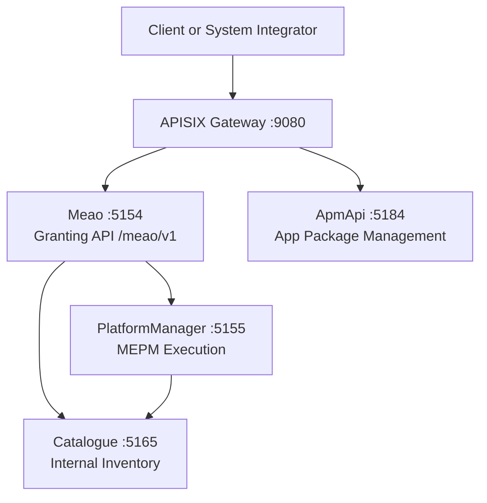
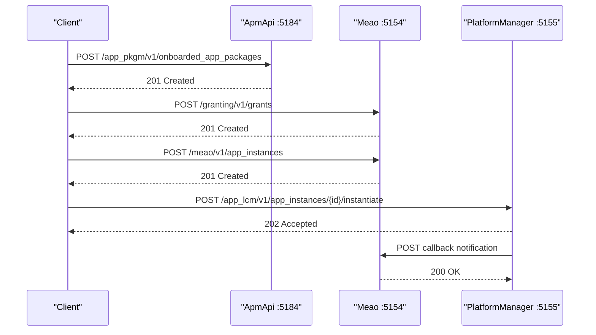
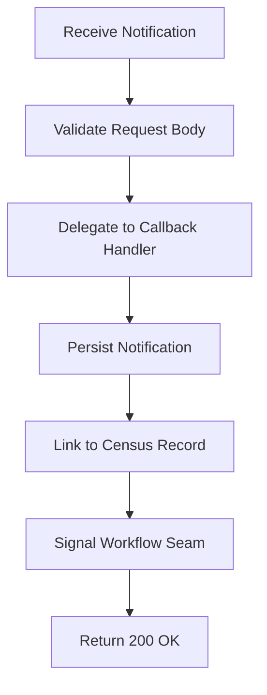
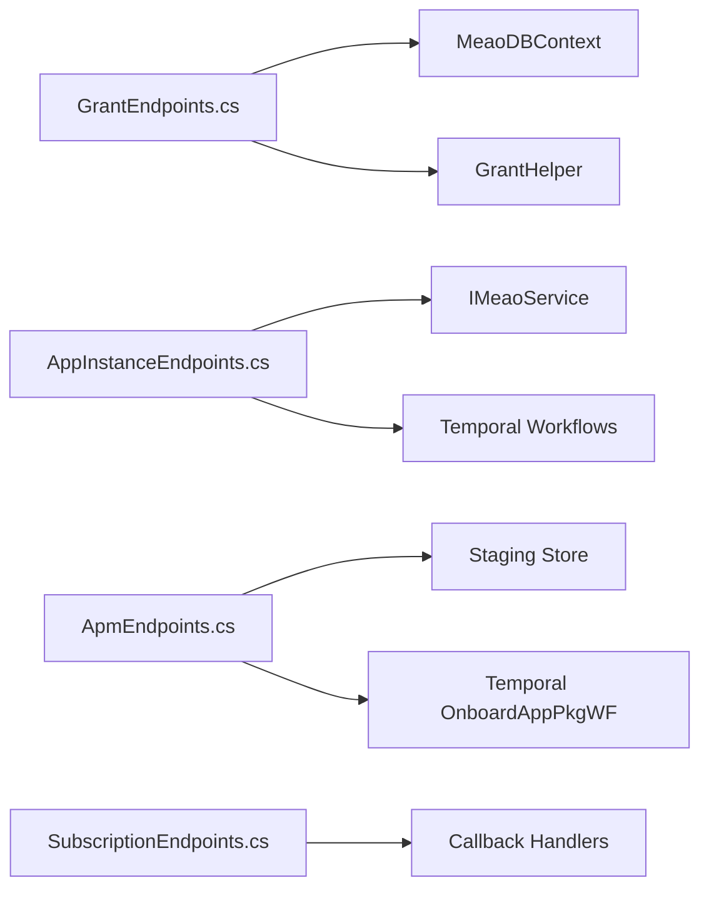

# API Reference

<cite>
**Referenced Files in This Document**
- `docs/API.md`
- `src/Meao/Endpoints/AppInstanceEndpoints.cs`
- `src/Meao/Endpoints/GrantEndpoints.cs`
- `src/Meao/Endpoints/AppInstanceInfoEndpoints.cs`
- `src/Meao/Endpoints/SubscriptionEndpoints.cs`
- `src/ApmApi/Endpoints/ApmEndpoints.cs`
- `src/Catalogue/Endpoints/MepmEndpoints.cs`
- `src/PlatformManager/PlatformManager/Endpoints/LcmEndpoint.cs`
- `src/PlatformManager/PlatformManager/Endpoints/AppInstanceEndpoints.cs`
- `src/PlatformManager/PlatformManager/Endpoints/LcmOpOccEndpoints.cs`
- `src/PlatformManager/PlatformManager/Endpoints/PlatformConfigEndpoints.cs`
- `src/PlatformManager/PlatformManager/Program.cs`
</cite>

## Table of Contents
1. [Introduction](#introduction)
2. [Project Structure](#project-structure)
3. [Core Components](#core-components)
4. [Architecture Overview](#architecture-overview)
5. [Detailed Component Analysis](#detailed-component-analysis)
6. [Dependency Analysis](#dependency-analysis)
7. [Performance Considerations](#performance-considerations)
8. [Troubleshooting Guide](#troubleshooting-guide)
9. [Conclusion](#conclusion)

## Introduction
This document is the public and internal API reference for Optimist.Orchestrator. It covers:

- ETSI GS MEC 010-2 compliant REST surfaces exposed by the MEO role, implemented by `Meao` (orchestration + Granting API) and `ApmApi` (App Package Management).
- The MEPM execution role surface exposed by `PlatformManager`, including `/app_lcm/v1/*` lifecycle endpoints and MEPM-local internal extensions.
- Internal service APIs exposed by `Catalogue`, which is a MEO backing store and not an ETSI-mandated API.
- Authentication via Keycloak JWT tokens, authorization model, error responses following RFC 7807 Problem Details, versioning strategy, and rate limiting characteristics.

The authoritative endpoint summary, request/response examples, authentication details, and error model are maintained in the repository’s generated API documentation.

**Section sources**
- `docs/API.md#L1-L120`

## Project Structure
Optimist.Orchestrator is a modular system with multiple services exposing different API namespaces:

| Service | Role | Public/internal surface | Default port |
|---|---|---|---|
| Meao | MEO orchestration, Granting API, MEO census and subscriptions | External (`/granting/v1/*`) and internal (`/meao/v1/*`) | 5154 |
| ApmApi | MEO package management | External (`/app_pkgm/v1/*`) | 5184 |
| PlatformManager | MEPM execution | External (`/app_lcm/v1/*`) and internal (`/mecHost`, `/app_lcm/v1/packages*`, `/app_lcm/v1/configs`) | 5155 |
| Catalogue | Internal MEO inventory | Internal (`/catalogue/v1/*`) | 5165 |



**Diagram sources**
- `docs/API.md#L12-L35`

**Section sources**
- `docs/API.md#L12-L120`

## Core Components
The API surface is organized around four main components:

1. **Granting API (`/granting/v1/grants`)** — produced by `Meao`. Consumers create grants that authorize resource placement before MEPM executes lifecycle operations.
2. **App Package Management (`/app_pkgm/v1/*`)** — produced by `ApmApi`. Consumers onboard CSAR packages, inspect descriptors, validate content, and subscribe to onboarding events.
3. **App Lifecycle Management (`/app_lcm/v1/*`)** — produced by `PlatformManager`. MEPM-side lifecycle operations such as instantiate, terminate, operate, and operation occurrence management.
4. **Internal APIs** — `/meao/v1/*` (MEO census and subscription records), `/catalogue/v1/*` (hosts, MEPMs, capacity, topology), and MEPM-local internal endpoints used during host-side setup.

Authentication is enforced through Keycloak JWT Bearer tokens. External traffic normally enters through APISIX, while MEO-to-MEPM lifecycle calls go directly to PlatformManager.

**Section sources**
- `docs/API.md#L12-L120`

## Architecture Overview
The end-to-end flow for app instantiation typically involves:

1. Onboard an app package through `ApmApi`.
2. Request a grant through `Meao`.
3. Create an application instance identity through `Meao`.
4. Instantiate the instance through `PlatformManager`.
5. Receive notifications through callback receivers registered on `Meao`.



**Diagram sources**
- `docs/API.md#L12-L120`
- `src/ApmApi/Endpoints/ApmEndpoints.cs#L1-L120`
- `src/Meao/Endpoints/GrantEndpoints.cs#L1-L63`
- `src/Meao/Endpoints/AppInstanceEndpoints.cs#L1-L120`

## Detailed Component Analysis

### Authentication and Authorization

#### Keycloak JWT Authentication
All services use Keycloak JWT Bearer authentication. Tokens are sent using the standard HTTP header:

```text
Authorization: Bearer <JWT>
```

Keycloak client configuration per service:

| Service | Port | Keycloak realm | Client |
|---|---|---|---|
| Meao | 5154 | `optimist` | `meao` |
| ApmApi | 5184 | `optimist` | `apm-api` |
| PlatformManager | 5155 | `optimist` | `platform-manager` |
| Catalogue | 5165 | `optimist` | `catalogue` |

External token acquisition is routed through APISIX at `/realms/optimist/protocol/openid-connect/token`. Admin routes under `/admin/*` remain private and unrouted.

#### Authorization Model
- Routes explicitly marked `.RequireAuthorization()` enforce authentication.
- PlatformManager and Catalogue use an authorization fallback policy requiring an authenticated user on all endpoints.
- Subscription callback receivers are protected because ETSI and ADR 0057 require OAuth 2.0 Bearer tokens for notification callbacks.

#### Rate Limiting
No rate limiting is configured in any service. There is no `AddRateLimiter` or `UseRateLimiter` usage, and no APISIX rate-limit configuration is present for this system. Clients must rely on Keycloak authentication and upstream service capacity.

#### curl Examples

Authenticate and list onboarded app packages:

```bash
curl -H "Authorization: Bearer $TOKEN" \
     http://localhost:5184/app_pkgm/v1/onboarded_app_packages
```

Create a grant:

```bash
curl -X POST -H "Authorization: Bearer $TOKEN" \
     -H "Content-Type: application/json" \
     --data '{
       "appInstanceId": "5c1f9a3e-0000-4b1a-9c2d-1f2e3d4c5b6a",
       "appLcmOpOccId": "7a2b8c9d-0000-4e2f-8a1b-2c3d4e5f6a7b",
       "appDId": "appd-mec-videometrics-01",
       "operation": "INSTANTIATE",
       "addResources": [
         {
           "id": "res-01",
           "type": "COMPUTE",
           "vduId": "vdu-01",
           "resourceTemplateId": "tmpl-01"
         }
       ],
       "_links": {
         "appInstance": { "href": "/app_lcm/v1/app_instances/5c1f9a3e-0000-4b1a-9c2d-1f2e3d4c5b6a" },
         "appLcmOpOcc": { "href": "/app_lcm/v1/app_lcm_op_occs/7a2b8c9d-0000-4e2f-8a1b-2c3d4e5f6a7b" }
       }
     }' \
     http://localhost:5154/granting/v1/grants
```

List MEAO census app instances:

```bash
curl -H "Authorization: Bearer $TOKEN" \
     http://localhost:5154/meao/v1/app_instances
```

**Section sources**
- `docs/API.md#L12-L120`
- `docs/API.md#L290-L321`

### Granting API — `/granting/v1/grants`

The Granting API is produced by `Meao` and consumed by MEPM. It authorizes resource placement before lifecycle execution.

#### POST `/granting/v1/grants`

Creates a grant.

- **Authentication:** Required via Keycloak JWT.
- **Request body:** `GrantRequest`.
- **Required fields:** `appInstanceId`, `appLcmOpOccId`, `appDId`, `operation`, `_links`.
- **Operation constraint:** Must be `INSTANTIATE`, `OPERATE`, or `TERMINATE`.
- **Instantiation constraint:** `addResources` must be non-empty when `operation` is `INSTANTIATE`.

| Status | Meaning |
|---|---|
| 201 Created | Grant created; response includes Location header pointing to `/granting/v1/grants/{id}` |
| 400 Bad Request | Validation failure or invalid argument |
| 401 Unauthorized | Missing or invalid JWT |
| 404 Not Found | Referenced resource not found |

Expected response schema:

```json
{
  "id": "g-9f8e7d6c",
  "appInstanceId": "5c1f9a3e-0000-4b1a-9c2d-1f2e3d4c5b6a",
  "appLcmOpOccId": "7a2b8c9d-0000-4e2f-8a1b-2c3d4e5f6a7b",
  "operation": "INSTANTIATE",
  "status": "GRANTED",
  "createdAt": "2026-09-09T12:00:00Z",
  "expiresAt": "2026-09-09T12:15:00Z",
  "vimConnections": [],
  "zones": [],
  "zoneGroups": [],
  "addResources": [
    { "resourceDefinitionId": "res-01", "vimConnectionId": "vim-k8s-01", "zoneId": "zone-01" }
  ],
  "tempResources": [],
  "removeResources": [],
  "updateResources": [],
  "extVirtualLinks": [],
  "_links": {}
}
```

Note: `status` is implementation-internal and not part of the ETSI Grant schema.

#### GET `/granting/v1/grants/{grantId}`

Reads an individual grant.

| Status | Meaning |
|---|---|
| 200 OK | Grant returned |
| 401 Unauthorized | Missing or invalid JWT |
| 404 Not Found | Unknown grant ID |

**Section sources**
- `src/Meao/Endpoints/GrantEndpoints.cs#L1-L63`
- `docs/API.md#L120-L200`

### App Package Management — `/app_pkgm/v1/*`

The App Package Management API is produced by `ApmApi`. It manages onboarded CSAR packages, descriptors, validation, image information, and subscriptions.

#### POST `/app_pkgm/v1/onboarded_app_packages`

Creates an app package record.

| Status | Meaning |
|---|---|
| 201 Created | Package record created |
| 400 Bad Request | Validation failure |
| 401 Unauthorized | Missing or invalid JWT |

Expected request body:

```json
{
  "appPkgName": "video-metrics",
  "appPkgPath": "packages/video-metrics.csar",
  "appPkgVersion": "1.0.0",
  "appProvider": "Acme",
  "checksum": { "algorithm": "SHA-256", "hash": "..." },
  "userDefinedData": {}
}
```

Constraints: `appPkgName`, `appPkgVersion`, and `checksum` are required.

#### PUT `/app_pkgm/v1/onboarded_app_packages/{appPkgId}/package_content`

Uploads CSAR package content as a form-encoded request.

Validation rules:

- Content type must be form data.
- Exactly one file is expected.
- File extension must be `.csar`.
- ZIP magic bytes must match supported PK headers.
- Total upload size is limited by `AppSettings:MaxUploadSize`, default 512 MB.
- `appPkgId` must be a valid UUID.

| Status | Meaning |
|---|---|
| 202 Accepted | Upload staged and onboarding workflow started |
| 400 Bad Request | Missing file, wrong extension, malformed UUID, or more than one file |
| 413 Payload Too Large | Upload exceeds server limit |
| 415 Unsupported Media Type | Not a valid CSAR archive |
| 404 Not Found | Package record not found |
| 503 Service Unavailable | Failed to start durable onboarding workflow |

Expected accepted response:

```json
{
  "appPkgId": "pkg-guid",
  "stagingId": "staging-id",
  "digest": "sha256-digest"
}
```

#### GET `/app_pkgm/v1/onboarded_app_packages/{appPkgId}/validate`

Validates a CSAR package.

| Status | Meaning |
|---|---|
| 200 OK | Validation result |
| 400 Bad Request | Missing `appPkgId` |
| 404 Not Found | CSAR file missing |
| 422 Unprocessable Entity | Multiple CSAR files or validation errors |

#### GET `/app_pkgm/v1/onboarded_app_packages/{appPkgId}/get_entry`

Extracts and returns a single entry from the package.

Security: path traversal checks reject `..` and rooted paths. If the extracted directory does not exist, it lazily extracts the CSAR into a temporary directory and atomically moves it into place.

| Status | Meaning |
|---|---|
| 200 OK | Entry definition returned |
| 400 Bad Request | Invalid `appPkgId` |
| 404 Not Found | Package content missing |
| 422 Unprocessable Entity | Archive extraction failed |

#### GET `/app_pkgm/v1/onboarded_app_packages/{appPkgId}/appd`

Returns the extracted AppD descriptor as YAML.

| Status | Meaning |
|---|---|
| 200 OK | YAML AppD descriptor |
| 400 Bad Request | Missing `appPkgId` |
| 404 Not Found | CSAR file not found |

#### GET `/app_pkgm/v1/onboarded_app_packages/{appPkgId}/get_imageInfo`

Returns software image names from persisted AppD descriptors, falling back to CSAR deserialization when not yet persisted.

| Status | Meaning |
|---|---|
| 200 OK | List of image names |
| 400 Bad Request | Missing or malformed `appPkgId` |
| 404 Not Found | CSAR file not found |

#### GET `/app_pkgm/v1/onboarded_app_packages/{appPkgId}/service_requirements`

Returns required services, optional services, and maximum latency from the AppD descriptor.

| Status | Meaning |
|---|---|
| 200 OK | Service requirements |
| 400 Bad Request | Missing or invalid UUID |
| 404 Not Found | App package not found |

#### Other App Package Endpoints

| Method | Path | Description | Notes |
|---|---|---|---|
| GET | `/app_pkgm/v1/onboarded_app_packages` | List onboarded app packages | Returns DTO list |
| GET | `/app_pkgm/v1/onboarded_app_packages/{appPkgId}` | Read app package record | Returns `AppPkgInfoDto` |
| DELETE | `/app_pkgm/v1/onboarded_app_packages/{appPkgId}` | Delete app package | Deletes record and local file |
| PATCH | `/app_pkgm/v1/onboarded_app_packages/{appPkgId}` | Update package operational state | State transition endpoint |
| GET | `/app_pkgm/v1/onboarded_app_packages/{appPkgId}/onboard` | Trigger onboarding | Triggers package onboarding |
| GET | `/app_pkgm/v1/onboarded_app_packages/{appPkgId}/package_details` | List package directory entries | Returns file names |
| GET | `/app_pkgm/v1/onboarded_app_packages/{appPkgId}/package_content` | Download package content | Returns octet stream |

#### App Package Subscriptions

| Method | Path | Description |
|---|---|---|
| POST | `/app_pkgm/v1/subscriptions` | Create package-management subscription |
| GET | `/app_pkgm/v1/subscriptions` | List package subscriptions |
| GET | `/app_pkgm/v1/subscriptions/{subscriptionId}` | Read a package subscription |
| DELETE | `/app_pkgm/v1/subscriptions/{subscriptionId}` | Delete a package subscription |

Expected subscription request body:

```json
{
  "callbackUri": "http://meao:5154/meao/v1/subscriptions/callbacks/app_pkg_onboarded",
  "subscriptionType": "AppPackageOnBoardingSubscription",
  "appPkgFilter": []
}
```

An empty `appPkgFilter` means “all packages”.

**Section sources**
- `src/ApmApi/Endpoints/ApmEndpoints.cs#L1-L493`
- `docs/API.md#L120-L200`

### App Lifecycle Management — `/app_lcm/v1/*`

The `/app_lcm/v1/*` surface is primarily produced by `PlatformManager`. According to the project architecture, LCM execution endpoints belong to MEPM, while MEO retains orchestration and read surfaces.

#### Application Instance Endpoints

| Method | Path | Description | Authentication |
|---|---|---|---|
| GET | `/app_lcm/v1/app_instances` | List application instances | Required |
| POST | `/app_lcm/v1/app_instances` | Create application instance resource | Required |
| GET | `/app_lcm/v1/app_instances/{appInstanceId}` | Read application instance | Required |
| DELETE | `/app_lcm/v1/app_instances/{appInstanceId}` | Delete application instance resource | Required |
| POST | `/app_lcm/v1/app_instances/{appInstanceId}/instantiate` | Instantiate the app | Required |
| POST | `/app_lcm/v1/app_instances/{appInstanceId}/terminate` | Terminate the app | Required |
| POST | `/app_lcm/v1/app_instances/{appInstanceId}/operate` | Change app operational state | Required |
| POST | `/app_lcm/v1/app_instances/{appInstanceId}/configure_platform_for_app` | Configure platform for the app | Required |

#### Operation Occurrence Endpoints

| Method | Path | Description |
|---|---|---|
| GET | `/app_lcm/v1/app_lcm_op_occs` | List lifecycle operation occurrences |
| GET | `/app_lcm/v1/app_lcm_op_occs/{appLcmOpOccId}` | Read an operation occurrence |
| POST | `/app_lcm/v1/app_lcm_op_occs/{appLcmOpOccId}/cancel` | Cancel an ongoing operation |
| POST | `/app_lcm/v1/app_lcm_op_occs/{appLcmOpOccId}/fail` | Mark an operation failed |
| POST | `/app_lcm/v1/app_lcm_op_occs/{appLcmOpOccId}/retry` | Retry a failed operation |

#### LCM Subscriptions

| Method | Path | Description |
|---|---|---|
| GET | `/app_lcm/v1/subscriptions` | List LCM subscriptions |
| GET | `/app_lcm/v1/subscriptions/{id}` | Read an LCM subscription |
| POST | `/app_lcm/v1/subscriptions` | Create LCM subscription |
| DELETE | `/app_lcm/v1/subscriptions/{id}` | Delete an LCM subscription |

Expected LCM subscription request body:

```json
{
  "subscriptionType": "AppLcmOpOccSubscription",
  "callbackUri": "http://meao:5154/meao/v1/subscriptions/callbacks/app_lcm_op_occ_state_change",
  "appInstanceId": "5c1f9a3e-0000-4b1a-9c2d-1f2e3d4c5b6a",
  "lifecycleNotificationTypes": ["AppLcmOpOccStateChange"],
  "operationTypes": ["INSTANTIATE"],
  "operationStates": ["COMPLETED", "FAILED"]
}
```

#### Operate Request Shape

The operate endpoint uses a request shape containing:

- `changeStateTo`
- `stopType`
- `gracefulStopTimeout`

These properties serialize in camelCase because the DTO does not use explicit ETSI property name mappings.

#### Instantiate Request Shape

The instantiate endpoint consumes orchestration fields beyond the strict ETSI wire contract:

- `appInstanceId`
- `appDId`
- `appPkgId`
- `appName`
- `hostIp`
- `grantId`
- `selectedMECHostInfo`
- `locationConstraints`
- `vimConnectionInfo`
- `virtualComputeDescriptor`
- `virtualStorageDescriptor`

#### Terminate Request Shape

Terminate requests follow an ETSI `TerminateAppRequest` shape with:

- `AppInstanceId`
- `HostIp`
- `AppDId`
- `TerminationType` (`FORCEFUL` or `GRACEFUL`)
- `GracefulTerminationTimeout`

#### Operation Occurrence Response Shape

Lifecycle operation occurrences return a camelCase object containing:

- `id`
- `appInstanceId`
- `lifecycleOperation`
- `operationState`
- `stateEnteredTime`
- `startTime`
- `endTime`
- `response`

**Section sources**
- `docs/API.md#L120-L290`
- `src/PlatformManager/PlatformManager/Endpoints/AppInstanceEndpoints.cs`
- `src/PlatformManager/PlatformManager/Endpoints/LcmOpOccEndpoints.cs`
- `src/PlatformManager/PlatformManager/Endpoints/PlatformConfigEndpoints.cs`

### MEO Internal APIs — `/meao/v1/*`

The `/meao/v1/*` surface on `Meao` is the MEO internal management API. It provides:

- App-instance census queries.
- MEO-side subscription records.
- Callback receivers for MEPM and ApmApi.

#### App Instance Census

| Method | Path | Description |
|---|---|---|
| GET | `/meao/v1/app_instances` | List all app instances from MEO census |
| GET | `/meao/v1/app_instances/{id}` | Get app instance by GUID |
| GET | `/meao/v1/AppInstanceInfo` | List `AppInstanceInfo` entities |
| GET | `/meao/v1/AppInstanceInfo/{id}` | Read `AppInstanceInfo` by id |
| PUT | `/meao/v1/AppInstanceInfo/{id}` | Update `AppInstanceInfo` |
| POST | `/meao/v1/AppInstanceInfo` | Create `AppInstanceInfo` |
| DELETE | `/meao/v1/AppInstanceInfo/{id}` | Delete `AppInstanceInfo` |

Query parameters for listing app instances include:

- `appInstanceId`
- `appDId`
- `appName`
- `instantiationState`

Validation behavior:

- Malformed `appInstanceId` query values return 400.
- Invalid `instantiationState` values return 400.
- Unknown instance IDs return 404.
- Temporal unreachability returns 503 during creation.

#### Subscription Management

| Method | Path | Description |
|---|---|---|
| GET | `/meao/v1/subscriptions` | List MEO-side LCM-op subscription records |
| GET | `/meao/v1/subscriptions/{id}` | Read a subscription record |
| POST | `/meao/v1/subscriptions` | Create a subscription record |
| DELETE | `/meao/v1/subscriptions/{id}` | Delete a subscription record |

#### Callback Receivers

| Method | Path | Description |
|---|---|---|
| POST | `/meao/v1/subscriptions/callbacks/app_lcm_op_occ_state_change` | MEPM → MEO callback receiver |
| POST | `/meao/v1/subscriptions/callbacks/app_pkg_onboarded` | APM → MEO onboarding completion callback |

Both callback receivers require OAuth 2.0 Bearer tokens and return a simple success payload after processing.



**Diagram sources**
- `src/Meao/Endpoints/SubscriptionEndpoints.cs#L1-L107`

**Section sources**
- `src/Meao/Endpoints/AppInstanceEndpoints.cs#L1-L200`
- `src/Meao/Endpoints/AppInstanceInfoEndpoints.cs#L1-L92`
- `src/Meao/Endpoints/SubscriptionEndpoints.cs#L1-L107`
- `docs/API.md#L120-L290`

### Internal Service APIs — `/catalogue/v1/*`

`Catalogue` is an internal MEO backing store for hosts, MEPMs, app instances, capacity, and topology. It is not an ETSI-mandated API.

#### MEPM Endpoints

| Method | Path | Description |
|---|---|---|
| GET | `/catalogue/v1/mepms` | List MEPM instances |
| GET | `/catalogue/v1/mepms/{mepm_ip}` | Read a MEPM instance |
| PUT | `/catalogue/v1/mepms/{mepm_ip}` | Update a MEPM instance |
| POST | `/catalogue/v1/mepms` | Register a MEPM instance |
| DELETE | `/catalogue/v1/mepms/{mepm_ip}` | Delete a MEPM instance |

Pagination supports `offset` and `limit`, with a maximum page size of 1000.

#### Host, App Instance, Topology, and Capacity Endpoints

Additional internal endpoints include:

- Edge host registration, retrieval, update, deletion, and filtering.
- App instance registration and lookup.
- Host service topology operations.
- Site and latency link operations.
- Capacity reservation and release.
- Resource inventory updates.

These endpoints support pagination, validation, and conflict handling where applicable.

**Section sources**
- `src/Catalogue/Endpoints/MepmEndpoints.cs#L1-L91`
- `docs/API.md#L120-L200`

### MEPM-Local Internal Extensions

The following endpoints are under `/app_lcm/v1` but are **not** part of ETSI GS MEC 010-2. They are implementation-internal extensions because `PlatformManager` doubles as the host-side package and configuration receiver.

| Method | Path | Description |
|---|---|---|
| POST | `/app_lcm/v1/packages` | Internal package upload |
| POST | `/app_lcm/v1/packages/{packageId}` | Internal package distribution to hosts |
| POST | `/app_lcm/v1/configs` | Internal platform configuration ingestion |
| GET | `/mecHost` | MEPM-internal host info relay |

Clients should not depend on these endpoints as stable ETSI contracts.

**Section sources**
- `docs/API.md#L120-L200`
- `src/PlatformManager/PlatformManager/Program.cs`

## Dependency Analysis



**Diagram sources**
- `src/Meao/Endpoints/GrantEndpoints.cs#L1-L63`
- `src/Meao/Endpoints/AppInstanceEndpoints.cs#L1-L120`
- `src/ApmApi/Endpoints/ApmEndpoints.cs#L1-L200`
- `src/Meao/Endpoints/SubscriptionEndpoints.cs#L1-L107`

Key dependencies:

- `GrantEndpoints` depends on database access and helper logic for creating grants.
- `AppInstanceEndpoints` delegates lifecycle workflows to `IMeaoService` and may interact with Temporal for distributed orchestration.
- `ApmEndpoints` stages CSAR uploads, validates archives, and starts a durable Temporal onboarding workflow.
- `SubscriptionEndpoints` persists subscription records and delegates callback notifications to typed handlers.

**Section sources**
- `src/Meao/Endpoints/GrantEndpoints.cs#L1-L63`
- `src/Meao/Endpoints/AppInstanceEndpoints.cs#L1-L120`
- `src/ApmApi/Endpoints/ApmEndpoints.cs#L1-L200`
- `src/Meao/Endpoints/SubscriptionEndpoints.cs#L1-L107`

## Performance Considerations

- App package upload uses a claim-check pattern: files are staged to persistent storage before starting the durable onboarding workflow.
- CSAR extraction is lazy and guarded by a per-package lock to avoid concurrent re-extraction.
- Query endpoints use `AsNoTracking()` where appropriate to reduce change-tracking overhead.
- Pagination is supported on several internal endpoints, with a hard cap of 1000 items.
- No rate limiting is configured, so high-throughput clients should implement their own backoff and retry logic.
- Background processing relies on Temporal workflows, making long-running operations asynchronous and resilient to restarts.

[No sources needed since this section provides general guidance]

## Troubleshooting Guide

### Error Model

All error responses follow RFC 7807 Problem Details. Errors are emitted through the global exception handler and validation filters.

Common status codes:

| Status | When | Notes |
|---|---|---|
| 400 Bad Request | Validation failures, malformed bodies, invalid parameters | Title often `Bad Request` or `Invalid Request` |
| 401 Unauthorized | Missing or invalid Keycloak JWT | Enforced by `.RequireAuthorization()` or fallback policy |
| 403 Forbidden | Authenticated but not authorized | |
| 404 Not Found | Unknown resource ID | |
| 409 Conflict | Concurrency conflicts, invalid transitions, duplicate resources | May include `code: CONCURRENCY_CONFLICT` |
| 413 Payload Too Large | Upload exceeds configured size limit | |
| 415 Unsupported Media Type | Wrong media type or invalid archive format | |
| 422 Unprocessable Entity | Validation or processing failure, such as invalid CSAR extraction | |
| 500 Internal Server Error | Unhandled exceptions | Detail sanitized; development may attach `exception` |
| 503 Service Unavailable | Temporal unreachable or workflow startup failure | |

Example problem response:

```json
{
  "type": "https://tools.ietf.org/html/rfc7231#section-6.5.8",
  "title": "Concurrency Conflict",
  "status": 409,
  "detail": "The requested resource was modified by another operation. Please retry with the latest version.",
  "instance": "/catalogue/v1/edge_hosts/10.0.0.11",
  "code": "CONCURRENCY_CONFLICT"
}
```

### Common Issues

- **CSAR upload fails with 415:** Check that the uploaded file is a ZIP-based CSAR and has a `.csar` extension.
- **CSAR upload fails with 413:** Reduce the package size or increase `AppSettings:MaxUploadSize`.
- **Get entry fails with 422:** The archive may be corrupted or contain disallowed content.
- **Grant creation fails with 404:** Verify that referenced `appInstanceId`, `appLcmOpOccId`, or related resources exist.
- **Lifecycle operation returns 503:** Temporal may be unreachable; retry after recovery.
- **Callback returns 401:** Ensure the caller sends a valid Keycloak JWT for the target service’s client.

**Section sources**
- `docs/API.md#L290-L321`

## Conclusion

Optimist.Orchestrator exposes three primary ETSI-aligned API families plus internal service APIs:

- `/granting/v1/grants` for granting resource placement.
- `/app_pkgm/v1/*` for app package onboarding, inspection, validation, and subscriptions.
- `/app_lcm/v1/*` for MEPM-side app lifecycle execution.
- Internal APIs under `/meao/v1/*`, `/catalogue/v1/*`, and MEPM-local internal endpoints.

Authentication is centralized through Keycloak JWT Bearer tokens. Authorization is enforced either through explicit route groups or service-level fallback policies. Errors are standardized using RFC 7807 Problem Details. There is no built-in rate limiting. Backwards compatibility should be treated carefully: ETSI-standard surfaces should preserve field names and semantics, while internal and MEPM-local extensions are implementation-specific and may evolve independently.

[No sources needed since this section summarizes without analyzing specific files]