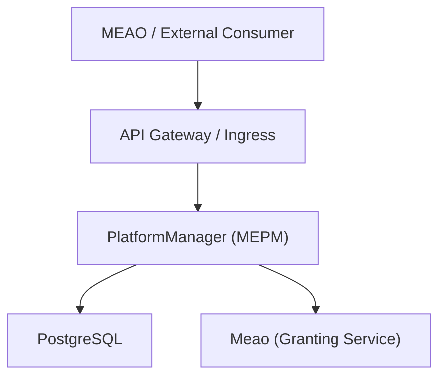
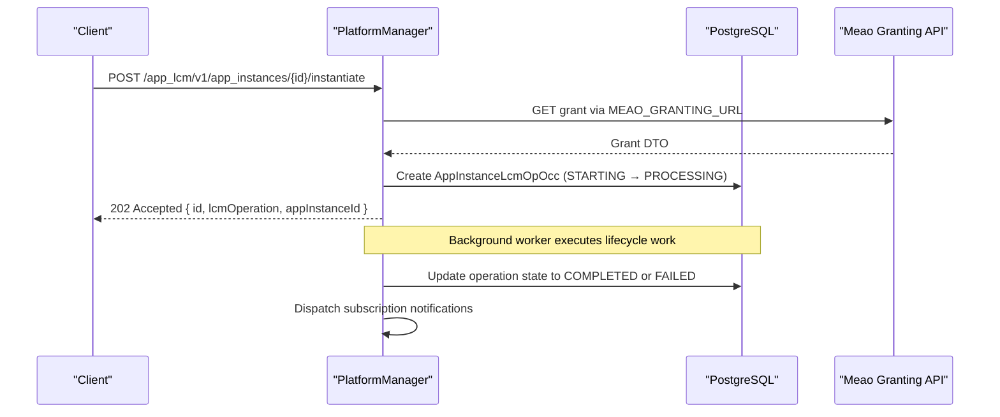
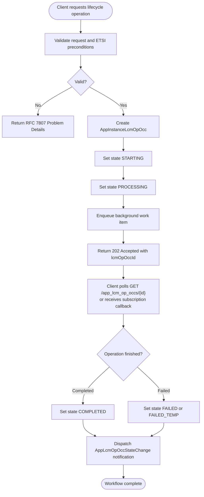
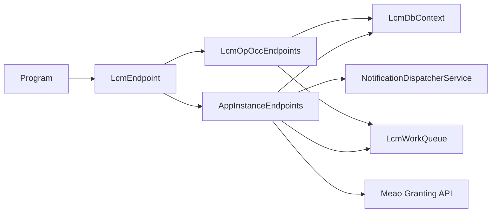

# ETSI App Lifecycle Management API

<cite>
**Referenced Files in This Document**   
- `src/PlatformManager/PlatformManager/Program.cs`
- `src/PlatformManager/PlatformManager/Endpoints/LcmEndpoint.cs`
- `src/PlatformManager/PlatformManager/Endpoints/AppInstanceEndpoints.cs`
- `src/PlatformManager/PlatformManager/Endpoints/LcmOpOccEndpoints.cs`
- `src/PlatformManager/PlatformManager/Models/AppInstance.cs`
- `src/PlatformManager/PlatformManager/Requests/SubscriptionRequestDto.cs`
- `src/PlatformManager/PlatformManager/Requests/TerminateRequest.cs`
- `docs/docs/ADR/0025-rfc7807-structured-error-model.md`
- `docs/docs/ADR/0032-keep-applcmopoccnotification-aligned-to-etsi-fields.md`
- `docs/docs/ADR/0059-etsi-subscription-callback-authentication-and-prefix-hardening.md`
</cite>

## Table of Contents
1. [Introduction](#introduction)
2. [Project Structure](#project-structure)
3. [Core Components](#core-components)
4. [Architecture Overview](#architecture-overview)
5. [Detailed Component Analysis](#detailed-component-analysis)
6. [Dependency Analysis](#dependency-analysis)
7. [Performance Considerations](#performance-considerations)
8. [Troubleshooting Guide](#troubleshooting-guide)
9. [Conclusion](#conclusion)

## Introduction
This document specifies the ETSI GS MEC 010-2 v3.1.1 App Lifecycle Management interface exposed by PlatformManager (MEPM) at `/app_lcm/v1`. It covers:

- **Application Instance Lifecycle**: `POST`, `GET`, `DELETE` on `/app_instances`; and POST sub-resources `instantiate`, `terminate`, `operate`.
- **Lifecycle Operation Occurrences**: GET list/read, and POST `cancel`, `fail`, `retry` on `/app_lcm_op_occs`.
- **Subscriptions**: POST, GET, DELETE on `/subscriptions`.

The service authenticates callers with Keycloak JWT Bearer tokens and returns structured RFC 7807 Problem Details for errors. Lifecycle operations are asynchronous: request endpoints return `202 Accepted` with an operation occurrence identifier, after which clients poll `/app_lcm_op_occs/{lcmOpOccId}` or receive subscription callbacks.

## Project Structure
PlatformManager is the MEPM that owns the standard ETSI App LCM management plane. The application entry point registers Keycloak authentication, problem details, background workers, and the `/app_lcm/v1` endpoint group. The group composes the three resource groups documented here.



**Diagram sources**
- `src/PlatformManager/PlatformManager/Program.cs#L1-L120`
- `src/PlatformManager/PlatformManager/Program.cs#L240-L329`
- `src/PlatformManager/PlatformManager/Endpoints/LcmEndpoint.cs#L20-L35`

**Section sources**
- `src/PlatformManager/PlatformManager/Program.cs#L1-L120`
- `src/PlatformManager/PlatformManager/Program.cs#L240-L329`
- `src/PlatformManager/PlatformManager/Endpoints/LcmEndpoint.cs#L20-L35`

## Core Components
- **`LcmEndpoint`** registers the `/app_lcm/v1` route group and composes Application Instance, Lifecycle Operation Occurrence, platform configuration, and Subscription endpoints.
- **`AppInstanceEndpoints`** implements the Application Instance resource and its lifecycle sub-resource operations.
- **`LcmOpOccEndpoints`** implements lifecycle operation occurrence listing, read, cancel, fail, and retry.
- **`AppInstance`** persists the ETSI `AppInstanceInfo` fields plus internal routing context (`HostIp`, `VimType`).
- **`SubscriptionRequestDto`** defines the subscription creation payload.
- **`TerminateRequest`** represents the termination request body; the implementation treats it as a no-body operation.

**Section sources**
- `src/PlatformManager/PlatformManager/Endpoints/LcmEndpoint.cs#L20-L35`
- `src/PlatformManager/PlatformManager/Endpoints/AppInstanceEndpoints.cs#L1-L120`
- `src/PlatformManager/PlatformManager/Endpoints/LcmOpOccEndpoints.cs#L1-L30`
- `src/PlatformManager/PlatformManager/Models/AppInstance.cs#L1-L72`
- `src/PlatformManager/PlatformManager/Requests/SubscriptionRequestDto.cs#L1-L14`
- `src/PlatformManager/PlatformManager/Requests/TerminateRequest.cs#L1-L6`

## Architecture Overview
The MEAO→MEPM boundary is important: instantiation requires MEAO grant verification before PlatformManager accepts the operation. Callback URIs registered through subscriptions are validated against DNS rebinding and private-address restrictions per ADR 0059. Notifications follow ETSI-aligned field naming per ADR 0032.



**Diagram sources**
- `src/PlatformManager/PlatformManager/Endpoints/AppInstanceEndpoints.cs#L201-L400`
- `src/PlatformManager/PlatformManager/Endpoints/AppInstanceEndpoints.cs#L400-L504`
- `src/PlatformManager/PlatformManager/Endpoints/LcmEndpoint.cs#L60-L120`

## Detailed Component Analysis

### Authentication and Error Model

| Aspect | Specification |
|---|---|
| **Authentication** | Keycloak JWT Bearer token. All `/app_lcm/v1` endpoints require authentication by default; `/health*` are explicitly allowed without auth. |
| **Authorization fallback** | Global fallback policy requires authenticated users. |
| **Error model** | RFC 7807 Problem Details. ADR 0025 and ADR 0034 add a `cause` extension populated from request context. |
| **Keycloak integration** | `AddKeycloakWebApiAuthentication` and `KeycloakServiceTokenHandler` for outbound MEAO calls. |

**Section sources**
- `src/PlatformManager/PlatformManager/Program.cs#L1-L40`
- `src/PlatformManager/PlatformManager/Program.cs#L120-L200`
- `src/PlatformManager/PlatformManager/Program.cs#L240-L329`
- `docs/docs/ADR/0025-rfc7807-structured-error-model.md`
- `docs/docs/ADR/0034-treat-problemdetails-cause-as-implementation-extension.md`

### Application Instance Lifecycle

#### Resource Group: `/app_instances`

| Method | URL Pattern | Request Body | Success Response | Notes |
|---|---|---|---|---|
| `GET` | `/app_lcm/v1/app_instances` | None | List of `AppInstance` records | Supports query parameters `offset` and `limit`; limit is capped at 1000. |
| `GET` | `/app_lcm/v1/app_instances/{appInstanceId}` | None | Single `AppInstance` | Returns `404 Not Found` when missing. |
| `POST` | `/app_lcm/v1/app_instances` | `AppInstance` | `201 Created` with location header and `AppInstance` | Sets initial `InstantiationState = NOT_INSTANTIATED`; auto-provisions CSAR digest from MEAO registry. |
| `DELETE` | `/app_lcm/v1/app_instances/{appInstanceId}` | None | `204 No Content` | Rejects deletion if instance is already `INSTANTIATED`. |

**ETSI field summary for `AppInstance`:**

| Field | Type | Required | Meaning |
|---|---|---:|---|
| `id` | string | Yes | Application instance identifier. Generated server-side if omitted. |
| `appDId` | string | Yes | App descriptor identifier. |
| `appSoftVersion` | string | Yes | Software version from AppD. |
| `appDVersion` | string | Yes | AppD version. |
| `appProvider` | string | Yes | Provider name. |
| `appPkgId` | string | Yes | Package reference. |
| `instantiationState` | string | Yes | `NOT_INSTANTIATED` or `INSTANTIATED`. |
| `instantiatedAppState` | string | Optional | `STARTED` or `STOPPED` when instantiated. |
| `appInstanceName` | string | Optional | Human-readable name. |
| `appInstanceDescription` | string | Optional | Human-readable description. |
| `hostIp` | string | Internal | MEC host IP used for VIM routing. |
| `vimType` | string | Internal | VIM routing context such as `k8s`. |

**Section sources**
- `src/PlatformManager/PlatformManager/Endpoints/AppInstanceEndpoints.cs#L1-L120`
- `src/PlatformManager/PlatformManager/Endpoints/AppInstanceEndpoints.cs#L201-L260`
- `src/PlatformManager/PlatformManager/Models/AppInstance.cs#L1-L72`

#### Sub-resource: `POST /app_instances/{appInstanceId}/instantiate`

| Item | Detail |
|---|---|
| **Purpose** | Start instantiation of an existing `NOT_INSTANTIATED` application instance. |
| **Request body** | `InstantiateAppRequestDto`. Required fields include `grantId`, `appPkgId`, and either `hostIp` or `selectedMECHostInfo`. |
| **Preconditions** | Instance must exist and not be `INSTANTIATED`; no active lifecycle operation may already be running. |
| **MEAO boundary** | Validates the grant via Meao granting API using `MEAO_GRANTING_URL`; forwards inbound Authorization header when calling MEAO. |
| **Success response** | `202 Accepted` with Location `/app_lcm/v1/app_lcm_op_occs/{lcmOpOccId}` and body containing `id`, `operationState`, `lifecycleOperation`, `appInstanceId`. |
| **Asynchronous workflow** | Creates `AppInstanceLcmOpOcc` in `STARTING`, transitions to `PROCESSING`, enqueues background work, then returns immediately. |
| **Failure handling** | On validation or precondition failure, returns RFC 7807 Problem Details. On unexpected exception, sets operation occurrence to `FAILED` and returns a `500` error with `cause = INTERNAL_ERROR`. |

**Concrete curl example:**

```bash
curl -X POST \
  --header "Authorization: Bearer <keycloak-jwt>" \
  --header "Content-Type: application/json" \
  --data '{
    "grantId": "<grant-id-from-meao>",
    "appPkgId": "<onboarded-csar-app-pkg-id>",
    "hostIp": "<mec-host-ip-or-null>",
    "selectedMECHostInfo": [
      {
        "hostIp": "<mec-host-ip-or-null>"
      }
    ]
  }' \
  "http://localhost:5155/app_lcm/v1/app_instances/<app-instance-id>/instantiate"
```

**Section sources**
- `src/PlatformManager/PlatformManager/Endpoints/AppInstanceEndpoints.cs#L260-L400`

#### Sub-resource: `POST /app_instances/{appInstanceId}/terminate`

| Item | Detail |
|---|---|
| **Purpose** | Terminate an instantiated application instance. |
| **Request body** | `TerminateAppRequestDto`; the current type has no required fields, so clients may send an empty JSON object. |
| **Preconditions** | Instance must exist and not be `NOT_INSTANTIATED`; no active lifecycle operation may already be running. |
| **VIM routing** | Uses persisted `inst.VimType`, falling back to `k8s`. |
| **Success response** | `202 Accepted` with Location and operation occurrence identifier. |
| **Failure handling** | RFC 7807 Problem Details on preconditions; unexpected exceptions set operation occurrence to `FAILED`. |

**Concrete curl example:**

```bash
curl -X POST \
  --header "Authorization: Bearer <keycloak-jwt>" \
  --header "Content-Type: application/json" \
  --data '{}' \
  "http://localhost:5155/app_lcm/v1/app_instances/<app-instance-id>/terminate"
```

**Section sources**
- `src/PlatformManager/PlatformManager/Endpoints/AppInstanceEndpoints.cs#L400-L504`
- `src/PlatformManager/PlatformManager/Requests/TerminateRequest.cs#L1-L6`

#### Sub-resource: `POST /app_instances/{appInstanceId}/operate`

| Item | Detail |
|---|---|
| **Purpose** | Change operational state between `STARTED` and `STOPPED`. |
| **Request body** | `OperateRequest` with field `changeStateTo`. The implementation uppercases the value. |
| **Preconditions** | Instance must be `INSTANTIATED`, have a valid `HostIp`, and have no active lifecycle operation. |
| **VIM routing** | Uses persisted `inst.VimType`, falling back to `k8s`. |
| **Success response** | `202 Accepted` with Location and operation occurrence identifier. |
| **Failure handling** | `409 Conflict` for invalid state or missing host; `500` with `cause = INTERNAL_ERROR` on unexpected failures. |

**Concrete curl example:**

```bash
curl -X POST \
  --header "Authorization: Bearer <keycloak-jwt>" \
  --header "Content-Type: application/json" \
  --data '{
    "changeStateTo": "STOPPED"
  }' \
  "http://localhost:5155/app_lcm/v1/app_instances/<app-instance-id>/operate"
```

**Section sources**
- `src/PlatformManager/PlatformManager/Endpoints/AppInstanceEndpoints.cs#L501-L607`

### Lifecycle Operation Occurrences

#### Resource Group: `/app_lcm_op_occs`

| Method | URL Pattern | Request Body | Success Response | Notes |
|---|---|---|---|---|
| `GET` | `/app_lcm/v1/app_lcm_op_occs` | None | Paginated list of operation occurrences | Ordered by `startTime` descending; supports `offset` and `limit` up to 1000. |
| `GET` | `/app_lcm/v1/app_lcm_op_occs/{appLcmOpOccId}` | None | Single operation occurrence | Includes `_links.self` and `_links.appInstance`. |
| `POST` | `/app_lcm/v1/app_lcm_op_occs/{appLcmOpOccId}/cancel` | None | `202 Accepted` | Only allowed when `operationState = PROCESSING`. |
| `POST` | `/app_lcm/v1/app_lcm_op_occs/{appLcmOpOccId}/fail` | None | `200 OK` | Only allowed when `operationState = FAILED_TEMP`. |
| `POST` | `/app_lcm/v1/app_lcm_op_occs/{appLcmOpOccId}/retry` | None | `202 Accepted` | Only allowed when `operationState = FAILED_TEMP`; re-enqueues the original work item. |

**Response shape for single operation occurrence:**

| Field | Type | Meaning |
|---|---|---|
| `id` | string | Operation occurrence identifier. |
| `operationState` | string | Current operation state. |
| `stateEnteredTime` | datetime | Time the current state was entered. |
| `startTime` | datetime | When the operation started. |
| `lifecycleOperation` | string | `INSTITUTE`, `TERMINATE`, or `OPERATE`. |
| `appInstanceId` | string | Associated application instance. |
| `endTime` | datetime | Present when the operation completed or failed. |
| `response` | string | Optional error or status message. |
| `_links.self` | object | Link to this operation occurrence. |
| `_links.appInstance` | object | Link to the related application instance. |

**Section sources**
- `src/PlatformManager/PlatformManager/Endpoints/LcmOpOccEndpoints.cs#L1-L163`

### Subscriptions

#### Resource Group: `/subscriptions`

| Method | URL Pattern | Request Body | Success Response | Notes |
|---|---|---|---|---|
| `GET` | `/app_lcm/v1/subscriptions` | None | List of subscriptions |
| `GET` | `/app_lcm/v1/subscriptions/{id}` | None | Single subscription |
| `POST` | `/app_lcm/v1/subscriptions` | `SubscriptionRequestDto` | `201 Created` with location | Validates callback URI security. |
| `DELETE` | `/app_lcm/v1/subscriptions/{id}` | None | `204 No Content` | Removes subscription. |

**`SubscriptionRequestDto` fields:**

| Field | Type | Required | Meaning |
|---|---|---:|---|
| `subscriptionType` | string | Yes | Event category; for App LCM this is `AppLcmOpOccStateChange`. |
| `callbackUri` | string | Yes | HTTP or HTTPS destination where notifications are posted. |
| `appInstanceId` | string | Optional | Scope to one application instance. |
| `appLcmOpOccId` | string | Optional | Scope to one lifecycle operation occurrence. |
| `lifecycleNotificationTypes` | array of strings | Optional | Filter on notification types. |
| `operationTypes` | array of strings | Optional | Filter on operation types. |
| `operationStates` | array of strings | Optional | Filter on operation states. |

**Callback URI security requirements (ADR 0059):**
- Must be an absolute HTTP or HTTPS URI.
- Hostname is resolved and every resolved address must be public unless `ALLOW_PRIVATE_CALLBACKS=true`.
- DNS rebinding is mitigated by rejecting non-public addresses.

**Section sources**
- `src/PlatformManager/PlatformManager/Endpoints/LcmEndpoint.cs#L35-L120`
- `src/PlatformManager/PlatformManager/Requests/SubscriptionRequestDto.cs#L1-L14`
- `docs/docs/ADR/0059-etsi-subscription-callback-authentication-and-prefix-hardening.md`

## Architecture Overview

### Asynchronous Workflow Pattern



**Diagram sources**
- `src/PlatformManager/PlatformManager/Endpoints/AppInstanceEndpoints.cs#L260-L400`
- `src/PlatformManager/PlatformManager/Endpoints/AppInstanceEndpoints.cs#L400-L504`
- `src/PlatformManager/PlatformManager/Endpoints/AppInstanceEndpoints.cs#L501-L607`
- `src/PlatformManager/PlatformManager/Endpoints/LcmEndpoint.cs#L60-L120`

### State Transitions

#### Instantiation State

| State | Meaning | Allowed Transitions |
|---|---|---|
| `NOT_INSTANTIATED` | Instance record exists but has not been instantiated. | Can transition to `INSTANTIATED` through successful instantiation. |
| `INSTANTIATED` | Instance is deployed and managed by a VIM. | Operational state changes apply; termination transitions back to `NOT_INSTANTIATED`. |

**Section sources**
- `src/PlatformManager/PlatformManager/Models/AppInstance.cs#L1-L72`
- `src/PlatformManager/PlatformManager/Endpoints/AppInstanceEndpoints.cs#L201-L260`

#### Instantiated Application State

| Field | Values | Constraint |
|---|---|---|
| `instantiatedAppState` | `STARTED`, `STOPPED` | Only meaningful when `instantiationState = INSTANTIATED`. |

**Section sources**
- `src/PlatformManager/PlatformManager/Models/AppInstance.cs#L1-L72`

#### Operation State

| State | Meaning | Transition Rules |
|---|---|---|
| `STARTING` | Operation record created; initial phase. | Transitioned to `PROCESSING` during instantiate/terminate processing. |
| `PROCESSING` | Background worker is executing the operation. | Can be cancelled to `FAILED_TEMP`; otherwise completes to `COMPLETED` or `FAILED`. |
| `COMPLETED` | Operation succeeded. | Terminal. |
| `FAILED` | Operation failed. | Terminal. |
| `FAILED_TEMP` | Temporary failure; allows recovery actions. | `retry` moves back to `PROCESSING`; `fail` moves to `FAILED`. |

**Section sources**
- `src/PlatformManager/PlatformManager/Endpoints/LcmOpOccEndpoints.cs#L30-L163`

## Dependency Analysis



**Diagram sources**
- `src/PlatformManager/PlatformManager/Program.cs#L240-L329`
- `src/PlatformManager/PlatformManager/Endpoints/LcmEndpoint.cs#L20-L35`
- `src/PlatformManager/PlatformManager/Endpoints/AppInstanceEndpoints.cs#L260-L400`
- `src/PlatformManager/PlatformManager/Endpoints/LcmOpOccEndpoints.cs#L1-L163`

**Section sources**
- `src/PlatformManager/PlatformManager/Program.cs#L240-L329`
- `src/PlatformManager/PlatformManager/Endpoints/LcmEndpoint.cs#L20-L35`

## Performance Considerations
- **Pagination limits**: Both `/app_instances` and `/app_lcm_op_occs` cap pagination at 1000 items. Clients should use `offset` and `limit` rather than requesting large result sets.
- **Background processing**: Lifecycle operations enqueue work items instead of blocking the HTTP handler. Consumers should implement polling with exponential backoff or subscribe to `AppLcmOpOccStateChange` notifications.
- **Database transactions**: Instantiate, terminate, and operate create operation occurrences inside database transactions to avoid inconsistent state when background processing fails.
- **MEAO grant lookup**: Instantiate validates the grant remotely; clients should handle network failures and transient MEAO errors.

[No sources needed since this section provides general guidance]

## Troubleshooting Guide

### Common HTTP Responses

| Status | Meaning | Typical Cause |
|---|---|---|
| `201 Created` | Application instance created. | Successful `POST /app_instances`. |
| `202 Accepted` | Asynchronous lifecycle operation accepted. | `instantiate`, `terminate`, `operate`, `cancel`, or `retry`. |
| `204 No Content` | Deletion or removal succeeded. | `DELETE /app_instances/{id}` or `DELETE /subscriptions/{id}`. |
| `400 Bad Request` | Invalid request, missing grant, expired grant, or invalid callback URI. | Grant mismatch, malformed body, disallowed callback scheme/host. |
| `404 Not Found` | Missing instance, operation occurrence, or subscription. | Unknown ID. |
| `409 Conflict` | State precondition violated. | Deleting instantiated instance, operating a non-instantiated instance, concurrent lifecycle operation, invalid cancel/fail/retry state. |
| `500 Internal Server Error` | Unexpected failure. | Exception during lifecycle processing; includes `cause = INTERNAL_ERROR`. |
| `503 Service Unavailable` | CSAR resolution failure or transient package provisioning issue. | CSAR digest resolution failed or race condition. |

### RFC 7807 Problem Details
Errors include at least `type`, `title`, `detail`, and optionally `instance`. The implementation adds a `cause` extension for machine-readable diagnostics.

**Section sources**
- `src/PlatformManager/PlatformManager/Program.cs#L60-L100`
- `docs/docs/ADR/0025-rfc7807-structured-error-model.md`
- `docs/docs/ADR/0034-treat-problemdetails-cause-as-implementation-extension.md`

### Diagnosing Operation Failures
1. Retrieve the operation occurrence:  
   `GET /app_lcm/v1/app_lcm_op_occs/{lcmOpOccId}`
2. Inspect `operationState`:
   - `PROCESSING`: Operation still running.
   - `FAILED_TEMP`: Retryable failure; call `POST /app_lcm_op_occs/{lcmOpOccId}/retry`.
   - `FAILED`: Terminal failure; call `POST /app_lcm_op_occs/{lcmOpOccId}/fail` only after cancel first.
   - `COMPLETED`: Operation succeeded.
3. Check `response` for human-readable error text.
4. If the operation was cancelled incorrectly, verify it was only attempted from `PROCESSING`.

**Section sources**
- `src/PlatformManager/PlatformManager/Endpoints/LcmOpOccEndpoints.cs#L60-L163`

### Subscription and Callback Issues
- Ensure `callbackUri` uses `http` or `https`.
- Confirm the hostname resolves to public addresses unless `ALLOW_PRIVATE_CALLBACKS=true`.
- Verify `subscriptionType` is `AppLcmOpOccStateChange` for lifecycle operation notifications.
- Notifications are dispatched for matching subscriptions scoped by `appInstanceId` and/or `appLcmOpOccId`.

**Section sources**
- `src/PlatformManager/PlatformManager/Endpoints/LcmEndpoint.cs#L60-L120`
- `docs/docs/ADR/0059-etsi-subscription-callback-authentication-and-prefix-hardening.md`
- `docs/docs/ADR/0032-keep-applcmopoccnotification-aligned-to-etsi-fields.md`

## Conclusion
PlatformManager exposes the ETSI App Lifecycle Management API at `/app_lcm/v1` with three clearly separated resource groups. Consumers authenticate with Keycloak JWTs, submit lifecycle operations asynchronously, and observe results through polling or subscription callbacks. Correct client behavior requires respecting ETSI-style state names, handling `202 Accepted` responses, avoiding concurrent operations on the same instance, and treating `FAILED_TEMP` as a recoverable intermediate state. Security-sensitive aspects—MEAO grant verification, callback URI hardening, and structured error reporting—are enforced at the PlatformManager boundary.

[No sources needed since this section summarizes without analyzing specific files]