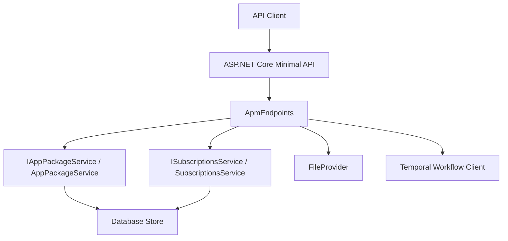
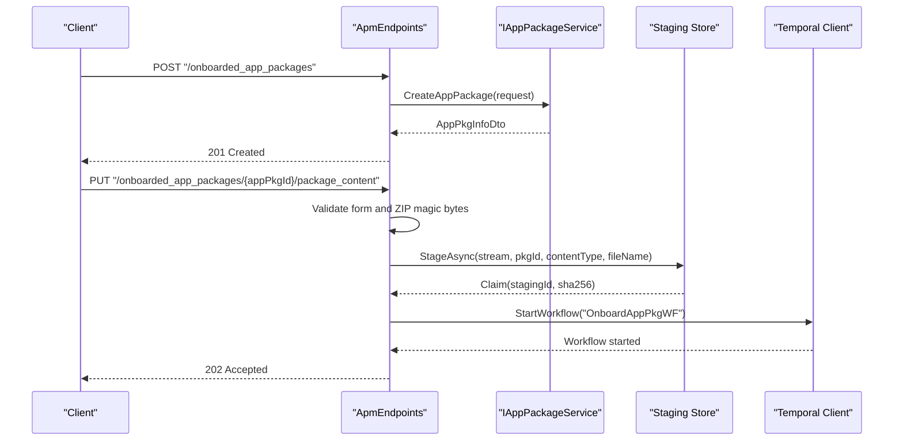
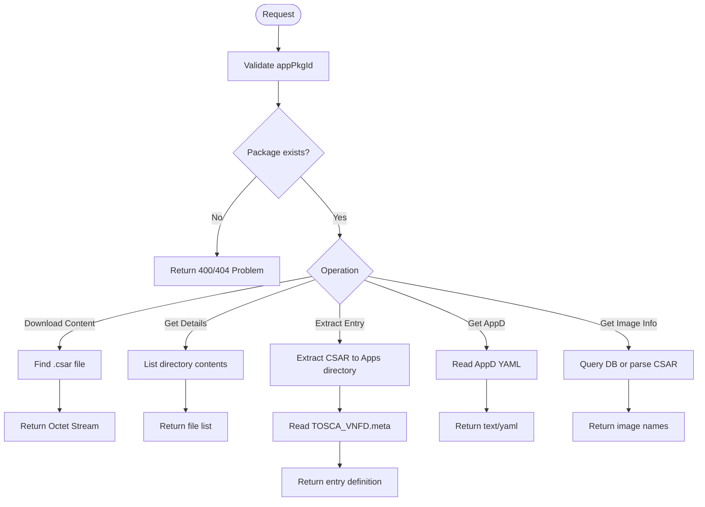
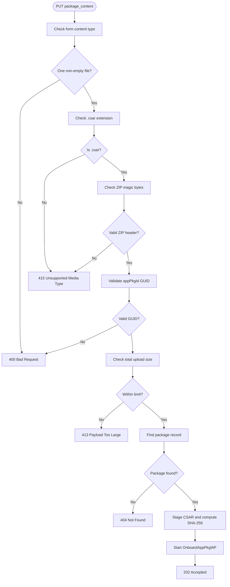
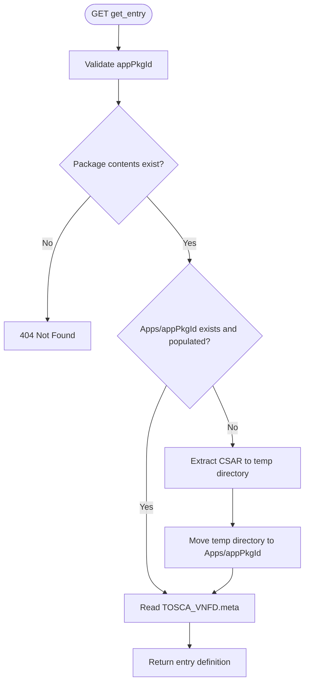
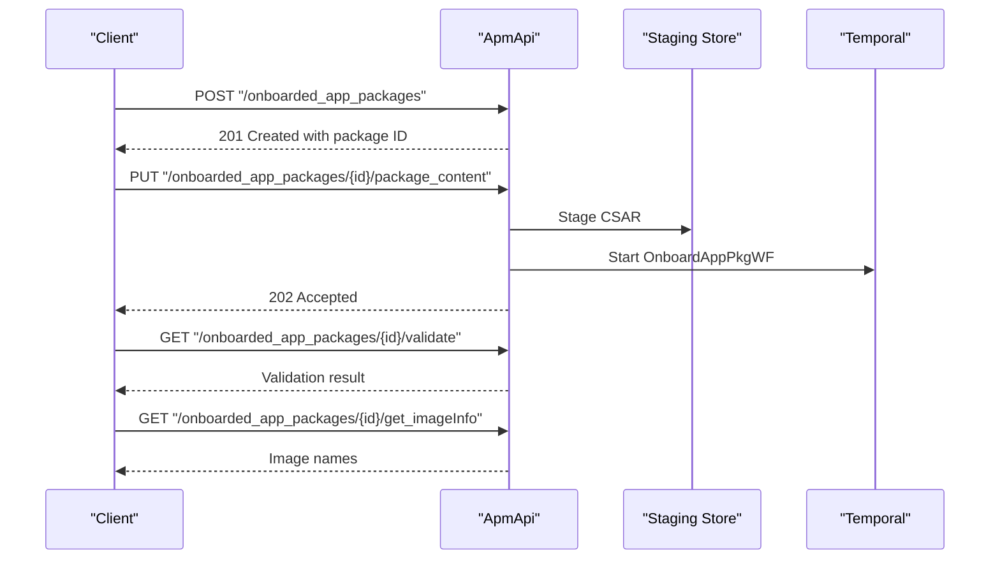
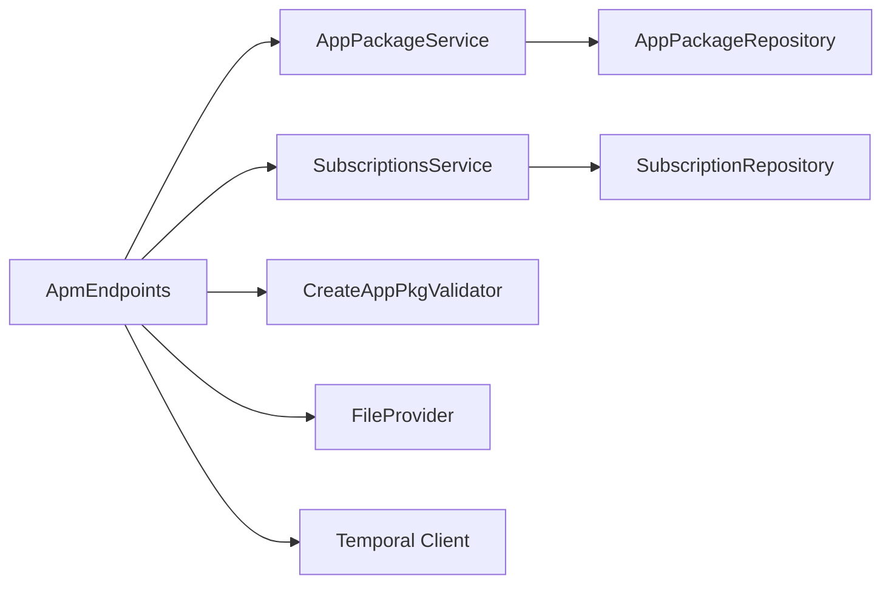

# ETSI App Package Management API

## Table of Contents
1. [Introduction](#introduction)
2. [Project Structure](#project-structure)
3. [Core Components](#core-components)
4. [Architecture Overview](#architecture-overview)
5. [Detailed Component Analysis](#detailed-component-analysis)
6. [Dependency Analysis](#dependency-analysis)
7. [Performance Considerations](#performance-considerations)
8. [Troubleshooting Guide](#troubleshooting-guide)
9. [Conclusion](#conclusion)

## Introduction
This document specifies the ETSI App Package Management interface exposed by `ApmApi`. The primary resource is `/app_pkgm/v1/onboarded_app_packages`, which manages onboarded CSAR-based application packages and their descriptors. It also documents subscription management at `/app_pkgm/v1/subscriptions` for asynchronous lifecycle notifications.

The API supports:
- CRUD operations for onboarded app packages.
- Two-phase onboarding: create a package record, then upload its CSAR content.
- CSAR validation and entry extraction.
- AppD descriptor retrieval and image information extraction.
- Operational state updates through PATCH endpoints defined by the service layer.
- Subscription creation and lifecycle notification delivery.

Authentication is required for all endpoints under `/app_pkgm/v1/onboarded_app_packages` because the endpoint group uses ASP.NET Core authorization. Subscription endpoints are validated against DTO validators and integration tests, indicating they participate in the same secured API surface.

**Section sources**
- `src/ApmApi/Endpoints/ApmEndpoints.cs#L1-L30`
- `docs/ETSI_SPECS/MEC01002_AppPkgMgmt.yaml`

## Project Structure
The APM API is implemented as an ASP.NET Core minimal API module inside the MEAO modular monolith. The key runtime components are:

- Endpoint definitions under `ApmEndpoints.cs`.
- Request models and DTOs for package metadata, subscriptions, and validation results.
- Service abstractions and implementations for package persistence and subscription handling.
- Validators for creating packages and subscription payloads.
- Integration tests that exercise validation, modernized endpoints, and subscription behavior.



**Diagram sources**
- `src/ApmApi/Endpoints/ApmEndpoints.cs#L10-L30`
- `src/ApmApi/Services/IAppPackageService.cs`
- `src/ApmApi/Services/ISubscriptionsService.cs`

**Section sources**
- `src/ApmApi/Endpoints/ApmEndpoints.cs#L1-L30`
- `src/ApmApi/Program.cs`

## Core Components
The core API surface is built around these responsibilities:

| Responsibility | Primary Implementation | Notes |
|---|---|---|
| Onboarded package listing, lookup, creation, deletion | `ApmEndpoints` with `IAppPackageService` | Uses `Results.Ok`, `Results.CreatedAtRoute`, `Results.Problem`. |
| CSAR upload and durable onboarding | `PUT /{appPkgId}/package_content` | Validates form data, ZIP magic bytes, staging store claim, and starts a Temporal workflow. |
| Package content download | `GET /{appPkgId}/package_content` | Returns the `.csar` file from the package directory. |
| Package details listing | `GET /{appPkgId}/package_details` | Lists files under the package directory. |
| Entry extraction | `GET /{appPkgId}/get_entry` | Extracts CSAR into an `Apps/{appPkgId}` directory and reads `TOSCA_VNFD.meta`. |
| AppD descriptor retrieval | `GET /{appPkgId}/appd` | Reads YAML from the CSAR. |
| Image information extraction | `GET /{appPkgId}/get_imageInfo` | Reads persisted software images or deserializes AppD from CSAR. |
| Validation | `GET /{appPkgId}/validate` | Validates exactly one CSAR and runs package validation rules. |
| Operational state update | PATCH-style service operations | Handled by package services; endpoint mapping should be reviewed when exposing new routes. |
| Subscription management | `SubscriptionsService` | Creates, queries, and manages subscriptions for async lifecycle events. |

**Section sources**
- `src/ApmApi/Endpoints/ApmEndpoints.cs#L30-L493`
- `src/ApmApi/Services/IAppPackageService.cs`
- `src/ApmApi/Services/SubscriptionsService.cs`

## Architecture Overview
The onboarding architecture follows a two-phase process:

1. **Record creation**: `POST /app_pkgm/v1/onboarded_app_packages` creates a package record and returns an `AppPkgInfoDto`.
2. **Content upload**: `PUT /app_pkgm/v1/onboarded_app_packages/{appPkgId}/package_content` uploads the CSAR, stages it, computes a digest, and starts a durable onboarding workflow.



**Diagram sources**
- `src/ApmApi/Endpoints/ApmEndpoints.cs#L30-L120`
- `src/ApmApi/Endpoints/ApmEndpoints.cs#L120-L200`

The package retrieval and processing paths read from persistent storage or temporary directories:



**Diagram sources**
- `src/ApmApi/Endpoints/ApmEndpoints.cs#L201-L493`

**Section sources**
- `src/ApmApi/Endpoints/ApmEndpoints.cs#L30-L493`

## Detailed Component Analysis

### Authentication and Authorization
All endpoints under `/app_pkgm/v1/onboarded_app_packages` require authorization because the route group calls `RequireAuthorization()`. Clients must include valid credentials according to the API gateway and authentication configuration.

- Authorization scope: entire `/app_pkgm/v1/onboarded_app_packages` group.
- Error responses use RFC 7807-style `ProblemDetails` objects for invalid input and missing resources.
- Configuration such as maximum upload size comes from application settings.

**Section sources**
- `src/ApmApi/Endpoints/ApmEndpoints.cs#L10-L30`
- `src/ApmApi/appsettings.json`

### Package Listing and Lookup

#### GET `/app_pkgm/v1/onboarded_app_packages`
- Purpose: List all onboarded app packages.
- Method: `GET`
- URL: `/app_pkgm/v1/onboarded_app_packages`
- Headers: `Accept: application/json`
- Authentication: Required
- Response: Array of `AppPkgInfoDto`
- Status codes:
  - `200 OK`: Successful listing.
  - `401 Unauthorized` or `403 Forbidden`: Authentication/authorization failure.

**Section sources**
- `src/ApmApi/Endpoints/ApmEndpoints.cs#L10-L40`

#### GET `/app_pkgm/v1/onboarded_app_packages/{appPkgId}`
- Purpose: Retrieve a single package by ID.
- Method: `GET`
- URL: `/app_pkgm/v1/onboarded_app_packages/{appPkgId}`
- Headers: `Accept: application/json`
- Authentication: Required
- Path parameter:
  - `appPkgId`: UUID string identifying the package.
- Response: `AppPkgInfoDto`
- Status codes:
  - `200 OK`: Package found.
  - `400 Bad Request`: Missing or empty `appPkgId`.
  - `404 Not Found`: Package does not exist.

**Section sources**
- `src/ApmApi/Endpoints/ApmEndpoints.cs#L40-L70`

### Package Creation

#### POST `/app_pkgm/v1/onboarded_app_packages`
- Purpose: Create a package record before uploading CSAR content.
- Method: `POST`
- URL: `/app_pkgm/v1/onboarded_app_packages`
- Headers: `Content-Type: application/json`, `Accept: application/json`
- Authentication: Required
- Request body: `CreateAppPkg` model, validated by `CreateAppPkgValidator`.
- Response: `AppPkgInfoDto`
- Status codes:
  - `201 Created`: Record created; response includes `Location` via `CreatedAtRoute`.
  - `400 Bad Request`: Invalid request payload.
  - `401 Unauthorized` or `403 Forbidden`: Authentication/authorization failure.

Validation requirements:
- The request model is strongly typed.
- Fluent validation is applied using `WithValidation<CreateAppPkg>()`.

**Section sources**
- `src/ApmApi/Endpoints/ApmEndpoints.cs#L70-L90`
- `src/ApmApi/Validators/CreateAppPkgValidator.cs`

### Package Deletion

#### DELETE `/app_pkgm/v1/onboarded_app_packages/{appPkgId}`
- Purpose: Remove a package record and associated local package file.
- Method: `DELETE`
- URL: `/app_pkgm/v1/onboarded_app_packages/{appPkgId}`
- Headers: `Accept: application/json`
- Authentication: Required
- Path parameter:
  - `appPkgId`: UUID string.
- Response: String containing the deleted package ID.
- Status codes:
  - `200 OK`: Package deleted.
  - `400 Bad Request`: Missing or empty `appPkgId`.
  - `404 Not Found`: Package does not exist.

Implementation notes:
- The endpoint deletes the package record through the service layer.
- It then removes the local package file path resolved by `ApmServiceHelper.GetLocalAppFilePath`.

**Section sources**
- `src/ApmApi/Endpoints/ApmEndpoints.cs#L90-L120`

### CSAR Upload and Download

#### PUT `/app_pkgm/v1/onboarded_app_packages/{appPkgId}/package_content`
- Purpose: Upload a CSAR archive for an existing package and start the durable onboarding workflow.
- Method: `PUT`
- URL: `/app_pkgm/v1/onboarded_app_packages/{appPkgId}/package_content`
- Headers:
  - `Content-Type: multipart/form-data`
  - `Accept: application/json`
- Authentication: Required
- Form fields:
  - Single file field containing a `.csar` archive.
- Path parameter:
  - `appPkgId`: UUID matching an existing package record.
- Request validation rules:
  - Must be a form-encoded request.
  - Exactly one non-empty file is required.
  - File extension must be `.csar`.
  - File must begin with valid ZIP magic bytes (`PK\x03\x04`, `PK\x05\x06`, or `PK\x07\x08`).
  - Total upload size must not exceed `AppSettings:MaxUploadSize`, defaulting to 512 MB.
  - `appPkgId` must be a valid GUID.
  - Only one CSAR file is allowed per upload.
- Processing flow:
  1. Validate content type and file presence.
  2. Validate `.csar` extension.
  3. Validate ZIP magic bytes.
  4. Validate GUID format.
  5. Enforce server-side max upload size.
  6. Resolve the existing package record.
  7. Stage the stream to a persistent staging store and compute SHA-256.
  8. Start the `OnboardAppPkgWF` Temporal workflow with a conflict policy terminating any existing workflow for the same ID.
- Response: `202 Accepted` with JSON containing:
  - `appPkgId`
  - `stagingId`
  - `digest`
- Status codes:
  - `202 Accepted`: Upload accepted and onboarding workflow started.
  - `400 Bad Request`: Missing file, wrong extension, invalid GUID, or malformed form.
  - `404 Not Found`: Package record not found.
  - `413 Payload Too Large`: Exceeds configured upload limit.
  - `415 Unsupported Media Type`: Not a `.csar` or invalid ZIP header.
  - `503 Service Unavailable`: Failed to start the onboarding workflow.



**Diagram sources**
- `src/ApmApi/Endpoints/ApmEndpoints.cs#L120-L200`

**Section sources**
- `src/ApmApi/Endpoints/ApmEndpoints.cs#L120-L200`

#### GET `/app_pkgm/v1/onboarded_app_packages/{appPkgId}/package_content`
- Purpose: Download the CSAR archive stored under the package directory.
- Method: `GET`
- URL: `/app_pkgm/v1/onboarded_app_packages/{appPkgId}/package_content`
- Headers: `Accept: application/octet-stream`
- Authentication: Required
- Path parameter:
  - `appPkgId`: UUID string.
- Response: Binary `.csar` file.
- Status codes:
  - `200 OK`: CSAR file returned.
  - `400 Bad Request`: Missing `appPkgId` or no package directory contents.
  - `404 Not Found`: No `.csar` file found under the package.

**Section sources**
- `src/ApmApi/Endpoints/ApmEndpoints.cs#L201-L240`

### Package Details and Entry Extraction

#### GET `/app_pkgm/v1/onboarded_app_packages/{appPkgId}/package_details`
- Purpose: List files under the package directory.
- Method: `GET`
- URL: `/app_pkgm/v1/onboarded_app_packages/{appPkgId}/package_details`
- Headers: `Accept: application/json`
- Authentication: Required
- Path parameter:
  - `appPkgId`: UUID string.
- Response: Array of file name strings.
- Status codes:
  - `200 OK`: File list returned.
  - `400 Bad Request`: Missing `appPkgId`.

**Section sources**
- `src/ApmApi/Endpoints/ApmEndpoints.cs#L201-L220`

#### GET `/app_pkgm/v1/onboarded_app_packages/{appPkgId}/get_entry`
- Purpose: Extract the CSAR archive and return the entry definition from `TOSCA_VNFD.meta`.
- Method: `GET`
- URL: `/app_pkgm/v1/onboarded_app_packages/{appPkgId}/get_entry`
- Headers: `Accept: application/json`
- Authentication: Required
- Path parameter:
  - `appPkgId`: UUID string.
- Behavior:
  - Rejects unsafe `appPkgId` values containing `..` or rooted paths.
  - Locates the `.csar` file under `app_packages/{appPkgId}`.
  - If the extracted directory under `Apps/{appPkgId}` does not exist or is empty, extracts the archive into a temporary directory and atomically moves it into place.
  - Reads `TOSCA_VNFD.meta` using `IApmService.GetEntryDefinition`.
- Response: Entry definition object.
- Status codes:
  - `200 OK`: Entry definition returned.
  - `400 Bad Request`: Invalid `appPkgId`.
  - `404 Not Found`: Package content not found.
  - `422 Unprocessable Entity`: Archive extraction rejected.



**Diagram sources**
- `src/ApmApi/Endpoints/ApmEndpoints.cs#L240-L310`

**Section sources**
- `src/ApmApi/Endpoints/ApmEndpoints.cs#L240-L310`

### AppD Descriptor and Image Information

#### GET `/app_pkgm/v1/onboarded_app_packages/{appPkgId}/appd`
- Purpose: Retrieve the AppD descriptor as YAML from the package’s CSAR.
- Method: `GET`
- URL: `/app_pkgm/v1/onboarded_app_packages/{appPkgId}/appd`
- Headers: `Accept: text/yaml`
- Authentication: Required
- Path parameter:
  - `appPkgId`: UUID string.
- Response: YAML text.
- Status codes:
  - `200 OK`: YAML returned.
  - `400 Bad Request`: Missing `appPkgId`.
  - `404 Not Found`: No CSAR file found for the package.

**Section sources**
- `src/ApmApi/Endpoints/ApmEndpoints.cs#L310-L340`

#### GET `/app_pkgm/v1/onboarded_app_packages/{appPkgId}/get_imageInfo`
- Purpose: Extract software image names from persisted AppD data or from the CSAR.
- Method: `GET`
- URL: `/app_pkgm/v1/onboarded_app_packages/{appPkgId}/get_imageInfo`
- Headers: `Accept: application/json`
- Authentication: Required
- Path parameter:
  - `appPkgId`: UUID string.
- Behavior:
  - First attempts to query the database for persisted `SwImageDescriptor` entries associated with the package.
  - If not found, falls back to deserializing the CSAR’s AppD descriptor.
- Response: Array of image name strings.
- Status codes:
  - `200 OK`: Image names returned.
  - `400 Bad Request`: Missing `appPkgId`.
  - `404 Not Found`: No CSAR file found for fallback parsing.

**Section sources**
- `src/ApmApi/Endpoints/ApmEndpoints.cs#L340-L390`

### Package Validation

#### GET `/app_pkgm/v1/onboarded_app_packages/{appPkgId}/validate`
- Purpose: Validate that the package contains exactly one CSAR and run package validation rules.
- Method: `GET`
- URL: `/app_pkgm/v1/onboarded_app_packages/{appPkgId}/validate`
- Headers: `Accept: application/json`
- Authentication: Required
- Path parameter:
  - `appPkgId`: UUID string.
- Validation rules:
  - Exactly one `.csar` file must exist under the package directory.
  - Each referenced CSAR must exist on disk.
  - `PackageValidator.ValidateCsarFileAsync` performs detailed validation.
- Response: Validation result object indicating validity and error messages.
- Status codes:
  - `200 OK`: Validation passed.
  - `400 Bad Request`: Missing `appPkgId`.
  - `404 Not Found`: CSAR package file not found.
  - `422 Unprocessable Entity`: Multiple CSAR files or validation errors.

Concrete curl example for validation:

```text
curl --location --request GET \
  "https://apm-api-host/app_pkgm/v1/onboarded_app_packages/<uuid>/validate" \
  --header "Authorization: Bearer <token>"
```

**Section sources**
- `src/ApmApi/Endpoints/ApmEndpoints.cs#L390-L493`
- `src/ApmApi/ApmApi.Tests/Integration/ApmValidationIntegrationTests.cs`

### Operational State Updates
Operational state updates are part of the package lifecycle managed by the APM service layer. The current endpoint implementation shows explicit GET, POST, PUT, and DELETE handlers, while PATCH-style operational state updates are primarily represented through service abstractions and related models. When exposing PATCH endpoints for operational state, ensure:

- The route group remains authorized.
- The request model matches the expected operational state enum.
- The service validates the transition and persists the new state.
- Errors follow the same RFC 7807 `ProblemDetails` pattern.

**Section sources**
- `src/ApmApi/Services/IAppPackageService.cs`
- `src/ApmApi/Services/AppPackageService.cs`

### Subscription Management

#### Overview
Subscription endpoints live under `/app_pkgm/v1/subscriptions` and support asynchronous notifications about package lifecycle events. They use DTOs and validators to enforce request structure.

Key behaviors:
- Subscription requests are validated by `AppPkgSubscriptionDtoValidator`.
- Subscription logic is implemented by `SubscriptionsService` behind `ISubscriptionsService`.
- Integration tests verify subscription routing, authentication, and behavior.

Typical subscription operations include:
- Creating subscriptions for package lifecycle events.
- Managing subscription status and filters.
- Delivering callbacks to client-provided URIs.

Authentication:
- Subscription endpoints are part of the secured API surface and should be accessed with valid credentials.

**Section sources**
- `src/ApmApi/Validators/AppPkgSubscriptionDtoValidator.cs`
- `src/ApmApi/Services/ISubscriptionsService.cs`
- `src/ApmApi/Services/SubscriptionsService.cs`
- `src/ApmApi/ApmApi.Tests/Integration/SubscriptionIntegrationTests.cs`

Concrete curl example for subscription creation:

```text
curl --location --request POST \
  "https://apm-api-host/app_pkgm/v1/subscriptions" \
  --header "Content-Type: application/json" \
  --header "Authorization: Bearer <token>" \
  --data '{
    "subscriptionName": "example-package-subscription",
    "callbackUri": "https://consumer.example.com/callback",
    "filter": {
      "eventType": "ONBOARDED_APP_PACKAGE_CREATED",
      "resourceIds": ["<uuid>"]
    }
  }'
```

Note: Adjust the subscription payload fields to match the actual DTO schema used by `AppPkgSubscriptionDtoValidator` and `SubscriptionsService`.

### Concrete CSAR Upload Workflow
The recommended two-phase workflow is:

1. Create the package record.
2. Upload the CSAR.
3. Optionally validate the package.
4. Retrieve package details, entry, AppD, or image information.
5. Use subscriptions to receive asynchronous lifecycle notifications.



**Diagram sources**
- `src/ApmApi/Endpoints/ApmEndpoints.cs#L70-L200`
- `src/ApmApi/Endpoints/ApmEndpoints.cs#L340-L493`

Concrete curl examples:

- Create package record:
```text
curl --location --request POST \
  "https://apm-api-host/app_pkgm/v1/onboarded_app_packages" \
  --header "Content-Type: application/json" \
  --header "Authorization: Bearer <token>" \
  --data '<CreateAppPkg JSON payload>'
```

- Upload CSAR:
```text
curl --location --request PUT \
  "https://apm-api-host/app_pkgm/v1/onboarded_app_packages/<uuid>/package_content" \
  --header "Authorization: Bearer <token>" \
  --form 'file=@"/path/to/package.csar"'
```

- Validate package:
```text
curl --location --request GET \
  "https://apm-api-host/app_pkgm/v1/onboarded_app_packages/<uuid>/validate" \
  --header "Authorization: Bearer <token>"
```

**Section sources**
- `src/ApmApi/Endpoints/ApmEndpoints.cs#L70-L200`
- `src/ApmApi/Endpoints/ApmEndpoints.cs#L390-L493`

## Dependency Analysis
The APM API depends on several runtime services:



**Diagram sources**
- `src/ApmApi/Endpoints/ApmEndpoints.cs#L10-L30`
- `src/ApmApi/Services/IAppPackageService.cs`
- `src/ApmApi/Services/ISubscriptionsService.cs`

Coupling characteristics:
- Endpoints are tightly coupled to request/response models and service abstractions.
- CSAR upload couples endpoint logic with staging storage and Temporal workflows.
- Descriptor and image information endpoints couple file access, database queries, and AppD deserialization.
- Subscription endpoints depend on DTO validators and subscription services.

Potential circular dependencies:
- None are obvious from the endpoint layer; dependencies flow from endpoints to services, repositories, and external clients.

External integration points:
- Temporal workflow engine for durable onboarding.
- File provider for package directories.
- Database context for package, AppD, and subscription persistence.
- Application configuration for upload limits and other settings.

**Section sources**
- `src/ApmApi/Endpoints/ApmEndpoints.cs#L10-L200`
- `src/ApmApi/Services/IAppPackageService.cs`
- `src/ApmApi/Services/ISubscriptionsService.cs`

## Performance Considerations
- CSAR uploads are staged before starting the onboarding workflow, reducing risk and enabling claim-check patterns.
- ZIP magic byte checks avoid unnecessary processing of invalid archives.
- Server-side upload size limits protect memory and storage.
- Directory extraction for `get_entry` uses a temporary directory and atomic move to reduce partial state exposure.
- Image information retrieval prefers persisted database data to avoid repeated CSAR parsing.

Recommendations:
- Monitor staging store throughput and retention policies.
- Tune `AppSettings:MaxUploadSize` based on expected CSAR sizes.
- Cache frequently accessed package metadata where appropriate.
- Avoid synchronous blocking I/O in high-throughput scenarios.

[No sources needed since this section provides general guidance]

## Troubleshooting Guide
Common issues and resolutions:

| Symptom | Likely Cause | Resolution |
|---|---|---|
| `400 Bad Request` on package lookup | Missing or empty `appPkgId` | Ensure the path parameter is present and non-empty. |
| `404 Not Found` on content download | No `.csar` file under the package directory | Complete the upload phase and confirm staging succeeded. |
| `415 Unsupported Media Type` | Uploaded file is not `.csar` or has invalid ZIP header | Verify the uploaded file is a valid CSAR ZIP archive. |
| `413 Payload Too Large` | Upload exceeds configured limit | Reduce archive size or increase `AppSettings:MaxUploadSize`. |
| `422 Unprocessable Entity` on validation | Multiple CSAR files or validation errors | Ensure exactly one CSAR and fix descriptor/validation issues. |
| `503 Service Unavailable` after upload | Temporal workflow start failed | Check Temporal availability and retry the upload; staged claim may be abandoned. |
| Subscription callback failures | Invalid callback URI or consumer errors | Validate DNS resolution and consumer endpoint availability. |

Error responses generally follow RFC 7807 `ProblemDetails` semantics, including `title`, `detail`, and HTTP status code.

**Section sources**
- `src/ApmApi/Endpoints/ApmEndpoints.cs#L30-L200`
- `src/ApmApi/Endpoints/ApmEndpoints.cs#L201-L493`

## Conclusion
The ETSI App Package Management API provides a robust, two-phase onboarding flow backed by durable workflows, strict CSAR validation, and rich descriptor inspection capabilities. Clients should create a package record, upload exactly one valid CSAR, and then consume package details, entry definitions, AppD descriptors, and image information as needed. Subscription endpoints enable asynchronous lifecycle monitoring. Proper authentication, content-type handling, and error interpretation are essential for reliable integration.

[No sources needed since this section summarizes without analyzing specific files]

> **Referenced Files in This Document**
>
> - `src/ApmApi/Endpoints/ApmEndpoints.cs`
> - `src/ApmApi/Validators/CreateAppPkgValidator.cs`
> - `src/ApmApi/Validators/AppPkgSubscriptionDtoValidator.cs`
> - `src/ApmApi/Services/IAppPackageService.cs`
> - `src/ApmApi/Services/AppPackageService.cs`
> - `src/ApmApi/Services/ISubscriptionsService.cs`
> - `src/ApmApi/Services/SubscriptionsService.cs`
> - `src/ApmApi/Services/IOnboardedPackageStore.cs`
> - `src/ApmApi/Program.cs`
> - `src/ApmApi/appsettings.json`
> - `src/ApmApi/ApmApi.Tests/Integration/ApmValidationIntegrationTests.cs`
> - `src/ApmApi/ApmApi.Tests/Integration/EndpointModernizationIntegrationTests.cs`
> - `src/ApmApi/ApmApi.Tests/Integration/SubscriptionIntegrationTests.cs`
> - `docs/ETSI_SPECS/MEC01002_AppPkgMgmt.yaml`
