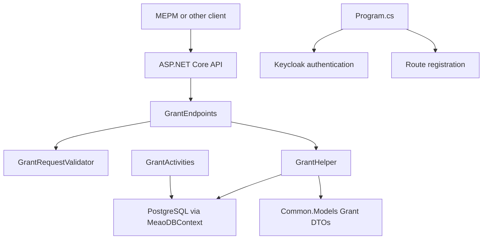
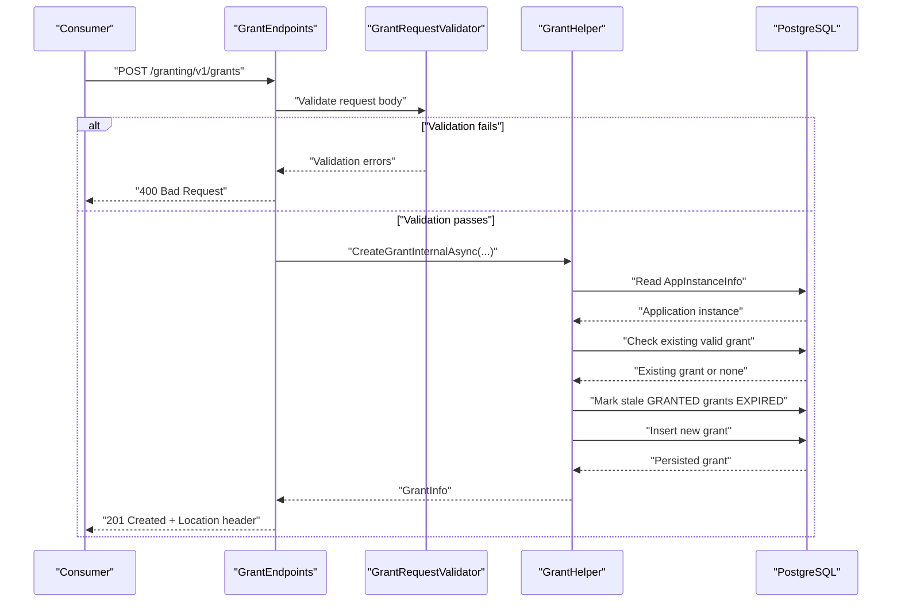
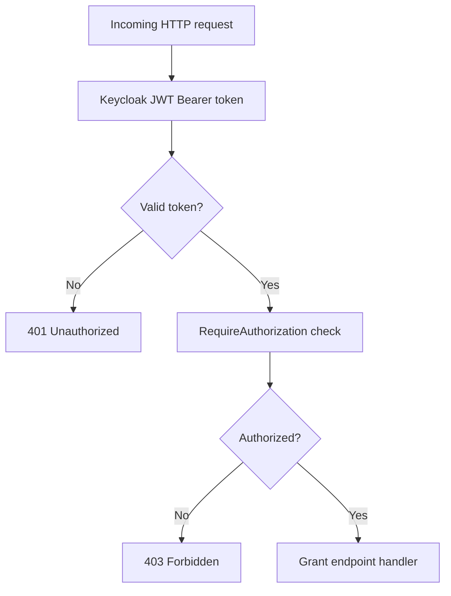
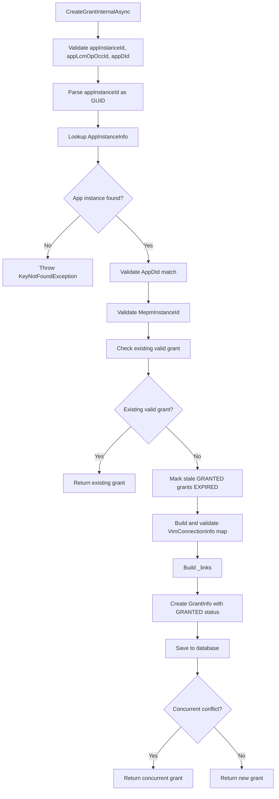
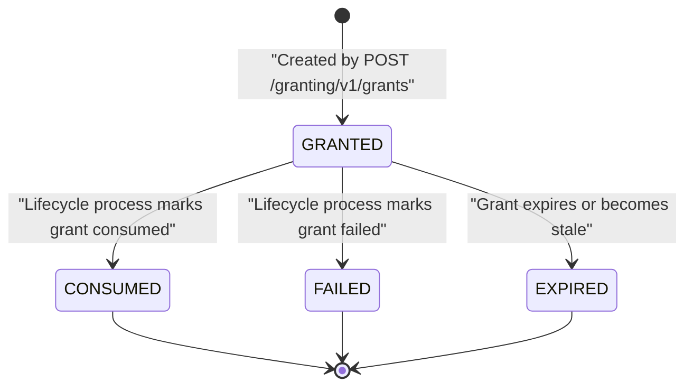
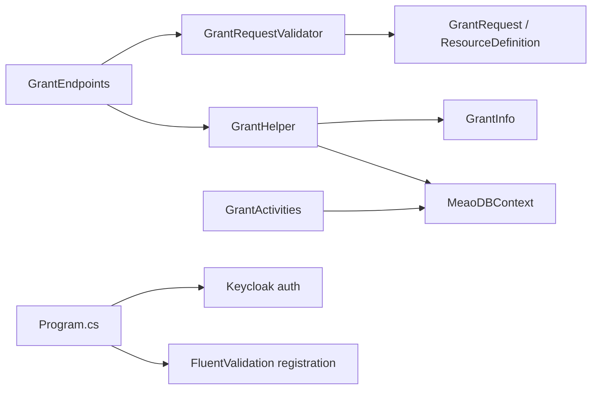

# ETSI Granting API

## Table of Contents
1. [Introduction](#introduction)
2. [Project Structure](#project-structure)
3. [Core Components](#core-components)
4. [Architecture Overview](#architecture-overview)
5. [Detailed Component Analysis](#detailed-component-analysis)
6. [Dependency Analysis](#dependency-analysis)
7. [Performance Considerations](#performance-considerations)
8. [Troubleshooting Guide](#troubleshooting-guide)
9. [Conclusion](#conclusion)

## Introduction
This document describes the ETSI MEC 010-2 Granting API exposed by Meao at `/granting/v1/grants`. It explains how a consumer such as MEPM requests authorization to allocate VIM resources before an application lifecycle operation, and how Meao responds with grants that carry approved resource definitions, VIM connections, zones, and links.

At a high level:
- The POST endpoint creates a grant for a requested lifecycle operation.
- The GET endpoint retrieves a previously created grant by its identifier.
- The request model follows the ETSI `GrantRequest` schema, with Meao validation enforcing required fields and operation-specific constraints.
- The response model extends the ETSI `Grant` schema with an implementation-internal `status` field whose values are `GRANTED`, `CONSUMED`, `EXPIRED`, and `FAILED`.
- Authentication is performed through Keycloak JWT Bearer tokens.
- Errors use RFC 7807 Problem Details.

The granting phase sits between a lifecycle operation occurrence and actual VIM provisioning: Meao validates the request, associates it with an existing application instance and application descriptor, records approval metadata, and exposes the resulting grant so downstream consumers can provision or consume resources accordingly.

## Project Structure
The granting feature is implemented primarily in the Meao service, with shared data contracts in the Common models layer and OpenAPI specifications under documentation.



**Diagram sources**
- `src/Meao/Endpoints/GrantEndpoints.cs#L12-L61`
- `src/Meao/Validators/GrantRequestValidator.cs#L8-L82`
- `src/Meao/Utils/GrantHelper.cs#L18-L151`
- `src/Meao/Activities/GrantActivities.cs#L12-L66`
- `src/Meao/Program.cs#L36-L56`

**Section sources**
- `src/Meao/Endpoints/GrantEndpoints.cs#L12-L61`
- `src/Meao/Program.cs#L36-L56`

## Core Components
| Component | Responsibility | Key details |
|---|---|---|
| `GrantEndpoints` | HTTP routes for `/granting/v1/grants` | POST creates grants; GET reads grants; both require authorization |
| `GrantRequestValidator` | FluentValidation rules for incoming requests | Enforces required fields, allowed operations, non-empty instantiation resources, and link structure |
| `GrantHelper` | Business logic for creating grants | Validates application instance ownership, detects duplicate or stale grants, persists grants, sets expiry |
| `GrantActivities` | Background workflow activities | Marks grants consumed or failed during lifecycle processing |
| `GrantInfo` | Internal persistence model | Stores status, timestamps, resource requirements, approved VIM connections, and JSON payloads |
| Shared DTOs | Wire contract types | `GrantRequest`, `ResourceDefinition`, `GrantDto`, link objects |
| ETSI spec | External contract baseline | Defines `GrantRequest`, `Grant`, `ResourceDefinition`, and related schemas |

**Section sources**
- `src/Meao/Endpoints/GrantEndpoints.cs#L12-L61`
- `src/Meao/Validators/GrantRequestValidator.cs#L8-L82`
- `src/Meao/Utils/GrantHelper.cs#L18-L151`
- `src/Meao/Models/GrantInfo.cs#L15-L48`
- `src/Common/Models/GrantDtos.cs#L11-L120`
- `src/Common/Models/SupportModels.cs#L82-L123`

## Architecture Overview
The granting flow is synchronous from the HTTP perspective: a POST returns immediately with a created grant when validation and persistence succeed. The overall ETSI lifecycle may still be asynchronous, but the granting endpoint itself does not return `202 Accepted` for grant creation.



**Diagram sources**
- `src/Meao/Endpoints/GrantEndpoints.cs#L22-L47`
- `src/Meao/Validators/GrantRequestValidator.cs#L8-L82`
- `src/Meao/Utils/GrantHelper.cs#L23-L151`

## Detailed Component Analysis

### Endpoint Definition
The granting API is registered under `/granting/v1/grants` with tag `Grant` and requires authorization.

| Method | Path | Description | Success Response | Error Responses |
|---|---|---|---|---|
| `POST` | `/granting/v1/grants` | Create a grant for an application lifecycle operation | `201 Created` with grant body and `Location` header | `400`, `404` based on validation or lookup failures |
| `GET` | `/granting/v1/grants/{grantId}` | Retrieve a previously created grant | `200 OK` with grant body | `404 Not Found` if the grant does not exist |

Implementation notes:
- POST delegates creation to `GrantHelper.CreateGrantInternalAsync`.
- POST returns `Results.Created` with a URL built from the generated grant ID.
- GET uses Entity Framework to look up a grant by primary key.
- Both endpoints rely on ASP.NET Core authorization via `RequireAuthorization`.

**Section sources**
- `src/Meao/Endpoints/GrantEndpoints.cs#L12-L61`

### Authentication and Authorization
Authentication is configured through Keycloak Web API authentication. Requests must include a valid JWT Bearer token obtained from the configured Keycloak realm.

Configuration highlights:
- Realm: `optimist`
- Server URL: `http://localhost:8180/`
- Resource name: `meao`
- Token audience verification is disabled in the shown configuration.
- Authorization is enabled globally for the granting group.



**Diagram sources**
- `src/Meao/Program.cs#L36-L56`
- `src/Meao/Endpoints/GrantEndpoints.cs#L17-L18`
- `src/Meao/appsettings.json#L12-L25`

**Section sources**
- `src/Meao/Program.cs#L36-L56`
- `src/Meao/appsettings.json#L12-L25`

### Grant Request Model
The request model is `GrantRequest`, which inherits from `GrantRequestDto` in the shared Common models. It maps closely to the ETSI `GrantRequest` schema defined in the MEC 010-2 specification.

#### Required Fields
| Field | Type | Required? | Meaning |
|---|---|---|---|
| `appInstanceId` | string | Yes | Identifier of the application instance associated with this grant request |
| `appLcmOpOccId` | string | Yes | Identifier of the application lifecycle management operation occurrence |
| `appDId` | string | Yes | Identifier of the application descriptor defining the application |
| `operation` | string | Yes | Lifecycle operation for which granting is requested |
| `_links` | object | Yes | HATEOAS links pointing to related resources |

#### Operation Values
Allowed values enforced by both the DTO regular expression and the validator:
- `INSTANTIATE`
- `OPERATE`
- `TERMINATE`

#### Optional Fields
| Field | Type | Notes |
|---|---|---|
| `addResources` | array of `ResourceDefinition` | Required and non-empty when `operation` is `INSTANTIATE` |
| `tempResources` | array of `ResourceDefinition` | Temporary resources managed during the lifecycle operation |
| `removeResources` | array of `ResourceDefinition` | Resources removed by the lifecycle operation |
| `updateResources` | array of `ResourceDefinition` | Resources modified by the lifecycle operation |
| `additionalParams` | object | MEPM-specific parameters |

#### Links Schema
The `_links` object must contain:
- `appInstance.href`: link to the application instance
- `appLcmOpOcc.href`: link to the lifecycle operation occurrence

Both link objects follow the ETSI `LinkType` representation with an `href` property.

#### Constraints Summary
- `appInstanceId` must be present and parseable as a GUID.
- `appLcmOpOccId` must be present.
- `appDId` must be present.
- `operation` must be one of `INSTANTIATE`, `OPERATE`, `TERMINATE`.
- `_links` must be present and contain both `appInstance` and `appLcmOpOcc`.
- For `INSTANTIATE`, `addResources` must be present and non-empty.
- Each resource definition must have a required `resourceId` and a permitted `type`.

**Section sources**
- `src/Common/Models/GrantDtos.cs#L11-L66`
- `src/Meao/Validators/GrantRequestValidator.cs#L8-L82`
- `src/Common/Models/SupportModels.cs#L82-L123`
- `docs/ETSI_SPECS/MEC01002_AppGrant.yaml#L198-L259`

### Grant Response Model
The response model is `GrantDto`, aligned with the ETSI `Grant` schema and extended by Meao.

#### ETSI-Aligned Fields
| Field | Type | Meaning |
|---|---|---|
| `id` | string | Grant identifier |
| `appInstanceId` | string | Related application instance |
| `appLcmOpOccId` | string | Related lifecycle operation occurrence |
| `vimConnections` | array | Approved VIM connections |
| `zones` | array | Approved resource zones |
| `zoneGroups` | array | Grouped zone information |
| `addResources` | array | Approved resources to add |
| `tempResources` | array | Approved temporary resources |
| `removeResources` | array | Approved resources to remove |
| `updateResources` | array | Approved resources to update |
| `vimAssets` | object | VIM-related assets |
| `extVirtualLinks` | array | External virtual link data |
| `additionalParams` | object | Additional parameters |
| `_links` | object | HATEOAS links |

#### Implementation-Internal Extension
| Field | Type | Allowed Values | Meaning |
|---|---|---|---|
| `status` | string | `GRANTED`, `CONSUMED`, `EXPIRED`, `FAILED` | Internal lifecycle state of the grant |

The snapshot test verifies that a returned grant includes `status: GRANTED` along with typical fields such as `addResources`, `vimConnections`, and `_links`.

**Section sources**
- `src/Common/Models/GrantDtos.cs#L68-L120`
- `src/Meao/Models/GrantInfo.cs#L25-L48`
- `src/Meao.Tests.Unit/GrantEndpointsSnapshotTests.GetGrant_ReturnsExpectedEtsiContractSnapshot.verified.txt#L1-L44`

### Grant Creation Logic
The core creation logic resides in `GrantHelper.CreateGrantInternalAsync`. Its responsibilities include:

1. **Input validation**
   - Reject empty `appInstanceId`, `appLcmOpOccId`, or `appDId`.
   - Validate `appInstanceId` as a GUID.
   - Verify that `appDId` matches the application instance’s descriptor identifier.
   - Require the application instance to have an `MepmInstanceId`.

2. **Duplicate and idempotency handling**
   - If a valid, unexpired grant already exists for the same application instance, operation occurrence, operation type, and status, return the existing grant.

3. **Stale grant cleanup**
   - Transition older `GRANTED` grants that have expired or belong to another operation occurrence to `EXPIRED`.

4. **VIM connection validation**
   - Build a dictionary of approved VIM connections from the application instance.
   - Ensure each VIM connection has a non-empty `Id`.
   - Reject duplicate VIM connection identifiers.

5. **Grant construction and persistence**
   - Generate a new grant ID.
   - Store resource requirements and approved resource lists as JSON.
   - Store approved VIM connections and links as JSON.
   - Set initial status to `GRANTED`.
   - Set `ExpiresAt` to 30 minutes after creation.
   - Persist and handle concurrent insert conflicts by returning an existing matching grant when detected.



**Diagram sources**
- `src/Meao/Utils/GrantHelper.cs#L23-L151`

**Section sources**
- `src/Meao/Utils/GrantHelper.cs#L23-L151`

### Grant Lifecycle States
The internal grant state machine evolves around four statuses:



- `GRANTED`: Initial state after successful creation.
- `CONSUMED`: Marked by background activities after successful consumption.
- `FAILED`: Marked by background activities after failure.
- `EXPIRED`: Applied to stale or time-expired grants.

Note that the ETSI `Grant` schema does not define a `status` field; this is an implementation extension documented in the code comments.

**Diagram sources**
- `src/Meao/Models/GrantInfo.cs#L25-L27`
- `src/Meao/Activities/GrantActivities.cs#L37-L65`
- `src/Meao/Utils/GrantHelper.cs#L88-L101`

**Section sources**
- `src/Meao/Models/GrantInfo.cs#L25-L27`
- `src/Meao/Activities/GrantActivities.cs#L37-L65`
- `src/Meao/Utils/GrantHelper.cs#L88-L101`

## Dependency Analysis
The granting subsystem depends on several layers:



**Diagram sources**
- `src/Meao/Validators/GrantRequestValidator.cs#L8-L82`
- `src/Meao/Endpoints/GrantEndpoints.cs#L12-L61`
- `src/Meao/Utils/GrantHelper.cs#L18-L151`
- `src/Meao/Models/GrantInfo.cs#L15-L48`
- `src/Meao/Activities/GrantActivities.cs#L12-L66`
- `src/Meao/Program.cs#L36-L56`

Coupling observations:
- Endpoints are loosely coupled to business logic through `GrantHelper`.
- Validation is separated into FluentValidation classes.
- Internal state changes (`CONSUMED`, `FAILED`) are handled by Temporal activities rather than directly by the HTTP endpoint.
- The wire contracts live in Common models, allowing reuse across services.

**Section sources**
- `src/Meao/Endpoints/GrantEndpoints.cs#L12-L61`
- `src/Meao/Validators/GrantRequestValidator.cs#L8-L82`
- `src/Meao/Utils/GrantHelper.cs#L18-L151`
- `src/Meao/Activities/GrantActivities.cs#L12-L66`
- `src/Meao/Program.cs#L36-L56`

## Performance Considerations
- Grant creation is synchronous and performs database reads and writes per request.
- Duplicate-grant detection avoids redundant allocations for the same application instance, operation occurrence, and operation type while the grant remains valid.
- Stale grant cleanup runs only for relevant application instances and transitions old grants to `EXPIRED`.
- Expiry is fixed at 30 minutes from creation time.
- Concurrent inserts are handled defensively by catching database update exceptions and returning an existing matching grant when available.

Operational recommendations:
- Monitor PostgreSQL latency for grant creation and retrieval.
- Watch for `EXPIRED` grant accumulation, which indicates consumers are not consuming or completing lifecycle operations promptly.
- Tune database indexes for `AppInstanceId`, `AppLcmOpOccId`, and `Status` if grant queries become frequent.

[No sources needed since this section provides general guidance]

## Troubleshooting Guide

### Common POST Scenarios

| Scenario | Expected Behavior | Likely Status Code |
|---|---|---|
| Missing or invalid `appInstanceId` | Validation fails | `400 Bad Request` |
| Invalid `appInstanceId` format (not a GUID) | Business validation fails | `400 Bad Request` |
| `appDId` does not match the application instance | Business validation fails | `400 Bad Request` |
| Application instance not found | Lookup fails | `404 Not Found` |
| `operation` is not one of the allowed values | Validation fails | `400 Bad Request` |
| `operation` is `INSTANTIATE` but `addResources` is empty or null | Validation fails | `400 Bad Request` |
| `_links.appInstance` or `_links.appLcmOpOcc` missing | Validation fails | `400 Bad Request` |
| Successful grant creation | Grant persisted with `GRANTED` status | `201 Created` with `Location` header |

### Example Requests and Responses

#### Instantiate Grant
A request to instantiate an application should include all required fields and a non-empty `addResources` list.

```text
curl -X POST https://meao.example.com/granting/v1/grants \
  -H "Authorization: Bearer <keycloak-jwt>" \
  -H "Content-Type: application/json" \
  -d '{
    "appInstanceId": "<valid-guid>",
    "appLcmOpOccId": "<lifecycle-operation-occurrence-id>",
    "appDId": "<application-descriptor-id>",
    "operation": "INSTANTIATE",
    "addResources": [
      {
        "resourceId": "<compute-resource-id>",
        "type": "COMPUTE",
        "resourceTemplateId": ["<template-id>"],
        "resource": {}
      }
    ],
    "_links": {
      "appInstance": {
        "href": "/app_lcm/v1/app_instances/<valid-guid>"
      },
      "appLcmOpOcc": {
        "href": "/app_lcm/v1/app_lcm_op_occs/<lifecycle-operation-occurrence-id>"
      }
    }
  }'
```

Expected success response:
- Status: `201 Created`
- Header: `Location: /granting/v1/grants/<grant-id>`
- Body: Grant object including `id`, `operation`, `status: GRANTED`, `createdAt`, `expiresAt`, resource arrays, and `_links`.

#### Operate Grant
An operate request should use `operation: OPERATE` and may include optional resource change arrays.

```text
curl -X POST https://meao.example.com/granting/v1/grants \
  -H "Authorization: Bearer <keycloak-jwt>" \
  -H "Content-Type: application/json" \
  -d '{
    "appInstanceId": "<valid-guid>",
    "appLcmOpOccId": "<lifecycle-operation-occurrence-id>",
    "appDId": "<application-descriptor-id>",
    "operation": "OPERATE",
    "updateResources": [
      {
        "resourceId": "<existing-resource-id>",
        "type": "COMPUTE",
        "resourceTemplateId": ["<template-id>"],
        "resource": {}
      }
    ],
    "_links": {
      "appInstance": {
        "href": "/app_lcm/v1/app_instances/<valid-guid>"
      },
      "appLcmOpOcc": {
        "href": "/app_lcm/v1/app_lcm_op_occs/<lifecycle-operation-occurrence-id>"
      }
    }
  }'
```

Expected success response:
- Status: `201 Created`
- Header: `Location: /granting/v1/grants/<grant-id>`
- Body: Grant object with `status: GRANTED`.

#### Terminate Grant
A terminate request should use `operation: TERMINATE`.

```text
curl -X POST https://meao.example.com/granting/v1/grants \
  -H "Authorization: Bearer <keycloak-jwt>" \
  -H "Content-Type: application/json" \
  -d '{
    "appInstanceId": "<valid-guid>",
    "appLcmOpOccId": "<lifecycle-operation-occurrence-id>",
    "appDId": "<application-descriptor-id>",
    "operation": "TERMINATE",
    "removeResources": [
      {
        "resourceId": "<resource-to-remove>",
        "type": "COMPUTE",
        "resourceTemplateId": ["<template-id>"],
        "resource": {}
      }
    ],
    "_links": {
      "appInstance": {
        "href": "/app_lcm/v1/app_instances/<valid-guid>"
      },
      "appLcmOpOcc": {
        "href": "/app_lcm/v1/app_lcm_op_occs/<lifecycle-operation-occurrence-id>"
      }
    }
  }'
```

Expected success response:
- Status: `201 Created`
- Header: `Location: /granting/v1/grants/<grant-id>`
- Body: Grant object with `status: GRANTED`.

### Error Scenarios

| Error | Cause | Response |
|---|---|---|
| `400 Bad Request` | Missing or invalid required fields, disallowed operation, empty instantiation resources | RFC 7807 Problem Details with `title: Bad Request` |
| `404 Not Found` | Application instance not found, or grant ID not found | RFC 7807 Problem Details with `title: Not Found` |
| `401 Unauthorized` | Missing or invalid Keycloak JWT Bearer token | RFC 7807 Problem Details |
| `403 Forbidden` | Valid token but insufficient authorization | RFC 7807 Problem Details |

Error response characteristics:
- Content type: RFC 7807 Problem Details.
- Includes standard fields such as `type`, `title`, `status`, `detail`, and optionally `instance`.
- The implementation adds a `cause` extension when available.

**Section sources**
- `src/Meao/Endpoints/GrantEndpoints.cs#L22-L61`
- `src/Meao/Program.cs#L44-L50`
- `src/Meao/Validators/GrantRequestValidator.cs#L8-L82`

## Conclusion
The Meao ETSI Granting API provides a clear, validated entry point for requesting resource allocation authorizations tied to application lifecycle operations. Consumers send structured `GrantRequest` payloads containing identity, operation, resource definitions, and links; Meao responds with grants that identify approved resources, VIM connections, zones, and relationships.

Key takeaways:
- Use `POST /granting/v1/grants` to create grants; expect `201 Created` and a `Location` header.
- Use `GET /granting/v1/grants/{grantId}` to inspect grant state.
- Always authenticate with a Keycloak JWT Bearer token.
- Treat `status` as an implementation extension beyond the ETSI schema.
- Respect operation constraints, especially the requirement for non-empty `addResources` during instantiation.
- Treat grants as pre-provisioning authorization artifacts within the broader ETSI MEC application lifecycle.

[No sources needed since this section summarizes without analyzing specific files]

> **Referenced Files in This Document**
>
> - `src/Meao/Endpoints/GrantEndpoints.cs`
> - `src/Common/Models/GrantDtos.cs`
> - `src/Common/Models/SupportModels.cs`
> - `src/Meao/Validators/GrantRequestValidator.cs`
> - `src/Meao/Utils/GrantHelper.cs`
> - `src/Meao/Models/GrantInfo.cs`
> - `src/Meao/Activities/GrantActivities.cs`
> - `src/Meao/Program.cs`
> - `src/Meao/appsettings.json`
> - `docs/ETSI_SPECS/MEC01002_AppGrant.yaml`
> - `src/Meao.Tests.Unit/GrantEndpointsSnapshotTests.GetGrant_ReturnsExpectedEtsiContractSnapshot.verified.txt`
