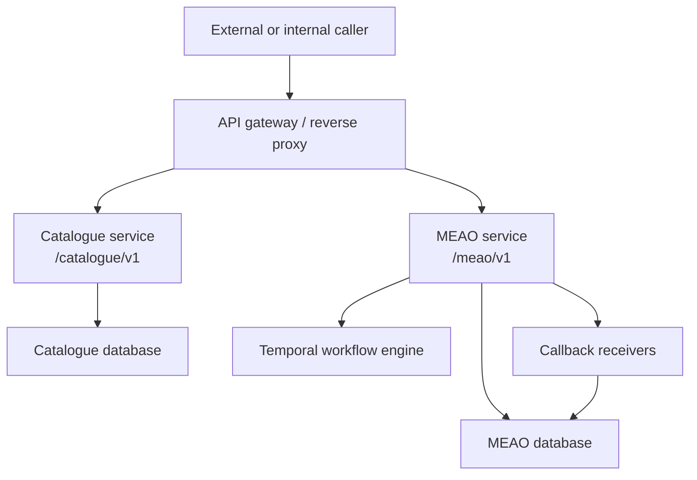
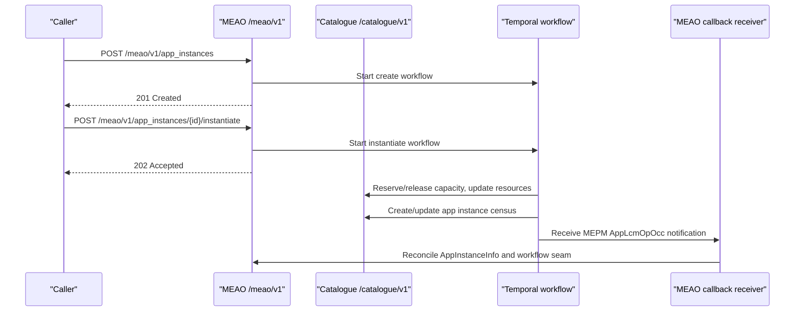
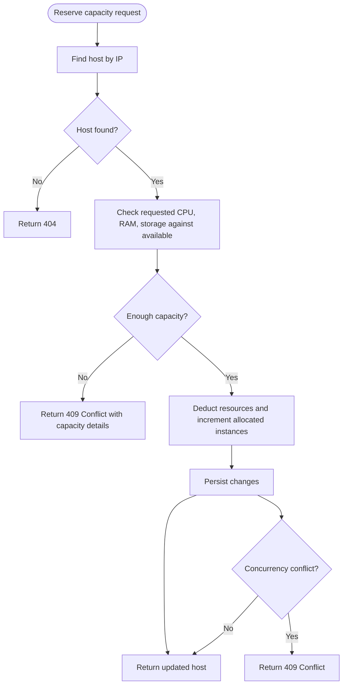
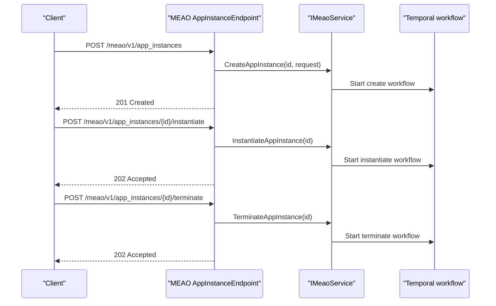
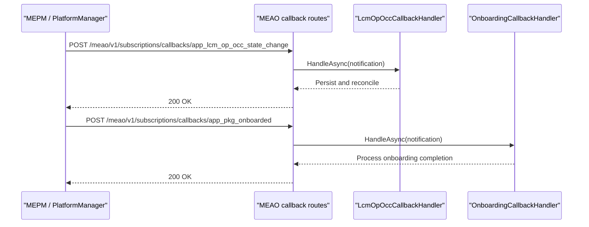
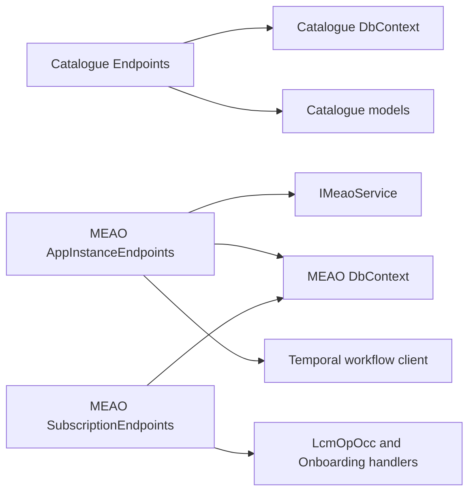

# Internal Services API

## Table of Contents
1. [Introduction](#introduction)
2. [Project Structure](#project-structure)
3. [Core Components](#core-components)
4. [Architecture Overview](#architecture-overview)
5. [Detailed Component Analysis](#detailed-component-analysis)
6. [Dependency Analysis](#dependency-analysis)
7. [Performance Considerations](#performance-considerations)
8. [Troubleshooting Guide](#troubleshooting-guide)
9. [Conclusion](#conclusion)

## Introduction
This document describes the internal service APIs used by Optimist.Orchestrator to coordinate distributed orchestration between the Catalogue service, the MEAO service, and related platform components. It focuses on:

- The Catalogue service API under `/catalogue/v1`, which exposes MEC host management, application instance census tracking, topology information, and MEPM registry endpoints.
- The MEAO internal API under `/meao/v1`, including AppInstanceInfo CRUD, subscription record management, and callback receivers for MEPM status updates.
- The MEPM-local internal extensions documented through usage in this codebase that live outside the ETSI standard contract.

The APIs are designed so that:
- Catalogue is the authoritative census and inventory store for edge hosts, app instances, sites, latency links, services, and MEPMs.
- MEAO owns the lifecycle workflow entry points and maintains an `AppInstanceInfo` census view, while delegating placement and workload operations to background workflows.
- Callback routes receive asynchronous notifications from MEPM or package-onboarding subsystems and reconcile them with persisted state.

## Project Structure
The relevant implementation is split across two ASP.NET Core minimal API services:

| Service | Base route | Responsibility |
|---|---|---|
| Catalogue | `/catalogue/v1` | Edge host CRUD and resource inventory, app instance census read/write helpers, MEPM registry, topology (sites, services, latency links). |
| MEAO | `/meao/v1` | Application instance lifecycle, AppInstanceInfo repository, subscriptions, and callback receivers. |

**Diagram sources**
- `src/Catalogue/Endpoints/MecHostEndpoints.cs#L1-L20`
- `src/Catalogue/Endpoints/AppInstanceEndpoints.cs#L1-L20`
- `src/Catalogue/Endpoints/MepmEndpoints.cs#L1-L12`
- `src/Catalogue/Endpoints/TopologyEndpoints.cs#L1-L20`
- `src/Meao/Endpoints/AppInstanceInfoEndpoints.cs#L1-L12`
- `src/Meao/Endpoints/SubscriptionEndpoints.cs#L1-L25`
- `src/Meao/Endpoints/AppInstanceEndpoints.cs#L1-L30`

**Section sources**
- `src/Catalogue/Endpoints/MecHostEndpoints.cs#L1-L20`
- `src/Catalogue/Endpoints/AppInstanceEndpoints.cs#L1-L20`
- `src/Catalogue/Endpoints/MepmEndpoints.cs#L1-L12`
- `src/Catalogue/Endpoints/TopologyEndpoints.cs#L1-L20`
- `src/Meao/Endpoints/AppInstanceInfoEndpoints.cs#L1-L12`
- `src/Meao/Endpoints/SubscriptionEndpoints.cs#L1-L25`
- `src/Meao/Endpoints/AppInstanceEndpoints.cs#L1-L30`

## Core Components
The internal API surface is organized around three major concerns:

1. **Edge host and resource inventory** — managed through Catalogue’s `/catalogue/v1/edge_hosts`.
2. **Application instance census and lifecycle** — Catalogue tracks deployed instances; MEAO exposes lifecycle operations and an `AppInstanceInfo` data store.
3. **Topology and MEPM registry** — Catalogue stores sites, services, latency links, and MEPM entries; MEAO manages subscriptions and receives lifecycle callbacks.

These components together support:
- Placement decisions using host capacity and topology.
- Census synchronization between MEAO and Catalogue.
- Asynchronous lifecycle coordination via Temporal workflows and callback routes.

**Section sources**
- `src/Catalogue/Endpoints/MecHostEndpoints.cs#L1-L200`
- `src/Catalogue/Endpoints/AppInstanceEndpoints.cs#L1-L154`
- `src/Catalogue/Endpoints/MepmEndpoints.cs#L1-L91`
- `src/Catalogue/Endpoints/TopologyEndpoints.cs#L1-L200`
- `src/Meao/Endpoints/AppInstanceInfoEndpoints.cs#L1-L92`
- `src/Meao/Endpoints/SubscriptionEndpoints.cs#L1-L107`
- `src/Meao/Endpoints/AppInstanceEndpoints.cs#L1-L200`

## Architecture Overview
The internal orchestration relies on a separation of responsibilities:

| Layer | Service | Primary role |
|---|---|---|
| Registry and census | Catalogue | Stores MEC hosts, app instances, MEPMs, sites, services, and latency links. |
| Lifecycle controller | MEAO | Creates app instance identities, starts placement/workflow operations, manages subscriptions, and exposes AppInstanceInfo. |
| Background processing | Temporal + MEAO activities | Performs placement, grant creation, MEPM interaction, and reconciliation. |
| Notifications | Callback receivers | Accepts MEPM lifecycle operation notifications and package-onboarding completion events. |

**Diagram sources**
- `src/Meao/Endpoints/AppInstanceEndpoints.cs#L136-L200`
- `src/Meao/Endpoints/AppInstanceEndpoints.cs#L201-L328`
- `src/Catalogue/Endpoints/MecHostEndpoints.cs#L195-L280`
- `src/Catalogue/Endpoints/AppInstanceEndpoints.cs#L59-L154`
- `src/Meao/Endpoints/SubscriptionEndpoints.cs#L87-L107`

## Detailed Component Analysis

### Catalogue Service API: `/catalogue/v1`

#### Edge Host Management
The edge host group is defined under `/catalogue/v1/edge_hosts`. It supports listing, lookup, upsert-like creation, update, deletion, filtering, app-instance enumeration, capacity reservation, capacity release, and resource inventory updates.

| Method | URL pattern | Purpose | Request body | Response | Authentication | Notes |
|---|---|---|---|---|---|---|
| GET | `/catalogue/v1/edge_hosts` | List edge hosts with optional pagination | Optional query parameters `offset`, `limit` | `List<EdgeHost>` | Not explicitly required by endpoint | Pagination caps `limit` at 1000. Results may be enriched with topology latency information. |
| GET | `/catalogue/v1/edge_hosts/{mechost_ip}` | Get one edge host by IP | None | `EdgeHost` or 404 | Not explicitly required by endpoint | Returns NotFound when no host matches. |
| PUT | `/catalogue/v1/edge_hosts/{mechost_ip}` | Update mutable host fields | `EdgeHost` | 204 NoContent or 404 | Not explicitly required by endpoint | Partial update; validation applied. |
| POST | `/catalogue/v1/edge_hosts` | Upsert or create edge host | `EdgeHost` | 201 Created with Location or existing host | Not explicitly required by endpoint | If host exists, it is updated; otherwise created. |
| DELETE | `/catalogue/v1/edge_hosts/{mechost_ip}` | Delete host and related assignments/links | None | Deleted host or 404 | Not explicitly required by endpoint | Removes host-site assignment and latency links referencing the host. |
| GET | `/catalogue/v1/edge_hosts/by-mepm/{mepm_ip}` | Filter hosts by MEPM IP | None | List of hosts | Not explicitly required by endpoint | Returns empty list rather than 404 when none match. |
| GET | `/catalogue/v1/edge_hosts/by-vim/{vim}` | Filter hosts by VIM identifier | None | List of hosts | Not explicitly required by endpoint | Returns empty list when none match. |
| GET | `/catalogue/v1/edge_hosts/by-coords/{coordinates}` | Filter hosts by coordinates string | None | List of hosts | Not explicitly required by endpoint | Returns empty list when none match. |
| GET | `/catalogue/v1/edge_hosts/{mechost_ip}/mec_apps` | Enumerate app instances hosted on an edge host | None | List of app instances | Not explicitly required by endpoint | Reads from app instance census table. |
| POST | `/catalogue/v1/edge_hosts/{mechost_ip}/reserve` | Reserve CPU/RAM/storage capacity | `ReserveCapacityRequest` | Updated host or 404/409 | Not explicitly required by endpoint | Validates available capacity; returns conflict on insufficient or concurrent modification. |
| POST | `/catalogue/v1/edge_hosts/{mechost_ip}/release` | Release reserved capacity | `ReleaseCapacityRequest` | Updated host or 404/409 | Not explicitly required by endpoint | Caps values at total capacity and prevents negative allocated instances. |
| PUT | `/catalogue/v1/edge_hosts/{mechost_ip}/resources` | Overwrite resource inventory telemetry | `UpdateResourcesRequest` | Updated host or 404/409 | Not explicitly required by endpoint | Used for resource telemetry updates; concurrency conflicts return 409. |

**Use cases:**
- MEPMs or infrastructure adapters report host availability and resource inventory.
- Placement logic reserves capacity before creating workloads.
- Telemetry updates keep available resources consistent with actual host state.

**Pagination and filters:**
- Listing uses optional `offset` and `limit` query parameters.
- Negative or zero values are ignored; positive limits are capped at 1000.
- Filtering endpoints accept path parameters only.

**Error handling conventions:**
- Missing entities return 404.
- Capacity problems return 409 Conflict with human-readable detail.
- Concurrent modifications return 409 Conflict.
- Validation failures use RFC 7807-style problem details where validation is configured.

**Diagram sources**
- `src/Catalogue/Endpoints/MecHostEndpoints.cs#L195-L280`

**Section sources**
- `src/Catalogue/Endpoints/MecHostEndpoints.cs#L1-L200`
- `src/Catalogue/Endpoints/MecHostEndpoints.cs#L201-L385`

#### App Instance Census
The app instance group under `/catalogue/v1/app_instances` provides a read-only census interface plus write helpers used by MEAO workflows.

| Method | URL pattern | Purpose | Request body | Response | Authentication | Notes |
|---|---|---|---|---|---|---|
| GET | `/catalogue/v1/app_instances` | List app instances with pagination | Optional `offset`, `limit` | `List<AppInstanceInfoDto>` | Not explicitly required by endpoint | Converts stored model to wire DTO. |
| GET | `/catalogue/v1/app_instances/{id}` | Read one app instance | None | `AppInstanceInfoDto` or 404 | Not explicitly required by endpoint | Returns NotFound if missing. |
| GET | `/catalogue/v1/app_instances/by-host/{hostIp}` | List app instances on a host | None | `List<AppInstanceInfoDto>` | Not explicitly required by endpoint | Filters by MEC host IP. |
| POST | `/catalogue/v1/edge_hosts/{hostIp}/mec_apps` | Add or update an app instance census record | `AppInstance` | 201 Created or 200 OK | Not explicitly required by endpoint | Links source package digest and OCI reference when available. |
| DELETE | `/catalogue/v1/mec_apps/{appInstanceId}` | Remove an app instance census record | None | 204 NoContent or 404 | Not explicitly required by endpoint | Used during teardown or cleanup. |

**Use cases:**
- MEAO writes or updates the deployed app instance census after successful instantiation.
- Consumers query what is actually running on each MEC host.
- Cleanup removes instances that are no longer present.

**Response schema notes:**
- Read endpoints return `AppInstanceInfoDto`, which includes identity, provider, names, versions, package identifiers, instantiation state, operational state, and self-link.
- Write endpoints return the persisted `AppInstance` entity.

**Section sources**
- `src/Catalogue/Endpoints/AppInstanceEndpoints.cs#L1-L154`

#### MEPM Registry
The MEPM group under `/catalogue/v1/mepms` provides basic CRUD for MEPM registry entries.

| Method | URL pattern | Purpose | Request body | Response | Authentication | Notes |
|---|---|---|---|---|---|---|
| GET | `/catalogue/v1/mepms` | List MEPMs with pagination | Optional `offset`, `limit` | `List<Mepm>` | Not explicitly required by endpoint | Sorted by MEPM IP. |
| GET | `/catalogue/v1/mepms/{mepm_ip}` | Read one MEPM | None | `Mepm` or 404 | Not explicitly required by endpoint | Lookup by IP. |
| PUT | `/catalogue/v1/mepms/{mepm_ip}` | Update MEPM metadata | `Mepm` | 204 NoContent or 404 | Not explicitly required by endpoint | Partial update with validation. |
| POST | `/catalogue/v1/mepms` | Create MEPM | `Mepm` | 201 Created | Not explicitly required by endpoint | Returns Location header. |
| DELETE | `/catalogue/v1/mepms/{mepm_ip}` | Delete MEPM | None | Deleted MEPM or 404 | Not explicitly required by endpoint | |

**Use cases:**
- Infrastructure registration reports MEPM presence and status.
- Orchestration looks up MEPM metadata when routing lifecycle operations.

**Section sources**
- `src/Catalogue/Endpoints/MepmEndpoints.cs#L1-L91`

#### Topology Information
Topology endpoints manage services registered on hosts, site assignments, site definitions, and latency links. Many topology endpoints require authorization.

| Method | URL pattern | Purpose | Request body | Response | Authentication | Notes |
|---|---|---|---|---|---|---|
| GET | `/catalogue/v1/edge_hosts/{mechost_ip}/services` | List services on a host | None | List of `MecServiceInfo` or 404 | Required by group | Returns ProblemDetails for missing host. |
| POST | `/catalogue/v1/edge_hosts/{mechost_ip}/services` | Register a service on a host | `CreateMecServiceRequest` | 201 Created or 404/409 | Required by group | Duplicate service name returns 409 Conflict. |
| DELETE | `/catalogue/v1/edge_hosts/{mechost_ip}/services/{serviceId}` | Remove a service | None | 204 NoContent or 404 | Required by group | Validates host and service ownership. |
| PUT | `/catalogue/v1/edge_hosts/{mechost_ip}/site/{siteId}` | Assign host to a site | None | 204 NoContent or 404 | Required by group | Creates or updates host-site assignment. |
| GET | `/catalogue/v1/sites` | List sites | None | List of `Site` | Required by group | Sorted by name. |
| GET | `/catalogue/v1/sites/{id}` | Read site | None | `Site` or 404 | Required by group | Uses GUID path parameter. |
| POST | `/catalogue/v1/sites` | Create site | `CreateSiteRequest` | 201 Created | Required by group | Includes region and core flag. |
| DELETE | `/catalogue/v1/sites/{id}` | Delete site | None | 204 NoContent or 404 | Required by group | Cascades removal of latency links and host-site assignments. |
| GET | `/catalogue/v1/latency_links` | List latency links | None | List of `LatencyLink` | Required by group | |
| GET | `/catalogue/v1/latency_links/{id}` | Read latency link | None | `LatencyLink` or 404 | Required by group | |
| POST | `/catalogue/v1/latency_links` | Create latency link | `CreateLatencyLinkRequest` | 201 Created | Required by group | Validates host/site references and core-site constraints. |
| DELETE | `/catalogue/v1/latency_links/{id}` | Delete latency link | None | 204 NoContent or 404 | Required by group | |

**Use cases:**
- Site and host topology describe deployment regions and relationships.
- Latency links help compute host-to-core latency used by enrichment and placement logic.
- Service declarations describe capabilities exposed by MEC hosts.

**Section sources**
- `src/Catalogue/Endpoints/TopologyEndpoints.cs#L1-L200`
- `src/Catalogue/Endpoints/TopologyEndpoints.cs#L201-L333`

### MEAO Internal API: `/meao/v1`

#### AppInstanceInfo CRUD
The AppInstanceInfo group under `/meao/v1/AppInstanceInfo` provides CRUD access to the MEAO census model. All endpoints require authorization.

| Method | URL pattern | Purpose | Request body | Response | Authentication | Notes |
|---|---|---|---|---|---|---|
| GET | `/meao/v1/AppInstanceInfo` | List all AppInstanceInfo records | None | `List<AppInstanceInfo>` | Required by group | |
| GET | `/meao/v1/AppInstanceInfo/{id}` | Read by GUID | None | `AppInstanceInfo` or 404 | Required by group | |
| PUT | `/meao/v1/AppInstanceInfo/{id}` | Update AppInstanceInfo | `AppInstanceInfo` | 204 NoContent or 404 | Required by group | Field-level update; returns 404 when affected rows differ. |
| POST | `/meao/v1/AppInstanceInfo` | Create AppInstanceInfo | `AppInstanceInfo` | 201 Created or 409 Conflict | Required by group | Prevents duplicate IDs. |
| DELETE | `/meao/v1/AppInstanceInfo/{id}` | Delete AppInstanceInfo | None | 200 OK or 404 | Required by group | Returns OK when exactly one row is deleted. |

**Use cases:**
- Internal consumers or reconcilers update or inspect the MEAO census representation.
- Subscription and callback flows may depend on persisted AppInstanceInfo records.

**Section sources**
- `src/Meao/Endpoints/AppInstanceInfoEndpoints.cs#L1-L92`

#### App Instance Lifecycle
The main app instance group under `/meao/v1/app_instances` exposes lifecycle operations backed by Temporal workflows.

| Method | URL pattern | Purpose | Request body | Response | Authentication | Notes |
|---|---|---|---|---|---|---|
| GET | `/meao/v1/app_instances` | Query MEO census | Optional query parameters: `appInstanceId`, `appDId`, `appName`, `instantiationState` | `List<AppInstanceInfoDto>` | Required by group | Supports GUID filtering, ILIKE search for `appDId` and `appName`, and enum filtering. |
| GET | `/meao/v1/app_instances/{id}` | Read one app instance | None | `AppInstanceInfoDto` or 404 | Required by group | Requires valid GUID format. |
| POST | `/meao/v1/app_instances` | Create app instance identity | `CreateAppInstRequest` | 201 Created | Required by group | Generates server-owned ID; starts create workflow; returns NOT_INSTANTIATED. |
| POST | `/meao/v1/app_instances/{id}/instantiate` | Start placement and workload instantiation | None | 202 Accepted or error | Required by group | Starts instantiate workflow; rejects invalid transitions or duplicate runs. |
| POST | `/meao/v1/app_instances/{id}/terminate` | Start termination | None | 202 Accepted or error | Required by group | Starts terminate workflow; rejects invalid transitions or duplicate runs. |

**Query filter behavior:**
- `appInstanceId` must be a valid GUID; otherwise returns 400.
- `appDId` and `appName` use case-insensitive substring matching.
- `instantiationState` must be a valid enum value; otherwise returns 400.

**Lifecycle semantics:**
- Creation creates identity and sets state to `NOT_INSTANTIATED`.
- Instantiation is asynchronous; response includes an internal operation status such as `INSTANTIATING`.
- Termination is asynchronous; response includes an internal operation status such as `TERMINATING`.
- Invalid lifecycle transitions return 409 Conflict.
- Already-running workflows return 409 Conflict.
- Temporal connectivity failures return 503 ServiceUnavailable.

**Diagram sources**
- `src/Meao/Endpoints/AppInstanceEndpoints.cs#L136-L200`
- `src/Meao/Endpoints/AppInstanceEndpoints.cs#L201-L328`

**Section sources**
- `src/Meao/Endpoints/AppInstanceEndpoints.cs#L1-L200`
- `src/Meao/Endpoints/AppInstanceEndpoints.cs#L201-L328`

#### Subscription Record Management
The subscription group under `/meao/v1/subscriptions` manages subscription records that capture what MEPMs should notify about.

| Method | URL pattern | Purpose | Request body | Response | Authentication | Notes |
|---|---|---|---|---|---|---|
| GET | `/meao/v1/subscriptions` | List subscriptions | None | List of subscriptions | Required by group | |
| GET | `/meao/v1/subscriptions/{id}` | Read subscription | None | Subscription or 404 | Required by group | |
| POST | `/meao/v1/subscriptions` | Create subscription | `SubscriptionRequestDto` | 201 Created | Required by group | Persists lifecycle notification types, operation types, and operation states as JSON filter. |
| DELETE | `/meao/v1/subscriptions/{id}` | Delete subscription | None | 204 NoContent or 404 | Required by group | |

**Use cases:**
- MEAO records subscription requests made to MEPMs.
- Subscription filters allow selective lifecycle event delivery.

**Section sources**
- `src/Meao/Endpoints/SubscriptionEndpoints.cs#L25-L86`

#### Callback Receivers for MEPM Status Updates
Two callback routes are mapped directly on the MEAO application builder rather than inside the subscriptions group. They receive asynchronous notifications and delegate to handlers.

| HTTP method | URL pattern | Purpose | Request body | Response | Authentication |
|---|---|---|---|---|---|
| POST | `/meao/v1/subscriptions/callbacks/app_lcm_op_occ_state_change` | Receive MEPM lifecycle operation occurrence state change | `LcmOpOccNotification` | 200 OK with received confirmation | Required by endpoint |
| POST | `/meao/v1/subscriptions/callbacks/app_pkg_onboarded` | Receive package-onboarding completion notification | `AppPackageOnBoardedNotification` | 200 OK with received confirmation | Required by endpoint |

Both routes validate the incoming payload and then call their respective handler interfaces:
- `ILcmOpOccCallbackHandler.HandleAsync` for lifecycle operation occurrence notifications.
- `ILcmOnboardingCallbackHandler.HandleAsync` for package-onboarding completion.

**Diagram sources**
- `src/Meao/Endpoints/SubscriptionEndpoints.cs#L87-L107`

**Section sources**
- `src/Meao/Endpoints/SubscriptionEndpoints.cs#L87-L107`

### MEPM-Local Internal Extensions
The documentation objective mentions MEPM-local internal extensions under `/app_lcm/v1/packages` and `/app_lcm/v1/configs`. In this repository, those paths do not appear as implemented endpoints. The MEPM-related internal behavior visible here is instead expressed through:

- Catalogue’s MEPM registry (`/catalogue/v1/mepms`).
- Catalogue’s host-capacity and resource-update endpoints used by MEPM-driven inventory updates.
- MEAO’s subscription and callback mechanisms that synchronize MEPM lifecycle state.
- App instance census endpoints used by MEAO workflows to reflect MEPM-deployed applications.

If MEPM-specific internal extensions exist elsewhere, they are not represented in the analyzed endpoint files.

[No sources needed since this section confirms absence of specific endpoint implementations]

## Dependency Analysis
The internal APIs form a small but important dependency graph between services and persistence layers:

**Diagram sources**
- `src/Catalogue/Endpoints/MecHostEndpoints.cs#L1-L20`
- `src/Catalogue/Endpoints/AppInstanceEndpoints.cs#L1-L20`
- `src/Meao/Endpoints/AppInstanceInfoEndpoints.cs#L1-L12`
- `src/Meao/Endpoints/SubscriptionEndpoints.cs#L1-L25`
- `src/Meao/Endpoints/AppInstanceEndpoints.cs#L1-L30`

**Section sources**
- `src/Catalogue/Endpoints/MecHostEndpoints.cs#L1-L20`
- `src/Catalogue/Endpoints/AppInstanceEndpoints.cs#L1-L20`
- `src/Meao/Endpoints/AppInstanceInfoEndpoints.cs#L1-L12`
- `src/Meao/Endpoints/SubscriptionEndpoints.cs#L1-L25`
- `src/Meao/Endpoints/AppInstanceEndpoints.cs#L1-L30`

## Performance Considerations
- **Read-heavy census queries** use `AsNoTracking()` to avoid EF Core change-tracking overhead.
- **Pagination** is implemented with `Skip` and `Take`; limits are capped at 1000 to prevent large result sets.
- **Topology enrichment** batches latency link lookups by collecting host and site IDs first, reducing repeated per-host queries.
- **Asynchronous lifecycle operations** return accepted responses for instantiation and termination, avoiding long-lived HTTP connections.
- **Database concurrency** on capacity updates is handled by catching concurrency exceptions and returning 409 Conflict, encouraging retry at the caller.

[No sources needed since this section provides general guidance derived from observed patterns]

## Troubleshooting Guide

### Common HTTP Status Codes
| Status | Meaning | Typical cause |
|---|---|---|
| 200 | Success | Successful GET, delete, or resource update. |
| 201 | Created | Successful POST that creates a new resource. |
| 202 | Accepted | Asynchronous operation started successfully. |
| 204 | No content | Successful mutation without response body. |
| 400 | Bad request | Invalid GUID, invalid enum, or validation failure. |
| 404 | Not found | Missing host, app instance, site, latency link, subscription, or MEPM. |
| 409 | Conflict | Duplicate service, insufficient capacity, invalid lifecycle transition, already-running workflow, or concurrent modification. |
| 500 | Internal server error | Unexpected exception propagated to global exception handler. |
| 503 | Service unavailable | Temporal workflow client connectivity failure. |

### Validation Errors
Validation errors use `.WithValidation<T>()` and produce RFC 7807 validation problem details. Examples include:
- Invalid `InstantiationState` query parameter.
- Invalid GUID path parameter.
- Invalid `CreateAppInstRequest`.
- Invalid `CreateMecServiceRequest`.
- Invalid `CreateLatencyLinkRequest`.
- Invalid `ReserveCapacityRequest`, `ReleaseCapacityRequest`, or `UpdateResourcesRequest`.

### Capacity Reservation Issues
- **Insufficient capacity**: Returned when requested CPU, RAM, or storage exceeds available values.
- **Concurrency conflict**: Returned when another request modifies host capacity concurrently.
- **Release overflow protection**: Available resources are capped at total capacity; allocated instances cannot go below zero.

### Lifecycle Transition Issues
- Creating an instance returns 201 with `NOT_INSTANTIATED`.
- Instantiating an already-instantiated instance returns 409 Conflict.
- Terminating an instance that is not instantiated returns 409 Conflict.
- Duplicate workflow starts return 409 Conflict.

### Authentication Requirements
- Catalogue edge host listing, lookup, creation, update, deletion, and app instance census endpoints do not explicitly require authorization in the endpoint definitions.
- Topology endpoints under host services, sites, and latency links explicitly require authorization.
- MEAO AppInstanceInfo endpoints explicitly require authorization.
- MEAO subscription endpoints explicitly require authorization.
- MEAO callback receivers explicitly require authorization.
- MEAO app instance lifecycle endpoints explicitly require authorization.

**Section sources**
- `src/Catalogue/Endpoints/MecHostEndpoints.cs#L195-L385`
- `src/Catalogue/Endpoints/TopologyEndpoints.cs#L1-L200`
- `src/Catalogue/Endpoints/TopologyEndpoints.cs#L201-L333`
- `src/Meao/Endpoints/AppInstanceInfoEndpoints.cs#L1-L92`
- `src/Meao/Endpoints/SubscriptionEndpoints.cs#L25-L107`
- `src/Meao/Endpoints/AppInstanceEndpoints.cs#L1-L200`
- `src/Meao/Endpoints/AppInstanceEndpoints.cs#L201-L328`

## Conclusion
The internal APIs in Optimist.Orchestrator separate concerns cleanly:

- Catalogue provides a consistent view of edge hosts, app instances, MEPMs, sites, services, and latency links.
- MEAO provides lifecycle entry points, AppInstanceInfo persistence, subscription management, and callback receivers.
- Distributed consistency is achieved through explicit capacity reservation, census synchronization, workflow-backed lifecycle operations, and callback-driven reconciliation.

For callers integrating with these internal services:
- Use Catalogue for host inventory, topology, and census reads/writes driven by orchestration workflows.
- Use MEAO for lifecycle operations and AppInstanceInfo inspection.
- Respect pagination limits, authentication requirements, and RFC 7807 error conventions.
- Treat asynchronous lifecycle responses as accepted work items and poll or subscribe via callbacks for final state.

[No sources needed since this section summarizes without analyzing specific files]

> **Referenced Files in This Document**
>
> - `src/Catalogue/Endpoints/MecHostEndpoints.cs`
> - `src/Catalogue/Endpoints/AppInstanceEndpoints.cs`
> - `src/Catalogue/Endpoints/MepmEndpoints.cs`
> - `src/Catalogue/Endpoints/TopologyEndpoints.cs`
> - `src/Meao/Endpoints/AppInstanceInfoEndpoints.cs`
> - `src/Meao/Endpoints/SubscriptionEndpoints.cs`
> - `src/Meao/Endpoints/AppInstanceEndpoints.cs`
