# Architecture Decision Records

## Update Summary
**Changes Made**
- Updated the "ETSI MEC Compliance Decisions" section to reflect Phase 49's formal descoping and the Deferred status of requirements REQ-ONB-03 through REQ-ONB-08.
- Added a new subsection documenting Phase 49's abandonment and its implications for the MEO modular monolith architecture.
- Corrected Phase 51 dependency information to reference Phases 47 and 50 rather than Phase 49.
- Updated the "Creating and Referencing New ADRs" guidance to include references to Phase 49's archived state.
- Enhanced the conclusion to document the current architectural direction without Option C.

## Table of Contents
1. [Introduction](#introduction)
2. [ADR Governance and Index](#adr-governance-and-index)
3. [System Architecture Overview](#system-architecture-overview)
4. [Core Architecture Decision Records](#core-architecture-decision-records)
5. [ETSI MEC Compliance Decisions](#etsi-mec-compliance-decisions)
6. [Service Boundary and Technology Stack Decisions](#service-boundary-and-technology-stack-decisions)
7. [Security and Secrets Management Decisions](#security-and-secrets-management-decisions)
8. [Reliability, Deployment, and Operational Decisions](#reliability-deployment-and-operational-decisions)
9. [Creating and Referencing New ADRs](#creating-and-referencing-new-adrs)
10. [Conclusion](#conclusion)

## Introduction
This document consolidates the Architecture Decision Records (ADRs) that shaped the Optimist.Orchestrator system design. It focuses on the decisions that determine how the ETSI GS MEC orchestrator is organized, how lifecycle operations are orchestrated, how MEPM and VIM boundaries are defined, and which technologies are used at runtime.

The repository's ADR collection covers more than sixty records. This guide groups them into thematic areas so readers can understand the major technical choices without reading every individual file first. The canonical index and status table live in the ADR directory readme.

**Section sources**
- `docs/ADR/README.md#L1-L158`

## ADR Governance and Index
The ADR directory is the authoritative record of architectural decisions. Each ADR follows a consistent structure:

| Section | Purpose |
|---|---|
| Status | Whether the decision is accepted, superseded, deferred, or implementation pending. |
| Context | The problem, constraints, or architectural tension being addressed. |
| Decision | What was chosen and how it applies to code, services, or deployment. |
| Consequences | Positive outcomes, trade-offs, operational costs, and risks. |
| Validation | Evidence from source files, tests, workflows, or architecture assessments proving the decision is implemented rather than aspirational. |

The ADR index also provides thematic groupings for ETSI role ownership, orchestration, service topology, data and contracts, VIM layer, MEPM execution, API contract and security, testing, and infrastructure.

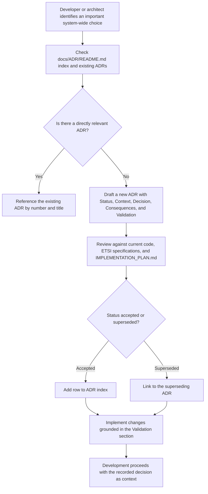

**Diagram sources**
- `docs/ADR/README.md#L1-L158`

**Section sources**
- `docs/ADR/README.md#L1-L158`

## System Architecture Overview
At a high level, Optimist.Orchestrator implements several ETSI MEC roles and supporting infrastructure:

| Role / Component | Responsibility |
|---|---|
| MEO | Application lifecycle orchestration, granting, placement, and package management consumption. |
| MEPM | ETSI `/app_lcm/v1` endpoint owner; drives VIM lifecycle operations. |
| VIM Adapter | Language-specific adapter implementing the Mm6 reference point between MEPM and cloud/Kubernetes/VIM backends. |
| Catalogue | System inventory, census, edge host registry, and unified package registry inventory. |
| ApmApi | Package onboarding, validation, descriptor extraction, and CSAR storage. |
| Infrastructure | PostgreSQL, Temporal, APISIX gateway, Keycloak, Zot registry, and GitOps delivery. |

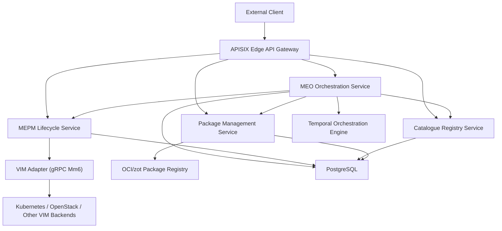

**Diagram sources**
- `docs/ADR/0006-temporal-orchestration-engine.md#L1-L57`
- `docs/ADR/0009-meo-modular-monolith.md#L1-L40`
- `docs/ADR/0013-grpc-mm6-transport.md#L1-L41`
- `docs/ADR/0047-declarative-gitops-cd-argocd-app-of-apps.md#L1-L64`

## Core Architecture Decision Records

### Temporal Orchestration Engine Selection
ADR 0006 documents why Temporal was selected as the orchestration engine for the MEO service. The core need was coordination of long-running, failure-prone application lifecycle steps across remote services such as ApmApi, Catalogue, PlatformManager, and MEPM.

Key elements:

| Dimension | Detail |
|---|---|
| Context | Lifecycle workflows require durable execution, compensation, deterministic replay, and long-running polling until MEPM reaches terminal state. |
| Alternatives considered | Raw HTTP controller chaining, general job queues such as Hangfire or background services. |
| Decision | Temporal workflows drive lifecycle operations; side-effecting calls are activities; compensation follows a saga pattern. |
| Consequences | Workflows survive process restarts and Temporal outages, but the system gains an external dependency on a Temporal cluster. Activities must remain deterministic and avoid heavy computation. |

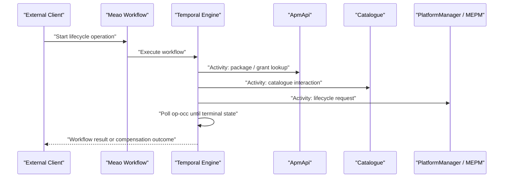

**Diagram sources**
- `docs/ADR/0006-temporal-orchestration-engine.md#L1-L57`

**Section sources**
- `docs/ADR/0006-temporal-orchestration-engine.md#L1-L57`

### Asynchronous VIM Execution and Long-Running Operations
ADR 0005 explains why synchronous VIM provisioning inside the MEPM HTTP handler was replaced with accept-then-execute processing. Synchronous execution blocked request threads, made `PROCESSING` effectively unobservable, and prevented multi-VIM selection from working end-to-end.

Key elements:

| Dimension | Detail |
|---|---|
| Context | LCM endpoints were calling VIM work inline, blocking Kestrel and producing misleading operation states. |
| Decision | Endpoints return immediately after persisting operation state and enqueueing work; a background worker drains an in-process channel and invokes the VIM adapter. |
| Alternatives considered | Keeping synchronous handlers, moving directly to an external queue, or adding retry logic inline. |
| Consequences | Handlers become fast, operation state becomes observable, and VIM type resolution uses the grant instead of hardcoding a backend. In-memory queue durability is limited to process lifetime unless hardened later. |

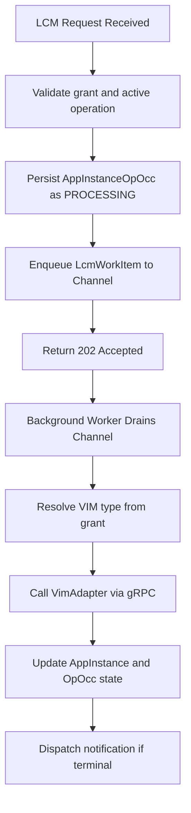

**Diagram sources**
- `docs/ADR/0005-async-vim-execution.md#L1-L107`
- `docs/ADR/0013-grpc-mm6-transport.md#L1-L41`

**Section sources**
- `docs/ADR/0005-async-vim-execution.md#L1-L107`

### MEPM-to-MEO Status Synchronization
ADR 0014 documents the hybrid approach to status synchronization. The active path remains Option A polling, while Option B push notifications are scaffolded for future migration.

Key elements:

| Dimension | Detail |
|---|---|
| Context | MEO needs to know when MEPM lifecycle operations reach COMPLETED or FAILED. |
| Decision | Polling remains the active fallback; MEPM subscription and notification dispatch are scaffolded; MEO-side subscription consumption is incremental work. |
| Consequences | Polling is simple and tolerates the in-process notification queue, but adds latency. Push notifications are available as a future optimization. |

**Section sources**
- `docs/ADR/0014-status-sync-option-a-polling.md#L1-L44`

### Durable Background Processing Queue Pattern
ADR 0039 generalizes the background processing pattern beyond the MEPM LCM worker. It defines bounded channels, per-attempt retries with fresh DI scopes, exponential backoff, dead-lettering, correlation tracking, and RFC 7807 error handling.

Key elements:

| Dimension | Detail |
|---|---|
| Context | Background jobs must not block HTTP paths, must survive transient failures, and must expose permanent failures for manual review. |
| Decision | Use bounded `Channel<T>` with backpressure, `BackgroundService` workers, scoped retries, dead-letter directories, correlation middleware, and structured error responses. |
| Consequences | Consistent asynchronous processing is available across services, but developers must follow the same queue pattern for new background work. |

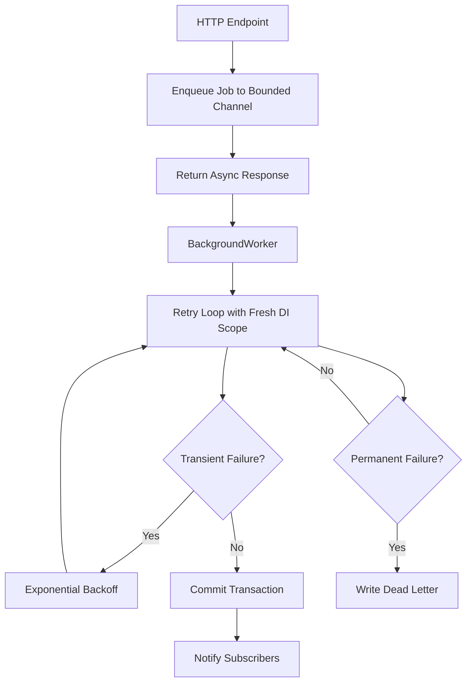

**Diagram sources**
- `docs/ADR/0039-durable-background-processing-queue.md#L1-L200`

**Section sources**
- `docs/ADR/0039-durable-background-processing-queue.md#L1-L200`

## ETSI MEC Compliance Decisions
Several ADRs exist specifically to keep the system aligned with ETSI GS MEC concepts, reference points, and field naming.

| ADR | ETSI Theme | Summary |
|---|---|---|
| 0009 | Role mapping | Treats Meao and ApmApi together as the MEO role. |
| 0014 | Status sync | Keeps polling as the active compliance-compatible path while scaffolding push. |
| 0032 | Notification schema | Keeps `AppLcmOpOccNotification` strictly aligned to ETSI fields. |
| 0033 | Field serialization | Serializes `OperateRequest.changeStateTo` using the ETSI field name. |
| 0038 | MEP host registry | Defines MEP host service registry and MEO Catalogue synchronization. |
| 0042 | VimConnectionInfo | Documents representation and audit discrepancy resolutions. |
| 0043 | Mm3 routing | Defines cross-cluster dynamic MEPM URI resolution and granting alignment. |
| 0049 | Internal extension | Adds non-standard `mecHostInformation` extension on internal MEO app-instance API. |
| 0059 | Subscription callback auth | Adds OAuth2 bearer authentication and route prefix hardening for subscription callbacks. |

These decisions collectively separate ETSI wire contracts from internal persistence models and ensure that public-facing behavior remains predictable even when internal implementation evolves.

**Updated** Phase 49 (Option C — MEO as sole public package surface) was formally descoped on 2026-10-25. Its six associated requirements (REQ-ONB-03 through REQ-ONB-08) are now Deferred, and the ten plans plus research artifacts are retained only on the archived branch `gsd/phase-49-target-surface-map`. This means the current active architecture does **not** implement Option C's design where MEO re-homes the ingress routes and ApmApi becomes unreachable externally. Instead, the system continues with Meao and ApmApi as distinct services under the broader MEO role, with their existing boundary relationships preserved.

**Section sources**
- `docs/ADR/0009-meo-modular-monolith.md#L1-L40`
- `docs/ADR/0014-status-sync-option-a-polling.md#L1-L44`
- `docs/ADR/0048-canonical-wire-contracts-and-bounded-context-realignment.md#L1-L137`
- `.planning/phases/49-meo-fronted-onboarding-option-c-meo-as-sole-public-package-s/49-DESCOPED.md#L1-L11`
- `.planning/REQUIREMENTS.md#L293-L318`

### Phase 49 Abandonment and Current Onboarding Direction
Phase 49 originally proposed Option C: making MEO (specifically Meao) the sole public package surface, freezing ApmApi from external access, moving AppD parsing orchestration to Temporal on the Meao side, handling ETSI subscription change events in Meao, deciding whether to keep or revert the zot/ORAS distribution chain, and creating a superseding ADR for ingress route ownership.

**Updated** All six requirements from Phase 49 are now Deferred:

| Requirement | Original Intent | Current Status |
|---|---|---|
| REQ-ONB-03 | Meao exposes public MEO app-package onboarding surface; ApmApi never directly reachable externally | Deferred |
| REQ-ONB-04 | Meao consumes ApmApi strictly as-is with no modifications | Deferred |
| REQ-ONB-05 | AppD parsing and package-processing orchestration runs under Temporal on Meao | Deferred |
| REQ-ONB-06 | App-package lifecycle change events flow through ETSI subscription/notification model | Deferred |
| REQ-ONB-07 | Explicit keep-or-revert decision on zot/ORAS CSAR distribution chain | Deferred |
| REQ-ONB-08 | New ADR recording Option C ingress re-homing | Deferred |

The phase's ten plans (`49-01` through `49-10`) remain only on the archived branch `gsd/phase-49-target-surface-map`, which is retained as an archive and should not be resumed or merged. Three plans were executed on that branch, but none will run on `main`. The branch is 74 commits ahead of `main` and represents approximately 16.8k changed lines.

Phase 51's prerequisites were corrected during the descope: it now depends on Phases 47 and 50 rather than Phase 49. The open question for Phase 51 is not whether a publisher exists — `PackageService.PushCsarAsync` already pushes to MEAO zot — but rather which digest to pin when decomposing CSAR packaging into multi-layer OCI 1.1 artifacts: `claim.Sha256` (the staged CSAR file bytes) versus `AppPkgRecord.CsarDigest` (the OCI manifest JSON digest). This is a design decision about digest identity semantics, not a missing implementation.

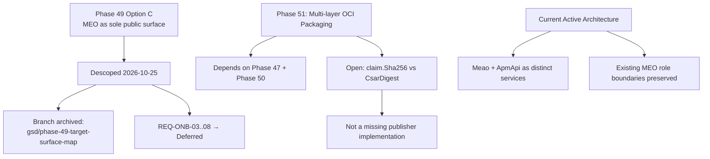

**Diagram sources**
- `.planning/phases/49-meo-fronted-onboarding-option-c-meo-as-sole-public-package-s/49-DESCOPED.md#L1-L11`
- `.planning/ROADMAP.md#L1358-L1380`
- `.planning/ROADMAP.md#L1391-L1398`

**Section sources**
- `.planning/phases/49-meo-fronted-onboarding-option-c-meo-as-sole-public-package-s/49-DESCOPED.md#L1-L11`
- `.planning/ROADMAP.md#L1358-L1380`
- `.planning/ROADMAP.md#L1391-L1398`
- `.planning/REQUIREMENTS.md#L293-L318`
- `.planning/STATE.md#L35-L46`

## Service Boundary and Technology Stack Decisions

### Modular Monolith Role Mapping
ADR 0009 establishes that the MEO role is realized as a modular monolith composed of two deployable services: Meao and ApmApi. They have different ports and datastores but represent one ETSI role.

Key elements:

| Aspect | Detail |
|---|---|
| Role mapping | MEO = {Meao, ApmApi}; MEPM = PlatformManager; VIM = VimAdapter; MEC Platform registry = Catalogue. |
| Runtime coupling | Meao depends on ApmApi during onboarding to download and validate packages. |
| Code vs role names | ETSI role names describe behavior; code package names map to roles but are not the source of truth. |
| Consequence | Clear responsibility boundaries while avoiding premature microservice sprawl. |

**Updated** With Phase 49 abandoned, the current implementation retains this original modular monolith design without transitioning to Option C's single-surface approach. Meao and ApmApi remain distinct services under the MEO role, preserving the existing dependency direction of Meao → ApmApi.

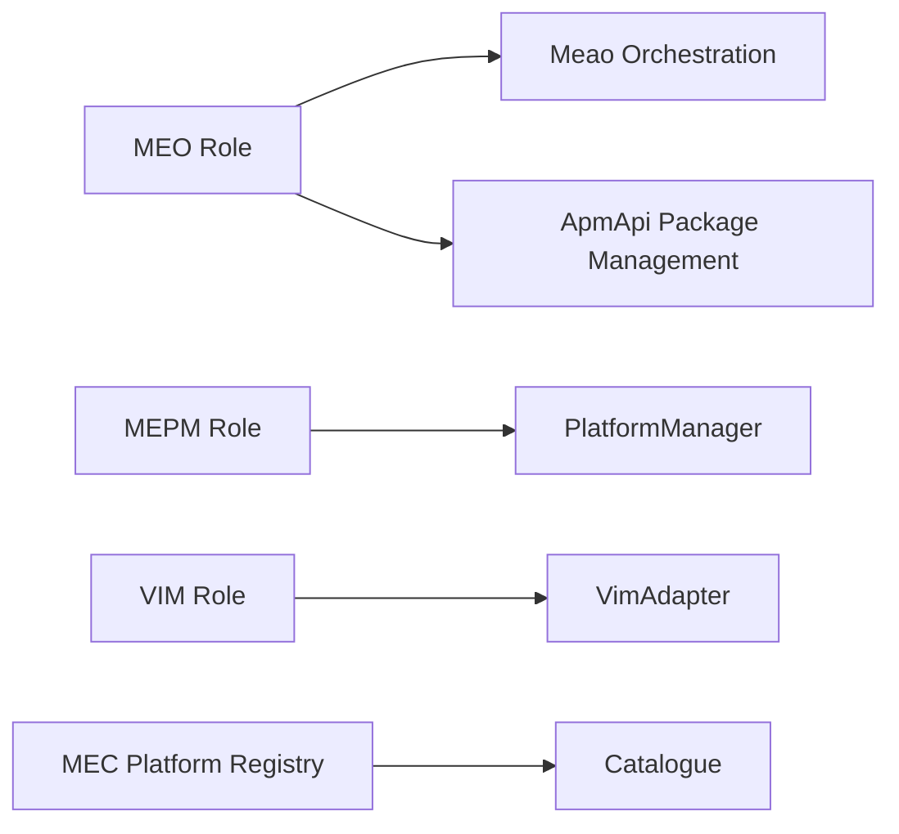

**Diagram sources**
- `docs/ADR/0009-meo-modular-monolith.md#L1-L40`

**Section sources**
- `docs/ADR/0009-meo-modular-monolith.md#L1-L40`

### gRPC Mm6 Transport Between MEPM and VIM
ADR 0013 selects gRPC for the MEPM-to-VIM transport because it is strongly typed, efficient for binary streaming, and language-agnostic. The proto contract is treated as stable across VIM factory swaps.

Key elements:

| Dimension | Detail |
|---|---|
| Transport | gRPC over Mm6 between PlatformManager and VimAdapter. |
| Contract | Defined in the VIM adapter proto and served by the Python gRPC server. |
| Factory pattern | MEPM resolves the VIM client through a plugin factory keyed by VIM type. |
| Consequences | Binary artifact streaming works well; proto changes affect both .NET and Python sides. |

**Section sources**
- `docs/ADR/0013-grpc-mm6-transport.md#L1-L41`

### VIM Adapter Implementation Language and Python Toolchain
ADR 0017 chose Python for the VIM adapter because the VIM layer needs strong SDK support for Kubernetes and OpenStack, while keeping the MEPM boundary language-agnostic via gRPC. ADR 0062 then narrowed the dependency-management clause of ADR 0017 by retiring pipenv and pyenv and establishing `uv` as the sole Python toolchain.

Key elements:

| Dimension | Detail |
|---|---|
| Choice | Python async asyncio gRPC server. |
| Rationale | Direct access to pyhelm3, openstacksdk, and Kubernetes clients. |
| Toolchain | `uv` only; `requirements.txt` is the only dependency manifest. |
| Superseded clause | ADR 0017's acceptance of `.venv` or pipenv is superseded by the dependency-management clause in ADR 0062. |
| Trade-off | Polyglot repository with separate toolchains for .NET and Python, but one Python toolchain per environment. |

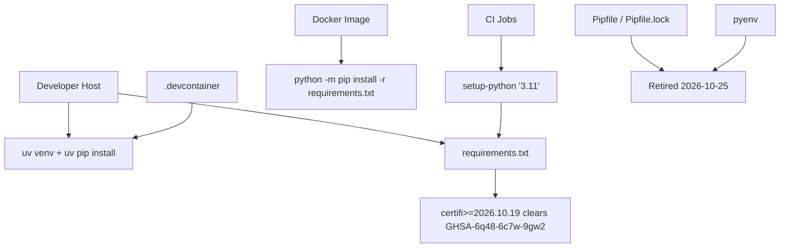

**Diagram sources**
- `docs/ADR/0062-uv-as-sole-python-toolchain.md#L1-L109`

**Updated** ADR 0062 documents a concrete security regression caused by having two manifests: `Pipfile.lock` pinned `certifi == 2026.6.17`, while `requirements.txt` floored the same package at `>=2026.10.19`. Because pipenv could only express minor version `3.11`, the devcontainer, CI, and production image built different interpreters and CA bundles from the same commit — and the stale lock carried the vulnerable bundle.

**Section sources**
- `docs/ADR/0017-vimadapter-python.md#L1-L39`
- `docs/ADR/0062-uv-as-sole-python-toolchain.md#L1-L109`

### .NET Baseline and Shared Projects
ADR 0023 standardizes all .NET services on `.NET 8.0`, enabling shared projects such as Common.Models and Common.Telemetry.

Key elements:

| Dimension | Detail |
|---|---|
| Baseline | .NET 8.0 across Meao, ApmApi, Catalogue, PlatformManager. |
| Benefits | Uniform LTS runtime, modern EF Core and minimal API features, simplified CI. |
| Cost | Development and CI environments require the .NET 8 SDK. |

**Section sources**
- `docs/ADR/0023-dotnet8-baseline.md#L1-L32`

### Canonical Wire Contracts and Bounded Context Realignment
ADR 0048 addresses systematic model divergence between public wire contracts and internal persistence entities. It consolidates canonical DTOs, separates configuration layers, and clarifies which service owns which domain concept.

Key elements:

| Concern | Boundary |
|---|---|
| Layer 1 — Infrastructure access configuration | `VimConnectionInfo`; belongs in grants and VIM routing context, not packages or Catalogue models. |
| Layer 2 — Platform rules and service configuration | `configure_platform_for_app`; belongs to MEPM and host-level MEC platform, not MEO persistence. |
| Layer 3 — Application workload configuration | CSAR/AppD content owned by ApmApi and rendered by VimAdapter. |

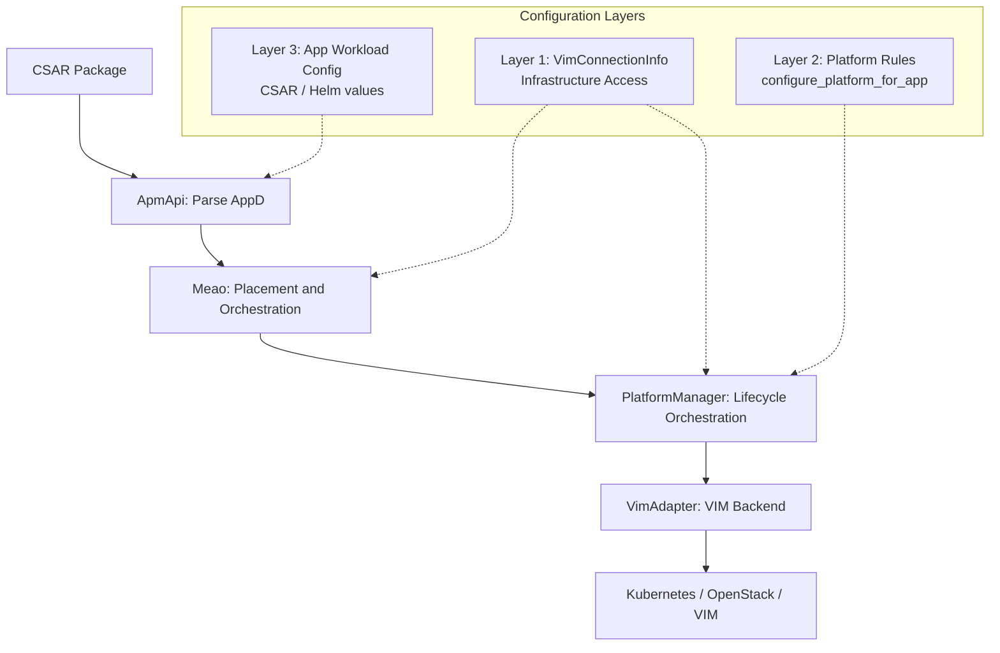

**Diagram sources**
- `docs/ADR/0048-canonical-wire-contracts-and-bounded-context-realignment.md#L1-L137`

**Section sources**
- `docs/ADR/0048-canonical-wire-contracts-and-bounded-context-realignment.md#L1-L137`

### Tactical Domain-Driven Design Direction
ADR 0051 proposes tactical DDD patterns: strongly-typed identifiers, value objects, immutable aggregates, and rich aggregate roots. Importantly, this ADR explicitly records that the design was accepted but **not implemented** as of the deferral date.

Key elements:

| Aspect | Status |
|---|---|
| Goal | Replace anemic data bags with domain aggregates enforcing lifecycle and capacity invariants. |
| Intended types | Strongly-typed IDs and compute capacity value objects in shared models. |
| Current state | Design locked; Phase 44 deferred; artifacts do not yet exist in the repository. |
| Future gate | Tests, static analysis, and domain invariant verification would be required before implementation acceptance. |

**Section sources**
- `docs/ADR/0051-tactical-ddd-strongly-typed-ids-and-rich-aggregates.md#L1-L93`

## Security and Secrets Management Decisions

### Keycloak Client Secret Rotation and ConfigMap Re-Sync Is Not Rotation
ADR 0063 documents the discovery that live Keycloak client secrets cannot be rotated by re-syncing the realm ConfigMap because the realm was imported with `IGNORE_EXISTING` strategy. This decision affects how the four live service-account secrets (`meao`, `apm-api`, `catalogue`, `platform-manager`) must be managed throughout their lifecycle.

Key elements:

| Dimension | Detail |
|---|---|
| Context | Eight tracked sites carry four live Keycloak client secrets; the realm JSON doubles as both the live deployment artifact and the bootstrap source. |
| Discovery | Live verification confirmed the realm was imported once on 2026-09-03 with `KC-SERVICES0030: Full model import requested. Strategy: IGNORE_EXISTING`. |
| Decision | Realm JSON edits and ConfigMap re-syncs do not rotate live secrets; rotation requires direct admin-API calls via `kcadm.sh update clients/<id> -r optimist -s secret=…`. |
| Consequences | Any remediation must distinguish between bootstrap material (realm JSON) and runtime secret material (live Keycloak clients); editing the realm alone cannot rotate running tokens. |

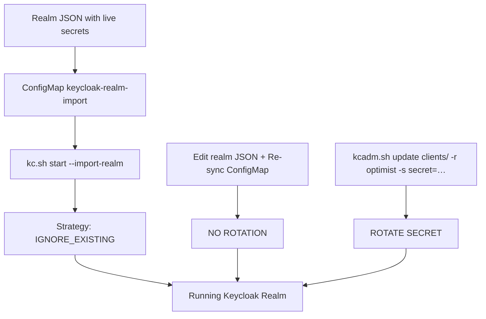

**Diagram sources**
- `.planning/todos/pending/committed-live-credentials-and-secret-scan-gap.md#L1-L154`

**Section sources**
- `.planning/todos/pending/committed-live-credentials-and-secret-scan-gap.md#L1-L154`

### ExternalSecret → Kubernetes Secret → kcadm.sh Admin-API Rotation Sequence
ADR 0064 documents the approved five-step operational procedure for rotating the four live Keycloak client secrets while maintaining continuous service availability. This sequence supersedes the original suggested ordering in the backlog because the pods must read the secret from Kubernetes before Keycloak changes its mind about what the secret is.

Key elements:

| Step | Action | Purpose |
|---|---|---|
| 1 | Populate `cluster-secrets/cluster-keycloak-clients` with the then-current four values | Behaviorally no-op rollout; prepares the destination before rotation |
| 2 | Add `ExternalSecret` + chart `secretKeyRef` env injection, push, verify env present and token acquisition returns 200 | Fixes latent defect where `KeycloakTokenProvider` throws when `KEYCLOAK_CLIENT_SECRET_*` is missing |
| 3 | Generate new values, run `kcadm` update, update cluster Secret, force ESO reconciliation, rollout restart, re-verify 200 | Actual secret rotation within one coordinated window |
| 4 | Placeholders in both realm JSONs, fix false `kustomization.yaml` claim, `${VAR:-default}` for literal compose passwords, real placeholders in `.env*.example` + gitignore | Clean up committed credentials and correct false claims |
| 5 | Scanner canary + add `push: [main]` trigger to `ci.yml` | Close the secret-scan gap that currently passes despite committed secrets |

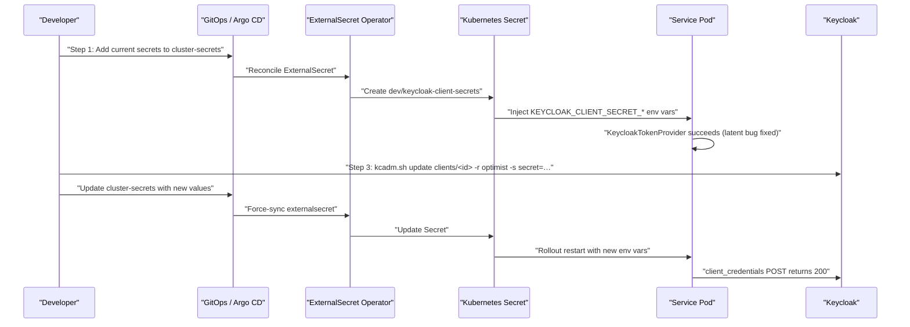

**Diagram sources**
- `.planning/todos/pending/committed-live-credentials-and-secret-scan-gap.md#L120-L154`
- `.planning/ROADMAP.md#L1560-L1645`

**Section sources**
- `.planning/todos/pending/committed-live-credentials-and-secret-scan-gap.md#L120-L154`
- `.planning/ROADMAP.md#L1560-L1645`

### Consumer-Side Secret Injection and Scan Gap Closure
The consumer-side wiring described in ADR 0064 does not require secret rotation — it fixes the half of the problem that involves how services consume Keycloak credentials. The existing `ClusterSecretStore` → Kubernetes provider → `cluster-secrets` namespace supply route already exists and is consumed by `gitops/apps/eso/external-secrets.yaml`.

Key elements:

| Component | Role |
|---|---|
| `ClusterSecretStore` | Declares the Kubernetes provider whose remote namespace is `cluster-secrets` |
| `external-secrets.yaml` | Projects secrets from `cluster-secrets` into the `dev` namespace |
| Chart templates | Emit guarded `secretKeyRef` env variables per service |
| `KeycloakTokenProvider` | Reads `KEYCLOAK_CLIENT_SECRET_*` root key and mints client-credentials tokens |

The scan gap closure is separate from the rotation sequence. The existing Trivy filesystem scan in CI passes despite committed secrets because entropy/prefix-based secret rules miss the specific patterns, and the workflow never runs on `push: [main]`. Closing this gap requires both rule tuning and trigger correction.

**Section sources**
- `.planning/todos/pending/committed-live-credentials-and-secret-scan-gap.md#L80-L119`
- `.planning/ROADMAP.md#L1600-L1645`

## Reliability, Deployment, and Operational Decisions

### Kubernetes Helm Pre-Upgrade Migration Hooks and Database Readiness
ADR 0056 solves multi-pod migration races, database schema drift risk, coarse health probing, duplicate reconciliation loops, and premature termination during long VIM operations.

Key elements:

| Area | Decision |
|---|---|
| Migration execution | Isolated CLI `--migrate-only` entrypoint executed before HTTP servers start. |
| Production guard | Fail-fast startup when pending migrations exist. |
| Health probes | Separate shallow liveness and deep readiness probes. |
| Ordering | Helm pre-install/pre-upgrade hook jobs run migrations before deployments. |
| Multi-replica safety | PostgreSQL advisory locks prevent duplicate reconciliation loops. |
| Graceful shutdown | 120-second budget aligned with long VIM operations. |

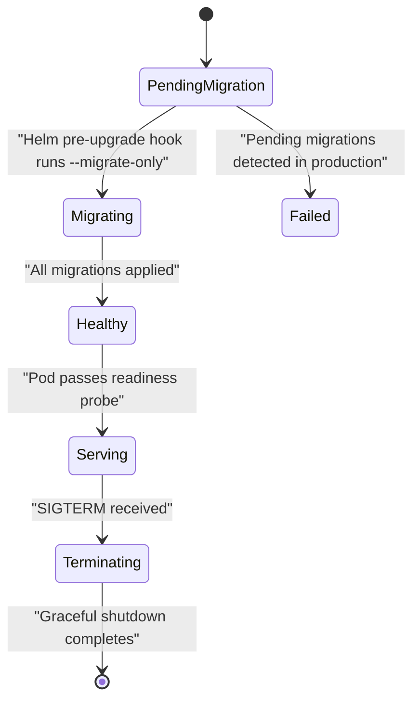

**Diagram sources**
- `docs/ADR/0056-kubernetes-helm-pre-upgrade-migration-hooks-and-database-readiness.md#L1-L91`

**Section sources**
- `docs/ADR/0056-kubernetes-helm-pre-upgrade-migration-hooks-and-database-readiness.md#L1-L91`

### Declarative GitOps Continuous Delivery
ADR 0047 replaces imperative GitHub Actions-driven Terraform deployments with declarative GitOps using Argo CD and an App-of-Apps architecture.

Key elements:

| Area | Detail |
|---|---|
| Old model | Imperative push-based CI, MinIO-backed Terraform state, secret sprawl, brittle ordering. |
| New model | Pull-based Argo CD reconciliation, ordered sync waves, External Secrets Operator, zero secrets in Git. |
| Infrastructure order | CRDs, stores, Temporal, Keycloak, APISIX, MEC services, ingress routes, post-deployment validation. |
| Trade-offs | Argo CD and External Secrets Operator add runtime overhead; schema migrations must remain backward-compatible. |

**Section sources**
- `docs/ADR/0047-declarative-gitops-cd-argocd-app-of-apps.md#L1-L64`

## Creating and Referencing New ADRs
Use this guidance when deciding whether to create a new ADR and how to reference existing decisions during development.

### When to Create a New ADR
Create a new ADR when a decision meets these conditions:

1. It affects multiple services, boundaries, or deployment paths.
2. It introduces or removes a significant external dependency.
3. It changes ETSI compliance behavior, wire contracts, or lifecycle state semantics.
4. It impacts observability, reliability, security, or data consistency.
5. There are meaningful alternatives worth documenting.
6. The decision cannot be fully explained by a single commit message or code comment.
7. It changes the build, dependency, or interpreter strategy for a polyglot component.
8. It governs the lifecycle of secrets, credentials, or other sensitive configuration material.
9. It abandons or significantly alters an existing planned architectural option.

Do **not** create an ADR for:

- Purely local refactors with no architectural impact.
- Temporary debugging changes.
- Small fixes already covered by an existing ADR.
- Style-only changes without behavioral consequences.
- Adding a second dependency manifest when another toolchain already governs a component.
- One-off operational commands that do not establish a reusable pattern.
- Recording a phase's descoped state when the existing planning artifacts already document it authoritatively.

### How to Reference Existing Decisions
When writing code or documentation:

| Situation | Recommended Reference |
|---|---|
| Choosing Temporal workflows | Reference ADR 0006. |
| Adding a new lifecycle operation | Reference ADR 0005, ADR 0006, and ADR 0014. |
| Adding a new VIM backend | Reference ADR 0012, ADR 0013, and ADR 0017. |
| Changing VimAdapter dependency tooling or manifests | Reference ADR 0017 and ADR 0062. |
| Rotating Keycloak client secrets or managing realm bootstrap material | Reference ADR 0063 and ADR 0064. |
| Injecting secrets into pods via ExternalSecret | Reference ADR 0064 and ADR 0047. |
| Changing ETSI wire contracts | Reference ADR 0048 and related ETSI-aligned ADRs. |
| Adding background work | Reference ADR 0039. |
| Deploying or migrating services | Reference ADR 0047 and ADR 0056. |
| Defining domain aggregates or IDs | Reference ADR 0051, noting its deferred implementation state. |
| Implementing service-to-service Keycloak authentication | Reference ADR 0057 and ADR 0059. |
| Understanding why Option C (MEO as sole public surface) was abandoned | Reference Phase 49's descoped record and ROADMAP.md Phase 49 section. |
| Planning Phase 51's multi-layer OCI packaging | Reference ROADMAP.md Phase 51 section and note the digest identity open question. |

### ADR Template Checklist
Every new ADR should include:

- [ ] Numbered slug following existing conventions.
- [ ] Status: Accepted, Superseded, Deferred, or Implementation Pending.
- [ ] Context describing the problem and constraints.
- [ ] Decision stating what was chosen.
- [ ] Alternatives considered.
- [ ] Consequences including positive outcomes and trade-offs.
- [ ] Validation linking to source files, tests, workflows, or architecture assessments.
- [ ] Cross-references to related ADRs.
- [ ] Entry in the ADR index readme.

For secret-related ADRs, additionally include:

- [ ] Explicit distinction between bootstrap material (deployed once) and runtime secrets (rotated frequently).
- [ ] Evidence that the deployed artifact actually matches the committed artifact, or a statement that this was not verified.
- [ ] Operational procedure for rotation, not merely the mechanism.
- [ ] Window considerations: collision windows, rollback paths, and partial-rotation states.
- [ ] Scanner and audit implications: whether the change closes a known secret-scan gap.

For architectural option abandonments, additionally include:

- [ ] Clear statement that the option is abandoned, not paused or deferred as work.
- [ ] Location of archived artifacts (branch name, commit range, or archive directory).
- [ ] Status of any requirements introduced by the abandoned option.
- [ ] Impact on dependent phases and whether their prerequisites were corrected.
- [ ] Statement about whether anything on the active branch is broken by the abandonment.

**Section sources**
- `docs/ADR/README.md#L1-L158`

## Conclusion
The Optimist.Orchestrator architecture is defined by a small set of durable decisions:

- Temporal provides durable, compensatable orchestration for complex lifecycle workflows.
- MEPM lifecycle work is decoupled from HTTP handlers through background processing.
- MEPM communicates with VIM adapters over gRPC, enabling polyglot backends.
- The MEO role is intentionally modular monolith style, separating Meao orchestration from ApmApi package management — and this design remains active because Phase 49's Option C (making MEO the sole public package surface) was abandoned.
- VimAdapter is implemented in Python, with ADR 0062 fixing the dependency-management ambiguity left by ADR 0017 by retiring pipenv and pyenv and making `uv` plus `requirements.txt` the sole toolchain and manifest.
- ETSI compliance is preserved through canonical wire contracts, strict field naming, and careful separation of infrastructure, platform, and workload configuration.
- Deployment and reliability are hardened through Helm migration hooks, dual health probes, advisory locking, graceful shutdown budgets, and declarative GitOps delivery.
- Keycloak client secret rotation cannot rely on realm ConfigMap re-sync; the live realm was imported with `IGNORE_EXISTING`, so rotation requires direct admin-API calls, and the approved five-step procedure coordinates pod secret injection before Keycloak changes its stored secret.
- Secret scanning gaps are closed only when both the scanner rules and the CI triggers fire on `push: [main]`, not merely by adding a `.trivyignore` or assuming a gate exists.
- Phase 49's six requirements (REQ-ONB-03 through REQ-ONB-08) are Deferred, and its ten plans remain only on the archived branch `gsd/phase-49-target-surface-map`; Phase 51's dependencies were corrected to Phases 47 and 50, leaving an open design question about which digest to pin (claim.Sha256 vs CsarDigest) rather than a missing publisher implementation.

For ongoing development, always check the ADR index first, cite the relevant ADR by number, and ground new decisions in the same Context–Decision–Consequences–Validation structure. For secrets and credentials, treat bootstrap material and runtime secrets as distinct categories and record the full operational rotation procedure rather than only the mechanism. For abandoned architectural options, distinguish clearly between work that is paused (still executable) and work that is descoped (abandoned, with artifacts archived separately).

> **Referenced Files in This Document**
>
> - `docs/ADR/README.md`
> - `docs/ADR/0005-async-vim-execution.md`
> - `docs/ADR/0006-temporal-orchestration-engine.md`
> - `docs/ADR/0009-meo-modular-monolith.md`
> - `docs/ADR/0013-grpc-mm6-transport.md`
> - `docs/ADR/0014-status-sync-option-a-polling.md`
> - `docs/ADR/0017-vimadapter-python.md`
> - `docs/ADR/0023-dotnet8-baseline.md`
> - `docs/ADR/0039-durable-background-processing-queue.md`
> - `docs/ADR/0047-declarative-gitops-cd-argocd-app-of-apps.md`
> - `docs/ADR/0048-canonical-wire-contracts-and-bounded-context-realignment.md`
> - `docs/ADR/0051-tactical-ddd-strongly-typed-ids-and-rich-aggregates.md`
> - `docs/ADR/0056-kubernetes-helm-pre-upgrade-migration-hooks-and-database-readiness.md`
> - `docs/ADR/0057-meao-internal-apmapi-service-token-authentication.md`
> - `docs/ADR/0059-etsi-subscription-callback-authentication-and-prefix-hardening.md`
> - `docs/ADR/0062-uv-as-sole-python-toolchain.md`
> - `.planning/phases/49-meo-fronted-onboarding-option-c-meo-as-sole-public-package-s/49-DESCOPED.md`
> - `.planning/ROADMAP.md`
> - `.planning/REQUIREMENTS.md`
> - `.planning/STATE.md`
> - `.planning/todos/pending/committed-live-credentials-and-secret-scan-gap.md`
