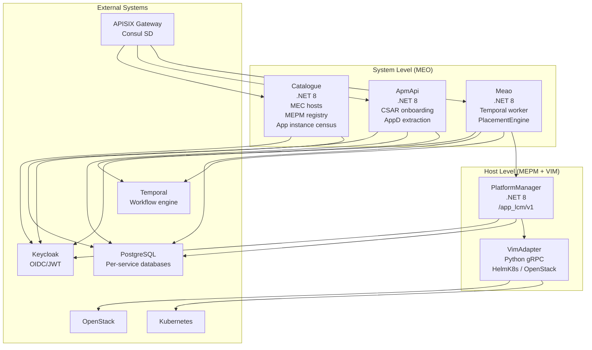
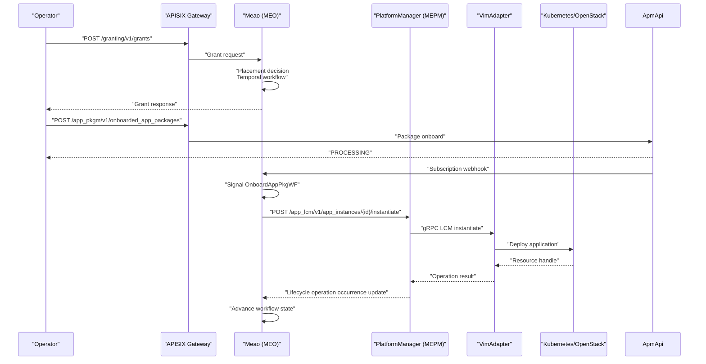
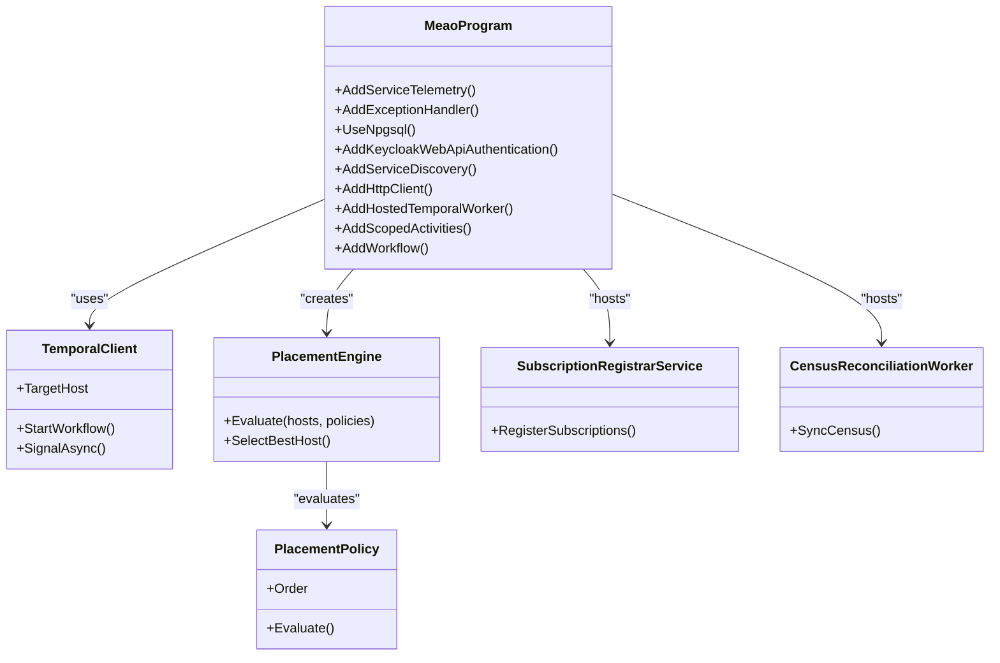
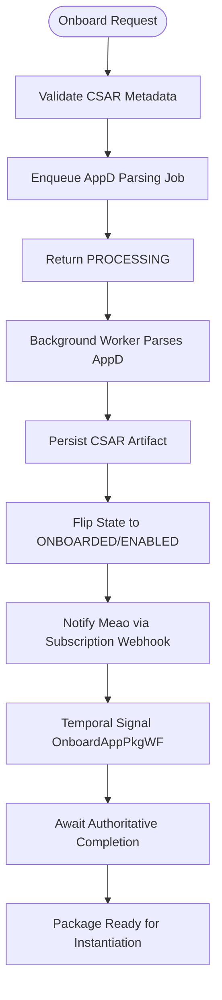
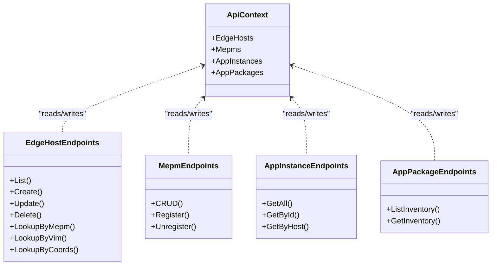
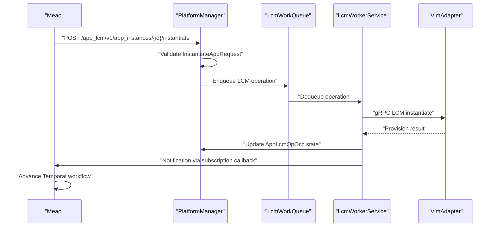
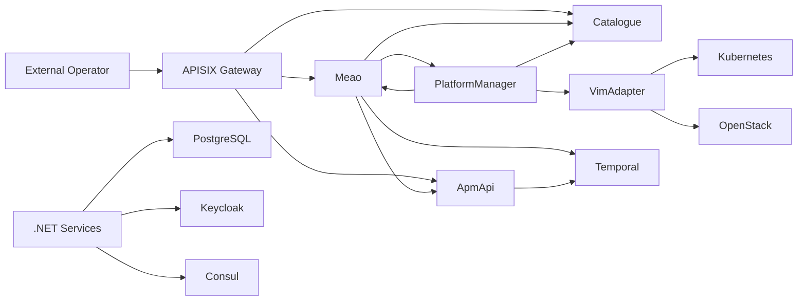

# Architecture Overview

<cite>
**Referenced Files in This Document**   
- `README.md`
- `SPEC.md`
- `ARCHITECTURE_ASSESSMENT.md`
- `docs/ARCHITECTURE.md`
- `docs/CONTEXT-MAP.md`
- `docs/DEPLOYMENT.md`
- `docs/contexts/meao.md`
- `docs/contexts/apmapi.md`
- `docs/contexts/catalogue.md`
- `docs/contexts/platformmanager.md`
- `docs/contexts/vimadapter.md`
- `src/Meao/Program.cs`
- `src/ApmApi/Program.cs`
- `src/Catalogue/Program.cs`
- `src/PlatformManager/PlatformManager/Program.cs`
</cite>

## Table of Contents
1. [Introduction](#introduction)
2. [Project Structure](#project-structure)
3. [Core Components](#core-components)
4. [Architecture Overview](#architecture-overview)
5. [Detailed Component Analysis](#detailed-component-analysis)
6. [Dependency Analysis](#dependency-analysis)
7. [Performance Considerations](#performance-considerations)
8. [Troubleshooting Guide](#troubleshooting-guide)
9. [Conclusion](#conclusion)
10. [Appendices](#appendices)

## Introduction
Optimist.Orchestrator is an ETSI GS MEC 010-2 v3.1.1-compliant orchestrator suite that implements the MEO, MEPM, and VIM adapter roles for managing MEC application packages and instances across distributed edge environments. The system combines .NET 8 REST services, a Python gRPC VIM adapter, PostgreSQL databases, Temporal workflows, Consul service discovery, Keycloak authentication, and APISIX routing into a modular monolith architecture with clear bounded contexts.

At the system level, Meao implements the MEO orchestration role: it owns lifecycle intent, performs placement decisions, issues grants, and coordinates durable workflows. ApmApi provides the ETSI App Package Management API inside the MEO context, owning CSAR onboarding, descriptor extraction, validation, and artifact storage. Catalogue is the internal MEO inventory backing store for MEC hosts, MEPM instances, app instances, and capacity information used by placement and census operations.

At the host level, PlatformManager implements the MEPM role and produces the ETSI App LCM API (`/app_lcm/v1`). It translates lifecycle requests into gRPC calls to VimAdapter, which then provisions resources onto Kubernetes or OpenStack through Helm or the OpenStack SDK.

The repository also documents cross-cutting concerns including JWT-based authentication via Keycloak, OpenTelemetry observability, RFC 7807 error handling, durability through Temporal workflows, and GitOps deployment over Kubernetes using Helm and Argo CD.

**Section sources**
- `README.md#L1-L117`
- `docs/ARCHITECTURE.md#L1-L117`
- `docs/CONTEXT-MAP.md#L1-L50`

## Project Structure
The codebase is organized as a multi-service solution under `src/`, with each service representing a bounded context:

| Path | Service | Role | Runtime | Primary Port | Data Store |
|------|---------|------|---------|--------------|------------|
| `src/Meao` | Meao | MEO orchestration engine | .NET 8 | 5154 (dev) | PostgreSQL `meao_db` |
| `src/ApmApi` | ApmApi | Application Package Management | .NET 8 | 5184 (dev) | PostgreSQL `apmdb` + filesystem |
| `src/Catalogue` | Catalogue | Internal MEO inventory/census | .NET 8 | 5165 (dev) | PostgreSQL `catalogue_db` |
| `src/PlatformManager/PlatformManager` | PlatformManager | MEPM LCM execution | .NET 8 | 5155 (dev) | PostgreSQL `mepm_db` |
| `src/VimAdapter` | VimAdapter | VIM adapter | Python 3.11 | 50051 (gRPC) | Local filesystem |
| `src/Common` | Shared libraries | Models, telemetry, infrastructure | .NET 8 | — | — |
| `tests/Optimist.Orchestrator.E2E` | Cross-service E2E tests | End-to-end validation | .NET 8 | — | — |

**Diagram sources**
- `README.md#L18-L117`
- `docs/ARCHITECTURE.md#L18-L117`
- `docs/DEPLOYMENT.md#L1-L117`

**Section sources**
- `README.md#L18-L117`
- `docs/ARCHITECTURE.md#L18-L117`
- `docs/DEPLOYMENT.md#L1-L117`

## Core Components
The system is divided into six bounded contexts aligned with ETSI MEC terminology:

### MEO Orchestration Context
Meao is the top-level orchestration functional entity responsible for global lifecycle coordination, host selection, grant issuance, and durable workflow execution. It exposes:

- `/granting/v1/grants` — ETSI Granting API consumed by MEPM before resource allocation.
- `/meao/v1/AppInstanceInfo` — internal MEO census tracking.
- `/meao/v1/subscriptions` — subscription management and callback receivers for MEPM lifecycle operation occurrences and package onboarding completion.

Meao uses Temporal workflows for deterministic orchestration, Consul for service discovery, and PostgreSQL for state persistence. It also contains the placement engine and placement policies for selecting target MEC hosts based on tenant affinity, GPU requirements, cost awareness, and capacity headroom.

### Application Package Management Context
ApmApi owns the ETSI App Package Management API surface and is the authoritative source for CSAR packaging, descriptor parsing, validation, and artifact availability. Responsibilities include:

- Onboarding CSAR packages and returning processing states.
- Extracting and validating TOSCA AppD descriptors asynchronously.
- Managing package content storage and retrieval.
- Providing package metadata, image info, validation results, and operational state updates.
- Hosting subscriptions for package events.

ApmApi runs a background worker that parses AppD descriptors off the request path and flips package state to `ONBOARDED` only after durable artifact storage is confirmed.

### Catalogue Backing Store Context
Catalogue maintains the internal MEO inventory and census data required for orchestration decisions:

- Registered MEC hosts with capacity and resource configuration.
- MEPM instance registry enabling dynamic MEPM endpoint resolution per host.
- Global service census of deployed app instances synchronized from edge MEPMs.
- Capacity reservation and release primitives supporting optimistic concurrency placement.
- Unified package inventory records for non-ETSI orchestration needs.

Catalogue enforces Keycloak authentication by default and exposes endpoints for host lookup, app registration, app lifecycle, and MEPM registry operations.

### MEPM Host Execution Context
PlatformManager is the host-level authority for running application instances. It produces the ETSI App LCM API and bridges REST requests to gRPC commands for VimAdapter:

- `/app_lcm/v1/app_instances` — create, read, delete app instances.
- `/app_lcm/v1/app_instances/{id}/instantiate|terminate|operate` — lifecycle operations returning `202 Accepted`.
- `/app_lcm/v1/app_lcm_op_occs` — lifecycle operation occurrence tracking with cancel, fail, and retry semantics.
- `/app_lcm/v1/subscriptions` — MEPM-side subscriptions for lifecycle notifications.
- Internal `/app_lcm/v1/configs` and `/app_lcm/v1/packages` — VIM configuration and CSAR distribution plumbing.

PlatformManager manages lifecycle state machines, notification dispatch, work queues, and pre-staging subscribers for CSAR artifacts.

### VIM Adapter Context
VimAdapter is the polymorphic abstraction layer translating lifecycle commands into concrete infrastructure operations. It exposes a gRPC `LCM` service and selects adapters through a factory pattern:

- `HelmK8sAdapter` — provisions applications on Kubernetes using Helm and the Kubernetes client.
- `OpenStackAdapter` — provisions Nova servers, Glance images, and Heat stacks through the OpenStack SDK.
- `create_vim_adapter(vim_type)` — runtime adapter selection based on connection information.

**Section sources**
- `docs/contexts/meao.md#L1-L29`
- `docs/contexts/apmapi.md#L1-L25`
- `docs/contexts/catalogue.md#L1-L25`
- `docs/contexts/platformmanager.md#L1-L33`
- `docs/contexts/vimadapter.md#L1-L25`
- `README.md#L45-L117`

## Architecture Overview
The system follows ETSI MEC reference points while implementing them as concrete service boundaries:

| Reference Point | Meaning | Local Implementation |
|-----------------|---------|----------------------|
| Mm1 | OSS/consumer to MEO | External operator → Meao `/meao/v1/*` |
| Mm3 | MEO ↔ MEPM coordination | Meao → PlatformManager HTTP REST |
| Mm5 | MEPM ↔ MEP platform configuration | Planned host-level MEP integration |
| Mm6 | MEPM ↔ VIM | PlatformManager → VimAdapter gRPC |
| Mm7 | VIM ↔ virtualized infrastructure | VimAdapter → Kubernetes/OpenStack |
| Mp1 | MEC app ↔ MEC platform | Planned Phase 14 |

**Diagram sources**
- `README.md#L45-L117`
- `docs/ARCHITECTURE.md#L18-L117`
- `SPEC.md#L1-L117`

The deployment topology supports two pathways:

| Pathway | Use Case | Tooling |
|---------|----------|---------|
| Docker Compose | Local development and PoC evaluation | `docker-compose.yml`, `docker-compose.infra.yml`, `docker-compose.override.yml` |
| Kubernetes (Helm + Argo CD) | Production and CI/CD deployment | GitHub Actions CD, Helm chart, Argo CD App-of-Apps pull model |

Production deploys to an OCI Ampere A1 ARM64 K3s cluster using a zero-trust GitOps pull model where GitHub Actions only builds and pushes images and bumps tags; Argo CD reconciles manifests from Git.

**Section sources**
- `docs/ARCHITECTURE.md#L18-L117`
- `docs/DEPLOYMENT.md#L1-L117`

## Detailed Component Analysis

### Meao: MEO Orchestration Engine
Meao is the central orchestration hub. Its startup wiring registers:

- OpenTelemetry telemetry and health checks.
- PostgreSQL database context.
- RFC 7807 Problem Details customization.
- Keycloak JWT authentication and authorization.
- Temporal client and hosted worker.
- Consul-based service discovery.
- Named HTTP clients for ApmApi, Catalogue, and MEPM with resilience handlers.
- Placement engine and placement policies.
- Subscription registrar and MEPM census reconciliation worker.
- Temporal activities and workflows for lifecycle orchestration.

**Diagram sources**
- `src/Meao/Program.cs#L1-L200`

Key responsibilities include:

- **Granting API**: Produces `/granting/v1/grants` consumed by MEPM to validate resource availability before executing lifecycle operations.
- **Placement Engine**: Evaluates MEC hosts against ordered placement policies such as tenant-site affinity, GPU requirements, and cost awareness.
- **Temporal Workflows**: Durable orchestration of package onboarding, app instantiation, termination, and lifecycle transitions.
- **Service Discovery**: Resolves ApmApi, Catalogue, and MEPM endpoints dynamically rather than relying on fixed addresses.
- **Cross-Service Authentication**: Uses Keycloak service tokens for internal HTTP calls to protected endpoints.

**Section sources**
- `src/Meao/Program.cs#L1-L200`
- `docs/contexts/meao.md#L1-L29`

### ApmApi: Application Package Management
ApmApi is the ETSI-defined authority for CSAR packages. Its startup wiring registers:

- OpenTelemetry telemetry, exception handling, and FluentValidation.
- PostgreSQL database context.
- RFC 7807 Problem Details customization.
- Keycloak authentication and authorization.
- Temporal client for durable onboarding saga execution.
- Background processing queue and `AppDBackgroundWorker`.
- CSAR staging store and onboarded package store.
- AppD deserializer, package validator, and subscription services.
- Consul service discovery and resilient HTTP clients.

**Diagram sources**
- `src/ApmApi/Program.cs#L1-L200`
- `SPEC.md#L1-L117`

Important design invariants enforced by the async onboarding flow:

- Parsing never runs synchronously on the request path.
- Package state is flipped only after durable artifact persistence is confirmed.
- Webhook signals are wake-only hints; the authoritative `AppDId` comes from polling ApmApi.
- Signal names must match Temporal SDK registration rules; mismatches fall back to polling.
- Stranded processing operations are recovered at cold start.

**Section sources**
- `src/ApmApi/Program.cs#L1-L200`
- `docs/contexts/apmapi.md#L1-L25`
- `SPEC.md#L1-L117`

### Catalogue: Internal MEO Inventory
Catalogue provides internal persistence for MEC hosts, MEPM instances, app instances, and package inventory. Its startup wiring includes:

- OpenTelemetry telemetry and Serilog request logging.
- PostgreSQL database context.
- Consul service discovery and resilient HTTP clients.
- Default Keycloak authentication policy requiring authenticated users.
- Health check endpoints exposed anonymously.
- Endpoint mapping for MEC host, topology, MEPM, app instance, and package operations.

**Diagram sources**
- `src/Catalogue/Program.cs#L1-L135`

Catalogue acts as the single source of truth for host topology and MEPM location data, enabling Meao to resolve the correct MEPM base URL per host without Consul federation.

**Section sources**
- `src/Catalogue/Program.cs#L1-L135`
- `docs/contexts/catalogue.md#L1-L25`

### PlatformManager: MEPM Host Execution
PlatformManager implements the MEPM role and exposes the ETSI App LCM API. Its startup wiring registers:

- OpenTelemetry telemetry, validation, and health checks.
- PostgreSQL database context.
- RFC 7807 Problem Details customization.
- Keycloak authentication with fallback authorization policy.
- Lifecycle services, config service, and package service.
- OCI distribution client for CSAR artifacts.
- Notification queue and dispatcher service.
- LCM work queue and worker service.
- CSAR pre-stage subscriber.
- Consul service discovery and named HTTP clients for Catalogue and Meao.
- gRPC plugin factory for VimAdapter integration.

**Diagram sources**
- `src/PlatformManager/PlatformManager/Program.cs#L1-L200`

PlatformManager separates standard ETSI endpoints from implementation-specific internal endpoints for VIM configuration and CSAR distribution, ensuring compatibility with external orchestration expectations while retaining necessary plumbing.

**Section sources**
- `src/PlatformManager/PlatformManager/Program.cs#L1-L200`
- `docs/contexts/platformmanager.md#L1-L33`

### VimAdapter: VIM Abstraction Layer
VimAdapter abstracts infrastructure differences behind a gRPC interface. Its bounded context defines:

- `VIM` as the underlying infrastructure system.
- `VimAdapter` as the gRPC daemon bridging MEPM requests to providers.
- `VimConnectionInfo` as connection configuration and credentials.
- `ResourceHandle` as the concrete infrastructure identifier returned by provisioners.
- `VIM Type` as the polymorphic driver category selected at runtime.

This separation allows the system to support Kubernetes/Helm and OpenStack without changing higher-level lifecycle logic.

**Section sources**
- `docs/contexts/vimadapter.md#L1-L25`

## Dependency Analysis
The services form a directed dependency graph with bounded coupling:

**Diagram sources**
- `README.md#L45-L117`
- `docs/ARCHITECTURE.md#L18-L117`

### Coupling Characteristics
- **Loose coupling via APIs**: Services communicate through REST and gRPC contracts rather than shared mutable state.
- **Bounded contexts**: Each service owns its database and domain model.
- **Dynamic discovery**: Consul resolves service endpoints, reducing hard-coded infrastructure assumptions.
- **Durability boundary**: Temporal isolates long-running workflows from transient failures.
- **Authentication boundary**: Keycloak JWT protects public and internal endpoints consistently.

### External Integration Points
| System | Purpose | Integration Pattern |
|--------|---------|---------------------|
| PostgreSQL | Persistent state per service | EF Core with Npgsql |
| Temporal | Durable workflow orchestration | .NET SDK client and hosted worker |
| Consul | Service discovery | Steeltoe discovery client |
| Keycloak | Identity and token validation | AuthServices middleware |
| APISIX | API gateway routing | Route tables backed by Consul |
| Kubernetes | MEC host provisioning | Helm and Kubernetes client via VimAdapter |
| OpenStack | MEC host provisioning | OpenStack SDK via VimAdapter |

**Section sources**
- `README.md#L45-L117`
- `docs/ARCHITECTURE.md#L18-L117`
- `docs/DEPLOYMENT.md#L117-L200`

## Performance Considerations
Several architectural decisions affect performance and scalability:

- **Asynchronous CSAR parsing**: AppD descriptor parsing is moved off the request path to avoid blocking HTTP handlers during large archive processing.
- **Background queues**: Both ApmApi and PlatformManager use background workers and queues to decouple request acceptance from infrastructure provisioning.
- **Resilient HTTP clients**: Standard resilience handlers retry transient failures while avoiding unnecessary retries for authentication errors.
- **Database isolation**: Per-service PostgreSQL databases reduce contention and allow independent scaling and backup strategies.
- **Temporal determinism**: Workflow replay avoids redundant infrastructure calls and ensures consistent state recovery after restarts.
- **Optimistic concurrency**: Catalogue capacity reservations use optimistic concurrency to reduce locking overhead during placement.
- **Filesystem staging**: CSAR staging and artifact stores avoid premature state publication until durable writes succeed.

These patterns trade some complexity for durability, throughput, and clearer failure boundaries.

[No sources needed since this section provides general guidance]

## Troubleshooting Guide
Common operational areas to inspect:

### Authentication Failures
- Verify Keycloak configuration sections are present in each service.
- Confirm service-account tokens are issued for internal calls when protected endpoints require JWT.
- Check that `MEAO_PUBLIC_URL` is configured in non-development environments.
- Ensure Callback endpoints like package onboarding webhooks are reachable and not blocked by network policies.

### Database Migration Issues
- Each service supports a `--migrate-only` CLI entrypoint for pre-upgrade migrations.
- Development mode applies migrations automatically.
- Production mode fails fast if pending migrations exist, preventing schema drift.

### Service Discovery Problems
- Verify Consul is running and services register their expected names.
- Confirm Consul discovery is enabled unless explicitly disabled via environment variables.
- Named HTTP clients must match Consul service names exactly.

### Temporal Workflow Issues
- Inspect workflow status through the Temporal UI.
- Check signal names; the Temporal .NET SDK strips trailing `Async` from handler names.
- Review activity retries and timeouts for long-running infrastructure operations.
- Use replay tests to validate workflow determinism after changes.

### VimAdapter Connectivity
- Confirm gRPC port 50051 is reachable from PlatformManager.
- Validate `VimConnectionInfo` parameters for the target VIM type.
- Check Helm or OpenStack SDK connectivity independently of the orchestrator.

**Section sources**
- `src/Meao/Program.cs#L1-L200`
- `src/ApmApi/Program.cs#L1-L200`
- `src/Catalogue/Program.cs#L1-L135`
- `src/PlatformManager/PlatformManager/Program.cs#L1-L200`
- `SPEC.md#L1-L117`

## Conclusion
Optimist.Orchestrator implements ETSI GS MEC 010-2 v3.1.1 compliance through a modular monolith architecture that cleanly separates MEO orchestration, package management, internal inventory, host-level lifecycle execution, and VIM abstraction. Meao coordinates durable workflows, ApmApi owns package artifacts and descriptors, Catalogue provides topology and capacity data, and PlatformManager executes lifecycle operations against pluggable VIM adapters.

The system’s durability comes from Temporal workflows, its security from Keycloak JWT authentication, its observability from OpenTelemetry, and its deployability from Docker Compose and GitOps-driven Kubernetes deployments. The bounded-context design keeps dependencies explicit, supports independent evolution of each role, and aligns closely with ETSI MEC reference points while remaining implementable on real infrastructure.

[No sources needed since this section summarizes without analyzing specific files]

## Appendices

### Technology Stack Summary
| Area | Technology |
|------|------------|
| Orchestration services | .NET 8 ASP.NET Core |
| VIM adapter | Python 3.11 gRPC |
| Workflow engine | Temporal.io |
| Persistence | PostgreSQL with EF Core |
| Service discovery | Consul via Steeltoe |
| Authentication | Keycloak OIDC/JWT |
| API gateway | APISIX |
| Observability | OpenTelemetry, Prometheus, Grafana |
| Containerization | Multi-stage Dockerfiles |
| Deployment | Helm + Argo CD GitOps |
| Testing | xUnit, Testcontainers, E2E harness |

**Section sources**
- `README.md#L18-L117`
- `docs/DEPLOYMENT.md#L117-L200`

### ETSI API Surface Mapping
| ETSI API | Base Path | Producer | Consumer |
|----------|-----------|----------|----------|
| App LCM | `/app_lcm/v1` | PlatformManager | Meao |
| App Package Management | `/app_pkgm/v1/onboarded_app_packages` | ApmApi | Operator / Meao |
| Granting | `/granting/v1/grants` | Meao | PlatformManager |
| Catalogue | `/catalogue/v1/*` | Catalogue | Meao (internal) |

**Section sources**
- `README.md#L45-L117`
- `docs/ARCHITECTURE.md#L80-L117`
