# Core Data Flows and Integration Patterns

<cite>
**Referenced Files in This Document**
- `README.md`
- `docs/ARCHITECTURE.md`
- `docs/CSAR_DISTRIBUTION_AND_LIFECYCLE_ARCHITECTURE.md`
- `docs/VIM_CONFIGURATION_AND_INSTANTIATION_FLOW.md`
- `docs/ONBOARDING_AND_LIFECYCLE_ARCHITECTURE_REVIEW.md`
- `src/Meao/Program.cs`
- `src/Meao/Workflows/CreateAppInstWF.cs`
- `src/Meao/Workflows/InstantiateAppInstWF.cs`
- `src/Meao/Workflows/TerminateAppinstWF.cs`
- `src/Meao/Workflows/OnboardAppPkgWF.cs`
- `src/Meao/Validators/GrantRequestValidator.cs`
- `src/Meao/Domain/Placement/PlacementEngine.cs`
- `src/PlatformManager/PlatformManager/Program.cs`
- `src/PlatformManager/PlatformManager/Services/LcmWorkerService.cs`
- `src/VimAdapter/main.py`
- `src/VimAdapter/src/server/lcm_grpc_server.py`
</cite>

## Table of Contents
1. [Introduction](#introduction)
2. [Project Structure](#project-structure)
3. [Core Components](#core-components)
4. [Architecture Overview](#architecture-overview)
5. [Detailed Component Analysis](#detailed-component-analysis)
6. [Dependency Analysis](#dependency-analysis)
7. [Performance Considerations](#performance-considerations)
8. [Troubleshooting Guide](#troubleshooting-guide)
9. [Conclusion](#conclusion)

## Introduction
This document explains the core data flows and integration patterns in Optimist.Orchestrator, focusing on:

- CSAR onboarding from upload through validation, parsing, distribution, and cataloging.
- Application lifecycle flow: grant request → placement decision → instantiation → operation → termination.
- The Temporal workflow saga pattern used by Meao for durable orchestration and compensation.
- VIM configuration and instantiation flow across PlatformManager and VimAdapter.
- Sequence diagrams for deployment, status synchronization, and error recovery.
- Data consistency, eventual consistency, and state synchronization mechanisms.

The system implements ETSI GS MEC 010-2 roles: Meao (MEO), ApmApi (package management inside MEO), Catalogue (internal census), PlatformManager (MEPM), and VimAdapter (VIM adapter). External operators interact with Meao and ApmApi through an API gateway; Meao calls PlatformManager directly over the management plane.

**Section sources**
- `README.md#L1-L120`
- `docs/ARCHITECTURE.md#L1-L120`

## Project Structure
Optimist.Orchestrator is a modular multi-service system:

| Service | Role | Runtime | Primary Ports | Main Responsibility |
|---|---|---|---:|---|
| Meao | MEO orchestrator engine | .NET 8 | 5154 | Temporal workflows, placement engine, grants, MEPM coordination |
| ApmApi | App package management | .NET 8 | 5184 | CSAR upload, AppD descriptor extraction, validation, finalization |
| Catalogue | Internal MEO inventory | .NET 8 | 5165 | Edge hosts, MEPM registry, capacity headroom, app instance census |
| PlatformManager | MEPM LCM execution | .NET 8 | 5155 | `/app_lcm/v1`, background VIM provisioning, gRPC bridge to VimAdapter |
| VimAdapter | VIM adapter | Python 3.11 | 50051 | Kubernetes Helm or OpenStack provisioning via gRPC |

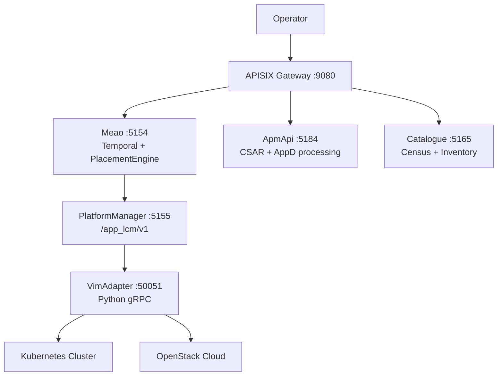

**Diagram sources**
- `README.md#L40-L120`
- `docs/ARCHITECTURE.md#L40-L120`

**Section sources**
- `README.md#L1-L120`
- `docs/ARCHITECTURE.md#L1-L120`

## Core Components
Meao is the central orchestrator. It registers Temporal workflows, activities, HTTP clients, service discovery, authentication handlers, and hosted workers.

Key responsibilities:

- Register Temporal client and worker task queue.
- Register `CreateAppInstWF`, `InstantiateAppInstWF`, `TerminateAppinstWF`, and `OnboardAppPkgWF`.
- Register activities for catalogue, APM, auth, MEPM, app instance, grants, and placement.
- Configure Keycloak-based JWT authentication and internal service tokens.
- Configure named HTTP clients backed by Consul service discovery and resilience handlers.
- Provide dedicated activity-level HTTP clients with controlled timeouts.

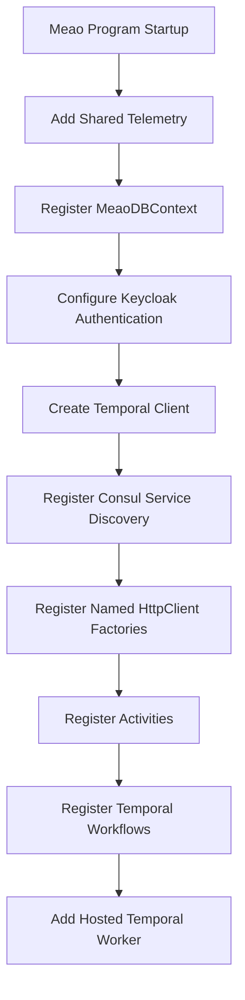

**Diagram sources**
- `src/Meao/Program.cs#L1-L200`

**Section sources**
- `src/Meao/Program.cs#L1-L200`

## Architecture Overview
At a high level, the system separates concerns across four layers:

1. **Northbound API layer:** APISIX routes operator requests to Meao, ApmApi, and Catalogue.
2. **System-level orchestration:** Meao owns workflow state, placement decisions, grants, and MEPM coordination.
3. **Host-level execution:** PlatformManager owns `/app_lcm/v1` and drives VIM provisioning asynchronously.
4. **Infrastructure layer:** VimAdapter translates lifecycle commands into Kubernetes or OpenStack operations.

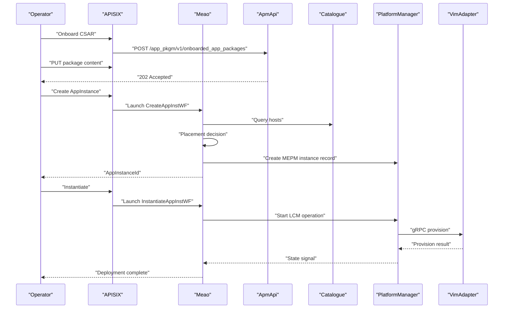

**Diagram sources**
- `docs/ONBOARDING_AND_LIFECYCLE_ARCHITECTURE_REVIEW.md#L120-L220`
- `docs/CSAR_DISTRIBUTION_AND_LIFECYCLE_ARCHITECTURE.md#L1-L120`

**Section sources**
- `docs/ARCHITECTURE.md#L1-L120`
- `docs/ONBOARDING_AND_LIFECYCLE_ARCHITECTURE_REVIEW.md#L1-L120`

## Detailed Component Analysis

### CSAR Onboarding Flow
The CSAR onboarding flow moves from ApmApi through Meao’s Temporal saga into Catalogue and OCI distribution paths.

#### End-to-End Onboarding Sequence
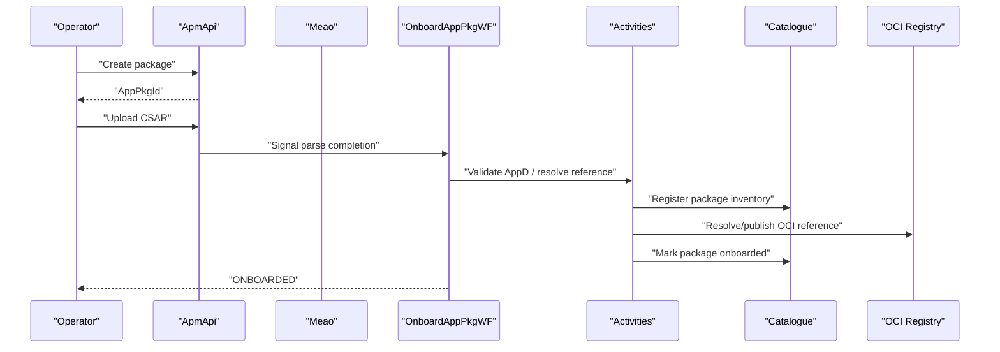

**Diagram sources**
- `src/Meao/Workflows/OnboardAppPkgWF.cs#L1-L200`
- `src/Meao/Workflows/OnboardAppPkgWF.cs#L200-L367`
- `docs/CSAR_DISTRIBUTION_AND_LIFECYCLE_ARCHITECTURE.md#L1-L120`

#### Key Behaviors
- **Claim Check Pattern:** The workflow receives a staging claim rather than raw CSAR bytes, keeping Temporal history small and replay-safe.
- **Async AppD Parsing:** New executions kick asynchronous parsing in ApmApi and wait via a signal-fast path plus bounded polling fallback.
- **Legacy and Patched Paths:** Pre-Phase-48 histories use legacy registration; patched runs register a package inventory record and mark it onboarded only after ApmApi finalization.
- **Compensation:** Failures trigger rollback and package-inventory compensation without deleting records.

**Section sources**
- `src/Meao/Workflows/OnboardAppPkgWF.cs#L1-L200`
- `src/Meao/Workflows/OnboardAppPkgWF.cs#L200-L367`
- `docs/CSAR_DISTRIBUTION_AND_LIFECYCLE_ARCHITECTURE.md#L1-L120`

### Application Lifecycle Data Flow
The application lifecycle spans grant request, placement, instantiation, operation, and termination.

#### Lifecycle State Model
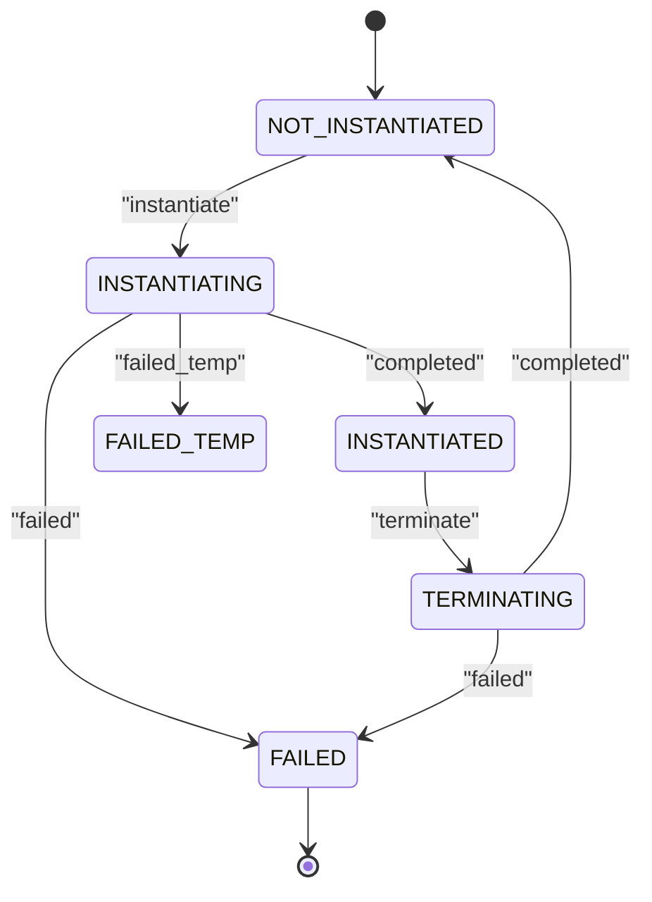

**Diagram sources**
- `src/Meao/Workflows/InstantiateAppInstWF.cs#L1-L200`
- `src/Meao/Workflows/TerminateAppinstWF.cs#L1-L180`

#### Grant Request Validation
Grant requests are validated before being accepted by the granting API.

Validation rules include:

- `AppInstanceId` must be present and a valid GUID.
- `AppLcmOpOccId` must be present.
- `AppDId` must be present.
- `Operation` must be one of `INSTANTIATE`, `OPERATE`, or `TERMINATE`.
- `_links` must contain required `appInstance` and `appLcmOpOcc` hrefs.
- For `INSTANTIATE`, `AddResources` must be present and non-empty.
- Resource definitions must have a valid resource type.

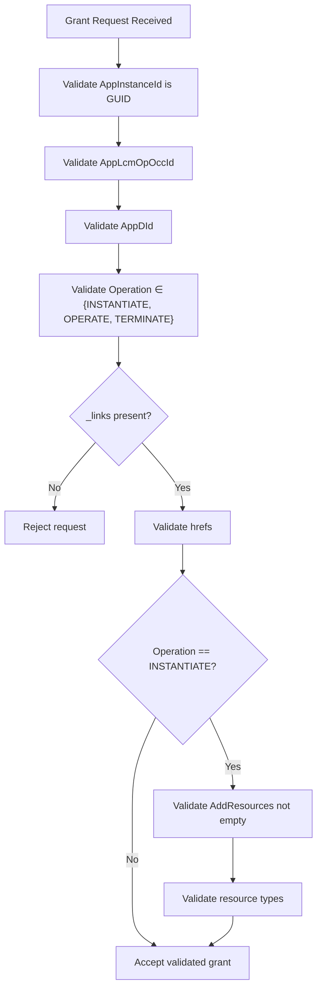

**Diagram sources**
- `src/Meao/Validators/GrantRequestValidator.cs#L1-L84`

**Section sources**
- `src/Meao/Validators/GrantRequestValidator.cs#L1-L84`

#### Placement Decision
When no host IP is supplied, Meao performs dynamic placement.

Placement behavior:

1. Fetches edge hosts from Catalogue.
2. Applies hard constraints: ONLINE status, VIM type, CPU, RAM, storage, required services, and latency.
3. Evaluates placement policies in registered order.
4. Scores eligible candidates using optional services and policy adjustments.
5. Selects the highest-scoring host and returns a placement decision with allocated resources.

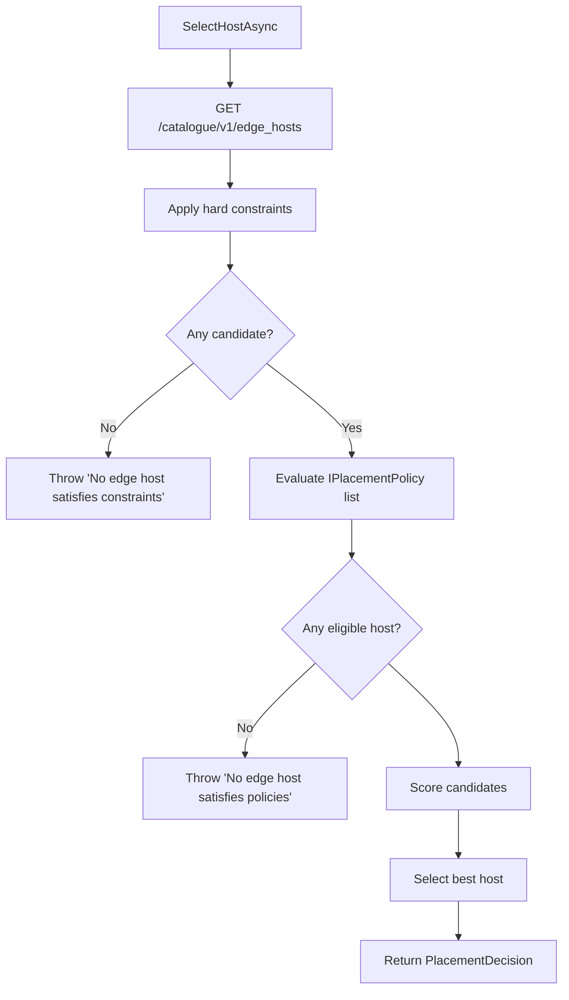

**Diagram sources**
- `src/Meao/Domain/Placement/PlacementEngine.cs#L1-L200`

**Section sources**
- `src/Meao/Domain/Placement/PlacementEngine.cs#L1-L200`

#### Instantiation Workflow
`InstantiateAppInstWF` coordinates grant creation, MEPM invocation, hybrid signal/poll waiting, and cleanup.

Critical steps:

1. Load existing `AppInstanceInfo`.
2. Resolve compute requirements from `VirtualComputeDescriptor`.
3. Perform dynamic placement if no host IP is provided, otherwise reserve capacity for the explicit host.
4. Resolve MEPM base URL from Catalogue.
5. Ensure MEPM instance record exists.
6. Create a grant.
7. Trigger MEPM instantiate operation.
8. Wait for terminal state using signals and polling.
9. Update local state, register deployed app in Catalogue, and mark grant consumed.

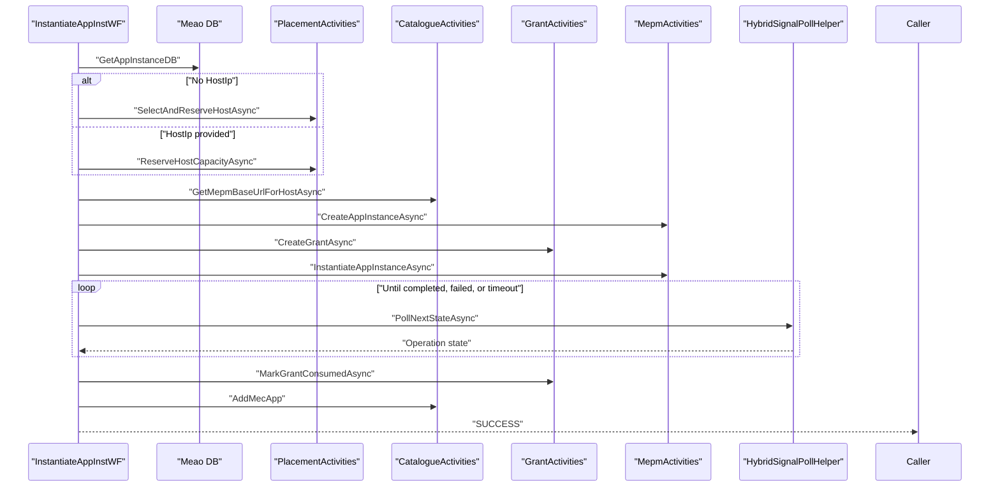

**Diagram sources**
- `src/Meao/Workflows/InstantiateAppInstWF.cs#L1-L200`
- `src/Meao/Workflows/InstantiateAppInstWF.cs#L200-L353`

**Section sources**
- `src/Meao/Workflows/InstantiateAppInstWF.cs#L1-L353`

#### Termination Workflow
`TerminateAppinstWF` terminates the remote workload, releases capacity, removes the app from Catalogue, and updates local state.

Termination compensation includes:

- Mark grant failed if not yet consumed.
- Release host capacity.
- Remove MEC app from Catalogue.
- Update `InstantiationState`, `OperationalState`, `HostIp`, and `MepmInstanceId`.

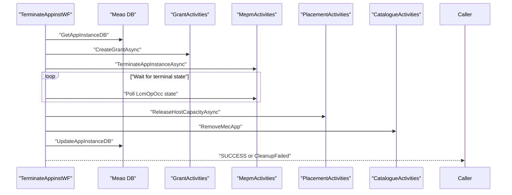

**Diagram sources**
- `src/Meao/Workflows/TerminateAppinstWF.cs#L1-L180`
- `src/Meao/Workflows/TerminateAppinstWF.cs#L180-L272`

**Section sources**
- `src/Meao/Workflows/TerminateAppinstWF.cs#L1-L272`

### Temporal Workflow Saga Pattern and Compensation
Meao uses Temporal workflows as durable sagas. Each workflow tracks its current stage, persists intermediate state, and compensates on failure.

Saga characteristics:

- **Deterministic Task Queue:** All workflows share `meao-task-queue`.
- **Stage Tracking:** Workflows update `_currentStage` so compensation can identify where failure occurred.
- **Activity Policies:** Standard, long-running, best-effort, and compensation policies control retry and timeout behavior.
- **Compensation Path:** Rollback activities run after failures, including ApmApi rollback and Catalogue package-inventory compensation.
- **Cancellation Handling:** Cancellation triggers cleanup and rethrows cancellation exceptions instead of masking them.

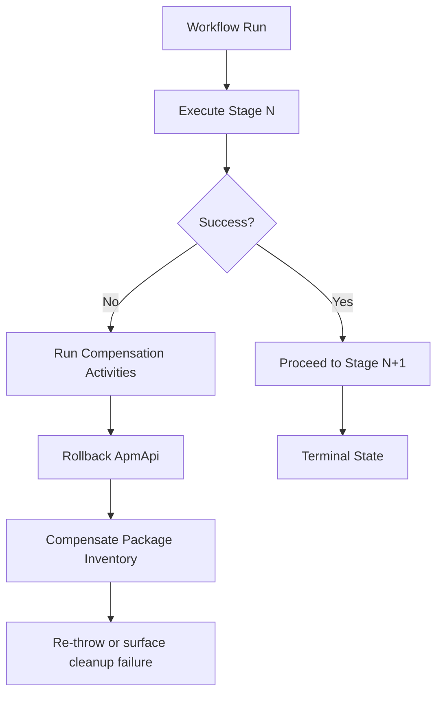

**Diagram sources**
- `src/Meao/Workflows/OnboardAppPkgWF.cs#L1-L200`
- `src/Meao/Workflows/OnboardAppPkgWF.cs#L200-L367`

**Section sources**
- `src/Meao/Workflows/OnboardAppPkgWF.cs#L1-L367`

### VIM Configuration and Instantiation Flow
VIM configuration is separated into three conceptual layers: infrastructure access configuration, platform rules, and application workload configuration.

#### Configuration Layers
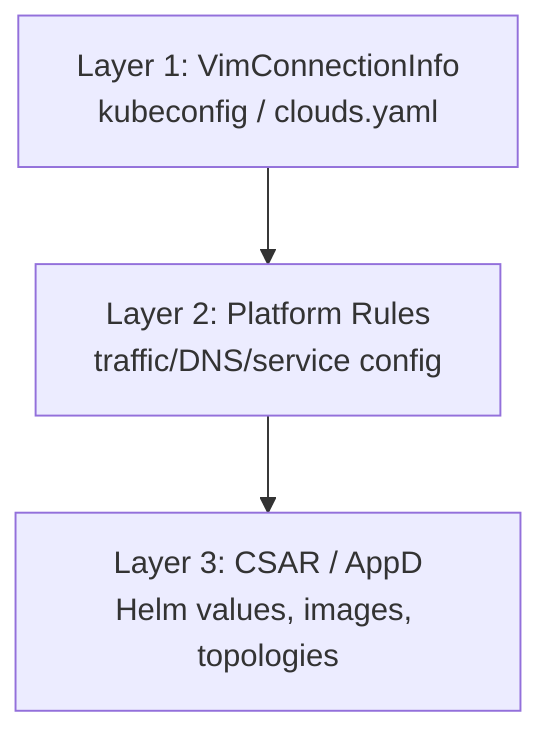

**Diagram sources**
- `docs/VIM_CONFIGURATION_AND_INSTANTIATION_FLOW.md#L1-L60`

#### Bootstrap and End-to-End Instantiation
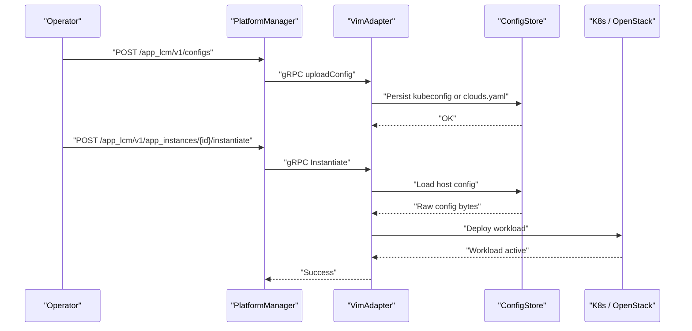

**Diagram sources**
- `docs/VIM_CONFIGURATION_AND_INSTANTIATION_FLOW.md#L60-L134`

**Section sources**
- `docs/VIM_CONFIGURATION_AND_INSTANTIATION_FLOW.md#L1-L134`

### PlatformManager Lifecycle Execution
PlatformManager exposes the MEPM LCM API and runs background work to process VIM provisioning.

Startup and service registration include:

- EF Core database context for `mepm_db`.
- Problem Details exception handling.
- Keycloak authentication.
- LCM work queue and hosted worker.
- OCI distribution client.
- Notification dispatcher.
- Health endpoints and migration entrypoints.

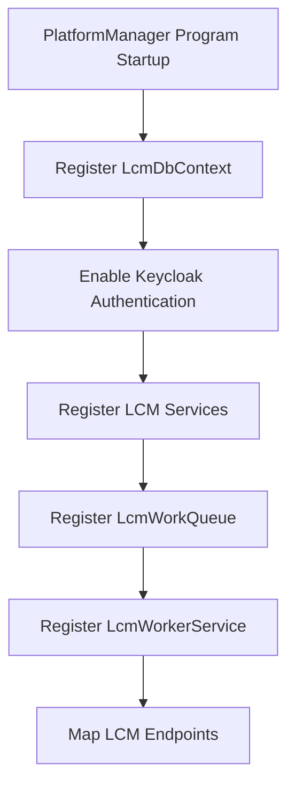

**Diagram sources**
- `src/PlatformManager/PlatformManager/Program.cs#L1-L200`

**Section sources**
- `src/PlatformManager/PlatformManager/Program.cs#L1-L200`

### VimAdapter gRPC Server
VimAdapter is a thin Python gRPC server that selects a VIM adapter at startup and validates inputs.

Key behaviors:

- Default VIM type is `k8s`.
- Config upload enforces host IP validation, payload size limits, and optional validation mode.
- Package upload enforces UUID validation, host IP validation, and streaming size limits.
- Errors map to gRPC status codes such as `INVALID_ARGUMENT`, `RESOURCE_EXHAUSTED`, `NOT_FOUND`, and `INTERNAL`.

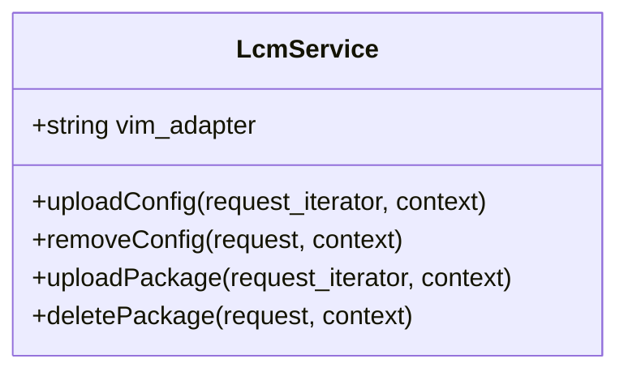

**Diagram sources**
- `src/VimAdapter/main.py#L1-L24`
- `src/VimAdapter/src/server/lcm_grpc_server.py#L1-L200`

**Section sources**
- `src/VimAdapter/main.py#L1-L24`
- `src/VimAdapter/src/server/lcm_grpc_server.py#L1-L200`

## Dependency Analysis
The main dependency relationships are:

- Meao depends on Catalogue, ApmApi, and PlatformManager.
- PlatformManager depends on VimAdapter via gRPC and on Catalogue for MEPM discovery.
- VimAdapter depends on Kubernetes or OpenStack infrastructure.
- Workflows depend on activities for external side effects.
- Placement decisions depend on Catalogue host inventory.

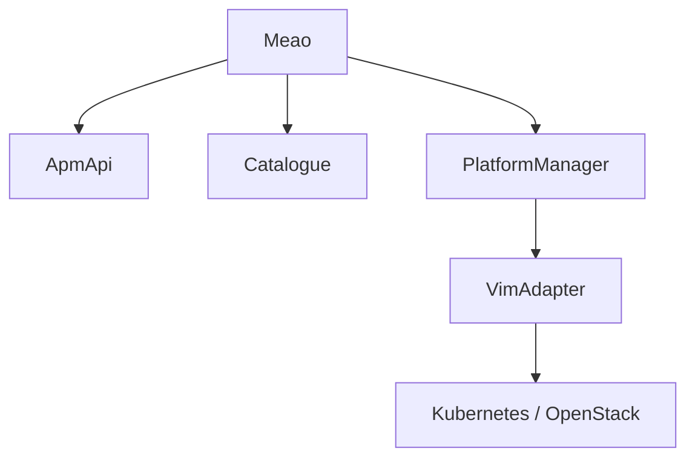

**Diagram sources**
- `docs/ARCHITECTURE.md#L40-L120`
- `README.md#L40-L120`

**Section sources**
- `docs/ARCHITECTURE.md#L40-L120`
- `README.md#L40-L120`

## Performance Considerations
- **Background Processing:** PlatformManager offloads long-running VIM provisioning to `LcmWorkerService`, avoiding blocking HTTP responses.
- **Timeout Enforcement:** Vim operation timeouts are configurable; defaults protect against hung VIM calls.
- **Crash Recovery:** On startup, PlatformManager replays `PROCESSING` operation occurrences created before process boot.
- **Eventual Consistency:** Catalogue and MEAO census states are updated after successful lifecycle operations; temporary inconsistency is tolerated until reconciliation completes.
- **OCI Distribution:** Modern CSAR distribution uses content-addressed OCI artifacts and pre-staging caches, reducing cold-start download costs.
- **Placement Cost:** Placement queries Catalogue hosts and evaluates policies; large host inventories increase selection time.

[No sources needed since this section provides general guidance]

## Troubleshooting Guide
Common issues and their likely causes:

| Symptom | Likely Cause | Recovery |
|---|---|---|
| Onboarding fails during AppD parsing | Invalid CSAR or missing descriptor | Inspect ApmApi parse logs; check staging claim fields |
| Instantiation times out | MEPM or VimAdapter unavailable | Verify MEPM health, VimAdapter gRPC, and target cluster/cloud connectivity |
| Capacity reservation succeeds but deployment fails | VIM provisioning error | Check `LcmWorkerService` logs and operation occurrence state |
| Termination leaves instance in inconsistent state | Compensation failure | Review Catalogue removal and capacity release logs; manually reconcile if needed |
| Grant request rejected | Missing or invalid fields | Validate `AppInstanceId`, `Operation`, `_links`, and resource definitions |
| No host selected | Constraints or policies reject all hosts | Adjust resource requirements, service requirements, latency constraints, or placement policies |

**Section sources**
- `src/Meao/Validators/GrantRequestValidator.cs#L1-L84`
- `src/Meao/Domain/Placement/PlacementEngine.cs#L1-L200`
- `src/PlatformManager/PlatformManager/Services/LcmWorkerService.cs#L1-L200`

## Conclusion
Optimist.Orchestrator implements a durable, event-driven MEC orchestration stack:

- ApmApi handles CSAR ingestion and descriptor parsing.
- Meao coordinates the full lifecycle through Temporal workflows, placing applications using Catalogue-backed constraints and policies.
- PlatformManager executes lifecycle operations asynchronously and bridges REST to VimAdapter gRPC.
- VimAdapter provisions workloads onto Kubernetes or OpenStack.
- Compensation mechanisms, crash recovery, and hybrid signal/poll synchronization provide resilience while accepting eventual consistency between MEAO, Catalogue, MEPM, and VIM states.