# Service Boundaries and Bounded Contexts

## Table of Contents
1. [Introduction](#introduction)
2. [Project Structure](#project-structure)
3. [Core Components](#core-components)
4. [Architecture Overview](#architecture-overview)
5. [Detailed Component Analysis](#detailed-component-analysis)
6. [Service Communication and API Contracts](#service-communication-and-api-contracts)
7. [Data Ownership and Bounded Context Boundaries](#data-ownership-and-bounded-context-boundaries)
8. [Authentication and Authorization Boundaries](#authentication-and-authorization-boundaries)
9. [Error Propagation Across Service Boundaries](#error-propagation-across-service-boundaries)
10. [Dependency Graph](#dependency-graph)
11. [Performance Considerations](#performance-considerations)
12. [Troubleshooting Guide](#troubleshooting-guide)
13. [Conclusion](#conclusion)

## Introduction
Optimist.Orchestrator implements the ETSI GS MEC orchestration stack across five deployable services: Meao, ApmApi, Catalogue, PlatformManager, and VimAdapter. The system is organized as a modular monolith at the MEO role level but deployed as separate processes with separate databases.

At the system level, Meao acts as the MEO orchestrator, ApmApi provides package management, and Catalogue stores inventory and census data. At the host level, PlatformManager executes lifecycle operations as the MEPM, and VimAdapter translates those operations into infrastructure provisioning calls for Kubernetes or OpenStack.

This document focuses on service boundaries, bounded contexts, responsibilities, communication patterns, API contracts, data ownership, authentication boundaries, and error propagation.

## Project Structure
The codebase groups each service under `src/`, plus shared libraries under `src/Common/` and documentation under `docs/`. Each .NET service registers itself with Consul, exposes REST endpoints, and owns its own PostgreSQL database. VimAdapter is implemented in Python and communicates over gRPC.

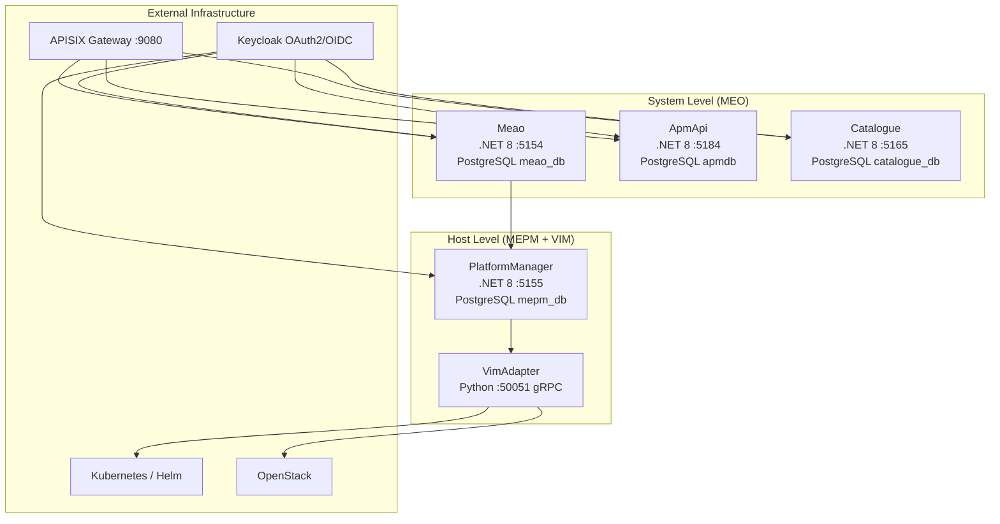

**Diagram sources**
- `README.md#L1-L200`
- `docs/ARCHITECTURE.md#L1-L200`

**Section sources**
- `README.md#L1-L200`
- `docs/ARCHITECTURE.md#L1-L200`

## Core Components
| Service | Role | Primary Responsibility | External API | Internal Boundary | Datastore |
|---|---|---|---|---|---|
| Meao | MEO orchestrator | Granting API, placement decisions, Temporal workflow orchestration, MEPM coordination | `/granting/v1/*` via APISIX; internal `/meao/v1/*` | Owns orchestration state and global intent; consumes ApmApi and Catalogue | PostgreSQL `meao_db` |
| ApmApi | Package management inside MEO | CSAR onboarding, AppD descriptor parsing, package validation and retrieval | `/app_pkgm/v1/onboarded_app_packages` | Owned by the MEO role but deployed separately; called by Meao workflows | PostgreSQL `apmdb` |
| Catalogue | Inventory and host census | Edge hosts, MEPM registry, app instance census, capacity headroom | `/catalogue/v1/*` | Internal MEO backing store; read by Meao and used to resolve MEPM URIs | PostgreSQL `catalogue_db` |
| PlatformManager | MEPM | LCM execution, REST-to-gRPC bridge, VIM configuration and package distribution | `/app_lcm/v1/*` (consumed directly by Meao, not through APISIX) | Host-level authority for running app instances | PostgreSQL `mepm_db` |
| VimAdapter | VIM adapter | Polymorphic infrastructure provisioning via Helm/Kubernetes or OpenStack SDK | gRPC `LCM` service on port 50051 | Lowest edge layer; no public REST surface | Local filesystem for configs and packages |

**Section sources**
- `README.md#L1-L200`
- `docs/CONTEXT-MAP.md#L1-L50`
- `docs/contexts/meao.md#L1-L29`
- `docs/contexts/apmapi.md#L1-L25`
- `docs/contexts/catalogue.md#L1-L25`
- `docs/contexts/platformmanager.md#L1-L33`
- `docs/contexts/vimadapter.md#L1-L25`

## Architecture Overview
The architecture separates system-level orchestration from host-level execution:

- **System level (MEO):** Meao coordinates lifecycle intent, performs placement using Catalogue inventory, produces the ETSI Granting API, and drives durable Temporal workflows. ApmApi manages CSAR packages inside the MEO role. Catalogue holds the unified inventory and census.
- **Host level (MEPM + VIM):** PlatformManager exposes `/app_lcm/v1`, validates grants against Meao, executes lifecycle operations, and bridges REST calls to VimAdapter over gRPC. VimAdapter selects a concrete VIM backend and provisions resources.

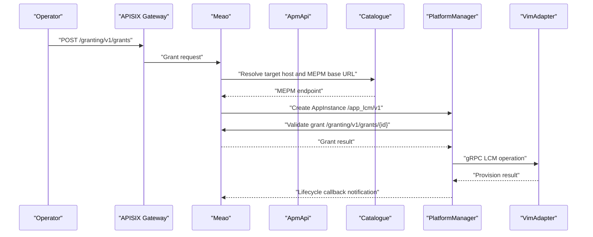

**Diagram sources**
- `docs/ARCHITECTURE.md#L1-L200`
- `docs/ADR/0043-mm3-cross-cluster-dynamic-mepm-routing.md#L1-L81`

**Section sources**
- `docs/ARCHITECTURE.md#L1-L200`
- `docs/CONTEXT-MAP.md#L1-L50`

## Detailed Component Analysis

### Meao — MEO Orchestrator
Meao is the MEO orchestration engine. Its responsibilities include:

- Producing the ETSI Granting API (`/granting/v1`).
- Hosting Temporal.io workflows that coordinate cross-service lifecycle operations.
- Performing placement decisions using Catalogue inventory.
- Resolving MEPM endpoints dynamically per host instead of relying on a fixed service discovery address.
- Receiving lifecycle notifications from PlatformManager and package-onboarding callbacks from ApmApi.
- Protecting internal control-plane endpoints such as `/meao/v1/subscriptions/callbacks`.

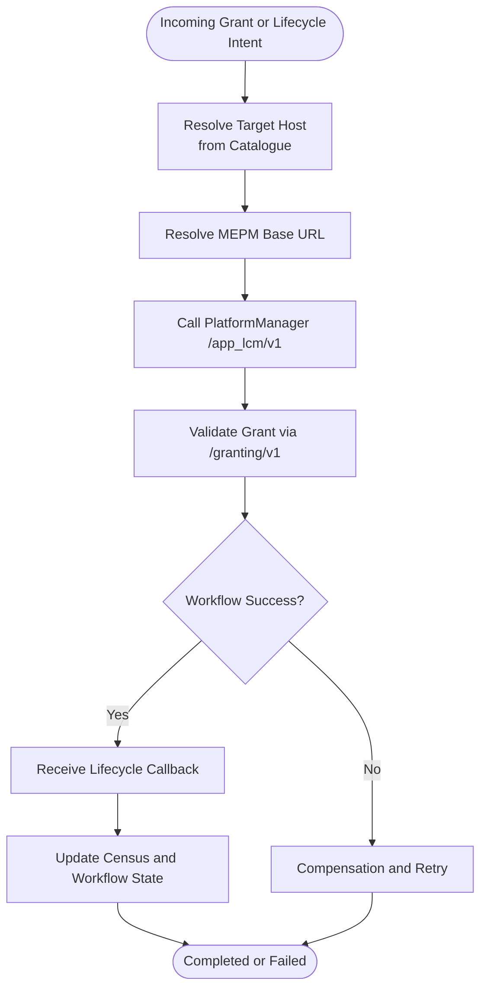

**Diagram sources**
- `docs/ADR/0043-mm3-cross-cluster-dynamic-mepm-routing.md#L1-L81`
- `docs/ADR/0059-etsi-subscription-callback-authentication-and-prefix-hardening.md#L1-L58`

**Section sources**
- `docs/contexts/meao.md#L1-L29`
- `docs/ADR/0043-mm3-cross-cluster-dynamic-mepm-routing.md#L1-L81`
- `docs/ADR/0059-etsi-subscription-callback-authentication-and-prefix-hardening.md#L1-L58`
- `src/Meao/appsettings.json#L1-L37`

### ApmApi — Application Package Management
ApmApi owns application package artifacts and their descriptors:

- Onboarding CSAR packages.
- Extracting and validating TOSCA AppD descriptors.
- Serving package metadata, content, image info, and validation results.
- Running background processing for long-running descriptor parsing jobs.
- Notifying Meao when packages become onboarded.
- Protecting its `/internal` activity-shim endpoints with Keycloak bearer authentication.

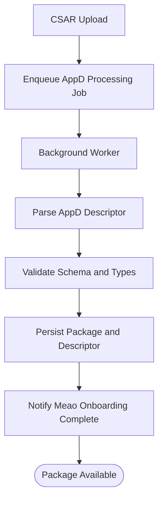

**Diagram sources**
- `docs/ADR/0039-durable-background-processing-queue.md#L1-L200`
- `docs/ADR/0057-meao-internal-apmapi-service-token-authentication.md#L1-L91`

**Section sources**
- `docs/contexts/apmapi.md#L1-L25`
- `docs/ADR/0039-durable-background-processing-queue.md#L1-L200`
- `docs/ADR/0057-meao-internal-apmapi-service-token-authentication.md#L1-L91`
- `src/ApmApi/appsettings.json#L1-L42`

### Catalogue — Inventory and Host Census
Catalogue is the internal MEO inventory backing store:

- Tracking registered MEC hosts, MEPM instances, and app instance census.
- Providing capacity headroom fields used by Meao’s placement engine.
- Supporting atomic capacity reservation and release for placement decisions.
- Supplying the authoritative mapping between host IP and MEPM base URL.
- Exposing internal APIs consumed by Meao and other MEO components.

```mermaid
classDiagram
    class EdgeHost {
        +string ip
        +string mepmIp
        +int totalCpuCores
        +int availableCpuCores
        +long totalRamMb
        +long availableRamMb
        +long totalStorageGb
        +long availableStorageGb
        +int allocatedInstances
    }

    class Mepm {
        +string ip
        +string baseUrl
    }

    class AppInstance {
        +string id
        +string hostIp
        +string status
    }

    EdgeHost ||--o{ AppInstance : "hosts"
    EdgeHost ||--|| Mepm : "managed by"
```

**Diagram sources**
- `docs/ADR/0048-canonical-wire-contracts-and-bounded-context-realignment.md#L1-L137`

**Section sources**
- `docs/contexts/catalogue.md#L1-L25`
- `docs/ADR/0048-canonical-wire-contracts-and-bounded-context-realignment.md#L1-L137`
- `src/Catalogue/appsettings.json#L1-L46`

### PlatformManager — MEPM Executing LCM Operations
PlatformManager is the host-level MEPM:

- Producing the ETSI App LCM API (`/app_lcm/v1`).
- Creating, instantiating, terminating, operating, and querying app instances.
- Validating grants against Meao before executing lifecycle operations.
- Bridging REST requests to VimAdapter over gRPC.
- Dispatching lifecycle operation occurrence notifications back to Meao.
- Managing internal plumbing endpoints for VIM configuration and package distribution.

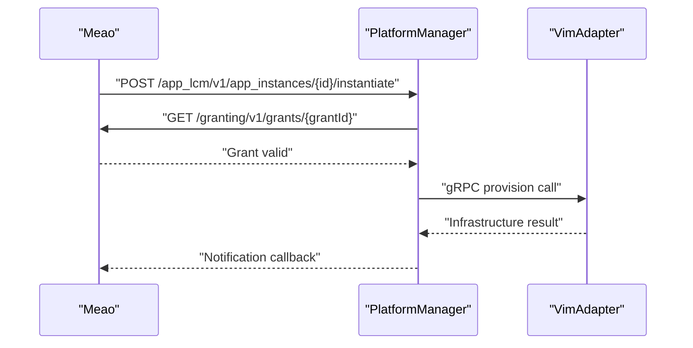

**Diagram sources**
- `docs/ADR/0043-mm3-cross-cluster-dynamic-mepm-routing.md#L1-L81`
- `docs/contexts/platformmanager.md#L1-L33`

**Section sources**
- `docs/contexts/platformmanager.md#L1-L33`
- `docs/ADR/0043-mm3-cross-cluster-dynamic-mepm-routing.md#L1-L81`
- `src/PlatformManager/PlatformManager/appsettings.json#L1-L37`

### VimAdapter — Infrastructure Provisioning
VimAdapter is the polymorphic VIM abstraction layer:

- Implementing a gRPC server on port 50051.
- Selecting a concrete adapter based on `vimType`: `k8s`/`helm` maps to Helm/Kubernetes, and `openstack` maps to OpenStack.
- Using a factory pattern so new VIM types can be added without changing callers.
- Keeping the gRPC contract stable so PlatformManager remains language-agnostic.
- Currently having a fully working Kubernetes/Helm path and a partial OpenStack path.

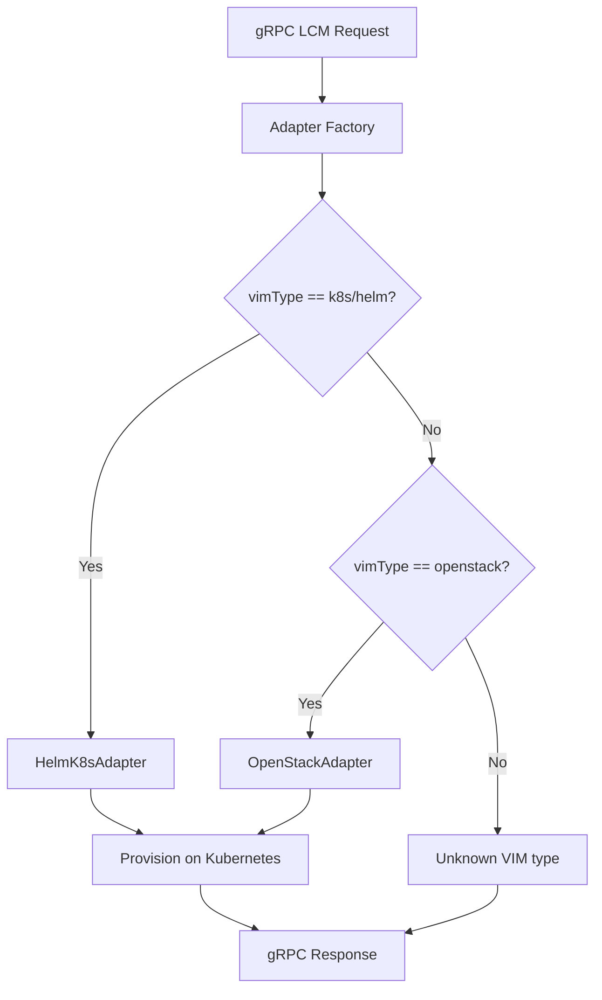

**Diagram sources**
- `docs/ADR/0012-vim-adapter-factory.md#L1-L46`
- `docs/ADR/0017-vimadapter-python.md#L1-L39`

**Section sources**
- `docs/contexts/vimadapter.md#L1-L25`
- `docs/ADR/0012-vim-adapter-factory.md#L1-L46`
- `docs/ADR/0017-vimadapter-python.md#L1-L39`

## Service Communication and API Contracts
The primary ETSI-aligned API surface is:

| ETSI API | Producer | Consumer | Transport | Contract Notes |
|---|---|---|---|---|
| App LCM | PlatformManager | Meao | HTTP REST `/app_lcm/v1` | Form-encoded lifecycle operations; returns operation occurrences |
| App Package Management | ApmApi | Operator and Meao | HTTP REST `/app_pkgm/v1/onboarded_app_packages` | CSAR upload, validation, metadata, subscription |
| Granting | Meao | PlatformManager | HTTP REST `/granting/v1/grants` | Resource allocation authorization consumed by MEPM |
| Catalogue | Catalogue | Meao (internal) | HTTP REST `/catalogue/v1` | Inventory, host census, MEPM registry |
| VIM LCM | VimAdapter | PlatformManager | gRPC | Stable proto contract; polymorphic adapters |

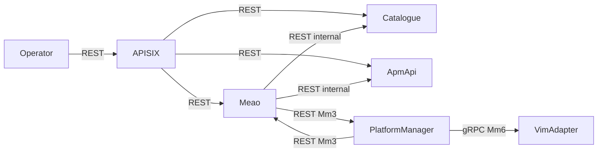

**Diagram sources**
- `README.md#L1-L200`
- `docs/ARCHITECTURE.md#L1-L200`

**Section sources**
- `README.md#L1-L200`
- `docs/ARCHITECTURE.md#L1-L200`

## Data Ownership and Bounded Context Boundaries
Each service owns its own database, and there are no distributed transactions across service boundaries. Consistency is eventual, coordinated by Temporal workflows, saga-style compensations, and reconciliation mechanisms.

| Service | Database Name | Ownership Boundary |
|---|---|---|
| Meao | `meao_db` | Orchestration state, grants, workflow history, global intent |
| ApmApi | `apmdb` | CSAR packages, AppD descriptors, package metadata |
| Catalogue | `catalogue_db` | Edge hosts, MEPM registry, app instance census, capacity headroom |
| PlatformManager | `mepm_db` | Host-level app instances, lifecycle operation occurrences, subscriptions |
| VimAdapter | Local filesystem | VIM configs, packages, Helm releases, provider-specific state |

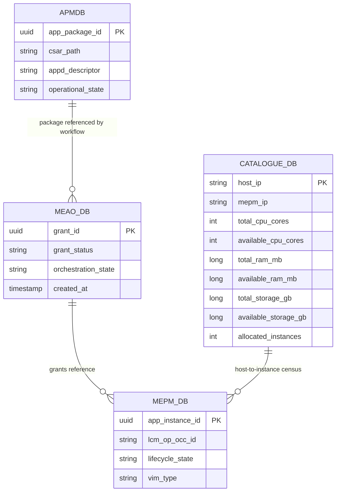

**Diagram sources**
- `docs/ADR/0011-per-service-datastores.md#L1-L47`
- `docs/ADR/0048-canonical-wire-contracts-and-bounded-context-realignment.md#L1-L137`

**Section sources**
- `docs/ADR/0011-per-service-datastores.md#L1-L47`
- `docs/ADR/0048-canonical-wire-contracts-and-bounded-context-realignment.md#L1-L137`
- `README.md#L1-L200`

## Authentication and Authorization Boundaries
Authentication is enforced differently depending on the boundary:

| Boundary | Authentication Model | Details |
|---|---|---|
| External API ingress | APISIX gateway + Keycloak | Public-facing routes `/granting/v1`, `/catalogue/v1`, `/app_pkgm/v1` pass through APISIX; Keycloak JWT bearer tokens protect management endpoints. |
| Meao → ApmApi internal calls | Client-credentials service token | ADR 0057 requires Meao to attach a bearer token obtained from Keycloak at activity execution time. Tokens never enter Temporal workflow payloads. |
| MEPM → Meao callbacks | OAuth2 client credentials | ADR 0059 requires PlatformManager and ApmApi to attach bearer tokens to outbound subscription callbacks only when the receiver is trusted. |
| Inbound Meao callbacks | RequireAuthorization | Both Meao callback routes require a valid Keycloak JWT; unauthenticated requests receive `401 Unauthorized`. |
| PlatformManager → Meao grant validation | Configurable MEAO granting URL | PlatformManager reads `MEAO_GRANTING_URL` and validates grants; transient failures are retried while invalid/expired grants return structured errors. |

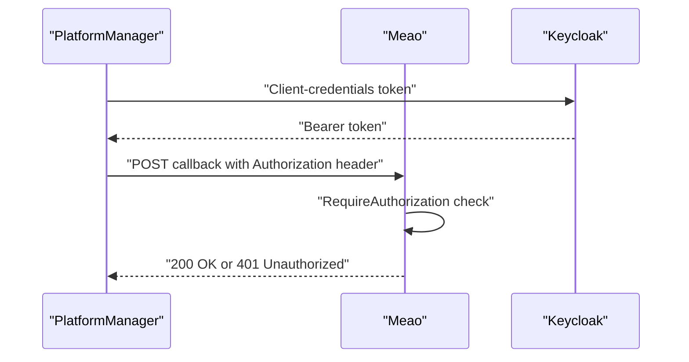

**Diagram sources**
- `docs/ADR/0057-meao-internal-apmapi-service-token-authentication.md#L1-L91`
- `docs/ADR/0059-etsi-subscription-callback-authentication-and-prefix-hardening.md#L1-L58`

**Section sources**
- `docs/ADR/0057-meao-internal-apmapi-service-token-authentication.md#L1-L91`
- `docs/ADR/0059-etsi-subscription-callback-authentication-and-prefix-hardening.md#L1-L58`
- `docs/ADR/0043-mm3-cross-cluster-dynamic-mepm-routing.md#L1-L81`
- `src/Meao/appsettings.json#L1-L37`
- `src/ApmApi/appsettings.json#L1-L42`
- `src/Catalogue/appsettings.json#L1-L46`
- `src/PlatformManager/PlatformManager/appsettings.json#L1-L37`

## Error Propagation Across Service Boundaries
Errors follow structured conventions rather than opaque text messages:

- **RFC 7807 Problem Details:** PlatformManager returns structured JSON errors with machine-readable `cause` values, correlated `appInstanceId`, `lcmOpOccId`, and an `instance` URI pointing to the affected operation occurrence.
- **Consumer symmetry:** Meao defines a `ProblemDetailsDto` to deserialize MEPM errors consistently.
- **Background job durability:** Long-running work uses bounded channels, scoped retries, exponential backoff, and dead-letter output for permanent failures.
- **Cross-service resilience:** Network failures are handled with retry and circuit-breaker patterns where configured; authentication failures are sanitized and do not leak secrets.

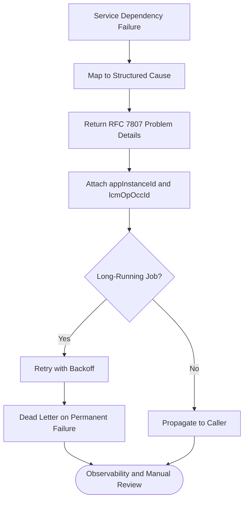

**Diagram sources**
- `docs/ADR/0025-rfc7807-structured-error-model.md#L1-L47`
- `docs/ADR/0039-durable-background-processing-queue.md#L1-L200`

**Section sources**
- `docs/ADR/0025-rfc7807-structured-error-model.md#L1-L47`
- `docs/ADR/0039-durable-background-processing-queue.md#L1-L200`

## Dependency Graph
The dependency graph shows runtime ownership and directionality. Dependencies flow outward from orchestration intent to execution and finally to infrastructure.

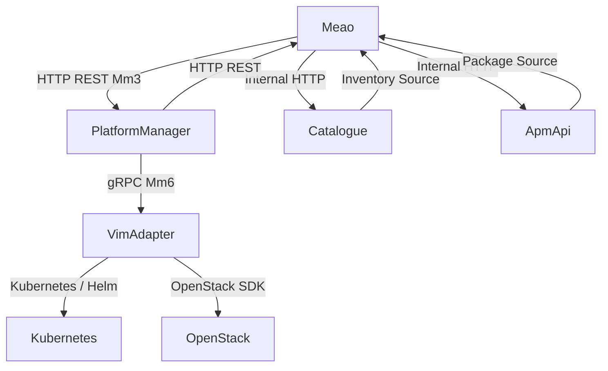

**Diagram sources**
- `docs/ARCHITECTURE.md#L1-L200`
- `docs/ADR/0009-meo-modular-monolith.md#L1-L40`
- `docs/ADR/0043-mm3-cross-cluster-dynamic-mepm-routing.md#L1-L81`

**Section sources**
- `docs/ADR/0009-meo-modular-monolith.md#L1-L40`
- `docs/ARCHITECTURE.md#L1-L200`
- `docs/ADR/0043-mm3-cross-cluster-dynamic-mepm-routing.md#L1-L81`

## Performance Considerations
- **Separate databases reduce coupling but remove cross-service ACID guarantees.** Correctness relies on workflow idempotency, compensation, and eventual consistency.
- **Temporal workflows provide durable orchestration,** making long-running multi-service flows resilient to process restarts.
- **Catalogue capacity headroom supports optimistic concurrency** for placement reservations, reducing double-booking risk during concurrent placement decisions.
- **Background queues use bounded channels and single-reader workers,** preventing memory growth and connection-pool starvation.
- **Keycloak token caching and single-flight refresh** reduce identity-provider overhead during high-frequency service-to-service calls.
- **gRPC between PlatformManager and VimAdapter** avoids HTTP overhead for infrastructure calls and keeps the VIM boundary language-agnostic.

[No sources needed since this section provides general guidance]

## Troubleshooting Guide
When diagnosing cross-service issues, start from the boundary most likely to fail:

| Symptom | Likely Boundary | Investigation Steps |
|---|---|---|
| Grant validation fails | PlatformManager → Meao | Check `MEAO_GRANTING_URL`, grant existence, grant expiry, and structured error cause. |
| Callback returns 404 | Meao subscription callback routing | Verify route prefix correction and exact callback URI format. |
| Callback returns 401 | Meao inbound authentication | Confirm outbound bearer token is attached by PlatformManager or ApmApi and that the destination is trusted. |
| ApmApi claim activities fail | Meao → ApmApi internal auth | Confirm Keycloak client credentials are configured and that the worker-side token handler attaches a bearer token. |
| Lifecycle operation stalls | PlatformManager → VimAdapter gRPC | Inspect gRPC timeout, VIM plugin address/port, and adapter selection based on `vimType`. |
| Placement selects wrong host | Catalogue inventory | Check host registration, MEPM base URL resolution, and capacity headroom fields. |
| Long-running job disappears | Background queue | Check channel backpressure, retry attempts, dead-letter directory, and correlation IDs. |

**Section sources**
- `docs/ADR/0043-mm3-cross-cluster-dynamic-mepm-routing.md#L1-L81`
- `docs/ADR/0057-meao-internal-apmapi-service-token-authentication.md#L1-L91`
- `docs/ADR/0059-etsi-subscription-callback-authentication-and-prefix-hardening.md#L1-L58`
- `docs/ADR/0039-durable-background-processing-queue.md#L1-L200`

## Conclusion
Optimist.Orchestrator models clear service boundaries around ETSI MEC roles:

- Meao owns orchestration intent, granting, and workflow coordination.
- ApmApi owns package artifacts and descriptors within the MEO role.
- Catalogue owns inventory, host census, and MEPM registry.
- PlatformManager owns host-level lifecycle execution and VIM bridging.
- VimAdapter owns concrete infrastructure provisioning.

Services communicate over well-defined contracts: REST for ETSI and internal orchestration boundaries, and gRPC for the VIM boundary. Data ownership is strict: each service has its own database, and cross-service consistency is eventual. Authentication is enforced at service boundaries, with special care taken to avoid leaking credentials into durable workflow histories. Errors are structured, correlatable, and designed for observability and recovery.

[No sources needed since this section summarizes without analyzing specific files]

> **Referenced Files in This Document**
>
> - `README.md`
> - `docs/ARCHITECTURE.md`
> - `docs/CONTEXT-MAP.md`
> - `docs/contexts/meao.md`
> - `docs/contexts/apmapi.md`
> - `docs/contexts/catalogue.md`
> - `docs/contexts/platformmanager.md`
> - `docs/contexts/vimadapter.md`
> - `docs/ADR/0009-meo-modular-monolith.md`
> - `docs/ADR/0011-per-service-datastores.md`
> - `docs/ADR/0012-vim-adapter-factory.md`
> - `docs/ADR/0017-vimadapter-python.md`
> - `docs/ADR/0025-rfc7807-structured-error-model.md`
> - `docs/ADR/0039-durable-background-processing-queue.md`
> - `docs/ADR/0043-mm3-cross-cluster-dynamic-mepm-routing.md`
> - `docs/ADR/0048-canonical-wire-contracts-and-bounded-context-realignment.md`
> - `docs/ADR/0057-meao-internal-apmapi-service-token-authentication.md`
> - `docs/ADR/0059-etsi-subscription-callback-authentication-and-prefix-hardening.md`
> - `src/Meao/appsettings.json`
> - `src/ApmApi/appsettings.json`
> - `src/Catalogue/appsettings.json`
> - `src/PlatformManager/PlatformManager/appsettings.json`
