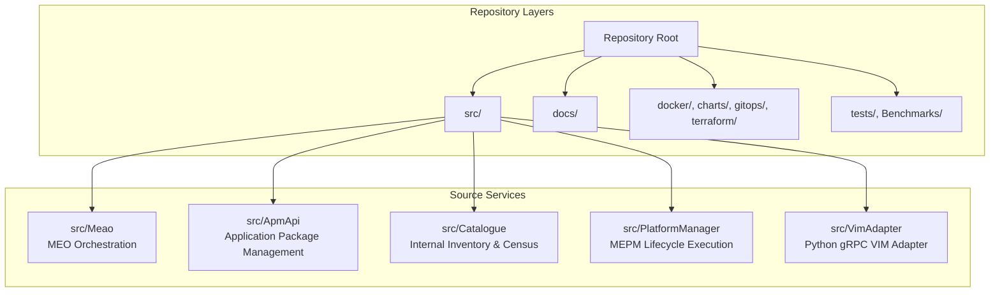
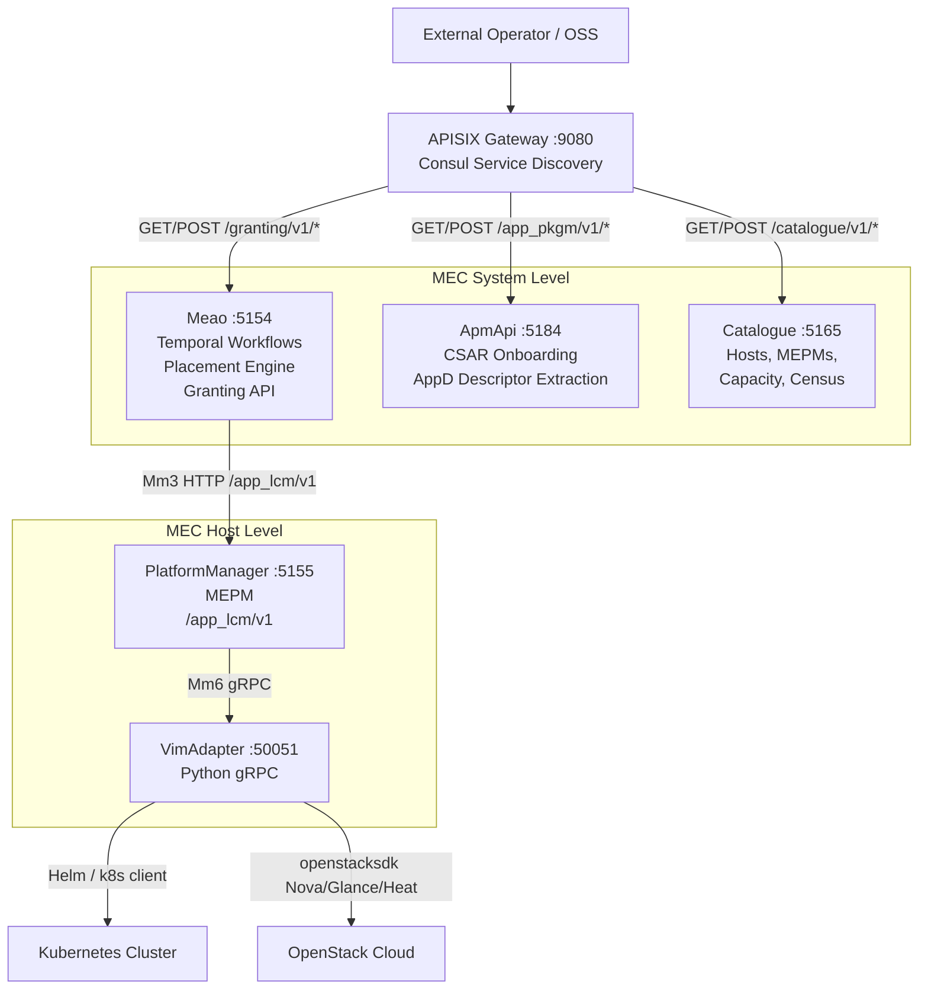
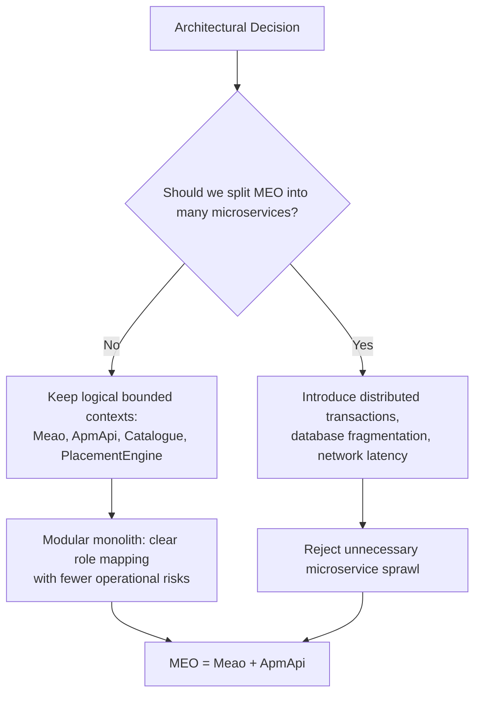
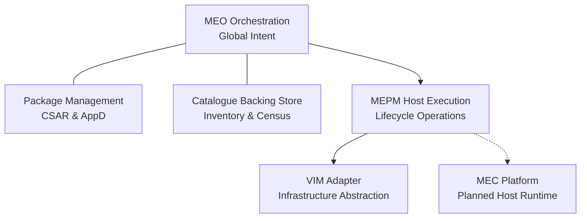
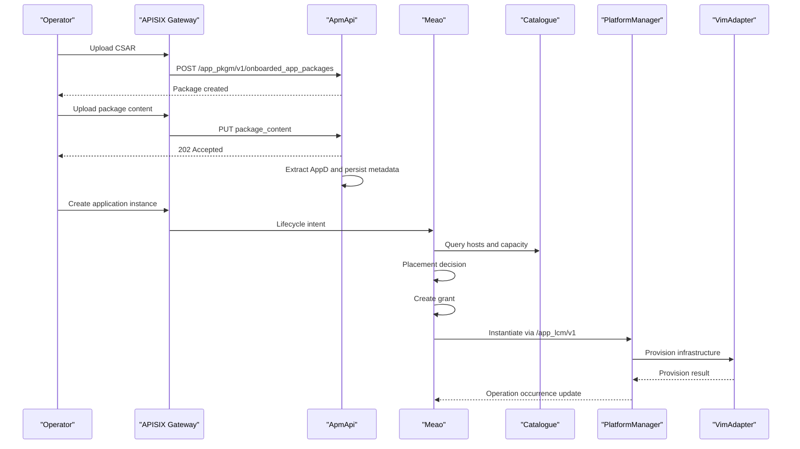
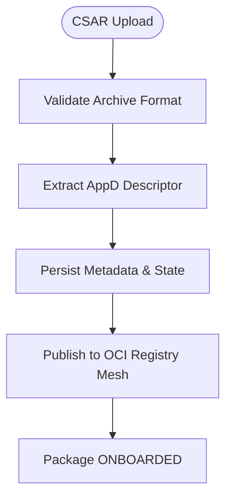
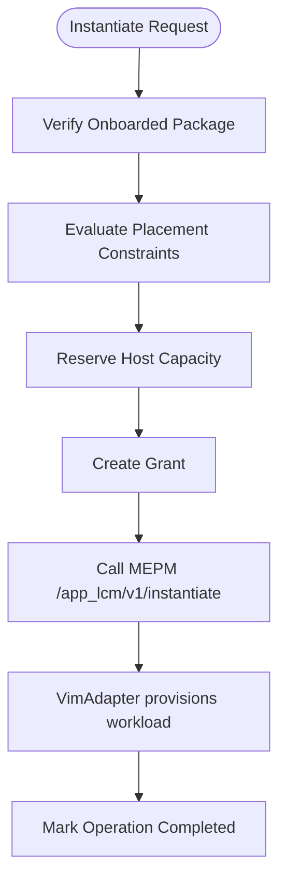
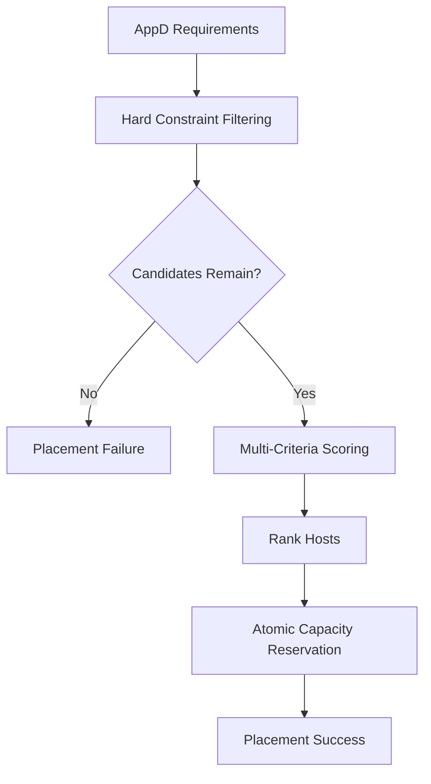
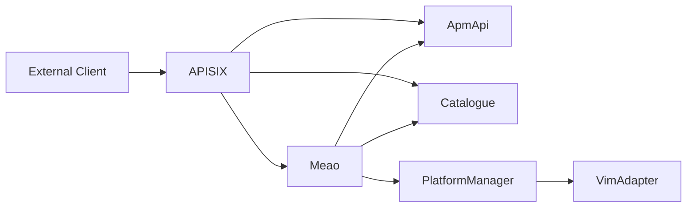

# System Overview and ETSI MEC Compliance

## Table of Contents
1. [Introduction](#introduction)
2. [Project Structure](#project-structure)
3. [Core Components](#core-components)
4. [Architecture Overview](#architecture-overview)
5. [Detailed Component Analysis](#detailed-component-analysis)
6. [Dependency Analysis](#dependency-analysis)
7. [Performance Considerations](#performance-considerations)
8. [Troubleshooting Guide](#troubleshooting-guide)
9. [Conclusion](#conclusion)

## Introduction
Optimist.Orchestrator is an ETSI GS MEC 010-2 v3.1.1-compliant orchestrator suite for Multi-access Edge Computing. It implements the MEO, MEPM, and VIM adapter roles, while keeping MEP as a planned host-level runtime component. The system separates lifecycle intent from execution: Meao owns orchestration and package management (MEO), PlatformManager owns host-level lifecycle execution (MEPM), and VimAdapter translates lifecycle operations into Kubernetes or OpenStack primitives.

The project is organized as a modular monolith at the MEO level: `Meao` provides workflow orchestration, placement, and granting, while `ApmApi` handles CSAR onboarding and descriptor extraction. Both together implement the MEO role even though they are independently deployable services. This design keeps clear bounded contexts without introducing distributed-system complexity where it does not add value.

This document explains how the architecture maps to ETSI MEC roles, why the modular monolith was chosen over microservices, and how CSAR-based application lifecycle flows proceed from package onboarding through placement, instantiation, operation, and termination.

**Section sources**
- `README.md#L1-L60`
- `docs/ARCHITECTURE.md#L1-L60`
- `docs/CONTEXT-MAP.md#L1-L50`

## Project Structure
At a high level, the repository is divided into:
- .NET services: `Meao`, `ApmApi`, `Catalogue`, `PlatformManager`.
- Python service: `VimAdapter`.
- Shared libraries under `Common`.
- Infrastructure configuration under `docker`, `charts`, `gitops`, `terraform`, and Ansible.
- Documentation, ADRs, test projects, benchmarks, scripts, and sample artifacts.

**Diagram sources**
- `README.md#L12-L50`
- `docs/ARCHITECTURE.md#L60-L140`

**Section sources**
- `README.md#L12-L50`
- `docs/ARCHITECTURE.md#L60-L140`

## Core Components
The core components map directly to ETSI MEC roles and reference points:

| Component | Role Mapping | Primary Responsibility | External API Surface | Internal Responsibility |
|---|---|---|---|---|
| **Meao** | MEO | Workflow orchestration, placement decisions, grant issuance | `/granting/v1/*` via APISIX; internal `/meao/v1/*` | Temporal workflows, catalog queries, MEPM coordination |
| **ApmApi** | MEO package-management module | CSAR upload, validation, descriptor extraction, package metadata | `/app_pkgm/v1/*` via APISIX | AppD parsing, staged upload handling, package state transitions |
| **Catalogue** | MEO inventory backing store | Host registry, MEPM registry, capacity headroom, app-instance census | `/catalogue/v1/*` via APISIX | Capacity reservation, host lookup by coordinates or MEPM type |
| **PlatformManager** | MEPM | Lifecycle execution, LCM operation occurrences, subscription notifications | `/app_lcm/v1/*` consumed by Meao on the management plane | REST-to-gRPC bridge, state machine, VimAdapter dispatch |
| **VimAdapter** | VIM adapter | Translate lifecycle commands into infrastructure actions | gRPC `LCM` service on port 50051 | Helm/Kubernetes or OpenStack provisioning |

ETSI MEC roles are functional boundaries, not strict code packaging rules. In this implementation:
- MEO = `Meao` + `ApmApi`.
- MEPM = `PlatformManager`.
- VIM adapter = `VimAdapter`.
- MEP is planned but not yet implemented.

**Section sources**
- `README.md#L1-L60`
- `docs/ARCHITECTURE.md#L60-L140`
- `docs/CONTEXT-MAP.md#L1-L50`
- `docs/contexts/meao.md#L1-L29`
- `docs/contexts/platformmanager.md#L1-L33`
- `docs/contexts/vimadapter.md#L1-L25`

## Architecture Overview
The system follows a two-level MEC architecture:

- **System Level (MEO):** Meao, ApmApi, and Catalogue coordinate global lifecycle intent, package ownership, placement decisions, grants, and cross-host census information.
- **Host Level (MEPM + VIM):** PlatformManager executes lifecycle operations locally and delegates infrastructure work to VimAdapter, which targets Kubernetes or OpenStack.

External clients enter through APISIX. Meao consumes PlatformManager directly on the management plane rather than routing `/app_lcm/v1` through the gateway. This enforces that lifecycle execution remains owned by MEPM and orchestrated by MEO.

**Diagram sources**
- `docs/ARCHITECTURE.md#L1-L60`
- `docs/ADR/0007-apisix-api-gateway.md#L1-L41`
- `docs/ONBOARDING_AND_LIFECYCLE_ARCHITECTURE_REVIEW.md#L180-L260`

### ETSI Reference Point Summary
| Reference Point | Meaning in This System | Direction | Transport |
|---|---|---|---|
| Mm1 | Operator or OSS interface to MEO | Operator → Meao | HTTP via APISIX |
| Mm3 | MEO ↔ MEPM orchestration coordination | Meao ↔ PlatformManager | HTTP REST |
| Mm5 | MEPM ↔ MEP platform configuration | Planned | REST |
| Mm6 | MEPM ↔ VIM adapter | PlatformManager → VimAdapter | gRPC |
| Mm7 | VIM ↔ virtualized infrastructure | VimAdapter → K8s/OpenStack | Helm SDK / openstacksdk |
| Mp1 | MEC application ↔ MEP | Planned | REST |

**Section sources**
- `docs/ARCHITECTURE.md#L100-L180`
- `docs/CONTEXT-MAP.md#L20-L50`

## Detailed Component Analysis

### Modular Monolith vs Microservices Decision
The MEO role spans `Meao` and `ApmApi`. Although these are separate processes with different ports and datastores, they are intentionally treated as one architectural unit implementing the MEO role.

Key reasons for choosing a modular monolith approach over microservices include:
- ETSI defines functional roles and reference points, not code packaging boundaries.
- Decomposing catalogue, inventory, topology, placement, and workflow concerns into separate physical microservices introduces distributed-monolith overhead without proportional benefit.
- Reusing existing components reduces coupling, database fragmentation, distributed transactions, and latency.
- Logical separation is preserved through bounded contexts, while deployment units remain manageable.

**Diagram sources**
- `docs/ADR/0009-meo-modular-monolith.md#L1-L40`
- `docs/ADR/0045-meo-placement-engine-and-unified-catalogue-inventory-model.md#L1-L67`

**Section sources**
- `docs/ADR/0009-meo-modular-monolith.md#L1-L40`
- `docs/ADR/0045-meo-placement-engine-and-unified-catalogue-inventory-model.md#L1-L67`

### Bounded Contexts
The domain is structured into six bounded contexts across the MEC system level and host level:

| Bounded Context | Implementation | Purpose |
|---|---|---|
| MEO Orchestration | `src/Meao` | Global lifecycle intent, grant decisions, Temporal workflows |
| Package Management | `src/ApmApi` | CSAR onboarding, descriptor extraction, package validation |
| Catalogue Backing Store | `src/Catalogue` | Hosts, MEPM instances, capacity, app-instance census |
| MEPM Host Execution | `src/PlatformManager` | Lifecycle execution, operation occurrences, subscriptions |
| MEC Platform | `src/Mep` | Planned host-level service discovery and support interfaces |
| VIM Adapter | `src/VimAdapter` | Infrastructure-specific provisioning through gRPC |

**Diagram sources**
- `docs/CONTEXT-MAP.md#L1-L50`

**Section sources**
- `docs/CONTEXT-MAP.md#L1-L50`

### CSAR-Based Application Lifecycle
The lifecycle is driven by CSAR packages and follows ETSI-aligned phases:

1. **Package Onboarding:** An operator uploads a CSAR to `ApmApi`. The service validates the archive, extracts TOSCA AppD descriptors, persists metadata, and marks the package onboarded.
2. **Package Distribution:** The CSAR is published to an OCI content-addressed registry mesh (`meao-zot`, `mepm-zot`, `mec-host-zot`) so downstream MEPM and VIM layers can pull immutable artifacts by digest.
3. **Application Creation:** MEO creates an application instance resource and associates it with an onboarded package.
4. **Placement:** MEO evaluates constraints such as required compute, storage, GPU, MEC services, and latency against Catalogue inventory.
5. **Granting:** MEO issues a grant through `/granting/v1/grants`, allowing MEPM to allocate resources before execution.
6. **Instantiation:** MEO calls MEPM’s `/app_lcm/v1/app_instances/{id}/instantiate`; MEPM coordinates VimAdapter to provision resources.
7. **Operation:** MEO requests state changes through `/app_lcm/v1/app_instances/{id}/operate`.
8. **Termination:** MEO requests termination through `/app_lcm/v1/app_instances/{id}/terminate`.
9. **Notification:** MEPM emits lifecycle-operation occurrence notifications and callbacks to MEO.

**Diagram sources**
- `docs/CSAR_DISTRIBUTION_AND_LIFECYCLE_ARCHITECTURE.md#L1-L120`
- `docs/ONBOARDING_AND_LIFECYCLE_ARCHITECTURE_REVIEW.md#L200-L340`
- `docs/MEPM_LCM_API.md#L1-L120`

#### Onboarding Flow
Onboarding is mandatory before instantiation. The pipeline validates CSAR magic bytes, deserializes TOSCA metadata, persists durable package records, transitions onboarding state, and distributes the package to edge registries.

**Diagram sources**
- `docs/ONBOARDING_AND_LIFECYCLE_ARCHITECTURE_REVIEW.md#L220-L300`
- `docs/CSAR_DISTRIBUTION_AND_LIFECYCLE_ARCHITECTURE.md#L60-L140`

#### Instantiation Flow
Instantiation involves placement, granting, MEPM coordination, and VIM provisioning.

**Diagram sources**
- `docs/ONBOARDING_AND_LIFECYCLE_ARCHITECTURE_REVIEW.md#L260-L340`
- `docs/ADR/0045-meo-placement-engine-and-unified-catalogue-inventory-model.md#L30-L67`

**Section sources**
- `docs/CSAR_DISTRIBUTION_AND_LIFECYCLE_ARCHITECTURE.md#L1-L120`
- `docs/ONBOARDING_AND_LIFECYCLE_ARCHITECTURE_REVIEW.md#L200-L340`
- `docs/MEPM_LCM_API.md#L60-L180`

### Placement Engine and Catalogue Inventory
The placement engine evaluates whether a target host satisfies hard constraints and then ranks candidates using soft criteria.

Hard filtering considers:
- VIM type compatibility.
- Insufficient CPU, RAM, or storage headroom.
- Missing GPU requirements.
- Missing mandatory MEC services.
- Latency exceeding the maximum acceptable threshold.

Soft scoring considers:
- Latency proximity.
- Resource headroom distribution policy.
- Optional MEC service affinity.

After ranking, the engine reserves capacity atomically in Catalogue before invoking MEPM instantiation.

**Diagram sources**
- `docs/ADR/0045-meo-placement-engine-and-unified-catalogue-inventory-model.md#L30-L67`

**Section sources**
- `docs/ADR/0045-meo-placement-engine-and-unified-catalogue-inventory-model.md#L1-L67`

### APISIX Gateway and External Entry Points
APISIX is the single external entry point for MEO-facing APIs. It routes:
- `/granting/v1/*` to Meao.
- `/app_pkgm/v1/*` to ApmApi.
- `/catalogue/v1/*` to Catalogue.
- `/meao/v1/*` to Meao for internal MEO control-plane access.

MEPM’s `/app_lcm/v1` is intentionally excluded from APISIX because it belongs to the management plane and must be invoked by Meao during orchestration, not bypassed by external callers.

**Section sources**
- `docs/ADR/0007-apisix-api-gateway.md#L1-L41`
- `docs/ARCHITECTURE.md#L100-L180`
- `docs/ONBOARDING_AND_LIFECYCLE_ARCHITECTURE_REVIEW.md#L140-L200`

## Dependency Analysis
The main dependency relationships are:

**Diagram sources**
- `docs/ARCHITECTURE.md#L1-L60`
- `docs/ONBOARDING_AND_LIFECYCLE_ARCHITECTURE_REVIEW.md#L180-L260`

Coupling and cohesion observations:
- Meao depends on ApmApi for package metadata and validation during lifecycle workflows.
- Meao depends on Catalogue for host inventory, capacity, and MEPM resolution.
- Meao depends on PlatformManager for lifecycle execution.
- PlatformManager depends on VimAdapter for infrastructure provisioning.
- Catalogue acts as a cohesive backing store for MEO inventory and capacity decisions.
- ApmApi is decoupled from lifecycle execution, focusing on package integrity and descriptor extraction.

Potential risks:
- If ApmApi is unavailable, lifecycle workflows cannot validate or download onboarded packages.
- If Catalogue lacks accurate host inventory, placement decisions may fail or select unsuitable hosts.
- If PlatformManager is unreachable, Meao cannot express lifecycle intent.
- If VimAdapter fails, infrastructure provisioning cannot complete.

**Section sources**
- `docs/ARCHITECTURE.md#L60-L140`
- `docs/ADR/0009-meo-modular-monolith.md#L20-L40`

## Performance Considerations
Several architectural choices are particularly relevant for edge scenarios:

- **Content-addressed CSAR distribution:** Using OCI registries and SHA-256 digests avoids repeated full-archive streaming and enables deduplication, caching, and air-gap support.
- **Pre-staging to edge caches:** CSARs can be pre-staged to MEPM and MEC-host registries so instantiation does not block on central MEO downloads.
- **Per-service databases:** Each .NET service uses its own PostgreSQL database, supporting independent scaling and failure domains.
- **Temporal workflows:** Durable orchestration survives pod restarts and supports saga-style compensation and retry semantics.
- **API gateway centralization:** TLS termination, rate limiting, and routing are centralized at APISIX, reducing per-service cross-cutting complexity.
- **Avoiding unnecessary microservices:** Keeping logical domains inside deployable services prevents distributed-monolith overhead while preserving clear boundaries.

Edge computing differs from cloud computing in important ways:
- Lower latency tolerance favors local execution and reduced round trips to central clouds.
- Network reliability may be intermittent, requiring durable workflows and resilient distribution.
- Compute, memory, GPU, and storage capacity are constrained compared to large cloud regions.
- Applications often require platform services close to data sources or users.
- Placement policies must consider geolocation, latency ceilings, and MEC service availability.

This architecture serves edge scenarios by placing lifecycle execution near the infrastructure, separating orchestration intent from execution, and providing placement-aware selection of MEC hosts.

**Section sources**
- `docs/CSAR_DISTRIBUTION_AND_LIFECYCLE_ARCHITECTURE.md#L60-L140`
- `docs/ADR/0045-meo-placement-engine-and-unified-catalogue-inventory-model.md#L30-L67`
- `docs/ARCHITECTURE.md#L140-L220`

## Troubleshooting Guide
Common operational areas to inspect:

| Symptom | Likely Area | What to Check |
|---|---|---|
| CSAR upload accepted but package never becomes ONBOARDED | ApmApi background processing | Descriptor extraction, persistence, and state transition logic |
| Instantiation fails because package is missing | Meao → ApmApi | Package onboarding prerequisites and download activity |
| Placement returns no suitable host | Catalogue inventory | Host registration, capacity headroom, VIM type, MEC services, coordinates |
| Grant creation succeeds but MEPM rejects instantiation | PlatformManager | Grant validity, host association, VIM connection info |
| Lifecycle operation stays PROCESSING | PlatformManager → VimAdapter | gRPC communication, Helm or OpenStack provisioning status |
| Subscription callback not received | Authentication or callback URI | Keycloak token provider, callback URI DNS/rebinding hardening, subscriber auth |
| External API call reaches wrong service | APISIX routing | Consul service discovery and route definitions |

Error handling in the system combines HTTP status codes, RFC 7807 Problem Details, lifecycle-operation occurrence states, and subscription notifications. For example, asynchronous lifecycle operations return `202 Accepted` with an operation occurrence identifier, while invalid state transitions or malformed requests return appropriate error responses.

**Section sources**
- `docs/MEPM_LCM_API.md#L120-L298`
- `docs/ONBOARDING_AND_LIFECYCLE_ARCHITECTURE_REVIEW.md#L340-L500`
- `README.md#L60-L120`

## Conclusion
Optimist.Orchestrator implements ETSI GS MEC 010-2 v3.1.1 by clearly separating MEO orchestration intent from MEPM execution and VIM provisioning. The modular monolith approach keeps bounded contexts explicit while avoiding the cost of unnecessary microservice decomposition. CSAR-based onboarding, OCI content-addressed distribution, Temporal workflows, placement-aware host selection, and gRPC-backed VIM adapters form a cohesive edge-native architecture.

For operators, the most important boundary is that package onboarding precedes lifecycle operations, placement selects a host based on real constraints, granting authorizes MEPM execution, and lifecycle outcomes are observed through operation occurrences and subscription callbacks. For maintainers, the most important architectural principle is that ETSI roles describe responsibilities, while code organization should prioritize clarity, durability, and edge suitability over distributed complexity.

> **Referenced Files in This Document**
>
> - `README.md`
> - `docs/ARCHITECTURE.md`
> - `docs/CONTEXT-MAP.md`
> - `docs/CSAR_DISTRIBUTION_AND_LIFECYCLE_ARCHITECTURE.md`
> - `docs/MEPM_LCM_API.md`
> - `docs/ONBOARDING_AND_LIFECYCLE_ARCHITECTURE_REVIEW.md`
> - `docs/ADR/0007-apisix-api-gateway.md`
> - `docs/ADR/0009-meo-modular-monolith.md`
> - `docs/ADR/0045-meo-placement-engine-and-unified-catalogue-inventory-model.md`
> - `docs/contexts/meao.md`
> - `docs/contexts/platformmanager.md`
> - `docs/contexts/vimadapter.md`
