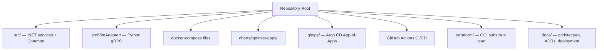
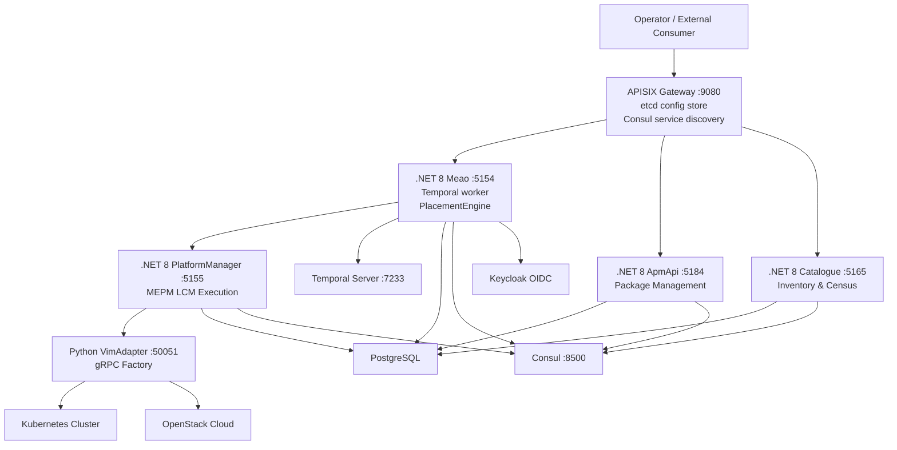
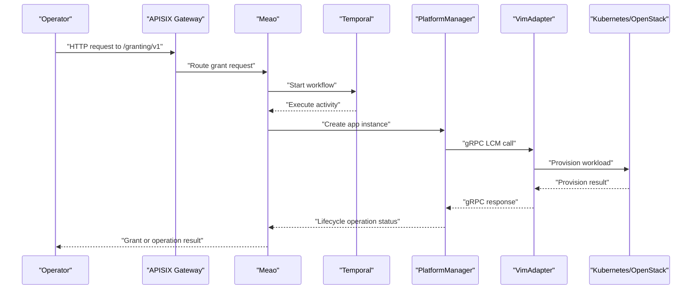
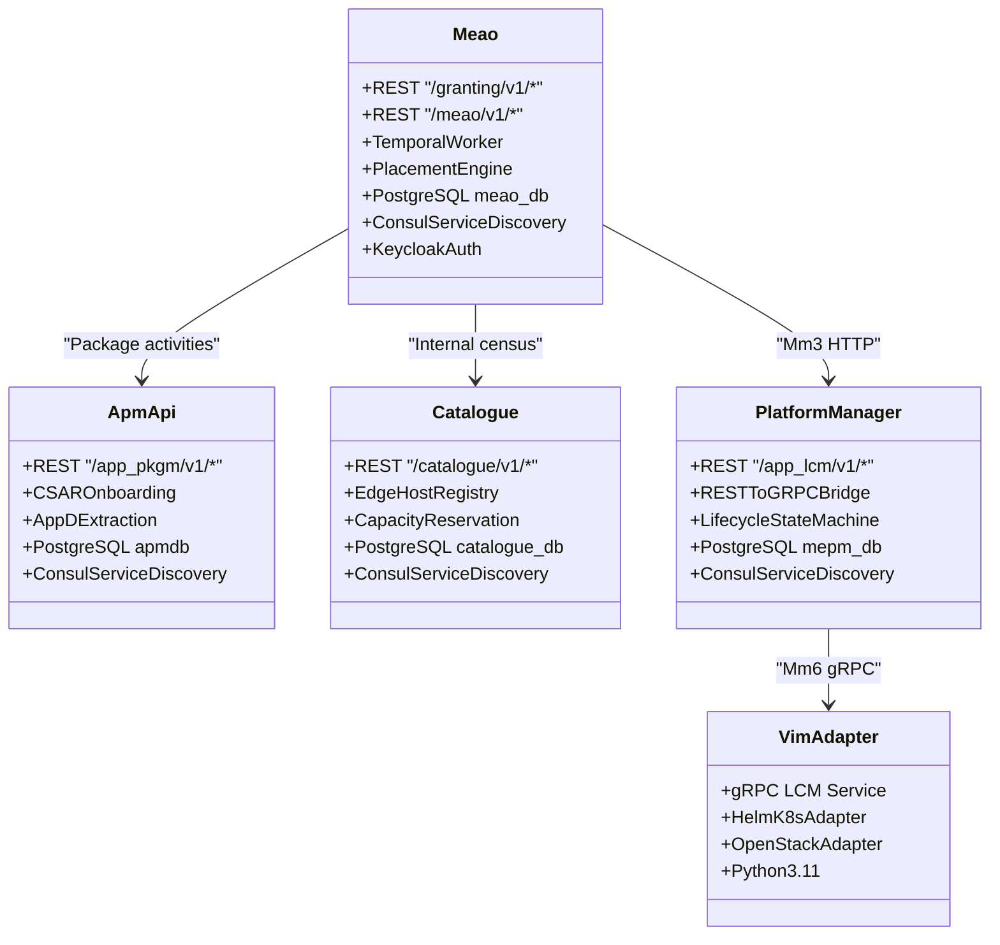
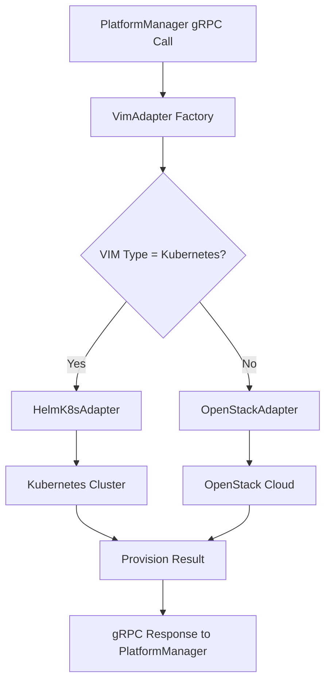
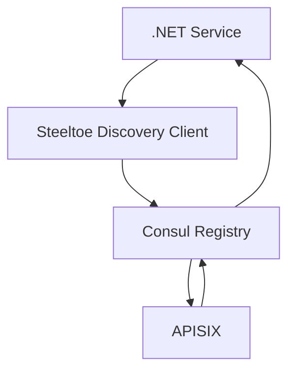
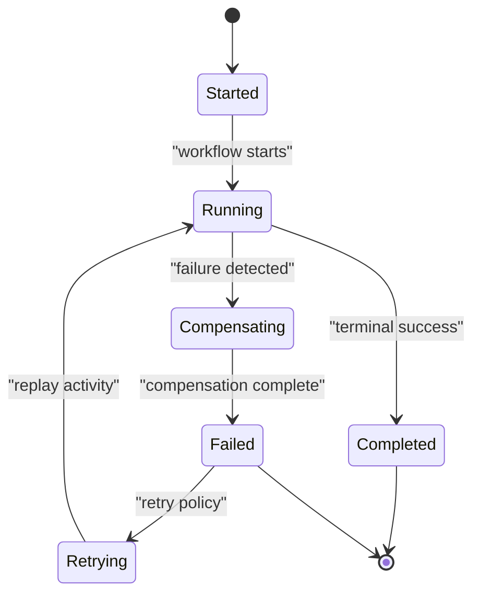
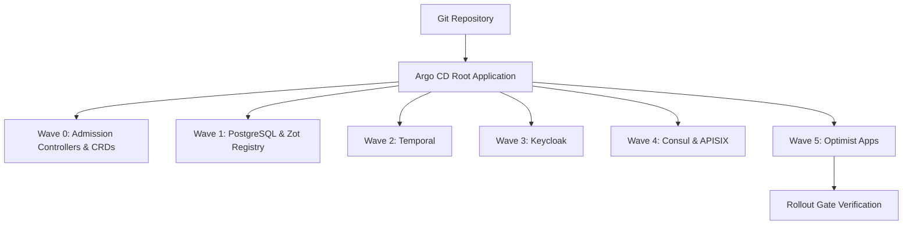
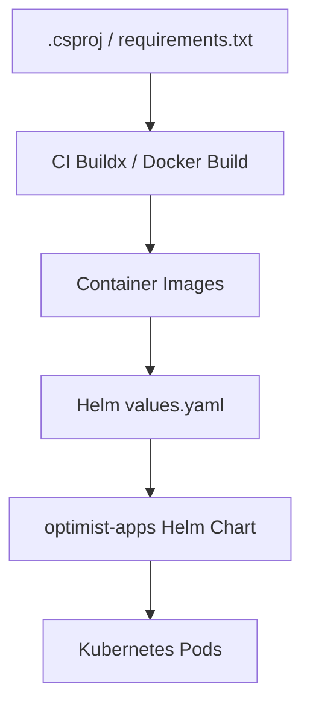
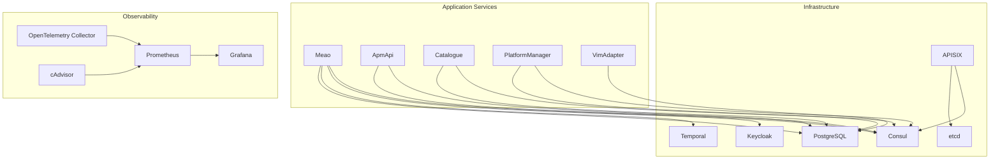

# Technology Stack and Infrastructure Dependencies

<cite>
**Referenced Files in This Document**   
- `README.md`
- `docs/ARCHITECTURE.md`
- `docs/DEPLOYMENT.md`
- `docker-compose.yml`
- `docker-compose.infra.yml`
- `Tiltfile`
- `charts/optimist-apps/values.yaml`
- `charts/optimist-apps/Chart.yaml`
- `charts/optimist-apps/templates/deployment.yaml`
- `gitops/bootstrap/root-app.yaml`
- `.github/workflows/ci.yml`
- `.github/workflows/cd.yml`
- `terraform/README.md`
- `terraform/providers.tf`
- `terraform/compute.tf`
- `terraform/network.tf`
- `terraform/variables.tf`
- `src/VimAdapter/Dockerfile`
- `src/VimAdapter/requirements.txt`
- `src/Meao/Dockerfile`
- `src/ApmApi/Dockerfile`
- `src/Catalogue/Dockerfile`
- `docs/ADR/0006-temporal-orchestration-engine.md`
- `docs/ADR/0007-apisix-api-gateway.md`
- `docs/ADR/0008-consul-service-discovery.md`
- `docs/ADR/0017-vimadapter-python.md`
- `docs/ADR/0023-dotnet8-baseline.md`
- `docs/ADR/0047-declarative-gitops-cad-argocd-app-of-apps.md`
</cite>

## Table of Contents
1. Introduction
2. Project Structure
3. Core Components
4. Architecture Overview
5. Detailed Component Analysis
6. Dependency Analysis
7. Performance Considerations
8. Troubleshooting Guide
9. Version Compatibility Matrix
10. Migration Guidance
11. Conclusion

## Introduction
Optimist.Orchestrator is an ETSI GS MEC 010-2 v3.1.1-compliant orchestration suite that implements the Multi-access Edge Orchestrator (MEO), MEC Platform Manager (MEPM), and Virtualisation Infrastructure Manager (VIM) adapter roles. The system runs five primary services: Meao, ApmApi, Catalogue, PlatformManager, and VimAdapter. It is deployed through Docker Compose for development and Kubernetes via Helm and Argo CD for production GitOps.

The technology stack combines:
- .NET 8 services for MEO, package management, catalogue, and MEPM.
- Python 3.11 gRPC VimAdapter for Kubernetes and OpenStack backends.
- PostgreSQL for per-service data persistence.
- Consul for service discovery and APISIX configuration integration.
- Keycloak for OAuth2/OIDC identity.
- Temporal.io for durable workflow orchestration.
- Prometheus, Grafana, OpenTelemetry, and cAdvisor for observability.
- OCI Terraform scaffolding for Oracle Cloud Infrastructure substrate planning.

This document focuses on infrastructure dependencies, deployment topology, scaling considerations, platform-specific guidance, and upgrade compatibility.

**Section sources**
- `README.md#L21-L80`
- `docs/ARCHITECTURE.md#L1-L50`

## Project Structure
At a high level, the repository separates application code, infrastructure definitions, GitOps manifests, CI/CD workflows, documentation, and cloud substrate modeling:

| Area | Responsibility |
|------|----------------|
| `src/` | .NET 8 services (`Meao`, `ApmApi`, `Catalogue`, `PlatformManager`) and shared libraries under `Common/`. |
| `src/VimAdapter/` | Python gRPC VIM adapter with Kubernetes and OpenStack adapters. |
| `docker-compose*.yml` | Local development application and infrastructure composition. |
| `charts/` | First-party Helm chart for the five application services. |
| `gitops/` | Argo CD App-of-Apps bootstrap and child Application manifests. |
| `.github/workflows/` | CI build/test pipeline and CD image publish/GitOps promotion pipeline. |
| `terraform/` | Plan-only Oracle Cloud Infrastructure substrate model. |
| `docs/` | Architecture decisions, ETSI API mappings, deployment guides, and context documents. |

**Diagram sources**
- `README.md#L21-L80`
- `charts/optimist-apps/Chart.yaml#L1-L10`
- `gitops/bootstrap/root-app.yaml#L1-L36`

**Section sources**
- `README.md#L21-L80`
- `docs/ARCHITECTURE.md#L1-L50`

## Core Components
The system exposes standardized ETSI APIs and internal control-plane interfaces across these components:

| Component | Runtime | Primary Port | Role | External or Internal Surface |
|-----------|---------|--------------|------|------------------------------|
| Meao | .NET 8 | 5154 locally, 8080 container | MEO orchestrator engine, Temporal worker, placement engine | `/granting/v1/*` via APISIX; internal `/meao/v1/*` |
| ApmApi | .NET 8 | 5184 locally, 8080 container | Package management inside MEO | `/app_pkgm/v1/*` via APISIX |
| Catalogue | .NET 8 | 5165 locally, 8080 container | Internal MEO inventory and census | `/catalogue/v1/*` via APISIX |
| PlatformManager | .NET 8 | 5155 locally, 8080 container | MEPM LCM execution | `/app_lcm/v1/*` called directly by Meao |
| VimAdapter | Python 3.11 | 50051 gRPC | VIM adapter factory for Kubernetes and OpenStack | gRPC `LCM` service |

Key implementation characteristics:
- All four .NET services target .NET 8 and use multi-stage Dockerfiles based on Microsoft ASP.NET images.
- VimAdapter uses a three-stage Dockerfile that embeds Helm 3.17.3, installs pinned Python dependencies, and runs non-root.
- Each .NET service has its own PostgreSQL database: `meao_db`, `apmdb`, `catalogue_db`, and `mepm_db`.
- APISIX fronts external-facing MEO APIs and resolves targets using Consul.
- Meao coordinates long-running lifecycle operations through Temporal workflows and activities.

**Section sources**
- `README.md#L42-L120`
- `docs/ARCHITECTURE.md#L50-L140`
- `docs/ADR/0023-dotnet8-baseline.md#L1-L32`
- `src/Meao/Dockerfile#L1-L23`
- `src/ApmApi/Dockerfile#L1-L24`
- `src/Catalogue/Dockerfile#L1-L23`
- `src/VimAdapter/Dockerfile#L1-L54`

## Architecture Overview
The runtime architecture maps ETSI reference points to concrete services and transports:

### Request Flow Summary
1. External requests enter APISIX on port 9080.
2. APISIX routes `/granting/v1/*`, `/app_pkgm/v1/*`, and `/catalogue/v1/*` to Meao, ApmApi, and Catalogue respectively.
3. Meao orchestrates lifecycle operations through Temporal workflows and calls PlatformManager directly over HTTP on the management plane.
4. PlatformManager bridges REST to gRPC and delegates infrastructure provisioning to VimAdapter.
5. VimAdapter selects a backend adapter and provisions workloads on Kubernetes or OpenStack.
6. Observability components collect traces, metrics, logs, and container telemetry.

**Diagram sources**
- `docs/ARCHITECTURE.md#L1-L50`
- `docs/ADR/0006-temporal-orchestration-engine.md#L1-L57`
- `docs/ADR/0007-apisix-api-gateway.md#L1-L41`
- `docs/ADR/0008-consul-service-discovery.md#L1-L40`

**Section sources**
- `docs/ARCHITECTURE.md#L1-L50`
- `docs/ADR/0006-temporal-orchestration-engine.md#L1-L57`
- `docs/ADR/0007-apisix-api-gateway.md#L1-L41`
- `docs/ADR/0008-consul-service-discovery.md#L1-L40`

## Detailed Component Analysis

### .NET 8 Services Architecture
Meao, ApmApi, and Catalogue are .NET 8 minimal-API services built with multi-stage Dockerfiles targeting `aspnet:8.0-noble-chiseled`. They expose HTTP ports 8080 in containers and use Consul for service discovery where applicable. PlatformManager provides the MEPM role and bridges REST to gRPC.

Important architectural patterns:
- Per-service PostgreSQL databases follow the “separate datastores” principle.
- Shared models and telemetry live in `Common/Models` and `Common/Telemetry`.
- Error handling and validation use RFC 7807 Problem Details and FluentValidation filters.
- Health endpoints support startup, liveness, and readiness probes.

**Diagram sources**
- `README.md#L42-L120`
- `docs/ARCHITECTURE.md#L50-L140`
- `docs/ADR/0023-dotnet8-baseline.md#L1-L32`

**Section sources**
- `README.md#L42-L120`
- `docs/ARCHITECTURE.md#L50-L140`
- `docs/ADR/0023-dotnet8-baseline.md#L1-L32`
- `src/Meao/Dockerfile#L1-L23`
- `src/ApmApi/Dockerfile#L1-L24`
- `src/Catalogue/Dockerfile#L1-L23`

### Python VimAdapter
The VimAdapter is implemented in Python 3.11 and serves a gRPC interface consumed by PlatformManager. It uses a factory pattern to dispatch between Kubernetes and OpenStack backends.

Key implementation details:
- Entry point is `main.py`.
- Dependencies include gRPC, protobuf, pyhelm3, Kubernetes SDK, openstacksdk, PyYAML, Pydantic, and OpenTelemetry instrumentation.
- Dockerfile pins Python 3.11.16, copies Helm binary from `alpine/helm:3.17.3`, builds a virtual environment, and runs as UID 1000.
- Persistent storage mounts are used for host-specific kubeconfigs and VIM configuration artifacts.

**Diagram sources**
- `docs/ADR/0017-vimadapter-python.md#L1-L39`
- `src/VimAdapter/requirements.txt#L1-L36`
- `src/VimAdapter/Dockerfile#L1-L54`

**Section sources**
- `docs/ADR/0017-vimadapter-python.md#L1-L39`
- `src/VimAdapter/requirements.txt#L1-L36`
- `src/VimAdapter/Dockerfile#L1-L54`

### PostgreSQL Database Layer
Each service owns its database, following a bounded-context design:

| Service | Database Name | Purpose |
|---------|---------------|---------|
| Meao | `meao_db` | Workflow state, grants, app instances, subscriptions |
| ApmApi | `apmdb` | CSAR packages, onboarded metadata, extracted descriptors |
| Catalogue | `catalogue_db` | Edge hosts, MEPM registry, app instances, capacity reservation |
| PlatformManager | `mepm_db` | LCM operations, operational state, VIM configuration |

Infrastructure compose also provisions separate PostgreSQL instances for Keycloak and Temporal.

Operational implications:
- Schema migrations are per-service.
- Backups must be scoped to logical databases rather than treating all services as one schema.
- Cross-service data sharing should go through APIs, not shared tables.

**Section sources**
- `docs/ARCHITECTURE.md#L120-L200`
- `docker-compose.infra.yml#L1-L200`

### Consul Service Discovery
Consul acts as both APISIX’s service discovery backend and the Steeltoe-based discovery client for .NET services. The decision was accepted with a known inconsistency: not every inter-service call currently uses Consul discovery uniformly.

Current behavior:
- APISIX consumes Consul for routing to Meao, ApmApi, and Catalogue.
- .NET services register and resolve peers via Steeltoe.
- Meao → PlatformManager resolution is dynamic through Catalogue rather than always using Consul SD.

**Diagram sources**
- `docs/ADR/0008-consul-service-discovery.md#L1-L40`
- `docker-compose.infra.yml#L1-L200`

**Section sources**
- `docs/ADR/0008-consul-service-discovery.md#L1-L40`
- `docs/ARCHITECTURE.md#L140-L200`

### Keycloak Authentication
Keycloak provides OAuth2/OIDC identity for the system. In development, it is configured with a local realm import and runs against its own PostgreSQL instance. Production values are expected to come from secrets managed outside Git.

Configuration notes:
- Development uses `quay.io/keycloak/keycloak:26.0.7`.
- Realm content is mounted from `docker/keycloak_conf`.
- Environment variables include database credentials, hostname settings, proxy mode, and bootstrap admin user.
- Service configuration references Keycloak authentication server URLs.

**Section sources**
- `docker-compose.infra.yml#L120-L200`
- `charts/optimist-apps/values.yaml#L1-L120`

### APISIX API Gateway
APISIX is the edge gateway for MEO-facing APIs. It listens on HTTP and HTTPS ports, stores configuration in etcd, and integrates with Consul for service discovery.

Routing surface:
- `/granting/v1/*` → Meao
- `/catalogue/v1/*` → Catalogue
- `/app_pkgm/v1/*` → ApmApi
- `/meao/v1/*` → Meao internal management endpoints

Production deployment differs slightly from docker-compose: the Helm-managed APISIX deployment described in the GitOps ADR does not use etcd when running with Gateway Controller mode, while docker-compose uses etcd mode.

**Section sources**
- `docs/ADR/0007-apisix-api-gateway.md#L1-L41`
- `docker-compose.infra.yml#L1-L120`
- `docs/ARCHITECTURE.md#L140-L200`

### Temporal.io Workflow Orchestration
Temporal is the durable orchestration engine for Meao. Workflows coordinate failure-prone steps across ApmApi, Catalogue, and PlatformManager. Activities encapsulate side effects and remote calls, while compensation logic follows a saga pattern.

Characteristics:
- Worker runs inside Meao.
- Lifecycle operations are registered as workflows.
- Long-running polling and timeouts survive process restarts.
- Temporal UI is available for workflow monitoring.

**Diagram sources**
- `docs/ADR/0006-temporal-orchestration-engine.md#L1-L57`

**Section sources**
- `docs/ADR/0006-temporal-orchestration-engine.md#L1-L57`

### Kubernetes Deployment Topology and Multi-Cluster Support
The production deployment targets a K3s cluster on Oracle Cloud Infrastructure Ampere A1 ARM64. It uses Helm charts and Argo CD in an App-of-Apps pull model.

Deployment properties:
- Zero-trust GitOps: GitHub Actions builds and promotes images but does not write directly to the cluster.
- Sync waves enforce ordering from admission controllers through application workloads.
- Storage classes and PVC templates are included to avoid writing into container image layers.
- Rollout gates verify Deployments become available after sync.

Multi-cluster considerations:
- The current documented production path is a single K3s cluster.
- Cross-cluster MEO↔MEPM routing is supported through Catalogue-resolved base URLs rather than requiring Consul federation.
- For true multi-cluster deployments, each cluster would need its own Argo CD root application, namespace isolation, and consistent GitOps source branches or overlay strategy.

**Section sources**
- `docs/DEPLOYMENT.md#L60-L140`
- `gitops/bootstrap/root-app.yaml#L1-L36`
- `charts/optimist-apps/values.yaml#L1-L228`
- `charts/optimist-apps/templates/deployment.yaml#L1-L124`

### GitOps with Argo CD
Argo CD reconciles the repository as the authoritative source of truth. The root Application points at `gitops/bootstrap/apps` and recursively deploys child Applications.

Key GitOps properties:
- Automated sync with prune and self-heal enabled.
- External Secrets Operator injects secrets at runtime.
- Image tags are promoted by CI into `values.yaml`; rollback means reverting the values commit.
- Kyverno policies provide admission control.

**Diagram sources**
- `docs/ADR/0047-declarative-gitops-cad-argocd-app-of-apps.md#L1-L64`
- `gitops/bootstrap/root-app.yaml#L1-L36`

**Section sources**
- `docs/ADR/0047-declarative-gitops-cad-argocd-app-of-apps.md#L1-L64`
- `gitops/bootstrap/root-app.yaml#L1-L36`
- `docs/DEPLOYMENT.md#L60-L140`

### Container Orchestration Patterns
Containerization follows consistent patterns:
- .NET services use multi-stage builds with SDK and chiseled ASP.NET runtimes.
- VimAdapter uses a builder runner pattern and embeds Helm.
- Helm templates render Deployments, Services, PVCs, probes, resource limits, and environment variables.
- Tilt supports local hot-reload development.

**Diagram sources**
- `src/Meao/Dockerfile#L1-L23`
- `src/VimAdapter/Dockerfile#L1-L54`
- `charts/optimist-apps/templates/deployment.yaml#L1-L124`
- `Tiltfile#L1-L41`

**Section sources**
- `src/Meao/Dockerfile#L1-L23`
- `src/ApmApi/Dockerfile#L1-L24`
- `src/Catalogue/Dockerfile#L1-L23`
- `src/VimAdapter/Dockerfile#L1-L54`
- `charts/optimist-apps/templates/deployment.yaml#L1-L124`
- `Tiltfile#L1-L41`

## Dependency Analysis
The infrastructure dependency graph shows how components interact during normal operation and deployment.

**Diagram sources**
- `docker-compose.infra.yml#L1-L200`
- `docs/ARCHITECTURE.md#L120-L200`

### Coupling and Cohesion
- Meao is the most coupled service: it depends on Temporal, PostgreSQL, Keycloak, Catalogue, ApmApi, and PlatformManager.
- VimAdapter has low coupling beyond gRPC and infrastructure backends.
- Catalogue is central for cross-cluster MEPM routing but remains read-heavy for Meao.
- APISIX decouples external consumers from internal service addresses.

**Section sources**
- `docs/ARCHITECTURE.md#L50-L140`
- `docs/ADR/0008-consul-service-discovery.md#L1-L40`

## Performance Considerations
Several performance-related characteristics are visible in the codebase and deployment definitions:

| Area | Consideration | Recommendation |
|------|---------------|----------------|
| .NET cold start | Startup probe allows up to 30 × 5 seconds before liveness/readiness are enforced. | Tune startup thresholds per environment; consider pre-warming or horizontal scaling during peak. |
| Termination grace period | PlatformManager and VimAdapter use longer termination grace periods. | Keep graceful shutdown active for ongoing gRPC and lifecycle operations. |
| Temporal workflows | Long-running workflows require durable execution and replay-safe APIs. | Avoid non-deterministic logic in activities; use Temporal time/random helpers. |
| PostgreSQL | Multiple databases share the same infra compose instance in development. | Separate or scale PostgreSQL instances in production according to workload size. |
| APISIX | Lightweight gateway with etcd config store. | Monitor etcd latency and APISIX memory usage. |
| Consul | Single-agent default in compose; production should consider HA Consul clusters for resilience. | Size Consul nodes and enable replication if required. |
| VimAdapter | Python gRPC with Helm and OpenStack SDKs. | Scale VimAdapter horizontally behind a gRPC load balancer if backend provisioning becomes a bottleneck. |
| Storage | PVCs are mounted instead of writing into image layers. | Ensure storage class reclaim policy matches backup and rollback strategy. |

[No sources needed since this section provides general guidance]

## Troubleshooting Guide
Common infrastructure issues and their likely causes:

| Symptom | Likely Cause | Resolution Path |
|---------|--------------|-----------------|
| .NET service crashes on startup due to permission denied | Writing to image layer as non-root user | Verify PVC mounts for writable paths such as ApmApi staging directories. |
| VimAdapter cannot find Helm or Python interpreter | Docker build or runtime environment mismatch | Confirm Python 3.11.16 base image and embedded Helm binary. |
| Inter-service calls fail outside Docker Compose | Missing or inconsistent Consul service discovery | Use Catalogue-resolved URLs for MEPM and ensure Consul registration. |
| APISIX routes do not match | Route provisioning or etcd/Consul configuration mismatch | Check APISIX Admin API and route provisioning script. |
| Keycloak realm not imported | Import volume or environment configuration issue | Verify realm JSON mount and Keycloak command flags. |
| Argo CD drift or failed rollout | Manual cluster edits or unavailable Deployment | Revert to Git state and check rollout gate verification. |
| Terraform plan fails without creating resources | Credentials or key path misconfiguration | Follow the plan-only guard rail and verify private key passphrase. |

**Section sources**
- `charts/optimist-apps/values.yaml#L120-L228`
- `charts/optimist-apps/templates/deployment.yaml#L1-L124`
- `src/VimAdapter/Dockerfile#L1-L54`
- `docs/ADR/0008-consul-service-discovery.md#L1-L40`
- `terraform/README.md#L1-L120`

## Version Compatibility Matrix
The repository defines several hard-pinned or explicitly referenced versions.

| Component | Version | Evidence |
|-----------|---------|----------|
| .NET Runtime | .NET 8 LTS | ADR 0023 and Dockerfiles |
| Python Runtime | 3.11.16 | VimAdapter Dockerfile and README prerequisites |
| Helm Binary | 3.17.3 | VimAdapter Dockerfile |
| Kubernetes Python SDK | 30.1.0 | VimAdapter requirements |
| OpenStack SDK | 4.13.0 | VimAdapter requirements |
| gRPC Python | 1.81.1 | VimAdapter requirements |
| Protobuf Python | ≥6.33.5 | VimAdapter requirements |
| Keycloak | 26.0.7 | docker-compose.infra.yml |
| Consul | 1.20 | docker-compose.infra.yml |
| APISIX | `apache/apisix:latest` in compose; Helm-managed variant in production | docker-compose.infra.yml and ADR 0007 |
| PostgreSQL | 16.x Alpine images | docker-compose.infra.yml and ARCHITECTURE.md |
| Temporal | `temporalio/auto-setup` with Temporal UI | docker-compose.infra.yml and ARCHITECTURE.md |
| Helm CLI (CI) | 3.15.0 | CI workflow |
| Trivy Action | 0.36.0 | CI workflow |

Upgrade guidance:
- Upgrade .NET services together because they share `Common/Models` and `Common/Telemetry`.
- Upgrade Python VimAdapter dependencies as a unit, especially gRPC, protobuf, and Helm/Kubernetes/OpenStack SDKs.
- Keep Helm CLI version aligned with cluster API server minor versions where tooling compatibility matters.
- Keycloak upgrades should be tested with realm imports and client configurations before promotion.
- Consul and APISIX upgrades should be validated against route provisioning and Steeltoe discovery behavior.

**Section sources**
- `docs/ADR/0023-dotnet8-baseline.md#L1-L32`
- `src/VimAdapter/Dockerfile#L1-L54`
- `src/VimAdapter/requirements.txt#L1-L36`
- `docker-compose.infra.yml#L1-L200`
- `.github/workflows/ci.yml#L1-L146`

## Migration Guidance

### Technology Upgrade Strategy
1. **Assess impact**: Identify whether the change affects only one service, shared libraries, or infrastructure.
2. **Pin versions first**: Update Dockerfiles, requirements, and CI matrix before upgrading runtime behavior.
3. **Validate locally**: Use Docker Compose and Tilt for fast iteration.
4. **Run CI checks**: Ensure linting, tests, Helm lint, Trivy scans, and VimAdapter pytest pass.
5. **Promote images**: Push multi-arch images and promote tags to GitOps values.
6. **Reconcile in Argo CD**: Let the App-of-Apps sync waves apply changes in order.
7. **Verify rollout**: Check health probes, Temporal workflows, and gateway routes.

### PostgreSQL Migration Notes
- Do not assume a single schema; treat each service database independently.
- Use backward-compatible schema migrations so Argo CD can roll back without breaking readers.
- When moving from single-node PostgreSQL to dedicated instances, update connection strings and secret keys.

### Consul and APISIX Migration Notes
- If migrating from etcd-backed APISIX to Gateway Controller mode, validate route provisioning separately from service discovery.
- Ensure Steeltoe Consul configuration remains consistent across all services that rely on it.
- Test Meao → PlatformManager Catalogue-based URL resolution after node or cluster changes.

### Keycloak Migration Notes
- Test realm import, client scopes, and token validation before updating production Keycloak.
- Rotate client secrets through External Secrets rather than committing them.

### Terraform Migration Notes
- The Terraform tree is plan-only educational material for OCI substrate.
- It intentionally avoids applying resources to the live GitOps node.
- Do not import the production node into Terraform state unless ownership boundaries are formally changed.

**Section sources**
- `docs/DEPLOYMENT.md#L60-L200`
- `docs/ADR/0047-declarative-gitops-cad-argocd-app-of-apps.md#L1-L64`
- `terraform/README.md#L1-L120`
- `terraform/providers.tf#L1-L36`
- `terraform/variables.tf#L1-L156`

## Conclusion
Optimist.Orchestrator’s infrastructure is a polyglot, Kubernetes-first system. .NET 8 services implement MEO and MEPM responsibilities, Python VimAdapter provides pluggable VIM backends, and PostgreSQL, Consul, Keycloak, Temporal, APISIX, and observability tools form the supporting platform. Production delivery relies on GitOps with Argo CD, Helm charts, and a zero-trust CI pipeline that publishes images and promotes GitOps tags without direct cluster access.

For reliable operations:
- Treat infrastructure as declarative Git state.
- Keep version matrices synchronized across Dockerfiles, requirements, Helm, and CI.
- Preserve service boundaries around PostgreSQL databases.
- Validate APISIX routing and Consul discovery before rolling out networking changes.
- Use Temporal’s durability guarantees for long-running lifecycle workflows.
- Plan OCI substrate changes separately from in-cluster application deployments.

[No sources needed since this section summarizes without analyzing specific files]