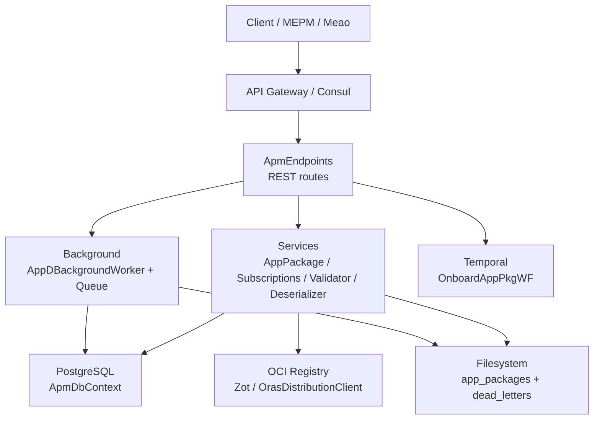
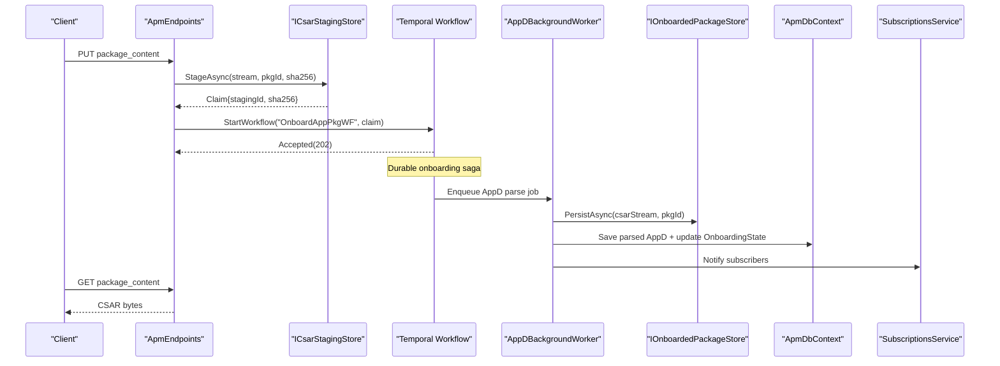
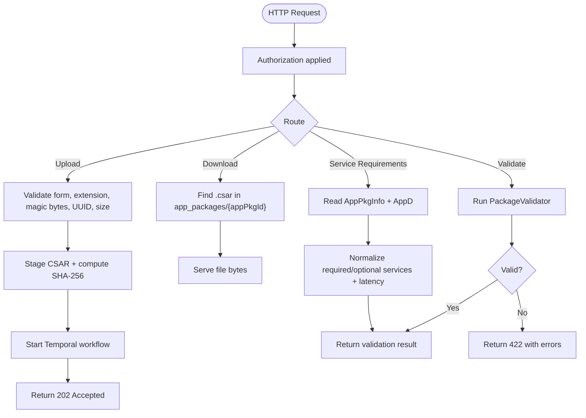
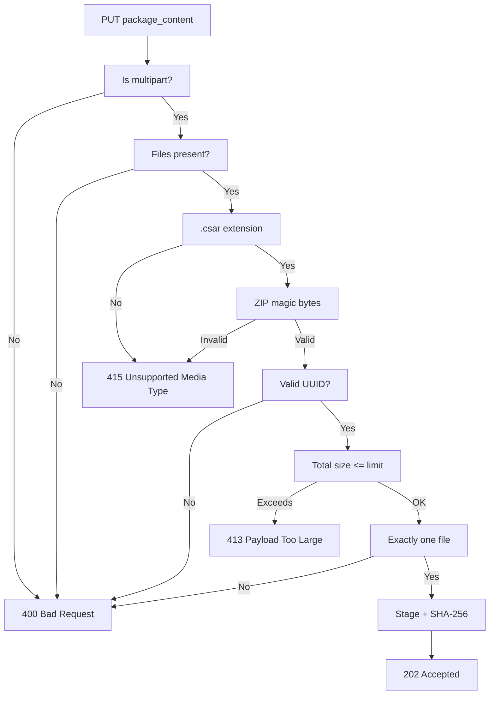
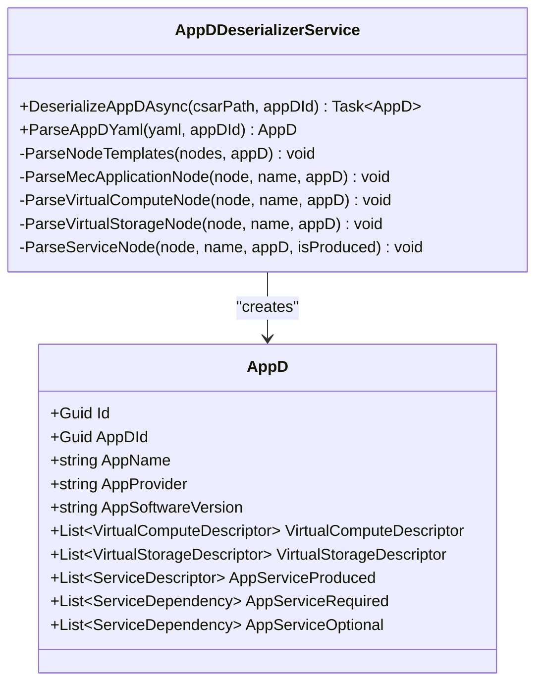
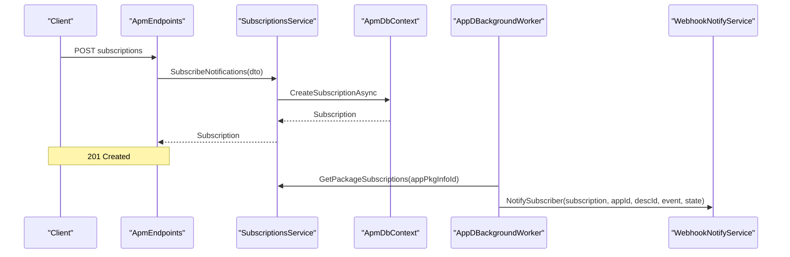
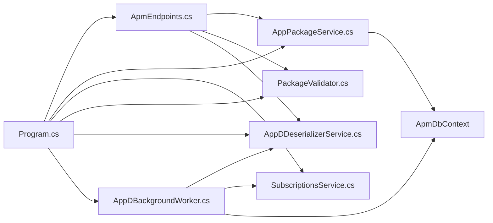

# ApmApi (Application Package Management Service)

## Table of Contents
1. Introduction
2. Project Structure
3. Core Components
4. Architecture Overview
5. Detailed Component Analysis
6. Dependency Analysis
7. Performance Considerations
8. Troubleshooting Guide
9. Conclusion

## Introduction
ApmApi implements the ETSI GS MEC 010-2 Application Package Management role for Optimist. It manages CSAR-based MEC application packages: creation, upload, validation, AppD parsing, durable storage, OCI distribution integration, subscription-driven notifications, and inventory coordination with other services such as Catalogue. The public REST surface under `/app_pkgm/v1` aligns with the ETSI v3.1.1 package management contract, while internal endpoints support a claim-check workflow backed by Temporal workflows and an in-process background worker.

The service is implemented in .NET 8 using ASP.NET Core Minimal APIs, FluentValidation, PostgreSQL via EF Core, YamlDotNet for descriptor handling, OpenTelemetry, Keycloak authentication, Consul service discovery, and Temporal for durable onboarding orchestration.

**Section sources**
- `src/ApmApi/README.md#L1-L95`
- `src/ApmApi/Program.cs#L1-L200`

## Project Structure
ApmApi is organized into feature-oriented folders within the project:

- `Endpoints`: HTTP route handlers for ETSI and internal APIs.
- `Services`: Business logic including package CRUD, subscription management, descriptor deserialization, CSAR validation, staging, and distribution helpers.
- `Models` and `Dto`: Domain entities, EF mappings, and wire DTOs for ETSI representations.
- `Validators`: FluentValidation rules for request DTOs.
- `Background`: In-process queue and worker for AppD parsing and notification delivery.
- `Repositories`, `Utils`, `Enums`, `Migrations`, `Properties`: Infrastructure, shared utilities, enumerations, and database migrations.
- `app_packages`: Persistent directory used for onboarded CSAR artifacts.

**Diagram sources**
- `src/ApmApi/Endpoints/ApmEndpoints.cs#L1-L200`
- `src/ApmApi/Program.cs#L1-L200`
- `src/ApmApi/Background/AppDBackgroundWorker.cs#L1-L191`

**Section sources**
- `src/ApmApi/README.md#L1-L95`
- `src/ApmApi/Program.cs#L1-L200`

## Core Components
- **ApmEndpoints**: Defines all `/app_pkgm/v1/onboarded_app_packages` routes and internal package lifecycle routes. It validates multipart uploads, stages CSAR files, starts Temporal onboarding workflows, reads descriptors, exposes validation, image info, entry point, and service requirements endpoints.
- **AppPackageService**: Thin repository-backed service for creating, reading, deleting, enabling, and disabling app packages.
- **SubscriptionsService**: Manages ETSI-style subscriptions, filters, and retrieval of callbacks per package.
- **PackageValidator**: Validates CSAR structure, TOSCA metadata, AppD YAML topology, and SHA-256 checksum manifests.
- **AppDDeserializerService**: Parses validated CSAR AppD YAML into strongly typed domain models consumed by MEO and placement systems.
- **CSAR Staging Stores**: Claim-check abstraction for secure staging and durable persistence of large CSAR files.
- **Background Worker**: Parses AppD, persists artifacts before publishing readiness, updates onboarding state, and delivers notifications.

**Section sources**
- `src/ApmApi/Endpoints/ApmEndpoints.cs#L1-L493`
- `src/ApmApi/Services/AppPackageService.cs#L1-L136`
- `src/ApmApi/Services/SubscriptionsService.cs#L1-L74`
- `src/ApmApi/Services/PackageValidator.cs#L1-L390`
- `src/ApmApi/Services/AppDDeserializerService.cs#L1-L200`

## Architecture Overview
A typical package onboarding flow follows this path:

1. Client creates a package record via `POST /app_pkgm/v1/onboarded_app_packages`.
2. Client uploads the CSAR via `PUT /app_pkgm/v1/onboarded_app_packages/{appPkgId}/package_content`.
3. Endpoint validates content type, magic bytes, UUID format, file count, and total size.
4. CSAR is staged to a persistent store; a claim containing staging ID and SHA-256 digest is returned.
5. A Temporal workflow `OnboardAppPkgWF` is started with the claim.
6. The background worker parses AppD, persists the CSAR artifact, updates package state to `ONBOARDED`/`ENABLED`, and notifies subscribers.
7. Consumers download the CSAR through `GET /app_pkgm/v1/onboarded_app_packages/{appPkgId}/package_content` once durability is established.

**Diagram sources**
- `src/ApmApi/Endpoints/ApmEndpoints.cs#L100-L220`
- `src/ApmApi/Background/AppDBackgroundWorker.cs#L30-L160`
- `src/ApmApi/Services/ICsarStagingStore.cs`
- `src/ApmApi/Services/IOnboardedPackageStore.cs`

**Section sources**
- `src/ApmApi/README.md#L20-L95`
- `src/ApmApi/Endpoints/ApmEndpoints.cs#L1-L493`
- `src/ApmApi/Background/AppDBackgroundWorker.cs#L1-L191`

## Detailed Component Analysis

### REST Endpoints Under `/app_pkgm/v1`
The primary endpoint group is `/app_pkgm/v1/onboarded_app_packages`. It supports ETSI-aligned operations plus implementation extensions.

| Method | Route | Responsibility | Validation / Behavior |
|--------|-------|----------------|----------------------|
| `GET` | `/app_pkgm/v1/onboarded_app_packages` | List all packages | Returns DTO list from `AppPackageService.GetAll`. |
| `GET` | `/app_pkgm/v1/onboarded_app_packages/{appPkgId}` | Get package metadata | Requires non-empty `appPkgId`; returns 404 if missing. |
| `POST` | `/app_pkgm/v1/onboarded_app_packages` | Create package record | Uses `CreateAppPkg` DTO; sets initial state to `CREATED`, `DISABLED`, `NOT_IN_USE`. |
| `DELETE` | `/app_pkgm/v1/onboarded_app_packages/{appPkgId}` | Delete package | Deletes metadata and local CSAR file through `ApmService`. |
| `PATCH` | `/app_pkgm/v1/onboarded_app_packages/{appPkgId}` | Enable/disable package | Delegates to `Enable`/`Disable` based on operational state. |
| `PUT` | `/app_pkgm/v1/onboarded_app_packages/{appPkgId}/package_content` | Upload CSAR | Validates form, `.csar` extension, ZIP magic bytes, UUID, single file, max upload size; stages file; starts Temporal workflow; returns `202 Accepted` with staging claim. |
| `GET` | `/app_pkgm/v1/onboarded_app_packages/{appPkgId}/package_content` | Download CSAR | Serves first `.csar` found in `app_packages/{appPkgId}`. |
| `GET` | `/app_pkgm/v1/onboarded_app_packages/{appPkgId}/package_details` | List packaged entries | Reads directory contents under `app_packages/{appPkgId}`. |
| `GET` | `/app_pkgm/v1/onboarded_app_packages/{appPkgId}/get_entry` | Extract VNFD entry point | Lazily extracts CSAR to `Apps/{appPkgId}` and returns `TOSCA_VNFD.meta` entry. |
| `GET` | `/app_pkgm/v1/onboarded_app_packages/{appPkgId}/appd` | Read AppD YAML | Locates CSAR under local package directory and returns YAML. |
| `GET` | `/app_pkgm/v1/onboarded_app_packages/{appPkgId}/get_imageInfo` | Software image names | Prefers persisted `SwImageDescriptor`; falls back to descriptor deserialization. |
| `GET` | `/app_pkgm/v1/onboarded_app_packages/{appPkgId}/service_requirements` | Required/optional services and latency | Reads parsed AppD from DB; returns normalized required/optional service names and optional max latency. |
| `GET` | `/app_pkgm/v1/onboarded_app_packages/{appPkgId}/validate` | Validate CSAR | Validates structure, AppD topology, and checksums; returns 422 with errors when invalid. |
| `POST` | `/internal/app_pkgm/v1/onboarded_app_packages/{appPkgId}/process_staging` | Process staged claim | Re-hashes staged file, enqueues durable AppD parse, returns `PROCESSING`. |
| `POST` | `/internal/app_pkgm/v1/onboarded_app_packages/{appPkgId}/publish_zot` | Resolve OCI digest ref | Phase 41 OCI distribution step; does not push bytes at onboarding time. |
| `POST` | `/internal/app_pkgm/v1/onboarded_app_packages/{appPkgId}/finalize` | Finalize durable copy | Idempotent copy; marks state `ENABLED`/`ONBOARDED`; rejects missing staging claim with 400. |
| `POST` | `/internal/app_pkgm/v1/onboarded_app_packages/{appPkgId}/rollback` | Roll back staging | Records onboarding failure and cleans up staging state. |

Internal endpoints require Bearer authentication as documented by ADR 0057. Public endpoints are protected through `RequireAuthorization` on the route group.

**Diagram sources**
- `src/ApmApi/Endpoints/ApmEndpoints.cs#L1-L493`
- `src/ApmApi/Services/PackageValidator.cs#L1-L390`

**Section sources**
- `src/ApmApi/Endpoints/ApmEndpoints.cs#L1-L493`
- `src/ApmApi/README.md#L20-L95`

### CSAR Upload and Validation Rules
Upload validation occurs synchronously before any long-running work begins:

- Request must be multipart/form-data.
- At least one file must be present.
- Each uploaded file must have a `.csar` extension.
- Magic byte check ensures the file is a valid ZIP archive header (`PK\x03\x04`, `PK\x05\x06`, or `PK\x07\x08`).
- `appPkgId` must be a valid GUID.
- Exactly one file is expected.
- Total upload size must not exceed configured maximum; default server limit is 512 MB, with Kestrel and FormOptions limits set in `Program.cs`.
- Successful upload stages the file and computes SHA-256; it does not immediately mark the package ready.

Validation of the stored CSAR is exposed through `/validate` and performed by `PackageValidator`:

- Requires `TOSCA-Metadata/TOSCA.meta`.
- Supports declared `Entry-Definitions` and scans `Definitions/` for YAML declaring `tosca.nodes.etsi.mec.MECApplication`.
- Reads AppD YAML with bounded text processing.
- Validates topology template and MEC application node presence.
- Validates checksum manifests from `.mf` files or `Checksums/checksums.sha256`.
- Rejects oversized entries and corrupt archives.

**Diagram sources**
- `src/ApmApi/Endpoints/ApmEndpoints.cs#L100-L220`
- `src/ApmApi/Program.cs#L80-L120`

**Section sources**
- `src/ApmApi/Endpoints/ApmEndpoints.cs#L100-L220`
- `src/ApmApi/Services/PackageValidator.cs#L1-L390`
- `src/ApmApi/Program.cs#L80-L120`

### AppD Descriptor Parsing
`AppDDeserializerService` converts AppD YAML into structured domain models:

- Extracts metadata such as `template_name`, `template_author`, `template_version`, and ETSI MEC version.
- Parses `topology_template` and its `node_templates`.
- Recognizes MEC application nodes, virtual compute/storage nodes, produced services, and required services.
- Produces lists of `VirtualComputeDescriptor`, `VirtualStorageDescriptor`, `ServiceDescriptor`, `TransportDependency`, and related entities.
- Normalizes property names across common variants.
- Is registered as a singleton because YamlDotNet serializers/deserializers are immutable after construction.

The background worker uses this service to persist parsed AppD data and update package metadata fields such as `AppName`, `AppProvider`, `AppSoftwareVersion`, and `AppDVersion`.

**Diagram sources**
- `src/ApmApi/Services/AppDDeserializerService.cs#L1-L200`
- `src/ApmApi/Services/AppDDeserializerService.cs#L201-L450`

**Section sources**
- `src/ApmApi/Services/AppDDeserializerService.cs#L1-L200`
- `src/ApmApi/Services/AppDDeserializerService.cs#L201-L450`
- `src/ApmApi/Background/AppDBackgroundWorker.cs#L60-L130`

### Package Distribution Through OCI Registries
According to the documentation and internal endpoints, ApmApi integrates with OCI registries such as Zot through `OrasDistributionClient`. The design distinguishes between onboarding and distribution:

- Onboarding validates and persists CSAR artifacts.
- Distribution is largely instantiate-time rather than eagerly pushing every byte during upload.
- Internal endpoint `/internal/app_pkgm/v1/onboarded_app_packages/{appPkgId}/publish_zot` resolves digest-pinned OCI references.
- This separation avoids unnecessary network overhead during package upload and aligns with ADR 0041.

Security considerations include digest pinning, registry authentication, and avoiding premature exposure of artifacts until they are durable and validated.

**Section sources**
- `src/ApmApi/README.md#L10-L30`
- `src/ApmApi/README.md#L40-L95`
- `src/ApmApi/Endpoints/ApmEndpoints.cs#L450-L493`

### Subscription Management for Notifications
Subscriptions allow external consumers to receive events such as package onboarding completion.

Key behaviors:

- `POST /app_pkgm/v1/subscriptions` creates a subscription with callback URI, subscription type, and optional package filters.
- `GET /app_pkgm/v1/subscriptions` lists subscriptions.
- `GET /app_pkgm/v1/subscriptions/{subscriptionId}` retrieves a specific subscription.
- `DELETE /app_pkgm/v1/subscriptions/{subscriptionId}` removes a subscription.
- `SubscriptionsService` generates a new subscription ID and maps filter DTOs into entity records.
- Notifications are delivered asynchronously by the background worker after successful AppD parsing and artifact persistence.
- Webhook notifications use Keycloak bearer tokens as described in ADR 0059.

**Diagram sources**
- `src/ApmApi/Services/SubscriptionsService.cs#L1-L74`
- `src/ApmApi/Services/ISubscriptionsService.cs#L1-L45`
- `src/ApmApi/Background/AppDBackgroundWorker.cs#L110-L160`

**Section sources**
- `src/ApmApi/Services/SubscriptionsService.cs#L1-L74`
- `src/ApmApi/Services/ISubscriptionsService.cs#L1-L45`
- `src/ApmApi/Background/AppDBackgroundWorker.cs#L100-L170`

### Integration with Catalogue and Inventory Updates
ApmApi’s README states that MEAO calls ApmApi to validate and download CSAR packages during instance creation workflows, and that PlatformManager retrieves package content and AppD for distribution through VimAdapter. While explicit Catalogue client code is not shown in the analyzed files, the documented architecture positions ApmApi as the authoritative source for onboarded CSAR metadata and content.

Inventory synchronization responsibilities should be understood as cross-service coordination:

- ApmApi owns package metadata and artifact availability.
- Consumers such as Meao and Catalogue query ApmApi for package details, service requirements, and downloadable CSAR content.
- The service exposes `service_requirements` to support placement engines that need required services, optional services, and latency constraints.

**Section sources**
- `src/ApmApi/README.md#L10-L30`
- `src/ApmApi/Endpoints/ApmEndpoints.cs#L280-L450`

### Claim-Check Pattern for Large Payload Management
The upload endpoint implements the claim-check pattern:

1. Client uploads CSAR bytes.
2. Server stages the file and computes SHA-256.
3. Server returns a lightweight claim containing `stagingId` and `digest`.
4. Long-running validation and parsing are delegated to Temporal and the background worker.
5. Clients can later reference the staging claim or wait for workflow completion before downloading the artifact.

This separates high-bandwidth payload transport from control-plane state changes and protects the API from blocking on large CSAR processing.

**Section sources**
- `src/ApmApi/Endpoints/ApmEndpoints.cs#L120-L220`
- `src/ApmApi/Services/ICsarStagingStore.cs`
- `src/ApmApi/Services/FileSystemCsarStagingStore.cs`

## Dependency Analysis
ApmApi depends on several infrastructure components:

- **PostgreSQL + EF Core**: Package metadata, AppD entities, subscriptions, and migrations.
- **Keycloak**: Authentication for inbound requests and outbound webhook token issuance.
- **Consul**: Optional service discovery.
- **Temporal**: Durable onboarding workflow execution.
- **YamlDotNet**: Immutable serializer/deserializer instances.
- **OpenTelemetry**: Traces and metrics.
- **Filesystem**: CSAR staging, onboarded artifacts, and dead-letter storage.

**Diagram sources**
- `src/ApmApi/Program.cs#L20-L80`
- `src/ApmApi/Endpoints/ApmEndpoints.cs#L1-L100`
- `src/ApmApi/Background/AppDBackgroundWorker.cs#L1-L60`

**Section sources**
- `src/ApmApi/Program.cs#L1-L200`
- `src/ApmApi/Endpoints/ApmEndpoints.cs#L1-L100`

## Performance Considerations
- **Large CSAR uploads**: Kestrel and FormOptions are configured with a 512 MB body limit. The upload handler also enforces a configurable `AppSettings:MaxUploadSize` defaulting to 512 MB.
- **Claim-check pattern**: Avoids blocking request threads by staging payloads and delegating parsing to background processes.
- **Bounded channel queue**: `AppDProcessingQueue` uses a bounded channel with capacity 100 and waiting writers to provide backpressure.
- **Immutable YAML objects**: `AppDDeserializerService` is registered as a singleton to avoid rebuilding deserializer graphs per request.
- **Bounded descriptor reads**: `PackageValidator.ReadBoundedTextEntryAsync` enforces a 10 MB limit on text entries and throws when entries exceed the limit.
- **Lazy extraction**: `get_entry` lazily extracts CSAR content only when needed and uses a lock per package to avoid concurrent extraction races.
- **Database transactions**: Background worker persists AppD and package state inside short-lived transactions to reduce lock duration.
- **Retry and dead-letter**: Parsing attempts are retried with exponential backoff; persistent failures flip state to `ERROR` and write a dead-letter file.

Recommended operational practices:

- Tune `AppSettings:MaxUploadSize` according to expected CSAR sizes.
- Monitor Temporal workflow queues and background worker throughput.
- Ensure filesystem storage has sufficient disk space for both staging and durable artifacts.
- Use health/readiness probes to gate traffic until database connectivity and migrations are confirmed.

**Section sources**
- `src/ApmApi/Program.cs#L80-L120`
- `src/ApmApi/Background/AppDProcessingQueue.cs#L1-L26`
- `src/ApmApi/Services/PackageValidator.cs#L1-L390`
- `src/ApmApi/Background/AppDBackgroundWorker.cs#L120-L191`

## Troubleshooting Guide
Common issues and their likely causes:

| Symptom | Likely Cause | Resolution |
|---------|--------------|------------|
| `400 Bad Request` on upload | Missing multipart form, missing file, wrong extension, invalid UUID, or more than one file. | Verify request headers, ensure exactly one `.csar`, and confirm `appPkgId` is a GUID. |
| `415 Unsupported Media Type` | Non-ZIP magic bytes or unsupported file type. | Confirm the uploaded file is a valid ZIP archive. |
| `413 Payload Too Large` | Upload exceeds configured limit. | Reduce CSAR size or increase `AppSettings:MaxUploadSize`. |
| `404 Not Found` on download | No CSAR found in `app_packages/{appPkgId}`. | Ensure onboarding completed successfully and durable artifact was persisted. |
| `422 Unprocessable Entity` on validation | Invalid CSAR structure, missing AppD, or checksum mismatch. | Fix TOSCA metadata, AppD topology, or checksum manifest. |
| Package remains `PROCESSING` | Temporal workflow failed or background worker could not complete parsing. | Inspect Temporal workflow status, worker logs, and dead-letter directory. |
| Package ends in `ERROR` | AppD parsing failed after retries. | Review dead-letter JSON, fix descriptor issues, and replay manually if supported. |
| Health checks fail | Pending migrations or database connectivity problems. | Apply migrations and verify connection string. |

Security and integrity considerations:

- Validate file type and magic bytes before trusting upload streams.
- Rely on SHA-256 checksum verification for package integrity.
- Restrict internal endpoints to authenticated callers.
- Validate callback URIs against DNS rebinding and prefix policies as noted in ADR 0059.
- Treat filesystem paths carefully; endpoints sanitize `appPkgId` and reject traversal patterns where applicable.

**Section sources**
- `src/ApmApi/Endpoints/ApmEndpoints.cs#L100-L493`
- `src/ApmApi/Services/PackageValidator.cs#L1-L390`
- `src/ApmApi/Background/AppDBackgroundWorker.cs#L120-L191`
- `src/ApmApi/Program.cs#L1-L80`

## Practical Package Onboarding Workflows

### Minimal External Workflow
1. Call `POST /app_pkgm/v1/onboarded_app_packages` with provider, name, version, checksum, and user-defined data.
2. Call `PUT /app_pkgm/v1/onboarded_app_packages/{appPkgId}/package_content` with a single `.csar`.
3. Receive `202 Accepted` with `stagingId` and `digest`.
4. Poll package metadata until `OnboardingState` becomes `ONBOARDED` and `OperationalState` becomes `ENABLED`.
5. Call `GET /app_pkgm/v1/onboarded_app_packages/{appPkgId}/package_content` to retrieve the CSAR.
6. Optionally call `GET /app_pkgm/v1/onboarded_app_packages/{appPkgId}/service_requirements` to obtain service dependencies for placement.

### CI/CD Pipeline Workflow
1. Build CSAR locally.
2. Compute SHA-256 and generate checksum manifest.
3. Create package record.
4. Upload CSAR.
5. Wait for onboarding completion.
6. Validate CSAR through `/validate`.
7. Publish OCI digest through `/publish_zot` when distribution is required.
8. Trigger instantiation through higher-level lifecycle APIs after verifying service requirements.

### Subscription-Based Notification Workflow
1. Create a subscription with a callback URI and optional package filters.
2. Upload and onboard a package.
3. Observe webhook delivery with event type `AppPackageOnBoarded`.
4. Use the delivered identifiers to correlate with the originating onboarding workflow.

**Section sources**
- `src/ApmApi/README.md#L20-L95`
- `src/ApmApi/Endpoints/ApmEndpoints.cs#L1-L493`
- `src/ApmApi/Services/SubscriptionsService.cs#L1-L74`

## Security Considerations
- **Package integrity**: CSAR magic bytes, checksum manifests, and SHA-256 verification protect against corrupted or tampered archives.
- **Input validation**: Extension checks, UUID validation, single-file enforcement, and bounded descriptor reads mitigate malformed input attacks.
- **Authentication**: Public package management endpoints require authorization; internal lifecycle endpoints require Bearer tokens.
- **Callback security**: Notifications are sent with Keycloak bearer tokens and follow ADR 0059 guidance for callback authentication and prefix hardening.
- **Resource exhaustion protection**: Bounded channels, descriptor size limits, and upload size limits reduce denial-of-service risk.
- **Filesystem safety**: Path sanitization and lock-based extraction reduce path traversal and race conditions.

**Section sources**
- `src/ApmApi/Program.cs#L1-L80`
- `src/ApmApi/Endpoints/ApmEndpoints.cs#L100-L220`
- `src/ApmApi/Services/PackageValidator.cs#L1-L390`

## Conclusion
ApmApi provides a robust, standards-aligned foundation for managing MEC application packages. Its layered design separates upload transport, validation, descriptor parsing, durable storage, and distribution concerns. The claim-check pattern, bounded processing, Temporal workflows, and background worker together ensure large CSARs are handled safely and reliably. For operators, the most important controls are upload limits, checksum verification, artifact durability, authentication, and monitoring of Temporal and background processing pipelines.

> **Referenced Files in This Document**
>
> - `src/ApmApi/Program.cs`
> - `src/ApmApi/README.md`
> - `src/ApmApi/Endpoints/ApmEndpoints.cs`
> - `src/ApmApi/Services/AppPackageService.cs`
> - `src/ApmApi/Services/IAppPackageService.cs`
> - `src/ApmApi/Services/SubscriptionsService.cs`
> - `src/ApmApi/Services/ISubscriptionsService.cs`
> - `src/ApmApi/Services/PackageValidator.cs`
> - `src/ApmApi/Services/AppDDeserializerService.cs`
> - `src/ApmApi/Services/ICsarStagingStore.cs`
> - `src/ApmApi/Services/FileSystemCsarStagingStore.cs`
> - `src/ApmApi/Services/IOnboardedPackageStore.cs`
> - `src/ApmApi/Services/FileSystemOnboardedPackageStore.cs`
> - `src/ApmApi/Background/AppDBackgroundWorker.cs`
> - `src/ApmApi/Background/AppDProcessingQueue.cs`
> - `src/ApmApi/Background/AppDProcessingJob.cs`
