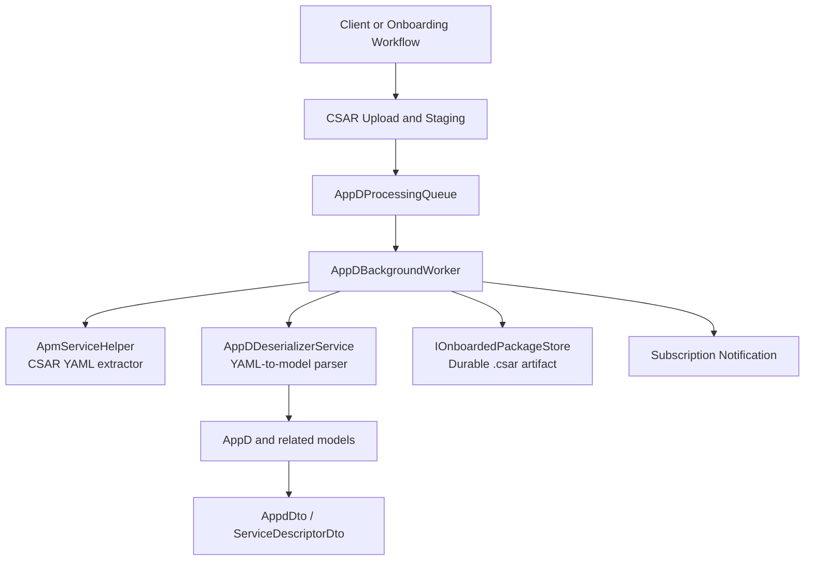
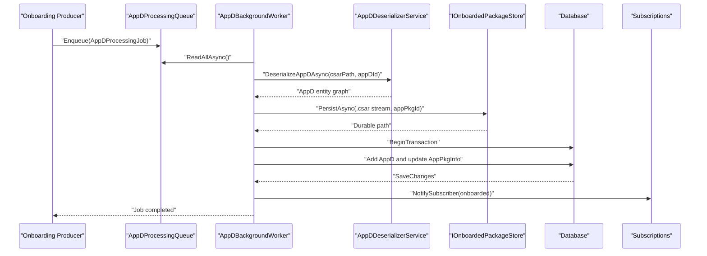
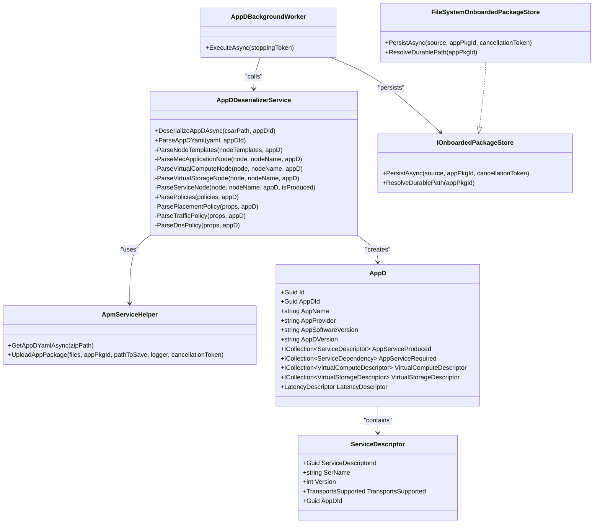
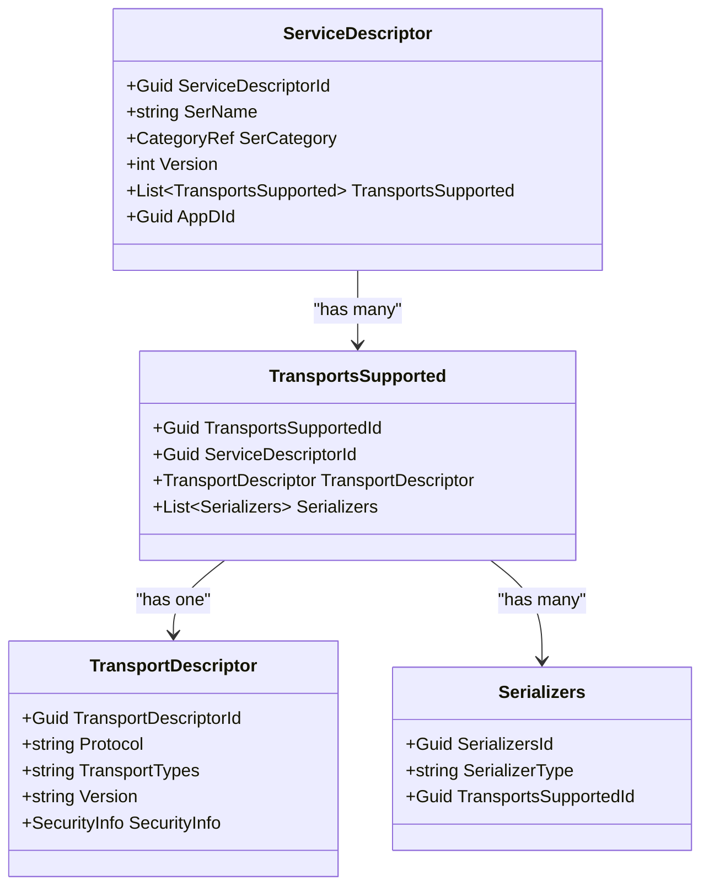
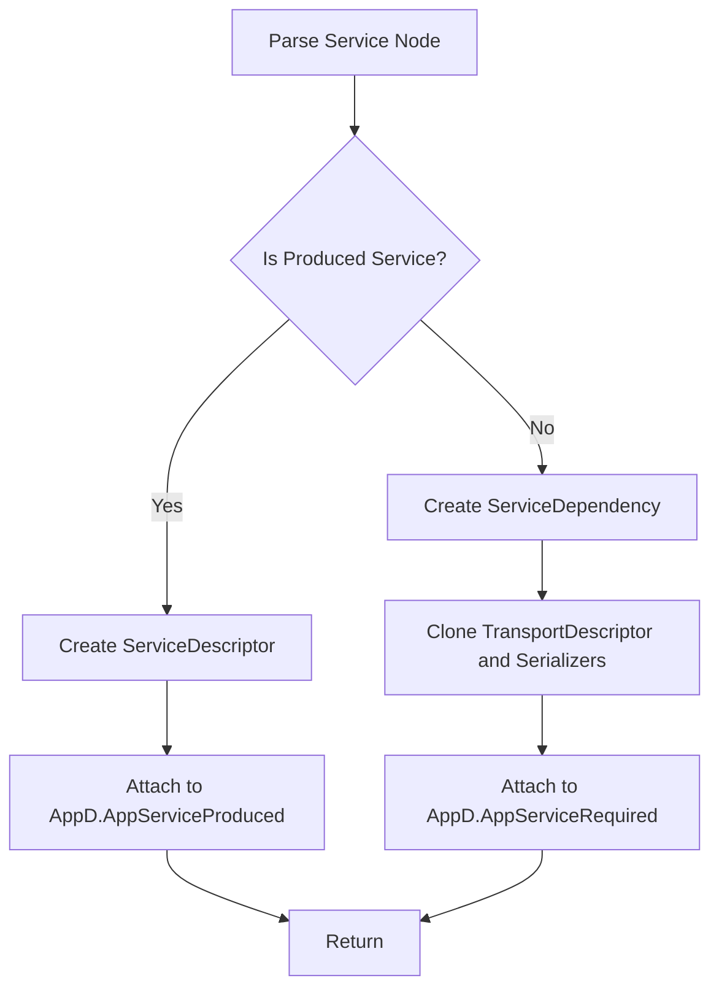
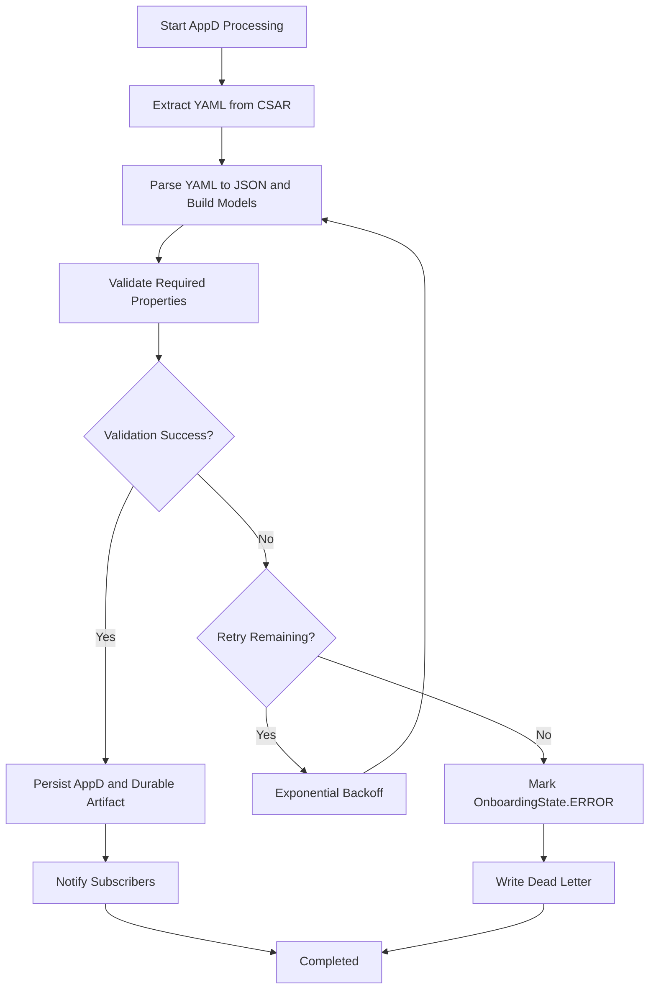
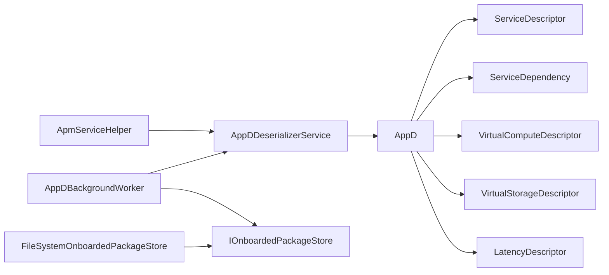

# AppD Descriptor Parsing and Processing

## Table of Contents
1. [Introduction](#introduction)
2. [Project Structure](#project-structure)
3. [Core Components](#core-components)
4. [Architecture Overview](#architecture-overview)
5. [Detailed Component Analysis](#detailed-component-analysis)
6. [Dependency Analysis](#dependency-analysis)
7. [Performance Considerations](#performance-considerations)
8. [Troubleshooting Guide](#troubleshooting-guide)
9. [Conclusion](#conclusion)

## Introduction
This document explains how the ApmApi service parses, validates, transforms, and persists Application Descriptor (AppD) data from TOSCA-based CSAR packages. The implementation focuses on:

- Extracting YAML descriptors from CSAR archives.
- Deserializing YAML into an intermediate JSON representation.
- Mapping descriptor elements to internal domain models such as `AppD`, `ServiceDescriptor`, virtual compute/storage descriptors, service dependencies, transport dependencies, latency constraints, traffic rules, and DNS rules.
- Persisting parsed descriptors through a background worker with retry, durable artifact storage, and subscription notification.
- Exposing the parsed model graph through DTOs for external consumption.

The design separates physical package artifacts (`AppPackage`) from semantic deployment descriptors (`AppD`), enabling downstream systems like MEO to consume structured AppD data during onboarding and lifecycle operations.

## Project Structure
AppD parsing and processing is implemented primarily within the ApmApi project under three layers:

- **Utilities**: CSAR archive reading and YAML extraction.
- **Services**: YAML-to-model transformation and validation.
- **Background workers**: Asynchronous job processing, persistence, retries, dead-letter handling, and subscription notifications.
- **Domain models**: Strongly typed entities representing the AppD graph.
- **DTOs**: Wire representations of parsed descriptors.
- **Persistence layer**: EF Core migrations and entity relationships.

**Diagram sources**
- `src/ApmApi/Background/AppDProcessingQueue.cs#L1-L26`
- `src/ApmApi/Background/AppDBackgroundWorker.cs#L1-L191`
- `src/ApmApi/Utils/ApmServiceHelper.cs#L1-L241`
- `src/ApmApi/Services/AppDDeserializerService.cs#L1-L200`
- `src/ApmApi/Models/AppD.cs#L1-L120`
- `src/ApmApi/Services/IOnboardedPackageStore.cs#L1-L30`
- `src/ApmApi/Services/FileSystemOnboardedPackageStore.cs#L1-L76`
- `src/ApmApi/Dto/AppdDto.cs#L1-L93`

**Section sources**
- `src/ApmApi/Services/AppDDeserializerService.cs#L1-L200`
- `src/ApmApi/Utils/ApmServiceHelper.cs#L1-L241`
- `src/ApmApi/Background/AppDBackgroundWorker.cs#L1-L191`
- `src/ApmApi/Background/AppDProcessingQueue.cs#L1-L26`

## Core Components

### AppDDeserializerService
The deserializer is the central component for AppD parsing. Its responsibilities include:

- Reading a CSAR file path and extracting the main AppD YAML.
- Deserializing YAML using YamlDotNet into an object graph.
- Serializing that graph back to JSON for efficient traversal with `System.Text.Json`.
- Building an `AppD` entity graph by walking metadata, topology template, node templates, policies, and fallback properties.
- Validating required numeric fields and rejecting malformed values.
- Producing related descriptors for virtual compute, virtual storage, services, transports, traffic rules, DNS rules, and latency constraints.

Key behaviors:

| Responsibility | Implementation Detail |
|---|---|
| CSAR entry resolution | Uses `ApmServiceHelper.GetAppDYamlAsync` to find the main descriptor via `TOSCA-Metadata/TOSCA.meta` or content scanning under `Definitions/`. |
| YAML parsing | Uses `DeserializerBuilder().IgnoreUnmatchedProperties()` for tolerant parsing. |
| JSON traversal | Converts parsed YAML to JSON text then uses `JsonDocument.Parse` for property access. |
| Metadata mapping | Reads `metadata.template_name`, `template_author`, `template_version`, `description`, and `ETSI-MEC-version`. |
| Node template routing | Dispatches MECApplication, VirtualCompute, VirtualStorage, Service, and RequiredService nodes. |
| Resource validation | Enforces positive CPU, memory, and storage values; throws descriptive `ArgumentException` for invalid input. |
| Policy extraction | Recognizes scaling, placement, traffic rule, and DNS rule policies by policy type keywords. |
| Fallback extraction | Recursively searches for missing properties such as `app_descriptor_id` or `storage_size_gb`. |

**Section sources**
- `src/ApmApi/Services/AppDDeserializerService.cs#L1-L200`
- `src/ApmApi/Services/AppDDeserializerService.cs#L201-L591`
- `src/ApmApi/Services/AppDDeserializerService.cs#L601-L1027`
- `src/ApmApi/Services/AppDDeserializerService.cs#L1028-L1059`

### ApmServiceHelper
This helper extracts the main AppD YAML from a CSAR archive. It supports:

- Reading `TOSCA-Metadata/TOSCA.meta` and following its `Entry-Definitions:` value.
- Falling back to scanning `Definitions/` for YAML files containing `tosca.nodes.etsi.mec.MECApplication` or `MECApplication`.
- Throwing `FileNotFoundException` when no descriptor is found.
- Wrapping I/O failures in `InvalidOperationException`.

It also provides legacy helpers for SwImage info and package path utilities, although typed descriptor parsing has moved into `AppDDeserializerService`.

**Section sources**
- `src/ApmApi/Utils/ApmServiceHelper.cs#L1-L241`

### Background Processing Pipeline
The background pipeline processes AppD jobs asynchronously:

1. `AppDProcessingQueue` enqueues `AppDProcessingJob` instances using a bounded channel with backpressure.
2. `AppDBackgroundWorker` reads jobs and processes them with up to three attempts and exponential backoff.
3. For each successful attempt:
   - The worker calls `AppDDeserializerService.DeserializeAppDAsync`.
   - It persists the durable `.csar` artifact through `IOnboardedPackageStore`.
   - It writes the parsed `AppD` entity graph to the database.
   - It updates `AppPkgInfo` linkage and sets `OnboardingState.ONBOARDED` and `OperationalState.ENABLED`.
   - It notifies subscribers about successful onboarding.
4. If all attempts fail, it marks the package state as `ERROR` and writes a dead-letter file for manual replay.

**Diagram sources**
- `src/ApmApi/Background/AppDProcessingQueue.cs#L1-L26`
- `src/ApmApi/Background/AppDBackgroundWorker.cs#L1-L191`
- `src/ApmApi/Services/AppDDeserializerService.cs#L1-L200`
- `src/ApmApi/Services/IOnboardedPackageStore.cs#L1-L30`

**Section sources**
- `src/ApmApi/Background/AppDBackgroundWorker.cs#L1-L191`
- `src/ApmApi/Background/AppDProcessingQueue.cs#L1-L26`
- `src/ApmApi/Background/IAppDProcessingQueue.cs#L1-L10`
- `src/ApmApi/Background/AppDProcessingJob.cs#L1-L10`

## Architecture Overview
The AppD parsing architecture follows a layered approach:

- **Input layer**: CSAR archive uploaded and staged.
- **Extraction layer**: `ApmServiceHelper` locates the main TOSCA descriptor.
- **Parsing layer**: `AppDDeserializerService` converts YAML to JSON and builds strongly typed entities.
- **Persistence layer**: Background worker persists entities and durable artifacts.
- **Output layer**: DTOs expose parsed descriptors to consumers.

**Diagram sources**
- `src/ApmApi/Services/AppDDeserializerService.cs#L1-L200`
- `src/ApmApi/Utils/ApmServiceHelper.cs#L1-L241`
- `src/ApmApi/Background/AppDBackgroundWorker.cs#L1-L191`
- `src/ApmApi/Services/IOnboardedPackageStore.cs#L1-L30`
- `src/ApmApi/Services/FileSystemOnboardedPackageStore.cs#L1-L76`
- `src/ApmApi/Models/AppD.cs#L1-L120`
- `src/ApmApi/Models/ServiceDescriptor.cs#L1-L28`

## Detailed Component Analysis

### AppD Model
`AppD` is the root domain entity for a parsed application descriptor. It represents:

- Application identity and versioning: `AppDId`, `AppName`, `AppProvider`, `AppSoftwareVersion`, `AppDVersion`, `MecVersion`.
- Optional description and instance operation configuration.
- Relationships to produced services, required services, optional services, features, transports, virtual compute, virtual storage, traffic rules, DNS rules, and latency constraints.

Primary properties and relationships:

| Property or Relationship | Purpose |
|---|---|
| `Id`, `AppDId` | Unique identifiers for the AppD record. |
| `AppName`, `AppProvider`, `AppSoftwareVersion`, `AppDVersion` | Descriptor identity and version metadata. |
| `AppDescription` | Human-readable description. |
| `AppServiceProduced` | Services exposed by the application. |
| `AppServiceRequired`, `AppServiceOptional` | External service dependencies. |
| `VirtualComputeDescriptor` | Declared compute resources. |
| `VirtualStorageDescriptor` | Declared storage resources. |
| `LatencyDescriptor` | Placement or latency requirements. |
| `TrafficRuleDescriptor` | Traffic routing/filtering rules. |
| `DNSRuleDescriptor` | DNS mapping rules. |
| `SwImageDescriptor` | Software image information. |
| `TransportDependency` | Transport-level dependency metadata. |

**Section sources**
- `src/ApmApi/Models/AppD.cs#L1-L120`

### ServiceDescriptor Model
`ServiceDescriptor` represents a service produced by an application. Its key aspects are:

- `ServiceDescriptorId`: Primary key.
- `SerName`: Service name, validated with a length constraint.
- `SerCategory`: Category reference.
- `Version`: Required integer version.
- `TransportsSupported`: Collection of supported transport configurations.
- `AppDId`: Foreign key linking to the parent `AppD`.

Business rules enforced by parsing:

- When parsing a `Service` node, `SerName` defaults to the node name if not present.
- `Version` defaults to `1` if not provided.
- A default transport is created with protocol, serializer, and security information.
- Produced services are attached to `AppD.AppServiceProduced`.

**Diagram sources**
- `src/ApmApi/Models/ServiceDescriptor.cs#L1-L28`
- `src/ApmApi/Services/AppDDeserializerService.cs#L201-L591`

**Section sources**
- `src/ApmApi/Models/ServiceDescriptor.cs#L1-L28`
- `src/ApmApi/Dto/ServiceDescriptorDto.cs#L1-L20`
- `src/ApmApi/Services/AppDDeserializerService.cs#L201-L591`

### Virtual Compute and Storage Descriptors
Virtual compute and storage descriptors capture resource requirements declared in the descriptor.

#### VirtualComputeDescriptor
- Stores CPU count and memory size as strongly typed integers.
- Provides backward-compatibility shims for legacy string properties.
- Migration ensures numeric columns exist and legacy string columns are dropped.

#### VirtualStorageDescriptor
- Stores storage type and disk size in gigabytes.
- Migrates from `int` to `long` for disk size.
- Provides backward-compatibility shims for legacy property names.

Validation behavior:

- CPU and memory candidates are read from multiple possible property names.
- Values must be positive integers; otherwise, parsing throws `ArgumentException`.
- Storage size uses candidate keys and falls back to root-level properties when needed.

**Section sources**
- `src/ApmApi/Models/VirtualComputeDescriptor.cs#L1-L69`
- `src/ApmApi/Models/VirtualStorageDescriptor.cs#L1-L56`
- `src/ApmApi/Migrations/20260908112511_StronglyTypedAppDDescriptors.cs#L1-L102`
- `src/ApmApi/Services/AppDDeserializerService.cs#L201-L591`

### Service Dependencies and Transport Dependencies
The system distinguishes between:

- **Produced services**: attached to `AppD.AppServiceProduced`.
- **Required services**: represented as `ServiceDependency` and attached to `AppD.AppServiceRequired`.

For required services, the parser clones serializer instances per dependency because EF Core expects separate rows with distinct foreign key parents. Transport dependencies carry labels, serializers, and transport descriptors.

**Diagram sources**
- `src/ApmApi/Services/AppDDeserializerService.cs#L201-L591`
- `src/ApmApi/Models/ServiceDependency.cs#L1-L39`
- `src/ApmApi/Models/TransportDependency.cs#L1-L35`

**Section sources**
- `src/ApmApi/Models/ServiceDependency.cs#L1-L39`
- `src/ApmApi/Models/TransportDependency.cs#L1-L35`
- `src/ApmApi/Services/AppDDeserializerService.cs#L201-L591`

### Deployment Information Extraction
Deployment information is extracted from:

- **Metadata**: application name, provider, software version, descriptor version, MEC version, description.
- **Topology template**: node templates and policies.
- **Node templates**: MECApplication, VirtualCompute, VirtualStorage, Service, RequiredService.
- **Fallback properties**: recursive search for missing descriptor fields.

Examples of mapped deployment information:

| Descriptor Area | Internal Representation |
|---|---|
| Application identity | `AppD.AppName`, `AppD.AppProvider`, `AppD.AppSoftwareVersion`, `AppD.AppDVersion` |
| Compute requirements | `AppD.VirtualComputeDescriptor` |
| Storage requirements | `AppD.VirtualStorageDescriptor` |
| Produced services | `AppD.AppServiceProduced` |
| Required services | `AppD.AppServiceRequired` |
| Latency constraints | `AppD.LatencyDescriptor.MaxLatency` |
| Traffic rules | `AppD.TrafficRuleDescriptor` |
| DNS rules | `AppD.DNSRuleDescriptor` |
| Software images | `AppD.SwImageDescriptor` |

**Section sources**
- `src/ApmApi/Services/AppDDeserializerService.cs#L1-L200`
- `src/ApmApi/Services/AppDDeserializerService.cs#L601-L1027`

### Scaling Policies, Runtime Requirements, and Extension Points
Current policy handling:

- **Scaling policies**: detected by policy type keywords; currently logged but not fully materialized into a dedicated scaling model.
- **Placement policies**: latency constraints are parsed and stored in `LatencyDescriptor.MaxLatency`.
- **Traffic policies**: parsed into `TrafficRuleDescriptor` with filter type, action type, priority, interface descriptors, and traffic filters.
- **DNS policies**: parsed into `DNSRuleDescriptor` with domain name, IP address, address type, and TTL.

Extension points for custom descriptor processing:

- Adding new policy types in `ParsePolicies`.
- Adding new node types in `ParseNodeTemplates`.
- Extending fallback property extraction in `ExtractFallbackProperties`.
- Adding new strongly typed models and corresponding DTOs.
- Integrating additional transport protocols or serializer types.

**Section sources**
- `src/ApmApi/Services/AppDDeserializerService.cs#L201-L591`
- `src/ApmApi/Services/AppDDeserializerService.cs#L601-L1027`
- `src/ApmApi/Models/LatencyDescriptor.cs#L1-L17`

### Descriptor Transformation Examples
Transformation examples can be understood from the parsing flow without quoting source code:

1. **TOSCA metadata mapping**: `template_name` becomes `AppD.AppName`; `template_author` becomes `AppD.AppProvider`; `template_version` becomes both `AppD.AppDVersion` and `AppD.AppSoftwareVersion`; `ETSI-MEC-version` becomes `AppD.MecVersion`.
2. **MECApplication node mapping**: `app_name`, `app_provider`, `app_software_version`, and lifecycle operation configurations are mapped into `AppD`.
3. **VirtualCompute mapping**: CPU and memory candidates are resolved and stored as `NumVirtualCpu` and `VirtualMemMb`.
4. **VirtualStorage mapping**: storage type defaults to `BLOCK`; disk size is parsed from candidate properties.
5. **Service mapping**: produced services receive default transport configuration; required services become dependencies with cloned transport serializers.
6. **Latency mapping**: placement policy with `LATENCY` constraint maps to `LatencyDescriptor.MaxLatency`.
7. **Traffic rule mapping**: traffic rules are converted into `TrafficRuleDescriptor` entries with enum-mapped actions and filter types.

**Section sources**
- `src/ApmApi/Services/AppDDeserializerService.cs#L1-L200`
- `src/ApmApi/Services/AppDDeserializerService.cs#L201-L591`
- `src/ApmApi/Services/AppDDeserializerService.cs#L601-L1027`

### Error Handling for Malformed Descriptors
Error handling spans extraction, parsing, validation, and background processing:

| Failure Point | Behavior |
|---|---|
| Missing CSAR file | Throws `FileNotFoundException`. |
| No AppD descriptor in CSAR | Throws `FileNotFoundException`. |
| I/O failure reading CSAR | Throws `InvalidOperationException`. |
| Missing required properties on VirtualCompute or VirtualStorage | Throws `ArgumentException`. |
| Invalid or non-positive numeric property | Throws `ArgumentException` with context about the property. |
| Background worker transient failure | Retries up to three times with exponential backoff. |
| Permanent parse failure | Marks `OnboardingState.ERROR` and writes a dead-letter JSON file. |
| Failed ERROR state persistence | Logs error but does not crash the worker loop. |
| Failed dead-letter write | Logs error without failing the worker loop. |

**Diagram sources**
- `src/ApmApi/Utils/ApmServiceHelper.cs#L1-L241`
- `src/ApmApi/Services/AppDDeserializerService.cs#L1-L200`
- `src/ApmApi/Background/AppDBackgroundWorker.cs#L1-L191`

**Section sources**
- `src/ApmApi/Utils/ApmServiceHelper.cs#L1-L241`
- `src/ApmApi/Services/AppDDeserializerService.cs#L201-L591`
- `src/ApmApi/Background/AppDBackgroundWorker.cs#L1-L191`

### DTO Exposure
Parsed models are exposed through DTOs:

- `AppdDto` maps `AppD` and its related collections to wire-friendly properties.
- `ServiceDescriptorDto` maps `ServiceDescriptor` including category and transport support.
- DTO constructors perform LINQ projection from model graphs.

These DTOs are suitable for API responses and integration contracts but are separate from EF Core entities.

**Section sources**
- `src/ApmApi/Dto/AppdDto.cs#L1-L93`
- `src/ApmApi/Dto/ServiceDescriptorDto.cs#L1-L20`

## Dependency Analysis
The AppD parsing subsystem has clear separation between extraction, transformation, persistence, and output:

- `AppDDeserializerService` depends on `ApmServiceHelper` for CSAR YAML extraction and on YamlDotNet and `System.Text.Json` for parsing.
- `AppDBackgroundWorker` depends on the queue, deserializer, database context, subscriptions, webhook notifications, and onboarded package store.
- `IOnboardedPackageStore` abstracts durable artifact storage; `FileSystemOnboardedPackageStore` implements file-system persistence.
- Domain models form a graph rooted at `AppD`.

**Diagram sources**
- `src/ApmApi/Utils/ApmServiceHelper.cs#L1-L241`
- `src/ApmApi/Services/AppDDeserializerService.cs#L1-L200`
- `src/ApmApi/Models/AppD.cs#L1-L120`
- `src/ApmApi/Models/ServiceDescriptor.cs#L1-L28`
- `src/ApmApi/Models/ServiceDependency.cs#L1-L39`
- `src/ApmApi/Models/VirtualComputeDescriptor.cs#L1-L69`
- `src/ApmApi/Models/VirtualStorageDescriptor.cs#L1-L56`
- `src/ApmApi/Models/LatencyDescriptor.cs#L1-L17`
- `src/ApmApi/Background/AppDBackgroundWorker.cs#L1-L191`
- `src/ApmApi/Services/IOnboardedPackageStore.cs#L1-L30`
- `src/ApmApi/Services/FileSystemOnboardedPackageStore.cs#L1-L76`

**Section sources**
- `src/ApmApi/Services/AppDDeserializerService.cs#L1-L200`
- `src/ApmApi/Background/AppDBackgroundWorker.cs#L1-L191`
- `src/ApmApi/Models/AppD.cs#L1-L120`

## Performance Considerations
Current performance characteristics and optimization opportunities:

### Current Optimizations
- **Bounded processing queue**: `AppDProcessingQueue` uses a bounded channel with waiting writers, providing backpressure under load.
- **Allocation-conscious property lookup**: Flexible property matching avoids repeated string allocations where possible.
- **Streaming uploads**: Package upload streams files to disk instead of buffering entirely in memory.
- **Atomic artifact persistence**: Durable `.csar` writes use temporary files followed by move operations to avoid partial artifacts.
- **Single reader worker**: Background worker processes one job at a time, reducing contention.

### Optimization Opportunities
- **Caching parsed descriptors**: There is no explicit cache for parsed `AppD` objects. A memoization layer keyed by `appPkgId` or descriptor content hash could reduce repeated parsing for large descriptors.
- **Lazy descriptor loading**: Large descriptor graphs could be loaded lazily when consumers request specific sections.
- **Schema validation caching**: Reusable validators for common descriptor shapes could reduce repeated structural checks.
- **Parallel policy parsing**: Independent policy parsing could be parallelized safely, though care is needed to preserve deterministic ordering.
- **Descriptor version routing**: Explicit version-aware parsers would allow optimized paths for known descriptor versions while keeping compatibility logic isolated.
- **Memory profiling for large CSARs**: Large archives may benefit from streaming YAML parsing rather than converting the entire YAML object graph to JSON first.

[No sources needed since this section provides general guidance]

## Troubleshooting Guide
Common issues and recommended diagnostics:

| Symptom | Likely Cause | Recommended Action |
|---|---|---|
| CSAR file not found | Incorrect path passed to deserializer. | Verify staging directory and `appPkgId`. |
| No AppD descriptor found | Missing `TOSCA-Metadata/TOSCA.meta` or no valid descriptor under `Definitions/`. | Inspect CSAR contents and ensure main descriptor declares a MEC application node. |
| VirtualCompute or VirtualStorage validation fails | Missing or invalid CPU/memory/storage properties. | Check node properties and candidate property names. |
| Non-positive integer errors | Descriptor contains zero, negative, or malformed numeric values. | Correct resource declarations to positive integers. |
| Job repeatedly fails after retries | Malformed descriptor or persistent I/O/database error. | Check dead-letter file and application logs. |
| Onboarding state remains PROCESSING | Worker failed before marking ONBOARDED. | Investigate exception logs and retry behavior. |
| Onboarding state becomes ERROR | All retry attempts failed. | Review dead-letter payload and fix descriptor structure. |
| package_content unavailable | Durable artifact not persisted. | Ensure `IOnboardedPackageStore.PersistAsync` succeeds before publishing readiness. |

**Section sources**
- `src/ApmApi/Utils/ApmServiceHelper.cs#L1-L241`
- `src/ApmApi/Services/AppDDeserializerService.cs#L201-L591`
- `src/ApmApi/Background/AppDBackgroundWorker.cs#L1-L191`
- `src/ApmApi/Services/IOnboardedPackageStore.cs#L1-L30`
- `src/ApmApi/Services/FileSystemOnboardedPackageStore.cs#L1-L76`

## Conclusion
The ApmApi AppD parsing pipeline provides a robust bridge between TOSCA-based CSAR descriptors and strongly typed internal models. It handles realistic descriptor variations through flexible property resolution, validates critical resource declarations, and integrates with background processing for resilient persistence and notification.

The most important areas for future evolution are:

- Explicit descriptor version handling.
- Caching for parsed descriptors and expensive parsing stages.
- More complete policy and scaling model materialization.
- Streaming-oriented YAML parsing for very large descriptors.
- Clear extension points for custom descriptor processing without modifying core parsing logic.

> **Referenced Files in This Document**
>
> - `src/ApmApi/Services/AppDDeserializerService.cs`
> - `src/ApmApi/Utils/ApmServiceHelper.cs`
> - `src/ApmApi/Background/AppDBackgroundWorker.cs`
> - `src/ApmApi/Background/AppDProcessingQueue.cs`
> - `src/ApmApi/Background/IAppDProcessingQueue.cs`
> - `src/ApmApi/Background/AppDProcessingJob.cs`
> - `src/ApmApi/Models/AppD.cs`
> - `src/ApmApi/Models/ServiceDescriptor.cs`
> - `src/ApmApi/Models/VirtualComputeDescriptor.cs`
> - `src/ApmApi/Models/VirtualStorageDescriptor.cs`
> - `src/ApmApi/Models/ServiceDependency.cs`
> - `src/ApmApi/Models/TransportDependency.cs`
> - `src/ApmApi/Models/LatencyDescriptor.cs`
> - `src/ApmApi/Dto/AppdDto.cs`
> - `src/ApmApi/Dto/ServiceDescriptorDto.cs`
> - `src/ApmApi/Migrations/20260908112511_StronglyTypedAppDDescriptors.cs`
> - `src/ApmApi/Services/IOnboardedPackageStore.cs`
> - `src/ApmApi/Services/FileSystemOnboardedPackageStore.cs`
