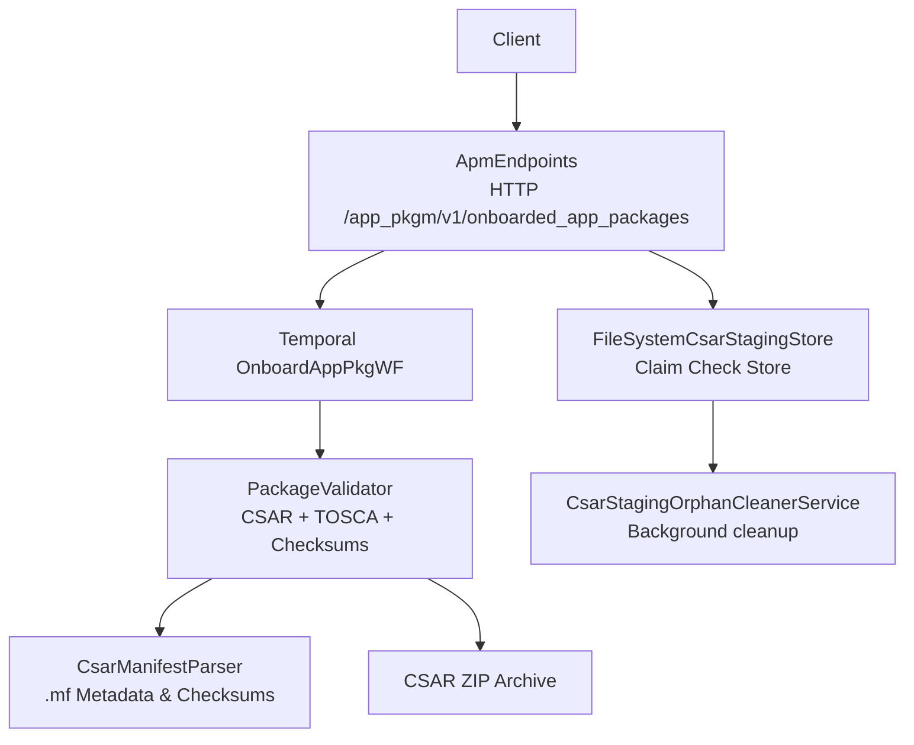
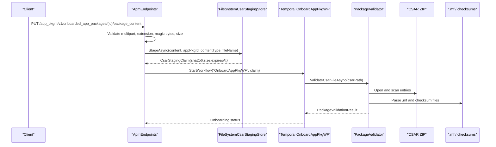
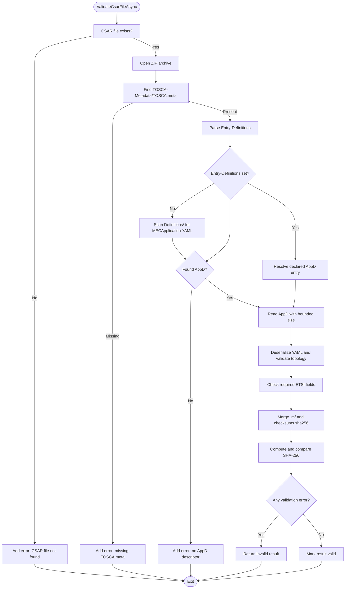
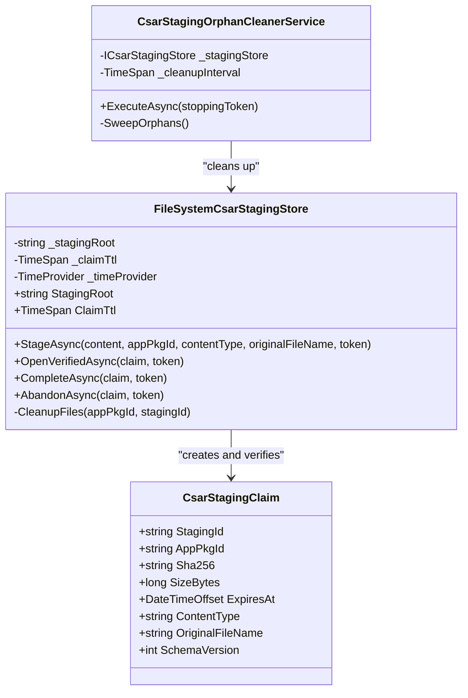
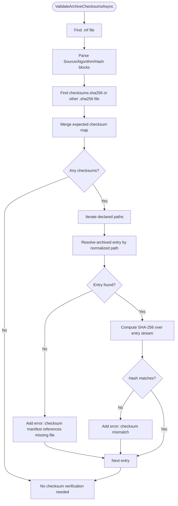
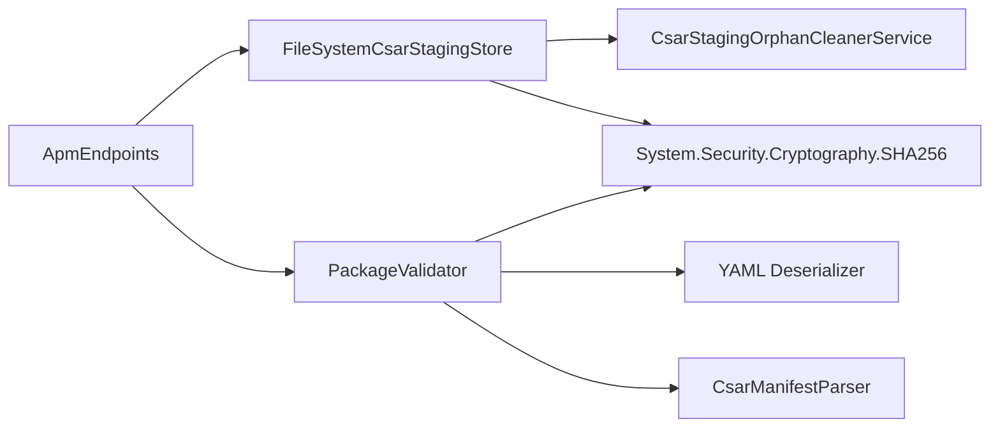

# CSAR Validation and Integrity Checking

<cite>
**Referenced Files in This Document**
- `docs/ADR/0004-package-validation-authority-and-csar-integrity.md`
- `docs/ADR/0024-csar-decompression-bound.md`
- `docs/ADR/0025-rfc7807-structured-error-model.md`
- `docs/CSAR_DISTRIBUTION_AND_LIFECYCLE_ARCHITECTURE.md`
- `src/ApmApi/Endpoints/ApmEndpoints.cs`
- `src/ApmApi/Services/PackageValidator.cs`
- `src/ApmApi/Services/FileSystemCsarStagingStore.cs`
- `src/Common/Models/CsarManifestParser.cs`
- `src/ApmApi/Validators/CreateAppPkgValidator.cs`
- `Benchmarks/CsarPipelineBenchmarks.cs`
</cite>

## Table of Contents
1. [Introduction](#introduction)
2. [Project Structure](#project-structure)
3. [Core Components](#core-components)
4. [Architecture Overview](#architecture-overview)
5. [Detailed Component Analysis](#detailed-component-analysis)
6. [Dependency Analysis](#dependency-analysis)
7. [Performance Considerations](#performance-considerations)
8. [Troubleshooting Guide](#troubleshooting-guide)
9. [Security Considerations](#security-considerations)
10. [Configuration Options](#configuration-options)
11. [Conclusion](#conclusion)

## Introduction
This document explains how the repository validates CSAR packages and checks their integrity during application package onboarding. It covers the validation pipeline from HTTP upload through TOSCA document parsing, descriptor completeness checks, ETSI-aligned structure validation, SHA-256 checksum verification, and the claim-check pattern used to handle large CSAR payloads safely.

The validation authority for CSAR onboarding is the APM module inside the MEO. The MEPM consumes already onboarded packages and may independently verify network transfer integrity, but it does not re-run the full APM `/validate` workflow during instantiation.

**Section sources**
- `docs/ADR/0004-package-validation-authority-and-csar-integrity.md#L1-L29`

## Project Structure
CSAR validation and integrity logic spans several layers:

| Layer | Responsibility | Key files |
|---|---|---|
| API boundary | Accepts multipart CSAR uploads, validates request shape, rejects non-ZIP archives, enforces server-side upload limits, and triggers durable onboarding | `src/ApmApi/Endpoints/ApmEndpoints.cs` |
| Claim check store | Stages uploaded bytes, computes SHA-256, persists a temporary CSAR, verifies claims, and cleans up orphaned files | `src/ApmApi/Services/FileSystemCsarStagingStore.cs` |
| Validation engine | Validates CSAR structure, finds AppD descriptors, parses YAML, checks required fields, and verifies archive checksums | `src/ApmApi/Services/PackageValidator.cs` |
| Manifest parser | Parses `.mf` metadata and per-file checksum blocks shared by APM and Platform Manager | `src/Common/Models/CsarManifestParser.cs` |
| Request model validation | Validates `CreateAppPkg` DTO fields such as name, version, and checksum | `src/ApmApi/Validators/CreateAppPkgValidator.cs` |
| Benchmarks | Exercises manifest parsing and claim-check staging without loading entire payloads into memory | `Benchmarks/CsarPipelineBenchmarks.cs` |

**Diagram sources**
- `src/ApmApi/Endpoints/ApmEndpoints.cs#L95-L200`
- `src/ApmApi/Services/FileSystemCsarStagingStore.cs#L58-L200`
- `src/ApmApi/Services/PackageValidator.cs#L1-L200`
- `src/Common/Models/CsarManifestParser.cs#L1-L140`

**Section sources**
- `src/ApmApi/Endpoints/ApmEndpoints.cs#L95-L200`
- `src/ApmApi/Services/FileSystemCsarStagingStore.cs#L58-L200`
- `src/ApmApi/Services/PackageValidator.cs#L1-L200`
- `src/Common/Models/CsarManifestParser.cs#L1-L140`

## Core Components

### APM API Endpoint
The `/app_pkgm/v1/onboarded_app_packages/{appPkgId}/package_content` endpoint performs initial input validation before any file is staged:

- Requires form-encoded multipart content.
- Rejects requests with no files or empty files.
- Rejects files whose extension is not `.csar`.
- Validates ZIP magic bytes against known PK headers.
- Requires a valid UUID-style `appPkgId`.
- Enforces a configurable maximum total upload size.
- Expects exactly one CSAR file.
- Stages the stream using the claim-check store.
- Starts the durable `OnboardAppPkgWF` Temporal workflow with the staging claim.
- Abandons the staged claim if the workflow cannot start.

The explicit `/validate` endpoint reads an existing packaged CSAR path and delegates validation to `PackageValidator`.

**Section sources**
- `src/ApmApi/Endpoints/ApmEndpoints.cs#L95-L200`
- `src/ApmApi/Endpoints/ApmEndpoints.cs#L460-L485`

### Claim-Check Store
`FileSystemCsarStagingStore` implements atomic two-stage writes:

1. **Stage**: Writes to a `.tmp` file while streaming data and computing SHA-256.
2. **Move**: Renames `.tmp` to `.csar` atomically on success.
3. **Verify**: `OpenVerifiedAsync` checks expiration, file existence, expected size, and recomputed SHA-256.
4. **Complete/Abandon**: Deletes staged files and optionally removes empty package directories.
5. **Cleanup**: `CsarStagingOrphanCleanerService` periodically removes abandoned `.tmp` files, expired `.csar` files, and empty directories.

The store uses:
- Shared `ArrayPool<byte>` buffers.
- `IncrementalHash` for incremental SHA-256 computation.
- Configurable staging root and claim TTL.
- TimeProvider for deterministic time handling in tests.

**Section sources**
- `src/ApmApi/Services/FileSystemCsarStagingStore.cs#L19-L57`
- `src/ApmApi/Services/FileSystemCsarStagingStore.cs#L58-L137`
- `src/ApmApi/Services/FileSystemCsarStagingStore.cs#L138-L200`
- `src/ApmApi/Services/FileSystemCsarStagingStore.cs#L201-L379`

### Validation Engine
`PackageValidator.ValidateCsarFileAsync` implements the core validation pipeline:

1. Open the CSAR ZIP archive.
2. Require `TOSCA-Metadata/TOSCA.meta`.
3. Parse `Entry-Definitions:` from the meta file when present.
4. Fall back to scanning `Definitions/` for a YAML declaring a MEC application node.
5. Read the AppD descriptor with bounded decompression.
6. Validate YAML topology and extract ETSI-related fields.
7. Merge checksum manifests from `.mf` and `Checksums/checksums.sha256`.
8. Compute SHA-256 for every referenced entry and compare expected vs actual hashes.

Errors are accumulated; only when there are no errors is the result marked valid.

**Section sources**
- `src/ApmApi/Services/PackageValidator.cs#L1-L200`
- `src/ApmApi/Services/PackageValidator.cs#L201-L390`

### Manifest Parser
`CsarManifestParser` is the shared source of truth for `.mf` parsing used by both APM and Platform Manager. It extracts:

- Canonical metadata fields under `app_*` and `vnf_*` key families.
- Per-file checksum entries where the algorithm is `SHA-256`.
- Unsupported algorithms are ignored rather than failing the whole manifest.

It avoids per-line string allocation where possible by using spans and enumerating lines efficiently.

**Section sources**
- `src/Common/Models/CsarManifestParser.cs#L1-L140`

### Request Model Validator
`CreateAppPkgValidator` validates the initial package registration request:

- `appPkgName` is required and limited to 55 characters.
- `appPkgVersion` is required and limited to 55 characters.
- `checksum` is required.
- `checksum.Algorithm` and `checksum.Hash` are required when checksum is present.

This validator applies at the DTO layer before service-level CSAR processing.

**Section sources**
- `src/ApmApi/Validators/CreateAppPkgValidator.cs#L1-L30`

## Architecture Overview
The end-to-end CSAR validation architecture separates responsibilities between HTTP ingestion, durable staging, background orchestration, and validation.

**Diagram sources**
- `src/ApmApi/Endpoints/ApmEndpoints.cs#L95-L200`
- `src/ApmApi/Services/FileSystemCsarStagingStore.cs#L58-L137`
- `src/ApmApi/Services/PackageValidator.cs#L1-L200`

## Detailed Component Analysis

### CSAR Validation Pipeline

**Diagram sources**
- `src/ApmApi/Services/PackageValidator.cs#L1-L200`
- `src/ApmApi/Services/PackageValidator.cs#L201-L390`

#### TOSCA Document Parsing
The validator uses a YAML deserializer configured with underscore naming conventions and unmatched property ignoring. It deserializes the AppD descriptor into a dictionary and walks `topology_template.node_templates` to find nodes whose type indicates an ETSI MEC application.

This is a structural schema validation rather than a full ETSI XML Schema/XSD pass. It checks:

- Presence of `topology_template`.
- Presence of node templates.
- At least one node that matches the MEC application type or contains an ETSI MEC type reference.
- Extraction of selected properties such as `app_descriptor_id`, `app_name`, `app_provider`, and `app_software_version`.

#### Descriptor Completeness Checks
Completeness rules currently include:

- A valid `topology_template` containing a MEC application node template.
- Mandatory `app_name`.
- Optional `app_provider`, reported as a warning when missing.
- Fallback generation of `app_descriptor_id` from `app_name` and software version when absent.

These rules are implementation-specific and do not imply that all ETSI GS MEC AppD fields are fully enforced.

#### Reference Resolution and Cross-References
The current code validates:

- CSAR structure and required files.
- Declared AppD descriptor presence.
- YAML topology structure.
- File checksum references.

It does not implement deep cross-reference resolution across multiple TOSCA files, external resource URIs, or runtime dependency graphs. Cross-reference validation would require loading and correlating multiple descriptor files and artifacts beyond what `PackageValidator` currently does.

#### Cryptographic Signature Verification
The implemented integrity mechanism is SHA-256 checksum verification against:

- Embedded checksum blocks in a `.mf` file (`Source`/`Algorithm`/`Hash`).
- Legacy `Checksums/checksums.sha256` or other `.sha256` files.

Only `SHA-256` algorithms are honoured. Other algorithms are skipped for individual blocks rather than causing immediate failure. There is no cryptographic signature verification such as detached signatures, signed manifests, or OCI cosign/notation verification in `PackageValidator`.

**Section sources**
- `src/ApmApi/Services/PackageValidator.cs#L1-L200`
- `src/ApmApi/Services/PackageValidator.cs#L201-L390`
- `src/Common/Models/CsarManifestParser.cs#L1-L140`

### Claim-Check Pattern Implementation

**Diagram sources**
- `src/ApmApi/Services/FileSystemCsarStagingStore.cs#L19-L57`
- `src/ApmApi/Services/FileSystemCsarStagingStore.cs#L58-L200`
- `src/ApmApi/Services/FileSystemCsarStagingStore.cs#L201-L379`

Key characteristics:

- The client never receives the raw CSAR bytes after staging. Consumers use the returned claim to open a verified stream.
- The claim carries immutable metadata: SHA-256 digest, size, expiration, content type, and original filename.
- Verification recomputes the hash rather than trusting the stored file alone.
- Orphan cleanup protects storage from abandoned uploads and expired claims.

**Section sources**
- `src/ApmApi/Services/FileSystemCsarStagingStore.cs#L58-L200`
- `src/ApmApi/Services/FileSystemCsarStagingStore.cs#L201-L379`

### Checksum Validation Algorithm

**Diagram sources**
- `src/ApmApi/Services/PackageValidator.cs#L201-L390`

## Dependency Analysis

**Diagram sources**
- `src/ApmApi/Endpoints/ApmEndpoints.cs#L95-L200`
- `src/ApmApi/Services/PackageValidator.cs#L1-L200`
- `src/ApmApi/Services/FileSystemCsarStagingStore.cs#L58-L200`
- `src/Common/Models/CsarManifestParser.cs#L1-L140`

Coupling observations:

- `ApmEndpoints` depends on both the staging store and the temporal workflow.
- `PackageValidator` depends on YAML parsing, ZIP access, cryptography, and logging.
- `CsarManifestParser` is a shared utility consumed by both APM and platform distribution logic.
- The claim-check store is independent of TOSCA semantics and focuses on durable, verifiable byte persistence.

**Section sources**
- `src/ApmApi/Endpoints/ApmEndpoints.cs#L95-L200`
- `src/ApmApi/Services/PackageValidator.cs#L1-L390`
- `src/ApmApi/Services/FileSystemCsarStagingStore.cs#L58-L379`
- `src/Common/Models/CsarManifestParser.cs#L1-L140`

## Performance Considerations

### Memory-Efficient Processing
The implementation avoids loading entire large descriptors or archives into memory unnecessarily:

- Streaming upload with `ArrayPool<byte>` reduces allocations during staging.
- Incremental SHA-256 hashing avoids materializing full file contents in a single buffer.
- Bounded text entry reading prevents zip-bomb expansion.
- Manifest parsing uses span-based line enumeration to reduce per-line allocations.
- Benchmarks exercise the real claim-check flow and manifest parsing to guard regressions.

### Parallel Validation Techniques
The current validation methods are synchronous within their own scope and do not parallelize checksum computation across archive entries. Checksum verification iterates declared entries sequentially. This simplifies error accumulation and resource management but can be a bottleneck for very large archives with many checksums.

Potential future improvements could include:

- Parallel entry hashing with bounded concurrency.
- Cancellation propagation through all streams.
- Early termination on first fatal structural error while still reporting collected diagnostics.

These are architectural suggestions; the current implementation prioritizes correctness and bounded resource usage over parallel throughput.

**Section sources**
- `src/ApmApi/Services/FileSystemCsarStagingStore.cs#L58-L200`
- `src/ApmApi/Services/PackageValidator.cs#L201-L390`
- `src/Common/Models/CsarManifestParser.cs#L1-L140`
- `Benchmarks/CsarPipelineBenchmarks.cs#L1-L126`

## Troubleshooting Guide

### Common Validation Errors and Resolutions

| Symptom | Likely Cause | Resolution |
|---|---|---|
| CSAR file not found | Validation endpoint received an invalid or stale CSAR path | Ensure the packaged CSAR exists before calling `/validate` or completing onboarding. |
| Missing `TOSCA-Metadata/TOSCA.meta` | Archive does not follow basic CSAR layout | Add the required meta file before packaging. |
| No AppD descriptor found | `Entry-Definitions` is missing and no YAML declares a MEC application node | Provide a valid AppD YAML under `Definitions/` or set `Entry-Definitions:` in `TOSCA.meta`. |
| AppDescriptor must contain valid topology | YAML is malformed or lacks `topology_template` | Fix YAML syntax and ensure a top-level `topology_template`. |
| Missing mandatory field `app_name` | AppD does not declare `app_name` | Add the required `app_name` field to the MEC application node properties. |
| Missing `app_provider` warning | Provider information is optional but recommended | Add `app_provider` to suppress the warning. |
| Checksum manifest references missing file | `.mf` or checksum file lists a path not present in the archive | Remove the missing reference or add the expected file. |
| Checksum mismatch | File content changed or was copied incorrectly | Repackage the CSAR and regenerate checksums, or correct the checksum list. |
| Entry exceeds maximum limit | Text entry is larger than the configured bound | Reduce descriptor size or adjust the configuration policy carefully. |
| Invalid ZIP/CSAR archive | Uploaded file is not a valid ZIP archive | Verify the file is a proper CSAR ZIP archive and not corrupted. |
| Upload payload too large | Total upload exceeds server limit | Split work or increase the configured upload limit if appropriate. |
| Staging claim expired | Claim TTL elapsed before verification completed | Retry quickly or regenerate the staged claim. |
| Staging file size mismatch | Stored file size differs from claim | Inspect storage corruption or concurrent modification; re-upload. |
| Staging file SHA-256 mismatch | Stored file content differs from computed hash | Re-upload the CSAR and investigate storage integrity. |

### Diagnostic Strategy
1. Start with HTTP-level errors returned by the endpoint.
2. Check whether the staged claim exists and has not expired.
3. Run the explicit `/validate` endpoint against the final packaged CSAR.
4. Inspect `PackageValidationResult.Errors` and `Warnings`.
5. If checksum failures occur, compare `.mf` and `Checksums/checksums.sha256` with the actual archive contents.
6. For performance issues, review staging logs for large uploads and consider benchmarking with `CsarPipelineBenchmarks`.

**Section sources**
- `src/ApmApi/Services/PackageValidator.cs#L1-L390`
- `src/ApmApi/Services/FileSystemCsarStagingStore.cs#L58-L200`
- `src/ApmApi/Endpoints/ApmEndpoints.cs#L95-L200`

## Security Considerations

### Malicious Payload Detection
The system defends against malicious CSAR inputs through layered checks:

- Extension check for `.csar`.
- ZIP magic byte validation.
- Server-side upload size enforcement.
- One-file-per-request restriction.
- Bounded text descriptor decompression.
- SHA-256 integrity verification against declared manifests.
- Claim expiration and size verification.
- Background cleanup of abandoned temporary files.

### Resource Exhaustion Prevention
The documented security policy bounds text descriptor decompression to 10 MB via `MaxDescriptorSizeBytes`. This mitigates zip-bomb attacks during validation. The staging store also uses bounded streaming buffers and does not load arbitrary content into unbounded collections.

Important limitation: the 10 MB bound applies to text descriptor entries processed by the validator. It is not a global limit for every entry in the archive. Large binary artifacts inside the archive can still consume significant disk space during staging.

### Secure Temporary File Handling
Temporary files are written to a `.tmp` path before being renamed to `.csar`. Cleanup handles both successful completion and abandonment. An orphan cleaner service sweeps old temporary files and expired staged files. Logs capture staging activity, including SHA-256 digests and sizes, so operators should treat log output as sensitive data.

### Network Transfer Integrity
MEPM may verify the SHA-256 hash of downloaded package streams locally before passing artifacts to VimAdapter. The modern distribution path also records and pins content-addressed digests through the OCI/Zot/Oras pipeline.

**Section sources**
- `docs/ADR/0004-package-validation-authority-and-csar-integrity.md#L1-L29`
- `docs/ADR/0024-csar-decompression-bound.md#L1-L33`
- `src/ApmApi/Services/FileSystemCsarStagingStore.cs#L58-L379`
- `docs/CSAR_DISTRIBUTION_AND_LIFECYCLE_ARCHITECTURE.md#L1-L200`

## Configuration Options

| Option | Default Behavior | Purpose |
|---|---:|---|
| `AppSettings:MaxUploadSize` | 512 MB | Maximum total upload size accepted by the package content endpoint. |
| `AppSettings:StagingPath` | Temp directory under `optimist-csar-staging` | Root path for staged CSAR files. |
| `CsarStaging:ClaimTtl` | 24 hours | Lifetime of a staging claim before `OpenVerifiedAsync` rejects it. |
| `CsarStaging:CleanerInterval` | 1 hour | Interval for the orphan cleanup background service. |
| `PackageValidator.MaxDescriptorSizeBytes` | 10 MB | Maximum allowed size for text descriptor entries during validation. |

Operators should tune these values conservatively. Increasing upload limits or descriptor bounds improves support for large legitimate packages but weakens protection against resource exhaustion.

**Section sources**
- `src/ApmApi/Endpoints/ApmEndpoints.cs#L95-L200`
- `src/ApmApi/Services/FileSystemCsarStagingStore.cs#L19-L57`
- `docs/ADR/0024-csar-decompression-bound.md#L1-L33`

## Conclusion
The repository implements a practical CSAR validation and integrity pipeline focused on:

- Structural CSAR validation.
- TOSCA AppD descriptor discovery and topology checks.
- Required-field validation for MEC application descriptors.
- SHA-256 checksum verification against `.mf` and legacy checksum files.
- Secure, memory-efficient staging through a claim-check pattern.
- Bounded descriptor decompression to mitigate zip-bomb risks.

It does not implement a complete ETSI schema validator, full cross-reference resolver, or cryptographic signature verifier. Those capabilities would need to be added explicitly if higher assurance is required. For most onboarding workflows, the combination of upload validation, claim-checked durability, bounded processing, descriptor checks, and checksum verification provides a strong operational foundation.