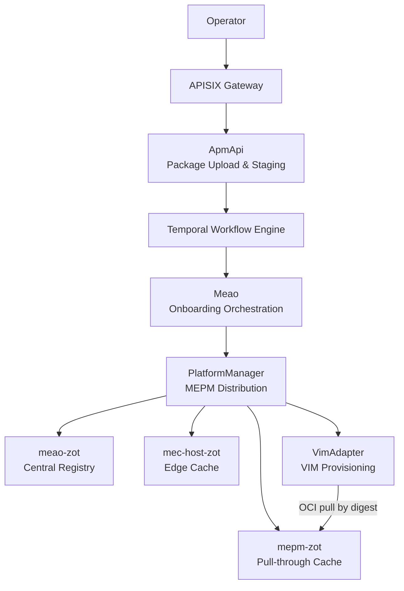
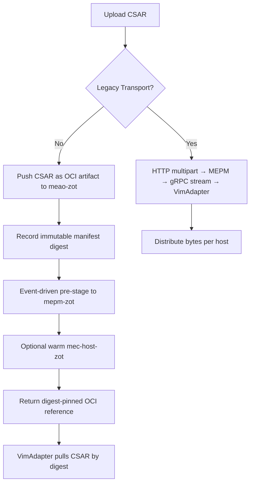
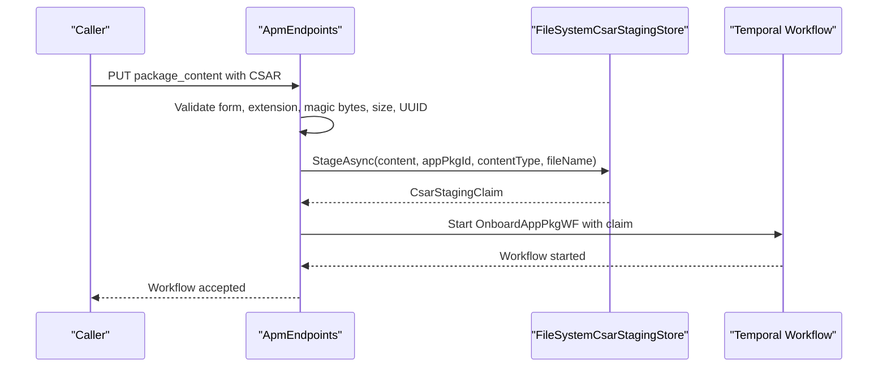
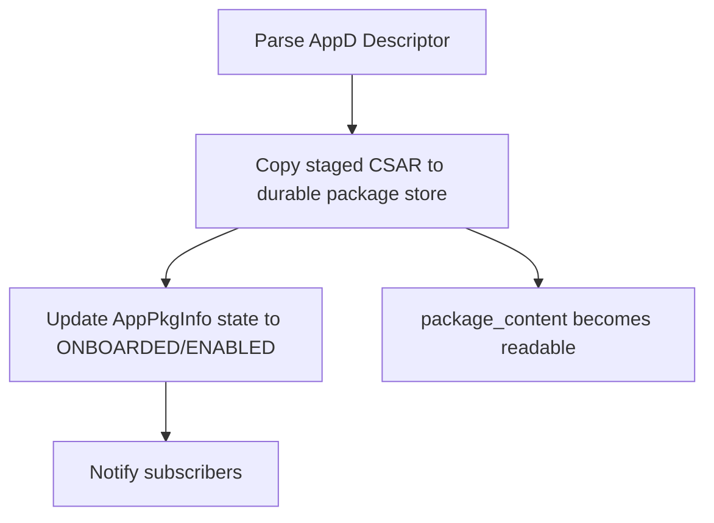
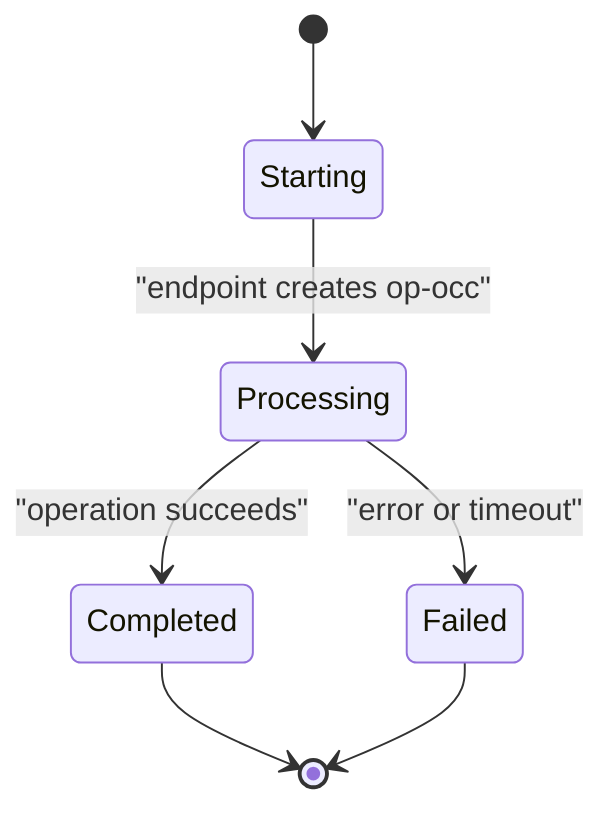
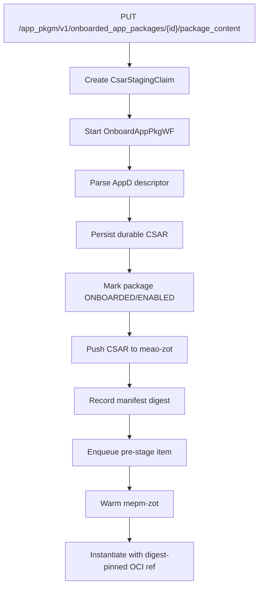
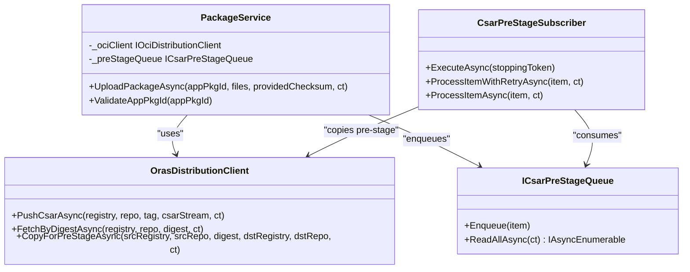
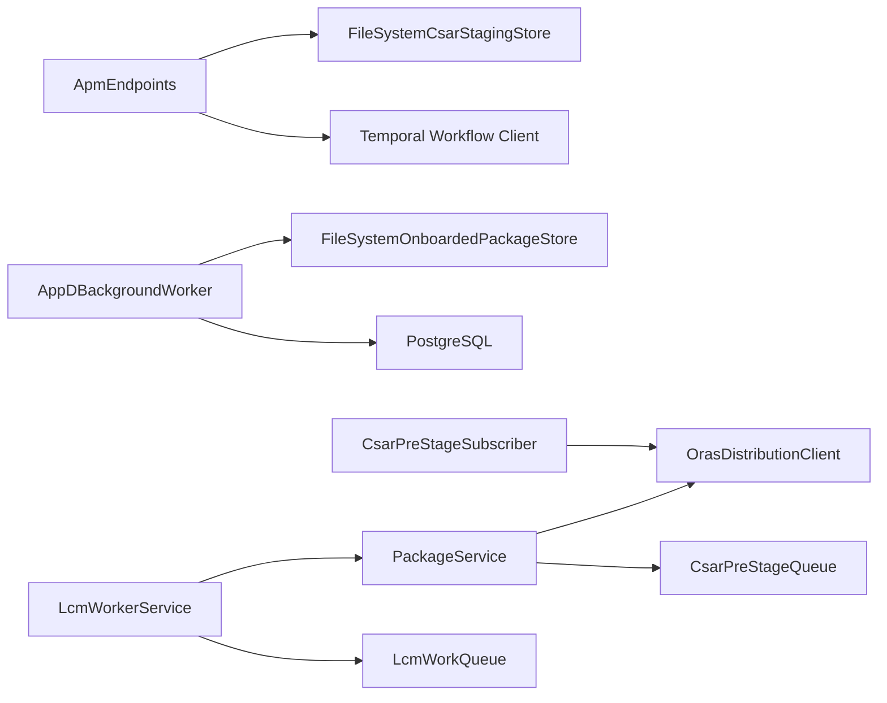

# Package Distribution and Storage

<cite>
**Referenced Files in This Document**
- `docs/CSAR_DISTRIBUTION_AND_LIFECYCLE_ARCHITECTURE.md`
- `docs/ARCHITECTURE.md`
- `docs/ADR/0029-mepm-package-distribution-vs-onboarding.md`
- `docs/ADR/0039-durable-background-processing-queue.md`
- `docs/ADR/0041-oci-zot-oras-csar-distribution.md`
- `docs/ADR/0061-kubernetes-persistent-storage-and-in-cluster-zot-registry.md`
- `src/ApmApi/Endpoints/ApmEndpoints.cs`
- `src/ApmApi/Background/AppDBackgroundWorker.cs`
- `src/ApmApi/Services/FileSystemCsarStagingStore.cs`
- `src/ApmApi/Services/FileSystemOnboardedPackageStore.cs`
- `src/PlatformManager/PlatformManager/Services/PackageService.cs`
- `src/PlatformManager/PlatformManager/Services/OrasDistributionClient.cs`
- `src/PlatformManager/PlatformManager/Services/CsarPreStageSubscriber.cs`
- `src/PlatformManager/PlatformManager/Services/LcmWorkerService.cs`
- `src/PlatformManager/PlatformManager/Services/LcmWorkQueue.cs`
</cite>

## Table of Contents
1. Introduction
2. Project Structure
3. Core Components
4. Architecture Overview
5. Detailed Component Analysis
6. Dependency Analysis
7. Performance Considerations
8. Troubleshooting Guide
9. Conclusion

## Introduction
This document explains how Optimist.Orchestrator stores, processes, and distributes application packages (CSAR archives). It covers:

- The multi-stage storage approach: staging area management, durable onboarded package persistence, and permanent storage coordination.
- The modern distribution path using an OCI registry mesh (zot) and ORAS, replacing legacy gRPC byte-streaming.
- Background workers that process long-running operations asynchronously with retry logic and progress tracking.
- The claim-check pattern used to decouple large payload handling from workflow orchestration.
- Chunked streaming during upload and verification, plus a storage backend abstraction.
- End-to-end package lifecycle, health monitoring, disaster recovery, scalability, and optimization guidance.

The codebase implements both the MEO role (package onboarding and distribution authority via ApmApi and Meao) and the MEPM role (lifecycle execution and edge distribution via PlatformManager), with VimAdapter performing actual VIM provisioning.

**Section sources**
- `docs/ARCHITECTURE.md#L1-L120`
- `docs/CSAR_DISTRIBUTION_AND_LIFECYCLE_ARCHITECTURE.md#L1-L120`

## Project Structure
Package-related responsibilities are split across three layers:

| Layer | Service | Responsibility |
|---|---|---|
| MEO / System Level | ApmApi | Accepts uploads, stages files, persists durable artifacts, parses descriptors, triggers Temporal workflows, exposes onboarded package queries. |
| MEO / System Level | Meao | Orchestrates end-to-end onboarding and distribution through Temporal workflows and activities. |
| MEPM / Host Level | PlatformManager | Receives packages, pushes them to the central Zot registry, pre-stages edge copies, resolves digest-pinned references, and drives lifecycle work. |
| Edge / VIM | VimAdapter | Pulls CSAR or referenced images from local registries and provisions Kubernetes/OpenStack resources. |

**Diagram sources**
- `docs/ARCHITECTURE.md#L1-L120`
- `docs/CSAR_DISTRIBUTION_AND_LIFECYCLE_ARCHITECTURE.md#L1-L120`

**Section sources**
- `docs/ARCHITECTURE.md#L1-L120`

## Core Components
The package system is built around five core components:

1. **Claim-check staging store:** `FileSystemCsarStagingStore` stages uploaded CSAR content atomically, computes SHA-256, and returns a time-bounded claim containing metadata such as staging ID, app package ID, digest, size, expiration, content type, and schema version.
2. **Durable onboarded package store:** `FileSystemOnboardedPackageStore` writes completed CSARs under the service content root so they remain visible to the HTTP package-content reader.
3. **Background descriptor worker:** `AppDBackgroundWorker` drains queued AppD parsing jobs, retries transient failures with exponential backoff, persists parsed descriptors, updates package states, and dead-letters permanently failed jobs.
4. **OCI distribution client:** `OrasDistributionClient` wraps ORAS SDK calls to push, fetch by digest, and copy between registries while emitting OpenTelemetry metrics.
5. **MEPM package coordinator:** `PackageService` validates inputs, persists local package metadata, pushes CSARs to the central Zot registry, records the immutable manifest digest, and enqueues event-driven pre-stage operations.

**Section sources**
- `src/ApmApi/Services/FileSystemCsarStagingStore.cs#L1-L200`
- `src/ApmApi/Services/FileSystemOnboardedPackageStore.cs#L1-L76`
- `src/ApmApi/Background/AppDBackgroundWorker.cs#L1-L191`
- `src/PlatformManager/PlatformManager/Services/OrasDistributionClient.cs#L1-L200`
- `src/PlatformManager/PlatformManager/Services/PackageService.cs#L1-L200`

## Architecture Overview
There are two transport generations documented in the repository:

- **Legacy transport:** Direct HTTP multipart upload from MEO to MEPM, followed by gRPC chunk streaming from MEPM to VimAdapter. This buffers full archives in memory and lacks content addressing.
- **Modern transport:** CSARs are pushed as OCI artifacts to a central Zot registry and distributed by digest through a three-tier Zot hierarchy: `meao-zot` (source of truth), `mepm-zot` (pull-through cache), and `mec-host-zot` (edge cache).

**Diagram sources**
- `docs/CSAR_DISTRIBUTION_AND_LIFECYCLE_ARCHITECTURE.md#L20-L120`
- `docs/ADR/0041-oci-zot-oras-csar-distribution.md#L1-L120`

**Section sources**
- `docs/CSAR_DISTRIBUTION_AND_LIFECYCLE_ARCHITECTURE.md#L20-L120`
- `docs/ADR/0029-mepm-package-distribution-vs-onboarding.md#L1-L53`
- `docs/ADR/0041-oci-zot-oras-csar-distribution.md#L1-L120`

## Detailed Component Analysis

### Claim-Check Pattern and Staging Area Management
The claim-check pattern separates large file transfer from workflow processing. The upload endpoint receives the request, streams the file into a staging store while computing its SHA-256, then starts a durable workflow carrying only a lightweight claim instead of the archive itself.

Key behaviors:

- Upload validation checks form encoding, file presence, `.csar` extension, ZIP magic bytes, UUID format, and configured maximum upload size.
- `FileSystemCsarStagingStore.StageAsync` streams the input, increments a SHA-256 hash, writes to a temporary `.csar.tmp` file, atomically moves it to the final staged path, and returns a `CsarStagingClaim`.
- The claim includes a GUID-based staging ID, app package ID, normalized SHA-256, total bytes, expiration time, content type, original filename, and schema version.
- `OpenVerifiedAsync` validates expiration, file existence, exact size, and recomputes SHA-256 before returning a verified read stream.
- TTL is configurable through `CsarStaging:ClaimTtl`, defaulting to 24 hours when positive; otherwise the default applies.

**Diagram sources**
- `src/ApmApi/Endpoints/ApmEndpoints.cs#L120-L200`
- `src/ApmApi/Services/FileSystemCsarStagingStore.cs#L1-L200`

**Section sources**
- `src/ApmApi/Endpoints/ApmEndpoints.cs#L120-L200`
- `src/ApmApi/Services/FileSystemCsarStagingStore.cs#L1-L200`

### Permanent Storage Coordination and Durable Copy Invariant
After successful descriptor parsing, the background worker persists the staged CSAR into the durable onboarded package store. This preserves the invariant that an onboarded package is retrievable.

Important details:

- The durable store lives under the service content root at `app_packages/{appPkgId}/{appPkgId}.csar`.
- Persistence uses an atomic `.tmp` write followed by `File.Move(..., overwrite: false)` so concurrent idempotent copies cannot replace an already durable artifact.
- If the final file already exists, `PersistAsync` returns without overwriting.
- The worker writes the staged artifact before marking the package `ONBOARDED` and `ENABLED`, ensuring readiness is not advertised over a missing artifact.
- Kubernetes persistent volumes mount `/app/app_packages`, `/app/Apps`, and `/app/data` so these paths survive pod restarts and rescheduling.

**Diagram sources**
- `src/ApmApi/Background/AppDBackgroundWorker.cs#L40-L140`
- `src/ApmApi/Services/FileSystemOnboardedPackageStore.cs#L1-L76`
- `docs/ADR/0061-kubernetes-persistent-storage-and-in-cluster-zot-registry.md#L1-L120`

**Section sources**
- `src/ApmApi/Background/AppDBackgroundWorker.cs#L40-L140`
- `src/ApmApi/Services/FileSystemOnboardedPackageStore.cs#L1-L76`
- `docs/ADR/0061-kubernetes-persistent-storage-and-in-cluster-zot-registry.md#L1-L120`

### Background Worker Retry Logic and Progress Tracking
Both ApmApi and PlatformManager use background workers to avoid blocking HTTP requests.

#### ApmApi Descriptor Worker
`AppDBackgroundWorker`:

- Drains an in-process channel of `AppDProcessingJob` items.
- Creates a fresh DI scope per job attempt to prevent connection-pool and DbContext issues.
- Parses the descriptor, persists the durable CSAR, saves parsed descriptor data, updates package metadata, and notifies subscribers.
- Retries up to three times with exponential backoff (`200ms × 2^attempt`).
- On permanent failure, sets the package state to `ERROR` and writes a dead-letter JSON file under `dead_letters`.
- Deduplicates subscription notifications within one job lifetime.

#### PlatformManager Lifecycle Worker
`LcmWorkerService`:

- Replays `PROCESSING` operation occurrences after startup to recover from crashes.
- Enqueues work items through `ILcmWorkQueue`, which is backed by an unbounded channel with single-reader semantics.
- Applies per-operation timeouts via linked cancellation tokens; timeouts mark operations failed rather than stalling the worker.
- Transitions op-occ records through a state machine inside bounded database transactions.
- For instantiation, resolves the CSAR digest, calls distribution, forwards the digest-pinned OCI reference, and updates instance state.

**Diagram sources**
- `src/ApmApi/Background/AppDBackgroundWorker.cs#L1-L191`
- `src/PlatformManager/PlatformManager/Services/LcmWorkerService.cs#L1-L200`
- `src/PlatformManager/PlatformManager/Services/LcmWorkerService.cs#L200-L500`
- `src/PlatformManager/PlatformManager/Services/LcmWorkQueue.cs#L1-L37`

**Section sources**
- `docs/ADR/0039-durable-background-processing-queue.md#L1-L200`
- `src/ApmApi/Background/AppDBackgroundWorker.cs#L1-L191`
- `src/PlatformManager/PlatformManager/Services/LcmWorkerService.cs#L1-L200`
- `src/PlatformManager/PlatformManager/Services/LcmWorkerService.cs#L200-L500`
- `src/PlatformManager/PlatformManager/Services/LcmWorkQueue.cs#L1-L37`

### Multi-Stage Storage Flow
The end-to-end flow combines staging, durable persistence, and OCI distribution.

**Diagram sources**
- `src/ApmApi/Endpoints/ApmEndpoints.cs#L120-L200`
- `src/ApmApi/Background/AppDBackgroundWorker.cs#L40-L140`
- `src/PlatformManager/PlatformManager/Services/PackageService.cs#L120-L200`
- `src/PlatformManager/PlatformManager/Services/CsarPreStageSubscriber.cs#L1-L136`

**Section sources**
- `src/ApmApi/Endpoints/ApmEndpoints.cs#L120-L200`
- `src/ApmApi/Background/AppDBackgroundWorker.cs#L40-L140`
- `src/PlatformManager/PlatformManager/Services/PackageService.cs#L120-L200`
- `src/PlatformManager/PlatformManager/Services/CsarPreStageSubscriber.cs#L1-L136`

### OCI Registry Integration and Distribution
`PackageService.UploadPackageAsync` coordinates the modern distribution path:

1. Validates `appPkgId` against null/empty and path traversal.
2. Persists a local `.csar` and extracts metadata for the `AppPkgRecord`.
3. Opens the file stream and calls `_ociClient.PushCsarAsync` to push the CSAR to the configured MEAO Zot registry under `{tenantId}/csar/{appPkgId}`.
4. Stores the returned manifest digest in `AppPkgRecord.CsarDigest`.
5. Enqueues a `CsarPreStageItem` so the pre-stage subscriber warms the MEPM Zot cache.

`OrasDistributionClient` implements:

- `PushCsarAsync`: reads the stream, creates a blob descriptor, packs an OCI manifest, tags it, and emits metrics.
- `FetchByDigestAsync`: fetches an artifact by digest from a repository.
- `CopyForPreStageAsync`: copies a digest-pinned source reference to a destination registry.

`CsarPreStageSubscriber` consumes pre-stage items, retries transient network errors with bounded exponential backoff, and continues processing even if a single item fails.

**Diagram sources**
- `src/PlatformManager/PlatformManager/Services/PackageService.cs#L1-L200`
- `src/PlatformManager/PlatformManager/Services/OrasDistributionClient.cs#L1-L200`
- `src/PlatformManager/PlatformManager/Services/CsarPreStageSubscriber.cs#L1-L136`

**Section sources**
- `src/PlatformManager/PlatformManager/Services/PackageService.cs#L1-L200`
- `src/PlatformManager/PlatformManager/Services/OrasDistributionClient.cs#L1-L200`
- `src/PlatformManager/PlatformManager/Services/CsarPreStageSubscriber.cs#L1-L136`
- `docs/ADR/0041-oci-zot-oras-csar-distribution.md#L1-L120`

### Chunked Upload Support
The implementation does not implement a protocol-level chunked upload API. Instead, it supports large payloads through streaming:

- The upload endpoint reads the incoming stream directly without loading the entire file into memory.
- `FileSystemCsarStagingStore` uses a reusable buffer pool and incremental SHA-256 hashing while writing chunks to disk.
- `CopyBufferSize` is set to 81,920 bytes for efficient streaming.
- The descriptor worker also opens the staged file as a stream and copies it to the durable store.

If true chunked upload semantics are required later, the current `ICsarStagingStore` abstraction can be extended without changing the claim-check contract.

**Section sources**
- `src/ApmApi/Endpoints/ApmEndpoints.cs#L120-L200`
- `src/ApmApi/Services/FileSystemCsarStagingStore.cs#L1-L200`
- `src/ApmApi/Background/AppDBackgroundWorker.cs#L60-L120`

### Storage Backend Abstraction
The codebase abstracts storage through interfaces rather than hard-coding filesystem behavior everywhere relevant to package integrity:

| Interface | Implementation | Purpose |
|---|---|---|
| `ICsarStagingStore` | `FileSystemCsarStagingStore` | Atomic staging, SHA-256 computation, claim issuance, and verified retrieval. |
| `IOnboardedPackageStore` | `FileSystemOnboardedPackageStore` | Durable persistence of onboarded CSARs under the content root. |
| `IOciDistributionClient` | `OrasDistributionClient` | Push, fetch-by-digest, and cross-registry copy over OCI. |
| `ILcmWorkQueue` | `LcmWorkQueue` | Unbounded channel-backed queue for lifecycle work. |
| `ICsarPreStageQueue` | `CsarPreStageQueue` | Unbounded channel-backed queue for pre-stage events. |

This abstraction makes testing easier and allows future implementations to swap out filesystem-backed storage where appropriate, although the current durable package store intentionally remains filesystem-backed to satisfy the onboarded-readiness invariant.

**Section sources**
- `src/ApmApi/Services/FileSystemCsarStagingStore.cs#L1-L200`
- `src/ApmApi/Services/FileSystemOnboardedPackageStore.cs#L1-L76`
- `src/PlatformManager/PlatformManager/Services/OrasDistributionClient.cs#L1-L200`
- `src/PlatformManager/PlatformManager/Services/LcmWorkQueue.cs#L1-L37`
- `src/PlatformManager/PlatformManager/Services/CsarPreStageSubscriber.cs#L1-L136`

## Dependency Analysis
The main dependency relationships for package distribution are:

**Diagram sources**
- `src/ApmApi/Endpoints/ApmEndpoints.cs#L120-L200`
- `src/ApmApi/Background/AppDBackgroundWorker.cs#L1-L191`
- `src/PlatformManager/PlatformManager/Services/PackageService.cs#L1-L200`
- `src/PlatformManager/PlatformManager/Services/OrasDistributionClient.cs#L1-L200`
- `src/PlatformManager/PlatformManager/Services/CsarPreStageSubscriber.cs#L1-L136`
- `src/PlatformManager/PlatformManager/Services/LcmWorkerService.cs#L1-L200`
- `src/PlatformManager/PlatformManager/Services/LcmWorkQueue.cs#L1-L37`

**Section sources**
- `docs/ARCHITECTURE.md#L1-L120`
- `docs/CSAR_DISTRIBUTION_AND_LIFECYCLE_ARCHITECTURE.md#L1-L120`

## Performance Considerations
- Streaming avoids loading full CSAR archives into memory during staging and verification.
- Buffer reuse through `ArrayPool<byte>` reduces allocations during large transfers.
- OCI digest addressing enables deduplication and caching across VimAdapters behind one MEPM.
- Event-driven pre-stage improves cold-start latency by warming the MEPM cache before instantiation.
- On-demand pull-through provides a safety net without stale windows caused by periodic sync timers.
- Per-operation timeouts prevent hung VIM calls from starving the lifecycle worker.
- Single-reader channels reduce contention between producers and consumers.
- OpenTelemetry metrics in `OrasDistributionClient` expose operation counts, outcomes, and fetch durations.

Operational notes from the repository include:

- On-demand instantiates can have higher latency than warm instantiates because they depend on registry reachability.
- Concurrent cold pulls may saturate edge networks and signature verification.
- Three-tier Zot replication duplicates storage, but this is intentional for pull-through isolation.
- Persistent volumes enable retention but require explicit reclaim policies to avoid orphaned node storage.

**Section sources**
- `docs/ADR/0041-oci-zot-oras-csar-distribution.md#L60-L200`
- `docs/ADR/0061-kubernetes-persistent-storage-and-in-cluster-zot-registry.md#L200-L320`
- `src/PlatformManager/PlatformManager/Services/OrasDistributionClient.cs#L1-L200`

## Troubleshooting Guide

### Upload Fails Validation
Symptoms:

- 400 Bad Request for malformed form data or invalid UUID.
- 415 Unsupported Media Type for non-CSAR files or invalid ZIP magic bytes.
- 413 Payload Too Large when total upload exceeds `AppSettings:MaxUploadSize`.

Checks:

- Confirm the request is form-encoded and contains exactly one `.csar` file.
- Verify the file begins with a valid ZIP header.
- Check the configured maximum upload size.
- Ensure the referenced package record exists before uploading content.

**Section sources**
- `src/ApmApi/Endpoints/ApmEndpoints.cs#L120-L200`

### Staged Claim Expires Before Processing
Symptoms:

- `InvalidOperationException` indicating a staging claim has expired.
- Missing staged file or size mismatch.
- SHA-256 digest mismatch.

Checks:

- Inspect `CsarStaging:ClaimTtl`; the default is 24 hours.
- Verify that the workflow consuming the claim runs before expiration.
- Confirm the staged file still exists and matches the recorded size.
- Compare expected and computed SHA-256 digests.

**Section sources**
- `src/ApmApi/Services/FileSystemCsarStagingStore.cs#L1-L200`

### Descriptor Parsing Permanently Fails
Symptoms:

- Package remains in or transitions to `ERROR`.
- Dead-letter JSON appears under `dead_letters`.
- Webhook notifications are not delivered for that package.

Checks:

- Review worker logs for retry attempts and exponential backoff.
- Inspect the dead-letter file for the last processed job payload.
- Check whether the staged CSAR can be opened and parsed.
- Verify webhook delivery and subscription configuration separately from package parsing.

**Section sources**
- `src/ApmApi/Background/AppDBackgroundWorker.cs#L1-L191`
- `docs/ADR/0039-durable-background-processing-queue.md#L1-L200`

### OCI Push or Fetch Fails
Symptoms:

- Push fails with manifest invalidation or blob-existence errors.
- Fetch-by-digest returns transport or authentication errors.
- Pre-stage copy fails between registries.

Checks:

- Confirm the registry address matches the configured plain-http allowlist for loopback or edge-local hosts.
- Verify that the artifact is signed when `onlySigned:true` is enforced by the registry.
- Inspect OpenTelemetry metrics for operation counts and outcomes.
- Check TLS, credentials, and network connectivity to `meao-zot`, `mepm-zot`, and `mec-host-zot`.

**Section sources**
- `src/PlatformManager/PlatformManager/Services/OrasDistributionClient.cs#L1-L200`
- `docs/ADR/0041-oci-zot-oras-csar-distribution.md#L1-L120`

### Pre-Stage Does Not Warm the Edge Cache
Symptoms:

- Instantiation falls back to on-demand pull.
- Logs show transient retry warnings or permanent pre-stage failures.

Checks:

- Confirm `PackageService` enqueued a pre-stage item after pushing to `meao-zot`.
- Verify `CsarPreStageSubscriber` is running and draining its queue.
- Check whether failures are classified as transient and retried.
- Inspect whether the MEAO and MEPM Zot endpoints are reachable.

**Section sources**
- `src/PlatformManager/PlatformManager/Services/PackageService.cs#L120-L200`
- `src/PlatformManager/PlatformManager/Services/CsarPreStageSubscriber.cs#L1-L136`

### Lifecycle Operation Times Out or Leaves Op-OcC in PROCESSING
Symptoms:

- Instance lifecycle operation does not complete.
- `LcmWorkerService` logs a timeout or worker error.
- Startup replay re-enqueues work after restart.

Checks:

- Review `LcmWorker:VimOperationTimeout`; the default is two minutes.
- Inspect op-occ state and response fields.
- Confirm the VM adapter call did not hang indefinitely.
- Verify that replay settles already-instantiated instances without reissuing VIM calls.

**Section sources**
- `src/PlatformManager/PlatformManager/Services/LcmWorkerService.cs#L1-L200`
- `src/PlatformManager/PlatformManager/Services/LcmWorkerService.cs#L200-L500`

### Persistent Storage Is Denied After Deployment
Symptoms:

- Container exits with permission denied when creating staging directories.
- Packages disappear after pod restart.
- Zor registries do not start or lose artifacts.

Checks:

- Confirm PVCs are mounted at `/app/app_packages`, `/app/Apps`, `/app/data`, `/app/config`, `/app/packages`, and `/app/k8sconfigs` as needed.
- Verify the storage class uses `Retain` and the correct provisioner.
- Confirm zot mounts `/var/lib/zot` and the volume is writable by the configured UID.
- Check that registry deployments are created after their PVCs bind.

**Section sources**
- `docs/ADR/0061-kubernetes-persistent-storage-and-in-cluster-zot-registry.md#L1-L320`

## Conclusion
The package distribution and storage design separates concerns cleanly:

- The claim-check pattern keeps large CSAR uploads decoupled from durable workflow execution.
- Staging stores validate and verify content incrementally.
- Durable package persistence ensures onboarded packages remain retrievable.
- OCI registries provide content-addressed, cacheable, and verifiable distribution.
- Background workers handle long-running descriptor parsing and lifecycle operations with retry, backoff, timeout, and crash-recovery semantics.
- Persistent volumes and a three-tier Zot chain make the system resilient to pod restarts and improve distribution performance.

For production environments, operators should monitor staging claims, descriptor dead letters, OCI metrics, pre-stage success rates, lifecycle op-occ states, and persistent volume retention. Disaster recovery should focus on restoring durable package files, reconciling stale op-occ rows, and re-onboarding artifacts whose registry references no longer resolve.