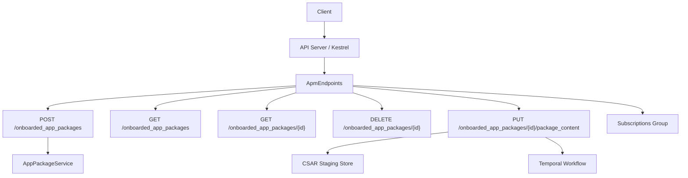
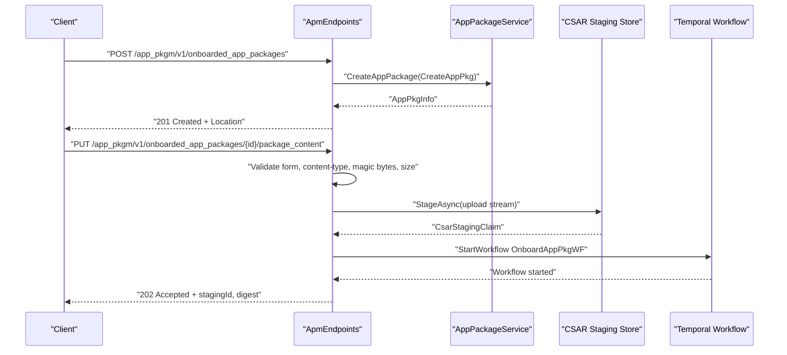
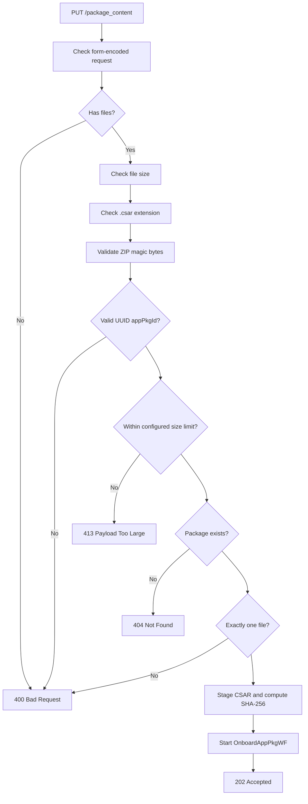
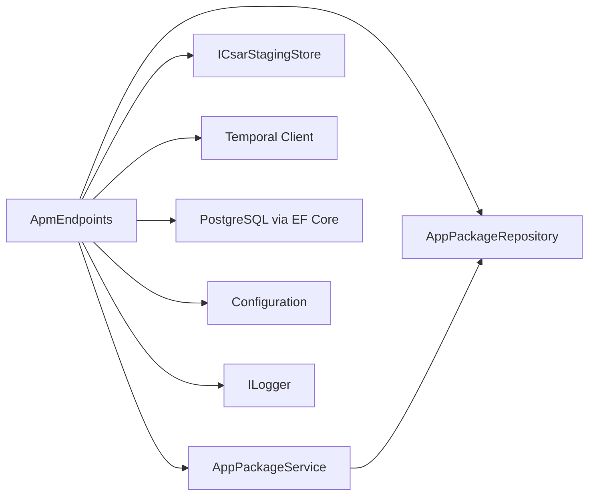

# REST API Endpoints (/app_pkgm/v1)

## Table of Contents
1. [Introduction](#introduction)
2. [Project Structure](#project-structure)
3. [Core Components](#core-components)
4. [Architecture Overview](#architecture-overview)
5. [Detailed Component Analysis](#detailed-component-analysis)
6. [Dependency Analysis](#dependency-analysis)
7. [Performance Considerations](#performance-considerations)
8. [Troubleshooting Guide](#troubleshooting-guide)
9. [Conclusion](#conclusion)

## Introduction
This document specifies the REST API surface exposed by the App Package Management (APM) service under `/app_pkgm/v1`. It focuses on the endpoints that implement ETSI GS MEC 010-2 Part 2 application package management, including CSAR upload, package metadata retrieval, deletion, operational state changes, and subscription management for app-package lifecycle events.

The implementation follows the OpenAPI contract defined in the ETSI specification while adding internal helper endpoints used by the MEAO orchestration pipeline. Error handling uses RFC 7807 `application/problem+json`, with a standardized `cause` extension for machine-readable failure classification.

## Project Structure
The APM service is part of the MEAO modular monolith. Its HTTP routes are registered through a single endpoint mapper, its request/response models live in `Dto`, `Models`, and `Requests`, and background processing is coordinated through Temporal workflows and a durable staging store.



**Diagram sources**
- `src/ApmApi/Endpoints/ApmEndpoints.cs#L1-L120`
- `src/ApmApi/Program.cs#L1-L120`

**Section sources**
- `src/ApmApi/Endpoints/ApmEndpoints.cs#L1-L120`
- `src/ApmApi/Program.cs#L1-L120`

## Core Components
- **Endpoint layer**: `ApmEndpoints` maps all public `/app_pkgm/v1/onboarded_app_packages` and `/app_pkgm/v1/subscriptions` routes.
- **Service layer**: `AppPackageService` implements CRUD over the persisted app package record.
- **Request model**: `CreateAppPkg` describes the payload for creating an app package resource.
- **Response model**: `AppPkgInfoDto` serializes stored package metadata to the ETSI-aligned wire format.
- **Authentication**: Keycloak bearer tokens are required for public routes; internal routes require authorization as well.
- **Error model**: Global exception handling and FluentValidation return RFC 7807 `ProblemDetails`.

Key responsibilities:
- Validate incoming requests before business logic.
- Generate server-side package IDs.
- Stage CSAR uploads securely.
- Start durable onboarding workflows.
- Manage subscriptions and callback delivery constraints.

**Section sources**
- `src/ApmApi/Endpoints/ApmEndpoints.cs#L1-L120`
- `src/ApmApi/Services/AppPackageService.cs#L1-L80`
- `src/ApmApi/Requests/CreateAppPkg.cs#L1-L38`
- `src/ApmApi/Dto/AppPkgInfoDto.cs#L1-L46`
- `src/ApmApi/Program.cs#L1-L120`

## Architecture Overview
The package onboarding flow is intentionally split into synchronous validation and durable asynchronous processing:



**Diagram sources**
- `src/ApmApi/Endpoints/ApmEndpoints.cs#L1-L200`
- `src/ApmApi/Program.cs#L60-L120`

## Detailed Component Analysis

### Authentication and Authorization
- Public APM routes use `.RequireAuthorization()` and are protected by Keycloak Web API authentication.
- Internal routes under `/internal/app_pkgm/v1/onboarded_app_packages` also require authorization and are intended for internal MEAO activity calls rather than external clients.
- The example client credential flow in the local HTTP file shows how a bearer token is obtained before calling the APM endpoints.

Security considerations:
- Callback URIs submitted during subscription creation are validated to reject non-HTTPS URLs and private IP ranges unless explicitly allowed.
- The global exception handler strips sensitive stack traces from error responses.

**Section sources**
- `src/ApmApi/Endpoints/ApmEndpoints.cs#L1-L120`
- `src/ApmApi/Endpoints/ApmEndpoints.cs#L650-L994`
- `src/ApmApi/Program.cs#L1-L60`
- `src/ApmApi/ApmApi.http#L1-L20`
- `docs/ADR/0046-universal-rfc7807-exception-handling-and-fluentvalidation.md#L1-L60`
- `docs/ADR/0059-etsi-subscription-callback-authentication-and-prefix-hardening.md`

### POST `/app_pkgm/v1/onboarded_app_packages`
Creates a new app package resource. This corresponds to the ETSI `OnboardedapppackagesPOST` operation.

| Property | Value |
|---|---|
| Method | `POST` |
| Path | `/app_pkgm/v1/onboarded_app_packages` |
| Authentication | Required (`Authorization: Bearer <token>`) |
| Request body | JSON object containing `CreateAppPkg` |
| Success response | `201 Created`; body contains `AppPkgInfo`; `Location` header points to the created resource |
| Content type | `application/json` |

#### Request schema: `CreateAppPkg`
| Field | Type | Required | Constraints |
|---|---|---:|---|
| `appPkgName` | string | Yes | Max length 55 |
| `appPkgPath` | string | No | Max length 55 |
| `appPkgVersion` | string | Yes | Max length 55 |
| `appProvider` | string | No | Max length 55 |
| `checksum` | object | Yes | Must be present; contains algorithm and hash |
| `userDefinedData` | object | No | Arbitrary key-value data serialized as JSON |

#### Response schema: `AppPkgInfo`
| Field | Type | Description |
|---|---|---|
| `id` | string | Server-generated UUID for the package resource |
| `appDId` | string | Application descriptor identifier |
| `appProvider` | string | Provider name |
| `appName` | string | Application name |
| `appSoftwareVersion` | string | Software version |
| `appDVersion` | string | Descriptor version |
| `checksum` | object | Provided checksum information |
| `softwareImages` | array | Software image descriptors |
| `additionalArtifacts` | object | Additional artifacts metadata |
| `onboardingState` | string | Current onboarding state |
| `operationalState` | string | Current operational state |
| `usageState` | string | Current usage state |
| `userDefinedData` | object | User-defined metadata |
| `_links` | object | Resource links |

#### Status codes
| Code | Meaning |
|---:|---|
| `201` | Resource created successfully |
| `400` | Validation or malformed request |
| `401` | Unauthorized |
| `403` | Forbidden |
| `404` | Not applicable at creation but declared by the spec |
| `406` | Not acceptable |
| `429` | Rate limited (declared by spec) |

#### Practical cURL example
```text
curl --request POST \
  --url http://localhost:5184/app_pkgm/v1/onboarded_app_packages \
  --header "Authorization: Bearer <token>" \
  --header "Content-Type: application/json" \
  --data '{
    "appPkgName": "dash-caching",
    "appPkgVersion": "v1.0",
    "appProvider": "Optimist",
    "checksum": {
      "algorithm": "SHA-512",
      "hash": "example-hash"
    }
  }'
```

Implementation notes:
- The server generates both `AppPkgId` and `AppDId`.
- Initial states are `CREATED`, `DISABLED`, and `NOT_IN_USE`.
- The response includes a `Location` header pointing to the individual package resource.

**Section sources**
- `docs/ETSI_SPECS/MEC01002_AppPkgMgmt.yaml#L1-L120`
- `src/ApmApi/Endpoints/ApmEndpoints.cs#L1-L120`
- `src/ApmApi/Services/AppPackageService.cs#L35-L80`
- `src/ApmApi/Requests/CreateAppPkg.cs#L1-L38`
- `src/ApmApi/Dto/AppPkgInfoDto.cs#L1-L46`
- `src/ApmApi/ApmApi.http#L10-L30`

### GET `/app_pkgm/v1/onboarded_app_packages`
Lists onboarded application packages.

| Property | Value |
|---|---|
| Method | `GET` |
| Path | `/app_pkgm/v1/onboarded_app_packages` |
| Authentication | Required |
| Query parameters | Spec defines query filtering, field selection, and exclusion parameters |
| Success response | `200 OK`; JSON array of `AppPkgInfo` |
| Pagination | The current implementation returns the full list; explicit pagination is not visible in the route handler |

#### Behavior
- Retrieves all persisted app packages.
- Converts each domain model to `AppPkgInfoDto`.
- Returns an empty list when no packages exist.

#### Status codes
| Code | Meaning |
|---:|---|
| `200` | Successful listing |
| `400` | Invalid request |
| `401` | Unauthorized |
| `403` | Forbidden |
| `404` | Declared by spec |
| `406` | Not acceptable |
| `429` | Rate limited |

#### Practical cURL example
```text
curl --request GET \
  --url http://localhost:5184/app_pkgm/v1/onboarded_app_packages \
  --header "Authorization: Bearer <token>"
```

**Section sources**
- `docs/ETSI_SPECS/MEC01002_AppPkgMgmt.yaml#L80-L160`
- `src/ApmApi/Endpoints/ApmEndpoints.cs#L20-L45`
- `src/ApmApi/Services/AppPackageService.cs#L15-L25`
- `src/ApmApi/ApmApi.http#L30-L40`

### GET `/app_pkgm/v1/onboarded_app_packages/{id}`
Retrieves a single app package by ID.

| Property | Value |
|---|---|
| Method | `GET` |
| Path | `/app_pkgm/v1/onboarded_app_packages/{appPkgId}` |
| Authentication | Required |
| Path parameter | `appPkgId` — string |
| Success response | `200 OK`; JSON object containing `AppPkgInfo` |
| Error response | `400 Bad Request` if ID is missing; `404 Not Found` if package does not exist |

#### Validation
- Rejects empty or whitespace-only IDs.
- Uses the service layer to resolve the package.

#### Status codes
| Code | Meaning |
|---:|---|
| `200` | Package found |
| `400` | Missing or invalid path parameter |
| `401` | Unauthorized |
| `403` | Forbidden |
| `404` | Package not found |
| `406` | Not acceptable |
| `429` | Rate limited |

#### Practical cURL example
```text
curl --request GET \
  --url http://localhost:5184/app_pkgm/v1/onboarded_app_packages/<uuid> \
  --header "Authorization: Bearer <token>"
```

**Section sources**
- `docs/ETSI_SPECS/MEC01002_AppPkgMgmt.yaml#L140-L220`
- `src/ApmApi/Endpoints/ApmEndpoints.cs#L45-L75`
- `src/ApmApi/Services/AppPackageService.cs#L27-L33`
- `src/ApmApi/ApmApi.http#L40-L50`

### DELETE `/app_pkgm/v1/onboarded_app_packages/{id}`
Deletes an onboarded application package resource.

| Property | Value |
|---|---|
| Method | `DELETE` |
| Path | `/app_pkgm/v1/onboarded_app_packages/{appPkgId}` |
| Authentication | Required |
| Success response | Implementation returns `200 OK` with the package ID |
| Spec success response | ETSI declares `204 No Content` |
| Error response | `400` for missing ID; `404` for unknown package |

#### Behavior
- Validates the path parameter.
- Loads the package from the repository.
- Removes the database record.
- Attempts to remove the local package file through `ApmService.DeleteAppPackageFile`.

#### Status codes
| Code | Meaning |
|---:|---|
| `200` | Returned by current implementation |
| `204` | Declared by ETSI spec |
| `400` | Missing or invalid path parameter |
| `401` | Unauthorized |
| `403` | Forbidden |
| `404` | Package not found |
| `406` | Not acceptable |
| `429` | Rate limited |

#### Practical cURL example
```text
curl --request DELETE \
  --url http://localhost:5184/app_pkgm/v1/onboarded_app_packages/<uuid> \
  --header "Authorization: Bearer <token>"
```

**Section sources**
- `docs/ETSI_SPECS/MEC01002_AppPkgMgmt.yaml#L200-L260`
- `src/ApmApi/Endpoints/ApmEndpoints.cs#L95-L120`
- `src/ApmApi/Services/AppPackageService.cs#L35-L50`
- `src/ApmApi/ApmApi.http#L50-L60`

### PUT `/app_pkgm/v1/onboarded_app_packages/{id}/package_content`
Uploads a CSAR file for an existing app package. This is the primary multipart upload endpoint.

| Property | Value |
|---|---|
| Method | `PUT` |
| Path | `/app_pkgm/v1/onboarded_app_packages/{appPkgId}/package_content` |
| Authentication | Required |
| Content type | `multipart/form-data` |
| File field | `files` |
| Allowed file extension | `.csar` |
| Success response | `202 Accepted`; body contains `appPkgId`, `stagingId`, and `digest` |
| Error response | `400`, `413`, `415`, `404`, or `503` depending on failure mode |

#### Multipart upload handling
1. Requires `multipart/form-data`.
2. Requires at least one file.
3. Rejects zero-length files.
4. Requires exactly one uploaded file.
5. Validates the filename extension is `.csar`.
6. Validates ZIP magic bytes against known archive headers.
7. Validates that `appPkgId` is a valid UUID.
8. Enforces a configurable maximum total upload size, defaulting to 512 MB.
9. Checks that the package already exists in the database.
10. Stages the file to a durable staging store and computes SHA-256.
11. Starts the `OnboardAppPkgWF` Temporal workflow.
12. Returns `202 Accepted` with staging claim details.



**Diagram sources**
- `src/ApmApi/Endpoints/ApmEndpoints.cs#L120-L200`

#### Request body
```text
------WebKitFormBoundary...
Content-Disposition: form-data; name="files"; filename="application.csar"
Content-Type: application/octet-stream

<binary CSAR content>
------WebKitFormBoundary...--
```

#### Response body
| Field | Type | Description |
|---|---|---|
| `appPkgId` | string | Server-generated package ID |
| `stagingId` | string | Durable staging identifier |
| `digest` | string | SHA-256 digest of the staged CSAR |

#### Status codes
| Code | Meaning |
|---:|---|
| `202` | Upload accepted and onboarding workflow started |
| `400` | Missing file, wrong content type, invalid UUID, or multiple files |
| `413` | Total upload exceeds configured limit |
| `415` | Not a `.csar` file or invalid ZIP magic bytes |
| `404` | Package record not found |
| `503` | Failed to start onboarding workflow |

#### Practical cURL example
```text
curl --request PUT \
  --url http://localhost:5184/app_pkgm/v1/onboarded_app_packages/<uuid>/package_content \
  --header "Authorization: Bearer <token>" \
  --form 'files=@./application.csar'
```

**Section sources**
- `src/ApmApi/Endpoints/ApmEndpoints.cs#L120-L200`
- `src/ApmApi/Program.cs#L100-L120`
- `src/ApmApi/ApmApi.http#L60-L80`

### PATCH `/app_pkgm/v1/onboarded_app_packages/{id}`
Enables or disables an app package.

| Property | Value |
|---|---|
| Method | `PATCH` |
| Path | `/app_pkgm/v1/onboarded_app_packages/{appPkgId}` |
| Authentication | Required |
| Request body | JSON object containing `OperationalState` |
| Supported values | `ENABLED`, `DISABLED` |
| Success response | `200 OK`; body contains the package ID |
| Error response | `400` for invalid UUID or missing ID; `404` for unknown package |

#### Behavior
- Validates that `appPkgId` is a non-empty UUID.
- Loads the package.
- Calls enable or disable based on the requested state.
- Persists the updated operational state.

#### Status codes
| Code | Meaning |
|---:|---|
| `200` | State change applied |
| `400` | Invalid or missing ID |
| `401` | Unauthorized |
| `403` | Forbidden |
| `404` | Package not found |
| `406` | Not acceptable |
| `429` | Rate limited |

#### Practical cURL example
```text
curl --request PATCH \
  --url http://localhost:5184/app_pkgm/v1/onboarded_app_packages/<uuid> \
  --header "Authorization: Bearer <token>" \
  --header "Content-Type: application/json" \
  --data '{"OperationalState":"ENABLED"}'
```

**Section sources**
- `docs/ETSI_SPECS/MEC01002_AppPkgMgmt.yaml#L240-L320`
- `src/ApmApi/Endpoints/ApmEndpoints.cs#L493-L540`
- `src/ApmApi/Services/AppPackageService.cs#L82-L136`

### POST `/app_pkgm/v1/subscriptions`
Creates a subscription for app-package notifications.

| Property | Value |
|---|---|
| Method | `POST` |
| Path | `/app_pkgm/v1/subscriptions` |
| Authentication | Required |
| Request body | Subscription DTO containing callback URI and subscription type |
| Success response | `201 Created`; body contains subscription metadata and a self link |
| Error response | `400` for invalid callback URI or validation failure |

#### Callback URI security
- Non-HTTPS callbacks are rejected.
- Private and loopback addresses are rejected.
- DNS rebinding protection resolves hostnames and validates every resolved address.
- Local callbacks can be enabled through configuration.

#### Status codes
| Code | Meaning |
|---:|---|
| `201` | Subscription created |
| `400` | Invalid or non-public callback URI |
| `401` | Unauthorized |
| `403` | Forbidden |
| `404` | Declared by spec |
| `406` | Not acceptable |
| `429` | Rate limited |

#### Practical cURL example
```text
curl --request POST \
  --url http://localhost:5184/app_pkgm/v1/subscriptions \
  --header "Authorization: Bearer <token>" \
  --header "Content-Type: application/json" \
  --data '{
    "callbackUri": "https://example.com/callback",
    "subscriptionType": "AppPackageOnBoardingSubscription"
  }'
```

**Section sources**
- `src/ApmApi/Endpoints/ApmEndpoints.cs#L540-L620`
- `src/ApmApi/Endpoints/ApmEndpoints.cs#L900-L994`
- `docs/ADR/0059-etsi-subscription-callback-authentication-and-prefix-hardening.md`

### GET `/app_pkgm/v1/subscriptions`
Lists subscription resources.

| Property | Value |
|---|---|
| Method | `GET` |
| Path | `/app_pkgm/v1/subscriptions` |
| Authentication | Required |
| Success response | `200 OK`; JSON object containing subscription links |

#### Practical cURL example
```text
curl --request GET \
  --url http://localhost:5184/app_pkgm/v1/subscriptions \
  --header "Authorization: Bearer <token>"
```

**Section sources**
- `src/ApmApi/Endpoints/ApmEndpoints.cs#L620-L660`

### GET `/app_pkgm/v1/subscriptions/{subscriptionId}`
Retrieves a subscription by ID.

| Property | Value |
|---|---|
| Method | `GET` |
| Path | `/app_pkgm/v1/subscriptions/{subscriptionId}` |
| Authentication | Required |
| Success response | `200 OK`; subscription info with self link |
| Error response | `404 Not Found` if subscription does not exist |

#### Practical cURL example
```text
curl --request GET \
  --url http://localhost:5184/app_pkgm/v1/subscriptions/<subscription-id> \
  --header "Authorization: Bearer <token>"
```

**Section sources**
- `src/ApmApi/Endpoints/ApmEndpoints.cs#L660-L700`

### DELETE `/app_pkgm/v1/subscriptions/{subscriptionId}`
Removes a subscription.

| Property | Value |
|---|---|
| Method | `DELETE` |
| Path | `/app_pkgm/v1/subscriptions/{subscriptionId}` |
| Authentication | Required |
| Success response | `204 No Content` |
| Error response | `404 Not Found` if subscription does not exist |

#### Practical cURL example
```text
curl --request DELETE \
  --url http://localhost:5184/app_pkgm/v1/subscriptions/<subscription-id> \
  --header "Authorization: Bearer <token>"
```

**Section sources**
- `src/ApmApi/Endpoints/ApmEndpoints.cs#L700-L740`

## Dependency Analysis
The APM API depends on several runtime services:



**Diagram sources**
- `src/ApmApi/Endpoints/ApmEndpoints.cs#L1-L120`
- `src/ApmApi/Program.cs#L60-L120`
- `src/ApmApi/Services/AppPackageService.cs#L1-L35`

Coupling characteristics:
- Endpoint handlers are thin; most persistence logic is delegated to `AppPackageService`.
- Upload handling couples HTTP I/O directly to staging storage and Temporal workflow invocation.
- Subscription handling depends on configuration-driven callback validation.
- Background processing is decoupled through Temporal and a durable queue.

Potential concerns:
- Some read endpoints access the file system directly instead of going through a service abstraction.
- Deletion mixes database removal with local file deletion, which can leave inconsistent state if either side fails.
- Listing endpoints do not implement pagination despite the ETSI spec defining query parameters.

**Section sources**
- `src/ApmApi/Endpoints/ApmEndpoints.cs#L1-L200`
- `src/ApmApi/Services/AppPackageService.cs#L1-L136`
- `src/ApmApi/Program.cs#L60-L120`

## Performance Considerations
- **Maximum request body size**: Kestrel limits the request body to 512 MB.
- **Multipart limits**: `MultipartBodyLengthLimit` is set to 512 MB; value and header length limits are also configured.
- **Server-side upload size check**: The upload endpoint sums uploaded file sizes and compares them against `AppSettings:MaxUploadSize`, defaulting to 512 MB.
- **CSAR validation**: ZIP magic-byte checking reads only the first four bytes before streaming the file into staging.
- **Background processing**: Large CSAR parsing and distribution are offloaded to Temporal workflows and a background worker rather than blocking the HTTP request.
- **Staging store**: Uses a claim-check pattern so large payloads are persisted separately from the HTTP response.

Recommendations:
- Configure reverse proxies and API gateways to enforce matching upload limits.
- Monitor staging disk space because staged CSARs persist until finalized or abandoned.
- Avoid unbounded listing without pagination in high-volume environments.
- Cache expensive descriptor lookups where appropriate.
- Use connection resilience for external dependencies such as Keycloak token fetching.

**Section sources**
- `src/ApmApi/Program.cs#L100-L120`
- `src/ApmApi/Endpoints/ApmEndpoints.cs#L120-L200`
- `src/ApmApi/Endpoints/ApmEndpoints.cs#L540-L620`

## Troubleshooting Guide

### Common Error Responses
All errors follow RFC 7807 `application/problem+json`. The global exception handler adds an `instance` property and supports a `cause` extension.

| Status | Typical cause | Example meaning |
|---:|---|---|
| `400` | Missing fields, invalid UUID, invalid callback URI, unsupported form content type | Client request is malformed |
| `401` | Missing or invalid bearer token | Authentication failed |
| `403` | Authorized user lacks permission | Authorization failed |
| `404` | Unknown package, unknown subscription, missing CSAR file | Resource not found |
| `413` | Upload exceeds configured limit | Payload too large |
| `415` | Wrong content type or invalid ZIP magic bytes | Unsupported media type |
| `422` | CSAR structural validation failed | Unprocessable entity |
| `500` | Unexpected server exception | Internal error |
| `503` | Failed to start onboarding workflow | Service unavailable |

### Authentication Issues
- Ensure the bearer token is obtained from the configured Identity Provider.
- Confirm the token is included in the `Authorization` header.
- For callback subscriptions, verify the callback URL is HTTPS and resolves to a public IP unless local callbacks are explicitly allowed.

### Upload Problems
- Verify the request is `multipart/form-data`.
- Ensure exactly one file is sent.
- Ensure the file has a `.csar` extension.
- Ensure the file is a valid ZIP archive.
- Ensure the total upload size is within the configured limit.
- Ensure the package record exists before uploading content.

### Subscription Problems
- Validate that the callback URI is absolute and HTTPS.
- Resolve DNS names to IPs and confirm none are private or reserved.
- Check whether `AllowLocalCallbacks` is enabled in configuration.

### Error Model Reference
The project adopts RFC 7807 Problem Details across services. Validation failures and unhandled exceptions are converted into structured error responses rather than HTML or raw stack traces.

**Section sources**
- `src/ApmApi/Program.cs#L20-L40`
- `docs/ADR/0025-rfc7807-structured-error-model.md#L1-L47`
- `docs/ADR/0046-universal-rfc7807-exception-handling-and-fluentvalidation.md#L1-L60`
- `src/ApmApi/Endpoints/ApmEndpoints.cs#L45-L75`
- `src/ApmApi/Endpoints/ApmEndpoints.cs#L120-L200`
- `src/ApmApi/Endpoints/ApmEndpoints.cs#L540-L620`

## Conclusion
The `/app_pkgm/v1` API provides a practical implementation of ETSI GS MEC 010-2 Part 2 app package management. It separates lightweight HTTP operations from heavy CSAR processing by using a staged upload model and durable background workflows. Authentication is enforced, errors are structured, and callback subscriptions include hardened validation. Clients should treat package creation and content upload as two distinct phases and rely on the returned `stagingId` and `digest` for auditability and recovery.

> **Referenced Files in This Document**
>
> - `docs/ETSI_SPECS/MEC01002_AppPkgMgmt.yaml`
> - `src/ApmApi/Endpoints/ApmEndpoints.cs`
> - `src/ApmApi/Program.cs`
> - `src/ApmApi/Services/AppPackageService.cs`
> - `src/ApmApi/Requests/CreateAppPkg.cs`
> - `src/ApmApi/Dto/AppPkgInfoDto.cs`
> - `src/ApmApi/ApmApi.http`
> - `docs/ADR/0025-rfc7807-structured-error-model.md`
> - `docs/ADR/0046-universal-rfc7807-exception-handling-and-fluentvalidation.md`
> - `docs/ADR/0059-etsi-subscription-callback-authentication-and-prefix-hardening.md`
