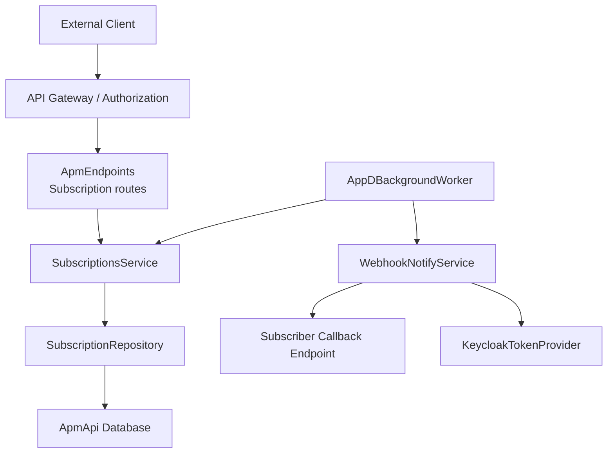
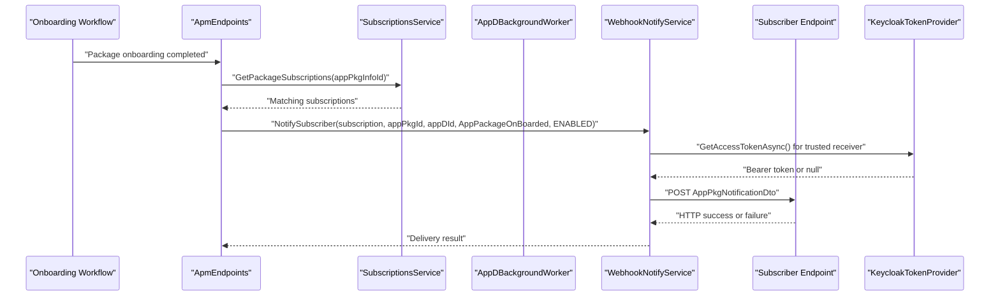
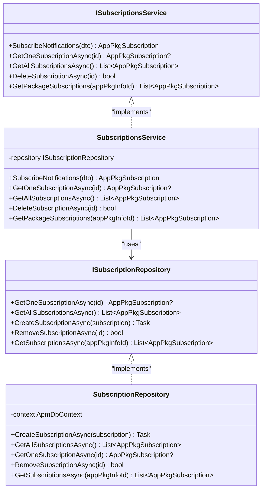
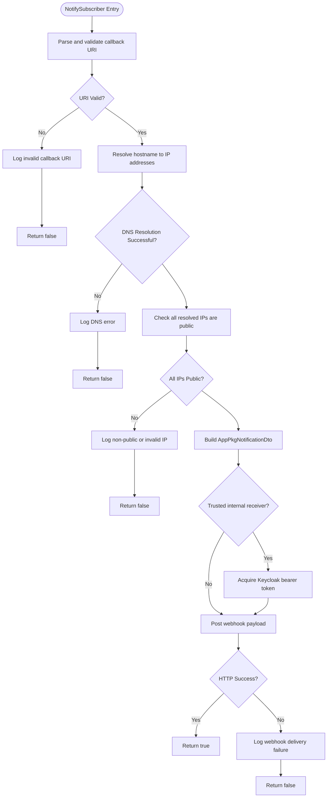
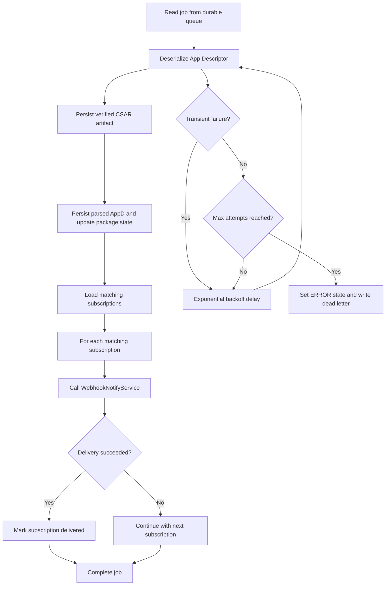
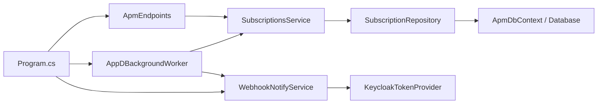

# Subscription and Notification Management

<cite>
**Referenced Files in This Document**
- `src/ApmApi/Endpoints/ApmEndpoints.cs`
- `src/ApmApi/Utils/WebhookNotifyService.cs`
- `src/ApmApi/Services/SubscriptionsService.cs`
- `src/ApmApi/Services/ISubscriptionsService.cs`
- `src/ApmApi/Background/AppDBackgroundWorker.cs`
- `src/ApmApi/Program.cs`
- `src/ApmApi/Dto/AppPkgSubscriptionDto.cs`
- `src/ApmApi/Dto/AppPkgSubscriptionInfoDto.cs`
- `src/ApmApi/Dto/AppPkgNotificationDto.cs`
- `src/ApmApi/Models/AppPkgSubscription.cs`
- `src/ApmApi/Models/AppPkgSubscriptionFilter.cs`
- `src/ApmApi/Repositories/impl/SubscriptionRepository.cs`
- `src/ApmApi/Repositories/ISubscriptionRepository.cs`
- `src/ApmApi/Validators/AppPkgSubscriptionDtoValidator.cs`
- `docs/ADR/0059-etsi-subscription-callback-authentication-and-prefix-hardening.md`
- `docs/ADR/0026-callback-uri-dns-rebinding-hardening.md`
</cite>

## Table of Contents
1. [Introduction](#introduction)
2. [Project Structure](#project-structure)
3. [Core Components](#core-components)
4. [Architecture Overview](#architecture-overview)
5. [Detailed Component Analysis](#detailed-component-analysis)
6. [Dependency Analysis](#dependency-analysis)
7. [Performance Considerations](#performance-considerations)
8. [Troubleshooting Guide](#troubleshooting-guide)
9. [Security Considerations](#security-considerations)
10. [Conclusion](#conclusion)

## Introduction
This document explains the subscription and notification management functionality that enables clients to receive webhook alerts about package lifecycle events such as upload completion, validation results, distribution status, and onboarding completion. The system provides:

- Subscription creation, retrieval, listing, and deletion APIs under `/app_pkgm/v1/subscriptions`.
- A webhook-based outbound notification mechanism that delivers `AppPackageOnBoarded` notifications to subscriber callback URLs.
- Callback URL validation that rejects unsafe or non-public destinations.
- Optional outbound authentication for trusted internal receivers using a Keycloak bearer token.
- A durable background worker with retry and dead-letter handling for reliable delivery after descriptor parsing.

The implementation is part of the `ApmApi` module and integrates with database persistence, Temporal workflows, and the broader MEAO platform architecture.

## Project Structure
Subscription and notification functionality spans endpoints, services, models, DTOs, validators, repositories, background processing, and architectural decisions:

**Diagram sources**
- `src/ApmApi/Endpoints/ApmEndpoints.cs#L527-L602`
- `src/ApmApi/Services/SubscriptionsService.cs#L1-L74`
- `src/ApmApi/Repositories/impl/SubscriptionRepository.cs#L1-L64`
- `src/ApmApi/Background/AppDBackgroundWorker.cs#L1-L191`
- `src/ApmApi/Utils/WebhookNotifyService.cs#L1-L231`

**Section sources**
- `src/ApmApi/Endpoints/ApmEndpoints.cs#L527-L602`
- `src/ApmApi/Services/SubscriptionsService.cs#L1-L74`
- `src/ApmApi/Background/AppDBackgroundWorker.cs#L1-L191`

## Core Components

### Subscription API Surface
The subscription endpoints are grouped under `/app_pkgm/v1/subscriptions`, require authorization, and expose:

| Method | Path | Purpose | Success Response | Failure Behavior |
|---|---|---|---|---|
| POST | `/app_pkgm/v1/subscriptions` | Create a subscription with a callback URL, subscription type, and optional filters | `201 Created` with subscription info | `400 Bad Request` for invalid or non-public callback URI; validation errors for malformed request body |
| GET | `/app_pkgm/v1/subscriptions` | List all subscriptions with links | `200 OK` with link list | None defined beyond normal 5xx behavior |
| GET | `/app_pkgm/v1/subscriptions/{subscriptionId}` | Retrieve one subscription by ID | `200 OK` with subscription info | `404 Not Found` if not found |
| DELETE | `/app_pkgm/v1/subscriptions/{subscriptionId}` | Delete a subscription by ID | `204 No Content` | `404 Not Found` if not found |

The POST endpoint validates the callback URL before creating the subscription, ensuring it is absolute, uses HTTPS in production (unless locally allowed), resolves only to public IP addresses, and passes DNS rebinding checks.

**Section sources**
- `src/ApmApi/Endpoints/ApmEndpoints.cs#L527-L602`
- `src/ApmApi/Endpoints/ApmEndpoints.cs#L604-L616`
- `src/ApmApi/Endpoints/ApmEndpoints.cs#L883-L994`

### Subscription Data Model
The persisted subscription model includes:

| Field | Type | Meaning |
|---|---|---|
| `appPkgSubscriptionId` | String | Stable subscription identifier returned to the client |
| `appPkgInfoId` | Nullable String | Optional package-level filter reference |
| `callbackUri` | String | Outbound webhook destination |
| `subscriptionType` | String | Enumerated event category stored as a string |
| `Filters` | List | One or more fine-grained filters |

Each filter supports fields such as application package ID, descriptor ID, provider, name, software version, descriptor version, operational state, and usage state.

**Section sources**
- `src/ApmApi/Models/AppPkgSubscription.cs#L1-L12`
- `src/ApmApi/Models/AppPkgSubscriptionFilter.cs#L1-L25`

### Subscription Request and Response Contracts
The subscription request accepts:

| Field | Type | Required | Description |
|---|---|---:|---|
| `callbackUri` | String | Yes | Absolute HTTP or HTTPS URI validated at the endpoint |
| `subscriptionType` | Enum | Yes | Event category; currently supports package onboarding, change, and deletion types |
| `appPkgFilter` | Array | No | Optional filter entries describing which packages or descriptors should trigger notifications |

The response contract returns:

| Field | Type | Description |
|---|---|---|
| `id` | String | Subscription identifier |
| `subscriptionType` | Enum | Normalized subscription type |
| `callbackUri` | String | Stored callback destination |
| `_links.self.href` | String | Resource location for the subscription |

**Section sources**
- `src/ApmApi/Dto/AppPkgSubscriptionDto.cs#L1-L27`
- `src/ApmApi/Dto/AppPkgSubscriptionInfoDto.cs#L1-L26`
- `src/ApmApi/Enums/SubscriptionType.cs#L1-L8`

### Validation Rules
Validation occurs in two layers:

1. **Request validation:** The `AppPkgSubscriptionDtoValidator` enforces that `callbackUri` is present, absolute, and either HTTP or HTTPS, and that `subscriptionType` is a valid enum value.
2. **Endpoint security validation:** The endpoint additionally rejects local callbacks unless explicitly allowed through configuration, requires HTTPS when local callbacks are disabled, and performs DNS resolution and public IP checks before accepting the subscription.

**Section sources**
- `src/ApmApi/Validators/AppPkgSubscriptionDtoValidator.cs#L1-L20`
- `src/ApmApi/Endpoints/ApmEndpoints.cs#L883-L994`

## Architecture Overview
The notification flow starts when package onboarding reaches a terminal success state. The system locates matching subscriptions, builds an ETSI-aligned notification payload, and posts it to each subscriber.

**Diagram sources**
- `src/ApmApi/Endpoints/ApmEndpoints.cs#L799-L814`
- `src/ApmApi/Services/SubscriptionsService.cs#L53-L74`
- `src/ApmApi/Utils/WebhookNotifyService.cs#L22-L180`
- `src/ApmApi/Program.cs#L53-L56`

## Detailed Component Analysis

### Subscription Creation and Management
`SubscriptionsService` implements CRUD operations for subscriptions:

- `SubscribeNotifications`: generates a GUID-based subscription ID, copies the request into the domain model, maps optional filters, and persists the subscription.
- `GetOneSubscriptionAsync` and `GetAllSubscriptionsAsync`: read from the repository.
- `DeleteSubscriptionAsync`: delegates removal to the repository.
- `GetPackageSubscriptions`: retrieves subscriptions scoped by package ID, including those whose filters match the package.

The service itself does not perform webhook delivery; it manages subscription metadata. Delivery is triggered by endpoints and background workers.

**Diagram sources**
- `src/ApmApi/Services/ISubscriptionsService.cs#L1-L45`
- `src/ApmApi/Services/SubscriptionsService.cs#L1-L74`
- `src/ApmApi/Repositories/ISubscriptionRepository.cs#L1-L14`
- `src/ApmApi/Repositories/impl/SubscriptionRepository.cs#L1-L64`

**Section sources**
- `src/ApmApi/Services/SubscriptionsService.cs#L1-L74`
- `src/ApmApi/Repositories/impl/SubscriptionRepository.cs#L1-L64`

### Webhook Notification Delivery
`WebhookNotifyService.NotifySubscriber` is responsible for constructing and sending the webhook payload:

1. Parse and validate the callback URI.
2. Resolve the host to IP addresses.
3. Reject non-public or invalid IPs.
4. Pin the connection to the first resolved public IP using `SocketsHttpHandler.ConnectCallback`.
5. Build an `AppPkgNotificationDto` with id, notification type, subscription id, timestamp, package identifiers, operational state, and subscription link.
6. Optionally acquire a Keycloak bearer token for trusted internal receivers.
7. Post the JSON payload with a 10-second timeout.
8. Return success only when the HTTP response indicates success.

**Diagram sources**
- `src/ApmApi/Utils/WebhookNotifyService.cs#L22-L180`
- `src/ApmApi/Utils/WebhookNotifyService.cs#L181-L231`

**Section sources**
- `src/ApmApi/Utils/WebhookNotifyService.cs#L1-L231`

### Background Processing and Retry Policy
The `AppDBackgroundWorker` processes CSAR App Descriptor deserialization jobs and triggers notifications after successful parsing and persistence:

- It reads jobs from a durable queue.
- For each job, it retries up to three times with exponential backoff delays (`200 * 2^(attempt-1)` milliseconds).
- On transient failures, it logs warnings and continues retries.
- After final failure, it flips the package onboarding state to `ERROR` and writes a dead-letter file.
- On success, it queries matching subscriptions and calls `WebhookNotifyService.NotifySubscriber`.

**Diagram sources**
- `src/ApmApi/Background/AppDBackgroundWorker.cs#L1-L191`
- `src/ApmApi/Utils/WebhookNotifyService.cs#L22-L180`

**Section sources**
- `src/ApmApi/Background/AppDBackgroundWorker.cs#L1-L191`

### Webhook Payload Contract
When a package is onboarded successfully, the system sends an `AppPkgNotificationDto` with these fields:

| Field | Type | Meaning |
|---|---|---|
| `id` | String | Unique notification identifier generated per delivery attempt |
| `notificationType` | String | Event category; for onboarding this is `AppPackageOnBoarded` |
| `subscriptionId` | String | The subscription that received the notification |
| `timeStamp.seconds` | Long | Unix seconds |
| `timeStamp.nanoSeconds` | Long | Fractional time component derived from UTC ticks |
| `appPkgId` | String | Canonical package identifier used by workflow routing |
| `appDId` | String | Parsed application descriptor identifier |
| `operationalState` | String | Current operational state; for successful onboarding this is `ENABLED` |
| `_links.subscription.href` | String | Link back to the subscription resource |

**Section sources**
- `src/ApmApi/Dto/AppPkgNotificationDto.cs#L1-L45`
- `src/ApmApi/Endpoints/ApmEndpoints.cs#L799-L814`
- `src/ApmApi/Background/AppDBackgroundWorker.cs#L118-L130`

### Message Queuing and Reliability
Reliability is achieved through multiple layers:

- **Durable queue:** Jobs are consumed via `IAppDProcessingQueue.Reader.ReadAllAsync`, indicating a durable message consumer rather than an in-memory fire-and-forget call.
- **Retry loop:** The worker retries transient processing errors up to three times.
- **Exponential backoff:** Delays increase between attempts to reduce pressure on failing dependencies.
- **Dead-letter path:** Final failures are recorded as files under a `dead_letters` directory so operators can inspect and replay failed jobs.
- **Transaction-scoped persistence:** Package state changes and descriptor persistence occur inside explicit database transactions.

Note: There is no dedicated webhook delivery queue in `WebhookNotifyService`; delivery is synchronous within the worker’s retry boundary. If webhook delivery fails, the worker treats it as part of the overall job outcome depending on where the failure occurs.

**Section sources**
- `src/ApmApi/Background/AppDBackgroundWorker.cs#L1-L191`

### Authentication Mechanisms
There are two distinct authentication concerns:

1. **Inbound subscription API authentication:** All subscription endpoints are mapped under a group requiring authorization, so clients must authenticate before creating, reading, or deleting subscriptions.
2. **Outbound webhook authentication:** When delivering to trusted internal receivers, `WebhookNotifyService` attaches a Keycloak bearer token obtained through `IKeycloakTokenProvider`. Trusted hosts include local development aliases, cluster-local names, `.internal`, and `.svc` suffixes.

If token acquisition fails, the service logs a warning and proceeds without the token rather than aborting delivery. Untrusted third-party subscribers never receive the internal bearer token.

**Section sources**
- `src/ApmApi/Endpoints/ApmEndpoints.cs#L527-L531`
- `src/ApmApi/Utils/WebhookNotifyService.cs#L120-L180`
- `docs/ADR/0059-etsi-subscription-callback-authentication-and-prefix-hardening.md#L1-L58`

### Error Handling and Failure Semantics
Failure handling differs by layer:

| Layer | Failure Case | Behavior |
|---|---|---|
| Endpoint | Invalid or non-public callback URI | Returns `400 Bad Request` during subscription creation |
| Endpoint | Missing subscription | Returns `404 Not Found` |
| Service | Repository operation failures | Propagates exceptions to callers |
| Webhook | Invalid URI | Logs warning and returns false |
| Webhook | DNS resolution failure | Logs error and returns false |
| Webhook | Non-public IP | Logs warning and returns false |
| Webhook | HTTP failure | Logs error and returns false |
| Worker | Descriptor parse or persistence failure | Retries with exponential backoff up to three times |
| Worker | Final failure | Sets package state to `ERROR` and writes dead-letter file |

**Section sources**
- `src/ApmApi/Endpoints/ApmEndpoints.cs#L531-L555`
- `src/ApmApi/Endpoints/ApmEndpoints.cs#L604-L616`
- `src/ApmApi/Utils/WebhookNotifyService.cs#L22-L180`
- `src/ApmApi/Background/AppDBackgroundWorker.cs#L131-L191`

## Dependency Analysis
The key runtime dependencies are:

**Diagram sources**
- `src/ApmApi/Program.cs#L53-L56`
- `src/ApmApi/Endpoints/ApmEndpoints.cs#L527-L602`
- `src/ApmApi/Services/SubscriptionsService.cs#L1-L74`
- `src/ApmApi/Repositories/impl/SubscriptionRepository.cs#L1-L64`
- `src/ApmApi/Background/AppDBackgroundWorker.cs#L1-L191`
- `src/ApmApi/Utils/WebhookNotifyService.cs#L18-L21`

**Section sources**
- `src/ApmApi/Program.cs#L53-L56`
- `src/ApmApi/Endpoints/ApmEndpoints.cs#L527-L602`
- `src/ApmApi/Services/SubscriptionsService.cs#L1-L74`
- `src/ApmApi/Background/AppDBackgroundWorker.cs#L1-L191`
- `src/ApmApi/Utils/WebhookNotifyService.cs#L1-L231`

## Performance Considerations
- **Connection pinning:** `WebhookNotifyService` pins the TCP connection to a single pre-resolved IP address, avoiding repeated DNS lookups at connect time and reducing DNS-rebinding risk.
- **Timeouts:** HTTP requests use a 10-second timeout, protecting the service from slow or hanging subscribers.
- **Background processing:** Descriptor parsing and notification delivery are offloaded to a background worker, preventing long-running HTTP requests from blocking API threads.
- **Retry and backoff:** Exponential backoff reduces load on transiently failing systems.
- **Database access:** Repository queries use `AsNoTracking()` for read-only operations and transaction boundaries around state mutations.
- **Scalability limits:** Because webhook delivery is synchronous within the worker loop, high volumes of subscribers or slow consumers may serialize work. A dedicated outbox or webhook delivery queue would improve throughput and decouple delivery from descriptor parsing.

[No sources needed since this section provides general guidance]

## Troubleshooting Guide

### Common Subscription Problems
- **Invalid callback URI rejected:** Ensure the callback URL is absolute and, in production, uses HTTPS. Local callbacks are accepted only when `AllowLocalCallbacks` is enabled.
- **Non-public IP blocked:** The endpoint resolves the hostname and rejects private, loopback, link-local, multicast, reserved, and other non-public ranges.
- **Subscription not found:** Verify the subscription ID returned at creation time and ensure the DELETE request targets the correct resource.

**Section sources**
- `src/ApmApi/Endpoints/ApmEndpoints.cs#L531-L555`
- `src/ApmApi/Endpoints/ApmEndpoints.cs#L579-L602`
- `src/ApmApi/Endpoints/ApmEndpoints.cs#L604-L616`
- `src/ApmApi/Endpoints/ApmEndpoints.cs#L883-L994`

### Debugging Failed Notifications
- **Check webhook delivery logs:** `WebhookNotifyService` logs invalid URIs, DNS failures, non-public IPs, and HTTP delivery failures.
- **Inspect subscription data:** Use the GET endpoints to verify the stored callback URL and subscription type.
- **Review worker progress:** The background worker logs attempt numbers, transient failures, exponential backoff delays, final failure, ERROR state transitions, and dead-letter file paths.
- **Verify Keycloak availability:** If outbound authentication is required for internal receivers, token acquisition failures are logged as warnings but do not crash delivery.
- **Validate subscriber endpoint:** Confirm the subscriber responds with HTTP success codes and consumes the expected payload structure.

**Section sources**
- `src/ApmApi/Utils/WebhookNotifyService.cs#L22-L180`
- `src/ApmApi/Background/AppDBackgroundWorker.cs#L1-L191`

### Monitoring Notification Delivery
Recommended monitoring signals include:

| Signal | Source | Guidance |
|---|---|---|
| Subscription creation rate | Subscription API metrics | Track new subscriptions over time |
| Subscription deletion rate | Subscription API metrics | Detect cleanup or churn |
| Webhook delivery success rate | Application logs | Count successes versus failures |
| DNS resolution failures | Webhook logs | Investigate misconfigured or unreachable subscriber domains |
| Non-public callback rejections | Endpoint logs | Identify security policy violations |
| Worker retry counts | Background worker logs | Monitor transient processing issues |
| Dead-letter volume | File system and logs | Alert on persistent failures |
| Keycloak token acquisition latency | Token provider and dependency telemetry | Monitor authentication infrastructure health |

[No sources needed since this section provides general guidance]

## Security Considerations

### Callback URL Validation
Subscription creation enforces strict callback validation:

- Only absolute URIs are accepted.
- In production, only HTTPS is allowed unless `AllowLocalCallbacks` is enabled.
- Hostnames resolve once and every resulting IP must be public.
- Private ranges such as loopback, link-local, site-local, IPv6 unique local, `10.0.0.0/8`, `172.16.0.0/12`, `192.168.0.0/16`, `169.254.0.0/16`, `100.64.0.0/10`, multicast, reserved, and zero-address blocks are rejected.

**Section sources**
- `src/ApmApi/Endpoints/ApmEndpoints.cs#L883-L994`
- `docs/ADR/0026-callback-uri-dns-rebinding-hardening.md#L1-L58`

### DNS Rebinding Protection
Both `ApmEndpoints` and `WebhookNotifyService` implement resolve-then-pin behavior:

- Resolve the hostname once.
- Validate all resolved IPs.
- Connect directly to the first validated public IP through `SocketsHttpHandler.ConnectCallback`.
- Avoid resolving again at connect time, closing the DNS rebinding window.

**Section sources**
- `docs/ADR/0026-callback-uri-dns-rebinding-hardening.md#L1-L58`
- `src/ApmApi/Utils/WebhookNotifyService.cs#L22-L120`

### Outbound Request Signing and Authentication
The current implementation does not implement HMAC or cryptographic request signing. Instead, it uses OAuth 2.0 client credentials bearer tokens for trusted internal receivers:

- Tokens are attached only when the destination host is considered trusted.
- Untrusted third-party subscribers do not receive internal credentials.
- Token acquisition failures degrade gracefully with a warning.

For stronger webhook authenticity guarantees, consider adding a shared secret signature header, timestamp validation, and nonce handling at the subscriber endpoint.

**Section sources**
- `src/ApmApi/Utils/WebhookNotifyService.cs#L120-L180`
- `docs/ADR/0059-etsi-subscription-callback-authentication-and-prefix-hardening.md#L1-L58`

### Implementing Robust Webhook Consumers
A robust subscriber should:

1. Accept only POST requests to the documented callback path.
2. Require authentication compatible with the platform’s inbound requirements.
3. Validate the presence and structure of required fields: `id`, `notificationType`, `subscriptionId`, `timeStamp`, `appPkgId`, `appDId`, `operationalState`, and `_links`.
4. Deduplicate notifications using the stable `id` field.
5. Treat non-success HTTP responses as delivery failures.
6. Log structured diagnostics including subscription ID, notification type, and operational state.
7. Implement idempotent processing so retries do not create duplicate resources.
8. Monitor delivery latency and failure rates.

[No sources needed since this section provides general guidance]

## Conclusion
The subscription and notification system provides a secure, validated, and observable mechanism for notifying clients about package lifecycle events. Subscription creation enforces strict callback validation, while webhook delivery protects against DNS rebinding and restricts internal authentication to trusted receivers. Background processing adds retry and dead-letter resilience for descriptor parsing and related operations.

To strengthen reliability further, teams may consider:

- Adding a dedicated webhook delivery queue to decouple notification delivery from descriptor parsing.
- Implementing request signatures and replay protection for webhook consumers.
- Introducing a per-subscription retry policy and visibility store for failed deliveries.
- Extending metrics and tracing around webhook delivery outcomes.
- Centralizing callback URI validation and pinned HTTP dialing into a shared helper to reduce duplication.