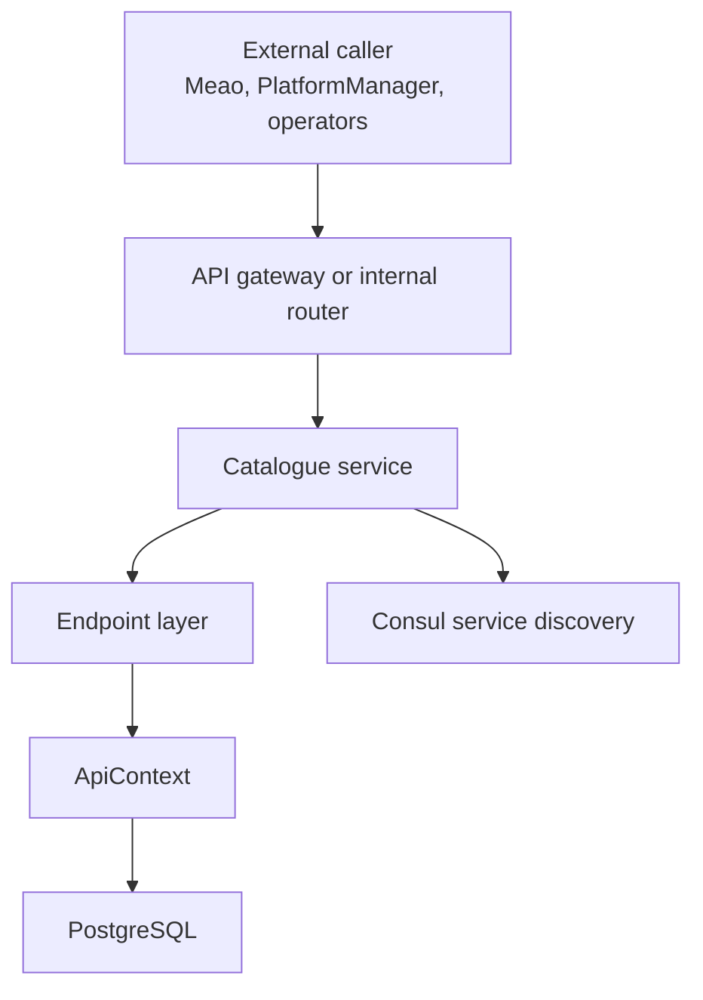
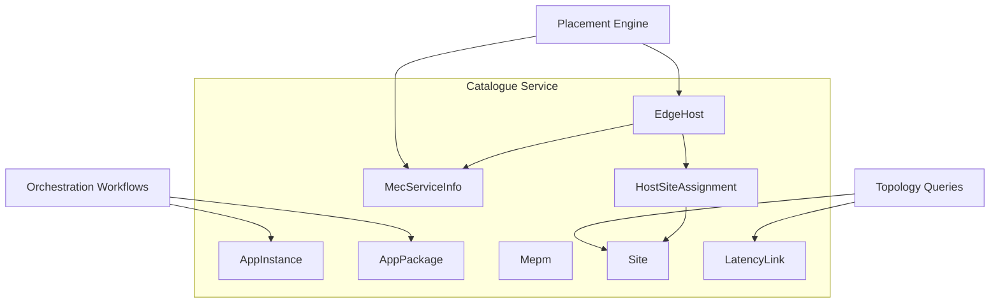
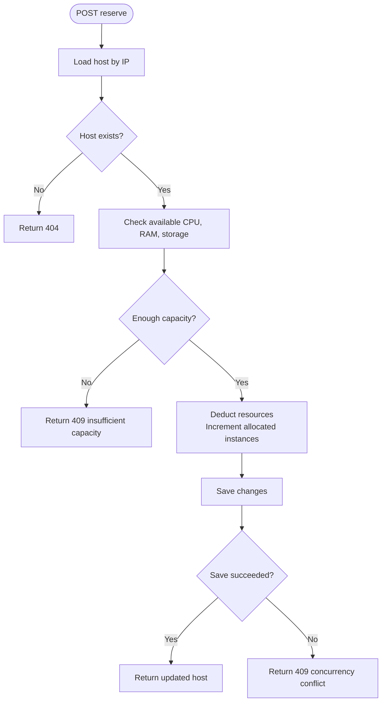
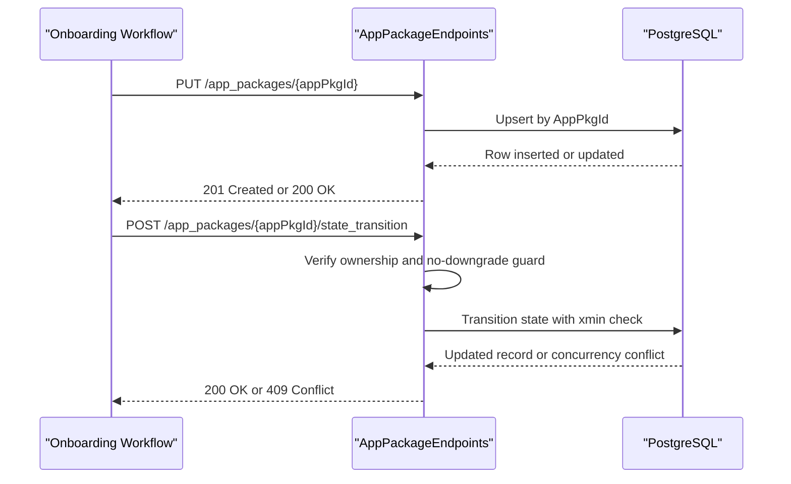
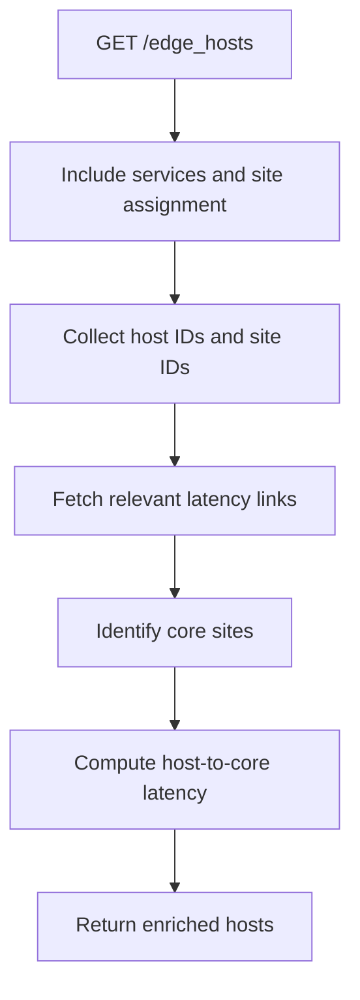
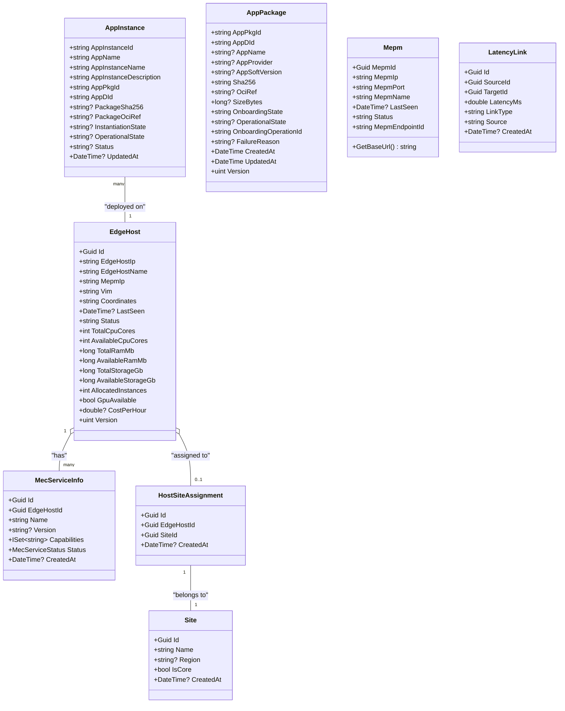
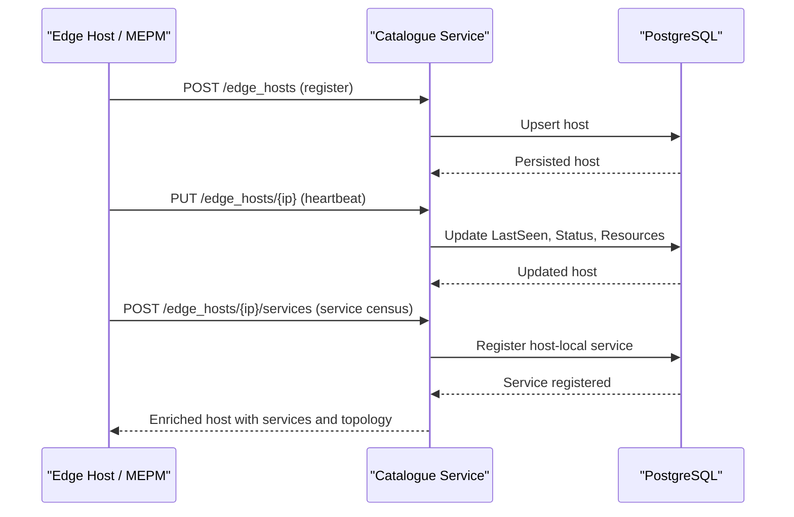

# Catalogue (Inventory Management Service)

## Table of Contents

1. [Introduction](#introduction)
2. [Project Structure](#project-structure)
3. [Core Components](#core-components)
4. [Architecture Overview](#architecture-overview)
5. [Detailed Component Analysis](#detailed-component-analysis)
6. [Dependency Analysis](#dependency-analysis)
7. [Performance Considerations](#performance-considerations)
8. [Troubleshooting Guide](#troubleshooting-guide)
9. [Conclusion](#conclusion)

## Introduction

The Catalogue service is the MEO’s internal inventory and census backing store for edge computing resources. Its purpose is to answer the question “what is actually in the MEC system” by maintaining a unified view of:

- MEC hosts (`EdgeHost`)
- MEPM platform-manager instances
- Active application instances deployed on hosts
- Application-package inventory references
- Host-local MEC services
- Site topology and latency relationships

It is not an ETSI-standard external API. It is an internal MEO backing store exposed under `/catalogue/v1`, used by orchestration workflows, placement logic, and operational tooling.

ADR 0010 defines Catalogue as the MEO system-inventory / census service. ADR 0038 separates host-level MEP service discovery from the system-level MEO catalogue census. ADR 0045 consolidates catalogue responsibilities into four logical domains inside the existing deployable service boundary: identity, inventory, topology, and placement support. The catalogue context document further clarifies terminology around MEC host, MEPM instance, catalogue registry, global service census, and grant record.

**Section sources**
- `docs/ADR/0010-catalogue-meo-inventory.md#L1-L54`
- `docs/ADR/0038-mep-host-service-registry-and-meo-catalogue-sync.md#L1-L33`
- `docs/ADR/0045-meo-placement-engine-and-unified-catalogue-inventory-model.md#L1-L67`
- `docs/contexts/catalogue.md#L1-L25`

## Project Structure

Catalogue is implemented as an ASP.NET Core service backed by PostgreSQL through Entity Framework Core. The repository organizes it by layer:

| Area | Responsibility |
|---|---|
| `Program.cs` | Web host setup, dependency injection, database migration behavior, authentication, health checks, routing registration |
| `ApiContext.cs` | EF Core DbContext, entity configuration, indexes, row-version mapping, relationship configuration |
| `Endpoints/` | HTTP route handlers for edge hosts, app instances, app packages, MEPMs, and topology |
| `Models/` | Persistent domain entities and request DTOs |
| `Validators/` | FluentValidation validators wired into the pipeline |
| `Extensions/` | OpenAPI and logging extensions |
| `Requests/` | Request DTOs |
| `Migrations/` | PostgreSQL schema migrations |
| `Catalogue.Tests.Integration/` | Integration tests covering endpoints, validation, auth, concurrency, and liveness |

**Diagram sources**
- `src/Catalogue/Program.cs#L1-L135`
- `src/Catalogue/ApiContext.cs#L1-L109`

**Section sources**
- `src/Catalogue/Program.cs#L1-L135`
- `src/Catalogue/ApiContext.cs#L1-L109`

## Core Components

### Service Entry Point and Lifecycle

`Program.cs` configures:

- Shared OpenTelemetry telemetry with service name `Catalogue`
- Serilog request logging
- Global RFC 7807 problem-details handling
- FluentValidation registration
- Npgsql-backed `ApiContext`
- Consul-based service discovery
- Resilient HTTP client
- Health checks at `/health`, `/health/live`, and `/health/ready`
- Keycloak JWT authentication with an authenticated-by-default authorization policy
- Migration execution strategy:
  - Development: auto-apply migrations
  - Production: fail fast if pending migrations exist
  - CLI mode: `--migrate-only` applies migrations and exits

This makes Catalogue a production-ready backing service where schema drift is treated as a hard failure rather than a silent inconsistency risk.

**Section sources**
- `src/Catalogue/Program.cs#L1-L135`

### Data Access Layer

`ApiContext` exposes typed `DbSet` collections for:

- `Mepms`
- `MecHosts`
- `AppInstances`
- `AppPackages`
- `MecServices`
- `Sites`
- `HostSiteAssignments`
- `LatencyLinks`

Key constraints include:

- Unique index on `EdgeHost.EdgeHostIp`
- Optimistic concurrency via `EdgeHost.Version` mapped to PostgreSQL `xmin`
- Composite unique index on `MecServiceInfo.EdgeHostId + Name`
- One-to-one host-to-site assignment with restricted delete behavior
- Latency link composite index on `SourceId`, `TargetId`, `LinkType`
- App package state fields converted to strings with row-version protection
- Indexes on `OnboardingOperationId` and `AppDId` for workflow auditability

**Section sources**
- `src/Catalogue/ApiContext.cs#L1-L109`

## Architecture Overview

The Catalogue architecture separates concerns across five main areas:

1. **MEC host census**: identity, liveness, capacity, and resource tracking
2. **MEPM registry**: platform-manager endpoints and base URL resolution
3. **Application-instance census**: deployed instances and their source package pointers
4. **Application-package inventory**: onboarded package metadata, lifecycle state, and ownership
5. **Topology and service registry**: site assignments, latency links, and host-local MEC services

**Diagram sources**
- `src/Catalogue/Models/EdgeHost.cs#L1-L57`
- `src/Catalogue/Models/AppInstance.cs#L1-L56`
- `src/Catalogue/Models/AppPackage.cs#L1-L58`
- `src/Catalogue/Models/Mepm.cs#L1-L51`
- `src/Catalogue/Models/MecServiceInfo.cs#L1-L68`
- `src/Catalogue/Models/Site.cs#L1-L27`
- `src/Catalogue/Models/LatencyLink.cs#L1-L50`
- `src/Catalogue/Models/HostSiteAssignment.cs#L1-L50`

**Section sources**
- `docs/ADR/0045-meo-placement-engine-and-unified-catalogue-inventory-model.md#L1-L67`

## Detailed Component Analysis

### Internal API: Edge Hosts

#### Endpoint Summary

| Route | Method | Purpose | Status Codes |
|---|---|---|---|
| `/catalogue/v1/edge_hosts` | GET | List hosts with pagination and optional enrichment | 200 |
| `/catalogue/v1/edge_hosts/{mechost_ip}` | GET | Lookup host by IP | 200, 404 |
| `/catalogue/v1/edge_hosts/{mechost_ip}` | PUT | Update mutable host properties | 204, 404 |
| `/catalogue/v1/edge_hosts` | POST | Register or upsert host by IP | 201, 200 |
| `/catalogue/v1/edge_hosts/{mechost_ip}` | DELETE | Remove host and related topology data | 200, 404 |
| `/catalogue/v1/edge_hosts/by-mepm/{mepm_ip}` | GET | Find hosts by MEPM IP | 200 |
| `/catalogue/v1/edge_hosts/by-vim/{vim}` | GET | Find hosts by VIM type | 200 |
| `/catalogue/v1/edge_hosts/by-coords/{coordinates}` | GET | Find hosts by coordinates | 200 |
| `/catalogue/v1/edge_hosts/{mechost_ip}/mec_apps` | GET | List app instances on a host | 200, 404 |
| `/catalogue/v1/edge_hosts/{mechost_ip}/reserve` | POST | Reserve compute/RAM/storage headroom | 200, 409, 404 |
| `/catalogue/v1/edge_hosts/{mechost_ip}/release` | POST | Release previously reserved headroom | 200, 409, 404 |
| `/catalogue/v1/edge_hosts/{mechost_ip}/resources` | PUT | Update total and available resource telemetry | 200, 409, 404 |

#### Capacity Reservation Flow

The reserve endpoint performs preconditions before modifying capacity:

1. Load the host by IP.
2. Validate that requested CPU, RAM, and storage fit within available headroom.
3. Subtract requested resources from available totals.
4. Increment allocated instance count.
5. Persist changes.
6. Treat concurrent modification as a 409 conflict.

The release endpoint reverses this reservation while clamping values to valid ranges. The update-resources endpoint allows external telemetry providers to refresh host capacity metrics atomically.

**Diagram sources**
- `src/Catalogue/Endpoints/MecHostEndpoints.cs#L1-L200`
- `src/Catalogue/Endpoints/MecHostEndpoints.cs#L201-L385`
- `src/Catalogue/Models/EdgeHost.cs#L1-L57`
- `src/Catalogue/Models/ReserveCapacityRequest.cs#L1-L50`

**Section sources**
- `src/Catalogue/Endpoints/MecHostEndpoints.cs#L1-L385`
- `src/Catalogue/Models/EdgeHost.cs#L1-L57`

### Internal API: Application Instances

#### Endpoint Summary

| Route | Method | Purpose | Status Codes |
|---|---|---|---|
| `/catalogue/v1/app_instances` | GET | List all instances with pagination | 200 |
| `/catalogue/v1/app_instances/{id}` | GET | Get instance by ID | 200, 404 |
| `/catalogue/v1/app_instances/by-host/{hostIp}` | GET | Get instances on a host | 200 |
| `/catalogue/v1/edge_hosts/{hostIp}/mec_apps` | POST | Add or update deployed instance | 201, 200 |
| `/catalogue/v1/mec_apps/{appInstanceId}` | DELETE | Remove deployed instance | 204, 404 |

#### Behavior

The read API returns `AppInstanceInfoDto`, derived from the persisted `AppInstance`. It normalizes names, provider, version fields, and maps string-backed states to strongly typed enumeration values.

The write path supports both creation and update:

- If the instance already exists, it updates metadata, host reference, instantiation state, operational state, status, and timestamp.
- If the instance does not exist, it creates it.
- When a matching `AppPackage` is present, it captures immutable package digest and OCI reference snapshots at instantiation time.

This implements the target contract described in the assessment: Catalogue holds lightweight references to packages rather than duplicating package content.

**Section sources**
- `src/Catalogue/Endpoints/AppInstanceEndpoints.cs#L1-L154`
- `src/Catalogue/Models/AppInstance.cs#L1-L56`
- `docs/ADR/0010-catalogue-meo-inventory.md#L1-L54`
- `docs/CATALOGUE_ASSESSMENT.md#L1-L139`

### Internal API: Application Package Inventory

#### Endpoint Summary

| Route | Method | Purpose | Status Codes |
|---|---|---|---|
| `/catalogue/v1/app_packages` | GET | List packages filtered by onboarding state | 200 |
| `/catalogue/v1/app_packages/{appPkgId}` | GET | Get package inventory record | 200, 404 |
| `/catalogue/v1/app_packages/{appPkgId}` | PUT | Idempotent register or update | 201, 200, 400, 409 |
| `/catalogue/v1/app_packages/{appPkgId}/state_transition` | POST | Owned lifecycle transition | 200, 404, 409 |

#### Ownership and Concurrency Model

Package registration is designed for Temporal workflow retries:

- Route `appPkgId` must match payload `appPkgId`.
- New records are created with `PROCESSING` state and an owning operation ID.
- Concurrent writes to the same row surface as a PostgreSQL `xmin` concurrency exception, mapped to 409.
- Re-registration by the same operation is idempotent.
- A different operation cannot take over a record unless it is in `ERROR`.
- State transitions enforce ownership and prevent downgrading a previously `ONBOARDED` record to `ERROR`.
- Compensation uses terminal non-usable states instead of deletion.

**Diagram sources**
- `src/Catalogue/Endpoints/AppPackageEndpoints.cs#L1-L200`
- `src/Catalogue/Models/AppPackage.cs#L1-L58`

**Section sources**
- `src/Catalogue/Endpoints/AppPackageEndpoints.cs#L1-L200`
- `src/Catalogue/Models/AppPackage.cs#L1-L58`

### Internal API: MEPM Registry

| Route | Method | Purpose | Status Codes |
|---|---|---|---|
| `/catalogue/v1/mepms` | GET | List MEPM instances | 200 |
| `/catalogue/v1/mepms/{mepm_ip}` | GET | Lookup MEPM by IP | 200, 404 |
| `/catalogue/v1/mepms/{mepm_ip}` | PUT | Update MEPM metadata and liveness | 204, 404 |
| `/catalogue/v1/mepms` | POST | Register MEPM | 201 |
| `/catalogue/v1/mepms/{mepm_ip}` | DELETE | Remove MEPM | 200, 404 |

The `Mepm` model includes `LastSeen`, `Status`, and `MepmEndpointId`. It provides `GetBaseUrl()` to resolve either an explicit HTTP(S) endpoint or a constructed host/port URL. This supports multi-MEPM routing decisions made by Meao.

**Section sources**
- `src/Catalogue/Endpoints/MepmEndpoints.cs#L1-L91`
- `src/Catalogue/Models/Mepm.cs#L1-L51`

### Internal API: Topology, Sites, and Host Services

#### Host Services

Under `/catalogue/v1/edge_hosts/{mechost_ip}`, authorized callers can:

- List host services
- Create a host-local MEC service
- Delete a host service

Service registration enforces uniqueness per host and converts enum-capability lists to sets.

#### Sites

Under `/catalogue/v1/sites`:

- List sites
- Get site by ID
- Create site
- Delete site, cascading cleanup of latency links and host assignments

#### Latency Links

Under `/catalogue/v1/latency_links`:

- List links
- Get link by ID
- Create link with referential validation
- Delete link

When listing or getting hosts, Catalogue enriches results with computed latency to core sites by combining host-to-site and site-to-core latency links.

**Diagram sources**
- `src/Catalogue/Endpoints/MecHostEndpoints.cs#L1-L200`
- `src/Catalogue/Endpoints/TopologyEndpoints.cs#L1-L200`
- `src/Catalogue/Endpoints/TopologyEndpoints.cs#L201-L333`
- `src/Catalogue/Models/LatencyLink.cs#L1-L50`

**Section sources**
- `src/Catalogue/Endpoints/TopologyEndpoints.cs#L1-L333`

### Data Models

#### EdgeHost

Represents an edge compute node with:

- Identity and static metadata
- Liveness (`LastSeen`) and operational status
- Total and available CPU, RAM, and storage
- Allocated instance count
- GPU availability and cost information
- Host-local MEC services
- Optional site assignment
- Computed projection fields `LatencyToCoreMs` and `SiteId`
- Optimistic concurrency token `Version`

#### AppInstance

Unified deployed-instance record containing:

- Instance identifiers and descriptive metadata
- Pointer to package and descriptor
- Immutable package snapshot captured at instantiation
- Host reference
- Mirrored instantiation and operational state
- Last-known status and update timestamp

#### AppPackage

Authoritative package inventory record containing:

- ETSI package identity
- App descriptor identity
- Descriptor metadata
- Content digest
- Digest-pinned OCI reference
- Size
- Onboarding and operational lifecycle state
- Owning workflow operation ID
- Failure reason
- Timestamps and optimistic concurrency token

#### Supporting Models

- `Mepm`: MEPM instance with endpoint resolution helper
- `MecServiceInfo`: Host-local service capability and status
- `Site`: Geographical or topological grouping
- `HostSiteAssignment`: One-to-one host-to-site assignment
- `LatencyLink`: Directed edge between host/site nodes with latency

**Diagram sources**
- `src/Catalogue/Models/EdgeHost.cs#L1-L57`
- `src/Catalogue/Models/AppInstance.cs#L1-L56`
- `src/Catalogue/Models/AppPackage.cs#L1-L58`
- `src/Catalogue/Models/Mepm.cs#L1-L51`
- `src/Catalogue/Models/MecServiceInfo.cs#L1-L68`
- `src/Catalogue/Models/Site.cs#L1-L27`
- `src/Catalogue/Models/HostSiteAssignment.cs#L1-L50`
- `src/Catalogue/Models/LatencyLink.cs#L1-L50`

**Section sources**
- `src/Catalogue/Models/EdgeHost.cs#L1-L57`
- `src/Catalogue/Models/AppInstance.cs#L1-L56`
- `src/Catalogue/Models/AppPackage.cs#L1-L58`
- `src/Catalogue/Models/Mepm.cs#L1-L51`
- `src/Catalogue/Models/MecServiceInfo.cs#L1-L68`
- `src/Catalogue/Models/Site.cs#L1-L27`

### Database Schema Design

The effective schema centers on eight primary tables:

| Table | Primary Key | Important Constraints | Notes |
|---|---:|---|---|
| `edge_host` | `id` | Unique `edge_host_ip`; row-version column `version` | Host census and capacity |
| `app_instance` | `app_instance_id` | Foreign key to host | Deployed-instance census |
| `app_package` | `app_pkg_id` | Indexes on `onboarding_operation_id`, `app_d_id`; row-version column `version` | Package inventory |
| `mepm` | `mepm_id` | — | MEPM registry |
| `mec_service_info` | `id` | Unique per `(edge_host_id, name)`; JSON array conversion for capabilities | Host-local services |
| `site` | `id` | — | Topological/geographic grouping |
| `host_site_assignment` | `id` | One-to-one with host via `edge_host_id`; restrict delete on host FK | Host-to-site binding |
| `latency_link` | `id` | Composite index on `(source_id, target_id, link_type)` | Topology edges |

Relationships:

- `EdgeHost` has many `MecServiceInfo`.
- `EdgeHost` has one `HostSiteAssignment`.
- `HostSiteAssignment` belongs to one `Site`.
- `AppInstance` belongs to one `EdgeHost`.
- `LatencyLink` connects two arbitrary entities using bare GUID identifiers to avoid cyclic cascade paths.

**Section sources**
- `src/Catalogue/ApiContext.cs#L1-L109`
- `src/Catalogue/Endpoints/MecHostEndpoints.cs#L1-L200`

### Census Update Mechanisms

Census updates occur through several mechanisms:

1. **Host registration and heartbeat**  
   Hosts are registered via POST and updated via PUT. The upsert path updates `LastSeen` and defaults `Status` to `ONLINE` when missing.

2. **Resource telemetry**  
   External systems update total and available resources via `/edge_hosts/{ip}/resources`.

3. **Placement reservations**  
   Workflows reserve capacity before deployment and release it afterward.

4. **Application-instance synchronization**  
   Workflows add, update, or remove app instances through dedicated endpoints.

5. **MEPM synchronization**  
   MEPM instances report identity and liveness through the MEPM registry.

6. **Service registry synchronization**  
   Host-local MEC services are registered against a host and queried during placement filtering.

7. **Topology synchronization**  
   Sites and latency links are managed separately and used to compute projected host latency to core locations.

ADR 0038 describes the intended architectural boundary: host-level MEP service registration stays local to the edge host, while system-wide synchronization flows through MEPM subscription callbacks over Mm3 to Catalogue.

**Diagram sources**
- `src/Catalogue/Endpoints/MecHostEndpoints.cs#L1-L200`
- `src/Catalogue/Endpoints/TopologyEndpoints.cs#L1-L200`
- `docs/ADR/0038-mep-host-service-registry-and-meo-catalogue-sync.md#L1-L33`

**Section sources**
- `docs/ADR/0038-mep-host-service-registry-and-meo-catalogue-sync.md#L1-L33`

### Consistency Guarantees During Distributed Updates

Catalogue uses several consistency mechanisms:

| Concern | Mechanism | Effect |
|---|---|---|
| Duplicate hosts | Unique index on `EdgeHostIp` | Prevents duplicate host entries |
| Concurrent capacity changes | Optimistic concurrency token mapped to PostgreSQL `xmin` | Detects race conditions during reserve/release/resource update |
| Stale workflow retries | App package row-version + ownership field | Prevents older retries from overwriting newer truth |
| Package ownership conflicts | `OnboardingOperationId` ownership checks | Only the owning workflow may transition state |
| No downgrade of valid packages | State-transition guard | Prevents downgrading `ONBOARDED` to `ERROR` |
| Service uniqueness | Composite unique index on host + service name | Prevents duplicate service registration |
| Cascade safety | Restrict delete on host-site assignment; bare GUID foreign keys for latency links | Avoids multiple cascade paths |

For placement allocations specifically, ADR 0045 documents optimistic concurrency tokens to eliminate double-booking races during concurrent instantiations.

**Section sources**
- `src/Catalogue/ApiContext.cs#L1-L109`
- `src/Catalogue/Endpoints/AppPackageEndpoints.cs#L1-L200`
- `src/Catalogue/Endpoints/MecHostEndpoints.cs#L201-L385`
- `docs/ADR/0045-meo-placement-engine-and-unified-catalogue-inventory-model.md#L1-L67`

### Caching Strategy

The current implementation does not define an explicit in-memory cache such as Redis or in-process caching. Instead, it uses read-side optimizations:

- `AsNoTracking()` for list and query endpoints reduces EF change-tracking overhead.
- Paged queries limit results to at most 1,000 rows.
- `Include` is used selectively for related data needed by the response.
- Computed projections like `LatencyToCoreMs` are calculated at query time.

A future optimization could introduce:

- Read-through cache for frequently queried host lists
- Cache invalidation keyed by host IP and MEPM IP
- TTL-based staleness control aligned with heartbeat intervals
- Separate hot-path cache for placement filtering versus admin observability

**Section sources**
- `src/Catalogue/Endpoints/MecHostEndpoints.cs#L1-L200`
- `src/Catalogue/Endpoints/AppInstanceEndpoints.cs#L1-L154`
- `src/Catalogue/Endpoints/TopologyEndpoints.cs#L1-L200`

### Integration Patterns with VIM Providers

Catalogue itself does not directly implement VIM adapters. VIM-specific logic lives in `VimAdapter`, while Catalogue stores VIM-related metadata as part of the host model:

- `EdgeHost.Vim` identifies the VIM type associated with the host.
- `EdgeHost.TotalCpuCores`, `TotalRamMb`, `TotalStorageGb`, and `GpuAvailable` describe static host capabilities.
- `EdgeHost.Available*` fields represent dynamic headroom updated by placement or telemetry.
- `EdgeHost.MepmIp` ties the host to a MEPM instance.

Integration patterns include:

1. **Host registration from MEPM/VIM discovery**  
   A host object is posted with VIM type and capability metadata.
2. **Capacity reporting**  
   Resource telemetry updates available headroom.
3. **Placement filtering**  
   Placement logic filters hosts by VIM type, available resources, GPU requirements, and service dependencies.
4. **Reservation and release**  
   Placement reserves capacity before deployment and releases it after completion or failure.

**Section sources**
- `src/Catalogue/Models/EdgeHost.cs#L1-L57`
- `src/Catalogue/Endpoints/MecHostEndpoints.cs#L201-L385`
- `docs/ADR/0045-meo-placement-engine-and-unified-catalogue-inventory-model.md#L1-L67`

## Dependency Analysis

### Service Dependencies

```mermaid
graph LR
    Program["Program.cs"]
    Endpoints["Endpoint classes"]
    ApiContext["ApiContext"]
    Npgsql["Npgsql"]
    EF["Entity Framework Core"]
    PostgreSQL["PostgreSQL"]
    Consul["Consul"]
    Keycloak["Keycloak"]
    Serilog["Serilog"]
    Telemetry["OpenTelemetry"]

    Program --> Endpoints
    Program --> ApiContext
    Program --> Npgsql
    Program --> EF
    Program --> Consul
    Program --> Keycloak
    Program --> Serilog
    Program --> Telemetry
    Endpoints --> ApiContext
    ApiContext --> PostgreSQL
```

**Diagram sources**
- `src/Catalogue/Program.cs#L1-L135`
- `src/Catalogue/ApiContext.cs#L1-L109`

### Caller Dependencies

| Consumer | Usage |
|---|---|
| Meao workflows | Host lookup, MEPM lookup, add/remove app instances, package inventory operations |
| Placement engine | Host identity, VIM type, capacity headroom, GPU availability, service dependencies, latency |
| MEPM / MEP | Host and service census synchronization |
| Operators and automation | Host, MEPM, site, latency-link, and package inventory management |

**Section sources**
- `docs/ADR/0010-catalogue-meo-inventory.md#L1-L54`
- `docs/ADR/0045-meo-placement-engine-and-unified-catalogue-inventory-model.md#L1-L67`

## Performance Considerations

- Use pagination for all list endpoints to avoid unbounded result sets.
- Prefer `AsNoTracking()` for read-only queries.
- Limit eager loading to only the relationships required by the response.
- Keep capacity updates atomic by relying on optimistic concurrency rather than manual locking.
- Avoid duplicating large package payloads in Catalogue; keep package content in ApmApi and use digest/OCI references here.
- Monitor PostgreSQL `xmin` contention as a signal of high-concurrency placement or package-saga activity.
- Consider introducing a read cache for host lists if catalog reads become a bottleneck relative to writes.
- Avoid over-enriching every host list with full topology unless the caller needs latency-to-core projections.

[No sources needed since this section provides general guidance]

## Troubleshooting Guide

### Common Issues

| Symptom | Likely Cause | Resolution |
|---|---|---|
| Duplicate host registration errors | Missing or conflicting host IP handling | Ensure unique `EdgeHostIp`; rely on upsert behavior |
| 409 conflict during capacity reservation | Concurrent reserve/release/resource-update requests | Retry with backoff |
| 409 conflict during package registration | Concurrent writes to the same `AppPkgId` | Retry with idempotency; verify owning operation ID |
| Cannot transition package state | Wrong owning operation or downgrade attempt | Confirm `OnboardingOperationId` and allowed state transitions |
| Host not found | Incorrect IP or stale reference | Verify host registration and host IP used by workflows |
| App instance not found | Instance removed or never added | Check add/update flow and instance ID |
| Pending migrations block startup | Schema drift in production | Apply migrations using `--migrate-only` or fix CI/CD pipeline |
| Authentication failures | Missing or invalid Keycloak token | Verify JWT audience, scopes, and Keycloak configuration |

### Operational Checks

1. **Health probes**  
   - `/health` and `/health/live` allow liveness checks.
   - `/health/ready` indicates database readiness.

2. **Migration state**  
   - Development automatically applies migrations.
   - Production fails fast if pending migrations exist.

3. **Auditability**  
   - App package records retain `OnboardingOperationId` and `FailureReason`.
   - App instances retain package digest and OCI reference snapshots.

4. **Data consistency verification**  
   - Compare host `AllocatedInstances` with actual app instances on the host.
   - Verify host capacity headroom matches reported usage.
   - Confirm package inventory state matches package distribution state.

**Section sources**
- `src/Catalogue/Program.cs#L1-L135`
- `src/Catalogue/Endpoints/AppPackageEndpoints.cs#L1-L200`
- `src/Catalogue/Endpoints/AppInstanceEndpoints.cs#L1-L154`
- `docs/CATALOGUE_ASSESSMENT.md#L1-L139`

## Conclusion

Catalogue is the authoritative MEO inventory and census service for edge infrastructure. It maintains host identity and liveness, tracks dynamic resource capacity, registers deployed application instances, owns application-package inventory metadata, and models topology through sites and latency links.

Its design emphasizes:

- Clear separation between deployed instances and package inventory
- Idempotent, ownership-safe operations for distributed workflows
- Optimistic concurrency to protect capacity and inventory integrity
- Minimal duplication of package content
- Extensible topology and service descriptors for placement decisions

For long-term accuracy, operators should ensure:

- Hosts and MEPMs regularly report heartbeat and resource telemetry
- Workflows consistently reserve and release capacity
- Package onboarding workflows honor ownership and state-transition rules
- Topology data remains consistent with real network characteristics
- Read-heavy consumers consider adding a safe, invalidated cache layer if performance requires it

> **Referenced Files in This Document**
>
> - `src/Catalogue/Program.cs`
> - `src/Catalogue/ApiContext.cs`
> - `src/Catalogue/Endpoints/MecHostEndpoints.cs`
> - `src/Catalogue/Endpoints/AppInstanceEndpoints.cs`
> - `src/Catalogue/Endpoints/AppPackageEndpoints.cs`
> - `src/Catalogue/Endpoints/MepmEndpoints.cs`
> - `src/Catalogue/Endpoints/TopologyEndpoints.cs`
> - `src/Catalogue/Models/EdgeHost.cs`
> - `src/Catalogue/Models/AppInstance.cs`
> - `src/Catalogue/Models/AppPackage.cs`
> - `src/Catalogue/Models/Mepm.cs`
> - `src/Catalogue/Models/MecServiceInfo.cs`
> - `src/Catalogue/Models/Site.cs`
> - `src/Catalogue/Models/HostSiteAssignment.cs`
> - `src/Catalogue/Models/LatencyLink.cs`
> - `src/Catalogue/Models/ReserveCapacityRequest.cs`
> - `src/Catalogue/Models/ReleaseCapacityRequest.cs`
> - `src/Catalogue/Models/UpdateResourcesRequest.cs`
> - `docs/ADR/0010-catalogue-meo-inventory.md`
> - `docs/ADR/0038-mep-host-service-registry-and-meo-catalogue-sync.md`
> - `docs/ADR/0045-meo-placement-engine-and-unified-catalogue-inventory-model.md`
> - `docs/contexts/catalogue.md`
> - `docs/CATALOGUE_ASSESSMENT.md`
