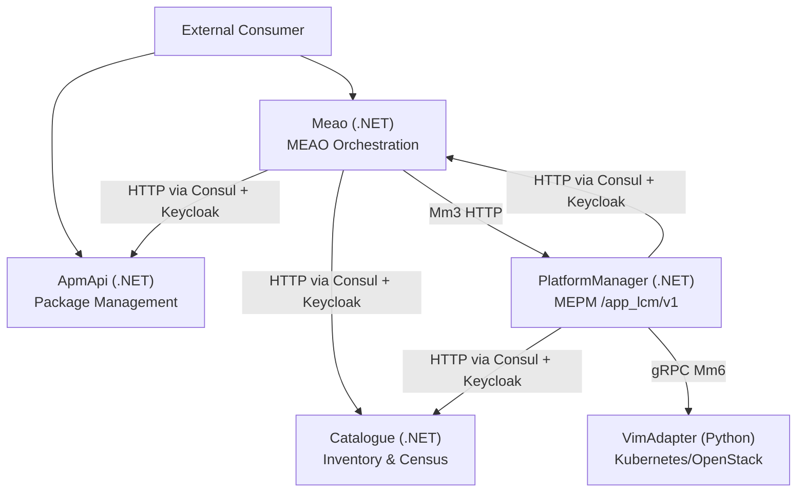
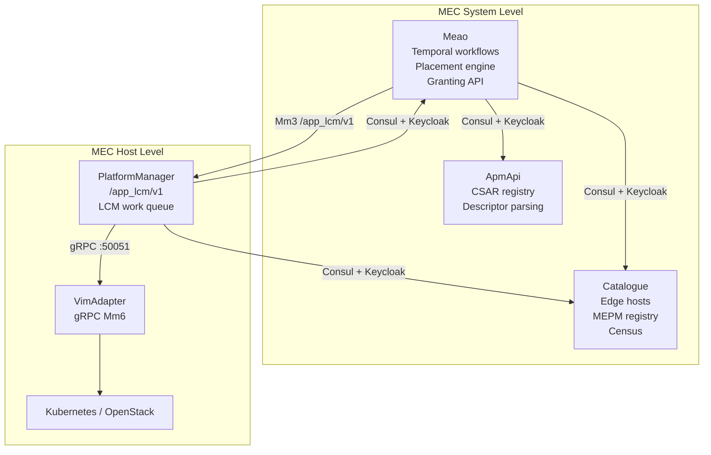
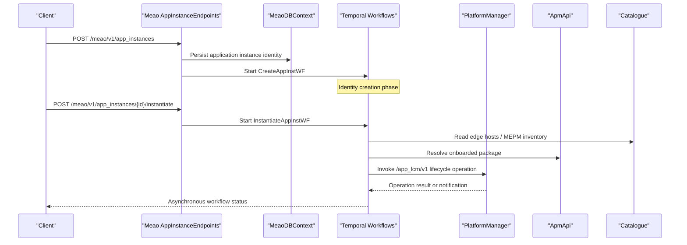
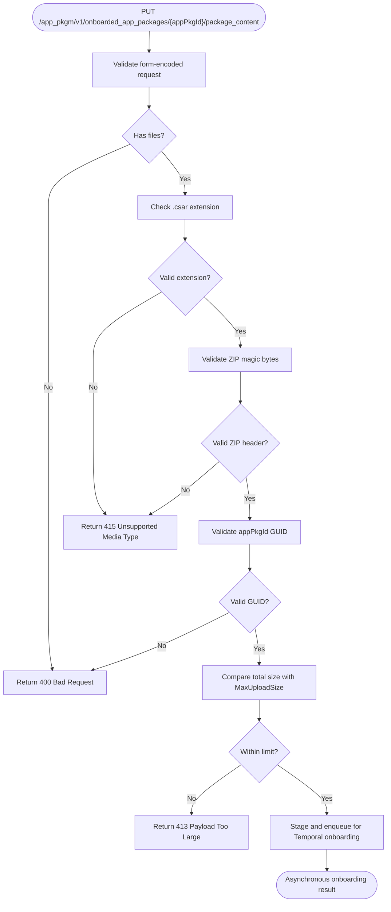
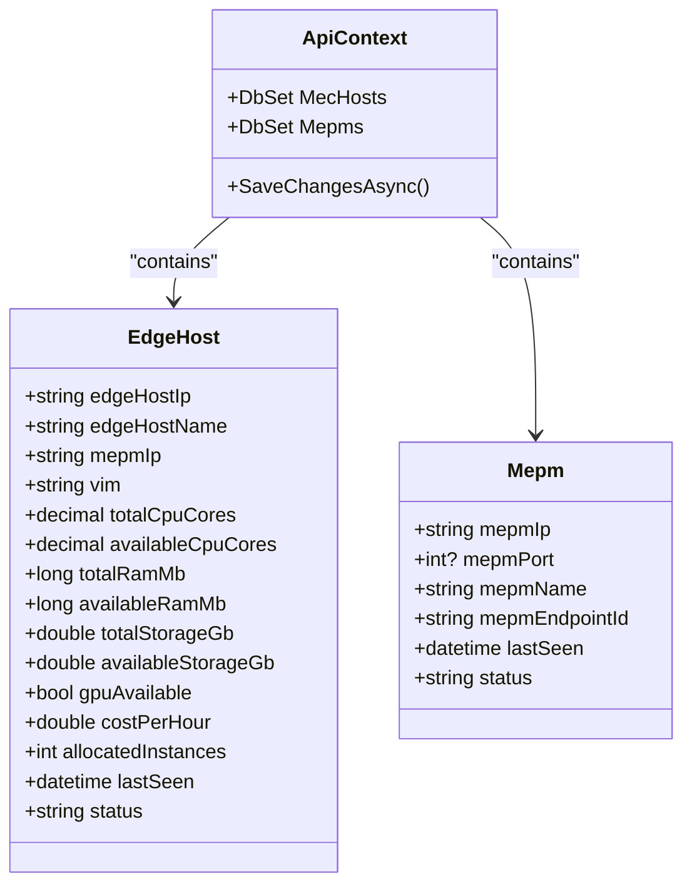
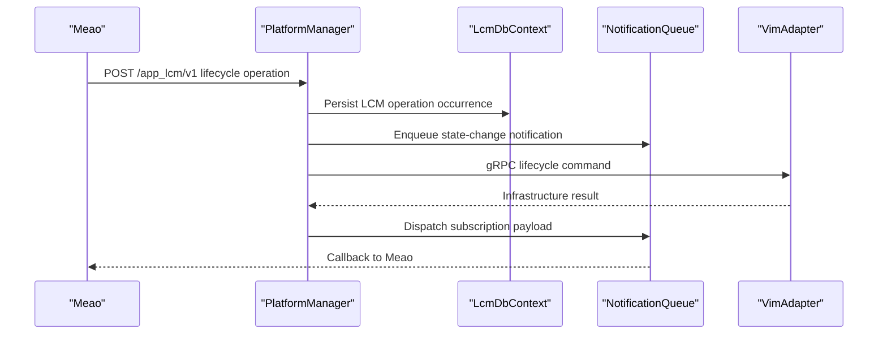
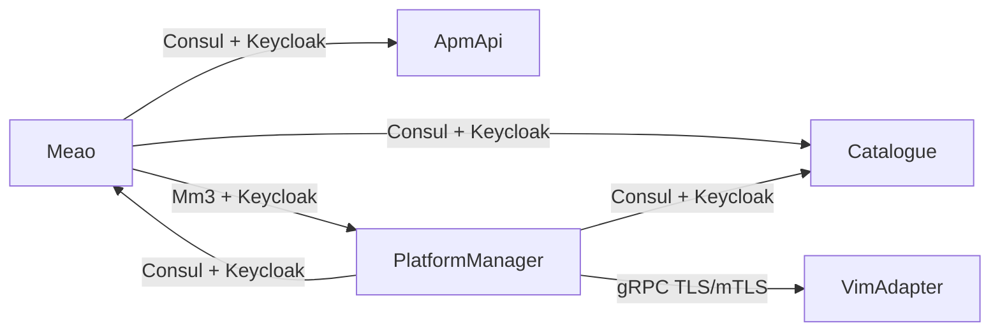

# Core Services

<cite>
**Referenced Files in This Document**
- `src/Meao/Program.cs`
- `src/Meao/appsettings.json`
- `src/Meao/Endpoints/AppInstanceEndpoints.cs`
- `src/ApmApi/Program.cs`
- `src/ApmApi/Endpoints/ApmEndpoints.cs`
- `src/ApmApi/appsettings.json`
- `src/Catalogue/Program.cs`
- `src/Catalogue/Endpoints/MepmEndpoints.cs`
- `src/Catalogue/Endpoints/MecHostEndpoints.cs`
- `src/Catalogue/appsettings.json`
- `src/PlatformManager/PlatformManager/Program.cs`
- `src/PlatformManager/PlatformManager/Endpoints/LcmEndpoint.cs`
- `src/VimAdapter/main.py`
- `docs/CONTEXT-MAP.md`
- `docs/CONFIGURATION.md`
</cite>

## Table of Contents
1. [Introduction](#introduction)
2. [Project Structure](#project-structure)
3. [Core Components](#core-components)
4. [Architecture Overview](#architecture-overview)
5. [Detailed Component Analysis](#detailed-component-analysis)
6. [Dependency Analysis](#dependency-analysis)
7. [Performance Considerations](#performance-considerations)
8. [Troubleshooting Guide](#troubleshooting-guide)
9. [Conclusion](#conclusion)

## Introduction
Optimist.Orchestrator implements the ETSI MEC orchestration domain across five services:

| Service | Language | ETSI role | Primary responsibility | Internal port (default) |
|---|---|---|---|---:|
| **Meao** | .NET 8 | MEO orchestrator | Lifecycle intent, placement, Temporal workflows, grants, subscriptions, and cross-service orchestration | 5154 |
| **ApmApi** | .NET 8 | Application package management | CSAR upload, descriptor parsing, onboarded-package registry, and durable onboarding pipeline | 5184 |
| **Catalogue** | .NET 8 | MEO inventory backing store | MEC host, MEPM, topology, app instance, and package inventory | 5165 |
| **PlatformManager** | .NET 8 | MEPM host execution | Host-level `/app_lcm/v1` API, LCM work queue, package distribution, VIM gRPC bridge | 5155 |
| **VimAdapter** | Python | VIM adapter | gRPC lifecycle operations translated to Kubernetes/Helm or OpenStack primitives | 50051 |

The system follows bounded-context design: Meao owns orchestration intent, ApmApi owns package content, Catalogue owns platform inventory, PlatformManager owns host runtime state, and VimAdapter owns infrastructure execution. External consumers interact with Meao for lifecycle requests and with ApmApi for packages; internal orchestration flows coordinate all five services through HTTP, gRPC, Consul service discovery, Keycloak authentication, and Temporal workflows.

## Project Structure
The repository organizes each service under `src/<Service>/`. The four .NET services are ASP.NET Core applications with their own entry point, configuration, endpoints, database context, health checks, and Keycloak integration. VimAdapter is a Python gRPC server launched by `main.py`, which delegates to `src.server.lcm_grpc_server`.

**Diagram sources**
- `src/Meao/Program.cs#L41-L92`
- `src/PlatformManager/PlatformManager/Program.cs#L121-L150`
- `docs/CONTEXT-MAP.md#L10-L49`

**Section sources**
- `docs/CONTEXT-MAP.md#L1-L49`
- `docs/CONFIGURATION.md#L15-L31`

## Core Components
This section summarizes the four main .NET services and the Python VimAdapter before diving into detailed architecture.

### Meao (MEO Orchestrator)
- Entry point registers OpenTelemetry, EF Core PostgreSQL (`MeaoDBContext`), RFC 7807 Problem Details, Keycloak authentication, Temporal client, service discovery, named HttpClient pipelines, background workers, validators, and hosted Temporal activities/workflows.
- Outbound clients:
  - `ApmAPI` — logical base address `http://apm`.
  - `ApmApiInternal` — authenticated via `KeycloakServiceTokenHandler` for `/internal/...` shims.
  - `CatalogueAPI` — authenticated via `KeycloakServiceTokenHandler`; Catalogue enforces JWT on all endpoints.
  - `MepmAPI` — per-host MEPM URIs resolved from Catalogue for Mm3 calls.
- Health check exposes a readiness probe tagged `ready` against `MeaoDBContext`.
- Requires `MEAO_PUBLIC_URL` in non-Development environments.

**Section sources**
- `src/Meao/Program.cs#L14-L92`
- `src/Meao/Program.cs#L105-L130`
- `src/Meao/appsettings.json#L1-L37`

### ApmApi (Application Package Management)
- Entry point registers EF Core PostgreSQL (`ApmDbContext`), validation, Keycloak authentication, Consul service discovery, Temporal client, AppD processing queue/background worker, file providers, and Swagger.
- Enforces a 512 MB multipart request body limit.
- Onboarded package REST surface is exposed at `/app_pkgm/v1/onboarded_app_packages`.
- Startup validates `AppRepoOptions` but container registry mirroring is dormant; real OCI distribution is deferred to PlatformManager over zot.

**Section sources**
- `src/ApmApi/Program.cs#L15-L150`
- `src/ApmApi/Endpoints/ApmEndpoints.cs#L20-L120`
- `src/ApmApi/appsettings.json#L1-L42`

### Catalogue (MEO Inventory Backing Store)
- Entry point registers EF Core PostgreSQL (`ApiContext`), service discovery, OpenAPI support, health checks, Keycloak authentication with a global fallback requiring authentication, and endpoint maps for MEC hosts, MEPMs, topology, app instances, and packages.
- Exposes `/health`, `/health/live`, and `/health/ready` probes.
- Maintains MEC host inventory including CPU/RAM/storage/GPU/cost metadata used by placement and census reconciliation.

**Section sources**
- `src/Catalogue/Program.cs#L1-L135`
- `src/Catalogue/Endpoints/MepmEndpoints.cs#L1-L91`
- `src/Catalogue/Endpoints/MecHostEndpoints.cs#L1-L120`
- `src/Catalogue/appsettings.json#L1-L46`

### PlatformManager (MEPM Host Execution)
- Entry point registers EF Core PostgreSQL (`LcmDbContext`), LCM services, OCI distribution client, notification queue, Keycloak token provider, service discovery, named HttpClient pipelines, and hosted LCM worker.
- Exposes `/app_lcm/v1` as the MEPM producer API and bridges to VimAdapter over gRPC using a plugin factory.
- Supports TLS/mTLS to VimAdapter through environment variables such as `<VIM>_PLUGIN`, `<VIM>_USE_TLS`, `GRPC_TLS_CERT`, and CA certificate options.
- Validates callback URIs and dispatches `AppLcmOpOccStateChange` notifications asynchronously.

**Section sources**
- `src/PlatformManager/PlatformManager/Program.cs#L1-L200`
- `src/PlatformManager/PlatformManager/Endpoints/LcmEndpoint.cs#L1-L150`

### VimAdapter (Python gRPC Adapter)
- Thin launcher reads `VIM_TYPE` (default `k8s`) and `GRPC_PORT` (default `50051`).
- Starts an asyncio gRPC server via `src.server.lcm_grpc_server.serve`.
- Actual VIM translation logic lives outside this file; this module only configures logging, defaults, and transport binding.

**Section sources**
- `src/VimAdapter/main.py#L1-L24`

## Architecture Overview
At a high level, Optimist.Orchestrator separates orchestration intent, package storage, platform inventory, host execution, and infrastructure translation:

**Diagram sources**
- `src/Meao/Program.cs#L41-L92`
- `src/PlatformManager/PlatformManager/Program.cs#L121-L150`
- `docs/CONTEXT-MAP.md#L10-L49`

## Detailed Component Analysis

### Meao: MEO Orchestration Service
Meao is the external-facing orchestration boundary for application lifecycle operations. Its responsibilities include:

- Managing application instance entities and querying them through `/meao/v1/app_instances`.
- Starting Temporal workflows such as `CreateAppInstWF`, `InstantiateAppInstWF`, `TerminateAppinstWF`, and `OnboardAppPkgWF`.
- Registering hosted activities: `CatalogueActivities`, `ApmActivities`, `AuthActivities`, `MepmActivities`, `AppInstanceActivities`, `GrantActivities`, and `PlacementActivities`.
- Resolving outbound HTTP clients through Consul service discovery and attaching Keycloak service-account tokens where required.
- Running background tasks such as subscription registration and MEPM census reconciliation.

#### Application Instance Lifecycle Endpoints
The application instance endpoints expose the MEO lifecycle triad:

| Operation | Path | Responsibility |
|---|---|---|
| Create application instance | `POST /meao/v1/app_instances` | Creates identity and starts `CreateAppInstWF`. |
| Instantiate application instance | `POST /meao/v1/app_instances/{id}/instantiate` | Starts `InstantiateAppInstWF` after placement and grant checks. |
| Query application instances | `GET /meao/v1/app_instances` | Lists instances filtered by ID, descriptor ID, name, or instantiation state. |
| Get application instance | `GET /meao/v1/app_instances/{id}` | Returns a single instance with VIM connection information. |

Errors follow RFC 7807 Problem Details: validation failures produce 400 responses, missing instances produce 404, and conflict/placement/invalid-transition cases produce 409.

**Diagram sources**
- `src/Meao/Endpoints/AppInstanceEndpoints.cs#L16-L120`
- `src/Meao/Program.cs#L94-L130`

**Section sources**
- `src/Meao/Endpoints/AppInstanceEndpoints.cs#L16-L120`
- `src/Meao/Program.cs#L14-L130`

#### Meao Configuration
| Setting | Default / Source | Purpose |
|---|---|---|
| `ConnectionStrings__MeaoDBContext` | `Host=127.0.0.1;Database=meao_db;Username=postgres;Password=postgres;` | EF Core persistence for Meao state. |
| `Keycloak:realm` | `optimist` | Keycloak realm for JWT validation and service-token acquisition. |
| `Keycloak:credentials:secret` | `${KEYCLOAK_CLIENT_SECRET_MEAO}` | Service account secret for Meao. |
| `Consul:Discovery:ServiceName` | `MEAOApi` | Consul service registration name. |
| `Consul:Discovery:Hostname` | `meao` | Logical hostname used by service discovery. |
| `TEMPORAL_TARGET_HOST` | `temporal:7233` | Temporal server target host. |
| `MEAO_PUBLIC_URL` | Required in non-Development | Public callback base URL for subscriptions. |

**Section sources**
- `src/Meao/appsettings.json#L1-L37`
- `src/Meao/Program.cs#L41-L62`
- `src/Meao/Program.cs#L105-L117`
- `docs/CONFIGURATION.md#L125-L170`

### ApmApi: CSAR Package Management Service
ApmApi is responsible for accepting CSAR bundles, validating their ZIP magic bytes, staging uploads, registering onboarded packages, and coordinating durable onboarding through Temporal and a background AppD parser queue.

#### Package Management API Surface
| Operation | Path | Behavior |
|---|---|---|
| List onboarded packages | `GET /app_pkgm/v1/onboarded_app_packages` | Returns registered packages. |
| Get one package | `GET /app_pkgm/v1/onboarded_app_packages/{appPkgId}` | Returns a single package or 404. |
| Create package record | `POST /app_pkgm/v1/onboarded_app_packages` | Registers package metadata. |
| Delete package | `DELETE /app_pkgm/v1/onboarded_app_packages/{appPkgId}` | Removes metadata and local package file. |
| Upload package content | `PUT /app_pkgm/v1/onboarded_app_packages/{appPkgId}/package_content` | Validates form content type, `.csar` extension, ZIP magic bytes, UUID format, and upload size. |

**Diagram sources**
- `src/ApmApi/Endpoints/ApmEndpoints.cs#L70-L150`

**Section sources**
- `src/ApmApi/Endpoints/ApmEndpoints.cs#L20-L150`
- `src/ApmApi/Program.cs#L15-L150`
- `src/ApmApi/appsettings.json#L1-L42`
- `docs/CONFIGURATION.md#L170-L210`

### Catalogue: MEC Host Inventory and Census Service
Catalogue is the authoritative source for MEC hosts, MEPM instances, topology, application instances, and onboarded packages. It supports paging, upsert semantics for edge hosts, and enrichment with topology data.

#### Key Inventory APIs
| Area | Endpoint Group | Purpose |
|---|---|---|
| Edge hosts | `/catalogue/v1/edge_hosts` | Discover, update, create, and upsert MEC hosts with resource capacity metadata. |
| MEPMs | `/catalogue/v1/mepms` | Discover, update, create, and delete MEPM entries. |
| Topology | `/catalogue/v1/topology` | Maintain MEC topology relationships. |
| App instances | `/catalogue/v1/app_instances` | Provide MEO census read access. |
| App packages | `/catalogue/v1/app_packages` | Unified package registry inventory. |

**Diagram sources**
- `src/Catalogue/Endpoints/MecHostEndpoints.cs#L10-L120`
- `src/Catalogue/Endpoints/MepmEndpoints.cs#L10-L91`

**Section sources**
- `src/Catalogue/Program.cs#L1-L135`
- `src/Catalogue/Endpoints/MecHostEndpoints.cs#L10-L120`
- `src/Catalogue/Endpoints/MepmEndpoints.cs#L10-L91`
- `src/Catalogue/appsettings.json#L1-L46`

### PlatformManager: Host-Level LCM Executor
PlatformManager produces the host-side `/app_lcm/v1` API, persists LCM state, queues asynchronous LCM work, distributes CSARs through OCI/zot, and invokes VimAdapter over gRPC.

#### Responsibilities
- Expose `/app_lcm/v1/subscriptions`, `/app_lcm/v1/app_instances`, LCM operation occurrences, and platform configuration endpoints.
- Validate subscription callbacks against private/loopback restrictions unless explicitly allowed.
- Dispatch `AppLcmOpOccStateChange` notifications to subscribers through a notification queue.
- Resolve VimAdapter addresses dynamically from environment variables based on the configured VIM type.
- Call back to Meao and Catalogue using Consul-discovered named HttpClient clients protected by Keycloak service tokens.

**Diagram sources**
- `src/PlatformManager/PlatformManager/Endpoints/LcmEndpoint.cs#L20-L150`
- `src/PlatformManager/PlatformManager/Program.cs#L95-L150`

**Section sources**
- `src/PlatformManager/PlatformManager/Program.cs#L1-L200`
- `src/PlatformManager/PlatformManager/Endpoints/LcmEndpoint.cs#L20-L150`

### VimAdapter: Python gRPC Lifecycle Bridge
VimAdapter is the least complex component from a startup perspective. It:

1. Configures Python logging.
2. Reads `VIM_TYPE`, defaulting to `k8s`.
3. Reads `GRPC_PORT`, defaulting to `50051`.
4. Calls `asyncio.run(serve(...))` with the bound address and VIM type.

All VIM-specific lifecycle translation logic is implemented in `src.server.lcm_grpc_server`, so operators should inspect that module when debugging VIM behavior.

**Section sources**
- `src/VimAdapter/main.py#L1-L24`
- `docs/CONTEXT-MAP.md#L45-L50`

## Dependency Analysis
The services have clear directional dependencies:

| Caller | Callee | Protocol | Authentication | Notes |
|---|---|---|---|---|
| Meao | ApmApi | HTTP | Optional direct client; internal shims use Keycloak token handler | Used for package-related orchestration. |
| Meao | Catalogue | HTTP | Keycloak service token handler | Census and inventory lookups. |
| Meao | PlatformManager | HTTP (Mm3) | Per-host URI from Catalogue; Keycloak token handler | Lifecycle orchestration. |
| PlatformManager | Catalogue | HTTP | Keycloak service token handler | Host and MEPM discovery. |
| PlatformManager | Meao | HTTP | Keycloak service token handler | Grant verification and callbacks. |
| PlatformManager | VimAdapter | gRPC | Environment-driven TLS/mTLS | VIM lifecycle commands. |

**Diagram sources**
- `src/Meao/Program.cs#L41-L92`
- `src/PlatformManager/PlatformManager/Program.cs#L121-L150`
- `src/VimAdapter/main.py#L1-L24`

**Section sources**
- `src/Meao/Program.cs#L41-L92`
- `src/PlatformManager/PlatformManager/Program.cs#L121-L150`
- `docs/CONFIGURATION.md#L125-L210`

## Performance Considerations
Several operational characteristics influence performance and reliability:

- **Large uploads**: ApmApi allows up to 512 MB multipart payloads, which requires careful disk staging and cleanup. The orphan cleaner service helps reclaim stale CSAR staging artifacts.
- **Background processing**: Both Meao and PlatformManager rely on background hosted services and Temporal workflows rather than synchronous blocking calls for long-running operations.
- **Service discovery and resilience**: Steeltoe Consul discovery and standard resilience handlers reduce transient network failure impact. Named HttpClient clients isolate timeout and retry policies.
- **Database migration strategy**: In production, unmigrated schemas cause immediate failure, preventing schema drift. Development mode applies migrations automatically.
- **Health checks**: All services register database readiness checks, making liveness/readiness probes useful for Kubernetes rolling updates.
- **VimAdapter concurrency**: VimAdapter uses asyncio for its gRPC server, while PlatformManager queues LCM work asynchronously. Operators should monitor both the gRPC listener and the LCM notification queue.

[No sources needed since this section provides general guidance]

## Troubleshooting Guide

### Common Startup Failures
| Symptom | Likely Cause | Resolution |
|---|---|---|
| Meao throws during startup without `MEAO_PUBLIC_URL` | Non-Development environment requires public callback URL. | Set `MEAO_PUBLIC_URL` in environment configuration. |
| Production services exit because of pending migrations | Schema changes were not applied ahead of deployment. | Run migrations before starting the service; use the `--migrate-only` entrypoint if supported. |
| Catalogue returns 401 on Meao calls | Catalogue has a global authentication fallback policy. | Ensure Meao’s outbound client carries a valid Keycloak service token. |
| VimAdapter listens on unexpected port | `GRPC_PORT` environment variable overrides default. | Verify the environment variable matches PlatformManager’s VIM plugin port configuration. |
| PlatformManager cannot reach VimAdapter | `<VIM>_PLUGIN` or `<VIM>_PLUGIN_PORT` misconfigured. | Confirm the VIM type and plugin address/port environment variables. |

### Health Check Endpoints
| Service | Live Probe | Ready Probe |
|---|---|---|
| Meao | `/health` | `/health/ready` (database readiness tag) |
| ApmApi | `/health` | `/health/ready` (database readiness tag) |
| Catalogue | `/health` | `/health/ready` (database readiness tag) |
| PlatformManager | `/health` | `/health/ready` (database readiness tag) |

### Operational Checklist
- Ensure Consul is reachable and all services register under expected names: `MEAOApi`, `ApmApi`, `CatalogueApi`.
- Verify Keycloak realms and client secrets are configured consistently across services.
- Confirm OTLP telemetry endpoint is set if distributed tracing is required.
- For VIM TLS/mTLS, validate certificate paths and CA settings according to PlatformManager’s gRPC credential configuration.
- Monitor Temporal task queues when lifecycle operations stall.
- Inspect CSAR staging directories when package uploads appear incomplete.

**Section sources**
- `src/Meao/Program.cs#L105-L117`
- `src/PlatformManager/PlatformManager/Program.cs#L151-L200`
- `src/Catalogue/Program.cs#L63-L105`
- `docs/CONFIGURATION.md#L125-L210`

## Conclusion
Optimist.Orchestrator’s core services implement a clean separation between orchestration intent, package management, platform inventory, host execution, and VIM translation:

- **Meao** is the MEO orchestrator: it accepts lifecycle requests, runs Temporal workflows, coordinates placement and grants, and drives Mm3 interactions with PlatformManager.
- **ApmApi** is the package authority: it validates, stages, and registers CSAR bundles and participates in durable onboarding.
- **Catalogue** is the inventory source: it tracks MEC hosts, MEPMs, topology, and application/package records consumed by placement and census reconciliation.
- **PlatformManager** is the host executor: it exposes `/app_lcm/v1`, queues LCM work, distributes packages, and translates lifecycle intent into VIM operations.
- **VimAdapter** is the infrastructure bridge: it converts gRPC lifecycle commands into concrete Kubernetes or OpenStack actions.

Together, they implement the ETSI MEC roles through well-defined interfaces, consistent authentication, service discovery, structured error handling, and durable background processing. Operators should treat these services as coordinated components rather than independent microservices: successful application onboarding and instantiation depend on correct configuration, healthy databases, working service discovery, valid Keycloak tokens, and a responsive VimAdapter.