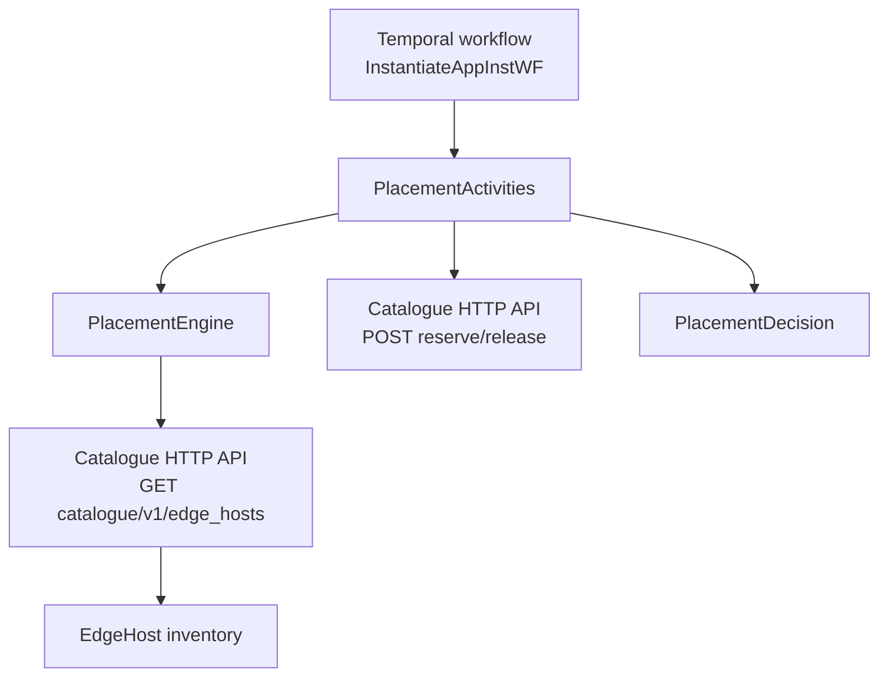
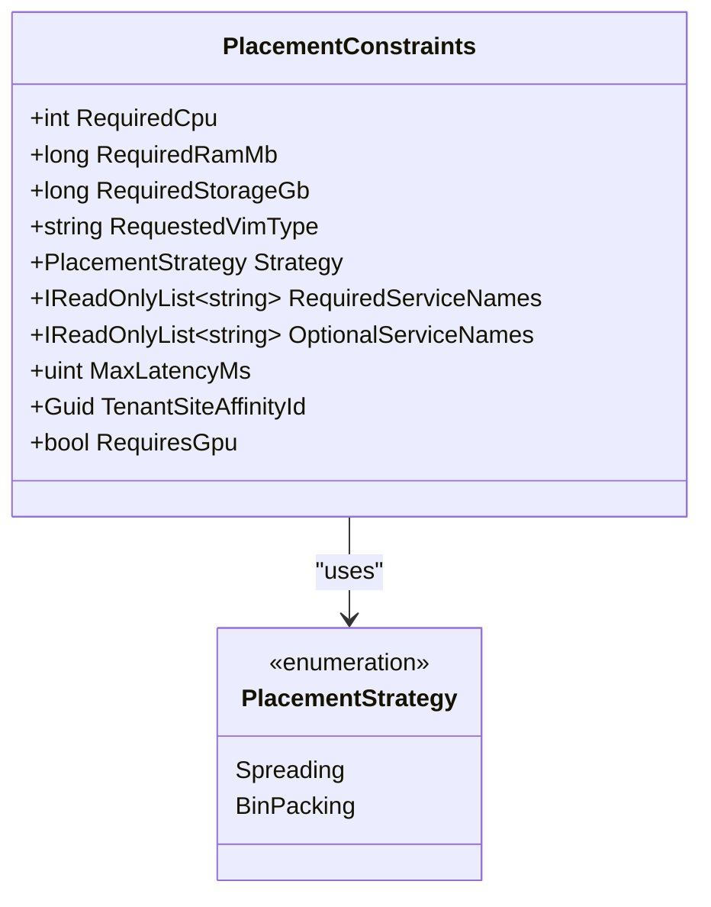
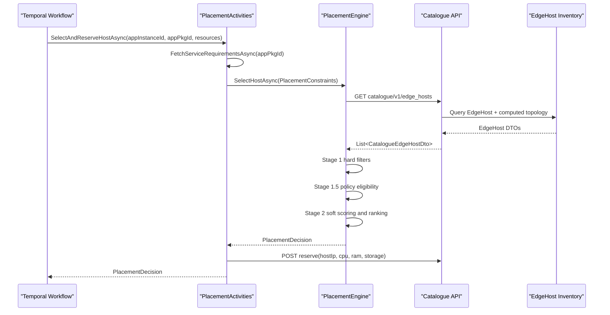
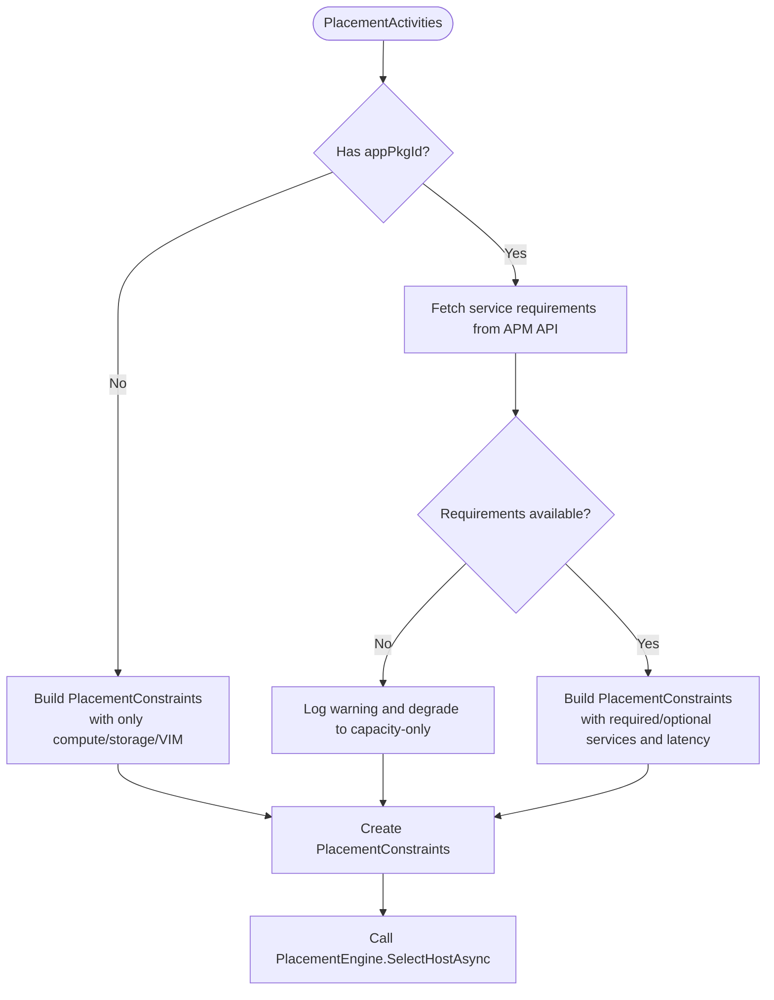
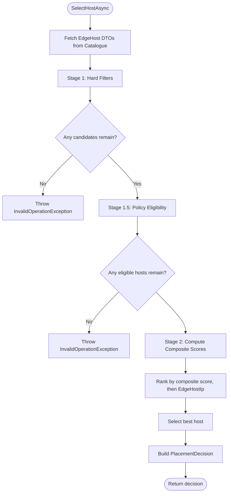
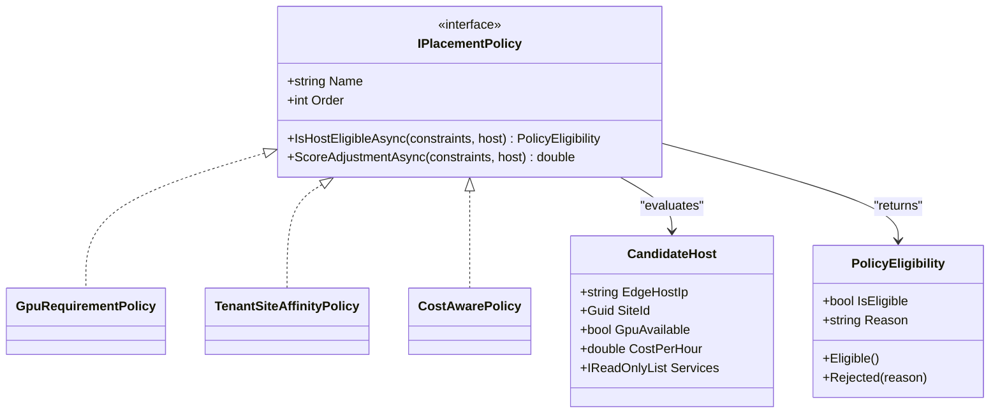
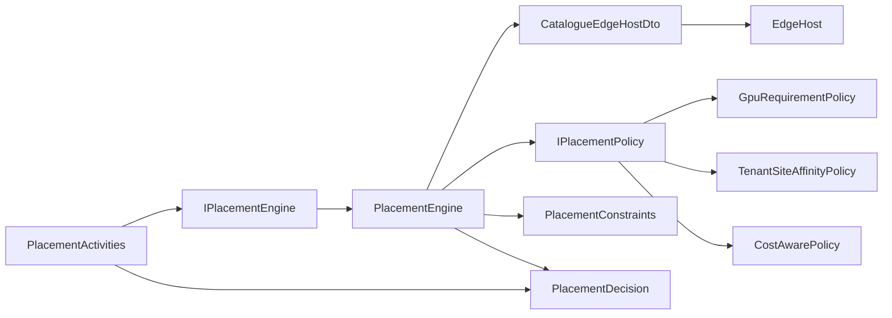

# Dynamic Placement Engine

## Table of Contents
1. [Introduction](#introduction)
2. [Project Structure](#project-structure)
3. [Core Components](#core-components)
4. [Architecture Overview](#architecture-overview)
5. [Detailed Component Analysis](#detailed-component-analysis)
6. [Dependency Analysis](#dependency-analysis)
7. [Performance Considerations](#performance-considerations)
8. [Troubleshooting Guide](#troubleshooting-guide)
9. [Conclusion](#conclusion)

## Introduction
The dynamic placement engine is responsible for selecting the most suitable MEC edge host for an application instance. It combines resource requirements extracted from AppD descriptors, network topology information, geographic or site affinity preferences, and configurable placement policies into a deterministic selection process. The current implementation performs:

- Hard filtering against available CPU, RAM, storage, VIM type, required MEC services, latency ceiling, and GPU capability.
- Policy-based eligibility checks that can reject hosts (for example, missing GPU when explicitly required).
- Soft scoring based on spreading or bin-packing strategy, optional service matches, policy adjustments, and cost.
- A final deterministic ranking by composite score and host IP address.

This document focuses on the constraint extraction model, the placement policies, EdgeHost capacity tracking, and the algorithm used to select optimal hosts.

## Project Structure
The placement feature is split across three main areas:

| Area | Responsibility | Key Files |
|---|---|---|
| Placement domain | Constraint model, decision model, placement interface, and engine | `IPlacementEngine.cs`, `PlacementConstraints.cs`, `PlacementDecision.cs`, `PlacementEngine.cs` |
| Placement policies | Extensible eligibility and scoring hooks | `IPlacementPolicy.cs`, `CostAwarePolicy.cs`, `GpuRequirementPolicy.cs`, `TenantSiteAffinityPolicy.cs` |
| Catalogue inventory | Edge host metadata, capacity headroom, services, site assignment, and latency projection | `EdgeHost.cs`, `MecHostEndpoints.cs` |
| Orchestration integration | Temporal activity that translates orchestration inputs into placement constraints and reserves capacity | `PlacementActivities.cs` |

**Diagram sources**
- `src/Meao/Activities/PlacementActivities.cs`
- `src/Meao/Domain/Placement/PlacementEngine.cs`
- `src/Catalogue/Models/EdgeHost.cs`

**Section sources**
- `docs/ADR/0045-meo-placement-engine-and-unified-catalogue-inventory-model.md#L1-L67`

## Core Components

### Placement Constraints
`PlacementConstraints` captures the hard and soft requirements passed to the placement engine:

| Field | Purpose | Current behavior |
|---|---|---|
| `RequiredCpu` | Minimum CPU cores needed | Hard filter; host must have at least this many available CPU cores |
| `RequiredRamMb` | Minimum RAM in MB | Hard filter; host must have enough available RAM |
| `RequiredStorageGb` | Minimum storage in GB | Hard filter; host must have enough available storage |
| `RequestedVimType` | Preferred virtualization platform | Hard filter when provided |
| `Strategy` | Spreading or bin-packing | Controls whether higher or lower remaining-resource ratio scores better |
| `RequiredServiceNames` | Mandatory MEC services | Host must offer each required service with status Available |
| `OptionalServiceNames` | Preferred MEC services | Increases soft score if present |
| `MaxLatencyMs` | Maximum acceptable latency to core | Hard filter through endpoint-computed `LatencyToCoreMs` |
| `TenantSiteAffinityId` | Site affinity preference | Used by tenant-site affinity policy as a soft bonus |
| `RequiresGpu` | Optional GPU requirement | Enforced by `GpuRequirementPolicy` as a hard veto |

**Diagram sources**
- `src/Meao/Domain/Placement/PlacementConstraints.cs`

**Section sources**
- `src/Meao/Domain/Placement/PlacementConstraints.cs#L1-L23`

### Placement Decision
`PlacementDecision` represents the outcome of host selection. It includes:

- Selected host IP.
- VIM type.
- Allocated CPU, RAM, and storage.
- Optional VIM connection identifier.
- Matched required and optional service names.
- Non-zero policy adjustments applied during ranking.

It also provides backward-compatible constructors and deconstruction members for older callers.

**Section sources**
- `src/Meao/Domain/Placement/PlacementDecision.cs#L1-L60`

### Placement Interface
`IPlacementEngine.SelectHostAsync` takes `PlacementConstraints` and returns a `PlacementDecision`. It intentionally hides the HTTP calls to the Catalogue and the internal scoring details behind a domain interface.

**Section sources**
- `src/Meao/Domain/Placement/IPlacementEngine.cs#L1-L12`

## Architecture Overview
The placement architecture separates concerns between:

1. **Constraint extraction:** Translation from orchestration inputs and AppD-derived service requirements into `PlacementConstraints`.
2. **Inventory lookup:** Fetching live edge host data from the Catalogue.
3. **Hard filtering:** Removing hosts that cannot satisfy mandatory requirements.
4. **Policy evaluation:** Applying extensible policies for eligibility and scoring.
5. **Soft ranking:** Computing a composite score using strategy, optional services, and policy adjustments.
6. **Reservation:** Reserving capacity after a host is selected.

**Diagram sources**
- `src/Meao/Activities/PlacementActivities.cs`
- `src/Meao/Domain/Placement/PlacementEngine.cs`
- `src/Catalogue/Models/EdgeHost.cs`

**Section sources**
- `docs/ADR/0045-meo-placement-engine-and-unified-catalogue-inventory-model.md#L28-L67`

## Detailed Component Analysis

### Constraint Extraction from AppD Descriptors
The placement system does not directly parse raw CSAR files. Instead, it relies on AppD descriptor data exposed by the APM service. `PlacementActivities.FetchServiceRequirementsAsync` calls the APM API endpoint `/app_pkgm/v1/onboarded_app_packages/{appPkgId}/service_requirements` and maps the response into:

- `requiredSerNames`: mandatory MEC services.
- `optionalSerNames`: preferred MEC services.
- `maxLatencyMs`: maximum latency threshold.

These values are then converted into `PlacementConstraints`. If service requirements are unavailable, the engine degrades gracefully to capacity-only placement.

**Diagram sources**
- `src/Meao/Activities/PlacementActivities.cs`

**Section sources**
- `src/Meao/Activities/PlacementActivities.cs`
- `docs/ADR/0045-meo-placement-engine-and-unified-catalogue-inventory-model.md#L32-L46`

### EdgeHost Capacity Tracking and Available Resources
The Catalogue’s `EdgeHost` entity tracks both total and available capacity:

| Capacity Field | Meaning |
|---|---|
| `TotalCpuCores` | Total CPU cores on the host |
| `AvailableCpuCores` | Remaining CPU cores after allocations |
| `TotalRamMb` | Total RAM in MB |
| `AvailableRamMb` | Remaining RAM in MB |
| `TotalStorageGb` | Total storage in GB |
| `AvailableStorageGb` | Remaining storage in GB |
| `AllocatedInstances` | Number of instances allocated to the host |
| `Version` | Optimistic concurrency token for reservation safety |

Additional fields support policy-aware placement:

| Field | Meaning |
|---|---|
| `Services` | Available MEC services |
| `SiteAssignment.SiteId` | Site assignment used for affinity |
| `LatencyToCoreMs` | Endpoint-computed latency to core site |
| `GpuAvailable` | Whether GPU is available |
| `CostPerHour` | Optional cost metric for cost-aware policy |

The Catalogue endpoint computes `SiteId` and `LatencyToCoreMs` from host-to-site and site-to-core links before returning the host DTO.

**Section sources**
- `src/Catalogue/Models/EdgeHost.cs#L1-L57`
- `src/Catalogue/Endpoints/MecHostEndpoints.cs`

### Placement Algorithm: Three Stages

#### Stage 1 — Hard Filtering
The engine fetches all edge hosts from the Catalogue and removes any host that fails mandatory conditions:

- Host status is empty or ONLINE.
- VIM type matches when requested.
- Available CPU, RAM, and storage meet requirements.
- All required MEC services are present and Available.
- Latency to core is within the configured maximum when specified.

If no candidate survives, the engine throws `InvalidOperationException`.

#### Stage 1.5 — Policy Eligibility
Each registered `IPlacementPolicy` evaluates every surviving candidate. A policy can:

- Return eligible without changing the score.
- Reject the host permanently.
- Log a rejection reason.

Policies execute in ascending `Order`.

#### Stage 2 — Soft Scoring and Ranking
For each eligible candidate, the engine computes:

1. **Optional service score:** Up to 1.0, calculated as the number of matched optional services multiplied by 0.25, capped at 1.0.
2. **Policy adjustment:** Sum of all policy `ScoreAdjustmentAsync` results.
3. **Base resource ratio:** `AvailableRamMb / TotalRamMb`.
4. **Composite score:**
   - For **Spreading**: base ratio plus optional service score plus policy adjustments.
   - For **BinPacking**: negative base ratio plus optional service score plus policy adjustments.

The final selection is the candidate with the highest composite score, breaking ties by `EdgeHostIp`.

**Diagram sources**
- `src/Meao/Domain/Placement/PlacementEngine.cs`

**Section sources**
- `src/Meao/Domain/Placement/PlacementEngine.cs`

### Placement Policies

#### Candidate Host Wrapper
`CandidateHost` wraps the Catalogue DTO and exposes typed properties such as IP, site ID, GPU availability, cost, and services. This avoids direct JSON property manipulation inside policies.

#### Policy Interface
`IPlacementPolicy` defines:

- `Name`: Human-readable policy name.
- `Order`: Deterministic execution order.
- `IsHostEligibleAsync`: Can reject a host.
- `ScoreAdjustmentAsync`: Adds or reduces a numeric score.

**Diagram sources**
- `src/Meao/Domain/Placement/IPlacementPolicy.cs`

#### Built-in Policies

| Policy | Role | Eligibility Behavior | Scoring Behavior |
|---|---|---|---|
| `GpuRequirementPolicy` | Enforces GPU requirement | Rejects host when `RequiresGpu` is true and host lacks GPU | No adjustment |
| `TenantSiteAffinityPolicy` | Rewards site affinity | Never rejects | Adds 1.0 when host site matches tenant affinity |
| `CostAwarePolicy` | Prefers lower cost | Never rejects | Adds `-costPerHour / 100.0`; lower cost means less negative score |

**Section sources**
- `src/Meao/Domain/Placement/IPlacementPolicy.cs#L1-L49`
- `src/Meao/Domain/Placement/Policies/GpuRequirementPolicy.cs#L1-L42`
- `src/Meao/Domain/Placement/Policies/TenantSiteAffinityPolicy.cs#L1-L44`
- `src/Meao/Domain/Placement/Policies/CostAwarePolicy.cs#L1-L41`

### Placement Policies and Configuration Options

| Option | Description | Effect |
|---|---|---|
| `Strategy = Spreading` | Distribute workloads across hosts | Higher remaining-resource ratio scores better |
| `Strategy = BinPacking` | Pack workloads onto fewer hosts | Lower remaining-resource ratio scores better |
| `RequiredServiceNames` | Mandatory MEC services | Hard filter; host must expose them |
| `OptionalServiceNames` | Preferred MEC services | Soft score bonus up to 1.0 |
| `MaxLatencyMs` | Latency ceiling | Hard filter through computed host latency |
| `TenantSiteAffinityId` | Site affinity preference | Soft score bonus via `TenantSiteAffinityPolicy` |
| `RequiresGpu` | GPU requirement | Hard veto via `GpuRequirementPolicy` |
| Registered policies | Extensible scoring and eligibility rules | Ordered evaluation before ranking |

Configuration is primarily expressed through `PlacementConstraints` and the set of injected `IPlacementPolicy` implementations. There is no single configuration object for placement strategies beyond the strategy enum and policy registration.

**Section sources**
- `src/Meao/Domain/Placement/PlacementConstraints.cs#L1-L23`
- `src/Meao/Domain/Placement/PlacementEngine.cs`
- `src/Meao/Domain/Placement/IPlacementPolicy.cs#L1-L49`

### Examples of Constraint Specifications

Below are conceptual examples of how constraints map to placement behavior. These are not literal request payloads but descriptions of supported configurations.

| Scenario | Constraint Specification | Expected Behavior |
|---|---|---|
| Basic deployment | CPU ≥ 2, RAM ≥ 2048 MB, storage ≥ 10 GB, strategy = Spreading | Picks an ONLINE host with sufficient headroom; spreading prefers hosts with more free RAM proportionally |
| Kubernetes-only deployment | Same as above, plus `RequestedVimType = k8s` | Rejects OpenStack or other VIM types |
| Service-aware deployment | Required services include a specific MEC service | Only hosts offering that service with Available status qualify |
| Latency-sensitive deployment | `MaxLatencyMs = 100` | Only hosts whose computed `LatencyToCoreMs` is ≤ 100 ms qualify |
| GPU workload | `RequiresGpu = true` | `GpuRequirementPolicy` rejects hosts without GPU |
| Multi-policy deployment | Tenant site affinity set, cost-aware policy registered | Site match adds score; lower-cost hosts receive a slightly better score |
| Resource-efficient deployment | Strategy = BinPacking | Prefers hosts with less remaining RAM proportionally, packing more instances together |

**Section sources**
- `src/Meao.Tests.Unit/PlacementEngineTests.cs`
- `src/Meao/Domain/Placement/PlacementEngine.cs`

## Dependency Analysis

**Diagram sources**
- `src/Meao/Activities/PlacementActivities.cs`
- `src/Meao/Domain/Placement/IPlacementEngine.cs`
- `src/Meao/Domain/Placement/PlacementEngine.cs`
- `src/Meao/Domain/Placement/IPlacementPolicy.cs`
- `src/Meao/Domain/Placement/PlacementConstraints.cs`
- `src/Meao/Domain/Placement/PlacementDecision.cs`
- `src/Catalogue/Models/EdgeHost.cs`

Key dependency observations:

- `PlacementEngine` depends on the Catalogue HTTP API rather than directly on EF Core entities. This keeps placement logic testable and decoupled from persistence.
- Policies are loosely coupled through `IPlacementPolicy`, allowing new scoring or eligibility rules without changing the engine.
- `PlacementActivities` bridges Temporal workflows and the placement domain, handling APM service requirement fetching and Catalogue capacity reservation.
- `EdgeHost` is the source of truth for capacity and topology-related fields used by the placement engine.

**Section sources**
- `src/Meao/Domain/Placement/PlacementEngine.cs`
- `src/Meao/Activities/PlacementActivities.cs`
- `src/Catalogue/Models/EdgeHost.cs#L1-L57`

## Performance Considerations

### Time Complexity
Let `H` be the number of candidate edge hosts returned by the Catalogue, and `P` be the number of registered policies.

| Phase | Complexity | Explanation |
|---|---|---|
| Catalogue fetch | O(1) HTTP call, O(H) deserialization | One GET request retrieves all hosts |
| Hard filtering | O(H × S) where S is service count | Each host is checked against CPU/RAM/storage/VIM/services/latency |
| Policy eligibility | O(H × P) | Every eligible host runs through every policy |
| Policy scoring | O(H × P) | Every eligible host receives per-policy adjustments |
| Optional service scoring | O(H × O) where O is optional service count | Simple list matching |
| Ranking | O(H log H) | Sort by composite score, then by IP |

Overall complexity is approximately **O(H log H + H × (S + P + O))**.

### Scalability Implications
- **Large host sets:** When many edge hosts exist, the Catalogue query becomes a single large payload. Indexing and pagination should be considered if host counts grow substantially.
- **Many policies:** Adding expensive policies increases runtime linearly with host count. Prefer lightweight eligibility checks and bounded score adjustments.
- **Service matching:** Large `RequiredServiceNames` or `OptionalServiceNames` lists increase matching time. Consider precomputing or indexing service presence in the Catalogue layer if needed.
- **Determinism:** Tie-breaking by `EdgeHostIp` ensures stable output even when multiple hosts share the same composite score.

### Optimization Opportunities
- Cache or batch host queries when placing multiple instances under the same constraints.
- Precompute or cache `LatencyToCoreMs` and site assignments in the Catalogue so the placement engine sees ready-to-use values.
- Introduce early exits for expensive policies when hard constraints already eliminate most hosts.
- Limit the number of evaluated policies or register only relevant ones per workload class.
- Consider incremental ranking instead of full sort when only the top candidate matters.

[No sources needed since this section provides general guidance]

## Troubleshooting Guide

### No Edge Hosts Registered
**Symptom:** `InvalidOperationException` stating no edge hosts are registered.  
**Cause:** Catalogue returned zero hosts.  
**Checks:**
- Verify Catalogue is running.
- Confirm hosts are registered via the Catalogue API.
- Ensure the `CatalogueActivityAPI` client resolves correctly.

**Section sources**
- `src/Meao/Domain/Placement/PlacementEngine.cs`

### No Host Satisfies Hard Constraints
**Symptom:** `InvalidOperationException` mentioning insufficient CPU, RAM, storage, VIM type, required services, or latency.  
**Cause:** All hosts fail one or more mandatory checks.  
**Checks:**
- Inspect `RequiredCpu`, `RequiredRamMb`, `RequiredStorageGb`.
- Check `RequestedVimType`.
- Validate `RequiredServiceNames` against actual host services.
- Review `MaxLatencyMs` and whether `LatencyToCoreMs` is populated.

**Section sources**
- `src/Meao/Domain/Placement/PlacementEngine.cs`
- `src/Meao.Tests.Unit/PlacementEngineTests.cs`

### No Host Satisfies Policies
**Symptom:** `InvalidOperationException` indicating no edge host satisfies placement policies, often including policy rejection reasons.  
**Cause:** One or more policies rejected all candidates.  
**Checks:**
- Look for GPU requirement mismatches when `RequiresGpu = true`.
- Review custom policies for strict eligibility rules.
- Inspect policy logs for rejection reasons.

**Section sources**
- `src/Meao/Domain/Placement/PlacementEngine.cs`
- `src/Meao/Domain/Placement/Policies/GpuRequirementPolicy.cs#L1-L42`

### AppD Requirements Not Available
**Symptom:** Warning about degradation to capacity-only placement.  
**Cause:** APM service requirements could not be fetched or were empty.  
**Checks:**
- Verify APM service availability.
- Confirm the package has onboarded service requirements.
- Confirm authentication token handling when calling the APM API.

**Section sources**
- `src/Meao/Activities/PlacementActivities.cs`

### Reservation Failures After Selection
**Symptom:** Placement succeeds but subsequent instantiation fails during capacity reservation.  
**Cause:** Catalogue reserve endpoint failed, possibly due to optimistic concurrency conflicts or invalid host state.  
**Checks:**
- Inspect the Catalogue reserve endpoint response.
- Check host version/concurrency tokens.
- Validate that the selected host remains ONLINE.

**Section sources**
- `src/Meao/Activities/PlacementActivities.cs`
- `src/Catalogue/Models/EdgeHost.cs#L1-L57`

## Conclusion
The dynamic placement engine implements a clear three-stage selection pipeline: hard filtering, policy eligibility, and soft ranking. Its strength lies in separating immutable resource constraints from extensible placement policies and keeping inventory access focused on the Catalogue. For large-scale deployments, the primary performance concerns are Catalogue payload size, policy count, and service-matching overhead. Extending placement behavior is straightforward through additional `IPlacementPolicy` implementations, while maintaining deterministic decisions through ordered evaluation and IP-based tie-breaking.

[No sources needed since this section summarizes without analyzing specific files]

> **Referenced Files in This Document**
>
> - `src/Meao/Domain/Placement/IPlacementEngine.cs`
> - `src/Meao/Domain/Placement/IPlacementPolicy.cs`
> - `src/Meao/Domain/Placement/PlacementConstraints.cs`
> - `src/Meao/Domain/Placement/PlacementDecision.cs`
> - `src/Meao/Domain/Placement/PlacementEngine.cs`
> - `src/Meao/Domain/Placement/Policies/CostAwarePolicy.cs`
> - `src/Meao/Domain/Placement/Policies/GpuRequirementPolicy.cs`
> - `src/Meao/Domain/Placement/Policies/TenantSiteAffinityPolicy.cs`
> - `src/Meao/Activities/PlacementActivities.cs`
> - `src/Catalogue/Models/EdgeHost.cs`
> - `src/Catalogue/Endpoints/MecHostEndpoints.cs`
> - `docs/ADR/0045-meo-placement-engine-and-unified-catalogue-inventory-model.md`
> - `src/Meao.Tests.Unit/PlacementEngineTests.cs`
