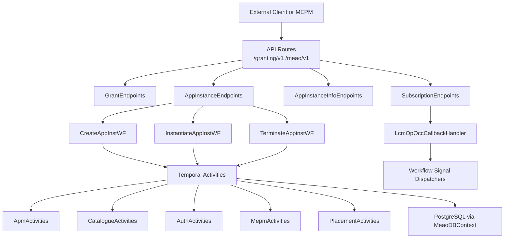
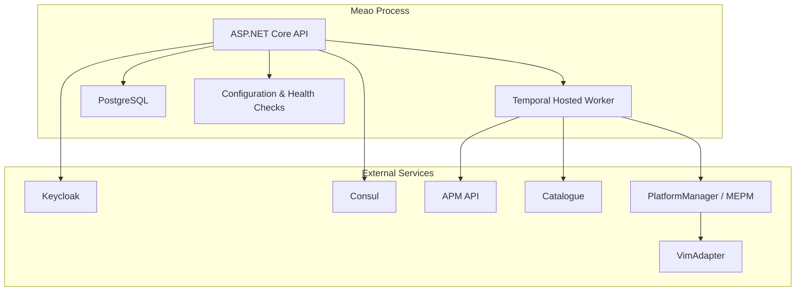
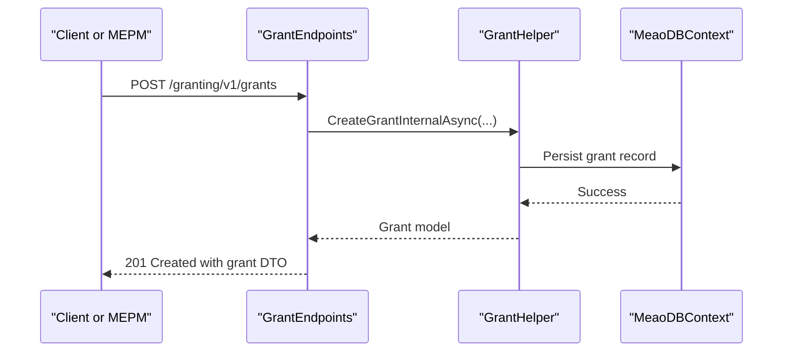
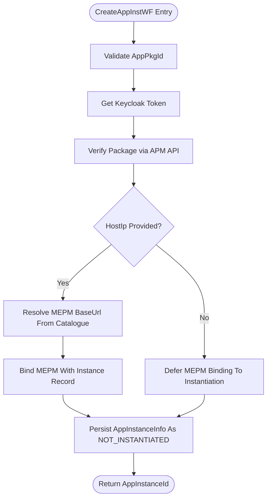
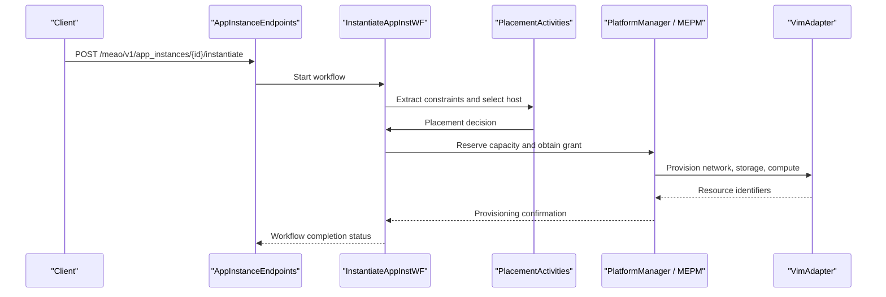
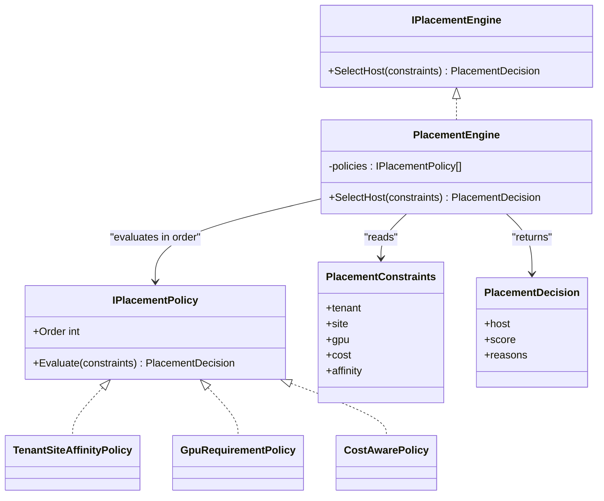
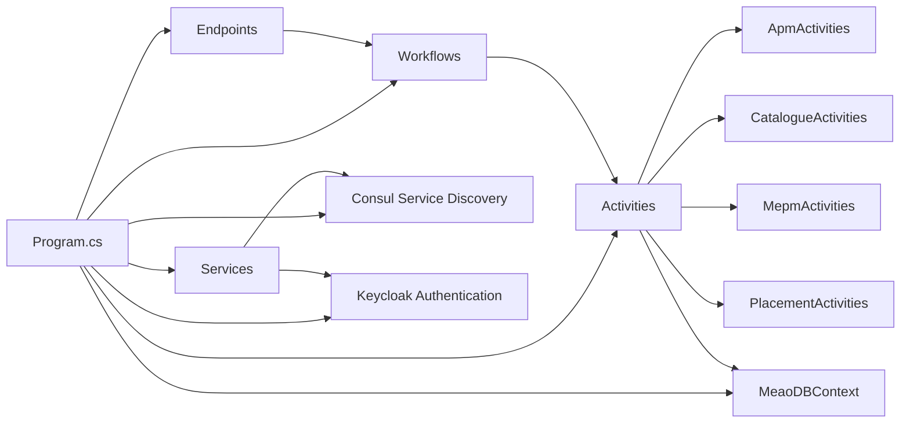

# Meao (MEO Orchestration Service)

## Table of Contents
1. [Introduction](#introduction)
2. [Project Structure](#project-structure)
3. [Core Components](#core-components)
4. [Architecture Overview](#architecture-overview)
5. [Detailed Component Analysis](#detailed-component-analysis)
6. [Dependency Analysis](#dependency-analysis)
7. [Performance Considerations](#performance-considerations)
8. [Troubleshooting Guide](#troubleshooting-guide)
9. [Conclusion](#conclusion)

## Introduction
Meao is the .NET orchestrator service implementing the ETSI MEC Multi-access Edge Orchestrator role. It owns application instance identity, grant request processing, and asynchronous lifecycle orchestration through Temporal workflows. It coordinates with external services such as APM API for package handling, Catalogue for discovery, PlatformManager/MEPM for VIM operations, Keycloak for authentication, and Consul for service discovery. Its HTTP surface exposes:

- `/granting/v1/grants` — ETSI MEO grant request API consumed by MEPM.
- `/meao/v1/app_instances` — Application instance lifecycle endpoints that start Temporal workflows.
- `/meao/v1/AppInstanceInfo` — Internal CRUD view of persisted application instance records.
- `/meao/v1/subscriptions` — Subscription management and callback receivers for lifecycle notifications and onboarding signals.

The service uses a modular monolith structure under `src/Meao`, with ASP.NET Minimal APIs, EF Core with PostgreSQL, FluentValidation, OpenAPI/Swagger, Steeltoe Consul-based service discovery, and Temporal workflow execution.

## Project Structure
The Meao project is organized around responsibilities rather than strict layers:

| Area | Responsibility |
|---|---|
| `Endpoints` | HTTP routes for grants, app instances, internal info, and subscriptions/callbacks |
| `Workflows` | Temporal workflow definitions for create, instantiate, terminate, and onboard operations |
| `Activities` | Temporal activity implementations calling external services and persistence |
| `Domain/Placement` | Placement engine, constraints, decisions, and pluggable placement policies |
| `Services` | Background workers, signal dispatchers, token providers, and helper orchestration services |
| `Models` | Domain entities, DTOs, mappers, and notification structures |
| `Requests` | Request models and command objects used by workflows |
| `Validators` | FluentValidation validators for requests and DTOs |
| `Infrastructure` | HTTP handlers, exception handling, client registration, and Keycloak integration |
| `Data` | EF Core context and database migrations |
| `Utils` | Helpers for grants, HTTP, and URI utilities |

**Diagram sources**
- `src/Meao/Program.cs#L1-L200`
- `src/Meao/Endpoints/GrantEndpoints.cs#L1-L63`
- `src/Meao/Endpoints/AppInstanceEndpoints.cs#L1-L200`
- `src/Meao/Endpoints/SubscriptionEndpoints.cs#L1-L107`
- `src/Meao/Workflows/CreateAppInstWF.cs#L1-L118`

**Section sources**
- `src/Meao/Program.cs#L1-L200`
- `src/Meao/appsettings.json#L1-L37`

## Core Components

### HTTP Endpoints
The service exposes four endpoint groups:

| Route Group | Purpose | Authentication | Typical Responses |
|---|---|---|---|
| `/granting/v1/grants` | Create and query grants required by MEPM before VIM operations | Required | `201 Created`, `200 OK`, `400 Bad Request`, `404 Not Found` |
| `/meao/v1/app_instances` | List, get, create, instantiate, and terminate application instances | Required | `200 OK`, `201 Created`, `202 Accepted`, `400 Bad Request`, `404 Not Found`, `409 Conflict`, `503 Service Unavailable` |
| `/meao/v1/AppInstanceInfo` | Internal CRUD over persisted `AppInstanceInfo` records | Required | `200 OK`, `201 Created`, `204 No Content`, `404 Not Found`, `409 Conflict` |
| `/meao/v1/subscriptions` and callbacks | Manage subscription records and receive lifecycle/onboarding notifications | Required | `200 OK`, `201 Created`, `204 No Content`, `404 Not Found` |

#### Grant Endpoints
`GrantEndpoints.MapGrantEndpoints` maps:

- `POST /granting/v1/grants` — Creates a grant using `GrantHelper.CreateGrantInternalAsync`.
- `GET /granting/v1/grants/{grantId}` — Retrieves a grant by ID.

Errors are mapped to RFC 7807-style problem details using `Results.Problem`, with explicit handling for `ArgumentException` and `KeyNotFoundException`.

**Section sources**
- `src/Meao/Endpoints/GrantEndpoints.cs#L1-L63`

#### Application Instance Endpoints
`AppInstanceEndpoints` implements the core MEO lifecycle triad:

- `GET /meao/v1/app_instances` — Lists instances with optional filtering by `appInstanceId`, `appDId`, `appName`, and `instantiationState`.
- `GET /meao/v1/app_instances/{id}` — Gets one instance by GUID.
- `POST /meao/v1/app_instances` — Starts `CreateAppInstWF` and returns `201 Created` with an internally generated identifier.
- `POST /meao/v1/app_instances/{id}/instantiate` — Starts `InstantiateAppInstWF`; returns `202 Accepted` because instantiation is asynchronous.
- `DELETE /meao/v1/app_instances/{id}` — Starts `TerminateAppinstWF` for termination.

Lifecycle state transitions follow the documented contract: creation produces `NOT_INSTANTIATED`; successful instantiation moves toward `INSTANTIATED`; invalid transitions or conflicts return `409 Conflict`. Temporal-related failures map to `503 Service Unavailable`.

**Section sources**
- `src/Meao/Endpoints/AppInstanceEndpoints.cs#L1-L200`

#### Internal AppInstanceInfo Endpoints
`AppInstanceInfoEndpoints` provides basic CRUD for `AppInstanceInfo` records. These are not the primary ETSI LCM interface but expose internal persistence for inspection and tooling.

**Section sources**
- `src/Meao/Endpoints/AppInstanceInfoEndpoints.cs#L1-L92`

#### Subscription and Callback Endpoints
`SubscriptionEndpoints` manages:

- `GET /meao/v1/subscriptions`
- `GET /meao/v1/subscriptions/{id}`
- `POST /meao/v1/subscriptions`
- `DELETE /meao/v1/subscriptions/{id}`

It also registers callback receivers:

- Lifecycle operation occurrence state change callback.
- App package onboarding callback.

Both callback routes require authorization and delegate to dedicated handler services.

**Section sources**
- `src/Meao/Endpoints/SubscriptionEndpoints.cs#L1-L107`

### Configuration and Health
Configuration is loaded from standard .NET configuration sources and includes:

- Logging level defaults.
- Census reconciliation interval.
- Connection string for `MeaoDBContext`.
- Keycloak realm, server URL, resource, credentials, and scope settings.
- Consul host, port, registration flags, service name, hostname, and URL usage.

Health checks include:

- Database readiness check registered under the `ready` tag.
- Problem Details customization adding an optional `cause` extension when present in the HTTP context.

Non-development environments require `MEAO_PUBLIC_URL`.

**Section sources**
- `src/Meao/Program.cs#L1-L200`
- `src/Meao/appsettings.json#L1-L37`

## Architecture Overview
At runtime, Meao is an ASP.NET Core web application hosting:

- Minimal API endpoints.
- Temporal hosted worker and activities.
- EF Core with PostgreSQL.
- Consul-based service discovery.
- Keycloak authentication and service-to-service tokens.
- Background workers for census reconciliation and subscription registration.
- OpenAPI/Swagger metadata.

**Diagram sources**
- `src/Meao/Program.cs#L1-L200`
- `src/Meao/appsettings.json#L1-L37`

## Detailed Component Analysis

### Grant Request Processing
Grant processing is the MEO responsibility exposed to MEPM. The flow is:

The endpoint validates the request, creates the grant through `GrantHelper`, and returns either success or structured error responses.

**Diagram sources**
- `src/Meao/Endpoints/GrantEndpoints.cs#L1-L63`
- `src/Meao/Utils/GrantHelper.cs`

**Section sources**
- `src/Meao/Endpoints/GrantEndpoints.cs#L1-L63`

### Application Instance Creation Workflow
`CreateAppInstWF` establishes the application instance identity. It does not perform full workload deployment; it verifies the package, optionally binds MEPM if a host constraint is provided, and persists the instance as `NOT_INSTANTIATED`.

**Diagram sources**
- `src/Meao/Workflows/CreateAppInstWF.cs#L1-L118`
- `src/Meao/Activities/AuthActivities.cs`
- `src/Meao/Activities/ApmActivities.cs`
- `src/Meao/Activities/CatalogueActivities.cs`
- `src/Meao/Activities/MepmActivities.cs`

**Section sources**
- `src/Meao/Workflows/CreateAppInstWF.cs#L1-L118`

### Application Instance Instantiation Workflow
Instantiation is the dynamic placement and VIM coordination phase. The endpoint starts `InstantiateAppInstWF` asynchronously and returns `202 Accepted`. Internally, this workflow typically performs:

1. Constraint extraction from the request and existing instance data.
2. Host selection through the placement engine.
3. Capacity reservation and grant acquisition.
4. Coordination with PlatformManager/MEPM for VIM-level provisioning.
5. State transition to an instantiated state once resources are confirmed.

**Diagram sources**
- `src/Meao/Endpoints/AppInstanceEndpoints.cs#L1-L200`
- `src/Meao/Workflows/InstantiateAppInstWF.cs`
- `src/Meao/Activities/PlacementActivities.cs`

**Section sources**
- `src/Meao/Endpoints/AppInstanceEndpoints.cs#L1-L200`

### Termination Workflow
`TerminateAppinstWF` represents the termination path for an already instantiated application instance. It is started from the delete endpoint and should coordinate teardown of workload resources, release grants, and update instance state.

**Section sources**
- `src/Meao/Workflows/TerminateAppinstWF.cs`

### Onboarding Workflow
`OnboardAppPkgWF` handles asynchronous onboarding of application packages. It integrates with APM API and can be signaled when parsing completes, enabling durable background processing rather than blocking HTTP calls.

**Section sources**
- `src/Meao/Workflows/OnboardAppPkgWF.cs`

### Dynamic Placement Engine
The placement system is modeled as an engine with pluggable policies:

The engine evaluates policies in configured order, allowing strategies such as tenant-site affinity, GPU requirement enforcement, and cost awareness to shape host selection. Policies encapsulate business rules, while the engine coordinates evaluation and decision construction.

**Diagram sources**
- `src/Meao/Domain/Placement/IPlacementEngine.cs`
- `src/Meao/Domain/Placement/PlacementEngine.cs`
- `src/Meao/Domain/Placement/IPlacementPolicy.cs`
- `src/Meao/Domain/Placement/PlacementConstraints.cs`
- `src/Meao/Domain/Placement/PlacementDecision.cs`
- `src/Meao/Domain/Placement/Policies/TenantSiteAffinityPolicy.cs`
- `src/Meao/Domain/Placement/Policies/GpuRequirementPolicy.cs`
- `src/Meao/Domain/Placement/Policies/CostAwarePolicy.cs`

**Section sources**
- `src/Meao/Domain/Placement/PlacementEngine.cs`
- `src/Meao/Domain/Placement/IPlacementEngine.cs`
- `src/Meao/Domain/Placement/IPlacementPolicy.cs`
- `src/Meao/Domain/Placement/PlacementConstraints.cs`
- `src/Meao/Domain/Placement/PlacementDecision.cs`
- `src/Meao/Domain/Placement/Policies/TenantSiteAffinityPolicy.cs`
- `src/Meao/Domain/Placement/Policies/GpuRequirementPolicy.cs`
- `src/Meao/Domain/Placement/Policies/CostAwarePolicy.cs`

### Integration Patterns

#### External HTTP Clients
The service configures named HTTP clients with service discovery and resilience:

- `ApmAPI` — Application package management API.
- `ApmApiInternal` — Authenticated internal shim with Keycloak service token handler.
- `CatalogueAPI` — Discovery/catalogue service, also authenticated with Keycloak service tokens.
- `MepmAPI` — Dynamic absolute URIs resolved per host, used for MEPM communication.
- `KeycloakToken` — Dedicated client for token acquisition.

Each client uses Steeltoe Consul discovery and .NET native resilience handlers where applicable.

**Section sources**
- `src/Meao/Program.cs#L1-L200`

#### Keycloak Authentication
Authentication has two dimensions:

1. **User/API access**: Keycloak Web API authentication protects most routes via `RequireAuthorization`.
2. **Service-to-service access**: `KeycloakServiceTokenHandler` injects OAuth 2.0 client credentials tokens into outbound calls to protected services such as APM internal shims and Catalogue.

The process avoids putting bearer tokens into Temporal workflow/activity payloads. Tokens are attached at HTTP execution time.

**Section sources**
- `src/Meao/Program.cs#L1-L200`
- `src/Meao/Infrastructure/KeycloakServiceTokenHandler.cs`

#### Lifecycle Notifications and Signals
`SubscriptionEndpoints` receives:

- `AppLcmOpOccStateChange` notifications from PlatformManager/MEPM.
- App package onboarding completion notifications.

These are handled by `LcmOpOccCallbackHandler` and related dispatcher services, which link notifications to persisted records and signal in-flight Temporal workflows.

**Section sources**
- `src/Meao/Endpoints/SubscriptionEndpoints.cs#L1-L107`
- `src/Meao/Services/LcmOpOccCallbackHandler.cs`

## Dependency Analysis
Meao’s dependencies fall into runtime infrastructure, external services, and internal modules:

**Diagram sources**
- `src/Meao/Program.cs#L1-L200`

**Section sources**
- `src/Meao/Program.cs#L1-L200`

## Performance Considerations
- **Asynchronous orchestration**: Long-running operations use Temporal workflows so HTTP endpoints remain responsive.
- **Resilience**: Named HTTP clients use standard resilience handlers to tolerate transient failures.
- **Database access**: Read endpoints often use `AsNoTracking` for lightweight queries.
- **Deterministic workflows**: Temporal workflow IDs prevent duplicate instantiation attempts and help with replayability.
- **Discovery-first networking**: Consul-based resolution supports scaling and environment isolation.
- **Census reconciliation worker**: Periodic reconciliation keeps Meao’s view consistent with MEPM inventory.

[No sources needed since this section provides general guidance]

## Troubleshooting Guide

### Common Error Responses
| Symptom | Likely Cause | Response |
|---|---|---|
| `400 Bad Request` | Validation failure or malformed input | RFC 7807 validation problem details |
| `404 Not Found` | Missing grant, app instance, or subscription | Structured problem detail |
| `409 Conflict` | Duplicate instance, invalid lifecycle transition, or existing record | Structured conflict response |
| `503 Service Unavailable` | Temporal connectivity or workflow initiation failure | Service unavailable problem detail |
| `500 Internal Server Error` | Unexpected unhandled exception | Global exception handler |

### Health and Readiness
Use the health check endpoint to verify database connectivity. The check is tagged as `ready`, making it suitable for Kubernetes readiness probes.

### Debugging Workflow Failures
Temporal workflow exceptions are handled by `TemporalWorkflowExceptionHandler`. When inspecting failures:

1. Check whether the workflow was started successfully.
2. Inspect the activity that failed.
3. Review downstream service availability, including APM API, Catalogue, and PlatformManager.
4. Verify Keycloak token acquisition for service-to-service calls.
5. Confirm that workflow inputs do not contain sensitive bearer tokens.

**Section sources**
- `src/Meao/Infrastructure/TemporalWorkflowExceptionHandler.cs`
- `src/Meao/Program.cs#L1-L200`

### Practical Orchestration Flows

#### Grant Allocation Flow
1. MEPM calls `POST /granting/v1/grants`.
2. Meao validates the request and persists a grant.
3. MEPM retrieves grant details via `GET /granting/v1/grants/{grantId}`.
4. Meao returns a grant representation suitable for downstream VIM operations.

**Section sources**
- `src/Meao/Endpoints/GrantEndpoints.cs#L1-L63`

#### Application Deployment Flow
1. Client calls `POST /meao/v1/app_instances` to create identity.
2. Meao starts `CreateAppInstWF`, verifies the package, and persists `NOT_INSTANTIATED`.
3. Client calls `POST /meao/v1/app_instances/{id}/instantiate`.
4. Meao starts `InstantiateAppInstWF`, runs placement, reserves resources, obtains grants, and coordinates with PlatformManager/MEPM.
5. Lifecycle callbacks or signals update workflow state and persist final instance information.

**Section sources**
- `src/Meao/Endpoints/AppInstanceEndpoints.cs#L1-L200`
- `src/Meao/Workflows/CreateAppInstWF.cs#L1-L118`
- `src/Meao/Workflows/InstantiateAppInstWF.cs`

## Conclusion
Meao implements the MEO orchestration layer by combining strongly typed HTTP contracts, Temporal workflows, a pluggable placement engine, and robust integration with Keycloak, Consul, APM API, Catalogue, PlatformManager, and PostgreSQL. Grants are managed through `/granting/v1`, while application lifecycle flows run under `/meao/v1`. The architecture favors asynchronous durability, deterministic workflows, and clear separation between identity creation, dynamic placement, and VIM coordination. Operators should monitor health checks, workflow history, downstream service availability, and Keycloak token issuance when troubleshooting deployment or grant failures.

> **Referenced Files in This Document**
>
> - `src/Meao/Program.cs`
> - `src/Meao/appsettings.json`
> - `src/Meao/Endpoints/GrantEndpoints.cs`
> - `src/Meao/Endpoints/AppInstanceEndpoints.cs`
> - `src/Meao/Endpoints/AppInstanceInfoEndpoints.cs`
> - `src/Meao/Endpoints/SubscriptionEndpoints.cs`
> - `src/Meao/Workflows/CreateAppInstWF.cs`
> - `src/Meao/Workflows/InstantiateAppInstWF.cs`
> - `src/Meao/Workflows/TerminateAppinstWF.cs`
> - `src/Meao/Workflows/OnboardAppPkgWF.cs`
> - `src/Meao/Domain/Placement/PlacementEngine.cs`
> - `src/Meao/Domain/Placement/IPlacementEngine.cs`
> - `src/Meao/Domain/Placement/IPlacementPolicy.cs`
> - `src/Meao/Domain/Placement/PlacementConstraints.cs`
> - `src/Meao/Domain/Placement/PlacementDecision.cs`
> - `src/Meao/Domain/Placement/Policies/TenantSiteAffinityPolicy.cs`
> - `src/Meao/Domain/Placement/Policies/GpuRequirementPolicy.cs`
> - `src/Meao/Domain/Placement/Policies/CostAwarePolicy.cs`
> - `src/Meao/Activities/PlacementActivities.cs`
> - `src/Meao/Activities/GrantActivities.cs`
> - `src/Meao/Activities/ApmActivities.cs`
> - `src/Meao/Activities/AuthActivities.cs`
> - `src/Meao/Activities/CatalogueActivities.cs`
> - `src/Meao/Activities/MepmActivities.cs`
> - `src/Meao/Utils/GrantHelper.cs`
> - `src/Meao/Infrastructure/KeycloakServiceTokenHandler.cs`
> - `src/Meao/Infrastructure/TemporalWorkflowExceptionHandler.cs`
> - `src/Meao/Services/LcmOpOccCallbackHandler.cs`
> - `src/Meao/Services/SubscriptionRegistrarService.cs`
