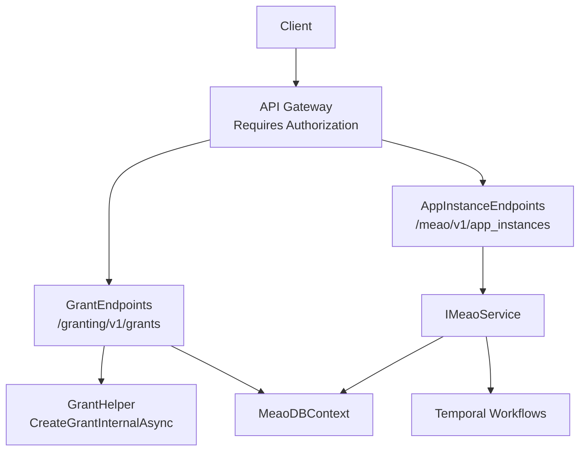
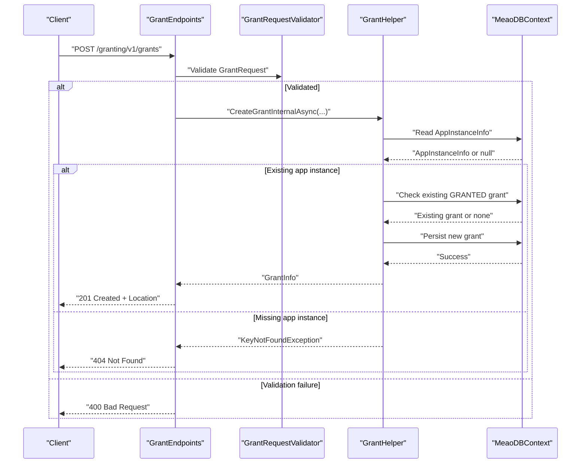
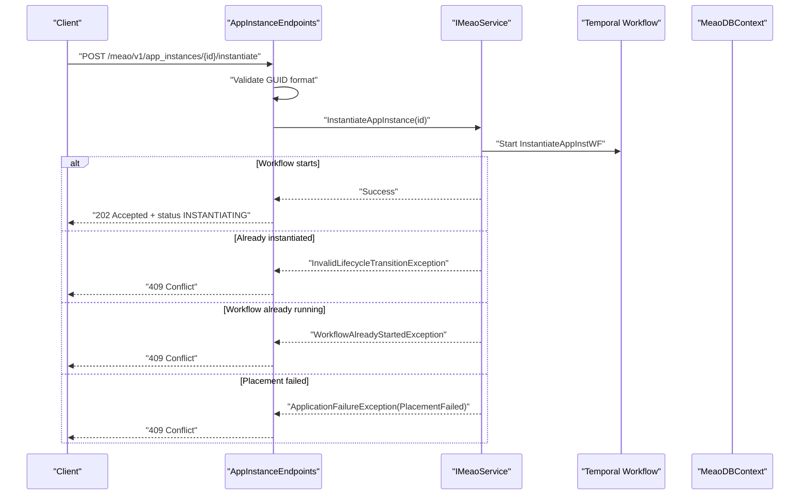
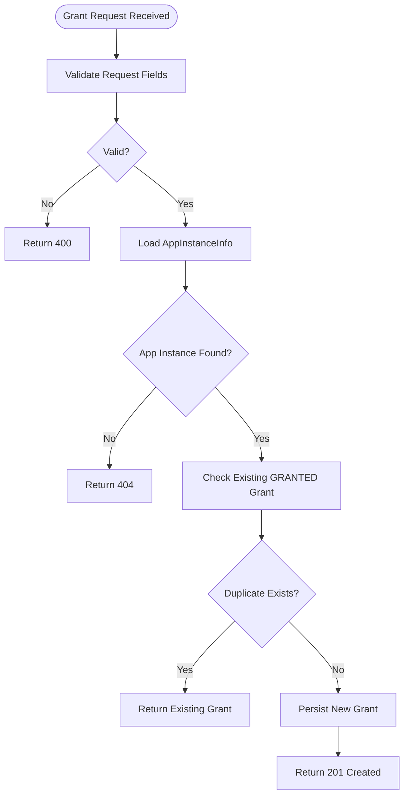
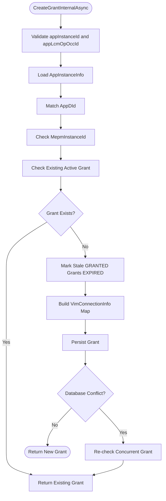
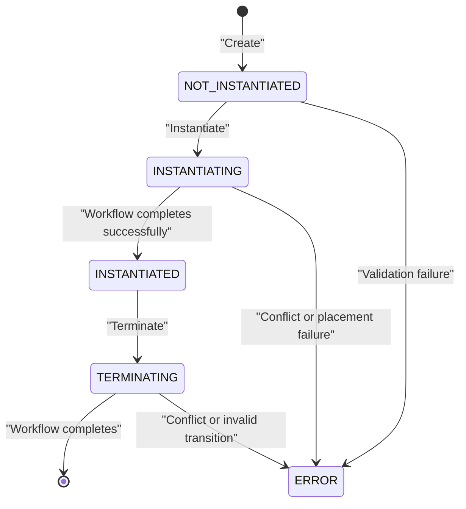
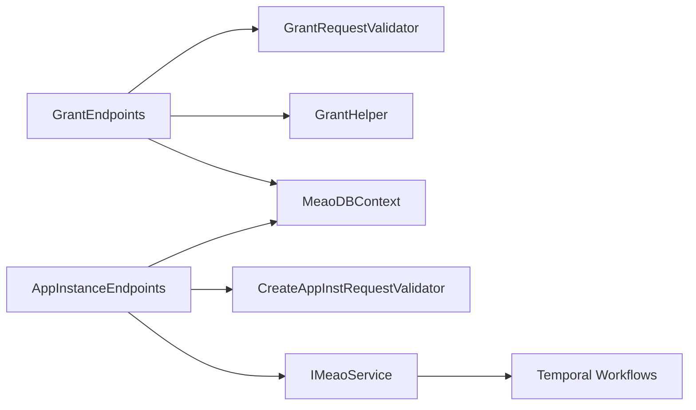

# REST API Endpoints

## Table of Contents
1. [Introduction](#introduction)
2. [Project Structure](#project-structure)
3. [Core Components](#core-components)
4. [Architecture Overview](#architecture-overview)
5. [Detailed Component Analysis](#detailed-component-analysis)
6. [Dependency Analysis](#dependency-analysis)
7. [Performance Considerations](#performance-considerations)
8. [Troubleshooting Guide](#troubleshooting-guide)
9. [Conclusion](#conclusion)

## Introduction
This document describes the Meao service REST endpoints relevant to ETSI MEC application lifecycle and granting:

- Granting API under `/granting/v1`
- Application instance management API under `/meao/v1`

The implementation is an ASP.NET Core Minimal API surface that maps strongly typed request models, validates inputs with FluentValidation, persists entities through Entity Framework Core, and delegates asynchronous orchestration to Temporal workflows where applicable. Error responses follow RFC 7807 Problem Details conventions used throughout the project.

Two base paths are exposed:

| Base path | Purpose | ETSI alignment |
|---|---|---|
| `/granting/v1/grants` | Request and read grants for application lifecycle operations | Matches the ETSI App Grant specification |
| `/meao/v1/app_instances` | Create, query, instantiate, and terminate application instances | Implements Meao’s own app instance lifecycle; ETSI LCM endpoint contracts are referenced by OpenAPI definitions |

Authentication is required on both groups. The code marks endpoints with authorization requirements, and grant handling uses internal JWT-aware services and Keycloak integration. Clients must present a valid bearer token when calling these APIs.

**Section sources**
- `src/Meao/Endpoints/GrantEndpoints.cs#L1-L63`
- `src/Meao/Endpoints/AppInstanceEndpoints.cs#L1-L200`
- `docs/ETSI_SPECS/MEC01002_AppGrant.yaml#L1-L200`
- `docs/ETSI_SPECS/MEC01002_AppLcm.yaml#L1-L200`

## Project Structure
The relevant Meao source files form a small but layered structure:

**Diagram sources**
- `src/Meao/Endpoints/GrantEndpoints.cs#L10-L63`
- `src/Meao/Endpoints/AppInstanceEndpoints.cs#L25-L328`
- `src/Meao/Utils/GrantHelper.cs#L12-L153`

**Section sources**
- `src/Meao/Endpoints/GrantEndpoints.cs#L1-L63`
- `src/Meao/Endpoints/AppInstanceEndpoints.cs#L1-L328`
- `src/Meao/Utils/GrantHelper.cs#L1-L153`

## Core Components

### Granting API
The Granting API is implemented by `GrantEndpoints`. It exposes two routes:

| HTTP method | Path | Description | Authentication | Status codes |
|---|---|---|---|---|
| `POST` | `/granting/v1/grants` | Request a grant for an application lifecycle operation | Required | `201 Created`, `400 Bad Request`, `404 Not Found` |
| `GET` | `/granting/v1/grants/{grantId}` | Read an individual grant resource | Required | `200 OK`, `404 Not Found` |

#### POST `/granting/v1/grants`
Creates a grant for a specified operation. The handler calls `GrantHelper.CreateGrantInternalAsync` with the request body fields.

**Request model:** `GrantRequest`

| Field | Type | Required | Validation |
|---|---|---:|---|
| `appInstanceId` | String | Yes | Must be a GUID |
| `appLcmOpOccId` | String | Yes | Must not be empty |
| `appDId` | String | Yes | Must not be empty |
| `operation` | String | Yes | Must be `INSTANTIATE`, `OPERATE`, or `TERMINATE` |
| `addResources` | Array of resource definitions | Conditional | Required for `INSTANTIATE`; each entry validated |
| `tempResources` | Array of resource definitions | No | Entries validated when present |
| `removeResources` | Array of resource definitions | No | Entries validated when present |
| `updateResources` | Array of resource definitions | No | Entries validated when present |
| `_links.appInstance.href` | String | Yes when `_links` is present | Must not be empty |
| `_links.appLcmOpOcc.href` | String | Yes when `_links` is present | Must not be empty |

**Response:** `201 Created` returns the created grant representation. The response includes a `Location` header pointing to `/granting/v1/grants/{id}`.

**Error behavior:**
- Invalid input or missing required fields return `400 Bad Request`.
- Missing application instance returns `404 Not Found`.

#### GET `/granting/v1/grants/{grantId}`
Returns the grant identified by `grantId`. If no grant exists, it returns `404 Not Found`.

**Section sources**
- `src/Meao/Endpoints/GrantEndpoints.cs#L10-L63`
- `src/Meao/Validators/GrantRequestValidator.cs#L1-L84`

### Application Instance Management API
The Meao application instance endpoints are defined by `AppInstanceEndpoints`. They expose four primary operations:

| HTTP method | Path | Description | Asynchronous? | Status codes |
|---|---|---|---:|---|
| `GET` | `/meao/v1/app_instances` | Query application instances | No | `200 OK`, `400 Bad Request` |
| `GET` | `/meao/v1/app_instances/{id}` | Read one application instance | No | `200 OK`, `400 Bad Request`, `404 Not Found` |
| `POST` | `/meao/v1/app_instances` | Create an application instance identity | No, but workflow runs asynchronously afterward | `201 Created`, `400 Bad Request`, `503 Service Unavailable` |
| `POST` | `/meao/v1/app_instances/{id}/instantiate` | Start placement and workload instantiation | Yes | `202 Accepted`, `400 Bad Request`, `404 Not Found`, `409 Conflict` |
| `POST` | `/meao/v1/app_instances/{id}/terminate` | Start termination | Yes | `202 Accepted`, `400 Bad Request`, `404 Not Found`, `409 Conflict` |

All routes require authorization.

**Section sources**
- `src/Meao/Endpoints/AppInstanceEndpoints.cs#L1-L328`

## Architecture Overview
The Meao service separates wire contracts from persistence and orchestration:

**Diagram sources**
- `src/Meao/Endpoints/GrantEndpoints.cs#L10-L63`
- `src/Meao/Validators/GrantRequestValidator.cs#L1-L84`
- `src/Meao/Utils/GrantHelper.cs#L12-L153`

**Diagram sources**
- `src/Meao/Endpoints/AppInstanceEndpoints.cs#L201-L328`

## Detailed Component Analysis

### Granting API Endpoint Contract
The ETSI App Grant OpenAPI contract defines grant creation and retrieval. The Meao implementation aligns closely with this contract:

- POST creates a grant synchronously and returns `201 Created`.
- GET retrieves an individual grant.
- Standard error responses include `400`, `401`, `403`, `404`, `406`, `409`, and `429` according to the specification.
- Responses use RFC 7807 `ProblemDetails` for errors.

The current Meao grant creation path does not implement the asynchronous `202 Accepted` branch documented in the ETSI schema; it always attempts synchronous grant creation.

**Diagram sources**
- `src/Meao/Utils/GrantHelper.cs#L12-L153`

**Section sources**
- `docs/ETSI_SPECS/MEC01002_AppGrant.yaml#L1-L200`
- `docs/ETSI_SPECS/MEC01002_AppGrant.yaml#L200-L787`
- `src/Meao/Endpoints/GrantEndpoints.cs#L10-L63`
- `src/Meao/Utils/GrantHelper.cs#L12-L153`

### Grant Request Lifecycle
A grant lifecycle in Meao is centered around these states and checks:

| Phase | Behavior |
|---|---|
| Creation | A new grant is created with status `GRANTED` |
| Deduplication | If an active grant already exists for the same app instance, operation, and lifecycle occurrence, the existing grant is returned |
| Expiration | Grants can carry an expiration time; stale grants may be transitioned to `EXPIRED` |
| Consumption | Internal state supports `CONSUMED` |
| Failure | Internal state supports `FAILED` |

The grant helper enforces several business rules:

- `appInstanceId` must be a valid GUID.
- `appLcmOpOccId` must be provided.
- `appDId` must match the stored application instance.
- The associated application instance must have an `MepmInstanceId`.
- VIM connection identifiers must be non-blank and unique per application instance.
- Duplicate concurrent grant creation is handled defensively.

**Diagram sources**
- `src/Meao/Utils/GrantHelper.cs#L12-L153`

**Section sources**
- `src/Meao/Utils/GrantHelper.cs#L12-L153`
- `src/Meao/Models/GrantInfo.cs#L1-L49`

### Application Instance Lifecycle
The Meao application instance lifecycle has three conceptual phases:

1. **Creation:** `POST /meao/v1/app_instances` creates the identity and stores it with `NOT_INSTANTIATED`.
2. **Instantiation:** `POST /meao/v1/app_instances/{id}/instantiate` triggers placement, capacity reservation, grant handling, and MEPM binding through a Temporal workflow.
3. **Termination:** `POST /meao/v1/app_instances/{id}/terminate` triggers grant creation, MEPM termination, capacity release, and catalogue cleanup through a separate workflow.

The create endpoint generates a server-owned GUID for `appInstanceId`. The request model requires package, descriptor, name, instance name, and description fields. An optional `HostIp` acts as a placement constraint.

Validation rules include:

| Field | Rule |
|---|---|
| `AppPkgId` | Required; must be a GUID |
| `AppDId` | Required |
| `AppInstanceName` | Required; must be unique across existing instances |
| `AppName` | Required |
| `AppInstanceDescription` | Required |
| `HostIp` | Optional; if provided, must be a valid IP address |

**Diagram sources**
- `src/Meao/Endpoints/AppInstanceEndpoints.cs#L1-L328`

**Section sources**
- `src/Meao/Endpoints/AppInstanceEndpoints.cs#L1-L328`
- `src/Meao/Requests/CreateAppInstRequest.cs#L1-L37`
- `src/Meao/Validators/CreateAppInstRequestValidator.cs#L1-L44`
- `src/Meao/Models/AppInstanceInfo.cs#L1-L48`

### Authentication and Authorization
Both endpoint groups call `.RequireAuthorization()`. The Meao project also contains Keycloak-related services and token handling utilities, indicating that authentication is delegated to an external identity provider using JWT bearer tokens.

Clients should:

- Obtain a JWT from the configured identity provider.
- Include the token in the `Authorization` header as a bearer token.
- Use the same token for both `/granting/v1` and `/meao/v1`.

**Section sources**
- `src/Meao/Endpoints/GrantEndpoints.cs#L10-L14`
- `src/Meao/Endpoints/AppInstanceEndpoints.cs#L25-L31`

## Dependency Analysis
The API layer depends on validation, domain helpers, database context, and service abstractions:

**Diagram sources**
- `src/Meao/Endpoints/GrantEndpoints.cs#L1-L63`
- `src/Meao/Endpoints/AppInstanceEndpoints.cs#L1-L328`
- `src/Meao/Validators/GrantRequestValidator.cs#L1-L84`
- `src/Meao/Validators/CreateAppInstRequestValidator.cs#L1-L44`

### Coupling and Cohesion
- `GrantEndpoints` is cohesive: it only maps routes and delegates business logic to `GrantHelper`.
- `AppInstanceEndpoints` handles lifecycle routing, input validation, and workflow dispatch.
- `GrantHelper` encapsulates grant creation rules, deduplication, VIM mapping, and persistence.
- Validators are decoupled from HTTP concerns and focus on data constraints.

### External Dependencies
- Entity Framework Core for database access.
- FluentValidation for request validation.
- Temporal for background workflow execution.
- RFC 7807 Problem Details for structured error responses.

**Section sources**
- `src/Meao/Endpoints/GrantEndpoints.cs#L1-L63`
- `src/Meao/Endpoints/AppInstanceEndpoints.cs#L1-L328`
- `src/Meao/Utils/GrantHelper.cs#L1-L153`

## Performance Considerations
- Grant creation performs a database lookup for the application instance and checks for existing grants. Clients should avoid duplicate requests for the same `appInstanceId`, `appLcmOpOccId`, and `operation`.
- The list endpoint for application instances uses eager loading of `VimConnectionInfo`. Consumers should filter queries early to reduce payload size.
- Instantiation and termination are asynchronous; clients should poll the application instance or rely on subscription/notification mechanisms rather than polling continuously.
- Duplicate workflow invocations are rejected with `409 Conflict` to prevent redundant workloads.

[No sources needed since this section provides general guidance]

## Troubleshooting Guide

### Common Granting API Errors
| Symptom | Likely cause | Response |
|---|---|---|
| `400 Bad Request` | Missing or invalid `appInstanceId`, `operation`, `_links`, or resource definition | RFC 7807 problem details |
| `404 Not Found` | Application instance does not exist | RFC 7807 problem details |
| Duplicate grant returned | Same operation, lifecycle occurrence, and active grant already exist | `201 Created` with existing grant |

### Common Application Instance Errors
| Symptom | Likely cause | Response |
|---|---|---|
| `400 Bad Request` | Invalid GUID format or invalid query parameter | RFC 7807 problem details |
| `404 Not Found` | Application instance not found | RFC 7807 problem details |
| `409 Conflict` | Invalid lifecycle transition, placement failure, or workflow already running | RFC 7807 problem details |
| `503 Service Unavailable` | Temporal connectivity failure during workflow initiation | RFC 7807 problem details |

### Integration Patterns
- For grant requests, send a single well-formed request and reuse the returned grant identifier for subsequent reads.
- For application instance instantiation and termination, treat `202 Accepted` as acceptance, not completion. Poll the instance or subscribe to lifecycle events.
- Always validate request payloads before sending them, especially GUID formats, required links, and resource definitions.

**Section sources**
- `src/Meao/Endpoints/GrantEndpoints.cs#L10-L63`
- `src/Meao/Endpoints/AppInstanceEndpoints.cs#L1-L328`
- `docs/ETSI_SPECS/MEC01002_AppGrant.yaml#L700-L787`

## Conclusion
The Meao service exposes a focused set of REST endpoints for ETSI-aligned grant requests and Meao-specific application instance management. The granting API validates and persists grants while enforcing application instance and VIM integrity. The application instance API separates identity creation from asynchronous lifecycle operations, returning accepted status codes for long-running workflows and structured error responses for failures.

For reliable integration:

- Authenticate every request with a valid bearer token.
- Validate request bodies before sending them.
- Treat asynchronous endpoints as accept-and-poll interfaces.
- Handle `409 Conflict` as a normal operational condition during duplicate or invalid lifecycle transitions.
- Use the grant identifier returned by creation for all subsequent grant reads.

[No sources needed since this section summarizes without analyzing specific files]

> **Referenced Files in This Document**
>
> - `src/Meao/Endpoints/GrantEndpoints.cs`
> - `src/Meao/Endpoints/AppInstanceEndpoints.cs`
> - `src/Meao/Utils/GrantHelper.cs`
> - `src/Meao/Validators/GrantRequestValidator.cs`
> - `src/Meao/Requests/CreateAppInstRequest.cs`
> - `src/Meao/Requests/CreateAppInstCommand.cs`
> - `src/Meao/Validators/CreateAppInstRequestValidator.cs`
> - `src/Meao/Models/AppInstanceInfo.cs`
> - `src/Meao/Models/GrantInfo.cs`
> - `docs/ETSI_SPECS/MEC01002_AppGrant.yaml`
> - `docs/ETSI_SPECS/MEC01002_AppLcm.yaml`
