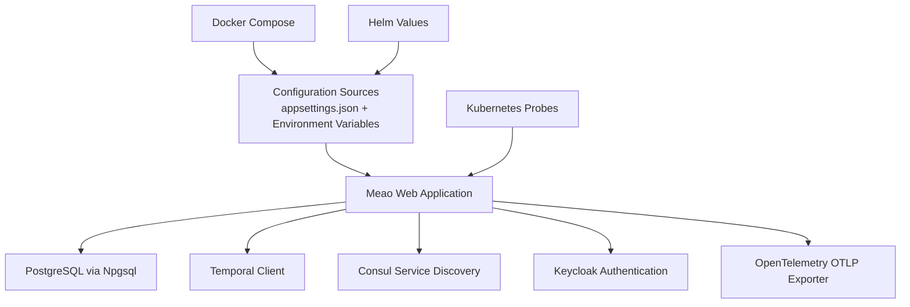
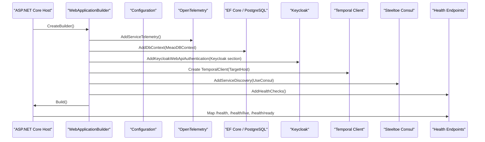
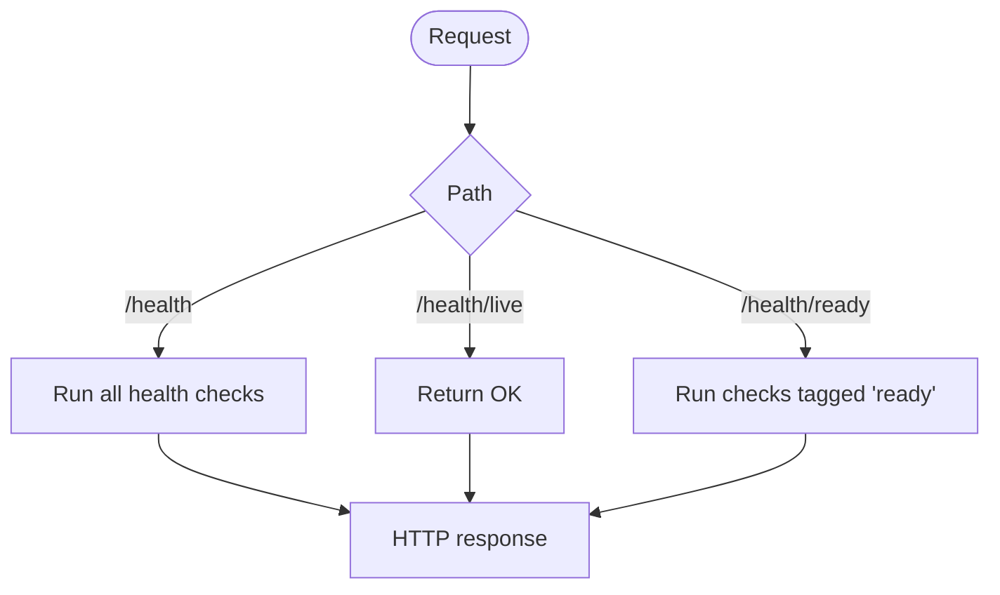
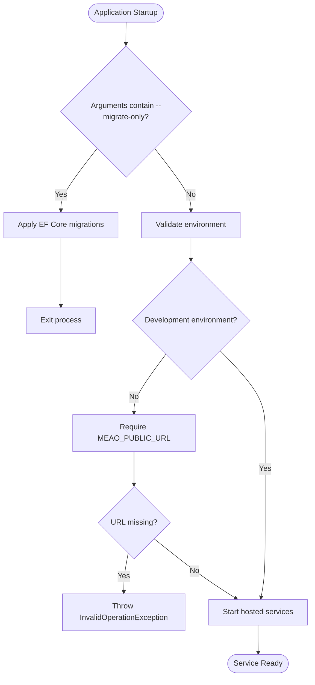
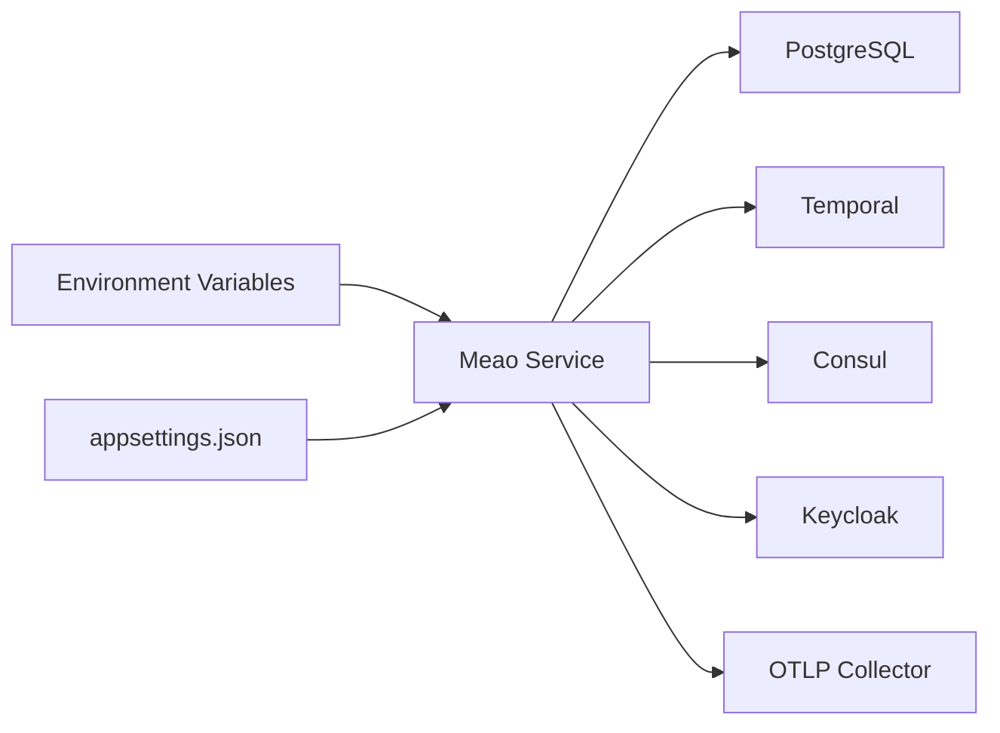

# Service Configuration and Health

<cite>
**Referenced Files in This Document**
- `src/Meao/appsettings.json`
- `src/Meao/Program.cs`
- `src/Meao/ServiceCollectionExtensions.cs`
- `src/Common/Telemetry/TelemetryExtensions.cs`
- `docker-compose.yml`
- `docker-compose.override.yml`
- `charts/optimist-apps/values.yaml`
- `charts/optimist-apps/templates/deployment.yaml`
- `docs/CONFIGURATION.md`
</cite>

## Table of Contents
1. [Introduction](#introduction)
2. [Project Structure](#project-structure)
3. [Core Components](#core-components)
4. [Architecture Overview](#architecture-overview)
5. [Detailed Component Analysis](#detailed-component-analysis)
6. [Dependency Analysis](#dependency-analysis)
7. [Performance Considerations](#performance-considerations)
8. [Troubleshooting Guide](#troubleshooting-guide)
9. [Conclusion](#conclusion)

## Introduction
This document explains how the Meao service is configured, how configuration values are resolved at runtime, and how health checks expose liveness and readiness state for Kubernetes or container orchestration systems. It focuses on:

- `appsettings.json` structure and environment-specific overrides.
- Environment variables for Temporal, PostgreSQL, Consul, Keycloak, OpenTelemetry, and operational switches.
- Startup validation, including required production settings.
- Health endpoints for liveness (`/health/live`) and readiness (`/health/ready`).
- Production examples using Docker Compose and Helm/Kubernetes manifests.

The Meao service is a .NET 8 ASP.NET Core application that uses EF Core with Npgsql for PostgreSQL, Steeltoe Consul for service discovery, Keycloak for authentication, Temporal for workflow orchestration, and OpenTelemetry for tracing and metrics.

## Project Structure
The Meao service lives under `src/Meao`. Its primary configuration surface is:

| File | Purpose |
|---|---|
| `src/Meao/appsettings.json` | Default configuration file for logging, database connection strings, Keycloak, Consul, and application settings. |
| `src/Meao/Program.cs` | Application bootstrap, dependency registration, Temporal client wiring, health endpoint mapping, startup validation, migration entrypoint, and hosted services. |
| `src/Meao/ServiceCollectionExtensions.cs` | Swagger/OpenAPI setup used by the Meao service. |
| `src/Common/Telemetry/TelemetryExtensions.cs` | Shared OpenTelemetry instrumentation and OTLP exporter configuration. |
| `docker-compose.yml` | Base compose definition for Meao and other Optimist services. |
| `docker-compose.override.yml` | Development overrides, including environment variables for Consul, Keycloak, PostgreSQL, and Temporal. |
| `charts/optimist-apps/values.yaml` | Helm values used to inject environment variables and connection-string secrets into Kubernetes Deployments. |
| `charts/optimist-apps/templates/deployment.yaml` | Kubernetes Deployment template that maps values to pod environment variables and probes. |
| `docs/CONFIGURATION.md` | Repository-wide configuration guide covering precedence, environment variables, and per-service documentation. |

**Diagram sources**
- `src/Meao/Program.cs#L10-L75`
- `src/Meao/appsettings.json#L1-L37`
- `src/Common/Telemetry/TelemetryExtensions.cs#L14-L75`
- `docker-compose.override.yml#L23-L44`
- `charts/optimist-apps/values.yaml#L76-L107`

**Section sources**
- `src/Meao/appsettings.json#L1-L37`
- `src/Meao/Program.cs#L10-L75`
- `src/Common/Telemetry/TelemetryExtensions.cs#L14-L75`
- `docker-compose.yml#L25-L56`
- `docker-compose.override.yml#L23-L44`
- `charts/optimist-apps/values.yaml#L76-L107`
- `charts/optimist-apps/templates/deployment.yaml#L63-L124`
- `docs/CONFIGURATION.md#L1-L120`

## Core Components
The Meao configuration surface consists of several major components:

### Configuration Resolution Order
.NET resolves configuration in this order (highest priority first):

1. Environment variables and command-line arguments.
2. `appsettings.Development.json`, `appsettings.Production.json`, or other environment-specific files if present.
3. `appsettings.json`.
4. Default values defined in code.

For Meao, the repository does not include environment-specific override files; defaults live in `appsettings.json`, while environment variables from Docker Compose or Helm override them at runtime.

**Section sources**
- `docs/CONFIGURATION.md#L22-L52`
- `src/Meao/appsettings.json#L1-L37`

### Configuration Sections
| Section | Source Path | Responsibility |
|---|---|---|
| `Logging` | `appsettings.json` | Controls default log level and framework log suppression. |
| `AppSettings` | `appsettings.json` | Contains background job settings such as census reconciliation interval. |
| `AllowedHosts` | `appsettings.json` | Kestrel host allowlist. |
| `ConnectionStrings:MeaoDBContext` | `appsettings.json` | Default PostgreSQL connection string for EF Core. |
| `Keycloak` | `appsettings.json` | Keycloak realm, server URL, client resource, scopes, and credential placeholder. |
| `Consul` | `appsettings.json` | Consul host, port, and service registration options. |
| `OTEL_EXPORTER_OTLP_ENDPOINT` | Environment variable or configuration | OpenTelemetry OTLP gRPC export endpoint. |
| `TEMPORAL_TARGET_HOST` | Environment variable | Temporal gRPC target address. |
| `MEAO_PUBLIC_URL` | Environment variable | Public callback base URL; required outside Development. |
| `MEAO_AUTO_SUBSCRIBE` | Environment variable | Enables automatic subscription registration on startup. |

**Section sources**
- `src/Meao/appsettings.json#L1-L37`
- `docs/CONFIGURATION.md#L98-L155`

## Architecture Overview
The Meao service wires its dependencies during application startup. The following diagram shows how configuration flows into runtime components.

**Diagram sources**
- `src/Meao/Program.cs#L10-L75`
- `src/Meao/Program.cs#L239-L241`
- `src/Common/Telemetry/TelemetryExtensions.cs#L41-L75`

**Section sources**
- `src/Meao/Program.cs#L10-L75`
- `src/Meao/Program.cs#L239-L241`

## Detailed Component Analysis

### Appsettings.json Structure
The default configuration file defines:

| Key | Default Value | Meaning |
|---|---:|---|
| `Logging:LogLevel:Default` | `Information` | Default application log level. |
| `Logging:LogLevel:Microsoft.AspNetCore` | `Warning` | Suppresses noisy framework logs by default. |
| `AppSettings:CensusReconciliationIntervalSeconds` | `60` | Interval used by the census reconciliation background worker. |
| `AllowedHosts` | `*` | Allows all hosts in development. |
| `ConnectionStrings:MeaoDBContext` | Local PostgreSQL connection string | Used by EF Core unless overridden by environment variables. |
| `Keycloak:realm` | `optimist` | Keycloak realm name. |
| `Keycloak:auth-server-url` | `http://localhost:8180/` | Local development Keycloak server URL. |
| `Keycloak:credentials:secret` | Token referencing `KEYCLOAK_CLIENT_SECRET_MEAO` | Resolved from environment at runtime. |
| `Consul:Host` | `localhost` | Local Consul address. |
| `Consul:Port` | `8500` | Local Consul HTTP API port. |
| `Consul:Discovery:Register` | `true` | Register this service in Consul. |
| `Consul:Discovery:ServiceName` | `MEAOApi` | Logical service name registered in Consul. |
| `Consul:Discovery:Hostname` | `meao` | Hostname used for service registration. |
| `Consul:Discovery:UseAspNetCoreUrls` | `true` | Use ASP.NET Core URLs for Consul registration. |

Important notes:

- The Keycloak secret is not embedded directly; it references an environment variable token.
- The local PostgreSQL connection string is intended for development; production should use a connection string supplied through environment variables or Kubernetes secrets.
- Consul defaults point to `localhost`; production deployments override `Consul__Host` and `Consul__Port`.

**Section sources**
- `src/Meao/appsettings.json#L1-L37`

### Environment-Specific Overrides
Environment variables take precedence over `appsettings.json`. The most relevant Meao variables are:

| Variable | Override Behavior | Notes |
|---|---|---|
| `ASPNETCORE_ENVIRONMENT` | Selects environment mode | Development enables relaxed validation and defaults. |
| `ASPNETCORE_URLS` | Changes Kestrel listen URL | Usually set to `http://+:80` inside containers. |
| `ConnectionStrings__MeaoDBContext` | Overrides EF Core PostgreSQL connection string | Use hierarchical key notation. |
| `Consul__Host` | Overrides Consul hostname | Must resolve within the deployment network. |
| `Consul__Port` | Overrides Consul port | Default is `8500`. |
| `Keycloak__auth-server-url` | Overrides Keycloak server URL | Required for JWT validation and service tokens. |
| `TEMPORAL_TARGET_HOST` | Overrides Temporal gRPC address | Defaults to `temporal:7233` when unset. |
| `MEAO_PUBLIC_URL` | Sets public callback base URL | Required outside Development. |
| `MEAO_AUTO_SUBSCRIBE` | Enables automatic MEPM subscription registration | Boolean-like value read at startup. |
| `KEYCLOAK_CLIENT_SECRET_MEAO` | Supplies Keycloak client secret | Referenced from `Keycloak:credentials:secret`. |
| `OTEL_EXPORTER_OTLP_ENDPOINT` | Overrides OpenTelemetry export endpoint | Highest-priority OTLP endpoint source. |

**Section sources**
- `docs/CONFIGURATION.md#L98-L155`
- `docker-compose.override.yml#L23-L44`
- `charts/optimist-apps/values.yaml#L76-L107`

### Runtime Configuration Options

#### Logging
Logging is configured through standard ASP.NET Core logging configuration. The default level is `Information`, with ASP.NET Core framework logs suppressed to `Warning`. Additional Serilog configuration is applied during host initialization.

**Section sources**
- `src/Meao/appsettings.json#L1-L8`
- `src/Meao/Program.cs#L63-L67`

#### Database Connectivity
Meao registers `MeaoDBContext` with EF Core and binds it to the `MeaoDBContext` connection string. If no connection string is found, startup throws an exception.

Recommended production behavior:

- Do not embed credentials in `appsettings.json`.
- Supply `ConnectionStrings__MeaoDBContext` from environment variables or Kubernetes secrets.
- Ensure PostgreSQL is reachable before Meao starts.

**Section sources**
- `src/Meao/appsettings.json#L11-L14`
- `src/Meao/Program.cs#L15-L20`

#### Temporal Client Connection
The Temporal client target host is read from `TEMPORAL_TARGET_HOST`, with a fallback of `temporal:7233`. The client is created lazily and passed to the Temporal hosted worker.

Production considerations:

- Set `TEMPORAL_TARGET_HOST` to the Temporal frontend address in your cluster or managed environment.
- Verify network connectivity between Meao pods and the Temporal service.
- Ensure the Temporal namespace matches the configured worker namespace.

**Section sources**
- `src/Meao/Program.cs#L39-L75`
- `docs/CONFIGURATION.md#L120-L155`

#### Consul Service Discovery
Meao registers Steeltoe Consul service discovery and uses logical service names for outbound HTTP clients. Clients for APM, Catalogue, and internal APM shims resolve their actual endpoints from Consul rather than relying solely on static URLs.

Key behaviors:

- `Consul__Host` and `Consul__Port` configure the Consul server.
- `Consul:Discovery:*` controls registration metadata.
- Outbound HTTP clients use `.AddServiceDiscovery()` so Consul can resolve backend addresses.

**Section sources**
- `src/Meao/appsettings.json#L28-L37`
- `src/Meao/Program.cs#L69-L113`

#### Keycloak Authentication
Keycloak authentication is configured through the `Keycloak` configuration section. The client secret is referenced via an environment-variable token, which must be available at runtime.

Security requirements:

- `KEYCLOAK_CLIENT_SECRET_MEAO` must be provided in production.
- The Keycloak server URL must be reachable from Meao.
- Requests requiring authentication will fail if Keycloak cannot validate the token or obtain a service token.

**Section sources**
- `src/Meao/appsettings.json#L15-L27`
- `src/Meao/Program.cs#L26-L30`

#### OpenTelemetry Tracing
Shared telemetry adds ASP.NET Core, HTTP client, and EF Core instrumentation. It exports traces, metrics, and logs via the OTLP gRPC exporter.

Endpoint resolution order:

1. `OTEL_EXPORTER_OTLP_ENDPOINT` environment variable.
2. `OTEL_EXPORTER_OTLP_ENDPOINT` configuration value.
3. Fallback to `http://localhost:4317`.

Production recommendation:

- Set `OTEL_EXPORTER_OTLP_ENDPOINT` to a collector or observability pipeline endpoint reachable from the cluster.

**Section sources**
- `src/Meao/Program.cs#L12-L14`
- `src/Common/Telemetry/TelemetryExtensions.cs#L14-L75`

### Health Check Endpoints
Meao exposes three health endpoints:

| Endpoint | Behavior | Use Case |
|---|---|---|
| `/health` | Returns OK for all checks | General health probe. |
| `/health/live` | Returns OK regardless of check results | Liveness probe. |
| `/health/ready` | Returns OK only for checks tagged `ready` | Readiness probe. |

Currently, the database health check is registered with the tag `ready`. Therefore, `/health/ready` reflects whether the PostgreSQL connection is healthy.

**Diagram sources**
- `src/Meao/Program.cs#L239-L241`
- `src/Meao/Program.cs#L31-L33`

**Section sources**
- `src/Meao/Program.cs#L31-L33`
- `src/Meao/Program.cs#L239-L241`

### Dependency Health Monitoring
Meao registers a database health check against `MeaoDBContext`. This provides a basic readiness signal tied to PostgreSQL connectivity.

External service monitoring is less explicit:

- Temporal connectivity is configured but not exposed as a dedicated health check in the analyzed code.
- Consul service discovery is wired, but there is no explicit Consul reachability health check in the analyzed startup code.
- Keycloak authentication is configured, but JWT validation failure is handled by authorization middleware rather than a dedicated health check.

Recommendation:

- Treat `/health/ready` as primarily a database readiness indicator.
- Add explicit health checks for Temporal, Consul, and Keycloak if you need those dependencies to block readiness.

**Section sources**
- `src/Meao/Program.cs#L31-L33`

### Startup Validation Procedures
Startup includes important validation steps:

1. **Database connection string validation**: Missing `MeaoDBContext` connection string throws an exception.
2. **Migration entrypoint**: Running with `--migrate-only` applies EF Core migrations and exits.
3. **Public URL validation**: In non-development environments, `MEAO_PUBLIC_URL` is required; missing it throws an exception.
4. **Background services**: Census reconciliation and subscription registration are added as hosted services.

**Diagram sources**
- `src/Meao/Program.cs#L179-L206`

**Section sources**
- `src/Meao/Program.cs#L15-L20`
- `src/Meao/Program.cs#L179-L206`

### Examples of Production Configuration

#### Docker Compose Example Pattern
In development, `docker-compose.override.yml` sets environment variables for:

- `ASPNETCORE_URLS`
- `TEMPORAL_TARGET_HOST`
- `Consul__Host`
- `Consul__Port`
- `Keycloak__auth-server-url`
- `ConnectionStrings__MeaoDBContext`

A production Compose file should replace local defaults with service-resolvable hostnames, externalized secrets, and appropriate security settings.

**Section sources**
- `docker-compose.override.yml#L23-L44`

#### Kubernetes ConfigMap and Secret Pattern
Helm values define environment variables and connection-string secret references for Meao:

- `env` contains configuration keys such as `APM_API_URL`, `CATALOGUE_API_URL`, `MEAO_PUBLIC_URL`, `Consul__Host`, `Consul__Port`, `TEMPORAL_TARGET_HOST`, and `Keycloak__auth-server-url`.
- `conn.secretKey` and `conn.envName` map a Kubernetes Secret key to the expected environment variable name.
- The deployment template injects these environment variables and configures HTTP startup, liveness, and readiness probes.

Recommended production pattern:

- Store connection strings and Keycloak secrets in Kubernetes Secrets.
- Use Helm values or GitOps configuration to mount those secrets as environment variables.
- Keep non-secret configuration in ConfigMaps or Helm values.

**Section sources**
- `charts/optimist-apps/values.yaml#L76-L107`
- `charts/optimist-apps/templates/deployment.yaml#L94-L124`

#### Swagger and API Metadata
Swagger is enabled through `ServiceCollectionExtensions.AddSwagger`. This documents the API surface and attaches a JWT bearer scheme. This is useful for developer tooling and API exploration but should not be exposed publicly in production without access controls.

**Section sources**
- `src/Meao/ServiceCollectionExtensions.cs#L1-L40`

## Dependency Analysis
The following diagram summarizes Meao’s main runtime dependencies and how configuration influences them.

**Diagram sources**
- `src/Meao/Program.cs#L10-L113`
- `src/Common/Telemetry/TelemetryExtensions.cs#L41-L75`
- `src/Meao/appsettings.json#L1-L37`

**Section sources**
- `src/Meao/Program.cs#L10-L113`
- `src/Common/Telemetry/TelemetryExtensions.cs#L41-L75`

## Performance Considerations
Configuration choices that affect performance and reliability:

- **Temporal target host**: Incorrect or unreachable Temporal addresses cause workflow operations to fail. Use a stable DNS name or cluster-internal service address.
- **Connection string latency**: Slow or unavailable PostgreSQL connections delay readiness. Network isolation and proper DNS resolution are important.
- **Consul service discovery**: Misconfigured Consul host/port prevents service discovery and can break outbound calls to APM and Catalogue.
- **OpenTelemetry endpoint**: An unreachable OTLP endpoint may add overhead or drop telemetry. Prefer a local collector or reliable observability pipeline.
- **Health probes**: Liveness probes should avoid expensive checks. Readiness probes should reflect real dependency availability.

[No sources needed since this section provides general guidance]

## Troubleshooting Guide

### Common Configuration Issues

| Symptom | Likely Cause | Resolution |
|---|---|---|
| Service fails to start because connection string is missing | `MeaoDBContext` connection string not provided | Supply `ConnectionStrings__MeaoDBContext` from environment or secret. |
| Non-development startup throws about missing public URL | `MEAO_PUBLIC_URL` not set | Set `MEAO_PUBLIC_URL` to the externally reachable base URL. |
| Authentication fails after deployment | Keycloak secret or server URL misconfigured | Provide `KEYCLOAK_CLIENT_SECRET_MEAO` and correct `Keycloak__auth-server-url`. |
| Workflows cannot connect to Temporal | `TEMPORAL_TARGET_HOST` incorrect or unreachable | Set the Temporal frontend address for the deployment environment. |
| Consul-based HTTP calls fail | `Consul__Host` or `Consul__Port` incorrect | Configure Consul host and port for the deployment network. |
| No telemetry appears | OTLP endpoint not configured or unreachable | Set `OTEL_EXPORTER_OTLP_ENDPOINT` to a reachable collector. |
| Pod never becomes ready | PostgreSQL health check fails | Verify database connectivity and readiness probe behavior. |

### Health Probe Behavior
- `/health/live` always returns OK and should not be used to detect dependency failures.
- `/health/ready` currently reflects PostgreSQL connectivity.
- External service failures (Temporal, Consul, Keycloak) may not immediately mark the service as not ready unless additional health checks are added.

**Section sources**
- `src/Meao/Program.cs#L239-L241`
- `src/Meao/Program.cs#L31-L33`

### Migration Entrypoint
If you need to run database migrations separately, use the `--migrate-only` argument. This applies migrations and exits the process instead of starting the web server.

**Section sources**
- `src/Meao/Program.cs#L179-L188`

## Conclusion
Meao’s configuration follows standard ASP.NET Core conventions: defaults in `appsettings.json`, overridden by environment variables from Docker Compose or Helm. Production deployments should externalize sensitive values, ensure `MEAO_PUBLIC_URL` is set, configure Consul and Keycloak for the target environment, provide a valid Temporal target host, and route OpenTelemetry to a reachable collector. Health endpoints provide basic liveness and readiness signals, with readiness currently tied to PostgreSQL connectivity. For stronger operational guarantees, consider adding explicit health checks for Temporal, Consul, and Keycloak.