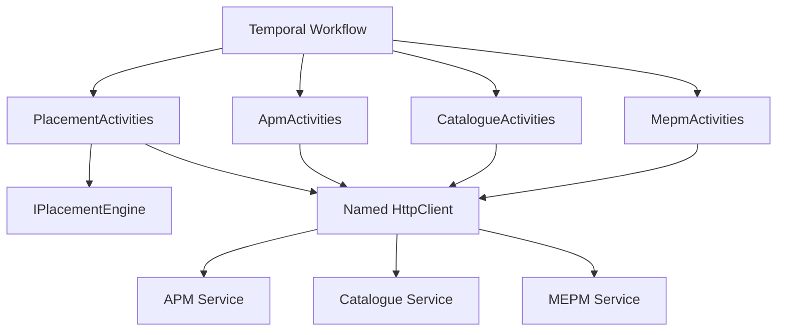
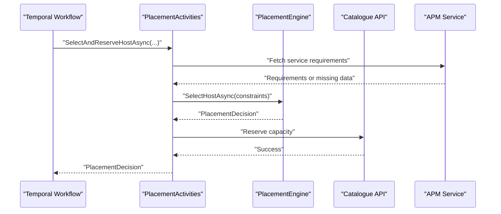
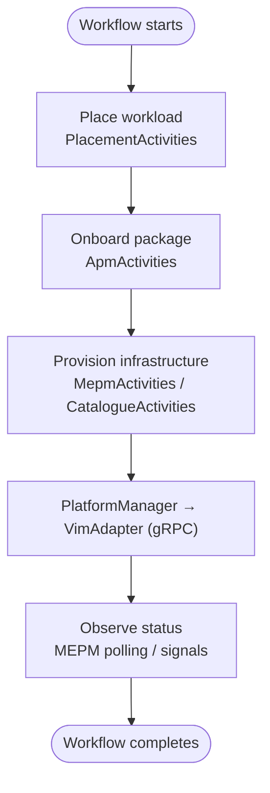
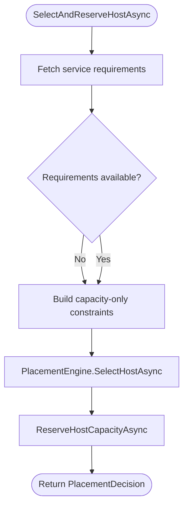
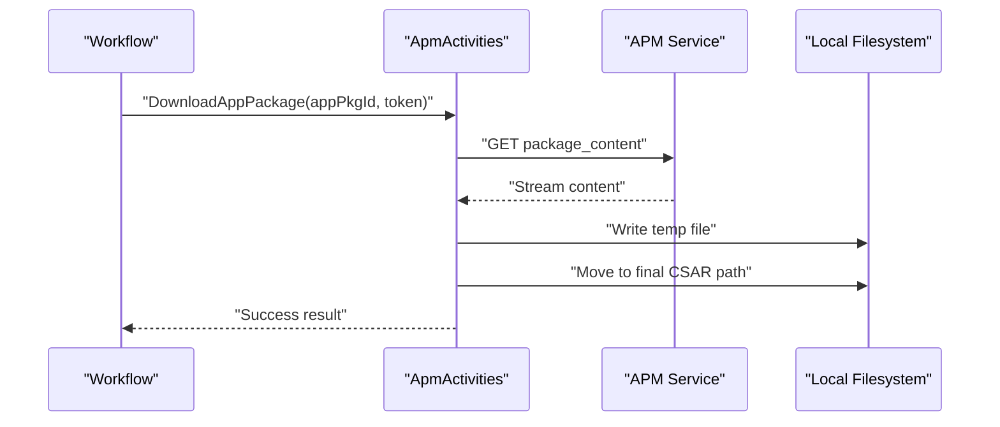
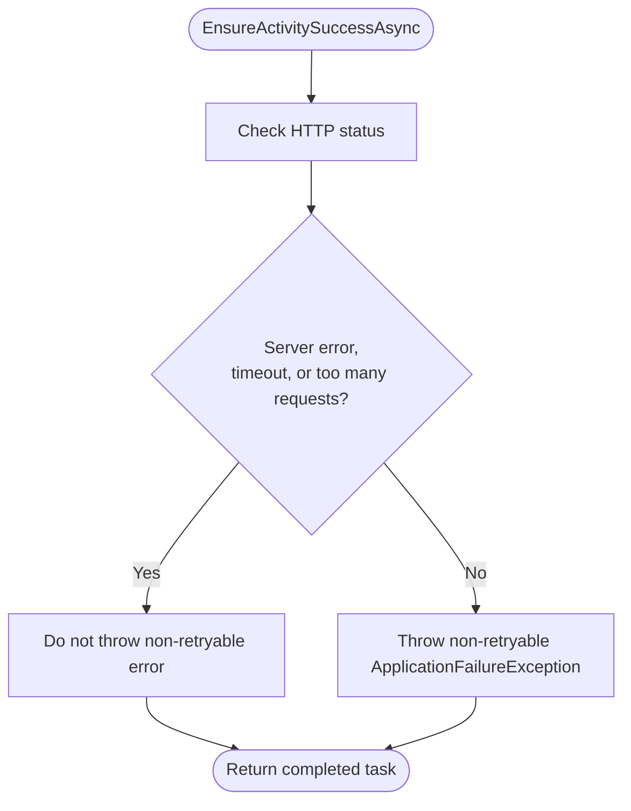
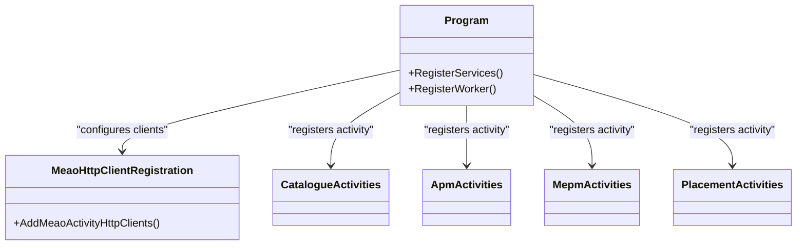
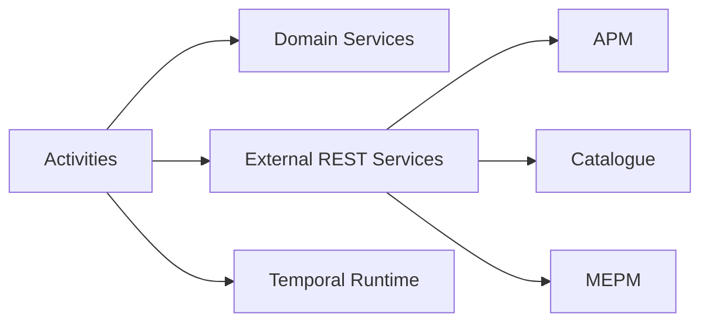

# Temporal Activities and Side Effects

## Table of Contents
1. [Introduction](#introduction)
2. [Project Structure](#project-structure)
3. [Core Components](#core-components)
4. [Architecture Overview](#architecture-overview)
5. [Detailed Component Analysis](#detailed-component-analysis)
6. [Dependency Analysis](#dependency-analysis)
7. [Performance Considerations](#performance-considerations)
8. [Troubleshooting Guide](#troubleshooting-guide)
9. [Conclusion](#conclusion)
10. [Appendices](#appendices)

## Introduction
This document explains how the MEAO orchestrator uses Temporal activities to perform side-effecting operations safely, deterministically, and with proper error propagation. It focuses on:

- **PlacementActivity**: coordinating with the placement engine and catalogue capacity API.
- **ApmApiActivity**: managing application package download, validation, parsing, and OCI publishing through APM services.
- **VIM adapter communication**: describing where VIM provisioning fits into the workflow, including gRPC boundaries documented elsewhere in the repository.
- **HttpActivityHelper**: HTTP retry and timeout strategy for activity calls.
- **Activity registration, parameter serialization, and error handling**.
- **Testing strategies**, including mocking external dependencies.
- **Idempotency best practices** for durable workflows.

Temporal activities are short, deterministic units of work that may call external systems. Workflows describe durable state transitions; activities execute the actual network, filesystem, or database operations. Because Temporal replays workflow code, activities must be idempotent and avoid hidden state changes unless they are designed as compensable side effects.

## Project Structure
The relevant implementation lives primarily in the MEAO service under `src/Meao`:

| Area | Responsibility | Key Files |
|---|---|---|
| Activities | Side-effecting operations invoked by workflows | `src/Meao/Activities/PlacementActivities.cs`, `src/Meao/Activities/ApmActivities.cs`, `src/Meao/Activities/CatalogueActivities.cs`, `src/Meao/Activities/MepmActivities.cs` |
| HTTP helpers | Activity-safe HTTP response validation | `src/Meao/Utils/HttpActivityHelper.cs` |
| Activity policies | Retry, timeout, and compensation configuration | `src/Meao/Workflows/Policies/ActivityPolicies.cs` |
| HTTP client registration | Dedicated clients per dependency with resilience and timeouts | `src/Meao/Infrastructure/MeaoHttpClientRegistration.cs` |
| Worker registration | DI wiring and Temporal worker startup | `src/Meao/Program.cs` |
| Unit tests | Mocked activity and helper behavior | `src/Meao.Tests.Unit/PlacementActivitiesTests.cs`, `src/Meao.Tests.Unit/HttpActivityHelperTests.cs`, `src/Meao.Tests.Unit/ApmAndAuthActivitiesTests.cs`, `src/Meao.Tests.Unit/Workflows/OnboardAppPkgWFTests.cs`, `src/Meao.Tests.Unit/InstantiateAppInstWFTests.cs` |

**Diagram sources**
- `src/Meao/Program.cs#L130-L200`
- `src/Meao/Infrastructure/MeaoHttpClientRegistration.cs#L1-L97`
- `src/Meao/Activities/PlacementActivities.cs#L1-L205`
- `src/Meao/Activities/ApmActivities.cs#L1-L251`
- `src/Meao/Activities/CatalogueActivities.cs#L1-L356`
- `src/Meao/Activities/MepmActivities.cs#L1-L191`

**Section sources**
- `src/Meao/Program.cs#L130-L200`
- `src/Meao/Infrastructure/MeaoHttpClientRegistration.cs#L1-L97`

## Core Components
The core activity components are:

| Component | Purpose | External Dependencies | Idempotency Notes |
|---|---|---|---|
| `PlacementActivities` | Selects a host via the placement engine and reserves/releases capacity in the catalogue. | Placement engine, Catalogue REST API, APM service requirements endpoint. | Capacity reservation is tied to an application instance ID; release mirrors reservation inputs. |
| `ApmActivities` | Downloads, validates, parses, polls, and publishes application packages. | APM REST APIs, local filesystem for CSAR staging. | Download path includes explicit replay notes and temporary-file cleanup. |
| `CatalogueActivities` | Resolves MEC hosts, MEPM base URLs, adds/removes app records, and queries catalogue data. | Catalogue REST API. | Some operations treat 404 as success for cleanup paths. |
| `MepmActivities` | Creates, instantiates, queries, terminates, updates, lists, and cancels lifecycle operations through MEPM. | MEPM REST API. | Explicitly treats 409 Conflict as idempotent success during creation. |
| `HttpActivityHelper` | Converts HTTP failures into Temporal application failures with retry semantics. | `HttpResponseMessage`, Temporal exceptions. | Non-retryable errors include client-side 4xx except specific transient categories. |
| `ActivityPolicies` | Provides standardized `ActivityOptions` for standard, long-running, compensation, and best-effort operations. | Temporal SDK. | Centralizes retry counts, backoff, and schedule-to-close budgets. |
| `MeaoHttpClientRegistration` | Registers named HTTP clients with infinite `Timeout`, zero HTTP-level retry, attempt timeouts, circuit breakers, and optional Keycloak token handlers. | .NET resilience handlers, service discovery. | Delegates transient retries to Temporal activity retry policies. |

**Section sources**
- `src/Meao/Activities/PlacementActivities.cs#L1-L205`
- `src/Meao/Activities/ApmActivities.cs#L1-L251`
- `src/Meao/Activities/CatalogueActivities.cs#L1-L356`
- `src/Meao/Activities/MepmActivities.cs#L1-L191`
- `src/Meao/Utils/HttpActivityHelper.cs#L1-L32`
- `src/Meao/Workflows/Policies/ActivityPolicies.cs#L1-L126`
- `src/Meao/Infrastructure/MeaoHttpClientRegistration.cs#L1-L97`

## Architecture Overview
Temporal orchestrates MEAO workflows while activities perform side effects against downstream services:

**Diagram sources**
- `src/Meao/Activities/PlacementActivities.cs#L20-L120`
- `src/Meao/Program.cs#L160-L200`

The overall system also integrates VIM adapters. Repository documentation describes MEAO calling PlatformManager, which then forwards LCM commands to VimAdapter over gRPC. The activity layer itself does not directly invoke VimAdapter; instead, it coordinates higher-level orchestration through MEPM and catalogue endpoints.

**Diagram sources**
- `src/Meao/Program.cs#L130-L200`
- `src/Meao/Activities/MepmActivities.cs#L1-L191`
- `src/Meao/README.md#L37-L152`

## Detailed Component Analysis

### PlacementActivity Coordination
`PlacementActivities` performs two main responsibilities:

1. **Host selection**: It builds placement constraints from CPU, RAM, storage, optional VIM type, and optionally service requirements fetched from APM. It then delegates selection to `IPlacementEngine`.
2. **Capacity management**: After successful placement, it reserves capacity on the selected host through the Catalogue API, and provides a matching release operation.

Key behaviors:

- If AppD service requirements are unavailable, the activity logs a warning and degrades to capacity-only placement.
- Placement engine failures are wrapped as non-retryable `ApplicationFailureException` with error type `PlacementFailed`.
- Service requirement fetching uses the named HTTP client `ApmActivityAPI` and relies on `HttpActivityHelper.EnsureActivitySuccessAsync`.
- Capacity reservation and release use the named client `CatalogueActivityAPI`.

**Diagram sources**
- `src/Meao/Activities/PlacementActivities.cs#L20-L120`

**Section sources**
- `src/Meao/Activities/PlacementActivities.cs#L1-L205`

### ApmApiActivity Package Management
`ApmActivities` encapsulates several package-management operations:

| Operation | Endpoint Pattern | Behavior |
|---|---|---|
| Download package | `app_pkgm/v1/onboarded_app_packages/{id}/package_content` | Authenticates with bearer token, reads stream, writes to `AppPackages` directory using a temporary file. |
| Validate package | `app_pkgm/v1/onboarded_app_packages/{id}/validate` | Validates package through APM. |
| Validate and parse AppD | `internal/app_pkgm/v1/onboarded_app_packages/{id}/process_staging` | Posts a staging claim and returns parsed AppD identifier. |
| Kick durable async parse | Same internal endpoint | Starts asynchronous processing and returns acknowledgement. |
| Poll parse completion | `app_pkgm/v1/onboarded_app_packages/{id}` | Reads onboarding state and AppD identifier. |
| Publish to ZOT | Internal OCI reference resolution | Legacy activity name retained for replay compatibility. |

Important design notes:

- All HTTP calls use `HttpActivityHelper.EnsureActivitySuccessAsync` to convert non-success responses into Temporal application failures.
- Filesystem operations write to a temporary file first and then move it into place, reducing partial downloads.
- The activity includes explicit comments about replay determinism and legacy activity names.

**Diagram sources**
- `src/Meao/Activities/ApmActivities.cs#L35-L110`

**Section sources**
- `src/Meao/Activities/ApmActivities.cs#L1-L251`

### VimAdapter Communication Boundary
The current activity layer does not directly call VimAdapter. Instead, the architecture documents a boundary:

- MEAO invokes PlatformManager or MEPM endpoints through activities.
- PlatformManager forwards LCM commands to VimAdapter over gRPC.
- VimAdapter provisions infrastructure against Kubernetes or OpenStack.

This separation keeps Temporal activities focused on durable orchestration and HTTP-based coordination, while VimAdapter remains a separate Python service responsible for platform-specific provisioning.

**Diagram sources**
- `src/Meao/README.md#L37-L152`

**Section sources**
- `src/Meao/README.md#L37-L152`

### HttpActivityHelper Retry and Timeout Handling
`HttpActivityHelper.EnsureActivitySuccessAsync` is the central HTTP error translator for activities:

- It calls `EnsureSuccessStatusCode`.
- For client errors below server error level, excluding request timeout and too many requests, it throws a non-retryable `ApplicationFailureException`.
- It accepts an optional context message and error type so callers can distinguish failure domains.
- It does not implement its own HTTP retry logic; retries belong to Temporal activity policies.

**Diagram sources**
- `src/Meao/Utils/HttpActivityHelper.cs#L1-L32`

**Section sources**
- `src/Meao/Utils/HttpActivityHelper.cs#L1-L32`

### Activity Registration and Dependency Injection
Activities are registered as scoped services and exposed to Temporal through the hosted worker. Named HTTP clients are configured separately:

- `AddScopedActivities<T>()` registers each activity class.
- `AddMeaoActivityHttpClients()` configures dedicated clients with infinite `HttpClient.Timeout`, zero HTTP-level retry, attempt timeouts, circuit breaker sampling durations, and optional Keycloak token handlers.
- Services such as placement engine, repositories, and signal dispatchers are added before worker startup.

**Diagram sources**
- `src/Meao/Program.cs#L130-L200`
- `src/Meao/Infrastructure/MeaoHttpClientRegistration.cs#L1-L97`

**Section sources**
- `src/Meao/Program.cs#L130-L200`
- `src/Meao/Infrastructure/MeaoHttpClientRegistration.cs#L1-L97`

### Parameter Serialization and Error Propagation
Parameter serialization follows these patterns:

- Simple primitive parameters (`string`, `int`, `long`) are passed directly through activity method signatures.
- Complex payloads use JSON serialization through `JsonContent.Create` or `PostAsJsonAsync`.
- Responses are deserialized using `ReadFromJsonAsync` or manual JSON parsing.
- Errors propagate back to workflows as Temporal exceptions:
  - `ApplicationFailureException` for business or validation failures.
  - `InvalidOperationException` wrapped with non-retryable application failures for placement failures.
  - Standard HTTP failures are converted by `HttpActivityHelper.EnsureActivitySuccessAsync`.

This ensures workflows receive structured, replay-compatible failures rather than raw HTTP or transport exceptions.

**Section sources**
- `src/Meao/Activities/PlacementActivities.cs#L80-L120`
- `src/Meao/Activities/ApmActivities.cs#L35-L110`
- `src/Meao/Utils/HttpActivityHelper.cs#L1-L32`

### Testing Strategies for Activities
The test suite demonstrates several approaches:

| Test Area | Strategy |
|---|---|
| Placement activities | Use unit tests to validate constraint building, fallback behavior, and interaction with placement engine and catalogue API. |
| HTTP helper | Verify status code handling, non-retryable exception types, and context messages. |
| APM and auth activities | Validate authentication flow, download/validation behavior, and mocked HTTP interactions. |
| Workflows | Replay or mock activity outcomes to validate end-to-end orchestration paths. |

Recommended testing pattern:

1. Inject fakes or mocks for `IHttpClientFactory`, external services, placement engine, and time providers.
2. Assert that activities log appropriate warnings when optional data is missing.
3. Assert that non-retryable errors are thrown with expected error types.
4. For filesystem operations, assert temporary file creation and cleanup behavior.
5. For workflows, isolate activity execution by mocking activities or using Temporal test workers.

**Section sources**
- `src/Meao.Tests.Unit/PlacementActivitiesTests.cs`
- `src/Meao.Tests.Unit/HttpActivityHelperTests.cs`
- `src/Meao.Tests.Unit/ApmAndAuthActivitiesTests.cs`
- `src/Meao.Tests.Unit/Workflows/OnboardAppPkgWFTests.cs`
- `src/Meao.Tests.Unit/InstantiateAppInstWFTests.cs`

## Dependency Analysis
The activity layer depends on three major categories:

| Dependency Category | Examples | Coupling Notes |
|---|---|---|
| Domain services | `IPlacementEngine` | Decoupled through interface; placement policy order is determined by policy ordering, not DI order. |
| External REST services | APM, Catalogue, MEPM | Accessed through named HTTP clients with resilience and timeouts. |
| Temporal runtime | `Activity`, `ActivityExecutionContext`, `ActivityOptions`, exceptions | Activities are stateless by design; state should be represented in workflow context or durable persistence. |

**Diagram sources**
- `src/Meao/Activities/PlacementActivities.cs#L1-L205`
- `src/Meao/Activities/ApmActivities.cs#L1-L251`
- `src/Meao/Activities/CatalogueActivities.cs#L1-L356`
- `src/Meao/Activities/MepmActivities.cs#L1-L191`

**Section sources**
- `src/Meao/Program.cs#L160-L200`
- `src/Meao/Infrastructure/MeaoHttpClientRegistration.cs#L1-L97`

## Performance Considerations
- **Retry ownership**: Transient retries are owned by Temporal activity retry policies, not by HTTP-level retry. HTTP-level retry count is explicitly set to 1 with a filter that disables automatic retry, leaving transient handling to Temporal.
- **Timeout ownership**: `HttpClient.Timeout` is set to infinite for activity clients; temporal `StartToCloseTimeout` is the authoritative deadline.
- **Attempt timeouts**: Each named client has an attempt timeout aligned with the longest activity using it.
- **Circuit breaker sampling duration**: Circuit breaker windows vary by dependency to match operational expectations.
- **Long-running operations**: Long-running policies use larger schedule-to-close budgets, suitable for LCM and OCI reference stages.
- **Cancellation tokens**: Activities read cancellation tokens from `ActivityExecutionContext`, allowing graceful cancellation during workflow termination.

[No sources needed since this section summarizes architectural guidance already analyzed above]

## Troubleshooting Guide
Common issues and diagnostics:

| Symptom | Likely Cause | Resolution |
|---|---|---|
| HTTP 4xx errors fail immediately | `HttpActivityHelper` marks most client errors as non-retryable. | Inspect error type and context message; verify upstream input and authentication. |
| Requests appear to hang | Infinite `HttpClient.Timeout` means Temporal deadlines control lifetime. | Check activity `StartToCloseTimeout` and `ScheduleToCloseTimeout`. |
| Duplicate external calls after restart | Temporal retries based on activity retry policy. | Ensure activities are idempotent or handle idempotency keys. |
| Missing AppD requirements | APM service returned no requirements. | Activity degrades gracefully; check logs and APM readiness. |
| Package download partially written | Temporary file cleanup failed. | Review filesystem permissions and cleanup logging. |
| MEPM creation returns conflict | Instance record already exists. | Treat 409 as idempotent success; activity already handles this case. |

**Section sources**
- `src/Meao/Utils/HttpActivityHelper.cs#L1-L32`
- `src/Meao/Activities/ApmActivities.cs#L35-L110`
- `src/Meao/Activities/MepmActivities.cs#L20-L60`

## Conclusion
Temporal activities in MEAO provide durable, replay-safe wrappers around side-effecting operations. The key design principles are:

- Keep activities stateless and deterministic.
- Delegate transient retries and scheduling to Temporal activity policies.
- Use centralized HTTP helpers to translate failures consistently.
- Register dedicated HTTP clients with explicit timeouts and resilience settings.
- Make external operations idempotent or compensate them through workflow sagas.
- Test activities with mocked dependencies and focus on error paths, logging, and idempotency.
- Keep VIM provisioning behind the PlatformManager/VimAdapter boundary rather than coupling activities directly to infrastructure.

These practices make workflows robust under restarts, retries, and partial failures while preserving clear observability and maintainability.

[No sources needed since this section summarizes without analyzing specific files]

## Appendices

### Best Practices for Custom Activity Development
- Mark side-effecting methods with `[Activity]`.
- Accept only serializable parameters.
- Avoid hidden global state.
- Use `ActivityExecutionContext.CancellationToken` for cancellation support.
- Log structured information useful for tracing and replay.
- Wrap domain errors as `ApplicationFailureException` with meaningful error types.
- Prefer `HttpActivityHelper.EnsureActivitySuccessAsync` for HTTP calls.
- Choose activity policies from `ActivityPolicies.Standard`, `LongRunning`, `Compensation`, or `BestEffort`.
- Design compensation paths for irreversible side effects.
- Write unit tests that exercise both success and failure branches.

[No sources needed since this section provides general guidance]

> **Referenced Files in This Document**
>
> - `src/Meao/Activities/PlacementActivities.cs`
> - `src/Meao/Activities/ApmActivities.cs`
> - `src/Meao/Activities/CatalogueActivities.cs`
> - `src/Meao/Activities/MepmActivities.cs`
> - `src/Meao/Utils/HttpActivityHelper.cs`
> - `src/Meao/Workflows/Policies/ActivityPolicies.cs`
> - `src/Meao/Infrastructure/MeaoHttpClientRegistration.cs`
> - `src/Meao/Program.cs`
> - `src/Meao.Tests.Unit/PlacementActivitiesTests.cs`
> - `src/Meao.Tests.Unit/HttpActivityHelperTests.cs`
> - `src/Meao.Tests.Unit/ApmAndAuthActivitiesTests.cs`
> - `src/Meao.Tests.Unit/Workflows/OnboardAppPkgWFTests.cs`
> - `src/Meao.Tests.Unit/InstantiateAppInstWFTests.cs`
