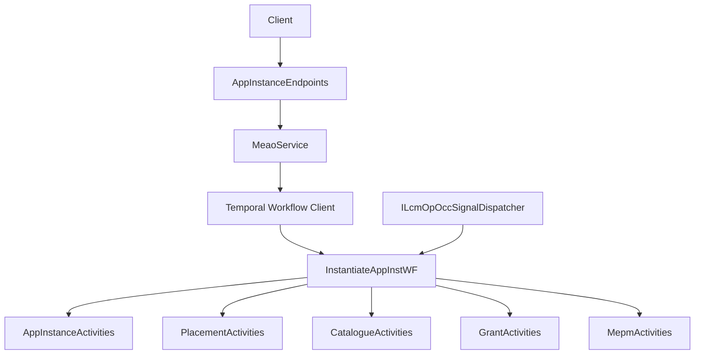
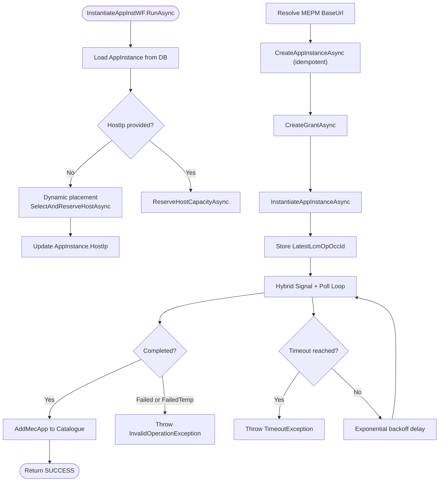
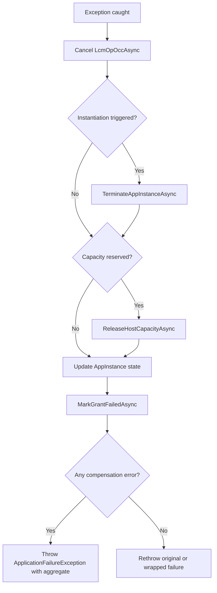
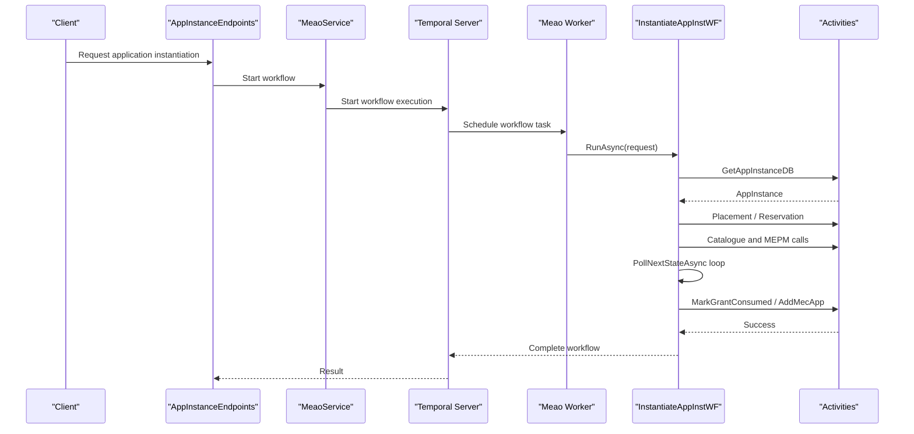
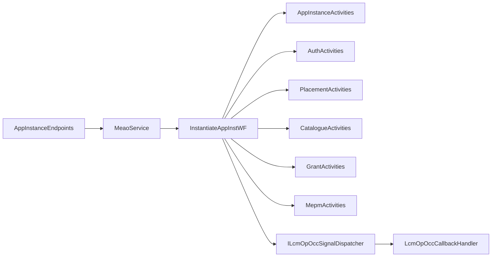

# Temporal Workflows and Orchestration

## Table of Contents
1. [Introduction](#introduction)
2. [Project Structure](#project-structure)
3. [Core Components](#core-components)
4. [Architecture Overview](#architecture-overview)
5. [Detailed Component Analysis](#detailed-component-analysis)
6. [Dependency Analysis](#dependency-analysis)
7. [Performance Considerations](#performance-considerations)
8. [Troubleshooting Guide](#troubleshooting-guide)
9. [Conclusion](#conclusion)

## Introduction
This document explains the Temporal-based workflow orchestration layer in the Meao service, focusing on application instantiation. The primary workflow is `InstantiateAppInstWF`. It coordinates placement, MEPM registration, grant creation, VIM provisioning through MEPM, polling for terminal state, cataloguing, and compensation when failures occur.

The design follows a durable execution model: workflows are replay-safe, checkpoint state between activity invocations, and survive worker restarts. Long-running waits use a hybrid signal-and-polling pattern to avoid unnecessary remote calls while still falling back to polling if signals are delayed or lost.

Although the user requested phase-specific workflows such as `InstantiateAppInstWFPhaseA`, `InstantiateAppInstWFPhaseB`, and `InstantiateAppInstWFPhaseC`, the current codebase implements the end-to-end flow in `InstantiateAppInstWF` rather than separate phase workflow classes. Phase B-like behavior appears primarily in tests and planning artifacts; it is not implemented as an independent workflow class in the analyzed source tree.

## Project Structure
Temporal-related orchestration lives under the Meao service:

- Workflows define long-running orchestrations using `[Workflow]` and `[WorkflowRun]`.
- Activities perform side effects such as database updates, external HTTP calls, and resource reservation.
- Endpoints trigger workflows via services.
- Signals from MEPM LCM operation notifications are delivered to workflow instances through a dispatcher and callback handler.
- Unit and replay tests verify policy coverage, history replay, and failure scenarios.

**Diagram sources**
- `src/Meao/Endpoints/AppInstanceEndpoints.cs`
- `src/Meao/Services/MeaoService.cs`
- `src/Meao/Services/IMeaoService.cs`
- `src/Meao/Workflows/InstantiateAppInstWF.cs`
- `src/Meao/Services/ILcmOpOccSignalDispatcher.cs`

**Section sources**
- `src/Meao/Program.cs`
- `src/Meao/Endpoints/AppInstanceEndpoints.cs`
- `src/Meao/Services/MeaoService.cs`
- `src/Meao/Services/IMeaoService.cs`

## Core Components
The main components involved in application instantiation are:

| Component | Responsibility | Key Behavior |
|---|---|---|
| `InstantiateAppInstWF` | Main orchestration workflow | Drives phases A through C within one durable workflow, including placement, MEPM interaction, grant management, polling, cataloguing, and compensation. |
| Activities | Side-effecting operations | Database access, placement engine, catalogue API, MEPM REST calls, and grant lifecycle. |
| `LcmOpOccSignal` | Event payload | Carries MEPM LCM operation state change information that can short-circuit polling. |
| Signal dispatcher and callback handler | Signal delivery | Enqueue signals into the workflow instance so the poll loop can consume them. |
| Test assets | Replay and policy verification | Confirm workflow histories, timeout paths, and activity policy usage. |

**Section sources**
- `src/Meao/Workflows/InstantiateAppInstWF.cs`
- `src/Meao/Models/LcmOpOccSignal.cs`
- `src/Meao/Services/ILcmOpOccSignalDispatcher.cs`
- `src/Meao/Services/LcmOpOccCallbackHandler.cs`

## Architecture Overview
`InstantiateAppInstWF` implements a state machine with implicit phases represented by ordered steps rather than explicit workflow transitions.

**Diagram sources**
- `src/Meao/Workflows/InstantiateAppInstWF.cs`

### Phases A, B, and C Mapping
- **Phase A — Placement and preparation**: Validate the app instance, determine target host, reserve capacity, resolve MEPM base URL, register the MEPM application instance idempotently, create a grant, and trigger instantiation.
- **Phase B — VIM provisioning coordination**: Wait for MEPM’s LCM operation to reach a terminal state using a hybrid approach. Signals from `ILcmOpOccSignalDispatcher` provide fast-path completion, while polling remains a fallback.
- **Phase C — Completion and cataloguing**: Mark the grant consumed, update local states to instantiated and started, add the MEC app to the catalogue, and return success.

These phases are sequential blocks inside one workflow method rather than separate workflow classes.

**Section sources**
- `src/Meao/Workflows/InstantiateAppInstWF.cs`

## Detailed Component Analysis

### Main Workflow: `InstantiateAppInstWF`
`InstantiateAppInstWF` is a Temporal workflow class decorated with `[Workflow]` and exposes a `[WorkflowRun]` entry point. It accepts an instantiation request and performs these responsibilities:

1. **Load context**: Reads the app instance from the database.
2. **Compute allocation hints**: Parses `VirtualComputeDescriptor` to extract CPU, memory, and storage values where possible.
3. **Determine host**: Either uses the provided host IP or invokes dynamic placement.
4. **Reserve capacity**: Updates the app instance record and reserves placement capacity.
5. **Resolve MEPM endpoint**: Gets the MEPM base URL for the selected host from the catalogue.
6. **Register with MEPM**: Calls `CreateAppInstanceAsync` idempotently before triggering instantiation.
7. **Create grant**: Creates a grant for the instantiation operation.
8. **Trigger MEPM instantiation**: Starts the asynchronous LCM operation and stores its ID.
9. **Wait for completion**: Uses a hybrid signal-and-poll loop with exponential backoff and a deadline.
10. **Complete successfully**: Marks the grant consumed, updates local state, registers the app in the catalogue, and returns success.
11. **Compensate on failure**: Cancels the LCM operation, terminates the app instance on MEPM, releases host capacity, resets local state, marks the grant failed, and throws an aggregated error if compensation itself fails.

#### State Machine Transitions
The workflow transitions through implicit states:

| Implicit State | Meaning | Next Transition |
|---|---|---|
| Loading | App instance is being read | Placement or direct reservation |
| Placing | Dynamic placement is running | Host resolution |
| Reserving | Capacity reservation is running | MEPM base URL resolution |
| Registering | MEPM app instance record is created | Grant creation |
| Instantiating | MEPM LCM operation has been started | Waiting for terminal state |
| Waiting | Hybrid signal/poll loop is active | Completed, failed, or timeout |
| Completing | Final activities run after success | Success |
| Compensating | Failure path runs cleanup | Error propagation |

#### Checkpointing Mechanism
Every call to `Workflow.ExecuteActivityAsync` is a durable checkpoint boundary. If the worker restarts, Temporal replays the workflow from the beginning but re-executes only up to the next pending event, then resumes at the last completed activity. Local variables such as `targetHostIp`, `grant`, `startResp`, and `mepmInstantiateTriggered` preserve in-memory state during replay.

The `_pendingSignals` queue is also part of workflow state and will be available during replay. New signals arriving after a restart are enqueued again by the signal dispatch pipeline.

#### Compensation Pattern
The compensation block handles several failure modes:

- Cancel the ongoing LCM operation if it was started.
- Terminate the app instance on MEPM if instantiation was triggered.
- Release reserved host capacity if capacity was reserved.
- Reset the app instance state to not instantiated and stopped.
- Mark the grant as failed.
- Aggregate compensation errors and throw a wrapped `ApplicationFailureException`.

Cancellation and termination activities use dedicated policies for longer timeouts, indicating they are compensations rather than normal operations.

**Diagram sources**
- `src/Meao/Workflows/InstantiateAppInstWF.cs`

**Section sources**
- `src/Meao/Workflows/InstantiateAppInstWF.cs`

### Phase-Specific Workflows and the Current Implementation
The repository includes:

- `InstantiateAppInstWF`: The actual workflow implementation.
- `CreateAppInstWF`: Another workflow file present in the project structure.
- `InstantiateAppInstWFPhaseBTests.cs`: Tests referencing a phase-B concept.

However, there is no `InstantiateAppInstWFPhaseA`, `InstantiateAppInstWFPhaseB`, or `InstantiateAppInstWFPhaseC` workflow class in the analyzed source files. Instead, the phases are modeled as sequential sections inside `InstantiateAppInstWF.RunAsync`.

If future refactoring introduces separate phase workflows, the recommended pattern would be:

- One workflow per major lifecycle phase.
- Child workflows invoked from a parent orchestrator.
- Shared activity interfaces for placement, catalogue, grants, MEPM, and database operations.
- Consistent retry, timeout, and compensation policies.

Until that change exists, developers should treat `InstantiateAppInstWF` as the single authoritative orchestration unit.

**Section sources**
- `src/Meao/Workflows/InstantiateAppInstWF.cs`
- `src/Meao/Workflows/CreateAppInstWF.cs`
- `src/Meao.Tests.Unit/InstantiateAppInstWFPhaseBTests.cs`

### Activity Invocation Patterns
Activities are invoked through strongly typed delegates passed to `Workflow.ExecuteActivityAsync`. Examples include:

- `AppInstanceActivities.GetAppInstanceDB`
- `AuthActivities.GetKeycloakToken`
- `PlacementActivities.SelectAndReserveHostAsync`
- `PlacementActivities.ReserveHostCapacityAsync`
- `PlacementActivities.ReleaseHostCapacityAsync`
- `CatalogueActivities.GetMepmBaseUrlForHostAsync`
- `CatalogueActivities.AddMecApp`
- `MepmActivities.CreateAppInstanceAsync`
- `MepmActivities.InstantiateAppInstanceAsync`
- `MepmActivities.CancelLcmOpOccAsync`
- `MepmActivities.TerminateAppInstanceAsync`
- `GrantActivities.CreateGrantAsync`
- `GrantActivities.MarkGrantConsumedAsync`
- `GrantActivities.MarkGrantFailedAsync`

Each invocation uses a policy object, typically `ActivityPolicies.Standard`, `ActivityPolicies.LongRunning`, or `ActivityPolicies.Compensation`.

#### Retry and Timeout Policy Model
| Policy Type | Intended Use | Observed Configuration |
|---|---|---|
| `Standard` | Normal business activities | Two-minute timeout |
| `LongRunning` | Non-idempotent or externally long operations | Two-minute timeout with maximum attempts override set to one |
| `Compensation` | Cleanup and rollback operations | Two-minute timeout for most compensations; five minutes for terminate |

The instantiation activity explicitly overrides maximum attempts to one because POST-style triggers should not be retried automatically.

**Section sources**
- `src/Meao/Workflows/InstantiateAppInstWF.cs`
- `src/Meao.Tests.Unit/Workflows/ActivityPolicyCoverageTests.cs`

### Error Handling, Retries, and Timeouts
The workflow distinguishes several failure categories:

| Failure Category | Behavior |
|---|---|
| Missing app instance | Throws `ApplicationFailureException` with type `NotFound`. |
| MEPM terminal failure | Throws `InvalidOperationException` with operation state and response details. |
| Timeout | Throws `TimeoutException` after the polling deadline. |
| Normal exception | Enters compensation block and may wrap multiple compensation errors. |
| Cancellation | Re-throws cancellation exceptions without entering compensation logic. |
| Existing `ApplicationFailureException` | Re-throws without wrapping. |

Polling uses a deadline calculated from `Workflow.UtcNow`, a starting delay of two seconds, and exponential backoff capped at ten seconds. This balances responsiveness with load reduction during slow MEPM operations.

**Section sources**
- `src/Meao/Workflows/InstantiateAppInstWF.cs`

### Durable Execution and Replay
Temporal ensures durability by recording workflow events and replaying deterministic code. Important characteristics visible in this workflow:

- All external work is performed through activities.
- Workflow-local state is serializable across replays.
- External side effects are not duplicated because completed activities are not re-executed.
- Signal queues are part of workflow state, enabling fast-path handling after restart.
- History replay tests validate that recorded histories produce expected results.

**Diagram sources**
- `src/Meao/Endpoints/AppInstanceEndpoints.cs`
- `src/Meao/Services/MeaoService.cs`
- `src/Meao/Workflows/InstantiateAppInstWF.cs`

**Section sources**
- `src/Meao.Tests.Unit/Replay/WorkflowReplayTests.cs`
- `src/Meao.Tests.Unit/TestAssets/WorkflowHistories/instantiate-poll-to-completion.json`

### Practical Examples

#### Workflow Definition Example
A workflow definition should:

- Be marked with `[Workflow]`.
- Expose a `[WorkflowRun]` method accepting a strongly typed request.
- Keep all side effects behind activities.
- Record meaningful log messages using `Workflow.Logger`.
- Use deadlines for long-running loops.
- Handle cancellations explicitly.
- Centralize compensation logic for multi-step failures.

The existing `InstantiateAppInstWF` demonstrates these patterns directly.

**Section sources**
- `src/Meao/Workflows/InstantiateAppInstWF.cs`

#### Activity Implementation Guidance
Activities should:

- Be registered with the Temporal worker.
- Be idempotent where possible.
- Throw domain-specific failures instead of generic runtime exceptions.
- Respect timeouts configured through activity policies.
- Avoid non-deterministic branching based on wall-clock time unless wrapped by Temporal primitives.
- Use structured logging suitable for distributed tracing.

Activity policy usage is verified by tests, indicating that the project expects consistent policy assignment across activities.

**Section sources**
- `src/Meao.Tests.Unit/Workflows/ActivityPolicyCoverageTests.cs`

#### Debugging Long-Running Orchestration
Recommended techniques:

1. **Use workflow logs**: The workflow logs invocation, app instance ID, host placement decisions, and compensation failures.
2. **Inspect Temporal history**: The test asset `instantiate-poll-to-completion.json` shows how history snapshots can represent a complete flow.
3. **Replay histories**: Use replay tests to validate deterministic behavior across changes.
4. **Check signal delivery**: Verify that `ILcmOpOccSignalDispatcher` and `LcmOpOccCallbackHandler` deliver signals to the correct workflow instance.
5. **Validate policies**: Use policy coverage tests to ensure retries, timeouts, and compensation behavior are intentional.
6. **Trace end-to-end requests**: Follow the path from `AppInstanceEndpoints` through `MeaoService` to the workflow and activities.

**Section sources**
- `src/Meao.Tests.Unit/InstantiateAppInstWFTests.cs`
- `src/Meao.Tests.Unit/Replay/WorkflowReplayTests.cs`
- `src/Meao.Tests.Unit/TestAssets/WorkflowHistories/instantiate-poll-to-completion.json`
- `src/Meao/Services/LcmOpOccCallbackHandler.cs`
- `src/Meao/Services/ILcmOpOccSignalDispatcher.cs`

## Dependency Analysis
The workflow depends on several internal subsystems:

**Diagram sources**
- `src/Meao/Workflows/InstantiateAppInstWF.cs`
- `src/Meao/Endpoints/AppInstanceEndpoints.cs`
- `src/Meao/Services/MeaoService.cs`
- `src/Meao/Services/ILcmOpOccSignalDispatcher.cs`
- `src/Meao/Services/LcmOpOccCallbackHandler.cs`

### Coupling and Cohesion
- High cohesion: `InstantiateAppInstWF` owns the full instantiation lifecycle.
- Moderate coupling: The workflow directly references many activity groups, which is acceptable for a central orchestrator but suggests careful interface boundaries around each activity group.
- External dependencies: MEPM, catalogue, placement engine, authentication, and local database.
- Signal dependency: The workflow depends on signal delivery to reduce polling overhead.

### Potential Circular Dependencies
There is no evidence of circular imports between the workflow and activities. The workflow consumes activities; activities do not call the workflow back. Signal delivery is inbound and does not require the workflow to call the dispatcher directly.

**Section sources**
- `src/Meao/Workflows/InstantiateAppInstWF.cs`
- `src/Meao/Services/ILcmOpOccSignalDispatcher.cs`

## Performance Considerations
- **Polling interval growth**: The polling delay grows exponentially up to ten seconds, reducing load during slow MEPM operations.
- **Deadline-based wait**: A fixed timeout prevents indefinite waits.
- **One attempt for instantiation POST**: Prevents duplicate MEPM instantiation attempts.
- **Signal short-circuit**: Successful signals bypass additional polling rounds.
- **Activity timeouts**: Standard two-minute timeouts keep resources bounded.
- **Compensation timeouts**: Longer timeouts for termination allow slow cleanup.

Optimization opportunities include:

- Measuring average polling duration and tuning the initial delay and cap.
- Adding metrics around signal arrival versus polling completion.
- Reviewing whether catalogue registration should be retried more aggressively, since the current code retries once and then compensates.
- Ensuring activity-level retries align with idempotency guarantees.

[No sources needed since this section provides general guidance]

## Troubleshooting Guide

| Symptom | Likely Cause | Recommended Action |
|---|---|---|
| Workflow never completes | MEPM did not emit a terminal signal or response | Inspect signal delivery and polling logs; check MEPM status for the stored LCM operation ID. |
| Timeout after ~10 minutes | Polling deadline exceeded | Investigate MEPM latency, network issues, or missing signals. |
| Duplicate MEPM instantiation | Incorrect retry configuration | Verify that the instantiation activity uses maximum attempts equal to one. |
| Capacity reservation remains after failure | Compensation failed | Check release activity logs and manually reconcile placement inventory if necessary. |
| App instance state inconsistent after failure | State reset or grant marking failed | Review compensation error aggregation and local state update logs. |
| Replay test fails | Non-deterministic behavior | Remove randomization, wall-clock-dependent branches, or external side effects from workflow logic. |

Key diagnostic files and locations:

- Workflow tests: `src/Meao.Tests.Unit/InstantiateAppInstWFTests.cs`
- Phase-B-related tests: `src/Meao.Tests.Unit/InstantiateAppInstWFPhaseBTests.cs`
- Replay tests: `src/Meao.Tests.Unit/Replay/WorkflowReplayTests.cs`
- Recorded history example: `src/Meao.Tests.Unit/TestAssets/WorkflowHistories/instantiate-poll-to-completion.json`

**Section sources**
- `src/Meao.Tests.Unit/InstantiateAppInstWFTests.cs`
- `src/Meao.Tests.Unit/InstantiateAppInstWFPhaseBTests.cs`
- `src/Meao.Tests.Unit/Replay/WorkflowReplayTests.cs`
- `src/Meao.Tests.Unit/TestAssets/WorkflowHistories/instantiate-poll-to-completion.json`

## Conclusion
`InstantiateAppInstWF` is the central durable orchestration unit for application instantiation in Meao. It combines placement, MEPM integration, grant lifecycle, polling, cataloguing, and compensation into one replay-safe workflow. While the user requested separate phase workflows, the current implementation models phases A, B, and C as sequential stages within a single workflow.

The most important operational properties are:

- Deterministic workflow code with durable checkpoints.
- Explicit retry and timeout policies per activity category.
- Hybrid signal-and-poll waiting for MEPM completion.
- Comprehensive compensation for partial failures.
- Testable design supported by unit tests, replay tests, and history assets.

Future refactorings could split this workflow into phase-specific child workflows, but any such change must preserve idempotency, determinism, and compensation semantics.

[No sources needed since this section summarizes without analyzing specific files]

> **Referenced Files in This Document**
>
> - `src/Meao/Workflows/InstantiateAppInstWF.cs`
> - `src/Meao/Workflows/CreateAppInstWF.cs`
> - `src/Meao/Program.cs`
> - `src/Meao/Endpoints/AppInstanceEndpoints.cs`
> - `src/Meao/Services/MeaoService.cs`
> - `src/Meao/Services/IMeaoService.cs`
> - `src/Meao/Services/ILcmOpOccSignalDispatcher.cs`
> - `src/Meao/Services/LcmOpOccCallbackHandler.cs`
> - `src/Meao/Models/LcmOpOccSignal.cs`
> - `src/Meao.Tests.Unit/InstantiateAppInstWFTests.cs`
> - `src/Meao.Tests.Unit/InstantiateAppInstWFPhaseBTests.cs`
> - `src/Meao.Tests.Unit/Replay/WorkflowReplayTests.cs`
> - `src/Meao.Tests.Unit/TestAssets/WorkflowHistories/instantiate-poll-to-completion.json`
> - `src/Meao.Tests.Unit/Workflows/ActivityPolicyCoverageTests.cs`
> - `docs/ADR/0006-temporal-orchestration-engine.md`
