# Background LCM Worker Service

<cite>
**Referenced Files in This Document**   
- `src/PlatformManager/PlatformManager/Services/LcmWorkerService.cs`
- `src/PlatformManager/PlatformManager/Services/LifecycleStateMachine.cs`
- `src/PlatformManager/PlatformManager/Services/LcmWorkQueue.cs`
- `src/PlatformManager/PlatformManager/Services/AppInstanceService.cs`
- `docs/ADR/0053-mepm-lcm-op-occ-persisted-replay.md`
- `docs/ADR/0028-lcm-worker-vim-timeout.md`
</cite>

## Table of Contents
1. [Introduction](#introduction)
2. [Project Structure](#project-structure)
3. [Core Components](#core-components)
4. [Architecture Overview](#architecture-overview)
5. [Detailed Component Analysis](#detailed-component-analysis)
6. [Dependency Analysis](#dependency-analysis)
7. [Performance Considerations](#performance-considerations)
8. [Troubleshooting Guide](#troubleshooting-guide)
9. [Conclusion](#conclusion)

## Introduction
The LCM worker is a background hosted service that removes long-running VIM provisioning work from the HTTP request path. When an ETSI App LCM request arrives, the HTTP handler persists an `AppInstanceLcmOpOcc` row and enqueues a lightweight work item. The worker then drains the queue, calls into the appropriate VIM adapter through gRPC, and drives the operation to a terminal state such as `COMPLETED`, `FAILED`, or `FAILED_TEMP`.

This document focuses on:
- Crash-survival replay of `PROCESSING` op-occs created before process startup.
- Idempotent-consumer guards against double-enqueueing during startup races.
- Per-operation VIM timeout configuration via `LcmWorker:VimOperationTimeout`.
- Bounded-token transaction pattern for terminal state transitions.
- Routing of Instantiate, Terminate, Operate, and ConfigurePlatformForApp operations.
- Persistence of `OpOcc` transitions through `LifecycleStateMachine`.
- Settlement of already-instantiated instances during replay.
- Subscription notification dispatch after terminal state changes.
- Retry behavior coordinated with MEO retries.
- Troubleshooting guidance for stuck op-occs and notification dispatch failures.

## Project Structure
The LCM worker lives in the Platform Manager service and interacts with the in-process work queue, application instance service, database context, and subscription/notification infrastructure.

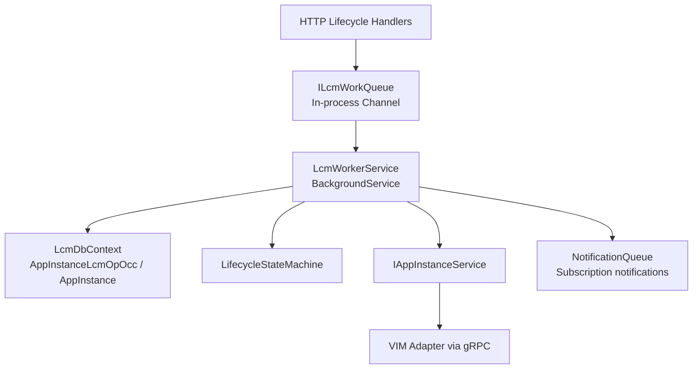

**Diagram sources**
- `src/PlatformManager/PlatformManager/Services/LcmWorkerService.cs#L1-L531`
- `src/PlatformManager/PlatformManager/Services/LcmWorkQueue.cs#L1-L37`
- `src/PlatformManager/PlatformManager/Services/AppInstanceService.cs#L1-L160`
- `src/PlatformManager/PlatformManager/Services/LifecycleStateMachine.cs#L1-L51`

**Section sources**
- `src/PlatformManager/PlatformManager/Services/LcmWorkerService.cs#L1-L531`
- `src/PlatformManager/PlatformManager/Services/LcmWorkQueue.cs#L1-L37`

## Core Components
- **LcmWorkerService**: Hosted background service that replays stranded `PROCESSING` rows at startup, drains the queue, routes lifecycle operations, applies timeouts, transitions states, and dispatches notifications.
- **ILcmWorkQueue / LcmWorkQueue**: In-process bounded single-reader channel abstraction for decoupling HTTP handlers from long-running VIM execution.
- **LifecycleStateMachine**: Canonical ETSI state-machine validator for `AppInstanceLcmOpOcc` state transitions.
- **AppInstanceService**: gRPC seam to the VIM adapter for instantiate, terminate, and operate calls.
- **ADR 0053**: Documents crash-survival replay design, constraints, and migration considerations.
- **ADR 0028**: Documents per-operation VIM timeout design and cancellation semantics.

**Section sources**
- `src/PlatformManager/PlatformManager/Services/LcmWorkerService.cs#L1-L531`
- `src/PlatformManager/PlatformManager/Services/LcmWorkQueue.cs#L1-L37`
- `src/PlatformManager/PlatformManager/Services/LifecycleStateMachine.cs#L1-L51`
- `src/PlatformManager/PlatformManager/Services/AppInstanceService.cs#L1-L160`
- `docs/ADR/0053-mepm-lcm-op-occ-persisted-replay.md#L1-L154`
- `docs/ADR/0028-lcm-worker-vim-timeout.md#L1-L33`

## Architecture Overview
The LCM flow has two phases:

1. **Request phase**: HTTP handler validates input, persists `AppInstanceLcmOpOcc` as `PROCESSING`, persists required payload columns, and enqueues a work item.
2. **Worker phase**: Background service replays pre-startup `PROCESSING` rows, processes queued work, calls VIM adapters, transitions states atomically, and dispatches subscription notifications.

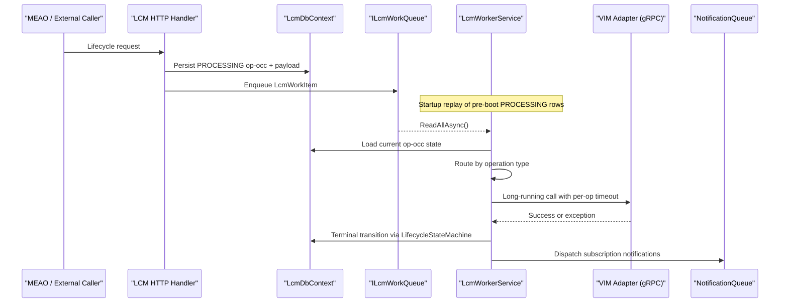

**Diagram sources**
- `src/PlatformManager/PlatformManager/Services/LcmWorkerService.cs#L1-L531`
- `src/PlatformManager/PlatformManager/Services/LcmWorkQueue.cs#L1-L37`
- `src/PlatformManager/PlatformManager/Services/AppInstanceService.cs#L1-L160`

## Detailed Component Analysis

### LcmWorkerService Background Loop
The worker starts by logging startup, running crash-survival replay, and then iterating over the queue. A successful queue iteration is bounded by host shutdown cancellation; unexpected exceptions are logged and converted into a failed terminal state so the loop can continue processing later items.

Key responsibilities:
- Resolve per-operation VIM timeout from `LcmWorker:VimOperationTimeout`.
- Replay pre-startup `PROCESSING` op-occs without blocking host startup on transient DB failures.
- Guard against double-enqueueing during startup races.
- Route four operation types.
- Apply per-operation VIM timeout.
- Transition terminal states through `LifecycleStateMachine`.
- Dispatch subscription notifications after successful settlement.

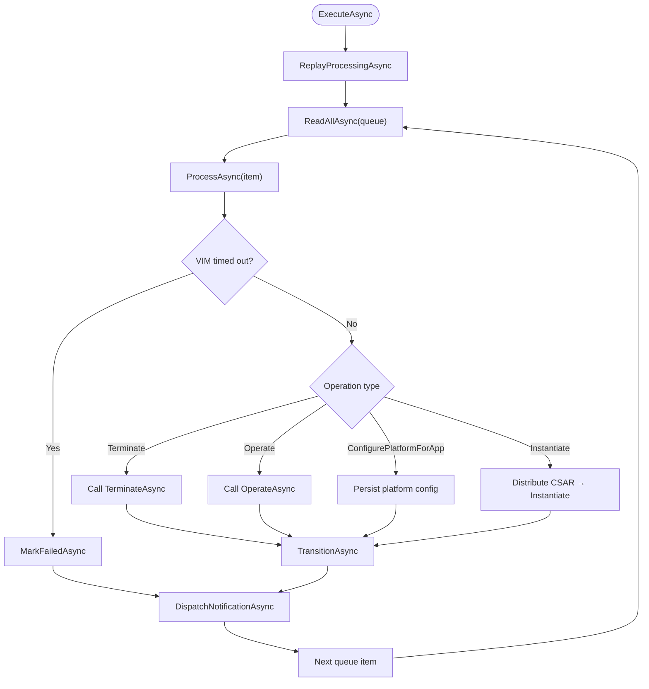

**Diagram sources**
- `src/PlatformManager/PlatformManager/Services/LcmWorkerService.cs#L1-L531`

**Section sources**
- `src/PlatformManager/PlatformManager/Services/LcmWorkerService.cs#L1-L200`
- `src/PlatformManager/PlatformManager/Services/LcmWorkerService.cs#L201-L531`

### Crash-Survival Replay Mechanism
Replay exists because the queue is in-process memory. If the Platform Manager crashes while an operation is in progress, the channel is lost but the `AppInstanceLcmOpOcc` row remains `PROCESSING`. Without replay, the instance stays locked behind active-op checks and the filtered unique index prevents replacement.

Replay rules:
- Only rows with `OperationState == PROCESSING` are eligible.
- Only rows whose `StartTime` is strictly before the worker’s boot watermark are replayed.
- Rows created by the running process are excluded because their endpoints already enqueued them.
- Replay loads pending rows ordered by `StartTime` then `Id` to preserve deterministic ordering.
- Replay performs one batched lookup of affected `AppInstance` records to avoid N+1 queries.
- For each eligible row, replay rebuilds a `LcmWorkItem` and enqueues it back into the existing channel.
- An already-instantiated Instantiate row is settled directly to `COMPLETED` instead of being re-enqueued, avoiding deadlock.
- Replay is wrapped in try/catch so a startup database failure does not kill the hosted service.

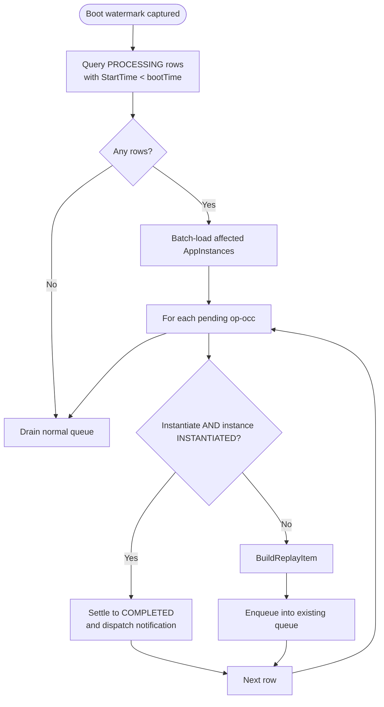

**Diagram sources**
- `src/PlatformManager/PlatformManager/Services/LcmWorkerService.cs#L106-L220`
- `docs/ADR/0053-mepm-lcm-op-occ-persisted-replay.md#L1-L154`

**Section sources**
- `src/PlatformManager/PlatformManager/Services/LcmWorkerService.cs#L106-L220`
- `docs/ADR/0053-mepm-lcm-op-occ-persisted-replay.md#L1-L154`

### Idempotent-Consumer Guards
A startup race can enqueue the same op twice:
- The HTTP endpoint commits a new `PROCESSING` row.
- Before the hosted service finishes starting, the replay snapshot reads that row.
- Both the endpoint and replay enqueue a work item.

The guard works as follows:
- The channel uses `SingleReader = true`, giving the worker in-process ownership.
- `ProcessAsync` reloads the current `OperationState` for the work item.
- If the state is not `PROCESSING`, the worker logs and returns early.
- This prevents illegal transitions such as `COMPLETED → COMPLETED` or cascading failures when replay and endpoint both target the same row.

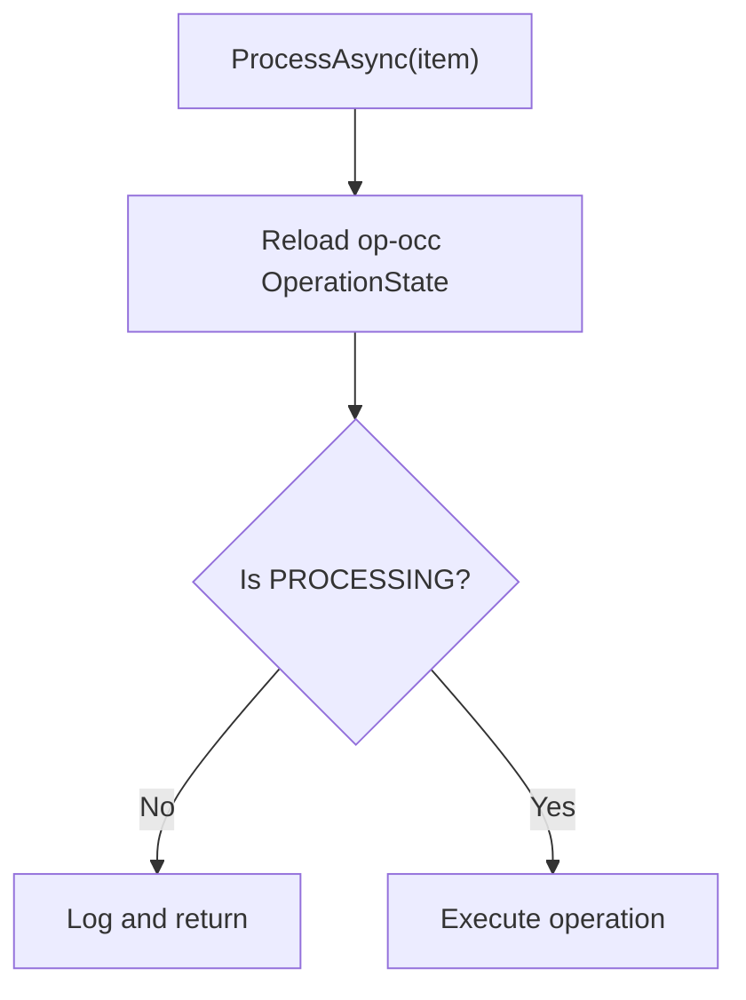

**Diagram sources**
- `src/PlatformManager/PlatformManager/Services/LcmWorkerService.cs#L220-L260`
- `src/PlatformManager/PlatformManager/Services/LcmWorkQueue.cs#L18-L37`

**Section sources**
- `src/PlatformManager/PlatformManager/Services/LcmWorkerService.cs#L220-L260`
- `src/PlatformManager/PlatformManager/Services/LcmWorkQueue.cs#L18-L37`

### Per-Operation VIM Timeout Configuration
The default VIM operation timeout is two minutes. It is resolved from `LcmWorker:VimOperationTimeout`:
- Missing or unparsable value → default two-minute timeout.
- Positive value → configured timeout.
- Zero or negative value → timeout disabled for backward compatibility.

Each work item creates a linked `CancellationTokenSource`:
- The link preserves host shutdown cancellation.
- If the timeout is enabled, the token cancels after the configured duration.
- `OperationCanceledException` caused only by the per-operation token is treated as a VIM timeout and settles the operation as `FAILED`.
- Genuine host shutdown cancellation is not caught here; it exits the worker loop gracefully.
- The timeout applies to VIM calls, not to terminal database transitions.

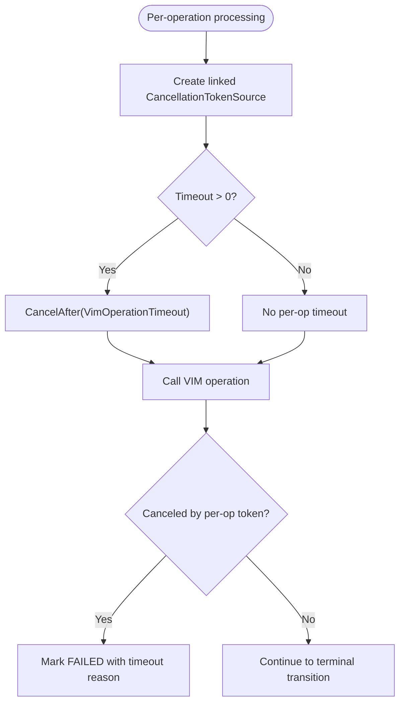

**Diagram sources**
- `src/PlatformManager/PlatformManager/Services/LcmWorkerService.cs#L1-L40`
- `src/PlatformManager/PlatformManager/Services/LcmWorkerService.cs#L260-L340`
- `docs/ADR/0028-lcm-worker-vim-timeout.md#L1-L33`

**Section sources**
- `src/PlatformManager/PlatformManager/Services/LcmWorkerService.cs#L1-L40`
- `src/PlatformManager/PlatformManager/Services/LcmWorkerService.cs#L260-L340`
- `docs/ADR/0028-lcm-worker-vim-timeout.md#L1-L33`

### Bounded-Token Transaction Pattern
Terminal state transitions use a dedicated transaction helper:
- Load the op-occ and app instance.
- Apply the caller-provided mutation to the op-occ.
- Validate the transition using `LifecycleStateMachine.AssertTransition`.
- Set `StateEnteredTime` and `EndTime`.
- Optionally mutate the app instance if it exists.
- Begin a database transaction.
- Save changes and commit.
- Use a 30-second bounded cancellation token so shutdown cannot block indefinitely while still allowing critical state writes time to complete.

`MarkFailedAsync` follows the same bounded-token pattern but sets the state to `FAILED` and records the failure detail.

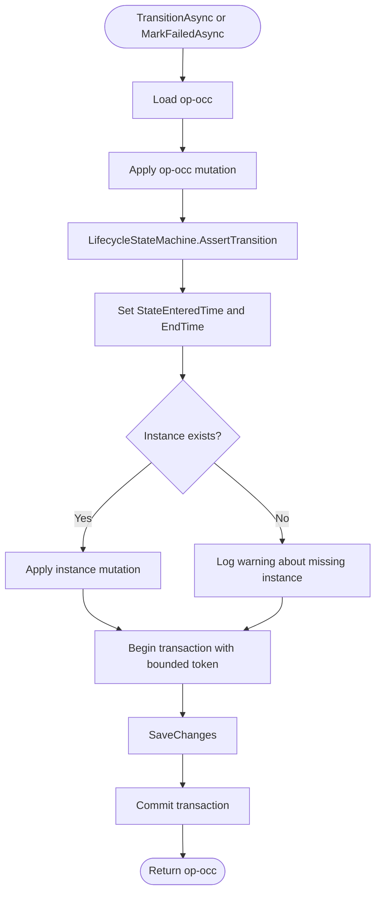

**Diagram sources**
- `src/PlatformManager/PlatformManager/Services/LcmWorkerService.cs#L340-L531`
- `src/PlatformManager/PlatformManager/Services/LifecycleStateMachine.cs#L1-L51`

**Section sources**
- `src/PlatformManager/PlatformManager/Services/LcmWorkerService.cs#L340-L531`
- `src/PlatformManager/PlatformManager/Services/LifecycleStateMachine.cs#L1-L51`

### Operation Routing

#### Terminate
- Calls `AppInstanceService.TerminateAsync`.
- On success, sets `OperationState` to `COMPLETED`.
- Sets instance state to `NotInstantiated`.
- Clears `InstantiatedAppState`.

#### Operate
- Uses `ChangeStateTo`, defaulting to `Started` when null.
- Calls `AppInstanceService.OperateAsync`.
- On success, sets `OperationState` to `COMPLETED`.
- Updates `InstantiatedAppState` to the requested target state.

#### ConfigurePlatformForApp
- Phase 20 persistent-only configuration.
- Requires `ConfigPayloadJson`; missing payload throws an invalid operation exception.
- Persists `PlatformConfigJson` onto the app instance.
- Transitions to `COMPLETED`.

#### Instantiate
- Resolves the immutable CSAR manifest digest from `AppPkgRecord`.
- Distributes the package and expects a digest-pinned OCI reference.
- Throws a controlled failure if distribution returns an empty reference.
- Calls `AppInstanceService.InstantiateAsync` with the OCI reference.
- On success, sets `OperationState` to `COMPLETED`.
- Sets instance state to `Instantiated` and `InstantiatedAppState` to `Started`.
- Persists `VimType` and `HostIp` on the instance for downstream routing.

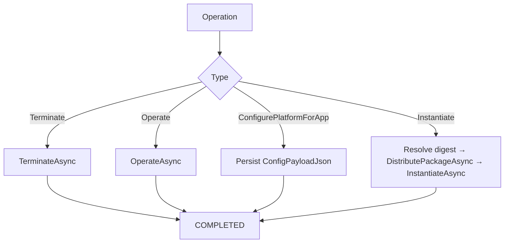

**Diagram sources**
- `src/PlatformManager/PlatformManager/Services/LcmWorkerService.cs#L260-L420`
- `src/PlatformManager/PlatformManager/Services/AppInstanceService.cs#L1-L160`

**Section sources**
- `src/PlatformManager/PlatformManager/Services/LcmWorkerService.cs#L260-L420`
- `src/PlatformManager/PlatformManager/Services/AppInstanceService.cs#L1-L160`

### Notification Dispatch After Terminal State Changes
After either a successful terminal transition or a failure, the worker attempts to dispatch subscription notifications:
- Queries subscriptions matching `AppLcmOpOccStateChange`.
- Matches by app instance or specific op-occ identifier.
- Enqueues one `NotificationItem` per matching subscription.
- Dispatch failures are isolated: they are logged but do not flip a successfully settled op-occ back to `FAILED`.
- The notification query itself uses a bounded 30-second token so shutdown cannot block indefinitely.

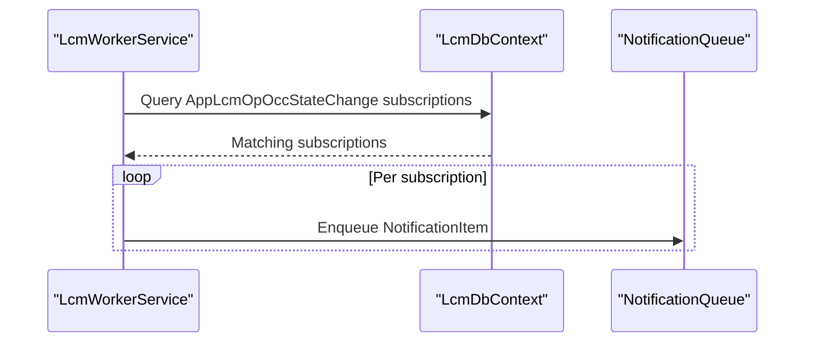

**Diagram sources**
- `src/PlatformManager/PlatformManager/Services/LcmWorkerService.cs#L502-L531`

**Section sources**
- `src/PlatformManager/PlatformManager/Services/LcmWorkerService.cs#L420-L531`

### Concrete Transition Examples

#### PROCESSING → COMPLETED
Typical successful example:
- Terminate succeeds.
- `TransitionAsync` asserts `PROCESSING → COMPLETED`.
- `StateEnteredTime` and `EndTime` are set.
- Instance becomes `NotInstantiated`.
- Notification is dispatched.

#### PROCESSING → FAILED
Typical failure example:
- VIM call throws or times out.
- `MarkFailedAsync` asserts `PROCESSING → FAILED`.
- Failure detail records the error or timeout message.
- Notification is dispatched.

#### PROCESSING → FAILED_TEMP
The state machine allows `PROCESSING → FAILED_TEMP`. This state is used to represent temporary retryable failures that MEO may coordinate through its own retry mechanism. The worker itself does not automatically transition `FAILED_TEMP` back to `PROCESSING`; external coordination handles retry eligibility.

**Section sources**
- `src/PlatformManager/PlatformManager/Services/LifecycleStateMachine.cs#L1-L51`
- `src/PlatformManager/PlatformManager/Services/LcmWorkerService.cs#L260-L531`

### Retry Behavior Coordinated with MEO Retries
The worker is not responsible for unbounded retry:
- A failed VIM call settles the operation as `FAILED` (or `FAILED_TEMP` where applicable).
- MEO owns retry policy: documented MEO retry budget uses `MaximumAttempts = 3` and `BackoffCoefficient = 2.0`.
- Crash replay adds at least one additional opportunity: a process restart replays pre-boot `PROCESSING` rows.
- Therefore, “at-least-once via MEO retry” means at most one MEPM replay attempt per process restart plus up to three MEO attempts — not infinite eventual completion.
- Idempotency depends on the VIM path: Helm/Kubernetes is effectively idempotent because release names match app instance identifiers; OpenStack raw instantiation is not idempotent and can double-provision after a crash mid-instantiate.

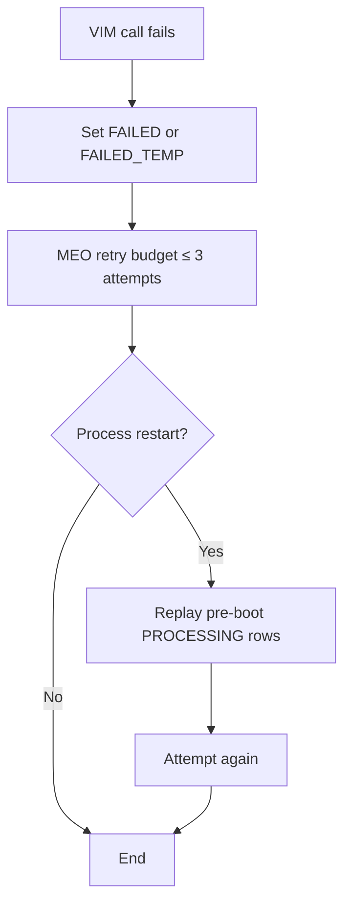

**Diagram sources**
- `docs/ADR/0053-mepm-lcm-op-occ-persisted-replay.md#L1-L154`
- `src/PlatformManager/PlatformManager/Services/LcmWorkerService.cs#L200-L340`

**Section sources**
- `docs/ADR/0053-mepm-lcm-op-occ-persisted-replay.md#L1-L154`
- `src/PlatformManager/PlatformManager/Services/LcmWorkerService.cs#L200-L340`

## Dependency Analysis
The worker depends on several internal services and shared patterns:

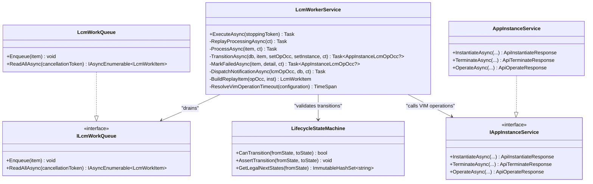

**Diagram sources**
- `src/PlatformManager/PlatformManager/Services/LcmWorkerService.cs#L1-L531`
- `src/PlatformManager/PlatformManager/Services/LcmWorkQueue.cs#L1-L37`
- `src/PlatformManager/PlatformManager/Services/LifecycleStateMachine.cs#L1-L51`
- `src/PlatformManager/PlatformManager/Services/AppInstanceService.cs#L1-L160`

**Section sources**
- `src/PlatformManager/PlatformManager/Services/LcmWorkerService.cs#L1-L531`
- `src/PlatformManager/PlatformManager/Services/LcmWorkQueue.cs#L1-L37`
- `src/PlatformManager/PlatformManager/Services/LifecycleStateMachine.cs#L1-L51`
- `src/PlatformManager/PlatformManager/Services/AppInstanceService.cs#L1-L160`

## Performance Considerations
- The queue is an unbounded in-process channel with single-reader semantics, suitable for the expected throughput of seconds-to-minutes-per-operation lifecycle work.
- Replay batches instance lookups to avoid N+1 database queries.
- Per-operation timeout prevents one hung VIM call from starving subsequent operations.
- Notification dispatch is decoupled from VIM execution and failure handling; dispatch errors do not corrupt terminal state.
- Bounded tokens on terminal writes and notification queries protect shutdown without blocking indefinitely.
- Payload columns may hold sensitive configuration values; logging avoids serializing `ConfigPayloadJson`.

[No sources needed since this section provides general guidance]

## Troubleshooting Guide

### Stuck PROCESSING Op-OcCs
Symptoms:
- An app instance remains locked by an active lifecycle operation.
- New lifecycle requests return conflict responses because an active row exists.
- The operation never reaches `COMPLETED`, `FAILED`, or `FAILED_TEMP`.

Checks:
1. Confirm the op-occ is `PROCESSING` and was created before the current process boot watermark.
2. Verify whether the process restarted; replay should have re-enqueued the row.
3. Check whether the row was skipped due to a replay failure; failed replay rows remain `PROCESSING` and retry on the next restart.
4. Inspect whether the instance is already `INSTANTIATED` for an Instantiate operation; the worker should settle it to `COMPLETED` during replay.
5. Review whether the row is blocked by database contention rather than worker logic.

Likely causes:
- Database outage during startup replay.
- Corrupted or missing payload causing replay item reconstruction to fail.
- Operational bug preventing the worker from reaching the terminal transition.
- Migration not applied so payload columns are unavailable.

**Section sources**
- `src/PlatformManager/PlatformManager/Services/LcmWorkerService.cs#L106-L220`
- `docs/ADR/0053-mepm-lcm-op-occ-persisted-replay.md#L1-L154`

### Notification Dispatch Failures
Symptoms:
- Terminal state reached `COMPLETED` or `FAILED`, but subscribers did not receive `AppLcmOpOccStateChange` notifications.
- Logs contain notification dispatch failures.

Behavior:
- Notification dispatch happens after terminal state persistence.
- Dispatch failures are logged but do not revert the terminal state.
- The terminal op-occ state is preserved.
- The subscription query uses a bounded token to avoid blocking shutdown.

Actions:
- Check subscription records for `AppLcmOpOccStateChange`.
- Confirm whether the subscription matches the app instance or op-occ identifier.
- Investigate notification queue consumers separately.
- Do not assume a failed notification means the operation failed.

**Section sources**
- `src/PlatformManager/PlatformManager/Services/LcmWorkerService.cs#L420-L531`

### VIM Timeouts
Symptoms:
- Operation settles as `FAILED` with a timeout message.
- The worker continues processing other queue items.
- MEO sees a terminal failure and may retry.

Actions:
- Review `LcmWorker:VimOperationTimeout`.
- Determine whether the timeout is intentionally disabled (zero or negative).
- Investigate VIM adapter health, network connectivity, and underlying Kubernetes/OpenStack operations.
- Remember that timeout cancellation is per-operation and does not cancel host shutdown.

**Section sources**
- `src/PlatformManager/PlatformManager/Services/LcmWorkerService.cs#L1-L40`
- `src/PlatformManager/PlatformManager/Services/LcmWorkerService.cs#L260-L340`
- `docs/ADR/0028-lcm-worker-vim-timeout.md#L1-L33`

### Illegal State Transitions
Symptoms:
- Exception indicating an illegal LCM op-occ state transition.
- Worker loop terminates unexpectedly if the transition occurs outside protected paths.

Causes:
- Code attempting `COMPLETED → COMPLETED`, `COMPLETED → PROCESSING`, or other unsupported transitions.
- Replay or endpoint logic mutating state without going through `LifecycleStateMachine`.

Resolution:
- Ensure all terminal transitions go through `TransitionAsync` or `MarkFailedAsync`.
- Use `CanTransition` or `GetLegalNextStates` for validation.
- Add explicit support for new states in `LifecycleStateMachine` before using them.

**Section sources**
- `src/PlatformManager/PlatformManager/Services/LifecycleStateMachine.cs#L1-L51`
- `src/PlatformManager/PlatformManager/Services/LcmWorkerService.cs#L340-L531`

### Double-Enqueue During Startup
Symptoms:
- Same op processed more than once after restart.
- Logs indicate skipping work because op-occ is not `PROCESSING`.

Expected behavior:
- Second invocation is ignored after the first completes or fails.
- No illegal transition occurs because the guard reloads the current state.

**Section sources**
- `src/PlatformManager/PlatformManager/Services/LcmWorkerService.cs#L220-L260`
- `src/PlatformManager/PlatformManager/Services/LcmWorkQueue.cs#L18-L37`

## Conclusion
The LCM worker service isolates long-running VIM provisioning work from the HTTP request path while preserving durability through persisted op-occs. Its replay mechanism recovers from process crashes, its idempotent-consumer guard protects against startup races, its per-operation VIM timeout prevents queue starvation, and its bounded-token transaction pattern ensures safe terminal state transitions. The worker routes Instantiate, Terminate, Operate, and ConfigurePlatformForApp operations consistently, validates state changes through `LifecycleStateMachine`, settles already-instantiated instances during replay, and dispatches subscription notifications after terminal state changes. Retry responsibility is shared between MEO’s bounded retry policy and crash-survival replay, with clear boundaries around idempotency and operational failure modes.

[No sources needed since this section summarizes without analyzing specific files]