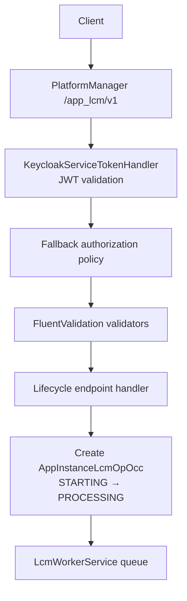
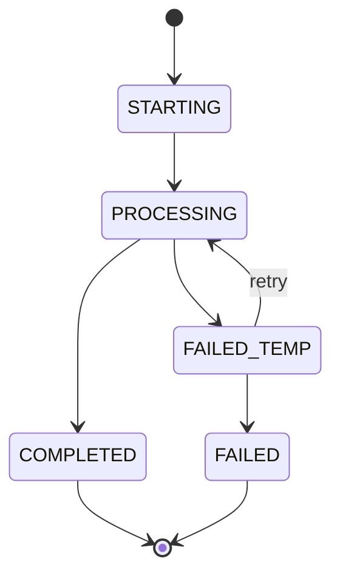
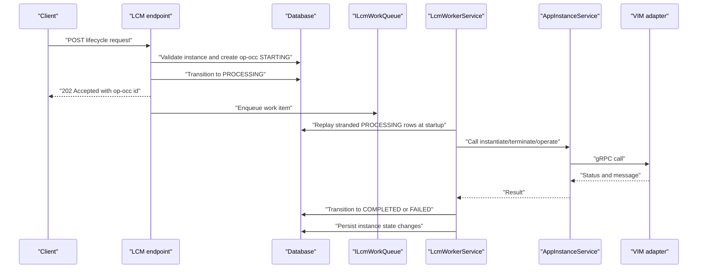
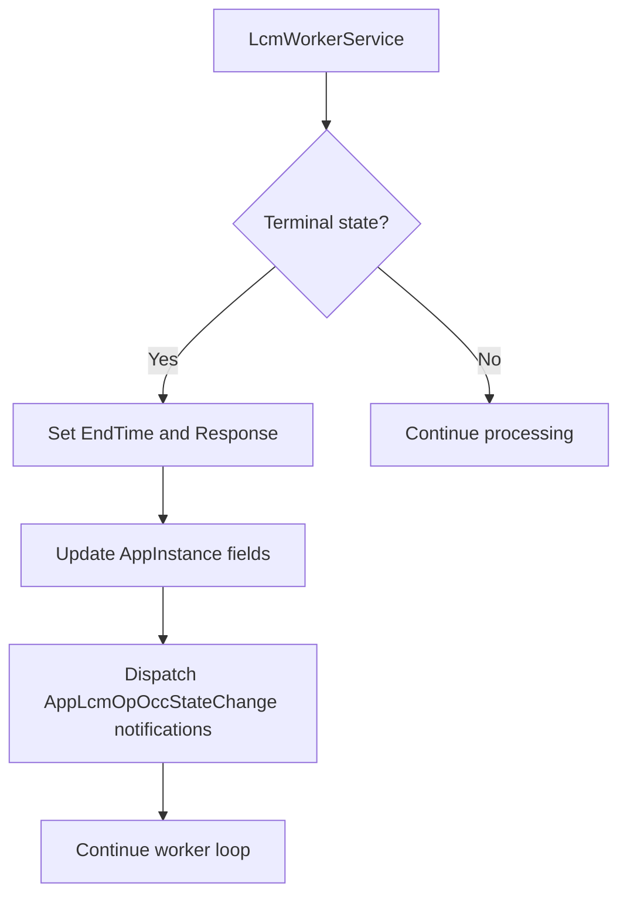
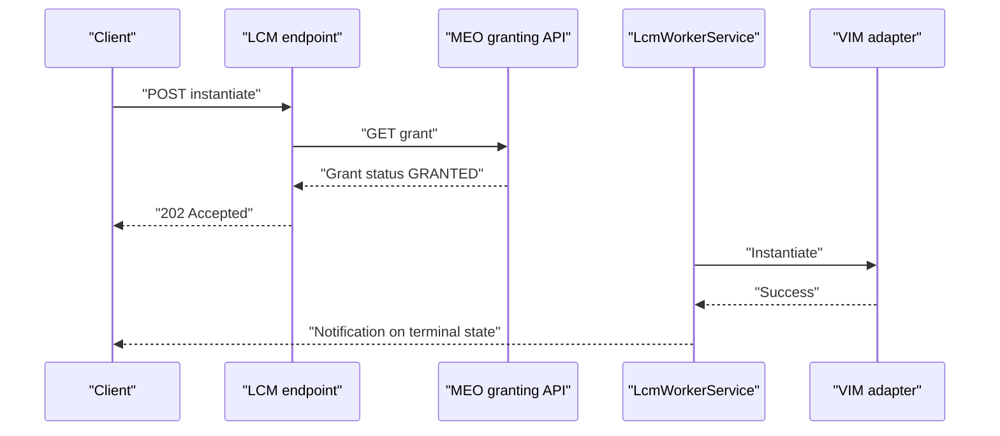

# LCM REST Endpoints

## Table of Contents
1. [Introduction](#introduction)
2. [API Surface and Base URL](#api-surface-and-base-url)
3. [Authentication and Authorization](#authentication-and-authorization)
4. [Request Validation and Error Model](#request-validation-and-error-model)
5. [Lifecycle Operation Occurrence Model](#lifecycle-operation-occurrence-model)
6. [MEPM Execution Role and Asynchronous Flow](#mepm-execution-role-and-asynchronous-flow)
7. [REST Endpoints](#rest-endpoints)
8. [Status Synchronization and Notifications](#status-synchronization-and-notifications)
9. [Typical Lifecycle Request Flows](#typical-lifecycle-request-flows)
10. [Troubleshooting Guide](#troubleshooting-guide)
11. [Conclusion](#conclusion)

## Introduction
This document describes the PlatformManager’s ETSI LCM REST endpoints under `/app_lcm/v1`. It focuses on the four lifecycle operations requested by the user:

- `instantiate`
- `terminate`
- `operate`
- `configure_platform_for_app`

The PlatformManager acts as the MEPM LCM API producer: it validates requests, creates an `AppInstanceLcmOpOcc` row in `STARTING`, transitions it to `PROCESSING`, offloads VIM work to the background `LcmWorkerService`, persists terminal state, and dispatches subscription-based notifications for terminal states.

## API Surface and Base URL
All documented lifecycle endpoints are grouped under the base path `/app_lcm/v1`. The route group also registers support resources such as subscriptions and operation occurrences, but this document concentrates on the four lifecycle operations.

| Endpoint | HTTP method | Purpose |
|---|---:|---|
| `/app_lcm/v1/app_instances/{appInstanceId}/instantiate` | POST | Start asynchronous instantiation of an app instance. |
| `/app_lcm/v1/app_instances/{appInstanceId}/terminate` | POST | Start asynchronous termination of an app instance. |
| `/app_lcm/v1/app_instances/{appInstanceId}/operate` | POST | Change the operational state of a running app instance. |
| `/app_lcm/v1/app_instances/{appInstanceId}/configure_platform_for_app` | POST | Persist platform configuration for an instantiated app instance. |

These routes are registered through the shared LCM endpoint group, which also maps subscriptions and op-occ query/control endpoints.

**Section sources**
- `src/PlatformManager/PlatformManager/Endpoints/LcmEndpoint.cs#L1-L35`
- `src/PlatformManager/PlatformManager/Endpoints/AppInstanceEndpoints.cs#L200-L220`
- `src/PlatformManager/PlatformManager/Endpoints/PlatformConfigEndpoints.cs#L104-L125`

## Authentication and Authorization
### Keycloak JWT authentication
Authentication is implemented using Keycloak via `KeycloakServiceTokenHandler`. The handler provides service-token validation for internal calls, while public-facing LCM endpoints use ASP.NET Core authorization policies.

### Fallback authorization policy
When Keycloak authentication or authorization does not authorize a request, the PlatformManager falls back to an authorization policy layer rather than silently accepting unauthenticated lifecycle mutations. This distinction is important:

- **Authentication**: Who the caller is, validated through Keycloak service tokens where applicable.
- **Authorization**: Whether the caller may perform the requested lifecycle operation.

The `configs` upload endpoint explicitly allows anonymous access, which is an exception intended for local VIM configuration distribution; most lifecycle endpoints do not declare `AllowAnonymous`.

**Diagram sources**
- `src/PlatformManager/PlatformManager/Infrastructure/KeycloakServiceTokenHandler.cs`
- `src/PlatformManager/PlatformManager/Endpoints/AppInstanceEndpoints.cs#L200-L220`
- `src/PlatformManager/PlatformManager/Endpoints/PlatformConfigEndpoints.cs#L104-L125`

**Section sources**
- `src/PlatformManager/PlatformManager/Infrastructure/KeycloakServiceTokenHandler.cs`
- `src/PlatformManager/PlatformManager/Endpoints/PlatformConfigEndpoints.cs#L100-L104`

## Request Validation and Error Model
### FluentValidation validators
Each lifecycle request type has a dedicated FluentValidation validator:

| Request type | Validator class |
|---|---|
| Instantiate request | `InstantiateAppRequestDtoValidator` |
| Terminate request | `TerminateAppRequestDtoValidator` |
| Operate request | `OperateRequestValidator` |
| Configure platform for app request | `ConfigPlatformForAppRequestDtoValidator` |

Validators are attached to endpoints using `.WithValidation<T>()`, so invalid payloads are rejected before business logic runs.

### RFC 7807 Problem Details
The API uses ASP.NET Core `Results.Problem` to produce structured error responses. Typical fields include:

| Field | Meaning |
|---|---|
| `title` | Human-readable error category. |
| `detail` | More specific explanation. |
| `instance` | Request URI when available. |
| `statusCode` | HTTP status code. |
| Extensions such as `cause` | Implementation-specific diagnostic information. |

Common status codes:

| Code | Meaning |
|---:|---|
| 400 Bad Request | Invalid payload, missing grant, expired grant, or validation failure. |
| 404 Not Found | Missing app instance or op-occ. |
| 409 Conflict | Instance already instantiated, not instantiated, active operation present, wrong op-occ state. |
| 413 Payload Too Large | Config file exceeds size limit. |
| 500 Internal Server Error | Unexpected handler or worker error. |

**Section sources**
- `src/PlatformManager/PlatformManager/Validators/InstantiateAppRequestDtoValidator.cs`
- `src/PlatformManager/PlatformManager/Validators/TerminateAppRequestDtoValidator.cs`
- `src/PlatformManager/PlatformManager/Validators/OperateRequestValidator.cs`
- `src/PlatformManager/PlatformManager/Validators/ConfigPlatformForAppRequestDtoValidator.cs`
- `src/PlatformManager/PlatformManager/Endpoints/AppInstanceEndpoints.cs#L200-L220`
- `src/PlatformManager/PlatformManager/Endpoints/AppInstanceEndpoints.cs#L504-L607`
- `src/PlatformManager/PlatformManager/Endpoints/PlatformConfigEndpoints.cs#L100-L104`

## Lifecycle Operation Occurrence Model
An `AppInstanceLcmOpOcc` represents one asynchronous lifecycle operation. Its key fields are:

| Field | Description |
|---|---|
| `Id` | Operation occurrence identifier. |
| `AppInstanceId` | Target app instance. |
| `LifecycleOperation` | Operation kind, such as instantiate, terminate, operate, or configure platform for app. |
| `OperationState` | State machine value: `STARTING`, `PROCESSING`, `COMPLETED`, `FAILED`, `FAILED_TEMP`. |
| `StateEnteredTime` | Timestamp of the most recent transition. |
| `StartTime` | When the operation started. |
| `EndTime` | Terminal timestamp. |
| `Response` | VIM response or error detail. |
| `HostIp` | Host IP used by the VIM adapter. |
| `VimType` | Resolved VIM type from the grant or instance. |
| `AppPkgId` | Package identifier used during instantiation. |
| `ChangeStateTo` | Operational target state for operate operations. |
| `ConfigPayloadJson` | Serialized platform configuration for `configure_platform_for_app`. |

**Diagram sources**
- `src/PlatformManager/PlatformManager/Models/AppInstanceLcmOpOcc.cs#L1-L54`
- `src/PlatformManager/PlatformManager/Endpoints/LcmOpOccEndpoints.cs#L1-L163`
- `src/PlatformManager/PlatformManager/Services/LcmWorkerService.cs#L1-L200`

**Section sources**
- `src/PlatformManager/PlatformManager/Models/AppInstanceLcmOpOcc.cs#L1-L54`

## MEPM Execution Role and Asynchronous Flow
The PlatformManager is responsible for:

1. Accepting the lifecycle request.
2. Validating the request body with FluentValidation.
3. Performing domain checks (instance existence, instantiation state, active operations).
4. Creating an `AppInstanceLcmOpOcc` in `STARTING`.
5. Transitioning it to `PROCESSING`.
6. Enqueuing a work item for `LcmWorkerService`.
7. Returning `202 Accepted` with a link to the op-occ resource.
8. Allowing the background worker to drive the operation to `COMPLETED` or `FAILED`.

The actual VIM work is performed by `AppInstanceService`, which selects the correct gRPC client based on the resolved `VimType` and forwards instantiate, terminate, or operate calls.

**Diagram sources**
- `src/PlatformManager/PlatformManager/Endpoints/AppInstanceEndpoints.cs#L200-L504`
- `src/PlatformManager/PlatformManager/Endpoints/PlatformConfigEndpoints.cs#L125-L225`
- `src/PlatformManager/PlatformManager/Services/LcmWorkerService.cs#L1-L200`
- `src/PlatformManager/PlatformManager/Services/LcmWorkerService.cs#L201-L501`
- `src/PlatformManager/PlatformManager/Services/AppInstanceService.cs#L1-L160`

**Section sources**
- `src/PlatformManager/PlatformManager/Services/LcmWorkerService.cs#L1-L200`
- `src/PlatformManager/PlatformManager/Services/AppInstanceService.cs#L1-L160`

## REST Endpoints

### Instantiate
**HTTP method:** POST  
**URL pattern:** `/app_lcm/v1/app_instances/{appInstanceId}/instantiate`

#### Request schema
The request uses `InstantiateAppRequestDto` and is validated by `InstantiateAppRequestDtoValidator`. Typical request properties include:

| Property | Type | Required | Description |
|---|---|---:|---|
| `grantId` | string | Yes | Grant identifier returned by MEO granting API. |
| `appPkgId` | string | Yes | Application package identifier. |
| `hostIp` | string | Optional | Target host IP; can be supplied directly or derived from selected MEC host info. |
| `selectedMECHostInfo` | array | Optional | Alternative source for host selection. |

The handler forwards the inbound `Authorization` header to the MEO grant verification call, preserving the Bearer token format.

#### Response schema
- Success: `202 Accepted`
- Location header points to `/app_lcm/v1/app_lcm_op_occs/{opOccId}`
- Body contains minimal operation metadata: `id`, `operationState`, `lifecycleOperation`, `appInstanceId`

#### Validation and preconditions
- Instance must exist.
- Instance must not already be `INSTANTIATED`.
- No other lifecycle operation may be `STARTING` or `PROCESSING`.
- Grant must resolve successfully from MEO and have status `GRANTED`, matching `appInstanceId`, operation `INSTANTIATE`, and not be expired.

#### Errors
| Status | Meaning |
|---:|---|
| 400 | Grant not found, expired, invalid, or mismatched. |
| 404 | Instance not found. |
| 409 | Instance already instantiated or another operation is active. |
| 500 | Unexpected handler error; includes `cause`, `appInstanceId`, and optional `lcmOpOccId`. |

**Section sources**
- `src/PlatformManager/PlatformManager/Endpoints/AppInstanceEndpoints.cs#L200-L504`
- `src/PlatformManager/PlatformManager/Validators/InstantiateAppRequestDtoValidator.cs`

### Terminate
**HTTP method:** POST  
**URL pattern:** `/app_lcm/v1/app_instances/{appInstanceId}/terminate`

#### Request schema
The request uses `TerminateAppRequestDto` and is validated by `TerminateAppRequestDtoValidator`. Typical properties include:

| Property | Type | Required | Description |
|---|---|---:|---|
| `hostIp` | string | Usually required by implementation | Target host IP used by the VIM adapter. |

#### Response schema
- Success: `202 Accepted`
- Location header points to `/app_lcm/v1/app_lcm_op_occs/{opOccId}`
- Body contains minimal operation metadata: `id`, `operationState`, `lifecycleOperation`, `appInstanceId`

#### Validation and preconditions
- Instance must exist.
- Instance must not be `NOT_INSTANTIATED`.
- No other lifecycle operation may be `STARTING` or `PROCESSING`.
- On success, the worker sets the instance back to `NOT_INSTANTIATED`.

#### Errors
| Status | Meaning |
|---:|---|
| 404 | Instance not found. |
| 409 | Instance already terminated or another operation is active. |
| 500 | Unexpected handler error. |

**Section sources**
- `src/PlatformManager/PlatformManager/Endpoints/AppInstanceEndpoints.cs#L504-L607`
- `src/PlatformManager/PlatformManager/Validators/TerminateAppRequestDtoValidator.cs`

### Operate
**HTTP method:** POST  
**URL pattern:** `/app_lcm/v1/app_instances/{appInstanceId}/operate`

#### Request schema
The request uses `OperateRequest` and is validated by `OperateRequestValidator`. Typical properties include:

| Property | Type | Required | Description |
|---|---|---:|---|
| `changeStateTo` | string | Yes | Target operational state, typically `STARTED` or `STOPPED`. |

#### Response schema
- Success: `202 Accepted`
- Location header points to `/app_lcm/v1/app_lcm_op_occs/{opOccId}`
- Body contains minimal operation metadata: `id`, `operationState`, `lifecycleOperation`, `appInstanceId`

#### Processing behavior
The worker resolves the target state from `ChangeStateTo`; if absent, it defaults to `STARTED`. Successful completion updates the instance’s `InstantiatedAppState` and writes the VIM response into the op-occ.

#### Errors
| Status | Meaning |
|---:|---|
| 404 | Instance not found. |
| 409 | Instance not instantiated, missing `HostIp`, or another operation is active. |
| 500 | Unexpected handler error. |

**Section sources**
- `src/PlatformManager/PlatformManager/Endpoints/AppInstanceEndpoints.cs#L504-L607`
- `src/PlatformManager/PlatformManager/Validators/OperateRequestValidator.cs`
- `src/PlatformManager/PlatformManager/Services/LcmWorkerService.cs#L201-L501`

### Configure platform for app
**HTTP method:** POST  
**URL pattern:** `/app_lcm/v1/app_instances/{appInstanceId}/configure_platform_for_app`

#### Request schema
The request uses `ConfigPlatformForAppRequestDto` and is validated by `ConfigPlatformForAppRequestDtoValidator`. The exact request body shape is defined by that DTO and its validator.

#### Response schema
- Success: `202 Accepted`
- Location header points to `/app_lcm/v1/app_lcm_op_occs/{opOccId}`
- Body contains minimal operation metadata: `id`, `operationState`, `lifecycleOperation`, `appInstanceId`

#### Processing behavior
Unlike instantiate/terminate/operate, `configure_platform_for_app` is persistence-only in this implementation:

1. The endpoint validates the instance exists and is `INSTANTIATED`.
2. It ensures no active lifecycle operation is present.
3. It creates an op-occ in `STARTING`.
4. It transitions to `PROCESSING`.
5. The worker persists the serialized configuration JSON onto the `AppInstance.PlatformConfigJson` field.
6. The op-occ transitions to `COMPLETED`.

#### Errors
| Status | Meaning |
|---:|---|
| 404 | Instance not found. |
| 409 | Instance not instantiated, missing `HostIp`, or another operation is active. |
| 500 | Unexpected handler error. |

**Section sources**
- `src/PlatformManager/PlatformManager/Endpoints/PlatformConfigEndpoints.cs#L104-L225`
- `src/PlatformManager/PlatformManager/Validators/ConfigPlatformForAppRequestDtoValidator.cs`
- `src/PlatformManager/PlatformManager/Services/LcmWorkerService.cs#L201-L501`

## Status Synchronization and Notifications
### Op-occ transitions
All lifecycle endpoints follow the same two-phase persistence pattern:

1. Create op-occ in `STARTING`.
2. Commit a second transaction setting `PROCESSING`, persisting execution context (`HostIp`, `AppPkgId`, `VimType`, `ChangeStateTo`, `ConfigPayloadJson`).
3. Enqueue the work item.

The background worker then drives transitions:

| Operation | Success transition | Failure transition |
|---|---|---|
| Instantiate | `PROCESSING` → `COMPLETED` | `PROCESSING` → `FAILED` |
| Terminate | `PROCESSING` → `COMPLETED` | `PROCESSING` → `FAILED` |
| Operate | `PROCESSING` → `COMPLETED` | `PROCESSING` → `FAILED` |
| Configure platform for app | `PROCESSING` → `COMPLETED` | `PROCESSING` → `FAILED` |

On successful completion, the worker also updates the `AppInstance`:

- Instantiate: sets `InstantiationState` to `INSTANTIATED`, `InstantiatedAppState` to `STARTED`, and persists `VimType` and `HostIp`.
- Terminate: resets to `NOT_INSTANTIATED` and clears `InstantiatedAppState`.
- Operate: updates `InstantiatedAppState` to the requested state.
- Configure platform for app: persists `PlatformConfigJson`.

### Crash replay
At startup, `LcmWorkerService` replays op-occs left in `PROCESSING` before the process booted. For instantiate operations where the target instance is already `INSTANTIATED`, the worker settles the op-occ to `COMPLETED` without calling the VIM again. Other stranded operations are re-enqueued.

### Subscription-based notifications
Terminal op-occ transitions trigger notification dispatch. Subscriptions can filter by:

- Notification type.
- Operation types.
- Operation states.
- Optional `AppInstanceId`.
- Optional `AppLcmOpOccId`.

Notifications are enqueued asynchronously; failures in notification dispatch do not roll back terminal op-occ state.

**Diagram sources**
- `src/PlatformManager/PlatformManager/Services/LcmWorkerService.cs#L201-L501`
- `src/PlatformManager/PlatformManager/Endpoints/LcmEndpoint.cs#L35-L120`

**Section sources**
- `src/PlatformManager/PlatformManager/Services/LcmWorkerService.cs#L1-L200`
- `src/PlatformManager/PlatformManager/Services/LcmWorkerService.cs#L201-L501`
- `src/PlatformManager/PlatformManager/Endpoints/LcmEndpoint.cs#L35-L120`

## Typical Lifecycle Request Flows

### Instantiate flow
1. Client sends `POST /app_lcm/v1/app_instances/{appInstanceId}/instantiate` with a valid grant.
2. PlatformManager verifies the grant via MEO.
3. PlatformManager creates an op-occ in `STARTING`.
4. PlatformManager transitions to `PROCESSING` and returns `202 Accepted`.
5. Background worker distributes the CSAR and calls the VIM adapter.
6. Worker sets the op-occ to `COMPLETED` and marks the instance `INSTANTIATED`.
7. If the client subscribes, a terminal notification is sent.

**Diagram sources**
- `src/PlatformManager/PlatformManager/Endpoints/AppInstanceEndpoints.cs#L200-L504`
- `src/PlatformManager/PlatformManager/Services/LcmWorkerService.cs#L201-L501`
- `src/PlatformManager/PlatformManager/Services/AppInstanceService.cs#L1-L160`

### Terminate flow
1. Client sends `POST /app_lcm/v1/app_instances/{appInstanceId}/terminate`.
2. PlatformManager validates instance state and active operations.
3. PlatformManager creates and starts the op-occ asynchronously.
4. Background worker calls VIM terminate.
5. Worker sets instance to `NOT_INSTANTIATED`.

### Operate flow
1. Client sends `POST /app_lcm/v1/app_instances/{appInstanceId}/operate` with `changeStateTo`.
2. PlatformManager validates instance is instantiated and has a host IP.
3. Background worker calls VIM operate.
4. Worker updates the instance’s operational state.

### Configure platform for app flow
1. Client sends `POST /app_lcm/v1/app_instances/{appInstanceId}/configure_platform_for_app`.
2. PlatformManager validates instance is instantiated and idle.
3. Background worker persists the configuration JSON onto the instance.
4. Op-occ completes without calling the VIM.

**Section sources**
- `src/PlatformManager/PlatformManager/Endpoints/AppInstanceEndpoints.cs#L200-L607`
- `src/PlatformManager/PlatformManager/Endpoints/PlatformConfigEndpoints.cs#L125-L225`
- `src/PlatformManager/PlatformManager/Services/LcmWorkerService.cs#L201-L501`

## Troubleshooting Guide

### Common 409 Conflict causes
| Situation | Likely cause |
|---|---|
| Instantiate returns 409 | Instance already `INSTANTIATED` or another lifecycle operation is active. |
| Terminate returns 409 | Instance already `NOT_INSTANTIATED` or another lifecycle operation is active. |
| Operate returns 409 | Instance not instantiated, missing `HostIp`, or another lifecycle operation is active. |
| Configure platform for app returns 409 | Instance not instantiated, missing `HostIp`, or another lifecycle operation is active. |

### Cancel, fail, and retry
The op-occ control endpoints provide manual recovery:

| Endpoint | Allowed state | Effect |
|---|---|---|
| `POST /app_lcm/v1/app_lcm_op_occs/{id}/cancel` | `PROCESSING` | Marks op-occ `FAILED_TEMP`. |
| `POST /app_lcm/v1/app_lcm_op_occs/{id}/fail` | `FAILED_TEMP` | Marks op-occ `FAILED`. |
| `POST /app_lcm/v1/app_lcm_op_occs/{id}/retry` | `FAILED_TEMP` | Restores `PROCESSING` and re-enqueues the work item. |

### Worker timeout behavior
A per-operation VIM timeout is applied to long-running VIM calls. If the timeout expires, the worker marks the op-occ `FAILED` instead of stalling the entire worker loop.

### Notification delivery issues
If a notification callback fails, the error is logged and swallowed so that terminal op-occ state remains intact. Clients should poll the op-occ resource or verify subscription delivery separately.

**Section sources**
- `src/PlatformManager/PlatformManager/Endpoints/LcmOpOccEndpoints.cs#L1-L163`
- `src/PlatformManager/PlatformManager/Services/LcmWorkerService.cs#L1-L200`
- `src/PlatformManager/PlatformManager/Services/LcmWorkerService.cs#L201-L501`
- `src/PlatformManager/PlatformManager/Endpoints/LcmEndpoint.cs#L35-L120`

## Conclusion
The PlatformManager’s LCM REST API implements asynchronous lifecycle management by combining strict request validation, persistent op-occ state tracking, and offloaded VIM execution. Clients should treat lifecycle endpoints as fire-and-forget entry points and rely on op-occ polling and subscription notifications for final state. Authentication is expected through Keycloak JWT where configured, with fallback authorization policies protecting mutations. Status synchronization between MEO grants, the PlatformManager database, and VIM adapters is maintained through explicit state transitions, crash-replay handling, and terminal notification dispatch.

> **Referenced Files in This Document**
>
> - `src/PlatformManager/PlatformManager/Endpoints/LcmEndpoint.cs`
> - `src/PlatformManager/PlatformManager/Endpoints/AppInstanceEndpoints.cs`
> - `src/PlatformManager/PlatformManager/Endpoints/LcmOpOccEndpoints.cs`
> - `src/PlatformManager/PlatformManager/Endpoints/PlatformConfigEndpoints.cs`
> - `src/PlatformManager/PlatformManager/Services/AppInstanceService.cs`
> - `src/PlatformManager/PlatformManager/Services/LcmWorkerService.cs`
> - `src/PlatformManager/PlatformManager/Models/AppInstanceLcmOpOcc.cs`
> - `src/PlatformManager/PlatformManager/Validators/InstantiateAppRequestDtoValidator.cs`
> - `src/PlatformManager/PlatformManager/Validators/TerminateAppRequestDtoValidator.cs`
> - `src/PlatformManager/PlatformManager/Validators/OperateRequestValidator.cs`
> - `src/PlatformManager/PlatformManager/Validators/ConfigPlatformForAppRequestDtoValidator.cs`
> - `src/PlatformManager/PlatformManager/Infrastructure/KeycloakServiceTokenHandler.cs`
