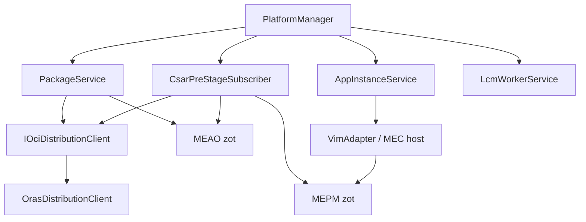
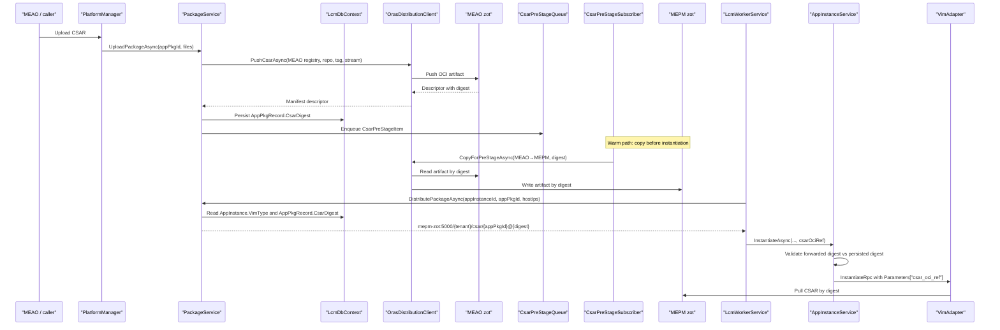
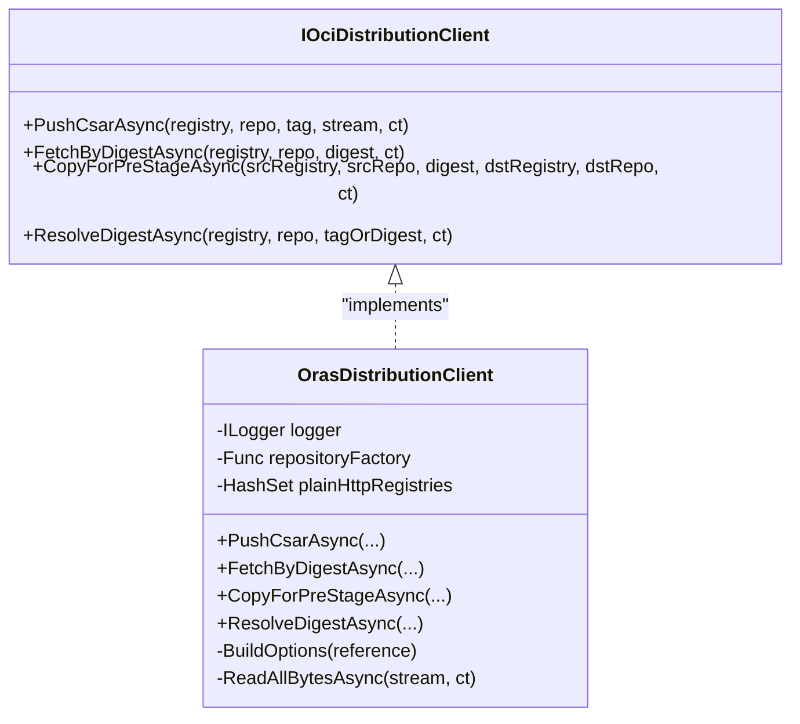
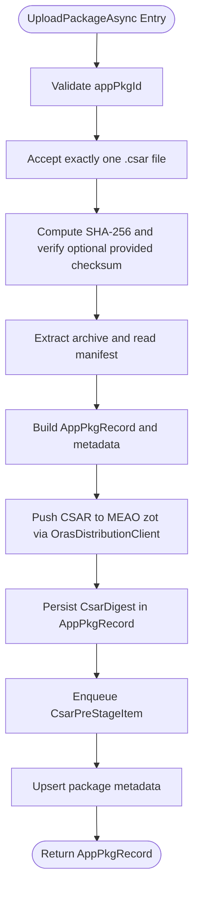
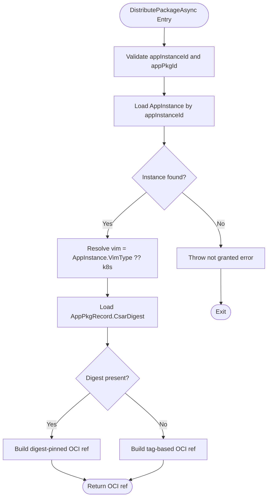
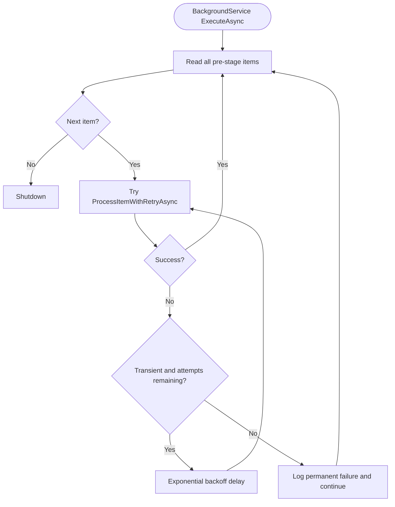
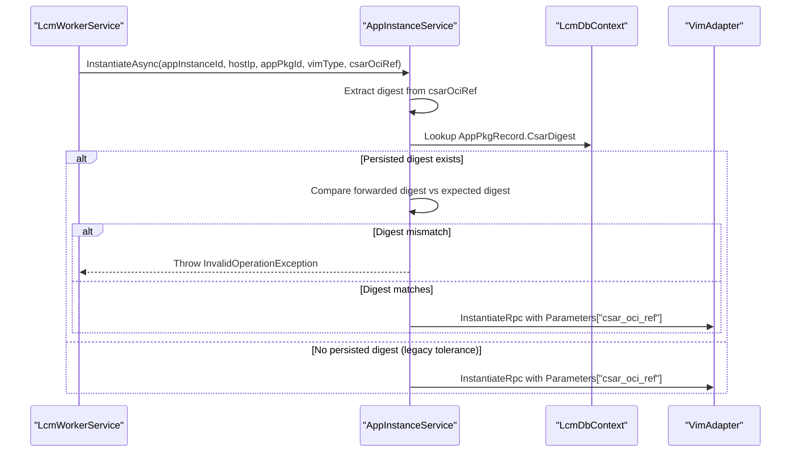
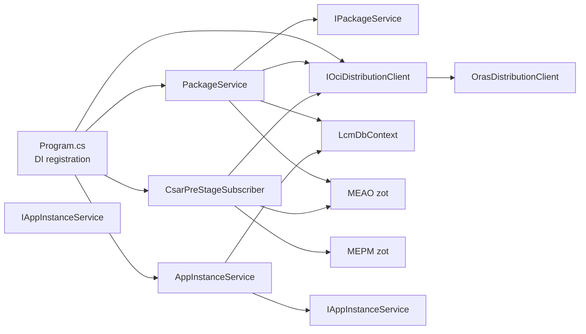

# Package Distribution and CSAR Pre-Staging

## Table of Contents
1. [Introduction](#introduction)
2. [Project Structure](#project-structure)
3. [Core Components](#core-components)
4. [Architecture Overview](#architecture-overview)
5. [Detailed Component Analysis](#detailed-component-analysis)
6. [Dependency Analysis](#dependency-analysis)
7. [Configuration](#configuration)
8. [Performance Considerations](#performance-considerations)
9. [Troubleshooting Guide](#troubleshooting-guide)
10. [Migration Notes](#migration-notes)
11. [Conclusion](#conclusion)

## Introduction
This document explains the package distribution subsystem that implements ADR-0041: replacing legacy gRPC byte-streaming of CSAR artifacts with OCI-based distribution through a zot registry and an ORAS client. The system has two complementary paths:

- **Warm path:** `CsarPreStageSubscriber` copies newly onboarded CSARs from the MEAO zot registry to the MEPM zot registry after `PackageOnboarded`.
- **Cold path:** The MEPM zot registry pulls on demand when a VIM adapter requests a CSAR that is not yet pre-staged.

At instantiation time, `PackageService.DistributePackageAsync` resolves VIM routing from the persisted `AppInstance.VimType`, computes an immutable digest-pinned OCI reference such as `mepm-zot:5000/{tenant}/csar/{appPkgId}@{CsarDigest}`, and returns it for consumption by `InstantiateAsync`. That reference is forwarded via the existing gRPC parameters map under the key `csar_oci_ref`, allowing VimAdapters to pull the artifact directly by digest instead of receiving another full CSAR stream over gRPC.

## Project Structure
The implementation lives primarily in the PlatformManager service and consists of:

| Area | Responsibility |
|---|---|
| `OrasDistributionClient` | ORAS 0.8.0 implementation of OCI push, fetch by digest, pre-stage copy, and tag-to-digest resolution. |
| `IOciDistributionClient` | Stable abstraction around ORAS operations; used everywhere except tests. |
| `PackageService` | Uploads CSAR files, persists metadata and the computed manifest digest, pushes to MEAO zot, enqueues pre-stage work, and computes the distributed OCI reference. |
| `CsarPreStageSubscriber` | Background service consuming pre-stage items and copying artifacts from MEAO zot to MEPM zot. |
| `AppInstanceService.InstantiateAsync` | Last-seam consumer that validates the forwarded digest and places `csar_oci_ref` into the instantiate request. |
| `LcmWorkerService` | Long-running worker that drives lifecycle operations and coordinates distribution and instantiation. |
| `AppPkgRecord` | Persistent record carrying the authoritative `CsarDigest`. |

**Diagram sources**
- `src/PlatformManager/PlatformManager/Program.cs#L100-L140`
- `src/PlatformManager/PlatformManager/Services/PackageService.cs#L100-L190`
- `src/PlatformManager/PlatformManager/Services/CsarPreStageSubscriber.cs#L1-L136`
- `src/PlatformManager/PlatformManager/Services/AppInstanceService.cs#L31-L78`
- `src/PlatformManager/PlatformManager/Services/LcmWorkerService.cs#L1-L120`

**Section sources**
- `src/PlatformManager/PlatformManager/Program.cs#L100-L140`
- `docs/ADR/0041-oci-zot-oras-csar-distribution.md#L1-L248`

## Core Components
The distribution subsystem is built around a small set of cohesive components:

| Component | Key Methods | Purpose |
|---|---|---|
| `IOciDistributionClient` | `PushCsarAsync`, `FetchByDigestAsync`, `CopyForPreStageAsync`, `ResolveDigestAsync` | Abstracts ORAS behavior so the rest of the codebase does not depend on ORAS versions or transport details. |
| `OrasDistributionClient` | Implements all four interface methods | Pushes CSAR blobs as OCI artifacts, pulls by digest, copies between registries for pre-staging, and resolves tags to digests. |
| `PackageService` | `UploadPackageAsync`, `DistributePackageAsync` | Validates and extracts uploaded CSARs, persists metadata and digest, pushes to MEAO zot, enqueues pre-stage, and computes the digest-pinned OCI ref. |
| `CsarPreStageSubscriber` | `ExecuteAsync`, `ProcessItemWithRetryAsync`, `ProcessItemAsync` | Consumes pre-stage queue items and copies MEAO → MEPM with bounded retry and cancellation support. |
| `AppInstanceService` | `InstantiateAsync` | Validates the forwarded digest against persisted `CsarDigest` and populates `InstantiateRequest.Parameters["csar_oci_ref"]`. |
| `LcmWorkerService` | Lifecycle-driven background processing | Drives long-running VIM operations, replays stranded work, and coordinates calls to `DistributePackageAsync` and `InstantiateAsync`. |
| `AppPkgRecord` | `CsarDigest` property | Stores the authoritative manifest digest produced during upload. |

**Section sources**
- `src/PlatformManager/PlatformManager/Services/IOciDistributionClient.cs#L1-L56`
- `src/PlatformManager/PlatformManager/Services/OrasDistributionClient.cs#L1-L277`
- `src/PlatformManager/PlatformManager/Services/PackageService.cs#L1-L390`
- `src/PlatformManager/PlatformManager/Services/CsarPreStageSubscriber.cs#L1-L136`
- `src/PlatformManager/PlatformManager/Services/AppInstanceService.cs#L1-L160`
- `src/PlatformManager/PlatformManager/Services/LcmWorkerService.cs#L1-L200`
- `src/PlatformManager/PlatformManager/Models/AppPkgRecord.cs#L1-L19`

## Architecture Overview
ADR-0041 defines the overall decision: CSARs are distributed as OCI artifacts addressed by digest rather than streamed as raw bytes. The MEAO zot registry is the source of truth; the MEPM zot registry is a cache that supports both event-driven pre-staging and on-demand pull-through.

**Diagram sources**
- `src/PlatformManager/PlatformManager/Services/PackageService.cs#L100-L390`
- `src/PlatformManager/PlatformManager/Services/CsarPreStageSubscriber.cs#L1-L136`
- `src/PlatformManager/PlatformManager/Services/AppInstanceService.cs#L31-L78`
- `src/PlatformManager/PlatformManager/Services/OrasDistributionClient.cs#L1-L277`
- `docs/ADR/0041-oci-zot-oras-csar-distribution.md#L1-L248`

## Detailed Component Analysis

### OrasDistributionClient and IOciDistributionClient
`IOciDistributionClient` isolates the codebase from ORAS 0.x internals. It exposes four idempotent, digest-focused operations:

| Operation | Input | Output | Usage |
|---|---|---|---|
| `PushCsarAsync` | Registry, repo, tag, CSAR stream | Manifest descriptor | Upload during package onboarding. |
| `FetchByDigestAsync` | Registry, repo, digest | Descriptor plus content stream | Digest-pinned retrieval. |
| `CopyForPreStageAsync` | Source registry/repo/digest, destination registry/repo | Destination descriptor | MEAO zot → MEPM zot warm path. |
| `ResolveDigestAsync` | Registry, repo, tag or digest | Manifest digest | Auto-provision and validation flows. |

`OrasDistributionClient` builds ORAS `RepositoryOptions` internally. Plain HTTP is allowed only for exact loopback addresses and explicitly configured edge-local zot hosts (`localhost:5000`, `127.0.0.1:5000`, and environment variables `MEAO_ZOT`, `MEPM_ZOT`, `MEC_HOST_ZOT`). All other registries use HTTPS with the SDK's default credential chain.

The client emits OpenTelemetry metrics through a static `Meter`:

| Metric | Meaning |
|---|---|
| `oci_operations_total` | Count of push/fetch/copy/resolve operations by outcome. |
| `oci_verify_total` | Count of signature-verify outcomes enforced by `onlySigned:true` zot configuration. |
| `oci_fetch_duration_seconds` | Histogram of fetch/pull latency by registry and repo. |

**Diagram sources**
- `src/PlatformManager/PlatformManager/Services/IOciDistributionClient.cs#L1-L56`
- `src/PlatformManager/PlatformManager/Services/OrasDistributionClient.cs#L1-L277`

**Section sources**
- `src/PlatformManager/PlatformManager/Services/IOciDistributionClient.cs#L1-L56`
- `src/PlatformManager/PlatformManager/Services/OrasDistributionClient.cs#L1-L277`

### PackageService: Upload, Digest Persistence, and Reference Resolution
`PackageService.UploadPackageAsync` performs several responsibilities:

1. Validates `appPkgId` against null, empty, absolute-path, and traversal inputs.
2. Accepts exactly one `.csar` file.
3. Writes a temporary file, computes SHA-256, optionally compares against a provided checksum, and moves it to the final location.
4. Extracts the archive and reads the top-level manifest to populate package metadata.
5. Pushes the CSAR to the MEAO zot registry using `OrasDistributionClient.PushCsarAsync`.
6. Persists the returned manifest digest into `AppPkgRecord.CsarDigest`.
7. Enqueues a `CsarPreStageItem` for the warm path.
8. Upserts `AppPkgDetails` and `AppPkgRecord` with transient-concurrency retries.

**Diagram sources**
- `src/PlatformManager/PlatformManager/Services/PackageService.cs#L60-L190`

`PackageService.DistributePackageAsync` replaces byte-stream distribution with digest-pinned reference resolution:

1. Validates `appPkgId` and requires `appInstanceId` to resolve VIM routing context.
2. Reads `AppInstance` from the local `LcmDbContext`; missing instances fail closed.
3. Resolves VIM type from `AppInstance.VimType`, falling back to `k8s` only for legacy instances without `VimType`.
4. Looks up `AppPkgRecord.CsarDigest`.
5. Builds either a digest-pinned reference `mepm-zot:5000/{tenant}/csar/{appPkgId}@{digest}` or a tag-based fallback when no digest exists.
6. Returns the OCI reference consumed by `InstantiateAsync`.

**Diagram sources**
- `src/PlatformManager/PlatformManager/Services/PackageService.cs#L230-L320`

**Section sources**
- `src/PlatformManager/PlatformManager/Services/PackageService.cs#L1-L390`
- `src/PlatformManager/PlatformManager/Services/IPackageService.cs#L1-L18`
- `src/PlatformManager/PlatformManager/Models/AppPkgRecord.cs#L1-L19`

### CsarPreStageSubscriber: Event-Driven Warm Path
`CsarPreStageSubscriber` is a hosted background service that consumes pre-stage items from `ICsarPreStageQueue`. Its design follows these principles:

- Never uses `CancellationToken.None`.
- Never lets a single item failure terminate the subscriber.
- Retries transient failures with exponential backoff.
- Honours cancellation on shutdown.
- Copies the artifact from `meao-zot:5000` to `mepm-zot:5000` using the tenant-scoped repo `{tenantId}/csar/{appPkgId}`.

The retry strategy is bounded:

| Attempt | Delay | Behavior |
|---|---:|---|
| 1 | Immediate | First attempt. |
| 2 | ~200 ms | Retry on transient errors. |
| 3 | ~400 ms | Final retry. |
| 4+ | No more retries | Log permanent failure and continue processing later items. |

Transient exceptions include timeouts, operation cancellations, HTTP transport failures, and general I/O failures. Authentication or configuration errors are considered non-transient and are logged without retry.

**Diagram sources**
- `src/PlatformManager/PlatformManager/Services/CsarPreStageSubscriber.cs#L1-L136`

**Section sources**
- `src/PlatformManager/PlatformManager/Services/CsarPreStageSubscriber.cs#L1-L136`

### AppInstanceService.InstantiateAsync: Last-Seam Digest Validation
`AppInstanceService.InstantiateAsync` is the last seam before the VIM call. It forwards the digest-pinned OCI reference through the existing gRPC parameters map under `csar_oci_ref`, but only on instantiate operations. Terminate and operate do not populate this parameter.

The digest-match guard extracts the digest suffix from the forwarded reference and compares it ordinally with `AppPkgRecord.CsarDigest`. If a persisted digest exists and differs, the method throws an `InvalidOperationException` naming both digests. If no persisted digest exists, the call tolerates legacy rows and still forwards the reference.

**Diagram sources**
- `src/PlatformManager/PlatformManager/Services/AppInstanceService.cs#L31-L78`
- `src/PlatformManager/PlatformManager/Services/IAppInstanceService.cs#L1-L36`

**Section sources**
- `src/PlatformManager/PlatformManager/Services/AppInstanceService.cs#L1-L160`
- `src/PlatformManager/PlatformManager/Services/IAppInstanceService.cs#L1-L36`

### LcmWorkerService Coordination
`LcmWorkerService` is a hosted background worker that drains the LCM work queue and manages crash-replay of operations stuck in `PROCESSING`. It applies ADR-0028 VIM operation timeouts and records failed operations so the orchestrator can cancel or retry them.

While `LcmWorkerService` itself does not contain every orchestration detail, it is the runtime boundary where long-running lifecycle operations, including those involving package distribution and instantiation, are executed off the HTTP request path.

**Section sources**
- `src/PlatformManager/PlatformManager/Services/LcmWorkerService.cs#L1-L200`

## Dependency Analysis
The dependency graph shows how the distribution subsystem connects callers, the OCI client, the database, and external registries.

**Diagram sources**
- `src/PlatformManager/PlatformManager/Program.cs#L100-L140`
- `src/PlatformManager/PlatformManager/Services/PackageService.cs#L1-L390`
- `src/PlatformManager/PlatformManager/Services/CsarPreStageSubscriber.cs#L1-L136`
- `src/PlatformManager/PlatformManager/Services/AppInstanceService.cs#L1-L160`
- `src/PlatformManager/PlatformManager/Services/OrasDistributionClient.cs#L1-L277`

**Section sources**
- `src/PlatformManager/PlatformManager/Program.cs#L100-L140`

## Configuration
The following configuration options control OCI registry behavior:

| Option | Source | Default | Meaning |
|---|---|---|---|
| `Oci:MeaoRegistry` | `PackageService` constructor | `meao-zot:5000` | Registry endpoint used for pushing CSARs during upload. Used by both upload and auto-provision digest resolution. |
| `MEAO_ZOT` | `OrasDistributionClient` constructor | `meao-zot:5000` | Exact hostname accepted for plaintext HTTP access. |
| `MEPM_ZOT` | `OrasDistributionClient` constructor | `mepm-zot:5000` | Exact hostname accepted for plaintext HTTP access. |
| `MEC_HOST_ZOT` | `OrasDistributionClient` constructor | `mec-host-zot:5000` | Exact hostname accepted for plaintext HTTP access. |
| `LcmWorker:VimOperationTimeout` | `LcmWorkerService` | 2 minutes | Maximum duration for VIM lifecycle operations; cold OCI pulls can be affected. |
| `PORT` | Application startup | `5155` | Kestrel listening port. |

Important distinction:

- `Oci:MeaoRegistry` controls where PlatformManager **pushes** CSARs and where auto-provision **resolves** digests.
- `MEAO_ZOT` / `MEPM_ZOT` / `MEC_HOST_ZOT` control which registries may be accessed over plain HTTP in `OrasDistributionClient`. They are evaluated once at construction.
- The forwarded OCI reference value remains the logical identity `mepm-zot:5000/{tenant}/csar/{appPkgId}@{digest}` regardless of compose host mappings.

**Section sources**
- `src/PlatformManager/PlatformManager/Services/PackageService.cs#L25-L55`
- `src/PlatformManager/PlatformManager/Services/OrasDistributionClient.cs#L25-L75`
- `src/PlatformManager/PlatformManager/Services/LcmWorkerService.cs#L20-L55`
- `docs/ADR/0041-oci-zot-oras-csar-distribution.md#L201-L248`

## Performance Considerations
- **Memory pressure reduction:** Replacing per-host gRPC byte streaming with digest-pinned OCI references removes the requirement for the MEPM to buffer the full CSAR for each VIM adapter.
- **Content addressing:** Digest-based references enable deduplication across multiple VimAdapters behind one MEPM.
- **Warm path goal:** Event-driven pre-staging targets high cache warmth before instantiation, reducing cold-pull latency.
- **Backoff strategy:** Pre-stage retries use exponential backoff bounded to three attempts, avoiding unbounded resource consumption.
- **Metrics:** `OrasDistributionClient` tracks operation counts, verification outcomes, and fetch durations, enabling evidence for ADR-0041 claims about no stale window and signed-only enforcement.
- **Timeout interaction:** Cold pulls that exceed `LcmWorker:VimOperationTimeout` settle the operation as failed; the orchestrator’s retry loop then attempts again, often succeeding after the pre-staged warm path converges.

[No sources needed since this section provides general guidance]

## Troubleshooting Guide

### Digest Mismatch Between Forwarded Reference and Persisted Record
**Symptoms:**
- `InstantiateAsync` throws an `InvalidOperationException`.
- The exception names both the forwarded reference digest and the persisted `AppPkgRecord.CsarDigest`.

**Likely causes:**
- A different CSAR was pushed under the same `appPkgId`.
- The wrong digest was propagated through the orchestration pipeline.
- Legacy rows without a persisted digest bypass the check, so mismatches are only caught when a digest exists.

**Resolution steps:**
1. Inspect the exception message to identify both digests.
2. Check whether the CSAR was re-uploaded under the same `appPkgId`.
3. Verify that `PackageService.DistributePackageAsync` is returning the digest derived from the MEAO zot push.
4. Confirm that `AppInstanceService.InstantiateAsync` receives the same reference.
5. For legacy rows without `CsarDigest`, the mismatch check is intentionally skipped; ensure new deployments populate the digest.

**Section sources**
- `src/PlatformManager/PlatformManager/Services/AppInstanceService.cs#L48-L71`
- `docs/ADR/0041-oci-zot-oras-csar-distribution.md#L201-L248`

### Pre-Stage Copy Fails Repeatedly
**Symptoms:**
- Logs show repeated pre-stage attempts with increasing delays.
- Eventually the item is marked permanently failed and the subscriber continues with later items.

**Likely causes:**
- MEAO zot unreachable.
- Network timeout.
- TLS or authentication misconfiguration.
- Non-transient registry errors.

**Resolution steps:**
1. Check whether the source repo exists at `MEAO_ZOT/{tenant}/csar/{appPkgId}`.
2. Confirm the digest is correct.
3. Review transient exception types: timeouts, HTTP transport failures, and I/O failures are retried; auth/config errors are not.
4. Verify that `MEAO_ZOT` and `MEPM_ZOT` point to reachable registries.
5. Inspect OpenTelemetry metrics for `oci_operations_total` and `oci_fetch_duration_seconds`.

**Section sources**
- `src/PlatformManager/PlatformManager/Services/CsarPreStageSubscriber.cs#L40-L136`
- `src/PlatformManager/PlatformManager/Services/OrasDistributionClient.cs#L160-L220`

### Plain HTTP Access Blocked
**Symptoms:**
- ORAS operations fail because the registry is not allowed to use plaintext HTTP.

**Likely causes:**
- The registry hostname does not exactly match `localhost:5000`, `127.0.0.1:5000`, or one of the environment variables `MEAO_ZOT`, `MEPM_ZOT`, `MEC_HOST_ZOT`.
- A substring match is insufficient; the registry must be an exact entry in the allow list.

**Resolution steps:**
1. Set `MEAO_ZOT`, `MEPM_ZOT`, or `MEC_HOST_ZOT` to the exact registry hostname used in the ORAS reference.
2. Do not rely on partial hostname matching.
3. Prefer HTTPS for production registries outside the explicit loopback and edge-local allow list.

**Section sources**
- `src/PlatformManager/PlatformManager/Services/OrasDistributionClient.cs#L25-L75`
- `src/PlatformManager/PlatformManager/Services/OrasDistributionClient.cs#L230-L277`

### Missing AppInstance During Distribution
**Symptoms:**
- `DistributePackageAsync` fails with an error indicating the AppInstance is not found.

**Likely causes:**
- The instance ID does not exist in `LcmDbContext`.
- The caller attempted distribution without a valid grant-created instance.

**Resolution steps:**
1. Verify the `appInstanceId` passed to `DistributePackageAsync`.
2. Ensure the instance was created before calling distribution.
3. Remember that unknown instances are treated as not granted.

**Section sources**
- `src/PlatformManager/PlatformManager/Services/PackageService.cs#L240-L270`

### VIM Routing Uses Unexpected Type
**Symptoms:**
- Instantiation routes to `k8s` even though the intended VIM is different.

**Likely causes:**
- `AppInstance.VimType` is null, causing the legacy fallback to `k8s`.
- Placement or grant wiring did not persist the correct VIM type.

**Resolution steps:**
1. Inspect the persisted `AppInstance.VimType`.
2. Avoid relying on the legacy fallback; ensure placement and grant flow populate `VimType`.
3. Confirm the LCM handler and worker preserve the resolved VIM type.

**Section sources**
- `src/PlatformManager/PlatformManager/Services/PackageService.cs#L260-L290`

## Migration Notes

### From Legacy Byte-Stream Distribution to Artifact Pull Semantics
The legacy path streamed CSAR bytes from MEPM to each VimAdapter through gRPC. The new path:

1. Pushes the CSAR as an OCI artifact to MEAO zot.
2. Persists the manifest digest in `AppPkgRecord.CsarDigest`.
3. Enqueues a pre-stage copy to MEPM zot.
4. Returns a digest-pinned OCI reference from `DistributePackageAsync`.
5. Forwards the reference as `Parameters["csar_oci_ref"]` in `InstantiateAsync`.
6. Allows VimAdapters to pull the artifact directly from MEPM zot by digest.

Key migration implications:

| Area | Legacy | New |
|---|---|---|
| Transport | gRPC byte stream | OCI artifact pull by digest |
| Addressing | In-memory or opaque handle | `mepm-zot:5000/{tenant}/csar/{appPkgId}@{digest}` |
| Deduplication | None across adapters | Content-addressed via digest |
| Memory model | Full CSAR buffered per host | Digest pinned; artifact pulled on demand |
| Integrity | Existing SHA-256 checks | zot `onlySigned:true` plus digest pinning |
| Warm path | Not applicable | Event-driven pre-stage |
| Cold path | Direct streaming | On-demand registry pull |

### Handling Pre-Migration Rows
- Instances without `VimType` fall back to `k8s`.
- Records without `CsarDigest` produce a tag-based OCI reference fallback rather than forcing a synchronous copy.
- `AppInstanceService.InstantiateAsync` tolerates missing persisted digests for backward compatibility while still enforcing the match when a digest exists.

### Observability and Auditing
- Use OpenTelemetry metrics exported by `OrasDistributionClient` to prove cache hit/miss behavior, fetch latency, and signed-only enforcement.
- Monitor pre-stage subscriber logs for transient failures and permanent failures.
- Track `LcmWorker:VimOperationTimeout` effects on cold pulls.

**Section sources**
- `docs/ADR/0041-oci-zot-oras-csar-distribution.md#L1-L248`
- `src/PlatformManager/PlatformManager/Services/PackageService.cs#L100-L320`
- `src/PlatformManager/PlatformManager/Services/AppInstanceService.cs#L48-L78`

## Conclusion
ADR-0041 shifts CSAR distribution from in-process byte streaming to content-addressed OCI artifacts. `OrasDistributionClient` provides the low-level ORAS operations, `PackageService` owns upload, digest persistence, and reference computation, and `CsarPreStageSubscriber` supplies the event-driven warm path. `DistributePackageAsync` resolves VIM routing from persisted `AppInstance.VimType` and returns a digest-pinned reference consumed by `InstantiateAsync`, which adds one final digest-match guard before forwarding `csar_oci_ref` to the VIM layer.

Together, these components reduce memory pressure, introduce content addressing, preserve ETSI-aligned pull semantics, and leave room for monitoring, retries, and future registry expansion while keeping the legacy fallbacks safe for older data.

[No sources needed since this section summarizes without analyzing specific files]

> **Referenced Files in This Document**
>
> - `docs/ADR/0041-oci-zot-oras-csar-distribution.md`
> - `src/PlatformManager/PlatformManager/Services/OrasDistributionClient.cs`
> - `src/PlatformManager/PlatformManager/Services/IOciDistributionClient.cs`
> - `src/PlatformManager/PlatformManager/Services/PackageService.cs`
> - `src/PlatformManager/PlatformManager/Services/IPackageService.cs`
> - `src/PlatformManager/PlatformManager/Services/CsarPreStageSubscriber.cs`
> - `src/PlatformManager/PlatformManager/Services/AppInstanceService.cs`
> - `src/PlatformManager/PlatformManager/Services/IAppInstanceService.cs`
> - `src/PlatformManager/PlatformManager/Services/LcmWorkerService.cs`
> - `src/PlatformManager/PlatformManager/Program.cs`
> - `src/PlatformManager/PlatformManager/Models/AppPkgRecord.cs`
