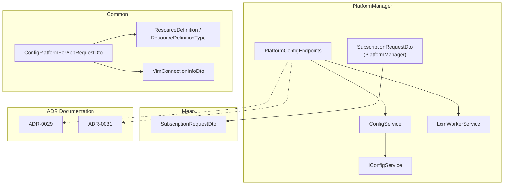
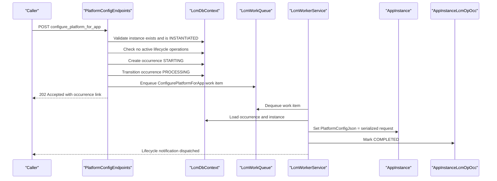
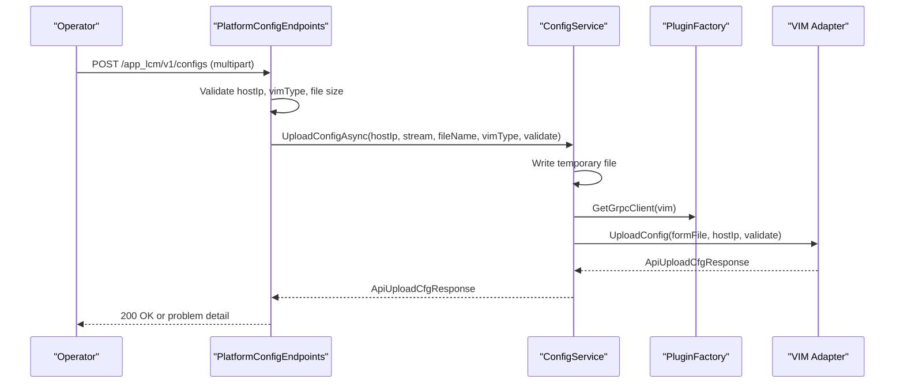
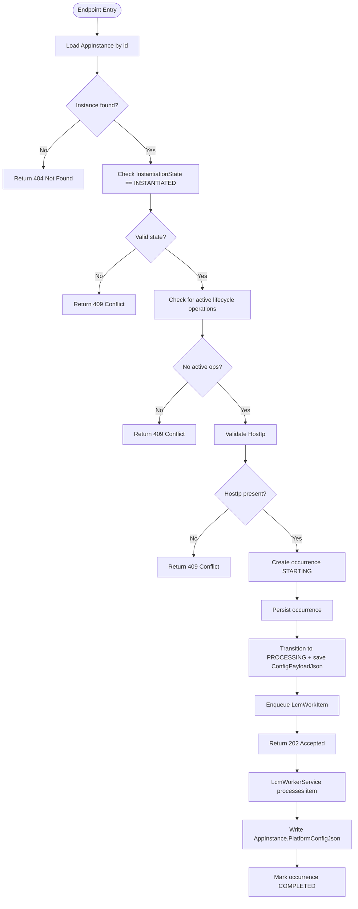
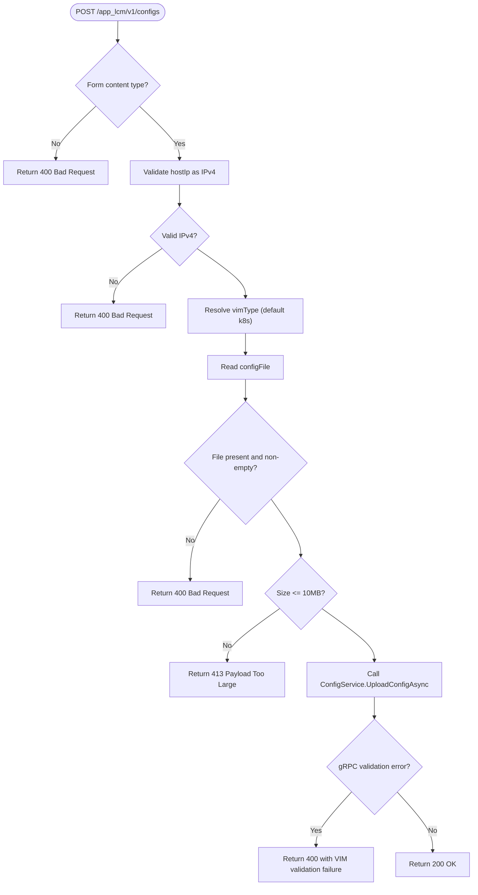
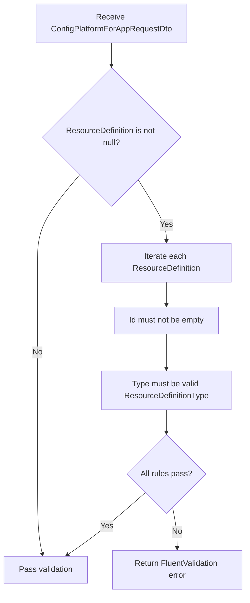
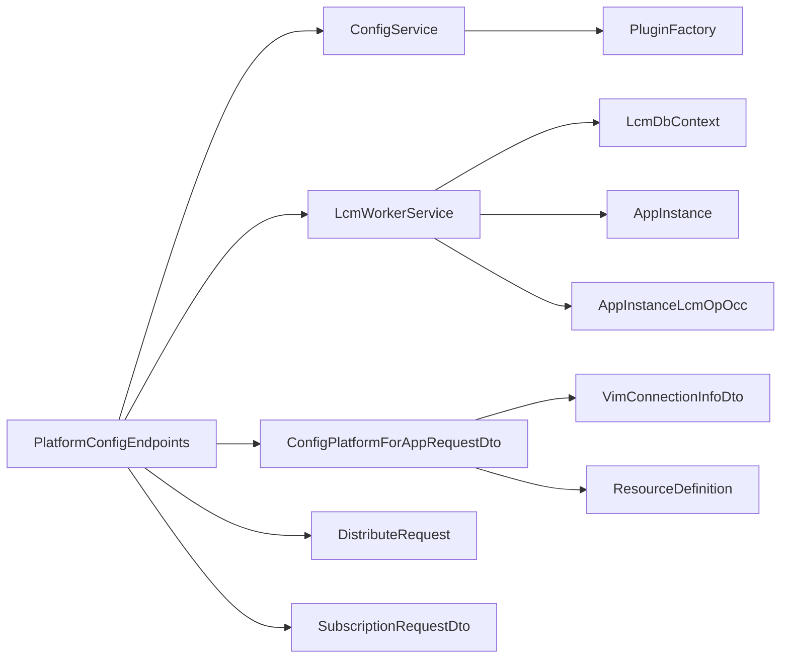

# Platform Configuration Service

## Table of Contents
1. [Introduction](#introduction)
2. [Project Structure](#project-structure)
3. [Core Components](#core-components)
4. [Architecture Overview](#architecture-overview)
5. [Detailed Component Analysis](#detailed-component-analysis)
6. [Dependency Analysis](#dependency-analysis)
7. [Performance Considerations](#performance-considerations)
8. [Troubleshooting Guide](#troubleshooting-guide)
9. [Conclusion](#conclusion)

## Introduction
This document explains the MEPM (MEC Management and Provisioning Manager) platform configuration service responsible for the `configure_platform_for_app` lifecycle operation and internal VIM configuration management. It covers:

- How the endpoint validates an ETSI-style request, creates a durable lifecycle operation record, persists the payload, and enqueues background work.
- How `LcmWorkerService` completes the operation by writing `AppInstance.PlatformConfigJson`.
- How the separate internal `/app_lcm/v1/configs` endpoint differs from the ETSI `configure_platform_for_app` operation.
- The validation rules enforced by `ConfigPlatformForAppRequestDtoValidator`.
- Related DTOs (`DistributeRequest`, `SubscriptionRequestDto`) and Consul-based service discovery configuration.

The implementation follows ADR-0029 and ADR-0031, which explicitly separate MEPM package distribution plumbing and internal VIM config upload from the ETSI App LCM contract.

## Project Structure
The relevant code lives primarily in the PlatformManager service under `src/PlatformManager/PlatformManager`, with shared request/response types in `src/Common/Models` and subscription contracts also referenced by Meao.

**Diagram sources**
- `src/PlatformManager/PlatformManager/Endpoints/PlatformConfigEndpoints.cs`
- `src/PlatformManager/PlatformManager/Services/ConfigService.cs`
- `src/PlatformManager/PlatformManager/Services/IConfigService.cs`
- `src/PlatformManager/PlatformManager/Services/LcmWorkerService.cs`
- `src/Common/Models/ConfigPlatformForAppRequestDto.cs`
- `src/Common/Models/VimConnectionInfoDto.cs`
- `src/Common/Models/GrantDtos.cs`
- `src/PlatformManager/PlatformManager/Requests/SubscriptionRequestDto.cs`
- `src/Meao/Requests/SubscriptionRequestDto.cs`
- `docs/ADR/0029-mepm-package-distribution-vs-onboarding.md`
- `docs/ADR/0031-separate-internal-vim-config-upload-from-etsi-platform-configuration.md`

**Section sources**
- `src/PlatformManager/PlatformManager/Endpoints/PlatformConfigEndpoints.cs`
- `src/PlatformManager/PlatformManager/Services/ConfigService.cs`
- `src/PlatformManager/PlatformManager/Services/LcmWorkerService.cs`
- `src/Common/Models/ConfigPlatformForAppRequestDto.cs`
- `docs/ADR/0029-mepm-package-distribution-vs-onboarding.md`
- `docs/ADR/0031-separate-internal-vim-config-upload-from-etsi-platform-configuration.md`

## Core Components

### ConfigService and IConfigService
`IConfigService` defines the interface for uploading VIM configuration to a downstream VIM adapter via gRPC. `ConfigService` implements it and provides two overloads:

- `UploadConfigAsync(hostIp, stream, fileName, vimType, ct)`
- `UploadConfigAsync(hostIp, stream, fileName, vimType, validate, ct)`

Key behaviors:
- Resolves the VIM type from the caller-supplied `vimType`, falling back to `k8s` when empty or whitespace.
- Uses the configured `ConfigDir` setting (default `config`) to write a temporary file with a GUID prefix.
- Validates that the resolved path remains inside the intended directory to prevent path traversal.
- Writes the uploaded stream to disk, constructs a gRPC form file, and calls `PluginFactory.GetGrpcClient(vim).UploadConfig(...)`.
- Treats VIM responses with status `Failure` or `Error` as operational failures.
- Deletes the temporary file in a `finally` block, logging warnings if deletion fails.
- Returns `ApiUploadCfgResponse` containing status, validated flag, latency, and optional success message.

This service is used only by the internal `/app_lcm/v1/configs` endpoint; it is not called by `configure_platform_for_app`.

**Section sources**
- `src/PlatformManager/PlatformManager/Services/IConfigService.cs#L1-L21`
- `src/PlatformManager/PlatformManager/Services/ConfigService.cs#L1-L101`

### PlatformConfigEndpoints
The endpoint class exposes two distinct routes:

1. **Internal VIM configuration upload**: `POST /app_lcm/v1/configs`
   - Accepts multipart form data: `hostIp`, `vimType`, `validate`, `configFile`.
   - Validates `hostIp` as an IPv4 address.
   - Defaults `vimType` to `k8s` when empty.
   - Rejects missing or empty files and rejects files larger than 10 MB.
   - Calls `ConfigService.UploadConfigAsync` and maps gRPC validation errors into RFC 7807-style problems.

2. **ETSI lifecycle operation**: `POST /app_lcm/v1/app_instances/{appInstanceId}/configure_platform_for_app`
   - Loads the target `AppInstance`.
   - Requires the instance state to be `INSTANTIATED`.
   - Rejects concurrent active lifecycle operations on the same instance.
   - Requires a registered `HostIp`.
   - Serializes the request body into JSON and records it in `AppInstanceLcmOpOcc.ConfigPayloadJson`.
   - Creates a lifecycle operation occurrence with `LifecycleOperations.ConfigurePlatformForApp` in `STARTING`, then transitions it to `PROCESSING`.
   - Enqueues an `LcmWorkItem` carrying the app instance ID, operation ID, host IP, app package ID, VIM type, and serialized config payload.
   - Returns HTTP 202 Accepted with a link to the new operation occurrence.
   - Wraps unexpected exceptions in a 500 response and attempts to set the operation occurrence to `FAILED` before dispatching notifications.

This endpoint does not call `ConfigService`; it performs a persist-only transition backed by `LcmWorkerService`.

**Section sources**
- `src/PlatformManager/PlatformManager/Endpoints/PlatformConfigEndpoints.cs`

### LcmWorkerService
`LcmWorkerService` is a hosted background worker that drains `ILcmWorkQueue`. For `ConfigurePlatformForApp`:

- It asserts that `item.ConfigPayloadJson` is present.
- It transitions the operation occurrence to `COMPLETED` with a success response.
- It writes the serialized payload directly onto `AppInstance.PlatformConfigJson`.
- It updates the instance timestamp.

The worker also handles crash recovery by replaying `PROCESSING` operation occurrences created before process boot, including special settlement logic for already-instantiated instances.

**Section sources**
- `src/PlatformManager/PlatformManager/Services/LcmWorkerService.cs`

### Request and Response DTOs

#### ConfigPlatformForAppRequestDto
This is the ETSI GS MEC 010-2 v3.1.1 `ConfigPlatformForAppRequest` representation:

| Property | Type | Meaning |
|---|---|---|
| `vimConnectionInfo` | List\<`VimConnectionInfoDto`>? | Optional VIM connection information for the application instance. May be empty if no additional VIM selection is needed. |
| `resourceDefinition` | List\<`ResourceDefinition`>? | Optional resource definitions associated with the application instance. |

`VimConnectionInfoDto` includes fields such as `Id`, `VimId`, `VimType`, `InterfaceInfo`, `AccessInfo`, and `Extra`.

`ResourceDefinition` and `ResourceDefinitionType` are defined in the shared grant models. Supported enum values include `COMPUTE`, `STORAGE`, `LINKPORT`, and `OSCONTAINER`.

**Section sources**
- `src/Common/Models/ConfigPlatformForAppRequestDto.cs#L1-L28`
- `src/Common/Models/VimConnectionInfoDto.cs#L1-L12`
- `src/Common/Models/GrantDtos.cs#L265-L294`

#### DistributeRequest
`DistributeRequest` is used by the MEPM package distribution flow to identify a target app instance and one or more destination host IPs. It is related to ADR-0029 and the broader package distribution pipeline but is not part of `configure_platform_for_app`.

| Property | Type | Meaning |
|---|---|---|
| `AppInstanceId` | string? | Target application instance identifier. |
| `HostIp` | IList\<string> | One or more destination hosts for package distribution. |

**Section sources**
- `src/PlatformManager/PlatformManager/Requests/DistributeRequest.cs#L1-L8`
- `docs/ADR/0029-mepm-package-distribution-vs-onboarding.md`

#### SubscriptionRequestDto
Two DTOs represent lifecycle notification subscriptions:

- `PlatformManager.Requests.SubscriptionRequestDto`: internal MEPM model.
- `Meao.Requests.SubscriptionRequestDto`: wire-compatible model used by Meao.

Both contain fields for subscription type, callback URI, optional app instance and operation identifiers, and optional filters for lifecycle notification types, operation types, and operation states.

| Field | Purpose |
|---|---|
| `subscriptionType` | Identifies the subscription category. |
| `callbackUri` | Destination for lifecycle notifications. |
| `appInstanceId` | Optional filter for a specific application instance. |
| `appLcmOpOccId` | Optional filter for a specific lifecycle operation occurrence. |
| `lifecycleNotificationTypes` | Filters by notification type. |
| `operationTypes` | Filters by lifecycle operation type. |
| `operationStates` | Filters by operation state. |

**Section sources**
- `src/PlatformManager/PlatformManager/Requests/SubscriptionRequestDto.cs`
- `src/Meao/Requests/SubscriptionRequestDto.cs`

## Architecture Overview
The `configure_platform_for_app` operation is intentionally split between the HTTP endpoint and the background worker:

**Diagram sources**
- `src/PlatformManager/PlatformManager/Endpoints/PlatformConfigEndpoints.cs`
- `src/PlatformManager/PlatformManager/Services/LcmWorkerService.cs`

The internal VIM configuration upload endpoint has a different path:

**Diagram sources**
- `src/PlatformManager/PlatformManager/Endpoints/PlatformConfigEndpoints.cs`
- `src/PlatformManager/PlatformManager/Services/ConfigService.cs`
- `src/PlatformManager/PlatformManager/Services/IConfigService.cs`

## Detailed Component Analysis

### ETSI `configure_platform_for_app` Flow
The endpoint treats this operation as a persist-only transition:

1. Load `AppInstance` by `appInstanceId`.
2. Require `InstantiationState == INSTANTIATED`.
3. Reject concurrent active lifecycle operations.
4. Require a non-empty `HostIp`.
5. Serialize the request body into JSON.
6. Create `AppInstanceLcmOpOcc` with `LifecycleOperations.ConfigurePlatformForApp` and `OperationStates.Starting`.
7. Persist the operation occurrence and commit.
8. Transition the occurrence to `Processing`, adding `HostIp`, `AppPkgId`, `VimType`, and `ConfigPayloadJson`.
9. Enqueue `LcmWorkItem` with those values.
10. Return 202 Accepted.

The worker later writes `PlatformConfigJson` and marks the operation completed.

**Diagram sources**
- `src/PlatformManager/PlatformManager/Endpoints/PlatformConfigEndpoints.cs`
- `src/PlatformManager/PlatformManager/Services/LcmWorkerService.cs`

**Section sources**
- `src/PlatformManager/PlatformManager/Endpoints/PlatformConfigEndpoints.cs`
- `src/PlatformManager/PlatformManager/Services/LcmWorkerService.cs`

### Internal VIM Config Upload Flow
The `/app_lcm/v1/configs` endpoint is an internal extension documented by ADR-0029 and ADR-0031. It does not update `AppInstance.PlatformConfigJson`; instead, it forwards the configuration to the appropriate VIM adapter through `ConfigService`.

**Diagram sources**
- `src/PlatformManager/PlatformManager/Endpoints/PlatformConfigEndpoints.cs`
- `src/PlatformManager/PlatformManager/Services/ConfigService.cs`

**Section sources**
- `src/PlatformManager/PlatformManager/Endpoints/PlatformConfigEndpoints.cs`
- `src/PlatformManager/PlatformManager/Services/ConfigService.cs`
- `docs/ADR/0029-mepm-package-distribution-vs-onboarding.md`
- `docs/ADR/0031-separate-internal-vim-config-upload-from-etsi-platform-configuration.md`

### Validation Rules for `ConfigPlatformForAppRequestDto`
`ConfigPlatformForAppRequestDtoValidator` uses FluentValidation and applies rules conditionally:

- If `ResourceDefinition` is provided:
  - Each element must have a non-empty `Id`.
  - Each element's `Type` must be a valid value of `ResourceDefinitionType`.

Important notes:
- The validator is conditional on `ResourceDefinition != null`; it does not reject a null collection.
- There is no explicit rule validating `VimConnectionInfo` presence, length, or contents.
- The supported `ResourceDefinitionType` values are `COMPUTE`, `STORAGE`, `LINKPORT`, and `OSCONTAINER`.

**Diagram sources**
- `src/PlatformManager/PlatformManager/Validators/ConfigPlatformForAppRequestDtoValidator.cs`
- `src/Common/Models/GrantDtos.cs`

**Section sources**
- `src/PlatformManager/PlatformManager/Validators/ConfigPlatformForAppRequestDtoValidator.cs#L1-L19`
- `src/Common/Models/GrantDtos.cs#L265-L294`

### Relationship Between `ConfigService` and `LcmWorkerService`
Despite both being named around configuration, they serve different responsibilities:

| Aspect | `ConfigService` | `LcmWorkerService` |
|---|---|---|
| Primary purpose | Upload VIM bootstrap configuration to a VIM adapter via gRPC. | Execute long-running lifecycle operations off the HTTP request path. |
| Used by | Internal `/app_lcm/v1/configs` endpoint. | Background queue draining for terminate, operate, instantiate, and configure-platform-for-app. |
| Persists to | Temporary file on disk, then deletes it. | `AppInstanceLcmOpOcc` and `AppInstance.PlatformConfigJson`. |
| ETSI alignment | Internal MEPM extension, not the ETSI `configure_platform_for_app` contract. | Implements the backend completion of the ETSI `configure_platform_for_app` operation. |
| Failure behavior | Throws operational exception on VIM failure status. | Sets operation occurrence to `FAILED` and preserves terminal state. |

**Section sources**
- `src/PlatformManager/PlatformManager/Services/ConfigService.cs#L1-L101`
- `src/PlatformManager/PlatformManager/Services/LcmWorkerService.cs`

## Dependency Analysis

**Diagram sources**
- `src/PlatformManager/PlatformManager/Endpoints/PlatformConfigEndpoints.cs`
- `src/PlatformManager/PlatformManager/Services/ConfigService.cs`
- `src/PlatformManager/PlatformManager/Services/LcmWorkerService.cs`
- `src/Common/Models/ConfigPlatformForAppRequestDto.cs`
- `src/Common/Models/VimConnectionInfoDto.cs`
- `src/Common/Models/GrantDtos.cs`
- `src/PlatformManager/PlatformManager/Requests/DistributeRequest.cs`
- `src/PlatformManager/PlatformManager/Requests/SubscriptionRequestDto.cs`

### External Dependencies and Integration Points
- **VIM adapter**: `ConfigService` resolves a gRPC client by VIM type and uploads a form-encoded configuration file.
- **Database**: Both the endpoint and worker use `LcmDbContext` to persist lifecycle operation occurrences and application instance state.
- **Background queue**: The endpoint enqueues work items consumed by `LcmWorkerService`.
- **Notifications**: Successful or failed operation outcomes are dispatched through a notification queue using subscription-related DTOs.
- **Configuration**: `appsettings.json` contains database connection strings, Keycloak settings, `LcmWorker:VimOperationTimeout`, logging defaults, and Consul discovery settings.

**Section sources**
- `src/PlatformManager/PlatformManager/Services/ConfigService.cs#L1-L101`
- `src/PlatformManager/PlatformManager/Services/LcmWorkerService.cs`
- `src/PlatformManager/PlatformManager/appsettings.json`

## Performance Considerations
- The internal VIM config upload endpoint enforces a 10 MB file size limit to protect memory and disk usage.
- `ConfigService` writes configurations to a temporary file rather than streaming them directly to gRPC, which simplifies form construction but introduces disk I/O.
- The worker’s per-operation VIM timeout prevents a hung VIM call from stalling the entire queue. The default timeout is two minutes, configurable via `LcmWorker:VimOperationTimeout`.
- Crash-replay reads `PROCESSING` operation occurrences once at startup and batches instance loads to avoid N+1 queries.
- Terminal state transitions use bounded cancellation tokens so shutdown cannot indefinitely block database commits.

[No sources needed since this section provides general guidance]

## Troubleshooting Guide

### Common Errors for `configure_platform_for_app`
| Symptom | Likely Cause | Resolution |
|---|---|---|
| 404 Not Found | Application instance ID does not exist. | Verify the instance was previously instantiated. |
| 409 Conflict — instance must be INSTANTIATED | Instance is not in the required lifecycle state. | Instantiate the instance first. |
| 409 Conflict — another lifecycle operation is active | Another operation is still starting or processing. | Wait for the existing operation to complete or fail. |
| 409 Conflict — no valid HostIp registered | The instance lacks a recorded host address. | Ensure placement and instantiation produced a host assignment. |
| 500 ConfigurePlatformForApp operation failed | Unexpected exception during persistence or enqueueing. | Inspect the operation occurrence response field and log context. |

### Validation Failures for `ResourceDefinition`
If a request includes `resourceDefinition` entries:
- Every entry must have a non-empty `id`.
- Every entry’s `type` must be one of `COMPUTE`, `STORAGE`, `LINKPORT`, or `OSCONTAINER`.
- Null or absent `resourceDefinition` is accepted by the current validator.

### Internal VIM Config Upload Failures
| Symptom | Likely Cause | Resolution |
|---|---|---|
| 400 Bad Request — expected form-encoded multipart request | Request is not multipart/form-data. | Use proper form encoding. |
| 400 Bad Request — invalid hostIp format | `hostIp` is not a valid IPv4 address. | Supply a valid IPv4 address. |
| 400 Bad Request — configFile is required | No file was uploaded or the file is empty. | Attach a non-empty configuration file. |
| 413 Payload Too Large | Uploaded file exceeds 10 MB. | Reduce configuration size. |
| 400 VIM config validation failed | gRPC validation returned `InvalidArgument`, `FailedPrecondition`, `Unauthenticated`, or `Unavailable`. | Inspect the VIM adapter error detail. |
| 500 VIM config upload failed | Non-validation gRPC error or unexpected exception. | Check logs for VIM adapter connectivity and authentication issues. |

**Section sources**
- `src/PlatformManager/PlatformManager/Endpoints/PlatformConfigEndpoints.cs`
- `src/PlatformManager/PlatformManager/Validators/ConfigPlatformForAppRequestDtoValidator.cs#L1-L19`
- `src/PlatformManager/PlatformManager/Services/ConfigService.cs#L1-L101`

## Conclusion
The MEPM platform configuration surface has two clearly separated paths:

1. **ETSI `configure_platform_for_app`**: A lifecycle operation that validates an application instance, persists the request payload into a durable operation occurrence, enqueues background work, and finally writes the serialized configuration to `AppInstance.PlatformConfigJson`. It is designed as a persist-only operation in the current implementation.

2. **Internal `/app_lcm/v1/configs`**: An operator-facing MEPM extension for uploading VIM-specific bootstrap configuration. It validates inputs, forwards the file to a VIM adapter through `ConfigService`, and does not update the ETSI platform configuration stored on the application instance.

Operational guidance should therefore keep these concerns separate:
- Use the ETSI endpoint for lifecycle-aligned platform configuration tied to an application instance.
- Use the internal config endpoint for VIM bootstrap artifacts when integrating with the VIM adapter.
- Monitor `AppInstanceLcmOpOcc` records for operation state, response details, and timestamps.
- Inspect `AppInstance.PlatformConfigJson` after successful completion to confirm the persisted configuration payload.
- Treat `ResourceDefinition` validation carefully because the current validator only checks non-null arrays and individual element constraints.

[No sources needed since this section summarizes without analyzing specific files]

> **Referenced Files in This Document**
>
> - `src/PlatformManager/PlatformManager/Services/IConfigService.cs`
> - `src/PlatformManager/PlatformManager/Services/ConfigService.cs`
> - `src/PlatformManager/PlatformManager/Endpoints/PlatformConfigEndpoints.cs`
> - `src/PlatformManager/PlatformManager/Services/LcmWorkerService.cs`
> - `src/Common/Models/ConfigPlatformForAppRequestDto.cs`
> - `src/Common/Models/VimConnectionInfoDto.cs`
> - `src/Common/Models/GrantDtos.cs`
> - `src/Meao/Requests/SubscriptionRequestDto.cs`
> - `src/PlatformManager/PlatformManager/Requests/SubscriptionRequestDto.cs`
> - `src/PlatformManager/PlatformManager/Requests/DistributeRequest.cs`
> - `src/PlatformManager/PlatformManager/appsettings.json`
> - `docs/ADR/0029-mepm-package-distribution-vs-onboarding.md`
> - `docs/ADR/0031-separate-internal-vim-config-upload-from-etsi-platform-configuration.md`
