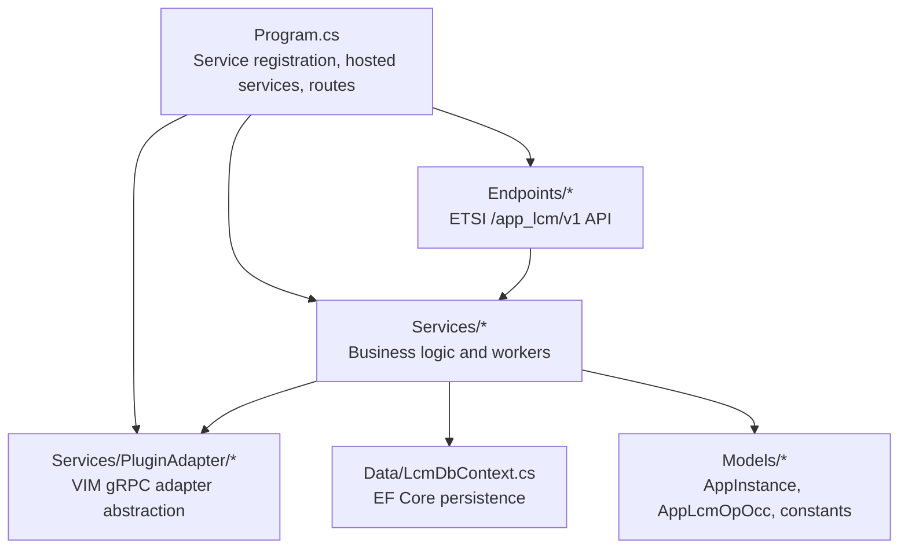
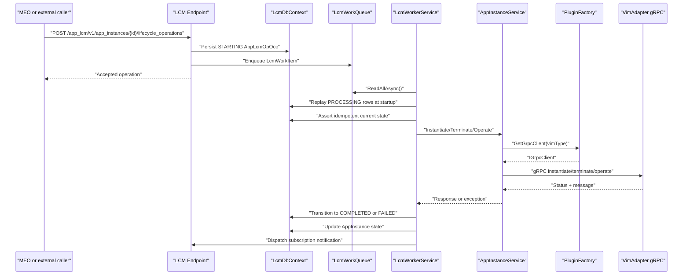
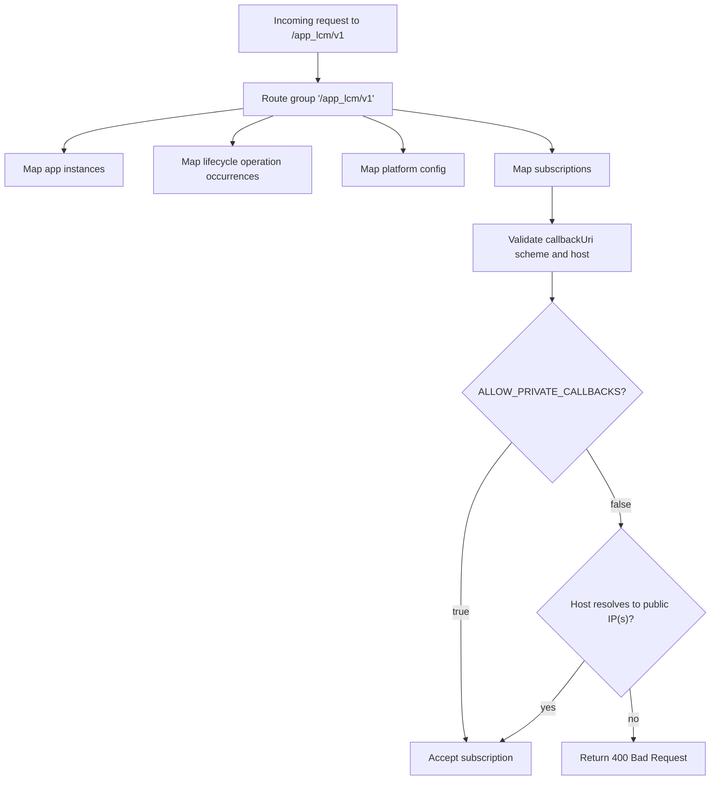
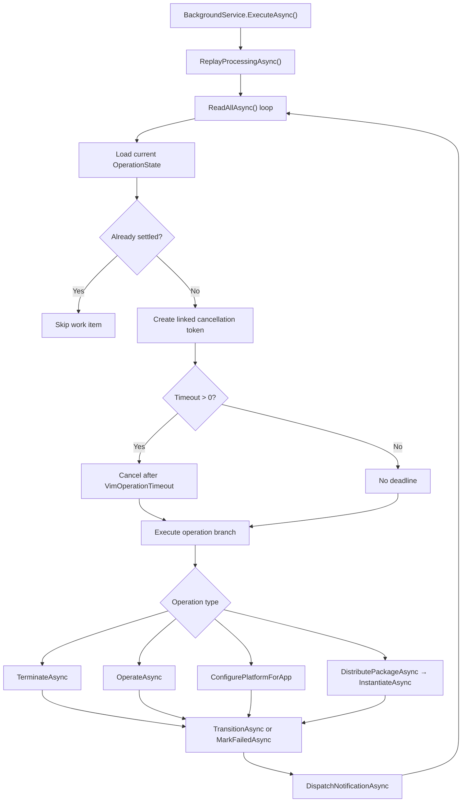
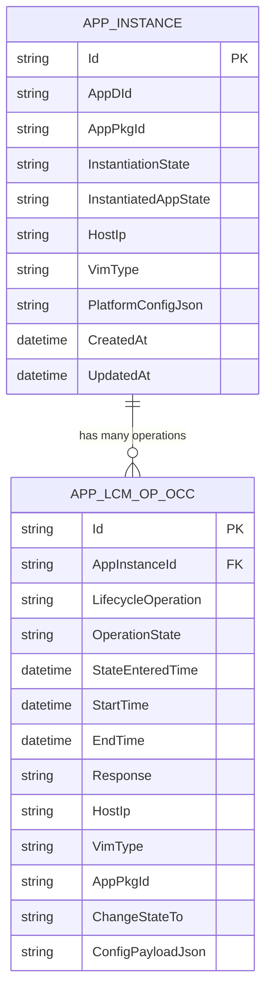
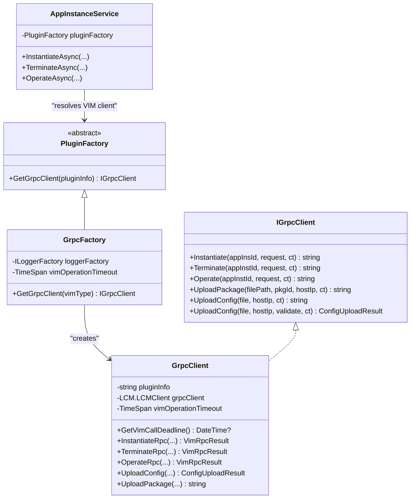
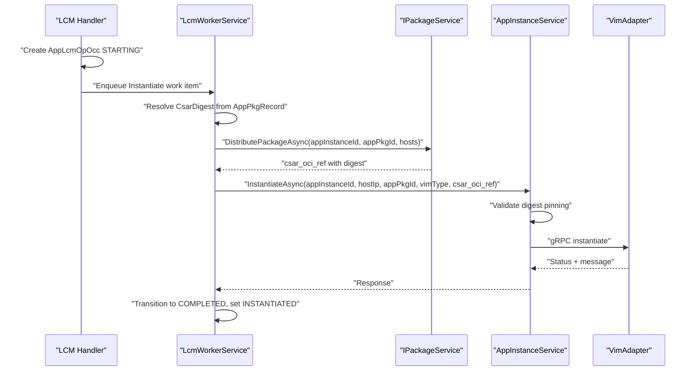
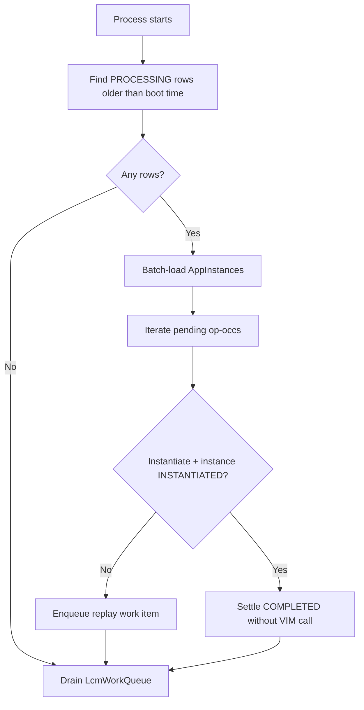
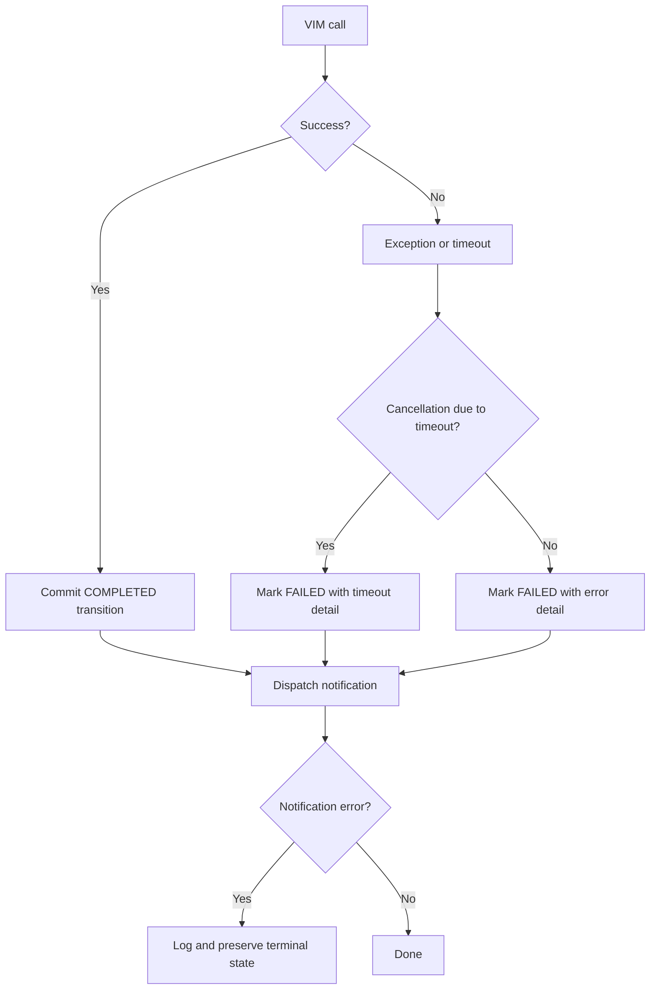
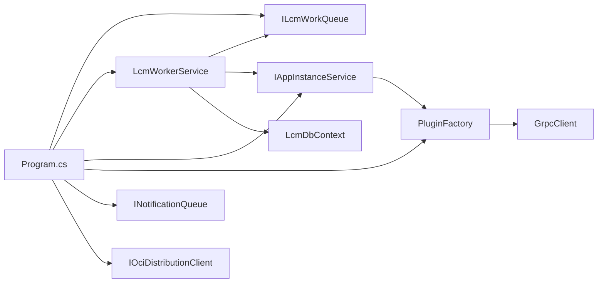

# PlatformManager (MEPM Execution Service)

## Table of Contents
1. [Introduction](#introduction)
2. [Project Structure](#project-structure)
3. [Core Components](#core-components)
4. [Architecture Overview](#architecture-overview)
5. [Detailed Component Analysis](#detailed-component-analysis)
6. [Dependency Analysis](#dependency-analysis)
7. [Performance Considerations](#performance-considerations)
8. [Troubleshooting Guide](#troubleshooting-guide)
9. [Conclusion](#conclusion)

## Introduction
The PlatformManager service implements the MEC Platform Manager role for the Optimist orchestrator. It owns the MEPM execution surface for application lifecycle management, creates and tracks lifecycle operation occurrences, drives long-running VIM operations asynchronously, coordinates with VIM adapters through gRPC, and synchronizes state between the MEO control plane and backend VIMs. Its responsibilities include:

- Exposing ETSI-compatible `/app_lcm/v1` endpoints for app instances, lifecycle operation occurrences, subscriptions, and internal platform configuration.
- Persisting `AppInstance` and `AppLcmOpOcc` records as the authoritative MEPM state.
- Offloading VIM provisioning work to a background worker so HTTP requests remain responsive.
- Selecting and calling VIM-specific gRPC adapters via an adapter factory.
- Handling crash recovery by replaying operations stuck in processing.
- Dispatching asynchronous notifications to subscribed consumers when operation states change.

This document focuses on how the PlatformManager executes LCM operations against VIM backends, how its worker architecture isolates long-running work, and how distributed failures are handled.

## Project Structure
The PlatformManager is a .NET ASP.NET Core service. The relevant source layout is:

**Diagram sources**
- `src/PlatformManager/PlatformManager/Program.cs#L76-L94`
- `src/PlatformManager/PlatformManager/Program.cs#L196-L200`
- `src/PlatformManager/PlatformManager/Endpoints/LcmEndpoint.cs#L1-L20`
- `src/PlatformManager/PlatformManager/Services/LcmWorkerService.cs#L1-L25`

**Section sources**
- `src/PlatformManager/PlatformManager/Program.cs#L76-L94`
- `src/PlatformManager/PlatformManager/Program.cs#L196-L200`
- `src/PlatformManager/PlatformManager/Endpoints/LcmEndpoint.cs#L1-L20`

## Core Components
The PlatformManager’s execution path is centered around these components:

| Component | Responsibility | Key Behavior |
|---|---|---|
| LCM endpoints | Accept ETSI lifecycle requests | Create `AppInstanceLcmOpOcc`, enqueue work, persist initial state |
| LcmWorkQueue | In-process async queue | Single-reader channel decouples HTTP handlers from VIM work |
| LcmWorkerService | Background worker | Replays stranded operations, executes VIM calls, transitions op-occ state |
| AppInstanceService | VIM call coordinator | Resolves VIM type, validates digest-pinned CSAR reference, invokes gRPC client |
| PluginFactory + GrpcFactory | VIM adapter factory | Maps VIM type to plugin endpoint; constructs gRPC clients |
| GrpcClient | VIM gRPC transport | Applies retry policy, deadlines, streaming uploads, and status mapping |
| LcmDbContext | Persistence layer | Tracks app instances, package records, op occurrences, subscriptions |
| Subscription dispatch | Event notification | Enqueues callbacks matching `AppLcmOpOccStateChange` filters |

**Section sources**
- `src/PlatformManager/PlatformManager/Endpoints/LcmEndpoint.cs#L1-L20`
- `src/PlatformManager/PlatformManager/Services/LcmWorkQueue.cs#L1-L37`
- `src/PlatformManager/PlatformManager/Services/LcmWorkerService.cs#L1-L25`
- `src/PlatformManager/PlatformManager/Services/AppInstanceService.cs#L1-L20`
- `src/PlatformManager/PlatformManager/Services/PluginAdapter/PluginFactory.cs#L1-L7`
- `src/PlatformManager/PlatformManager/Services/PluginAdapter/GrpcFactory.cs#L1-L30`
- `src/PlatformManager/PlatformManager/Services/PluginAdapter/GrpcClient.cs#L1-L40`
- `src/PlatformManager/PlatformManager/Data/LcmDbContext.cs#L1-L30`

## Architecture Overview
At a high level, the PlatformManager receives lifecycle requests, persists durable operation records, and delegates actual VIM work to a background worker. The worker selects the correct VIM adapter, performs package distribution where required, calls the VIM over gRPC, updates both the operation occurrence and the app instance, and notifies subscribers.

**Diagram sources**
- `src/PlatformManager/PlatformManager/Endpoints/LcmEndpoint.cs#L1-L20`
- `src/PlatformManager/PlatformManager/Services/LcmWorkerService.cs#L25-L85`
- `src/PlatformManager/PlatformManager/Services/AppInstanceService.cs#L22-L160`
- `src/PlatformManager/PlatformManager/Services/PluginAdapter/GrpcFactory.cs#L18-L30`
- `src/PlatformManager/PlatformManager/Services/PluginAdapter/GrpcClient.cs#L41-L120`

## Detailed Component Analysis

### Lifecycle API Surface
The MEPM produces the standard ETSI `/app_lcm/v1` group. The route group wires:

- App instance endpoints.
- Lifecycle operation occurrence endpoints.
- Internal platform configuration endpoints.
- Subscription endpoints.

Subscriptions support filtering by notification type, operation type, operation state, app instance ID, and operation occurrence ID. Callback URIs are validated to accept absolute HTTP or HTTPS destinations, with optional private callback support controlled by an environment variable.

**Diagram sources**
- `src/PlatformManager/PlatformManager/Endpoints/LcmEndpoint.cs#L8-L20`
- `src/PlatformManager/PlatformManager/Endpoints/LcmEndpoint.cs#L22-L120`
- `src/PlatformManager/PlatformManager/Endpoints/LcmEndpoint.cs#L120-L200`

**Section sources**
- `src/PlatformManager/PlatformManager/Endpoints/LcmEndpoint.cs#L8-L20`
- `src/PlatformManager/PlatformManager/Endpoints/LcmEndpoint.cs#L22-L120`
- `src/PlatformManager/PlatformManager/Endpoints/LcmEndpoint.cs#L120-L200`

### Asynchronous Worker Architecture
The worker is a hosted background service that drains the LCM work queue. Its main responsibilities are:

1. **Startup replay**: Before draining queued work, it scans for `AppLcmOpOcc` rows in `PROCESSING` created before process boot.
2. **Idempotent consumption**: For each work item, it checks the current persisted state and skips already settled operations.
3. **Operation execution**: It dispatches terminate, operate, configure-platform-for-app, and instantiate flows.
4. **Timeout handling**: Each VIM call has a per-operation timeout derived from configuration.
5. **Terminal transitions**: Successful operations move to `COMPLETED`; failures move to `FAILED`.
6. **Notification dispatch**: After terminal transitions, it enqueues subscription notifications.

**Diagram sources**
- `src/PlatformManager/PlatformManager/Services/LcmWorkerService.cs#L25-L85`
- `src/PlatformManager/PlatformManager/Services/LcmWorkerService.cs#L201-L280`
- `src/PlatformManager/PlatformManager/Services/LcmWorkerService.cs#L280-L501`

**Section sources**
- `src/PlatformManager/PlatformManager/Services/LcmWorkerService.cs#L25-L85`
- `src/PlatformManager/PlatformManager/Services/LcmWorkerService.cs#L201-L280`
- `src/PlatformManager/PlatformManager/Services/LcmWorkerService.cs#L280-L501`

### LCM Operation Occurrence Tracking
`AppInstanceLcmOpOcc` is the authoritative record for asynchronous lifecycle operations. Its fields track:

- Target app instance.
- Operation type.
- Current operation state.
- State entry time, start time, and end time.
- Response detail.
- Crash-replay payload such as host IP, VIM type, package ID, target operate state, and serialized platform configuration.

The database model adds indexes for app instance lookup and startup time, plus a filtered unique index preventing multiple active `STARTING` or `PROCESSING` occurrences per app instance.

**Diagram sources**
- `src/PlatformManager/PlatformManager/Models/AppInstance.cs#L1-L72`
- `src/PlatformManager/PlatformManager/Models/AppInstanceLcmOpOcc.cs#L1-L54`
- `src/PlatformManager/PlatformManager/Data/LcmDbContext.cs#L31-L90`

**Section sources**
- `src/PlatformManager/PlatformManager/Models/AppInstanceLcmOpOcc.cs#L1-L54`
- `src/PlatformManager/PlatformManager/Data/LcmDbContext.cs#L31-L90`

### VIM Adapter Coordination via gRPC
The PlatformManager does not hardcode VIM implementation details inside the lifecycle service. Instead, it uses an adapter factory pattern:

- `PluginFactory` defines the abstract contract for resolving a VIM gRPC client.
- `GrpcFactory` reads plugin information for a given VIM type and constructs a `GrpcClient`.
- `AppInstanceService` calls the factory to obtain a client based on the resolved VIM type.
- `GrpcClient` applies wire deadlines, retries transient failures, and maps protobuf responses to result objects.

**Diagram sources**
- `src/PlatformManager/PlatformManager/Services/PluginAdapter/PluginFactory.cs#L1-L7`
- `src/PlatformManager/PlatformManager/Services/PluginAdapter/GrpcFactory.cs#L1-L30`
- `src/PlatformManager/PlatformManager/Services/PluginAdapter/IGrpcClient.cs#L1-L41`
- `src/PlatformManager/PlatformManager/Services/PluginAdapter/GrpcClient.cs#L1-L120`
- `src/PlatformManager/PlatformManager/Services/AppInstanceService.cs#L1-L160`

**Section sources**
- `src/PlatformManager/PlatformManager/Services/PluginAdapter/PluginFactory.cs#L1-L7`
- `src/PlatformManager/PlatformManager/Services/PluginAdapter/GrpcFactory.cs#L1-L30`
- `src/PlatformManager/PlatformManager/Services/PluginAdapter/IGrpcClient.cs#L1-L41`
- `src/PlatformManager/PlatformManager/Services/PluginAdapter/GrpcClient.cs#L1-L120`
- `src/PlatformManager/PlatformManager/Services/AppInstanceService.cs#L1-L160`

### LCM Operation Flows

#### Instantiate Flow
The instantiate flow is the most complex because it includes package distribution and VIM instantiation:

1. The HTTP handler creates a lifecycle operation occurrence in `STARTING` and moves it to `PROCESSING`.
2. The worker rebuilds a work item and resolves the immutable CSAR digest.
3. The package service distributes the CSAR and returns a digest-pinned OCI reference.
4. The digest-pinned reference is forwarded into the gRPC instantiate request.
5. `AppInstanceService` validates the forwarded reference against the persisted package digest.
6. The VIM adapter responds with success or failure.
7. The worker marks the operation occurrence completed and sets the app instance to instantiated.

**Diagram sources**
- `src/PlatformManager/PlatformManager/Services/LcmWorkerService.cs#L320-L420`
- `src/PlatformManager/PlatformManager/Services/AppInstanceService.cs#L22-L85`

**Section sources**
- `src/PlatformManager/PlatformManager/Services/LcmWorkerService.cs#L320-L420`
- `src/PlatformManager/PlatformManager/Services/AppInstanceService.cs#L22-L85`

#### Terminate Flow
Terminate is simpler:

1. The worker calls `AppInstanceService.TerminateAsync`.
2. The service resolves the VIM client and calls terminate over gRPC.
3. On success, the worker marks the operation occurrence completed and clears the instance’s instantiation state.

**Section sources**
- `src/PlatformManager/PlatformManager/Services/LcmWorkerService.cs#L300-L340`
- `src/PlatformManager/PlatformManager/Services/AppInstanceService.cs#L87-L120`

#### Operate Flow
Operate changes the running state of an instantiated instance:

1. The worker resolves the target state, defaulting to started if unspecified.
2. It calls `AppInstanceService.OperateAsync`.
3. On success, the worker updates the operation occurrence and the instance’s `InstantiatedAppState`.

**Section sources**
- `src/PlatformManager/PlatformManager/Services/LcmWorkerService.cs#L340-L380`
- `src/PlatformManager/PlatformManager/Services/AppInstanceService.cs#L122-L160`

### Background Job Processing and Crash Recovery
The worker service implements crash recovery using ADR-style safeguards:

- Startup replay finds `PROCESSING` operation occurrences created before the current process booted.
- If an instantiate operation’s target instance is already instantiated, the worker settles the operation as completed without re-invoking the VIM.
- Otherwise, the worker enqueues the operation again so it can be retried.
- Per-row isolation ensures one bad replay row does not strand the rest of the backlog.
- The main drain loop catches exceptions, logs them, marks the operation failed, and continues processing subsequent items.

**Diagram sources**
- `src/PlatformManager/PlatformManager/Services/LcmWorkerService.cs#L85-L200`
- `src/PlatformManager/PlatformManager/Services/LcmWorkerService.cs#L201-L280`

**Section sources**
- `src/PlatformManager/PlatformManager/Services/LcmWorkerService.cs#L85-L200`
- `src/PlatformManager/PlatformManager/Services/LcmWorkerService.cs#L201-L280`

### Status Synchronization Between MEO and VIMs
Status synchronization is achieved through three mechanisms:

1. **Operation occurrence state**: Every VIM call updates `AppLcmOpOcc.OperationState`, timestamps, and response text.
2. **App instance state**: Successful instantiate sets the instance to instantiated; terminate clears it; operate updates the running state.
3. **Subscription notifications**: When an operation reaches a terminal state, the endpoint helper enqueues notifications for matching subscriptions.

The context also documents that `FAILED_TEMP` is a recoverable transient failure state allowing automated retry or manual rollback before final termination.

**Section sources**
- `src/PlatformManager/PlatformManager/Services/LcmWorkerService.cs#L420-L501`
- `src/PlatformManager/PlatformManager/Endpoints/LcmEndpoint.cs#L120-L170`
- `docs/contexts/platformmanager.md#L1-L33`

### Configuration for Different VIM Types
VIM selection is driven by:

- The VIM type resolved from the grant or persisted app instance context.
- `Program.GetPluginInfo`, which resolves the gRPC endpoint for a given VIM type.
- `GrpcFactory.GetGrpcClient`, which builds a gRPC client configured with credentials, retry policy, and timeout.

Configuration keys involved:

| Key | Purpose | Default or Behavior |
|---|---|---|
| `LcmWorker:VimOperationTimeout` | Per-operation VIM call timeout used by both the worker cancellation window and the gRPC wire deadline | 2 minutes when unset; non-positive value disables the timeout |
| `ALLOW_PRIVATE_CALLBACKS` | Allows private callback URIs for subscription notifications | Environment variable; defaults to false |
| VIM plugin endpoint | Determined by `GetPluginInfo` | Resolved dynamically per VIM type |

**Section sources**
- `src/PlatformManager/PlatformManager/Program.cs#L296-L340`
- `src/PlatformManager/PlatformManager/Services/PluginAdapter/GrpcFactory.cs#L18-L30`
- `src/PlatformManager/PlatformManager/Services/PluginAdapter/GrpcClient.cs#L12-L40`
- `src/PlatformManager/PlatformManager/Services/LcmWorkerService.cs#L25-L45`

### Monitoring Long-Running Operations
Long-running VIM operations are observable through:

- `AppLcmOpOcc` records exposing operation type, state, start time, state entry time, and end time.
- Logging throughout the worker, service, and gRPC client layers.
- Subscription-based notifications for operation occurrence state changes.
- The ability to query subscriptions and filter by operation type and state.

Operators should monitor:

- The number of `PROCESSING` operation occurrences.
- Time spent in `STARTING` or `PROCESSING`.
- Failed and failed-temp operation occurrences.
- Notification delivery errors.

**Section sources**
- `src/PlatformManager/PlatformManager/Models/AppInstanceLcmOpOcc.cs#L1-L54`
- `src/PlatformManager/PlatformManager/Endpoints/LcmEndpoint.cs#L120-L170`
- `src/PlatformManager/PlatformManager/Services/LcmWorkerService.cs#L25-L85`

### Retry Mechanisms for Transient Failures
There are two distinct retry strategies:

1. **gRPC-level retry**: `GrpcClient` configures a retry policy for unavailable gRPC status codes with up to five attempts, exponential backoff starting at one second and capping at five seconds.
2. **Application-level retry**: Application-level transient failures are surfaced as failed operation occurrences. The MEO can retry or cancel based on the operation occurrence state. The documented `FAILED_TEMP` state represents a recoverable transient failure.

Important distinction: gRPC retry handles network-level transient failures; it does not retry business failures returned as VIM status values.

**Section sources**
- `src/PlatformManager/PlatformManager/Services/PluginAdapter/GrpcClient.cs#L41-L120`
- `docs/contexts/platformmanager.md#L1-L33`

### Error Handling Strategies for Distributed Operations
Error handling spans several layers:

| Layer | Strategy |
|---|---|
| HTTP endpoint | Validates subscription callback URIs; returns structured problems for invalid input |
| Database | Uses EF Core constraints and filtered unique indexes to prevent duplicate active operations |
| Worker loop | Catches exceptions per work item, marks the operation failed, and continues processing |
| Timeout handling | Cancels hung VIM calls and marks them failed instead of stalling the worker |
| Terminal transitions | Uses a state machine assertion and bounded transactions to avoid illegal state transitions |
| Notification dispatch | Isolates notification failures so they cannot flip a successful terminal operation to failed |
| gRPC client | Logs transport failures and preserves stack traces while applying deadlines and retries |

**Diagram sources**
- `src/PlatformManager/PlatformManager/Services/LcmWorkerService.cs#L420-L501`
- `src/PlatformManager/PlatformManager/Endpoints/LcmEndpoint.cs#L120-L170`

**Section sources**
- `src/PlatformManager/PlatformManager/Services/LcmWorkerService.cs#L420-L501`
- `src/PlatformManager/PlatformManager/Endpoints/LcmEndpoint.cs#L120-L170`

## Dependency Analysis
The PlatformManager’s runtime dependencies are registered in the program bootstrap:

**Diagram sources**
- `src/PlatformManager/PlatformManager/Program.cs#L76-L94`
- `src/PlatformManager/PlatformManager/Services/LcmWorkerService.cs#L1-L25`
- `src/PlatformManager/PlatformManager/Services/AppInstanceService.cs#L1-L20`
- `src/PlatformManager/PlatformManager/Services/PluginAdapter/PluginFactory.cs#L1-L7`

Key coupling observations:

- `LcmWorkerService` depends on the work queue, dependency scope factory, notification queue, configuration, logger, and database.
- `AppInstanceService` depends only on the adapter factory, logger, and database for digest validation; it does not know concrete VIM types.
- `GrpcClient` owns gRPC channel creation, retry policy, deadlines, and streaming uploads.
- The database schema couples operation occurrences to app instances but allows missing instance side effects during settlement, logging warnings rather than failing silently.

**Section sources**
- `src/PlatformManager/PlatformManager/Program.cs#L76-L94`
- `src/PlatformManager/PlatformManager/Services/LcmWorkerService.cs#L1-L25`
- `src/PlatformManager/PlatformManager/Services/AppInstanceService.cs#L1-L20`
- `src/PlatformManager/PlatformManager/Services/PluginAdapter/GrpcClient.cs#L41-L120`
- `src/PlatformManager/PlatformManager/Data/LcmDbContext.cs#L31-L90`

## Performance Considerations
- **Asynchronous offloading**: Long-running VIM calls run in the background worker, keeping HTTP handlers responsive.
- **Single-reader channel**: `LcmWorkQueue` uses `SingleReader = true`, avoiding contention between producers and consumers.
- **Batch instance loading**: Startup replay batches app instance loads to avoid N+1 queries.
- **Bounded terminal writes**: Terminal DB transitions use bounded cancellation tokens so shutdown cannot block indefinitely.
- **Per-operation timeout**: A configurable VIM operation timeout prevents hung calls from starving the worker.
- **gRPC retry backoff**: Unavailable gRPC errors trigger bounded exponential backoff rather than immediate retries.
- **Streaming transfers**: Config and package upload use chunked streaming to avoid large in-memory payloads.

[No sources needed since this section provides general guidance]

## Troubleshooting Guide
Common operational issues and their likely causes:

| Symptom | Likely Cause | Recommended Action |
|---|---|---|
| Operation remains in `PROCESSING` | Previous process crashed before completion | Check startup replay logs; ensure next restart replays the row |
| Instantiate fails with digest mismatch | Forwarded `csar_oci_ref` digest does not match persisted `CsarDigest` | Inspect package distribution and digest pinning pipeline |
| VIM call hangs | VIM adapter is slow or unreachable | Increase `LcmWorker:VimOperationTimeout`; check VIM adapter connectivity |
| Operation fails with transient network error | gRPC unavailable status | Review automatic retry behavior; check VIM adapter availability |
| Subscription callback rejected | Invalid or private callback URI | Use HTTP/HTTPS absolute URI; enable `ALLOW_PRIVATE_CALLBACKS` if required |
| Duplicate active operation blocked | Filtered unique index prevents multiple `STARTING`/`PROCESSING` rows | Investigate endpoint duplication or replay anomalies |
| Notification delivery fails | Subscriber endpoint down or malformed | Check notification queue logs; do not assume operation failure |

**Section sources**
- `src/PlatformManager/PlatformManager/Services/LcmWorkerService.cs#L85-L200`
- `src/PlatformManager/PlatformManager/Services/AppInstanceService.cs#L22-L85`
- `src/PlatformManager/PlatformManager/Services/PluginAdapter/GrpcClient.cs#L41-L120`
- `src/PlatformManager/PlatformManager/Endpoints/LcmEndpoint.cs#L22-L120`
- `src/PlatformManager/PlatformManager/Data/LcmDbContext.cs#L31-L90`

## Conclusion
The PlatformManager service is the MEPM execution layer that turns ETSI lifecycle requests into durable, observable, and recoverable VIM operations. Its design separates HTTP routing from long-running execution, uses an adapter factory for pluggable VIM backends, and persists authoritative state in `AppInstance` and `AppLcmOpOcc`. Crash-safe replay, per-operation timeouts, gRPC retry policies, and subscription notifications together provide a robust foundation for distributed lifecycle management across heterogeneous VIM environments.

[No sources needed since this section summarizes without analyzing specific files]

> **Referenced Files in This Document**
>
> - `src/PlatformManager/PlatformManager/Endpoints/LcmEndpoint.cs`
> - `src/PlatformManager/PlatformManager/Endpoints/AppInstanceEndpoints.cs`
> - `src/PlatformManager/PlatformManager/Endpoints/PlatformConfigEndpoints.cs`
> - `src/PlatformManager/PlatformManager/Program.cs`
> - `src/PlatformManager/PlatformManager/Services/AppInstanceService.cs`
> - `src/PlatformManager/PlatformManager/Services/LcmWorkerService.cs`
> - `src/PlatformManager/PlatformManager/Services/LcmWorkQueue.cs`
> - `src/PlatformManager/PlatformManager/Services/PluginAdapter/PluginFactory.cs`
> - `src/PlatformManager/PlatformManager/Services/PluginAdapter/GrpcFactory.cs`
> - `src/PlatformManager/PlatformManager/Services/PluginAdapter/IGrpcClient.cs`
> - `src/PlatformManager/PlatformManager/Services/PluginAdapter/GrpcClient.cs`
> - `src/PlatformManager/PlatformManager/Services/PluginAdapter/PluginAdapter.cs`
> - `src/PlatformManager/PlatformManager/Data/LcmDbContext.cs`
> - `src/PlatformManager/PlatformManager/Models/AppInstance.cs`
> - `src/PlatformManager/PlatformManager/Models/AppInstanceLcmOpOcc.cs`
> - `src/PlatformManager/PlatformManager/Models/LcmConstants.cs`
> - `docs/contexts/platformmanager.md`
