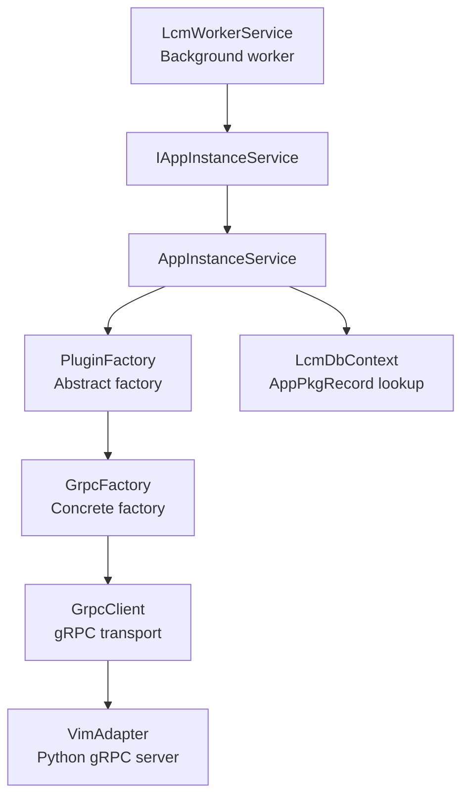
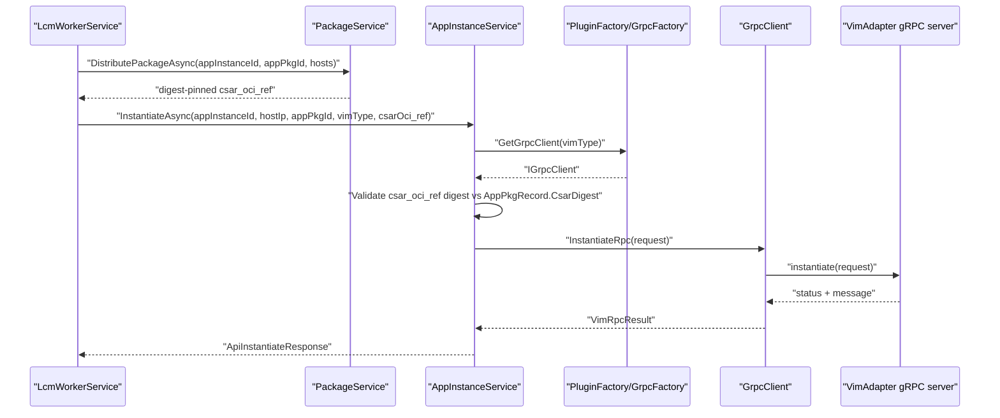
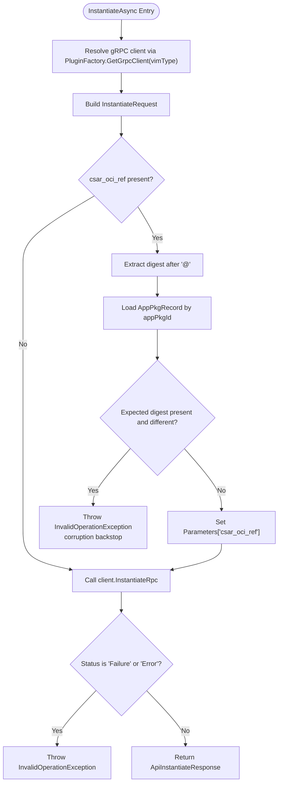
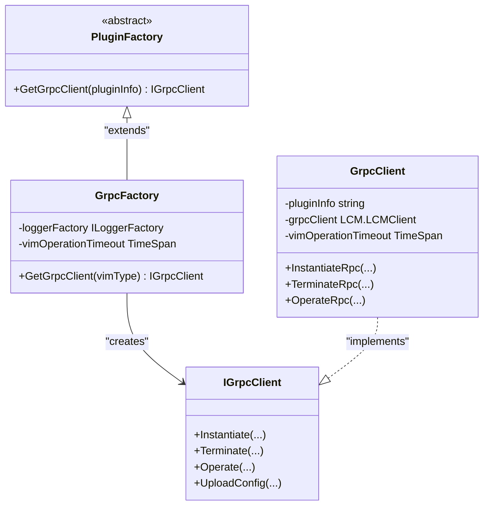
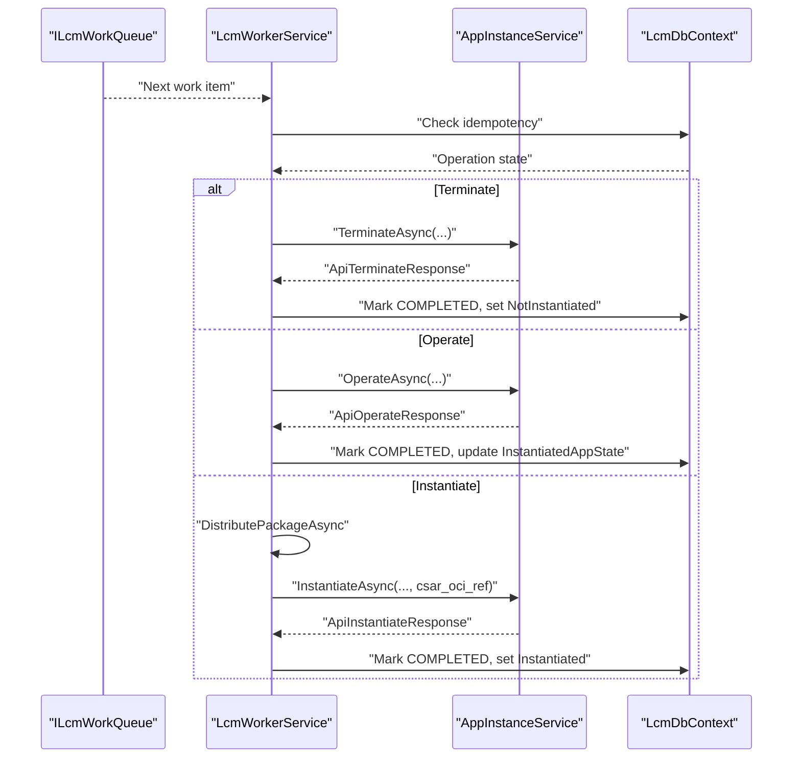
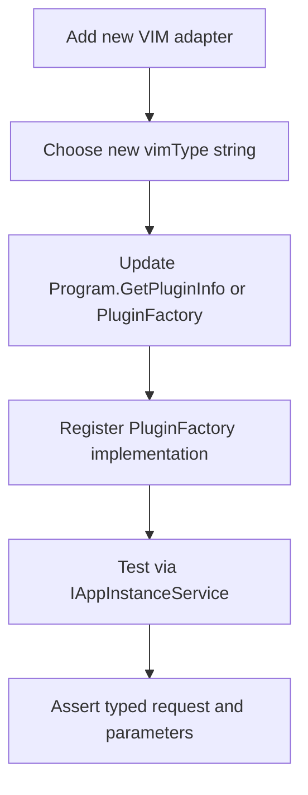
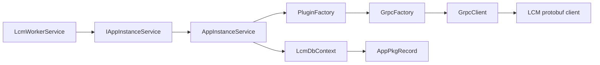

# VIM gRPC Client Service

<cite>
**Referenced Files in This Document**
- `src/PlatformManager/PlatformManager/Services/AppInstanceService.cs`
- `src/PlatformManager/PlatformManager/Services/IAppInstanceService.cs`
- `src/PlatformManager/PlatformManager/Models/ApiResponses.cs`
- `src/PlatformManager/PlatformManager/Services/LcmWorkerService.cs`
- `src/PlatformManager/PlatformManager/Services/PluginAdapter/PluginFactory.cs`
- `src/PlatformManager/PlatformManager/Services/PluginAdapter/GrpcFactory.cs`
- `src/PlatformManager/PlatformManager/Services/PluginAdapter/IGrpcClient.cs`
- `src/PlatformManager/PlatformManager/Services/PluginAdapter/GrpcClient.cs`
- `src/PlatformManager/PlatformManager/Program.cs`
- `src/PlatformManager/PlatformManager/Models/AppPkgRecord.cs`
- `src/PlatformManager/PlatformManager.Tests.Integration/AppInstanceServiceForwardingTests.cs`
- `src/PlatformManager/PlatformManager.Tests.Integration/LcmWorkerServiceCsarDigestTests.cs`
</cite>

## Table of Contents
1. [Introduction](#introduction)
2. [Project Structure](#project-structure)
3. [Core Components](#core-components)
4. [Architecture Overview](#architecture-overview)
5. [Detailed Component Analysis](#detailed-component-analysis)
6. [Dependency Analysis](#dependency-analysis)
7. [Performance Considerations](#performance-considerations)
8. [Troubleshooting Guide](#troubleshooting-guide)
9. [Conclusion](#conclusion)

## Introduction
AppInstanceService is the Platform Manager component that turns a lifecycle operation into an actual call against a VIM adapter over gRPC. It does not hardcode which VIM backend to use. Instead, it receives `vimType` from its caller — normally `LcmWorkerService` — and uses the pluggable `PluginFactory` / `GrpcFactory` adapter system to obtain a typed `IGrpcClient`. The service then constructs typed gRPC request models, forwards Phase 46’s digest-pinned `csar_oci_ref`, validates that the forwarded reference matches `AppPkgRecord.CsarDigest`, and returns structured API response records.

This document explains:
- How `InstantiateAsync`, `TerminateAsync`, and `OperateAsync` resolve and route calls.
- How the `csar_oci_ref` parameter flows through the gRPC layer for OCI distribution.
- How corruption is detected when the ref digest differs from the persisted CSAR digest.
- What `ApiInstantiateResponse`, `ApiTerminateResponse`, and `ApiOperateResponse` contain.
- How gRPC errors, cancellation, timeouts, and failures are handled.
- How this service fits into the LCM worker pipeline.
- How k8s and OpenStack adapters are selected at runtime.
- How to add new VIM adapters through the factory pattern.

## Project Structure
AppInstanceService lives in the Platform Manager (`PlatformManager`) project alongside the LCM background worker, the plugin adapter layer, and the shared API response models.

**Diagram sources**
- `src/PlatformManager/PlatformManager/Services/LcmWorkerService.cs#L200-L430`
- `src/PlatformManager/PlatformManager/Services/IAppInstanceService.cs#L1-L36`
- `src/PlatformManager/PlatformManager/Services/AppInstanceService.cs#L1-L160`
- `src/PlatformManager/PlatformManager/Services/PluginAdapter/PluginFactory.cs#L1-L7`
- `src/PlatformManager/PlatformManager/Services/PluginAdapter/GrpcFactory.cs#L1-L30`
- `src/PlatformManager/PlatformManager/Services/PluginAdapter/GrpcClient.cs#L1-L200`

**Section sources**
- `src/PlatformManager/PlatformManager/Services/AppInstanceService.cs#L1-L160`
- `src/PlatformManager/PlatformManager/Services/LcmWorkerService.cs#L1-L531`
- `src/PlatformManager/PlatformManager/Services/PluginAdapter/PluginFactory.cs#L1-L7`
- `src/PlatformManager/PlatformManager/Services/PluginAdapter/GrpcFactory.cs#L1-L30`
- `src/PlatformManager/PlatformManager/Program.cs#L1-L200`

## Core Components
| Component | Responsibility | Key behavior |
|---|---|---|
| `AppInstanceService` | Executes instantiate, terminate, and operate operations against a VIM adapter | Resolves a gRPC client by `vimType`, builds typed requests, validates Phase 46 digest pinning, logs status, converts failure responses to exceptions, and returns structured API responses |
| `IAppInstanceService` | Stable contract for lifecycle execution | Forces callers to pass `vimType` and, for instantiation, `csarOciRef`; hides gRPC implementation details |
| `PluginFactory` | Abstract factory for VIM gRPC clients | Defines `GetGrpcClient(string)` so VIM selection is decoupled from callers |
| `GrpcFactory` | Default concrete factory | Uses `Program.GetPluginInfo` to translate `vimType` (for example `k8s` or `openstack`) into a gRPC endpoint, applies per-operation timeout configuration, and creates `GrpcClient` instances |
| `IGrpcClient` | Typed interface for VIM gRPC calls | Exposes `InstantiateRpc`, `TerminateRpc`, `OperateRpc`, upload methods, and helper return types such as `VimRpcResult` |
| `GrpcClient` | Real gRPC transport | Builds credentials, configures retry for `Unavailable`, applies deadline and cancellation token, wraps protobuf responses into `VimRpcResult` |
| `ApiInstantiateResponse`, `ApiTerminateResponse`, `ApiOperateResponse` | Lightweight response models returned by AppInstanceService | Carry `Status` and optional `Message` |
| `AppPkgRecord` | Persisted application package metadata | Holds the immutable `CsarDigest` used to validate the forwarded OCI reference |

**Section sources**
- `src/PlatformManager/PlatformManager/Services/IAppInstanceService.cs#L1-L36`
- `src/PlatformManager/PlatformManager/Services/AppInstanceService.cs#L1-L160`
- `src/PlatformManager/PlatformManager/Services/PluginAdapter/PluginFactory.cs#L1-L7`
- `src/PlatformManager/PlatformManager/Services/PluginAdapter/GrpcFactory.cs#L1-L30`
- `src/PlatformManager/PlatformManager/Services/PluginAdapter/IGrpcClient.cs#L1-L41`
- `src/PlatformManager/PlatformManager/Services/PluginAdapter/GrpcClient.cs#L1-L200`
- `src/PlatformManager/PlatformManager/Models/ApiResponses.cs#L1-L11`
- `src/PlatformManager/PlatformManager/Models/AppPkgRecord.cs#L1-L19`

## Architecture Overview
The end-to-end flow starts with `LcmWorkerService`, which owns the long-running lifecycle state machine. For instantiation, it resolves the CSAR manifest digest from `AppPkgRecord`, asks `PackageService` to distribute the artifact to the configured OCI registry, obtains a digest-pinned OCI reference, and then delegates the actual VIM call to `AppInstanceService`.

**Diagram sources**
- `src/PlatformManager/PlatformManager/Services/LcmWorkerService.cs#L200-L430`
- `src/PlatformManager/PlatformManager/Services/AppInstanceService.cs#L18-L110`
- `src/PlatformManager/PlatformManager/Services/PluginAdapter/GrpcClient.cs#L120-L200`

## Detailed Component Analysis

### AppInstanceService: Lifecycle Execution
`AppInstanceService` implements `IAppInstanceService` and depends on three collaborators:
- `ILogger<AppInstanceService>` for operational logging.
- `PluginFactory` for selecting a VIM adapter.
- `LcmDbContext` for reading `AppPkgRecord.CsarDigest` during Phase 46 validation.

It does not construct gRPC channels directly; it delegates channel creation to the factory. It also does not own the lifecycle state machine; it returns structured results and throws only when the VIM reports failure or when the Phase 46 integrity check fails.

#### Runtime VIM Resolution
All three methods accept `vimType` as a string rather than deriving it internally. The caller is responsible for resolving it from grant data or persisted instance context. In normal operation, `LcmWorkerService` passes the `VimType` carried by the work item.

| Operation | Input parameters | Request model | Forwarded parameters | Notes |
|---|---|---|---|---|
| `InstantiateAsync` | `appInstanceId`, `hostIp`, `appPkgId`, `vimType`, `csarOciRef`, `ct` | `InstantiateRequest` | `Parameters["csar_oci_ref"]` if non-empty | Validates digest before calling gRPC |
| `TerminateAsync` | `appInstanceId`, `hostIp`, `vimType`, `ct` | `TerminateRequest` | None | No Phase 46 forwarding |
| `OperateAsync` | `appInstanceId`, `hostIp`, `changeStateTo`, `vimType`, `ct` | `OperateRequest` | None | Validates inputs early |

#### InstantiateAsync: Digest-Pinned OCI Distribution
`InstantiateAsync` performs these steps:
1. Resolve a gRPC client using `PluginFactory.GetGrpcClient(vimType)`.
2. Construct `InstantiateRequest` with `AppInstanceId`, `HostIp`, and `AppPackageId`.
3. If `csarOciRef` is non-empty:
   - Extract the digest after the last `@`.
   - Load `AppPkgRecord` by `appPkgId`.
   - If `expectedDigest` is present and differs from the extracted digest, throw `InvalidOperationException`.
   - Otherwise, set `request.Parameters["csar_oci_ref"] = csarOciRef`.
4. Call `client.InstantiateRpc(...)`.
5. Log the RPC result status and message.
6. Treat `"Failure"` or `"Error"` as a failed operation by throwing `InvalidOperationException`.
7. Return `new ApiInstantiateResponse(status, message)`.

This design means the Phase 46 OCI distribution reference is validated at the last seam before the wire, while still tolerating legacy rows where auto-provision did not populate `CsarDigest`.

**Diagram sources**
- `src/PlatformManager/PlatformManager/Services/AppInstanceService.cs#L18-L110`
- `src/PlatformManager/PlatformManager/Models/AppPkgRecord.cs#L1-L19`

#### TerminateAsync
`TerminateAsync`:
- Resolves the gRPC client by `vimType`.
- Constructs `TerminateRequest` with `AppInstanceId` and `HostIp`.
- Calls `client.TerminateRpc(...)`.
- Logs the result.
- Throws `InvalidOperationException` if the VIM status is `"Failure"` or `"Error"`.
- Returns `ApiTerminateResponse`.

It does not forward `csar_oci_ref`, because termination does not need the application package artifact.

#### OperateAsync
`OperateAsync`:
- Checks cancellation immediately.
- Validates that `appInstanceId` and `hostIp` are neither null nor whitespace.
- Resolves the gRPC client by `vimType`.
- Constructs `OperateRequest` with `AppInstanceId`, `HostIp`, and `ChangeStateTo`.
- Calls `client.OperateRpc(...)`.
- Logs the result.
- Throws `InvalidOperationException` when the VIM status indicates failure.
- Returns `ApiOperateResponse`.

The input validation makes malformed operate calls fail fast before network access.

#### Return Models
| Model | Properties | Meaning |
|---|---|---|
| `ApiInstantiateResponse` | `Status`, `Message?` | Result of a VIM instantiate call |
| `ApiTerminateResponse` | `Status`, `Message?` | Result of a VIM terminate call |
| `ApiOperateResponse` | `Status`, `Message?` | Result of a VIM operate call |

These are simple C# records. They carry enough information for `LcmWorkerService` to persist terminal state and build human-readable response text.

**Section sources**
- `src/PlatformManager/PlatformManager/Services/AppInstanceService.cs#L18-L160`
- `src/PlatformManager/PlatformManager/Models/ApiResponses.cs#L1-L11`

### PluginFactory and GrpcFactory: Pluggable VIM Selection
`PluginFactory` is an abstract class with one method: `GetGrpcClient(string)`. Its purpose is to hide how a string such as `k8s` or `openstack` becomes a gRPC connection.

`GrpcFactory` is the default implementation. It:
- Resolves the per-operation VIM timeout once from configuration.
- Creates a logger for `GrpcClient`.
- Delegates endpoint resolution to `Program.GetPluginInfo(vimType, logger)`.
- Returns a new `GrpcClient(pluginInfo, logger, _vimOperationTimeout)`.

This separation allows tests and alternative environments to supply a different factory without changing `AppInstanceService`.

**Diagram sources**
- `src/PlatformManager/PlatformManager/Services/PluginAdapter/PluginFactory.cs#L1-L7`
- `src/PlatformManager/PlatformManager/Services/PluginAdapter/GrpcFactory.cs#L1-L30`
- `src/PlatformManager/PlatformManager/Services/PluginAdapter/IGrpcClient.cs#L1-L41`
- `src/PlatformManager/PlatformManager/Services/PluginAdapter/GrpcClient.cs#L1-L200`

**Section sources**
- `src/PlatformManager/PlatformManager/Services/PluginAdapter/PluginFactory.cs#L1-L7`
- `src/PlatformManager/PlatformManager/Services/PluginAdapter/GrpcFactory.cs#L1-L30`
- `src/PlatformManager/PlatformManager/Program.cs#L299-L329`

### Relationship Between AppInstanceService and LcmWorkerService
`LcmWorkerService` is a hosted background service that drains `ILcmWorkQueue`. It owns:
- Crash recovery replay.
- Per-operation timeout handling.
- Idempotent-consumer checks.
- State transitions between lifecycle states.
- Notification dispatch.

`AppInstanceService` owns only the boundary between the platform’s lifecycle workflow and the VIM adapter. It is resolved from the dependency container inside `ProcessAsync`.

For each operation type:
- **Terminate**: calls `TerminateAsync`, marks the op-occ completed, and sets the instance state to `NotInstantiated`.
- **Operate**: calls `OperateAsync`, persists the target state into the instance’s `InstantiatedAppState`.
- **Instantiate**: distributes the package first, validates the returned OCI ref, then calls `InstantiateAsync`, marks the op-occ completed, sets `InstantiationState` to `Instantiated`, and persists `VimType` and `HostIp`.

**Diagram sources**
- `src/PlatformManager/PlatformManager/Services/LcmWorkerService.cs#L200-L430`
- `src/PlatformManager/PlatformManager/Services/AppInstanceService.cs#L18-L160`

**Section sources**
- `src/PlatformManager/PlatformManager/Services/LcmWorkerService.cs#L1-L531`
- `src/PlatformManager/PlatformManager/Services/AppInstanceService.cs#L18-L160`

### gRPC Error Handling and Cancellation
Errors can occur at multiple layers:

| Layer | Behavior |
|---|---|
| `AppInstanceService` | Converts VIM-reported `"Failure"` or `"Error"` into `InvalidOperationException`; throws `ArgumentException` for invalid operate inputs; throws `InvalidOperationException` for Phase 46 digest mismatch |
| `GrpcClient` | Wraps protobuf responses into `VimRpcResult`; logs failed calls; propagates exceptions upward rather than swallowing them |
| `LcmWorkerService` | Catches `OperationCanceledException` from per-operation timeout and marks the op-occ `Failed`; catches other exceptions, logs them, and marks the op-occ `Failed`; isolates notification dispatch failures so they do not flip a successful operation to failed |
| Cancellation | `OperateAsync` throws immediately if cancellation was already requested; both worker-level and gRPC-layer cancellation tokens are propagated through the call chain |

Important distinction:
- A gRPC transport exception (network failure, unavailable adapter, deadline exceeded) bubbles up as an exception.
- A successful but failing VIM response (status `"Failure"` or `"Error"`) is converted to an `InvalidOperationException` by `AppInstanceService`.
- Only `LcmWorkerService` decides whether that exception becomes a terminal `FAILED` operation-occurrence row.

**Section sources**
- `src/PlatformManager/PlatformManager/Services/AppInstanceService.cs#L18-L160`
- `src/PlatformManager/PlatformManager/Services/PluginAdapter/GrpcClient.cs#L120-L200`
- `src/PlatformManager/PlatformManager/Services/LcmWorkerService.cs#L300-L531`

### Examples: k8s and OpenStack Adapter Selection
At runtime, `vimType` is a plain string. The concrete selection happens in `GrpcFactory.GetGrpcClient`, which calls `Program.GetPluginInfo(vimType, logger)`. Integration tests exercise both:
- `vimType = "k8s"`
- `vimType = "openstack"`

Both flow through the same `AppInstanceService` path. The key difference is the endpoint resolved by `GetPluginInfo`, not the service logic itself.

Practical examples:
- **k8s instantiation**: The worker resolves `vimType = "k8s"`, the factory resolves a Kubernetes-oriented gRPC endpoint, `InstantiateRequest` carries `csar_oci_ref`, and the VIM adapter provisions resources on Kubernetes.
- **OpenStack instantiation**: The worker resolves `vimType = "openstack"`, the factory resolves an OpenStack-oriented gRPC endpoint, `InstantiateRequest` still carries `csar_oci_ref`, and the OpenStack adapter ignores the key today while still receiving it through the universal forwarding path.

**Section sources**
- `src/PlatformManager/PlatformManager/Services/PluginAdapter/GrpcFactory.cs#L22-L30`
- `src/PlatformManager/PlatformManager/Program.cs#L299-L329`
- `src/PlatformManager/PlatformManager.Tests.Integration/AppInstanceServiceForwardingTests.cs#L54-L116`

### Debugging gRPC Call Failures
When a lifecycle operation fails, inspect the following layers in order:

1. **LcmWorkerService logs**
   - Look for “VIM ... failed” messages.
   - Check whether the failure came from a timeout (`OperationCanceledException`) or another exception.
   - Confirm the op-occ settled to `FAILED` or `COMPLETED`.

2. **AppInstanceService logs**
   - Verify the resolved `vimType`.
   - For instantiation, verify whether the `csar_oci_ref` digest mismatch guard fired before the gRPC call.
   - Confirm the logged VIM status and message.

3. **GrpcClient behavior**
   - Check whether the gRPC call threw an exception (transport failure) or returned a failure status.
   - Confirm the configured `LcmWorker:VimOperationTimeout` value.
   - Inspect retry behavior: `Unavailable` is retried up to five times with exponential backoff.

4. **Phase 46 integrity**
   - Compare the digest extracted from `csar_oci_ref` with `AppPkgRecord.CsarDigest`.
   - A missing `AppPkgRecord` or null `CsarDigest` does not fail the guard — this is intentional legacy tolerance.
   - A mismatch rejects the corrupt reference before any gRPC call.

5. **VIM adapter connectivity**
   - Validate that `Program.GetPluginInfo(vimType)` resolves to the expected endpoint.
   - Confirm credentials and TLS settings applied by `GrpcCredentialsHelper`.
   - Confirm the Python VimAdapter process is reachable.

**Section sources**
- `src/PlatformManager/PlatformManager/Services/AppInstanceService.cs#L18-L160`
- `src/PlatformManager/PlatformManager/Services/PluginAdapter/GrpcClient.cs#L1-L200`
- `src/PlatformManager/PlatformManager/Services/LcmWorkerService.cs#L300-L531`
- `src/PlatformManager/PlatformManager.Tests.Integration/AppInstanceServiceForwardingTests.cs#L116-L160`

### Extension Points: Adding New VIM Adapters
Adding a new VIM adapter follows the existing factory pattern:

1. **Implement the VIM adapter**
   - Provide a Python gRPC server implementing the `LCM` protobuf contract.
   - Configure discovery or static endpoint resolution for the new adapter.

2. **Wire adapter selection**
   - Extend `Program.GetPluginInfo` so a new `vimType` string resolves to the correct gRPC endpoint.
   - Alternatively, register a custom `PluginFactory` implementation if endpoint resolution needs more complexity.

3. **Register the factory**
   - The current registration is `PluginFactory` → `GrpcFactory`.
   - Tests demonstrate replacing the factory with a capturing or fake implementation.

4. **Exercise with integration tests**
   - Use the same pattern as `AppInstanceServiceForwardingTests` and `AppInstanceServiceOperateTests`: construct `AppInstanceService` with a fake `PluginFactory`, assert the constructed request, and verify status propagation.

**Diagram sources**
- `src/PlatformManager/PlatformManager/Program.cs#L299-L329`
- `src/PlatformManager/PlatformManager/Services/PluginAdapter/PluginFactory.cs#L1-L7`
- `src/PlatformManager/PlatformManager/Services/PluginAdapter/GrpcFactory.cs#L22-L30`
- `src/PlatformManager/PlatformManager.Tests.Integration/AppInstanceServiceForwardingTests.cs#L160-L220`

**Section sources**
- `src/PlatformManager/PlatformManager/Program.cs#L299-L329`
- `src/PlatformManager/PlatformManager/Services/PluginAdapter/PluginFactory.cs#L1-L7`
- `src/PlatformManager/PlatformManager/Services/PluginAdapter/GrpcFactory.cs#L1-L30`
- `src/PlatformManager/PlatformManager.Tests.Integration/AppInstanceServiceForwardingTests.cs#L160-L220`

## Dependency Analysis
The main dependencies are intentionally layered:

Key observations:
- `AppInstanceService` depends on abstractions (`IAppInstanceService`, `PluginFactory`, `LcmDbContext`), making it easy to test without a real gRPC server.
- `GrpcFactory` depends on `Program.GetPluginInfo` for endpoint resolution and on configuration for timeout values.
- `GrpcClient` owns the gRPC channel, retry policy, deadline, and credential setup.
- `LcmWorkerService` owns the longer-lived orchestration concerns: queues, state machines, retries, crash recovery, and notifications.

**Diagram sources**
- `src/PlatformManager/PlatformManager/Services/AppInstanceService.cs#L1-L160`
- `src/PlatformManager/PlatformManager/Services/LcmWorkerService.cs#L1-L531`
- `src/PlatformManager/PlatformManager/Services/PluginAdapter/GrpcFactory.cs#L1-L30`
- `src/PlatformManager/PlatformManager/Services/PluginAdapter/GrpcClient.cs#L1-L200`
- `src/PlatformManager/PlatformManager/Models/AppPkgRecord.cs#L1-L19`

**Section sources**
- `src/PlatformManager/PlatformManager/Services/AppInstanceService.cs#L1-L160`
- `src/PlatformManager/PlatformManager/Services/LcmWorkerService.cs#L1-L531`
- `src/PlatformManager/PlatformManager/Program.cs#L1-L200`

## Performance Considerations
- **Per-operation timeout**: Both `LcmWorkerService` and `GrpcClient` derive their timeout from `LcmWorker:VimOperationTimeout`. The worker cancels after the configured interval, and `GrpcClient` sets a gRPC deadline using the same configuration. A non-positive value disables the timeout for backward compatibility.
- **Retry policy**: `GrpcClient` retries `Unavailable` up to five times with initial backoff of one second, maximum backoff of five seconds, and a multiplier of 1.5.
- **Database reads**: Phase 46 validation loads `AppPkgRecord` by primary key. This is a single-row lookup and should be inexpensive.
- **Cancellation propagation**: `OperateAsync` validates cancellation before constructing requests, reducing unnecessary work when the worker is shutting down or has been cancelled.
- **No proto changes for Phase 46**: The `csar_oci_ref` parameter is forwarded through the existing protobuf `parameters` map, avoiding schema evolution costs.

[No sources needed since this section provides general guidance]

## Troubleshooting Guide
| Symptom | Likely cause | Investigation steps |
|---|---|---|
| Instantiate never reaches the VIM adapter | Phase 46 digest mismatch | Check whether the digest extracted from `csar_oci_ref` differs from `AppPkgRecord.CsarDigest`. A mismatch throws before the gRPC call. |
| Instantiate succeeds but the operation settles FAILED | VIM reported failure or gRPC transport error | Inspect `ApiInstantiateResponse.Status` and `LcmWorkerService` logs. Transport errors bubble as exceptions; VIM failure statuses are converted to `InvalidOperationException`. |
| Operation times out | VIM adapter is slow or unreachable | Check `LcmWorker:VimOperationTimeout`. Confirm whether the timeout comes from the linked cancellation token or the gRPC deadline. |
| OpenStack calls go to k8s | Incorrect `vimType` or resolver mapping | Inspect how the grant or instance context supplies `vimType`, and confirm `Program.GetPluginInfo` maps it correctly. |
| `csar_oci_ref` is absent from the request | Empty or null `csarOciRef` | The service only populates the parameter when the ref is non-empty. Verify `PackageService.DistributePackageAsync` returned a valid digest-pinned reference. |
| Legacy instantiation still works without `CsarDigest` | Intentional legacy tolerance | Missing `AppPkgRecord` or null `CsarDigest` does not fail the guard. This preserves compatibility with older rows. |
| Notify dispatch fails after success | Subscription callback or query error | Notification dispatch is isolated; it logs the failure but preserves the terminal operation state. |

**Section sources**
- `src/PlatformManager/PlatformManager/Services/AppInstanceService.cs#L18-L160`
- `src/PlatformManager/PlatformManager/Services/LcmWorkerService.cs#L300-L531`
- `src/PlatformManager/PlatformManager/Services/PluginAdapter/GrpcClient.cs#L120-L200`
- `src/PlatformManager/PlatformManager.Tests.Integration/AppInstanceServiceForwardingTests.cs#L54-L160`
- `src/PlatformManager/PlatformManager.Tests.Integration/LcmWorkerServiceCsarDigestTests.cs#L1-L200`

## Conclusion
AppInstanceService is the thin, typed bridge between the Platform Manager’s lifecycle workflow and VIM adapters over gRPC. It centralizes three responsibilities:
1. **VIM routing**: delegate adapter selection to `PluginFactory` / `GrpcFactory` using the caller-supplied `vimType`.
2. **Phase 46 integrity**: validate and forward the digest-pinned `csar_oci_ref` only for instantiation, rejecting corrupted references while preserving legacy tolerance.
3. **Structured error handling**: convert VIM-reported failures and transport errors into clear exceptions that `LcmWorkerService` can settle into durable lifecycle state.

Its relationship with `LcmWorkerService` is clean: the worker owns orchestration, durability, and state transitions; AppInstanceService owns the concrete VIM call. This separation makes k8s and OpenStack adapters interchangeable, supports extension through the factory pattern, and keeps gRPC details away from the higher-level lifecycle logic.