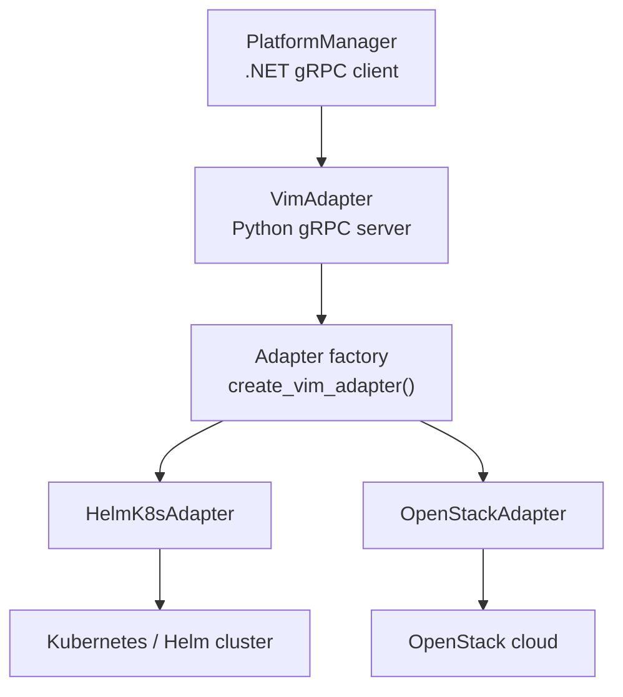
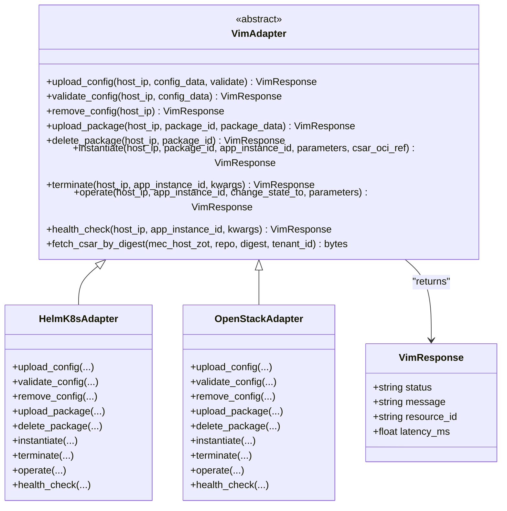
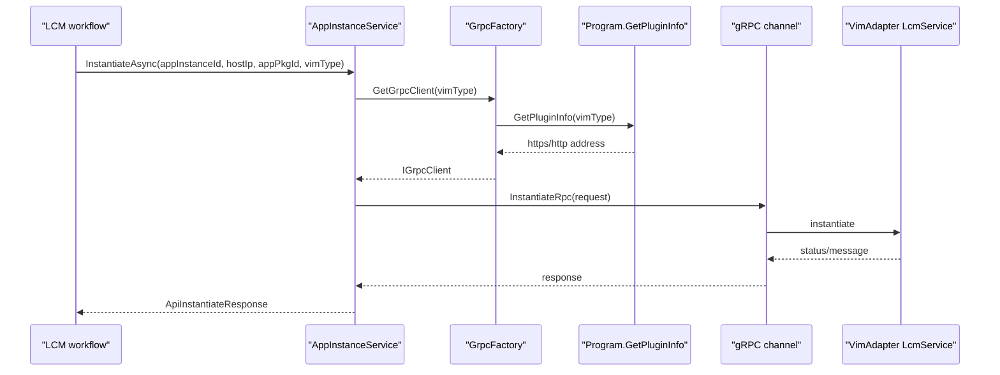
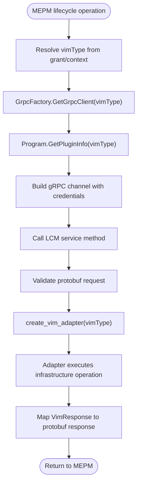
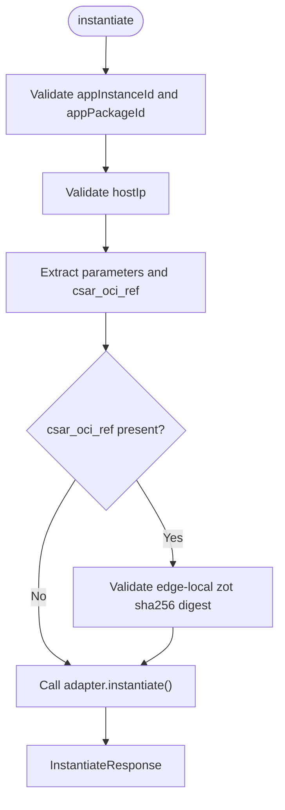
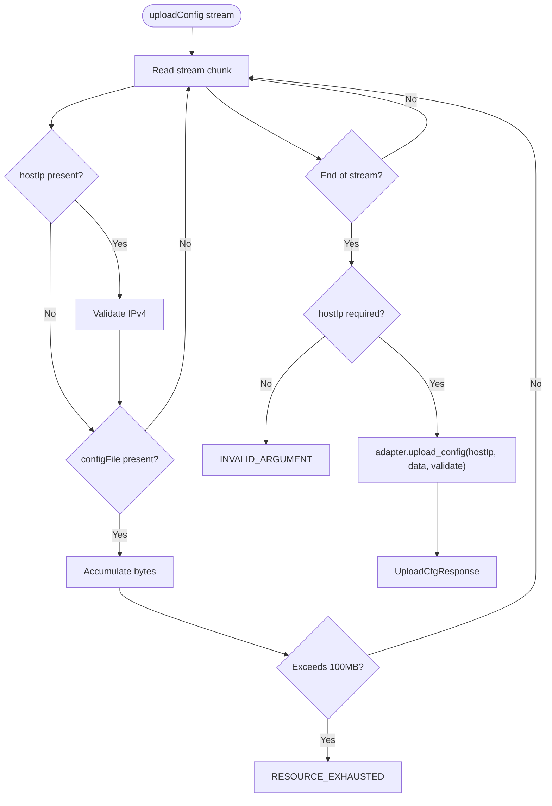
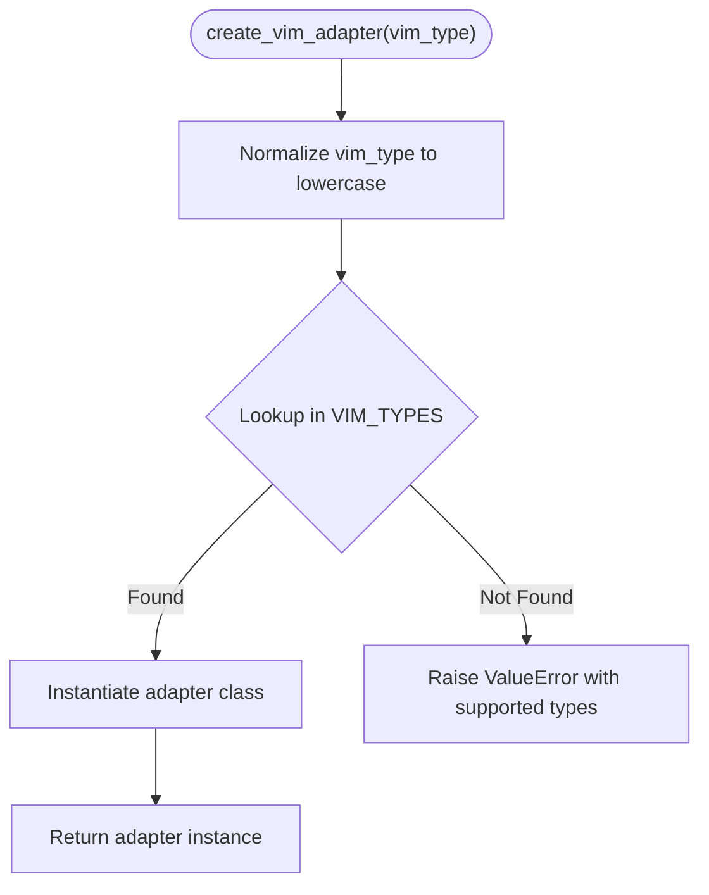
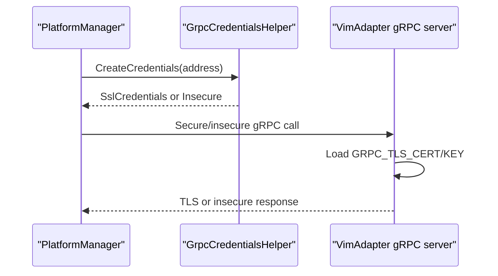
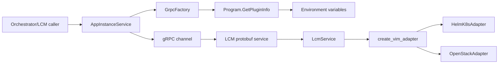

# Adapter Architecture and gRPC Interface

<cite>
**Referenced Files in This Document**
- `src/VimAdapter/protos/lcmservice.proto`
- `src/VimAdapter/src/server/lcm_grpc_server.py`
- `src/VimAdapter/src/adapters/factory.py`
- `src/VimAdapter/src/adapters/base.py`
- `src/VimAdapter/src/adapters/helm/helm_adapter.py`
- `src/VimAdapter/src/adapters/openstack/openstack_adapter.py`
- `src/PlatformManager/PlatformManager/Services/AppInstanceService.cs`
- `src/PlatformManager/PlatformManager/Services/ConfigService.cs`
- `src/PlatformManager/PlatformManager/Services/PluginAdapter/GrpcFactory.cs`
- `src/PlatformManager/PlatformManager/Program.cs`
- `src/PlatformManager/PlatformManager/Utils/GrpcCredentialsHelper.cs`
- `docs/contexts/vimadapter.md`
- `docs/ADR/0012-vim-adapter-factory.md`
- `docs/ADR/0013-grpc-mm6-transport.md`
- `tests/Optimist.Orchestrator.E2E/Fixtures/VimAdapterFixture.cs`
- `tests/Optimist.Orchestrator.E2E/Grpc/FakeVimAdapterServer.cs`
</cite>

## Table of Contents
1. [Introduction](#introduction)
2. [Project Structure](#project-structure)
3. [Core Components](#core-components)
4. [Architecture Overview](#architecture-overview)
5. [Detailed Component Analysis](#detailed-component-analysis)
6. [Dependency Analysis](#dependency-analysis)
7. [Performance Considerations](#performance-considerations)
8. [Troubleshooting Guide](#troubleshooting-guide)
9. [Conclusion](#conclusion)

## Introduction
The VimAdapter is the Python-based gRPC server that implements the Mm6 reference point between the MEC Platform Manager (MEPM, implemented here as `PlatformManager`) and a concrete Virtualisation Infrastructure Manager (VIM). It exposes a lifecycle and package/configuration interface defined by `lcmservice.proto`, then delegates actual provisioning to a pluggable infrastructure backend through an adapter factory. The current production path uses Kubernetes/Helm; OpenStack support exists but is partial.

The design has two major architectural goals:
- A stable protobuf contract so MEPM can call the VIM without knowing whether it is Helm/Kubernetes or OpenStack.
- An adapter factory inside VimAdapter so new infrastructure backends can be added without changing the gRPC service implementation or the MEPM client code.

The MEPM resolves the target VimAdapter endpoint using environment variables and calls it over gRPC with optional TLS/mTLS. Lifecycle operations such as instantiate, terminate, and operate are forwarded to the selected adapter, which owns resource state on the underlying infrastructure.

**Section sources**
- `docs/ADR/0012-vim-adapter-factory.md#L1-L46`
- `docs/ADR/0013-grpc-mm6-transport.md#L1-L41`
- `docs/contexts/vimadapter.md#L1-L25`

## Project Structure
The relevant code is split across three layers:

| Layer | Responsibility | Key files |
|---|---|---|
| Protobuf contract | Defines the wire interface for lifecycle and configuration operations | `src/VimAdapter/protos/lcmservice.proto` |
| VimAdapter (Python) | gRPC server, validation, adapter factory, adapters, file/config handling | `src/VimAdapter/src/server/lcm_grpc_server.py`, `src/VimAdapter/src/adapters/factory.py`, `src/VimAdapter/src/adapters/base.py`, `src/VimAdapter/src/adapters/helm/helm_adapter.py`, `src/VimAdapter/src/adapters/openstack/openstack_adapter.py` |
| MEPM (.NET) | Client code that selects a VIM type, resolves the gRPC address, and invokes lifecycle endpoints | `src/PlatformManager/PlatformManager/Services/AppInstanceService.cs`, `src/PlatformManager/PlatformManager/Services/ConfigService.cs`, `src/PlatformManager/PlatformManager/Services/PluginAdapter/GrpcFactory.cs`, `src/PlatformManager/PlatformManager/Program.cs`, `src/PlatformManager/PlatformManager/Utils/GrpcCredentialsHelper.cs` |

**Diagram sources**
- `src/VimAdapter/src/server/lcm_grpc_server.py#L1-L200`
- `src/VimAdapter/src/adapters/factory.py#L1-L35`
- `src/VimAdapter/src/adapters/helm/helm_adapter.py#L1-L200`
- `src/VimAdapter/src/adapters/openstack/openstack_adapter.py#L1-L200`

**Section sources**
- `src/VimAdapter/protos/lcmservice.proto#L1-L94`
- `src/VimAdapter/src/server/lcm_grpc_server.py#L1-L414`
- `src/VimAdapter/src/adapters/factory.py#L1-L35`
- `src/VimAdapter/src/adapters/base.py#L1-L159`
- `src/PlatformManager/PlatformManager/Services/AppInstanceService.cs#L1-L160`
- `src/PlatformManager/PlatformManager/Services/ConfigService.cs#L1-L101`
- `src/PlatformManager/PlatformManager/Services/PluginAdapter/GrpcFactory.cs#L1-L30`
- `src/PlatformManager/PlatformManager/Program.cs#L280-L329`

## Core Components
This section maps the conceptual components to their actual implementations.

### gRPC Service Contract
The LCM service defines seven RPCs:
- `instantiate`: create an application instance.
- `terminate`: delete an application instance.
- `operate`: start or stop an existing instance.
- `uploadConfig`: stream configuration bytes to the VIM.
- `removeConfig`: remove previously uploaded configuration.
- `uploadPackage`: stream a CSAR package to the VIM.
- `deletePackage`: remove an uploaded package.

All request/response messages use simple string status fields plus optional messages, parameters maps, UUID-like identifiers, host IP addresses, and binary payloads for streaming uploads.

| RPC | Request | Response | Notes |
|---|---|---|---|
| `instantiate` | `InstantiateRequest` | `InstantiateResponse` | Accepts `appInstanceId`, `appPackageId`, `hostIp`, and `parameters`; supports optional `csar_oci_ref` in parameters. |
| `terminate` | `TerminateRequest` | `TerminateResponse` | Requires `appInstanceId` and `hostIp`. |
| `operate` | `OperateRequest` | `OperateResponse` | Requires `changeStateTo` to be `STARTED` or `STOPPED`. |
| `uploadConfig` | Stream of `UploadCfgRequest` | `UploadCfgResponse` | Streams config bytes; enforces a 100 MB limit. |
| `removeConfig` | `RemoveCfgRequest` | `RemoveCfgResponse` | Removes configuration for a host IP. |
| `uploadPackage` | Stream of `UploadPackageRequest` | `UploadPackageResponse` | Streams CSAR bytes; enforces a 500 MB limit. |
| `deletePackage` | `DeletePackageRequest` | `DeletePackageResponse` | Deletes a package identified by host IP and package ID. |

**Section sources**
- `src/VimAdapter/protos/lcmservice.proto#L1-L94`

### VimAdapter gRPC Server
The `LcmService` servicer in `lcm_grpc_server.py` is the entry point for all Mm6 calls from MEPM. Its responsibilities include:
- Constructing the selected VIM adapter based on the `VIM_TYPE` environment variable (defaulting to `k8s`).
- Validating input fields such as UUIDs, IPv4 addresses, and CSAR OCI references.
- Delegating work to the adapter.
- Converting adapter responses into protobuf responses.
- Mapping exceptions to gRPC status codes.
- Serving either securely via TLS or insecurely when configured.

It also enables gRPC reflection, which helps clients discover available services during development and testing.

**Section sources**
- `src/VimAdapter/src/server/lcm_grpc_server.py#L1-L414`

### Adapter Factory Pattern
The adapter factory centralizes VIM selection:
- `VIM_TYPES` maps discriminator strings to adapter classes.
- Currently supported types are `k8s`, `helm`, and `openstack`.
- `create_vim_adapter` raises `ValueError` for unknown types.
- New backends only require registration in `VIM_TYPES` and implementing the abstract adapter contract.

This isolates polymorphism to one place and keeps the gRPC servicer generic.

**Section sources**
- `src/VimAdapter/src/adapters/factory.py#L1-L35`
- `docs/ADR/0012-vim-adapter-factory.md#L1-L46`

### Abstract Adapter Contract
`VimAdapter` defines the backend interface:
- Configuration upload, validation, and removal.
- Package upload and deletion.
- Application instantiation, termination, and operational state changes.
- Health checking.
- Optional CSAR retrieval by immutable digest from an edge-local container registry.

`VimResponse` standardizes adapter results with a status, message, optional resource identifier, and optional latency metric.

**Diagram sources**
- `src/VimAdapter/src/adapters/base.py#L1-L159`
- `src/VimAdapter/src/adapters/helm/helm_adapter.py#L1-L200`
- `src/VimAdapter/src/adapters/openstack/openstack_adapter.py#L1-L200`

**Section sources**
- `src/VimAdapter/src/adapters/base.py#L1-L159`

### MEPM gRPC Client Integration
The MEPM does not hardcode a single VimAdapter implementation. Instead:
- `GrpcFactory` creates a gRPC client per operation using `Program.GetPluginInfo(vimType)`.
- `GetPluginInfo` resolves the VimAdapter address from environment variables such as `{VIM}_PLUGIN` and `{VIM}_PLUGIN_PORT`, defaulting to a local loopback address when missing.
- `AppInstanceService` builds typed requests and forwards them to the selected VIM.
- `ConfigService` streams configuration files to the VimAdapter using the same plugin resolution path.

**Diagram sources**
- `src/PlatformManager/PlatformManager/Services/AppInstanceService.cs#L1-L160`
- `src/PlatformManager/PlatformManager/Services/PluginAdapter/GrpcFactory.cs#L1-L30`
- `src/PlatformManager/PlatformManager/Program.cs#L280-L329`
- `src/VimAdapter/src/server/lcm_grpc_server.py#L1-L414`

**Section sources**
- `src/PlatformManager/PlatformManager/Services/AppInstanceService.cs#L1-L160`
- `src/PlatformManager/PlatformManager/Services/ConfigService.cs#L1-L101`
- `src/PlatformManager/PlatformManager/Services/PluginAdapter/GrpcFactory.cs#L1-L30`
- `src/PlatformManager/PlatformManager/Program.cs#L280-L329`

## Architecture Overview
The end-to-end flow is layered:

1. **MEPM caller**: Orchestrator or LCM handler decides which VIM to use based on grant context.
2. **MEPM service layer**: `AppInstanceService` or `ConfigService` builds the request and asks `PluginFactory` for a gRPC client.
3. **Address resolution**: `Program.GetPluginInfo` reads environment variables and returns an HTTP/HTTPS target.
4. **Transport**: gRPC over HTTP/2, optionally secured with TLS or mTLS.
5. **VimAdapter server**: Validates inputs and dispatches to the selected adapter.
6. **Concrete adapter**: Translates lifecycle commands into Kubernetes/Helm or OpenStack API calls.
7. **Infrastructure**: Cluster, container registry, or cloud APIs perform the real work.

**Diagram sources**
- `src/PlatformManager/PlatformManager/Services/AppInstanceService.cs#L1-L160`
- `src/PlatformManager/PlatformManager/Program.cs#L280-L329`
- `src/VimAdapter/src/server/lcm_grpc_server.py#L1-L414`
- `src/VimAdapter/src/adapters/factory.py#L1-L35`

## Detailed Component Analysis

### gRPC Lifecycle Methods

#### Instantiate
- Validates `appInstanceId`, `appPackageId`, and `hostIp`.
- Extracts special keys from `parameters`, including `csar_oci_ref`.
- When `csar_oci_ref` is present, validates that it points to an edge-local zot repository and uses a SHA-256 digest.
- Forwards the operation to the selected adapter.
- Returns failure/gRPC errors when validation fails.

MEPM additionally checks that the digest portion of the provided OCI reference matches the persisted `CsarDigest` before forwarding it.

**Diagram sources**
- `src/VimAdapter/src/server/lcm_grpc_server.py#L201-L330`
- `src/PlatformManager/PlatformManager/Services/AppInstanceService.cs#L1-L160`

**Section sources**
- `src/VimAdapter/src/server/lcm_grpc_server.py#L201-L330`
- `src/PlatformManager/PlatformManager/Services/AppInstanceService.cs#L1-L160`

#### Terminate
- Validates `hostIp` and `appInstanceId`.
- Delegates to `adapter.terminate`.
- Maps `ValueError` to invalid argument, `FileNotFoundError` to not found, and other exceptions to internal error.

**Section sources**
- `src/VimAdapter/src/server/lcm_grpc_server.py#L330-L390`

#### Operate
- Validates `appInstanceId`, `hostIp`, and restricts `changeStateTo` to `STARTED` or `STOPPED`.
- Passes parameters unchanged to the adapter.
- Maps adapter exceptions to gRPC status codes.

**Section sources**
- `src/VimAdapter/src/server/lcm_grpc_server.py#L390-L414`

#### UploadConfiguration
- Accepts a streamed iterator of `UploadCfgRequest`.
- Tracks `hostIp` and accumulated config bytes.
- Enforces a 100 MB payload limit.
- Supports optional validation via the `x-validate` metadata flag.
- Writes validated latency metadata as trailing metadata when requested.
- Calls `adapter.upload_config`.

**Diagram sources**
- `src/VimAdapter/src/server/lcm_grpc_server.py#L1-L200`

**Section sources**
- `src/VimAdapter/src/server/lcm_grpc_server.py#L1-L200`
- `src/PlatformManager/PlatformManager/Services/ConfigService.cs#L1-L101`

#### UploadPackage
- Reads a streamed package payload.
- Enforces a 500 MB in-memory limit.
- Requires both `hostIp` and `appPackageId`.
- Delegates to `adapter.upload_package`.

**Section sources**
- `src/VimAdapter/src/server/lcm_grpc_server.py#L120-L200`

#### RemoveConfiguration and DeletePackage
Both methods validate input and delegate to the corresponding adapter method, mapping common exception types to structured gRPC errors.

**Section sources**
- `src/VimAdapter/src/server/lcm_grpc_server.py#L200-L260`

### Adapter Registration Mechanism
Adapter registration is explicit and centralized:
- Add a new backend class implementing `VimAdapter`.
- Register it in `VIM_TYPES` under a discriminator key.
- Configure MEPM to select that key via the grant’s `VimConnectionInfo.VimType` and environment variables.

Unknown types raise `ValueError`, which surfaces as an invalid argument or initialization failure depending on where the lookup occurs.

**Diagram sources**
- `src/VimAdapter/src/adapters/factory.py#L1-L35`

**Section sources**
- `src/VimAdapter/src/adapters/factory.py#L1-L35`
- `docs/ADR/0012-vim-adapter-factory.md#L1-L46`

### Error Handling Patterns
Errors follow a consistent pattern:
- Input validation failures return `INVALID_ARGUMENT`.
- Missing configuration or package resources return `NOT_FOUND`.
- Unexpected backend failures return `INTERNAL`.
- Oversized payloads return `RESOURCE_EXHAUSTED`.
- Validation-specific failures may be wrapped in `ValueError` and mapped by the servicer.

Adapter implementations also scrub credentials from logs and exceptions before surfacing them.

| Error source | gRPC status | Example condition |
|---|---|---|
| Invalid UUID | `INVALID_ARGUMENT` | `appInstanceId` or `appPackageId` |
| Invalid IPv4 | `INVALID_ARGUMENT` | `hostIp` |
| Unsupported state | `INVALID_ARGUMENT` | `changeStateTo` not `STARTED` or `STOPPED` |
| Missing host IP | `INVALID_ARGUMENT` | Required field absent |
| Config exceeds 100 MB | `RESOURCE_EXHAUSTED` | `uploadConfig` |
| Package exceeds 500 MB | `RESOURCE_EXHAUSTED` | `uploadPackage` |
| Missing kubeconfig/config | `NOT_FOUND` | Adapter cannot find stored configuration |
| Backend exception | `INTERNAL` | Unhandled exception in adapter |

**Section sources**
- `src/VimAdapter/src/server/lcm_grpc_server.py#L1-L414`
- `src/VimAdapter/src/adapters/base.py#L1-L159`
- `src/VimAdapter/src/adapters/helm/helm_adapter.py#L1-L200`
- `src/VimAdapter/src/adapters/openstack/openstack_adapter.py#L1-L200`

### Authentication and Security
Authentication has two distinct layers:

1. **MEPM to VimAdapter transport security**:
   - VimAdapter serves TLS when `GRPC_TLS_CERT` and `GRPC_TLS_KEY` are present and valid.
   - If TLS loading fails, it can fall back to insecure mode when `GRPC_INSECURE=true`.
   - MEPM constructs channel credentials using `GrpcCredentialsHelper`, supporting mTLS and CA-only TLS.

2. **VIM provider authentication**:
   - Kubernetes: kubeconfig bytes uploaded via `uploadConfig`.
   - OpenStack: `clouds.yaml` profile uploaded via `uploadConfig`.
   - These credentials are stored by adapters and used to connect to the underlying infrastructure.

There is no Keycloak token validation inside the VimAdapter itself in the examined files. Authentication between MEPM and VimAdapter is transport-level TLS/mTLS and environment-driven configuration. Keycloak appears elsewhere in the platform, but the VimAdapter gRPC boundary documented here relies on secure transport and VIM-specific configuration rather than Keycloak tokens at the gRPC layer.

**Diagram sources**
- `src/PlatformManager/PlatformManager/Utils/GrpcCredentialsHelper.cs#L1-L119`
- `src/VimAdapter/src/server/lcm_grpc_server.py#L360-L414`

**Section sources**
- `src/PlatformManager/PlatformManager/Utils/GrpcCredentialsHelper.cs#L1-L119`
- `src/VimAdapter/src/server/lcm_grpc_server.py#L360-L414`
- `src/PlatformManager/PlatformManager/Program.cs#L280-L329`

### Connection Management
- MEPM resolves VimAdapter targets using environment variables:
  - `{VIM}_PLUGIN` and `{VIM}_PLUGIN_PORT`.
  - Optional `{VIM}_USE_TLS` and `{VIM}_GRPC_TLS_CERT`.
  - Defaults to `http://127.0.0.1:50051` or `https://127.0.0.1:50051` when missing.
- Per-operation timeout is resolved once by `GrpcFactory` from configuration and applied to gRPC clients.
- Tests demonstrate both a real VimAdapter subprocess fixture and a fake in-process Kestrel gRPC server for integration tests.

**Section sources**
- `src/PlatformManager/PlatformManager/Program.cs#L280-L329`
- `src/PlatformManager/PlatformManager/Services/PluginAdapter/GrpcFactory.cs#L1-L30`
- `tests/Optimist.Orchestrator.E2E/Fixtures/VimAdapterFixture.cs#L1-L200`
- `tests/Optimist.Orchestrator.E2E/Grpc/FakeVimAdapterServer.cs#L1-L67`

### gRPC Client Usage Examples
The repository provides both production-style and test-oriented usage patterns:

| Scenario | Client behavior | Relevant files |
|---|---|---|
| Production MEPM call | Resolve vimType, get gRPC client, build request, invoke RPC, map status to .NET response | `src/PlatformManager/PlatformManager/Services/AppInstanceService.cs#L1-L160` |
| Configuration upload | Stream file through temporary disk copy, forward via `uploadConfig`, clean up temp file | `src/PlatformManager/PlatformManager/Services/ConfigService.cs#L1-L101` |
| E2E real VimAdapter | Launch Python process, set `VIM_TYPE=k8s`, `GRPC_INSECURE=true`, probe readiness, create `LCM.LCMClient` | `tests/Optimist.Orchestrator.E2E/Fixtures/VimAdapterFixture.cs#L1-L200` |
| E2E fake VimAdapter | Host a real Kestrel gRPC server on loopback with HTTP/2 cleartext | `tests/Optimist.Orchestrator.E2E/Grpc/FakeVimAdapterServer.cs#L1-L67` |

A typical client sequence is:
1. Determine `vimType`.
2. Call `GrpcFactory.GetGrpcClient(vimType)`.
3. Build a protobuf request.
4. Invoke the appropriate RPC.
5. Treat `Failure` or `Error` statuses as failures.
6. Use cancellation tokens for long-running operations.

**Section sources**
- `src/PlatformManager/PlatformManager/Services/AppInstanceService.cs#L1-L160`
- `src/PlatformManager/PlatformManager/Services/ConfigService.cs#L1-L101`
- `tests/Optimist.Orchestrator.E2E/Fixtures/VimAdapterFixture.cs#L1-L200`
- `tests/Optimist.Orchestrator.E2E/Grpc/FakeVimAdapterServer.cs#L1-L67`

### Protocol Versioning and Migration Strategy
The protobuf contract is treated as stable:
- The ADR states the proto is unchanged across VIM factory swaps.
- New VIM types implement the same `LCM` service contract.
- Backward-compatible changes should preserve existing field numbers and avoid removing fields used by callers.

Recommended migration strategy for interface changes:
1. Prefer additive changes: add new fields with higher tag numbers.
2. Keep old fields present during a transition period.
3. Make consumers ignore unknown fields safely.
4. Avoid changing enum meanings or allowed values unless both sides support a deprecation phase.
5. Update generated client and server stubs together.
6. Test both MEPM and VimAdapter against the updated proto.
7. Roll out MEPM and VimAdapter in a controlled order if behavior depends on new fields.

Current extensions visible in the code include:
- Passing `csar_oci_ref` through the existing `parameters` map instead of adding a new proto field.
- Using trailing metadata such as `x-validated` and `x-latency-ms` for optional validation diagnostics.

**Section sources**
- `docs/ADR/0013-grpc-mm6-transport.md#L1-L41`
- `src/VimAdapter/protos/lcmservice.proto#L1-L94`
- `src/PlatformManager/PlatformManager/Services/AppInstanceService.cs#L1-L160`
- `src/VimAdapter/src/server/lcm_grpc_server.py#L1-L200`

## Dependency Analysis
The main dependency relationships are:

**Diagram sources**
- `src/PlatformManager/PlatformManager/Services/AppInstanceService.cs#L1-L160`
- `src/PlatformManager/PlatformManager/Services/PluginAdapter/GrpcFactory.cs#L1-L30`
- `src/PlatformManager/PlatformManager/Program.cs#L280-L329`
- `src/VimAdapter/src/server/lcm_grpc_server.py#L1-L414`
- `src/VimAdapter/src/adapters/factory.py#L1-L35`

Key observations:
- MEPM couples to the protobuf-generated client and `PluginFactory`, not directly to adapter internals.
- VimAdapter couples to adapters through the factory and base contract.
- Concrete adapters depend on infrastructure libraries (`kubernetes`, `openstacksdk`, Helm tooling, filesystem utilities).
- Environment variables are the primary wiring mechanism for transport and backend selection.

**Section sources**
- `src/PlatformManager/PlatformManager/Services/AppInstanceService.cs#L1-L160`
- `src/PlatformManager/PlatformManager/Services/PluginAdapter/GrpcFactory.cs#L1-L30`
- `src/PlatformManager/PlatformManager/Program.cs#L280-L329`
- `src/VimAdapter/src/server/lcm_grpc_server.py#L1-L414`
- `src/VimAdapter/src/adapters/factory.py#L1-L35`

## Performance Considerations
- Streaming uploads are first-class: configuration and package payloads are streamed rather than fully materialized in MEPM.
- VimAdapter enforces payload size limits:
  - 100 MB for configuration uploads.
  - 500 MB for package uploads.
- Long-running operations use cancellation tokens on the MEPM side and timeouts configured per VIM operation.
- Adapter validation may perform network probes (e.g., Kubernetes discovery, OpenStack identity) and reports latency in `VimResponse.latency_ms` when validation is enabled.
- The CSAR-by-digest path uses an external `oras` CLI and runs blocking I/O off the asyncio event loop.

Recommendations:
- Monitor payload sizes and adapter latency metrics.
- Tune VIM operation timeouts according to infrastructure performance.
- Avoid uploading unnecessarily large configuration files.
- Prefer digest-pinned OCI references for reproducible deployments.

**Section sources**
- `src/VimAdapter/src/server/lcm_grpc_server.py#L1-L200`
- `src/VimAdapter/src/adapters/base.py#L1-L159`
- `src/VimAdapter/src/adapters/helm/helm_adapter.py#L1-L200`
- `src/VimAdapter/src/adapters/openstack/openstack_adapter.py#L1-L200`
- `src/PlatformManager/PlatformManager/Services/PluginAdapter/GrpcFactory.cs#L1-L30`

## Troubleshooting Guide

| Symptom | Likely cause | Where to inspect |
|---|---|---|
| VimAdapter refuses connection | Missing or incorrect `{VIM}_PLUGIN` / `{VIM}_PLUGIN_PORT` | `src/PlatformManager/PlatformManager/Program.cs#L280-L329` |
| TLS handshake failure | Missing or invalid `GRPC_TLS_CERT` / `GRPC_TLS_KEY` | `src/VimAdapter/src/server/lcm_grpc_server.py#L360-L414` |
| MEPM cannot trust VimAdapter certificate | Missing CA certificate or wrong path | `src/PlatformManager/PlatformManager/Utils/GrpcCredentialsHelper.cs#L1-L119` |
| `INVALID_ARGUMENT` on instantiate | Bad UUID or IPv4 format | `src/VimAdapter/src/server/lcm_grpc_server.py#L201-L330` |
| `RESOURCE_EXHAUSTED` on upload | Payload too large | `src/VimAdapter/src/server/lcm_grpc_server.py#L1-L200` |
| `NOT_FOUND` on lifecycle operation | Missing kubeconfig or package | `src/VimAdapter/src/server/lcm_grpc_server.py#L200-L390` |
| Unknown VIM type | Missing adapter registration | `src/VimAdapter/src/adapters/factory.py#L1-L35` |
| E2E VimAdapter never becomes ready | Python process exited or port not ready | `tests/Optimist.Orchestrator.E2E/Fixtures/VimAdapterFixture.cs#L1-L200` |
| Fake gRPC server rejects cleartext calls | Kestrel must expose HTTP/2 on cleartext endpoint | `tests/Optimist.Orchestrator.E2E/Grpc/FakeVimAdapterServer.cs#L1-L67` |

Practical steps:
1. Verify `vimType` matches a registered adapter key.
2. Confirm MEPM environment variables resolve to a reachable VimAdapter address.
3. Enable logging in MEPM and VimAdapter to trace request flow.
4. Use gRPC reflection or test fixtures to verify the service is available.
5. Validate configuration files before upload when possible.
6. Check adapter logs for infrastructure connectivity issues.

**Section sources**
- `src/PlatformManager/PlatformManager/Program.cs#L280-L329`
- `src/PlatformManager/PlatformManager/Utils/GrpcCredentialsHelper.cs#L1-L119`
- `src/VimAdapter/src/server/lcm_grpc_server.py#L1-L414`
- `src/VimAdapter/src/adapters/factory.py#L1-L35`
- `tests/Optimist.Orchestrator.E2E/Fixtures/VimAdapterFixture.cs#L1-L200`
- `tests/Optimist.Orchestrator.E2E/Grpc/FakeVimAdapterServer.cs#L1-L67`

## Conclusion
The VimAdapter architecture cleanly separates the MEPM-facing gRPC contract from infrastructure-specific implementation details. The protobuf-defined `LCM` service provides a stable Mm6 boundary, while the adapter factory allows Kubernetes/Helm and OpenStack backends to share the same wire interface. MEPM selects the backend through environment-driven plugin resolution, and VimAdapter validates and delegates lifecycle operations to the chosen adapter.

For future evolution:
- Keep the protobuf contract backward compatible.
- Extend backend support by registering new adapters rather than modifying the gRPC servicer.
- Preserve clear separation between transport security, VIM provider authentication, and application lifecycle logic.
- Use streaming, timeouts, cancellation, and structured errors to keep the system observable and resilient.