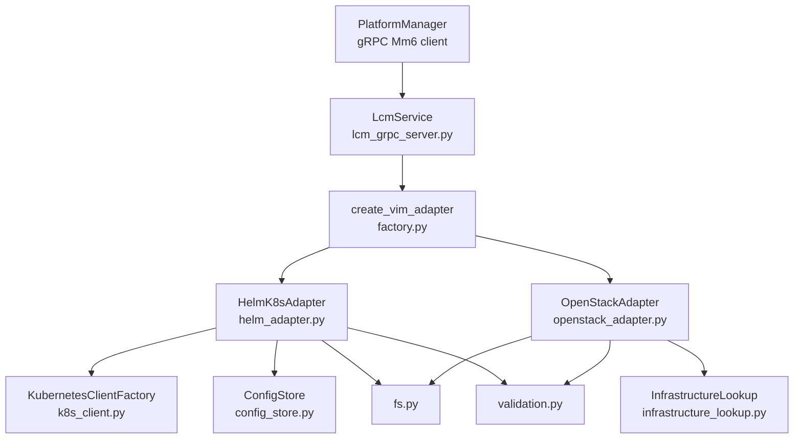
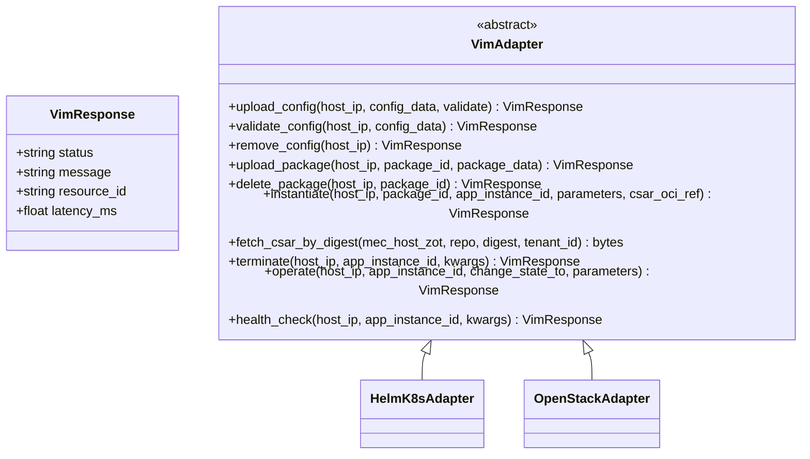
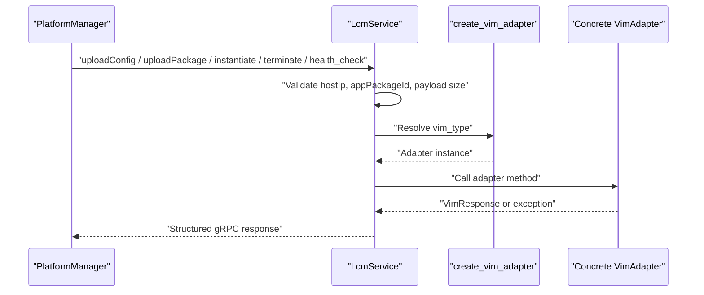
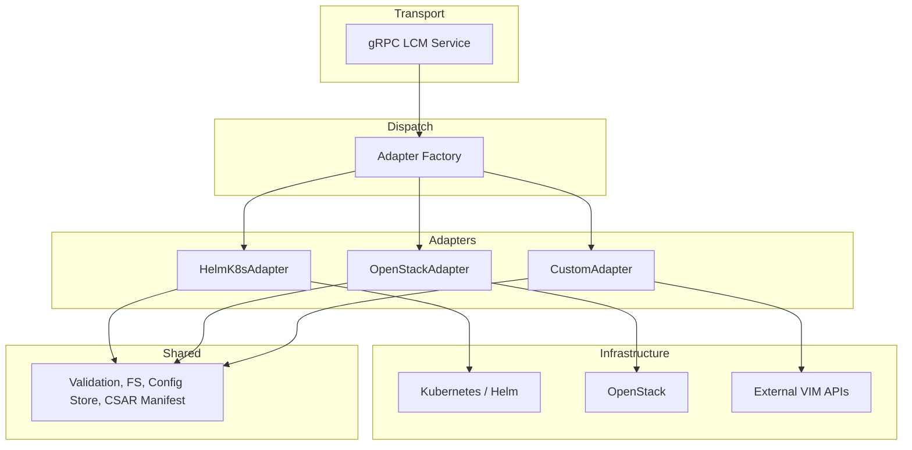
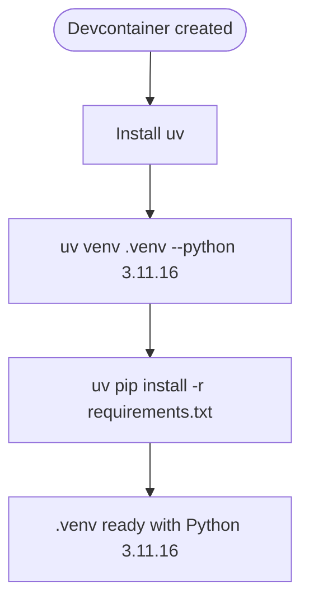
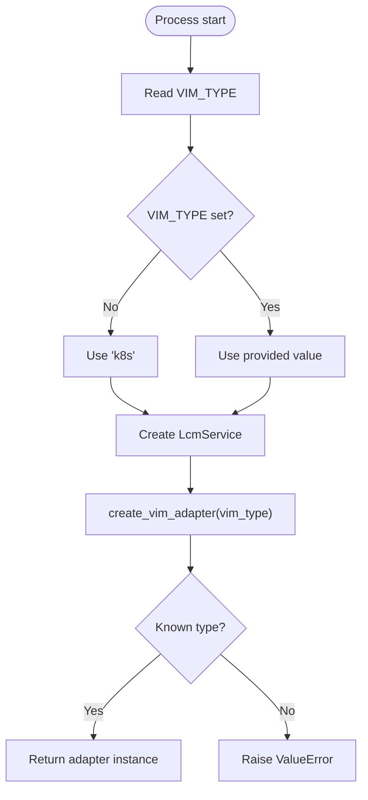
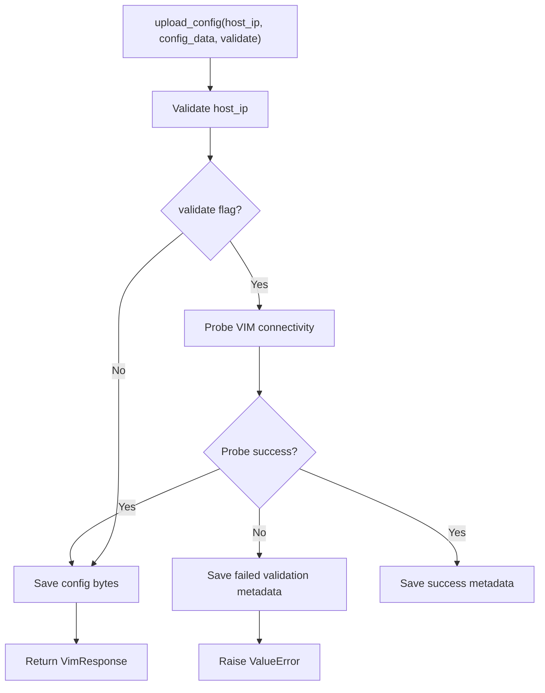
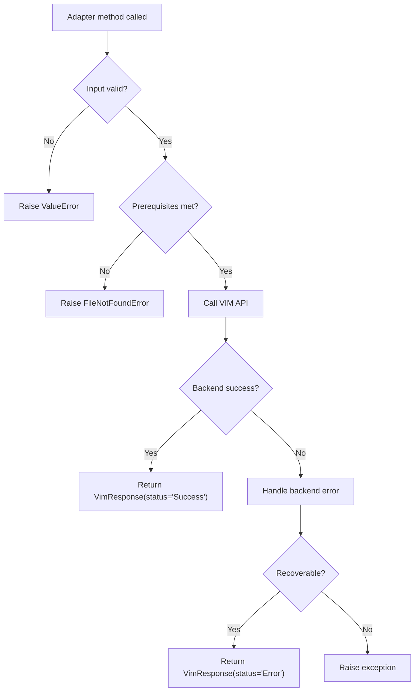
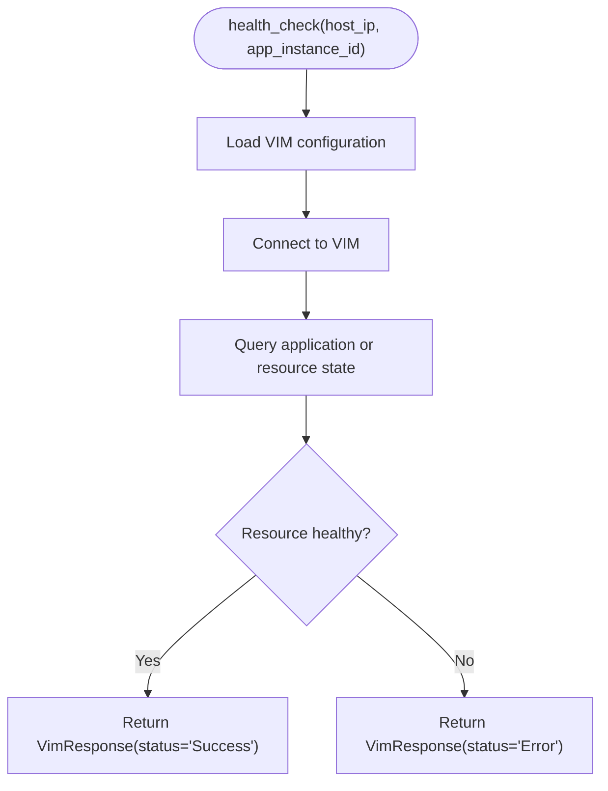

# Custom Adapter Development Guide

## Update Summary
**Changes Made**
- Updated the development and deployment toolchain section to reflect that `uv` is now the only supported Python toolchain.
- Removed all references to retired `pipenv`, `pyenv`, `Pipfile`, and `Pipfile.lock`.
- Added explicit documentation for `.python-version`, `requirements.txt`, and the devcontainer `postCreateCommand`.
- Updated setup instructions, image construction notes, dependency pinning guidance, and troubleshooting content to match the current codebase.

## Table of Contents

1. [Introduction](#introduction)
2. [Project Structure](#project-structure)
3. [Core Components](#core-components)
4. [Architecture Overview](#architecture-overview)
5. [Development Toolchain](#development-toolchain)
6. [Adapter Interface Requirements](#adapter-interface-requirements)
7. [Adapter Registration and Configuration](#adapter-registration-and-configuration)
8. [Configuration Management](#configuration-management)
9. [Logging Standards](#logging-standards)
10. [Error Handling Conventions](#error-handling-conventions)
11. [Implementing a New Adapter](#implementing-a-new-adaptor)
12. [Testing Strategies](#testing-strategies)
13. [Integration Testing](#integration-testing)
14. [Debugging Techniques](#debugging-techniques)
15. [Containerization and Deployment](#containerization-and-deployment)
16. [Health Check Implementation](#health-check-implementation)
17. [Performance Benchmarking](#performance-benchmarking)
18. [Common Scenarios](#common-scenarios)
19. [Troubleshooting Guide](#troubleshooting-guide)
20. [Conclusion](#conclusion)

## Introduction

The VimAdapter is the Virtualisation Infrastructure Manager daemon at the ETSI MEC host boundary. It exposes a gRPC service on the Mm6 reference point, receives lifecycle commands from PlatformManager, and translates them into concrete virtualization operations against Kubernetes/Helm or OpenStack backends.

For developers building custom adapters, VimAdapter provides:

- A stable abstract adapter interface defining configuration, package, lifecycle, operation, and health endpoints.
- A factory that selects an adapter implementation by type string.
- Shared utilities for validation, filesystem safety, CSAR manifest inspection, and per-host configuration persistence.
- Two concrete implementations — `HelmK8sAdapter` and `OpenStackAdapter` — as templates for new VIM backends.
- A thin gRPC server that validates requests, delegates to the selected adapter, and maps exceptions to structured gRPC status codes.

This guide explains how to implement, test, containerize, deploy, monitor, and debug a custom adapter within this framework.

**Section sources**
- `docs/CONTEXT-MAP.md#L1-L50`
- `docs/contexts/vimadapter.md#L1-L25`
- `docs/ADR/0017-vimadapter-python.md#L1-L39`

## Project Structure

At the VimAdapter level, the relevant layout is:

| Area | Responsibility |
|---|---|
| `main.py` | Async entry point; reads `VIM_TYPE` and `GRPC_PORT`; starts the gRPC server. |
| `src/server/lcm_grpc_server.py` | gRPC servicer delegating to the adapter factory. |
| `src/adapters/base.py` | Abstract `VimAdapter` contract and `VimResponse`. |
| `src/adapters/factory.py` | Type-to-class registry used by the gRPC layer. |
| `src/adapters/helm/helm_adapter.py` | Kubernetes/Helm adapter implementation. |
| `src/adapters/openstack/openstack_adapter.py` | OpenStack Nova/Heat/Glance/Neutron/Keystone adapter implementation. |
| `src/clients/k8s_client.py` | In-memory kubeconfig client factory. |
| `src/utils/*` | Validation, filesystem safety, config storage, CSAR manifest helpers, infrastructure lookup. |
| `tests/*` | Pytest suites for adapters, services, manifests, validation, and filesystem behavior. |
| `Dockerfile` | Multi-stage image with pinned Python, Helm binary, non-root user, and exposed port 50051. |
| `.devcontainer/devcontainer.json` | Dev container bootstrap using `uv` to create a pinned `3.11.16` environment. |
| `.python-version` | Interpreter patch pin (`3.11.16`) consumed by `uv`. |
| `requirements.txt` | Sole dependency manifest, including runtime and dev dependencies. |



**Diagram sources**
- `src/VimAdapter/src/server/lcm_grpc_server.py#L1-L200`
- `src/VimAdapter/src/adapters/factory.py#L1-L35`
- `src/VimAdapter/src/adapters/helm/helm_adapter.py#L1-L200`
- `src/VimAdapter/src/adapters/openstack/openstack_adapter.py#L1-L200`
- `src/VimAdapter/src/clients/k8s_client.py#L1-L76`
- `src/VimAdapter/src/utils/config_store.py#L1-L176`
- `src/VimAdapter/src/utils/infrastructure_lookup.py#L1-L200`
- `src/VimAdapter/src/utils/fs.py#L1-L114`
- `src/VimAdapter/src/utils/validation.py#L1-L145`

**Section sources**
- `src/VimAdapter/README.md#L1-L200`
- `src/VimAdapter/main.py#L1-L24`
- `src/VimAdapter/Dockerfile#L1-L54`

## Core Components

### Adapter Contract

The adapter contract lives in `VimAdapter`, an abstract base class. Every custom adapter must implement its lifecycle methods and can reuse the shared `VimResponse` dataclass.

| Method | Purpose |
|---|---|
| `upload_config` | Persist VIM-specific configuration such as kubeconfig or clouds.yaml. |
| `validate_config` | Probe connectivity and authentication for the supplied configuration. |
| `remove_config` | Delete previously uploaded configuration. |
| `upload_package` | Accept, validate, and extract a CSAR package. |
| `delete_package` | Remove stored package artifacts. |
| `instantiate` | Provision the MEC application on the target VIM. |
| `terminate` | Undeploy and tear down provisioned resources. |
| `operate` | Change operational state, typically STARTED or STOPPED. |
| `health_check` | Report application or resource health. |
| `fetch_csar_by_digest` | Optional helper to pull a digest-pinned CSAR from an edge-local zot registry. |

`VimResponse` carries:

| Field | Meaning |
|---|---|
| `status` | High-level result, commonly `Success` or `Error`. |
| `message` | Human-readable detail. |
| `resource_id` | Optional VIM-assigned identifier. |
| `latency_ms` | Optional timing information useful for validation probes. |



**Diagram sources**
- `src/VimAdapter/src/adapters/base.py#L1-L159`
- `src/VimAdapter/src/adapters/helm/helm_adapter.py#L1-L200`
- `src/VimAdapter/src/adapters/openstack/openstack_adapter.py#L1-L200`

**Section sources**
- `src/VimAdapter/src/adapters/base.py#L1-L159`

### gRPC Server Layer

`LcmService` is the gRPC entry point. It constructs the selected adapter through the factory and routes each LCM method to it. The server performs:

- IPv4 address validation.
- UUID validation for package identifiers.
- Streaming payload size limits (100 MB for config, 500 MB for packages).
- Exception mapping to gRPC status codes.
- Optional trailing metadata for successful validation probes.



**Diagram sources**
- `src/VimAdapter/src/server/lcm_grpc_server.py#L1-L200`
- `src/VimAdapter/src/adapters/factory.py#L1-L35`

**Section sources**
- `src/VimAdapter/src/server/lcm_grpc_server.py#L1-L200`

### Helper Utilities

| Module | Purpose |
|---|---|
| `validation.py` | IPv4, UUID, host IP, package ID, OCI digest, and credential scrubbing. |
| `fs.py` | Safe directory creation, CSAR extraction with zip-slip protection, symlink rejection, and path containment checks. |
| `config_store.py` | Per-host secure file persistence with traversal guards, optional metadata, and restrictive permissions. |
| `csar_manifest.py` | Canonical view of TOSCA App Descriptor paths and manifest checksums. |
| `infrastructure_lookup.py` | Maps CSAR metadata to VIM resource specifications. |
| `k8s_client.py` | Parses kubeconfig from bytes, string, or dict without fixed disk paths. |

**Section sources**
- `src/VimAdapter/src/utils/validation.py#L1-L145`
- `src/VimAdapter/src/utils/fs.py#L1-L114`
- `src/VimAdapter/src/utils/config_store.py#L1-L176`
- `src/VimAdapter/src/utils/csar_manifest.py#L1-L144`
- `src/VimAdapter/src/utils/infrastructure_lookup.py#L1-L200`
- `src/VimAdapter/src/clients/k8s_client.py#L1-L76`

## Architecture Overview

The adapter architecture follows a layered pattern:

1. **Transport layer:** gRPC handles MEPM requests.
2. **Dispatch layer:** `LcmService` validates inputs and delegates to the adapter.
3. **Adapter layer:** Concrete adapters translate LCM operations into VIM primitives.
4. **Infrastructure layer:** Kubernetes API, Helm CLI, or OpenStack SDK performs actual provisioning.
5. **Shared support layer:** Validation, filesystem safety, config persistence, and CSAR parsing are reused across adapters.



**Diagram sources**
- `src/VimAdapter/README.md#L1-L200`
- `docs/ADR/0012-vim-adapter-factory.md#L1-L46`
- `src/VimAdapter/src/adapters/factory.py#L1-L35`

**Section sources**
- `src/VimAdapter/README.md#L1-L200`
- `docs/ADR/0012-vim-adapter-factory.md#L1-L46`

## Development Toolchain

**Updated** The VimAdapter development and deployment toolchain no longer uses `pipenv`, `pyenv`, `Pipfile`, or `Pipfile.lock`. `uv` is the only supported Python toolchain, `requirements.txt` is the sole dependency manifest, `.python-version` pins CPython `3.11.16`, and the devcontainer post-create command builds a pinned environment using `uv`.

### Supported Toolchain

| Item | Current State |
|---|---|
| Python interpreter | `3.11.16` pinned by `.python-version`. |
| Environment manager | `uv` — preferred and required by the devcontainer. |
| Dependency manifest | `requirements.txt` — only manifest; `Pipfile`/`Pipfile.lock` were retired. |
| Local virtual environment | `.venv`, created by `uv venv .venv --python 3.11.16`. |
| CI and image baseline | Floats minor `3.11`; exact patch pin comes from `.python-version` and the Dockerfile. |
| Devcontainer bootstrap | Installs `uv`, creates `.venv` with Python `3.11.16`, then installs `requirements.txt`. |

### Recommended Setup

```bash
cd src/VimAdapter
uv venv .venv --python 3.11.16 --clear
uv pip install --python .venv/Scripts/python.exe -r requirements.txt   # Windows
uv pip install --python .venv/bin/python -r requirements.txt           # Linux / macOS
```

After creating the environment, verify the interpreter:

```powershell
.venv\Scripts\python.exe --version   # must print Python 3.11.16
```

```bash
.venv/bin/python --version           # must print Python 3.11.16
```

### Why `uv` Is Required

Bare `python -m venv .venv` does not read `.python-version` and may resolve any available CPython 3.11.x or even an older interpreter depending on PATH. That was the original cause of drift to Python 3.10.11. Using `uv` guarantees that the local development environment matches the devcontainer and the patch pin recorded in `.python-version`.

### Devcontainer Behavior

The devcontainer:

1. Uses the `mcr.microsoft.com/devcontainers/python:3.11` image.
2. Forwards port `50051`.
3. Runs `pip install uv && uv venv .venv --python 3.11.16 && uv pip install --python .venv/bin/python -r requirements.txt`.
4. Configures VS Code to use `.venv/bin/python`.



**Diagram sources**
- `src/VimAdapter/.devcontainer/devcontainer.json#L1-L28`
- `src/VimAdapter/requirements.txt#L1-L43`
- `src/VimAdapter/.python-version#L1-L1`

### Runtime Selection

The gRPC server resolves the adapter type through `LcmService.__init__`, which uses the `vim_type` constructor argument. The process entry point passes `VIM_TYPE` from the environment, defaulting to `k8s`.



**Diagram sources**
- `src/VimAdapter/main.py#L1-L24`
- `src/VimAdapter/src/adapters/factory.py#L1-L35`
- `src/VimAdapter/src/server/lcm_grpc_server.py#L1-L200`

**Section sources**
- `src/VimAdapter/README.md#L290-L460`
- `src/VimAdapter/.devcontainer/devcontainer.json#L1-L28`
- `src/VimAdapter/.python-version#L1-L1`
- `src/VimAdapter/requirements.txt#L1-L43`
- `src/VimAdapter/src/adapters/factory.py#L1-L35`
- `src/VimAdapter/main.py#L1-L24`

## Adapter Interface Requirements

A custom adapter should follow these rules:

1. **Inherit from `VimAdapter`.**  
   Do not reimplement `VimResponse`; return it from every public lifecycle method.

2. **Make all lifecycle methods async.**  
   Long-running VIM calls should be executed off the asyncio event loop using `asyncio.to_thread` when they are blocking.

3. **Validate input early.**  
   Use `validate_host_ip`, `validate_package_id`, and other validators before touching files or calling external APIs.

4. **Use shared utilities instead of ad-hoc logic.**  
   Prefer `ConfigStore`, `extract_csar`, `safe_join`, `validate_csar_oci_ref`, and `scrub_credentials`.

5. **Return structured results.**  
   Success responses should use `status="Success"`; failures should use `status="Error"` and include a descriptive message.

6. **Expose `validate_config`.**  
   This enables operators to probe connectivity and credentials before persisting secrets.

7. **Track created resources when appropriate.**  
   For multi-resource VIMs like OpenStack, record IDs so termination can perform best-effort teardown.

8. **Avoid leaking secrets.**  
   Use `scrub_credentials` around error messages, logs, and validation failure details.

9. **Support optional `csar_oci_ref`.**  
   If your adapter supports pulling CSAR artifacts, consider extending `fetch_csar_by_digest` or documenting the same precedence model as the Helm adapter.

10. **Keep adapter imports safe.**  
    Like `OpenStackAdapter`, avoid hard dependencies on optional SDKs at import time if those SDKs are not required for all adapter types.

**Section sources**
- `src/VimAdapter/src/adapters/base.py#L1-L159`
- `src/VimAdapter/README.md#L1-L200`
- `src/VimAdapter/src/adapters/openstack/openstack_adapter.py#L1-L200`

## Adapter Registration and Configuration

### Factory Registration

New VIM types are registered centrally in `VIM_TYPES`:

| Key | Adapter Class |
|---|---|
| `k8s` | `HelmK8sAdapter` |
| `helm` | `HelmK8sAdapter` |
| `openstack` | `OpenStackAdapter` |

Adding a custom adapter requires two changes:

1. Import the adapter class.
2. Add a lowercase key mapping to `VIM_TYPES`.

The factory returns the matching class and instantiates it. Unknown types raise `ValueError`.

### Runtime Selection

The gRPC server resolves the adapter type through `LcmService.__init__`, which uses the `vim_type` constructor argument. The process entry point passes `VIM_TYPE` from the environment, defaulting to `k8s`.

**Section sources**
- `docs/ADR/0012-vim-adapter-factory.md#L1-L46`
- `src/VimAdapter/src/adapters/factory.py#L1-L35`
- `src/VimAdapter/main.py#L1-L24`

## Configuration Management

### Per-Host Storage Model

Configuration is keyed by `host_ip`. This design assumes one VIM connection profile per MEC host rather than one per application instance.

| Backend | Base Directory | File Naming |
|---|---|---|
| Kubernetes/Helm | `k8sconfigs` | `{host_ip}` |
| OpenStack | `openstack_configs` | `{host_ip}` |
| CSAR metadata | `csar_metadata` | `{package_id}.meta.json` |

### Security Properties

`ConfigStore` enforces:

- IPv4-only host identifiers.
- Absolute path resolution.
- Path containment checks inside the configured base directory.
- Symlink-safe writes where supported.
- Restrictive file permissions (`0o600`).
- Separate metadata files for validation state, timestamps, content hashes, and messages.

### Validation Metadata

When `validate=True`, adapters store:

- Whether validation was requested.
- Whether validation succeeded.
- Timestamps for upload and last validation.
- Content hash of the uploaded configuration.
- Optional latency and validation message.



**Diagram sources**
- `src/VimAdapter/src/utils/config_store.py#L1-L176`
- `src/VimAdapter/src/adapters/helm/helm_adapter.py#L1-L200`
- `src/VimAdapter/src/adapters/openstack/openstack_adapter.py#L1-L200`

**Section sources**
- `src/VimAdapter/src/utils/config_store.py#L1-L176`
- `src/VimAdapter/src/adapters/helm/helm_adapter.py#L1-L200`
- `src/VimAdapter/src/adapters/openstack/openstack_adapter.py#L1-L200`

## Logging Standards

The adapter framework uses Python's standard `logging` module. Recommended conventions:

| Level | When to Use |
|---|---|
| `DEBUG` | Request routing, resolved paths, temporary state, internal tracing. |
| `INFO` | Successful lifecycle transitions, configuration saved/removed, package extracted. |
| `WARNING` | Missing optional resources, degraded fallback behavior. |
| `ERROR` | Failed VIM calls, malformed payloads, validation failures, unexpected exceptions. |

Important security rule:

- Never log raw passwords, tokens, bearer headers, kubeconfig secrets, or cloud credentials.
- Wrap error strings with `scrub_credentials` before logging or raising them.

The default entry point configures timestamped, level-tagged logs suitable for containerized environments.

**Section sources**
- `src/VimAdapter/main.py#L1-L24`
- `src/VimAdapter/src/utils/validation.py#L1-L145`
- `src/VimAdapter/src/adapters/helm/helm_adapter.py#L1-L200`
- `src/VimAdapter/src/adapters/openstack/openstack_adapter.py#L1-L200`

## Error Handling Conventions

### Adapter Exceptions

Adapters should generally raise domain exceptions for invalid input or missing prerequisites:

| Exception | Typical Meaning |
|---|---|
| `ValueError` | Invalid input, malformed configuration, unsupported state. |
| `FileNotFoundError` | Missing configuration or package. |
| `OSError` | Low-level filesystem or I/O failure. |

### gRPC Status Mapping

The gRPC server catches adapter exceptions and maps them:

| Adapter Exception | gRPC Status |
|---|---|
| `ValueError` | `INVALID_ARGUMENT` |
| `FileNotFoundError` | `NOT_FOUND` |
| Other exceptions | `INTERNAL` |

Early validation in the server can also abort directly with `INVALID_ARGUMENT` or `RESOURCE_EXHAUSTED` for malformed fields or oversized streams.

### Structured Responses

Adapter methods themselves usually return `VimResponse` with `status="Error"` and a human-readable message rather than raising for recoverable backend errors. Non-recoverable protocol or precondition errors raise exceptions so the server can map them to gRPC status codes.



**Diagram sources**
- `src/VimAdapter/src/server/lcm_grpc_server.py#L1-L200`
- `src/VimAdapter/src/adapters/base.py#L1-L159`

**Section sources**
- `src/VimAdapter/src/server/lcm_grpc_server.py#L1-L200`
- `src/VimAdapter/src/adapters/base.py#L1-L159`

## Implementing a New Adapter

### Step-by-Step Process

1. **Create the adapter module.**  
   Place it under `src/adapters/<your_backend>/<your_adapter>.py`.

2. **Define the adapter class.**  
   Inherit from `VimAdapter` and implement all abstract methods.

3. **Reuse shared utilities.**  
   - Use `validate_host_ip` and `validate_package_id`.
   - Use `ConfigStore` for configuration persistence.
   - Use `extract_csar` and `safe_join` for package handling.
   - Use `scrub_credentials` for sensitive output.

4. **Register the adapter.**  
   Add the adapter class and a lowercase discriminator to `VIM_TYPES` in `factory.py`.

5. **Add tests.**  
   Follow the patterns in `test_helm_adapter.py` and `test_openstack_adapter.py`.

6. **Update documentation.**  
   Mirror the style of `README.md` and `OPENSTACK_VIM_ADAPTER.md`.

7. **Build and run locally.**  
   Activate the VimAdapter virtual environment built by `uv` and run `python main.py`.

8. **Build the Docker image.**  
   Reuse the existing multi-stage `Dockerfile` and ensure any new runtime binaries are copied in.

### Minimal Adapter Skeleton

A new adapter should look conceptually like this:

```python
from src.adapters.base import VimAdapter, VimResponse
from src.utils.config_store import ConfigStore
from src.utils.validation import validate_host_ip, validate_package_id, scrub_credentials
import logging


class MyVimAdapter(VimAdapter):
    def __init__(self):
        self.config_store = ConfigStore("my_vim_configs")
        self.package_path = "packages"

    async def upload_config(self, host_ip, config_data, validate=False):
        validate_host_ip(host_ip)
        # Parse, normalize, and optionally probe the backend
        self.config_store.save(host_ip, config_data)
        return VimResponse(status="Success", message="Configuration uploaded")

    async def validate_config(self, host_ip, config_data):
        validate_host_ip(host_ip)
        # Probe connectivity and return latency
        return VimResponse(status="Success", message="Connection verified")

    async def remove_config(self, host_ip):
        validate_host_ip(host_ip)
        self.config_store.delete(host_ip)
        return VimResponse(status="Success", message="Configuration removed")

    async def upload_package(self, host_ip, package_id, package_data):
        validate_host_ip(host_ip)
        validate_package_id(package_id)
        # Persist and extract CSAR safely
        return VimResponse(status="Success", message="Package uploaded")

    async def delete_package(self, host_ip, package_id):
        validate_host_ip(host_ip)
        validate_package_id(package_id)
        # Remove package directory
        return VimResponse(status="Success", message="Package removed")

    async def instantiate(self, host_ip, package_id, app_instance_id, parameters, csar_oci_ref=None):
        validate_host_ip(host_ip)
        validate_package_id(package_id)
        # Provision resources
        return VimResponse(status="Success", message="Application instantiated")

    async def terminate(self, host_ip, app_instance_id, **kwargs):
        validate_host_ip(host_ip)
        # Tear down tracked resources
        return VimResponse(status="Success", message="Application terminated")

    async def operate(self, host_ip, app_instance_id, change_state_to, parameters):
        validate_host_ip(host_ip)
        # Apply operational state change
        return VimResponse(status="Success", message="Operation applied")

    async def health_check(self, host_ip, app_instance_id, **kwargs):
        validate_host_ip(host_ip)
        # Query backend health
        return VimResponse(status="Success", message="Healthy")
```

After implementing the class:

1. Import it in `factory.py`.
2. Add it to `VIM_TYPES`.
3. Run unit tests.
4. Test via the gRPC server with `VIM_TYPE=<your_key>`.

**Section sources**
- `src/VimAdapter/src/adapters/factory.py#L1-L35`
- `src/VimAdapter/src/adapters/base.py#L1-L159`
- `src/VimAdapter/src/adapters/helm/helm_adapter.py#L1-L200`
- `src/VimAdapter/src/adapters/openstack/openstack_adapter.py#L1-L200`

## Testing Strategies

### Unit Tests for Adapters

Follow the patterns established in the repository:

- Use `tmp_path` fixtures to isolate filesystem state.
- Override adapter paths (`config_store.base_dir`, `package_path`) to avoid polluting the workspace.
- Mock external clients rather than calling real Kubernetes or OpenStack APIs.
- Assert both `VimResponse.status` and `VimResponse.message`.
- Cover success, missing config, invalid IP, invalid package ID, and backend failure paths.

### Mocking VIM Clients

For Kubernetes-style adapters:

- Mock the Kubernetes client factory.
- Mock discovery or resource queries used during validation.
- Mock Helm installation, deletion, and status polling.

For OpenStack-style adapters:

- Mock `openstack.connect`.
- Mock compute, block storage, image, network, identity, and orchestration connections.
- Use dedicated mock classes for connection proxies.
- Verify dependency order during instantiation and termination.

### Example Patterns

The Helm adapter tests demonstrate:

- Saving and loading kubeconfig bytes.
- Validating successful and failing probes.
- Verifying validation metadata.
- Handling invalid ZIP archives.
- Ensuring missing kubeconfig raises `FileNotFoundError`.

The OpenStack adapter tests demonstrate:

- Normalizing and storing `clouds.yaml`.
- Preserving original profiles alongside normalized ones.
- Probing Keystone authentication.
- Scrubbing credentials from failure messages.
- Failing fast when configuration is missing.

**Section sources**
- `src/VimAdapter/tests/test_helm_adapter.py#L1-L200`
- `src/VimAdapter/tests/test_openstack_adapter.py#L1-L200`
- `src/VimAdapter/tests/test_service_mocks.py#L1-L200`

## Integration Testing

### Local Python Integration Tests

Run the adapter suite from the adapter directory after activating the `uv`-managed virtual environment:

```bash
cd src/VimAdapter
PYTHONPATH= .venv/Scripts/python.exe -m pytest tests/ -v   # Windows
PYTHONPATH= .venv/bin/python -m pytest tests/ -v           # Linux / macOS
```

This exercises validation, filesystem behavior, CSAR manifest parsing, and adapter-specific logic without requiring live infrastructure. The suite currently contains 233 tests covering validation, filesystem helpers, `ConfigStore`, `HelmK8sAdapter`, and `OpenStackAdapter`.

### Cross-Service End-to-End Tests

The repository includes end-to-end fixtures for orchestrator testing, including:

- Fake gRPC servers.
- Fake VIM gRPC services.
- Fixtures for resolving Python environments.
- Smoke tests for adapter behavior.

These are valuable for validating the full chain from PlatformManager through VimAdapter to mocked infrastructure.

### Containerized Integration Tests

Use the built VimAdapter image to validate:

- Entrypoint behavior.
- Environment variable configuration.
- Port exposure.
- Filesystem directories owned by the non-root user.
- Behavior when optional dependencies are absent.

**Section sources**
- `docs/OPENSTACK_VIM_ADAPTER.md#L1-L194`
- `src/VimAdapter/tests/test_service_mocks.py#L1-L200`
- `src/VimAdapter/README.md#L460-L516`

## Debugging Techniques

### Enable Detailed Logs

The entry point configures logging at `DEBUG` level. In production, adjust the log level through your deployment configuration while keeping sensitive values scrubbed.

### Inspect Stored Configuration

Check the configured base directories:

- `k8sconfigs/{host_ip}` for Kubernetes configurations.
- `openstack_configs/{host_ip}` for OpenStack configurations.
- Companion `.meta.json` files for validation state.

Use `ConfigStore.load` and `ConfigStore.load_metadata` in diagnostic scripts.

### Validate OCI References

If your adapter pulls CSAR artifacts, verify the ref format:

- Registry must be an allowed edge-local zot endpoint.
- Reference must use `sha256:<64 hex>` digest.
- No floating tags.

Use `validate_csar_oci_ref` and `validate_oci_digest`.

### Trace Adapter Lifecycle

Add instrumentation around:

- Input validation.
- Configuration load/save.
- Package extraction.
- External API calls.
- Resource tracking.
- Termination ordering.

The existing adapters already measure validation latency; extend this pattern for longer operations.

**Section sources**
- `src/VimAdapter/main.py#L1-L24`
- `src/VimAdapter/src/utils/config_store.py#L1-L176`
- `src/VimAdapter/src/utils/validation.py#L1-L145`

## Containerization and Deployment

### Image Construction

The Dockerfile uses three stages:

1. **Helm binary stage:** Copies Helm from an official Alpine image to avoid unreliable downloads.
2. **Builder stage:** Creates a Python virtual environment and installs dependencies from `requirements.txt`.
3. **Runner stage:** Uses a slim Python image, copies Helm, copies the venv, creates application directories, sets environment variables, exposes port 50051, and runs as a non-root user.

### Required Directories

The image creates:

- `/app/k8sconfigs`
- `/app/packages`
- `/app/openstack_configs`

A custom adapter should add its own persistent directory if it stores configuration or artifacts.

### Environment Variables

| Variable | Default | Purpose |
|---|---:|---|
| `VIM_TYPE` | `k8s` | Selects the adapter factory entry. |
| `GRPC_PORT` | `50051` | Listens on the Mm6 gRPC port. |

### Deployment Notes

- Ensure the mounted volume for persistent configs is writable by the non-root UID/GID used by the image.
- Keep CSAR packages and VIM credentials on separate volumes if possible.
- Restrict access to secret-bearing directories.
- Do not expose port 50051 publicly unless protected by a gateway or service mesh.
- Consider readiness and liveness probes that call `health_check`.

**Section sources**
- `src/VimAdapter/Dockerfile#L1-L54`
- `src/VimAdapter/main.py#L1-L24`

## Health Check Implementation

A health check should answer whether the deployed application or its underlying resources are reachable and usable.

### Kubernetes/Helm Pattern

- Load kubeconfig from `ConfigStore`.
- Connect to the cluster through `KubernetesClientFactory`.
- Query workload status (for example, pods, deployments, or Helm release state).
- Return `VimResponse` with a meaningful status and optional resource identifier.

### OpenStack Pattern

- Load `clouds.yaml` from `ConfigStore`.
- Establish an OpenStack connection.
- Query server, stack, or service state depending on provisioning mode.
- Map SDK exceptions to `VimResponse.Error`.

### General Rules

- Avoid expensive side effects in health checks.
- Time out external calls appropriately.
- Distinguish between infrastructure unreachable and application unhealthy.
- Include enough context to distinguish transient network issues from permanent misconfiguration.



**Diagram sources**
- `src/VimAdapter/src/adapters/base.py#L1-L159`
- `src/VimAdapter/src/adapters/helm/helm_adapter.py#L1-L200`
- `src/VimAdapter/src/adapters/openstack/openstack_adapter.py#L1-L200`

**Section sources**
- `src/VimAdapter/src/adapters/base.py#L1-L159`

## Performance Benchmarking

### Where to Measure

Focus on the most expensive adapter phases:

1. Configuration validation.
2. CSAR extraction.
3. External API calls.
4. Status polling.
5. Resource teardown.

### Existing Benchmarks

The repository includes a benchmark project for other subsystems such as package upload and pipeline work. While not adapter-specific, the same principles apply:

- Pin warm and cold paths.
- Measure average, p95, and p99 latency.
- Measure memory usage.
- Compare pre-staged versus fallback paths.
- Include retry behavior in realistic scenarios.

### Adapter-Specific Recommendations

- Cache immutable CSAR metadata where safe.
- Avoid repeated YAML parsing when possible.
- Reuse connections only when thread/async safety permits.
- Bound retries with deadlines.
- Use `asyncio.to_thread` for blocking SDK calls.
- Instrument validation latency and propagate it through `VimResponse.latency_ms`.

**Section sources**
- `Benchmarks/Benchmarks/AppPackageUploadBenchmark.cs#L1-L200`
- `Benchmarks/Benchmarks/CsarPipelineBenchmarks.cs#L1-L200`
- `Benchmarks/Benchmarks/Program.cs#L1-L200`

## Common Scenarios

### Scenario 1: Resource Provisioning

**Goal:** Provision compute, storage, networking, and identity resources based on CSAR metadata.

**Approach:**

1. Validate `host_ip` and `package_id`.
2. Load configuration from `ConfigStore`.
3. Extract or resolve CSAR metadata.
4. Derive resource specifications.
5. Provision in dependency order.
6. Record created resource IDs.
7. Return `VimResponse` with a resource identifier.

**Reference patterns:**

- Kubernetes/Helm chart installation.
- OpenStack Nova server creation with Neutron, Cinder, Glance, and Keystone wiring.

**Section sources**
- `src/VimAdapter/src/adapters/helm/helm_adapter.py#L1-L200`
- `src/VimAdapter/src/adapters/openstack/openstack_adapter.py#L1-L200`
- `src/VimAdapter/src/utils/infrastructure_lookup.py#L1-L200`

### Scenario 2: Status Polling

**Goal:** Wait for a long-running backend operation to reach a terminal state.

**Approach:**

1. Poll the backend at bounded intervals.
2. Respect overall timeout boundaries.
3. Distinguish transient failures from terminal failures.
4. Log progress without leaking secrets.
5. Convert backend states into `VimResponse` outcomes.

**Reference patterns:**

- Kubernetes API discovery and Helm client interactions.
- OpenStack server and volume polling through service modules.

**Section sources**
- `src/VimAdapter/src/clients/k8s_client.py#L1-L76`
- `src/VimAdapter/tests/test_service_mocks.py#L1-L200`

### Scenario 3: Graceful Shutdown Handling

**Goal:** Stop accepting new work, finish in-flight operations, and release resources cleanly.

**Recommended practices:**

- Stop the gRPC server gracefully.
- Cancel or await long-running tasks.
- Flush logs before exit.
- Avoid partial resource state by recording created resources.
- Perform best-effort teardown on shutdown if needed.

The current codebase focuses on explicit `terminate` calls rather than process-lifecycle hooks. A custom adapter should preserve that contract and add shutdown cleanup only if it owns long-lived background workers.

**Section sources**
- `src/VimAdapter/src/adapters/base.py#L1-L159`
- `src/VimAdapter/src/adapters/openstack/openstack_adapter.py#L1-L200`

## Troubleshooting Guide

### Problem: Unknown VIM Type

**Symptoms:** Adapter startup fails with `ValueError` about an unknown VIM type.

**Likely causes:**

- `VIM_TYPE` is misspelled.
- The adapter was added to the class but not to `VIM_TYPES`.
- Case mismatch in the discriminator.

**Resolution:**

- Verify `VIM_TYPE`.
- Confirm the lowercase key exists in `VIM_TYPES`.
- Restart the service.

**Section sources**
- `src/VimAdapter/src/adapters/factory.py#L1-L35`
- `src/VimAdapter/main.py#L1-L24`

### Problem: Invalid Host IP

**Symptoms:** gRPC returns `INVALID_ARGUMENT`.

**Likely causes:**

- Non-IPv4 address.
- Address with spaces.
- Octet outside 0–255.

**Resolution:**

- Validate the caller-provided `host_ip`.
- Use `validate_ipv4` or `validate_host_ip`.

**Section sources**
- `src/VimAdapter/src/utils/validation.py#L1-L145`
- `src/VimAdapter/src/server/lcm_grpc_server.py#L1-L200`

### Problem: Config Payload Too Large

**Symptoms:** gRPC returns `RESOURCE_EXHAUSTED`.

**Likely causes:**

- Config exceeds 100 MB.
- Package exceeds 500 MB.

**Resolution:**

- Stream or split large artifacts at the caller.
- Verify operator uploads meet the documented limits.

**Section sources**
- `src/VimAdapter/src/server/lcm_grpc_server.py#L1-L200`

### Problem: CSAR Extraction Fails

**Symptoms:** Adapter returns `Error` during package upload.

**Likely causes:**

- Corrupt ZIP archive.
- Path traversal attempt.
- Symlink member.
- Excessive file count or uncompressed size.
- Compression ratio too high.

**Resolution:**

- Validate the CSAR before upload.
- Use `extract_csar` rather than custom unzip logic.
- Inspect archive contents externally if needed.

**Section sources**
- `src/VimAdapter/src/utils/fs.py#L1-L114`
- `src/VimAdapter/src/adapters/helm/helm_adapter.py#L1-L200`

### Problem: Credentials Leaked in Logs

**Symptoms:** Passwords, tokens, or bearer headers appear in logs.

**Resolution:**

- Wrap error messages with `scrub_credentials`.
- Audit adapter logging sites.
- Redact logs in CI and local debugging output.

**Section sources**
- `src/VimAdapter/src/utils/validation.py#L1-L145`
- `src/VimAdapter/src/adapters/helm/helm_adapter.py#L1-L200`
- `src/VimAdapter/src/adapters/openstack/openstack_adapter.py#L1-L200`

### Problem: Development Environment Uses Wrong Python Version

**Symptoms:** Tests fail because the interpreter is not `3.11.16`, or CI behaves differently from local development.

**Likely causes:**

- The environment was created with bare `python -m venv` instead of `uv`.
- An old `.venv` was reused without clearing it.
- `uv` is not installed in the devcontainer or shell.
- `requirements.txt` was not reinstalled after switching interpreters.

**Resolution:**

```powershell
cd src/VimAdapter
uv venv .venv --python 3.11.16 --clear
uv pip install --python .venv/Scripts/python.exe -r requirements.txt
.venv\Scripts\python.exe --version
```

```bash
cd src/VimAdapter
uv venv .venv --python 3.11.16 --clear
uv pip install --python .venv/bin/python -r requirements.txt
.venv/bin/python --version
```

Confirm that `uv` is available in the devcontainer, since the devcontainer post-create command installs it automatically.

**Section sources**
- `src/VimAdapter/README.md#L290-L460`
- `src/VimAdapter/.devcontainer/devcontainer.json#L1-L28`
- `src/VimAdapter/.python-version#L1-L1`
- `src/VimAdapter/requirements.txt#L1-L43`

## Conclusion

Building a custom VimAdapter means implementing the shared `VimAdapter` contract, registering the adapter through the factory, and reusing the framework’s validation, filesystem, configuration, and CSAR utilities. The existing Helm and OpenStack adapters provide strong templates for resource provisioning, status polling, configuration validation, and graceful teardown.

For reliable custom adapters:

- Treat the adapter interface as a strict contract.
- Keep external SDK dependencies optional and isolated.
- Validate inputs early and fail fast.
- Persist configuration securely.
- Track created resources for deterministic teardown.
- Scrub secrets everywhere.
- Develop with `uv` and the pinned `.python-version` interpreter.
- Use `requirements.txt` as the only dependency manifest.
- Test with mocks first, then integrate against containers or real VIMs.
- Build reproducible images and expose clear health checks.
- Measure performance on the critical paths: configuration validation, CSAR extraction, and backend polling.

> **Referenced Files in This Document**
>
> - `src/VimAdapter/README.md`
> - `docs/ADR/0012-vim-adapter-factory.md`
> - `docs/ADR/0017-vimadapter-python.md`
> - `docs/CONTEXT-MAP.md`
> - `docs/OPENSTACK_VIM_ADAPTER.md`
> - `docs/contexts/vimadapter.md`
> - `src/VimAdapter/main.py`
> - `src/VimAdapter/Dockerfile`
> - `src/VimAdapter/.devcontainer/devcontainer.json`
> - `src/VimAdapter/.python-version`
> - `src/VimAdapter/requirements.txt`
> - `src/VimAdapter/src/server/lcm_grpc_server.py`
> - `src/VimAdapter/src/adapters/base.py`
> - `src/VimAdapter/src/adapters/factory.py`
> - `src/VimAdapter/src/adapters/helm/helm_adapter.py`
> - `src/VimAdapter/src/adapters/openstack/openstack_adapter.py`
> - `src/VimAdapter/src/clients/k8s_client.py`
> - `src/VimAdapter/src/utils/config_store.py`
> - `src/VimAdapter/src/utils/fs.py`
> - `src/VimAdapter/src/utils/validation.py`
> - `src/VimAdapter/src/utils/csar_manifest.py`
> - `src/VimAdapter/src/utils/infrastructure_lookup.py`
> - `src/VimAdapter/tests/test_helm_adapter.py`
> - `src/VimAdapter/tests/test_openstack_adapter.py`
> - `src/VimAdapter/tests/test_service_mocks.py`
