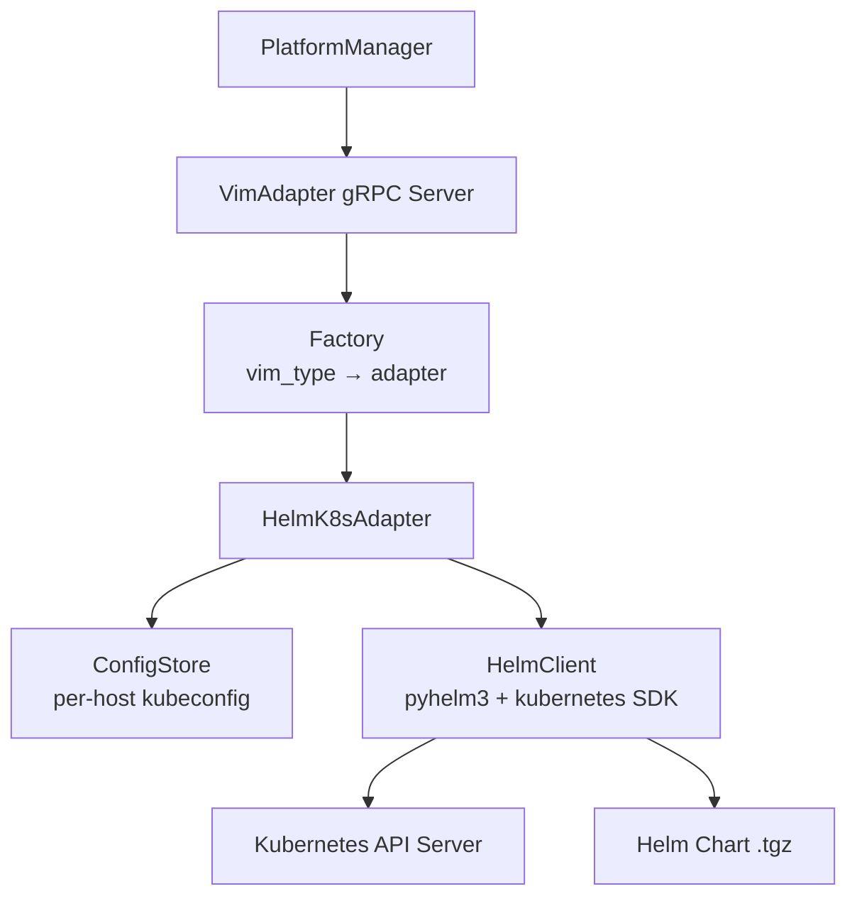
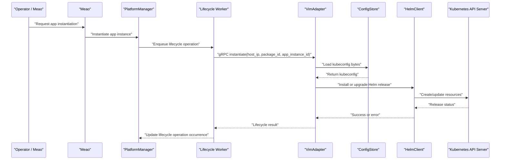
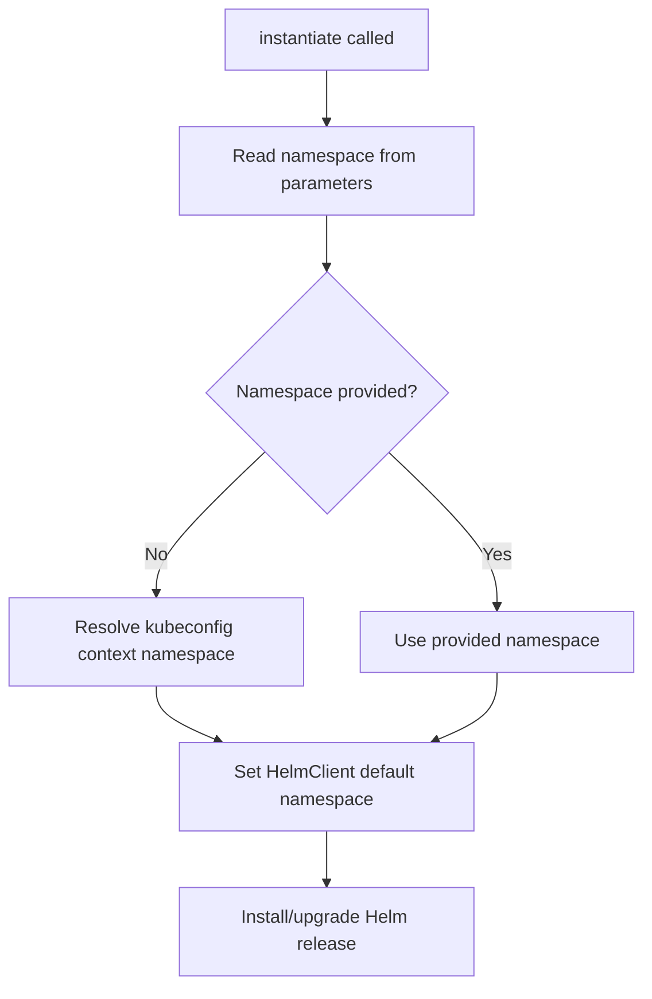
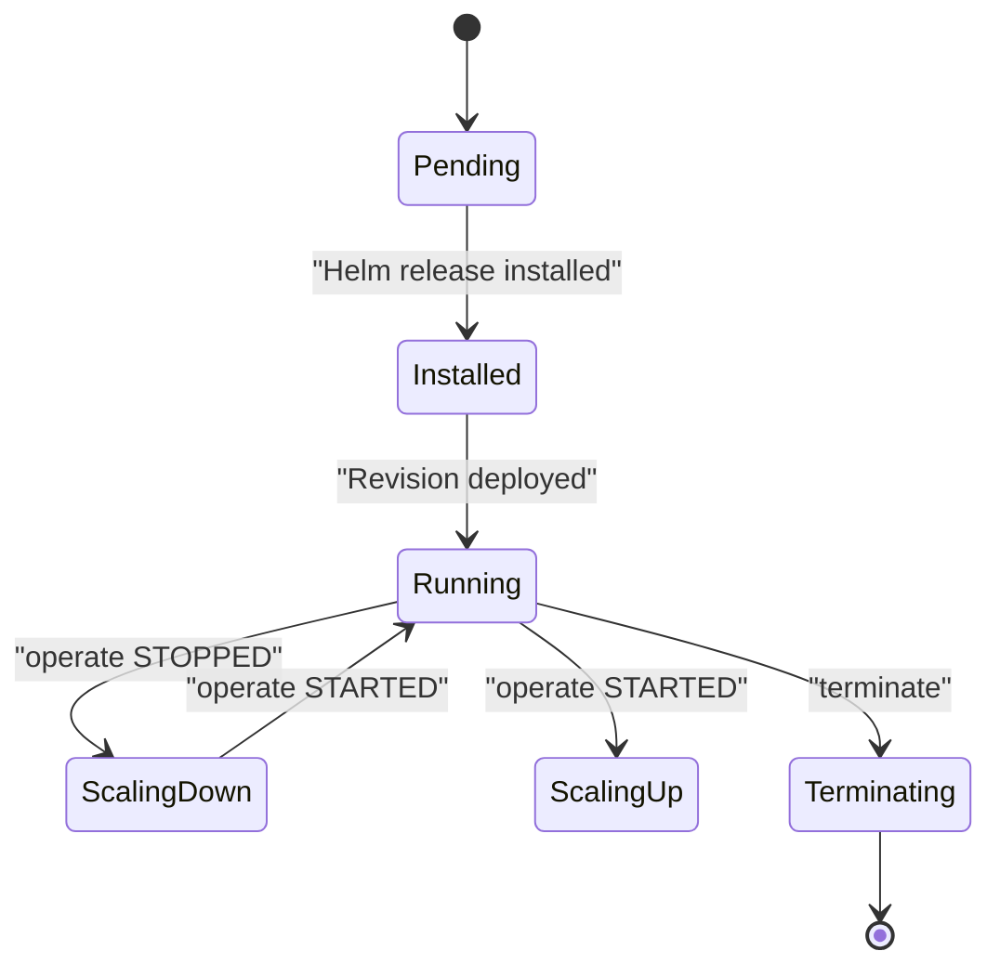
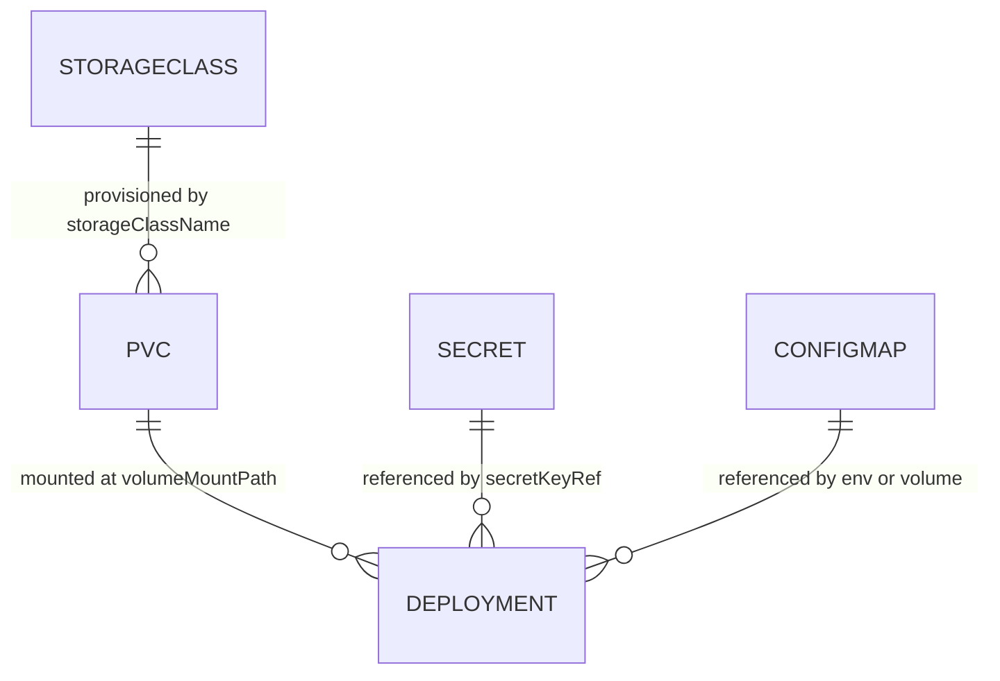
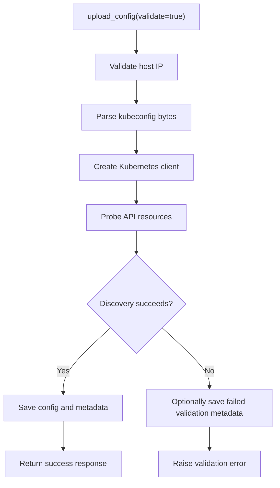
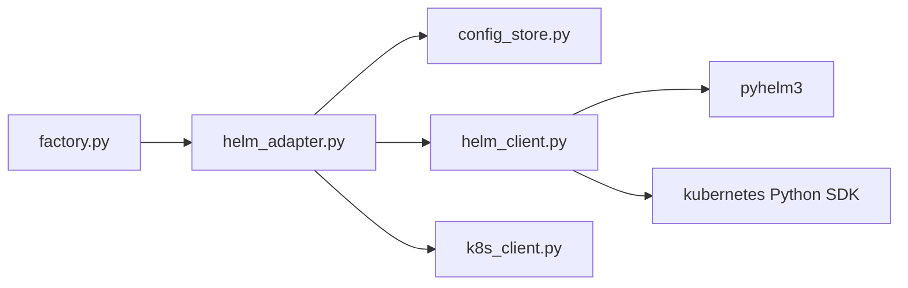

# Kubernetes/Helm Adapter Implementation

## Table of Contents
1. [Introduction](#introduction)
2. [Project Structure](#project-structure)
3. [Core Components](#core-components)
4. [Architecture Overview](#architecture-overview)
5. [Detailed Component Analysis](#detailed-component-analysis)
6. [Dependency Analysis](#dependency-analysis)
7. [Performance Considerations](#performance-considerations)
8. [Troubleshooting Guide](#troubleshooting-guide)
9. [Conclusion](#conclusion)

## Introduction
This document explains how the VimAdapter Kubernetes/Helm adapter translates MEC application lifecycle operations into Kubernetes API calls and Helm chart deployments. It focuses on namespace isolation, resource management, Helm release lifecycle, storage configuration, service discovery, and operational concerns such as timeouts, graceful shutdown, secrets handling, and Prometheus-style observability.

The adapter is one of two active VIM backends in this repository. The other backend targets OpenStack; it is included here only where it clarifies the shared VIM contract or contrasts with the Kubernetes path.

**Section sources**
- `docs/ADR/0019-kubernetes-first-vim.md#L1-L43`
- `docs/OPENSTACK_VIM_ADAPTER.md#L1-L20`

## Project Structure
At a high level, the Kubernetes/Helm adapter lives under `src/VimAdapter` and is composed of:

| Area | Responsibility |
|---|---|
| `src/VimAdapter/src/adapters/factory.py` | Maps VIM type strings to concrete adapters. |
| `src/VimAdapter/src/adapters/helm/helm_adapter.py` | Lifecycle entry point for Kubernetes workloads. |
| `src/VimAdapter/src/adapters/helm/helm_client.py` | Helm 3 wrapper around `pyhelm3`, plus scaling via the Kubernetes Python SDK. |
| `src/VimAdapter/src/clients/k8s_client.py` | Factory that builds a Kubernetes CoreV1 client from in-memory kubeconfig data. |
| `src/VimAdapter/src/utils/config_store.py` | Secure per-host persistence of `kubeconfig` and metadata. |
| `charts/optimist-apps/values.yaml` | Deployment values, environment variables, persistent storage, and security context. |
| `charts/optimist-apps/templates/deployment.yaml` | Per-service Deployment manifests, probes, volumes, and secrets references. |
| `charts/optimist-apps/templates/pvc.yaml` | One PVC per mount point driven by the per-service `storage` list. |

**Diagram sources**
- `src/VimAdapter/src/adapters/factory.py#L1-L35`
- `src/VimAdapter/src/adapters/helm/helm_adapter.py#L1-L60`
- `src/VimAdapter/src/adapters/helm/helm_client.py#L1-L60`
- `src/VimAdapter/src/utils/config_store.py#L1-L40`

**Section sources**
- `src/VimAdapter/src/adapters/factory.py#L1-L35`
- `src/VimAdapter/src/adapters/helm/helm_adapter.py#L1-L60`
- `src/VimAdapter/src/adapters/helm/helm_client.py#L1-L60`
- `src/VimAdapter/src/clients/k8s_client.py#L1-L76`
- `src/VimAdapter/src/utils/config_store.py#L1-L40`
- `charts/optimist-apps/values.yaml#L1-L60`
- `charts/optimist-apps/templates/deployment.yaml#L1-L40`
- `charts/optimist-apps/templates/pvc.yaml#L1-L40`

## Core Components
### VIM Type Factory
The factory maps both `"k8s"` and `"helm"` to `HelmK8sAdapter`, while `"openstack"` maps to `OpenStackAdapter`. This allows the rest of the system to select the correct backend using a single string without knowing implementation details.

Key behaviors:
- Case-insensitive lookup.
- Clear error when an unknown VIM type is supplied.
- New VIM backends are added by extending `VIM_TYPES`.

**Section sources**
- `src/VimAdapter/src/adapters/factory.py#L1-L35`
- `docs/ADR/0019-kubernetes-first-vim.md#L25-L43`

### HelmK8sAdapter
`HelmK8sAdapter` implements the VIM lifecycle contract for Kubernetes:

| Operation | Behavior |
|---|---|
| `validate_config` | Parses the kubeconfig, creates a Kubernetes client, and probes API discovery with a short timeout. |
| `upload_config` | Stores raw kubeconfig bytes and optional validation metadata. |
| `remove_config` | Deletes the stored kubeconfig and metadata. |
| `upload_package` | Writes and extracts a CSAR archive under `packages/{packageId}-{hostIp}`. |
| `delete_package` | Removes the extracted package directory after containment checks. |
| `instantiate` | Locates the Helm chart `.tgz`, optionally pulls a digest-pinned CSAR from OCI, pre-imports embedded container images, then installs or upgrades a Helm release. |
| `terminate` | Uninstalls the Helm release, recovering its namespace from release state if needed. |
| `health_check` | Checks whether the Helm release exists and reports its status. |
| `operate` | Scales the workload to zero replicas for `STOPPED` and one replica for `STARTED`. |

Important implementation notes:
- The adapter never reads kubeconfig from a fixed path; it loads bytes from `ConfigStore`.
- Chart resolution supports ETSI-conformant paths and legacy chart layouts.
- Embedded image tarballs are imported before Helm deployment through `ctr` with a `docker load` fallback.
- A cold-path OCI pull is supported when no pre-staged CSAR is present but a validated `csar_oci_ref` is forwarded.

**Section sources**
- `src/VimAdapter/src/adapters/helm/helm_adapter.py#L1-L60`
- `src/VimAdapter/src/adapters/helm/helm_adapter.py#L201-L330`
- `src/VimAdapter/src/adapters/helm/helm_adapter.py#L331-L513`

### HelmClient
`HelmClient` wraps `pyhelm3` and provides:
- In-memory kubeconfig support via a secure temporary file.
- Automatic cleanup of the temporary kubeconfig at close, context-manager exit, garbage collection, and interpreter shutdown.
- Command logging that masks sensitive arguments such as tokens and passwords.
- Release listing, install/upgrade, uninstall, status query, and scaling.
- Scaling through the Kubernetes Python SDK rather than Helm, because `pyhelm3` does not expose a scale API.

Scaling uses the label selector `app.kubernetes.io/instance=<release_name>` to find managed Deployments, which handles cases where the Helm chart overrides the Deployment name.

**Section sources**
- `src/VimAdapter/src/adapters/helm/helm_client.py#L1-L60`
- `src/VimAdapter/src/adapters/helm/helm_client.py#L201-L368`

### KubernetesClientFactory
`KubernetesClientFactory` builds a Kubernetes `CoreV1Api` client directly from in-memory kubeconfig content. It accepts:
- Parsed dictionaries.
- Raw YAML/JSON text.
- Byte-encoded kubeconfig files.

It is used during config validation and by the Kubernetes SDK scaling path inside `HelmClient`.

**Section sources**
- `src/VimAdapter/src/clients/k8s_client.py#L1-L76`

### ConfigStore
`ConfigStore` manages per-host VIM credentials:
- Keys are host IPs.
- Paths are validated against traversal.
- Config files and metadata are written with restrictive permissions.
- Symlink following is rejected where available.
- Separate metadata files store upload time, content hash, validation status, and related diagnostics.

This component owns the secret boundary between PlatformManager and the target Kubernetes cluster.

**Section sources**
- `src/VimAdapter/src/utils/config_store.py#L1-L40`
- `src/VimAdapter/src/utils/config_store.py#L41-L176`

## Architecture Overview
The Kubernetes path is part of a broader asynchronous VIM execution model: Meao places an app instance, PlatformManager enqueues a lifecycle operation, and VimAdapter executes the actual provisioning against the target VIM.

**Diagram sources**
- `docs/VIM_CONFIGURATION_AND_INSTANTIATION_FLOW.md#L49-L110`
- `src/VimAdapter/src/adapters/helm/helm_adapter.py#L201-L330`
- `src/VimAdapter/src/adapters/helm/helm_client.py#L240-L368`

## Detailed Component Analysis

### Namespace Isolation
Namespace isolation in the Kubernetes adapter operates at three levels:

1. **Helm default namespace**: `HelmClient` resolves a default namespace from the provided kubeconfig context when the constructor argument is `"default"`. If the current context has a namespace, that becomes the Helm client's default.
2. **Per-release namespace ownership**: During terminate, if the caller-supplied namespace is still `"default"`, the adapter queries released Helm releases and uses the namespace associated with the matching release name.
3. **Application-provided namespace override**: `instantiate` reads `parameters.get("namespace", "default")`, allowing the upstream workflow to place the Helm release into a tenant or application namespace.

Important distinction:
- The Helm adapter does not create namespaces itself. It assumes the target namespace already exists or is created by the chart, RBAC policy, GitOps controller, or platform operator.
- The adapter does not manage Kubernetes ResourceQuotas or LimitRanges directly. Those are cluster-scoped policies applied outside the adapter, typically by platform operators or admission controllers.

**Diagram sources**
- `src/VimAdapter/src/adapters/helm/helm_client.py#L100-L170`
- `src/VimAdapter/src/adapters/helm/helm_adapter.py#L201-L260`
- `src/VimAdapter/src/adapters/helm/helm_adapter.py#L261-L330`

**Section sources**
- `src/VimAdapter/src/adapters/helm/helm_client.py#L100-L170`
- `src/VimAdapter/src/adapters/helm/helm_adapter.py#L201-L330`
- `src/VimAdapter/src/adapters/helm/helm_adapter.py#L331-L400`

### RBAC Configuration
The Helm adapter itself does not define RBAC rules. Instead, it depends on:
- The kubeconfig passed to it containing a user, token, or certificate bound to sufficient permissions.
- Cluster roles binding that user to permissions required to create, update, patch, and delete the resources declared by the deployed Helm chart.
- Namespace-level RoleBindings if the chart relies on namespaced Roles.

Security implications:
- The kubeconfig is treated as a secret and persisted securely by `ConfigStore`.
- The adapter never exposes cluster credentials to the application workload.
- For production clusters, RBAC should follow least privilege: grant permissions only to the namespaces and resources required by the application charts.

There is no automatic RBAC provisioning in `HelmK8sAdapter`; administrators must provision appropriate ServiceAccounts, Roles, and RoleBindings through GitOps, admission policies, or cluster bootstrap.

**Section sources**
- `src/VimAdapter/src/utils/config_store.py#L41-L176`
- `docs/ADR/0050-internal-route-namespace-isolation.md#L33-L87`

### Helm Release Lifecycle
The adapter treats each MEC application instance as a Helm release:

| Phase | Adapter Action |
|---|---|
| Package onboarding | CSAR is uploaded and extracted to local disk. |
| Chart discovery | The adapter locates the Helm chart `.tgz` inside the CSAR layout. |
| Image pre-import | Embedded container image tarballs are imported into the node runtime before deployment. |
| Install/upgrade | `install_or_upgrade_release` is called with `atomic=False`, `cleanup_on_fail=True`, and `wait=False`. |
| Status check | Health checks read the current revision status. |
| Termination | The release is uninstalled; namespace discovery falls back to release metadata if needed. |
| Scaling | `operate` patches Deployment replicas via the Kubernetes SDK. |

**Diagram sources**
- `src/VimAdapter/src/adapters/helm/helm_adapter.py#L201-L330`
- `src/VimAdapter/src/adapters/helm/helm_client.py#L240-L368`

**Section sources**
- `src/VimAdapter/src/adapters/helm/helm_adapter.py#L201-L513`
- `src/VimAdapter/src/adapters/helm/helm_client.py#L240-L368`

### Custom Resource Definitions and Chart Abstraction
The adapter does not know about specific Kubernetes resource kinds. It delegates all resource creation to Helm charts packaged inside the CSAR. Therefore:
- Custom Resource Definitions (CRDs), Operators, Ingress controllers, NetworkPolicies, and Application-specific CRs must be supplied by the chart or pre-deployed by the platform.
- The adapter only manages the Helm release lifecycle and the scaled Deployment replicas discovered by label.

This abstraction keeps the VIM adapter cloud-agnostic while allowing rich Kubernetes topologies through Helm charts.

**Section sources**
- `src/VimAdapter/src/adapters/helm/helm_client.py#L240-L368`
- `docs/ADR/0061-kubernetes-persistent-storage-and-in-cluster-zot-registry.md#L120-L200`

### Ingress Configuration and Service Discovery
The adapter does not configure ingress or service discovery directly. Those responsibilities belong to the Helm chart and platform components:
- **Service discovery**: The repository uses Consul and Kubernetes Services. Values show `Consul__Host` and `Consul__Port`, alongside service URLs for internal APIs.
- **Ingress/gateway**: Public routes go through APISIX and gateway routes; internal endpoints are separated from public ETSI surface.
- **Internal routing isolation**: Internal callback endpoints are reserved under `/internal/*`, must not be routed by APISIX, and require authorization and network policy protection.

For Kubernetes-based applications, the chart should:
- Create Services for internal communication.
- Configure Ingress or Gateway API resources for external access.
- Use DNS names within the cluster for inter-service calls.
- Avoid exposing internal control-plane endpoints publicly.

**Section sources**
- `charts/optimist-apps/values.yaml#L1-L120`
- `docs/ADR/0050-internal-route-namespace-isolation.md#L33-L87`

### Persistent Volume Claims, ConfigMaps, Secrets, and Pod Scheduling
#### Persistent Volume Claims
The Helm chart renders one PVC per mounted volume:
- `apm`: `app_packages`, `apps`, `staging`.
- `platform-manager`: `config`, `packages`.
- `vim-adapter`: `k8sconfigs`.

Each PVC uses the configured storage class, access mode, and requested size. Reclaim policy is intentionally defined at the StorageClass level, not the PVC level.

#### ConfigMaps
ConfigMaps are used by in-cluster services such as the zot registry. The adapter itself does not create ConfigMaps for application workloads; those are chart responsibilities.

#### Secrets Management
Secrets are referenced through Kubernetes Secret objects:
- Database connection strings and passwords are injected via `secretKeyRef`.
- The vim-adapter stores kubeconfig bytes securely on disk via `ConfigStore`.
- The chart also references image pull secrets.

#### Pod Security and Scheduling Constraints
- The vim-adapter pod explicitly sets non-root execution, dropped capabilities, and restricted privilege escalation.
- The deployment template applies per-service security contexts.
- Resource requests and limits are templated from values.
- Scheduling constraints such as node selectors, tolerations, affinity, and taints can be added by the chart or GitOps layer; they are not hard-coded by the adapter.

**Diagram sources**
- `charts/optimist-apps/values.yaml#L1-L200`
- `charts/optimist-apps/templates/deployment.yaml#L1-L124`
- `charts/optimist-apps/templates/pvc.yaml#L1-L40`

**Section sources**
- `charts/optimist-apps/values.yaml#L1-L228`
- `charts/optimist-apps/templates/deployment.yaml#L1-L124`
- `charts/optimist-apps/templates/pvc.yaml#L1-L40`
- `docs/ADR/0061-kubernetes-persistent-storage-and-in-cluster-zot-registry.md#L120-L200`

### Config Validation and Credential Handling
When validating a Kubernetes configuration, the adapter:
1. Validates the host IP.
2. Rejects empty payloads.
3. Parses the kubeconfig into a dictionary.
4. Creates a Kubernetes client.
5. Calls discovery to verify connectivity and authentication.
6. Records latency and scrubbed error messages.

During normal lifecycle operations, the kubeconfig is loaded from `ConfigStore` and passed in-memory to `HelmClient`. The temporary kubeconfig file is cleaned up automatically.

**Diagram sources**
- `src/VimAdapter/src/adapters/helm/helm_adapter.py#L61-L120`
- `src/VimAdapter/src/utils/config_store.py#L41-L176`

**Section sources**
- `src/VimAdapter/src/adapters/helm/helm_adapter.py#L61-L120`
- `src/VimAdapter/src/clients/k8s_client.py#L1-L76`
- `src/VimAdapter/src/utils/config_store.py#L41-L176`

## Dependency Analysis
The adapter’s direct dependencies form a layered chain:

**Diagram sources**
- `src/VimAdapter/src/adapters/factory.py#L1-L35`
- `src/VimAdapter/src/adapters/helm/helm_adapter.py#L1-L60`
- `src/VimAdapter/src/adapters/helm/helm_client.py#L1-L60`
- `src/VimAdapter/src/clients/k8s_client.py#L1-L76`

Coupling observations:
- `HelmK8sAdapter` is tightly coupled to `ConfigStore` for credential retrieval and to `HelmClient` for Kubernetes/Helm operations.
- `HelmClient` couples Helm 3 behavior to `pyhelm3` and scales through the Kubernetes SDK, introducing a second dependency on the Kubernetes API.
- The factory decouples callers from concrete adapter implementations.

Potential risks:
- Scaling depends on the presence of a Deployment labeled with `app.kubernetes.io/instance`. Charts that do not propagate the Helm release name into labels will break scaling.
- External tool dependencies (`ctr`, `docker`) affect image pre-import reliability.
- Secret exposure risk exists if kubeconfig permissions or `ConfigStore` mounts are misconfigured.

**Section sources**
- `src/VimAdapter/src/adapters/factory.py#L1-L35`
- `src/VimAdapter/src/adapters/helm/helm_adapter.py#L1-L60`
- `src/VimAdapter/src/adapters/helm/helm_client.py#L240-L368`

## Performance Considerations
### Large-Scale Deployments
- **Asynchronous gRPC execution**: The overall VIM execution model uses background workers and lifecycle operations, preventing synchronous blocking on long-running Kubernetes deployments.
- **Helm install/upgrade**: The adapter calls install or upgrade without waiting for completion, which reduces adapter-side latency but requires health checks and reconciliation to determine final readiness.
- **Image pre-import**: Embedded image tarballs are imported before Helm deployment. This improves pull performance at deployment time but adds startup latency. The import path tries `ctr` first and falls back to `docker load`, with a 120-second timeout per import attempt.
- **Timeouts and shutdown budget**: Long-running VIM operations may take 90–120 seconds. The deployment templates set `terminationGracePeriodSeconds: 120` for `platform-manager` and `vim-adapter`, aligning Kubernetes termination with the .NET host shutdown budget.

### Connection and API Overhead
- Each lifecycle operation constructs a new `HelmClient`, which writes a temporary kubeconfig and closes it afterward. This avoids sharing credentials across concurrent operations but incurs small overhead.
- Scaling uses the Kubernetes SDK directly and queries Deployments by label, which is efficient compared to scanning all namespaces manually.

### Observability and Metrics
- The adapter logs structured information including latency for config validation and command execution traces from `pyhelm3`.
- OpenTelemetry spans are mentioned in the OpenStack adapter documentation; the Kubernetes adapter similarly benefits from tracing where the surrounding infrastructure exports telemetry.
- Prometheus metrics are not implemented directly by the adapter code examined here. For Prometheus integration, users should rely on:
  - Kubernetes metrics server and kube-state-metrics.
  - Helm release status monitoring.
  - Application-level metrics exposed by the workload chart.
  - Infrastructure exporters such as node-exporter and cAdvisor.

[No sources needed since this section provides general guidance beyond the referenced files]

## Troubleshooting Guide

### Common Issues and Resolutions

| Symptom | Likely Cause | Resolution |
|---|---|---|
| Config validation fails immediately | Invalid kubeconfig, unreachable API server, or insufficient credentials | Run `validate_config` first; inspect scrubbed error message and validate cluster reachability. |
| `FileNotFoundError` during lifecycle | No kubeconfig uploaded for the host | Call `upload_config` before lifecycle operations. |
| Chart not found | CSAR missing, wrong layout, or no `.tgz` under expected path | Verify CSAR contains `Artifacts/Deployment/helm-chart.tgz` or a legacy chart layout. |
| Release not found during terminate | Wrong namespace or stale release name | Let the adapter discover the release namespace; ensure the Helm release name matches the app instance identifier. |
| Scaling returns 404 | Deployment not labeled with `app.kubernetes.io/instance=<release_name>` | Update the chart so the Deployment inherits or propagates the Helm release name label. |
| Container image pull failures | Image not available locally or registry unreachable | Ensure embedded image tarballs are present and successfully imported, or configure a reachable registry. |
| Pod crashes writing to `/app/data` | Missing persistent volume mount or UID mismatch | Mount the correct PVC; the chart already mounts persistent paths for apm, platform-manager, and vim-adapter. |
| Argo sync passes but pod starts failing | PreSync migration hooks succeeded but application startup changed | Add rollout gates and deep readiness probes; distinguish liveness from readiness. |

### Debugging Steps
1. Verify the VIM type selection by checking the grant or platform configuration.
2. Confirm `ConfigStore` has the expected kubeconfig file and metadata.
3. Run config validation before uploading packages.
4. Inspect the extracted CSAR layout under `packages/{packageId}-{hostIp}`.
5. Check Helm release status using the adapter’s health check or Kubernetes tools.
6. Review pod events for PVC binding, image pull, and readiness probe failures.
7. Align timeouts and grace periods with long-running VIM operations.

**Section sources**
- `src/VimAdapter/src/adapters/helm/helm_adapter.py#L61-L120`
- `src/VimAdapter/src/adapters/helm/helm_adapter.py#L201-L513`
- `src/VimAdapter/src/adapters/helm/helm_client.py#L240-L368`
- `docs/ADR/0056-kubernetes-helm-pre-upgrade-migration-hooks-and-database-readiness.md#L18-L91`
- `docs/ADR/0061-kubernetes-persistent-storage-and-in-cluster-zot-registry.md#L60-L120`

## Conclusion
The Kubernetes/Helm adapter implements a focused boundary between MEC lifecycle operations and Kubernetes resource management. Its main responsibilities are credential handling, Helm release lifecycle, chart discovery, basic scaling, and health reporting. It deliberately leaves advanced Kubernetes features—such as CRD installation, RBAC provisioning, quota management, ingress configuration, and detailed service discovery—to Helm charts and platform operators.

For production use, operators should:
- Provision RBAC and namespaces separately from the adapter.
- Ensure charts declare required CRDs, services, ingresses, and storage.
- Persist kubeconfig securely and rotate it through the same mechanism used today.
- Monitor Helm release states, Kubernetes events, and application health.
- Tune timeouts, resource requests, and storage classes according to cluster capacity.
- Extend observability with Prometheus-compatible metrics at the application and cluster levels.

[No sources needed since this section summarizes without analyzing specific files]

> **Referenced Files in This Document**
>
> - `docs/ADR/0019-kubernetes-first-vim.md`
> - `docs/ADR/0050-internal-route-namespace-isolation.md`
> - `docs/ADR/0056-kubernetes-helm-pre-upgrade-migration-hooks-and-database-readiness.md`
> - `docs/ADR/0061-kubernetes-persistent-storage-and-in-cluster-zot-registry.md`
> - `docs/OPENSTACK_VIM_ADAPTER.md`
> - `docs/VIM_CONFIGURATION_AND_INSTANTIATION_FLOW.md`
> - `src/VimAdapter/src/adapters/factory.py`
> - `src/VimAdapter/src/adapters/helm/helm_adapter.py`
> - `src/VimAdapter/src/adapters/helm/helm_client.py`
> - `src/VimAdapter/src/clients/k8s_client.py`
> - `src/VimAdapter/src/utils/config_store.py`
> - `charts/optimist-apps/values.yaml`
> - `charts/optimist-apps/templates/deployment.yaml`
> - `charts/optimist-apps/templates/pvc.yaml`
