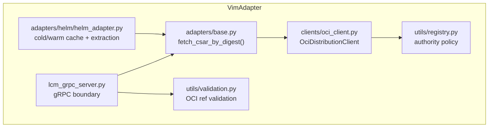
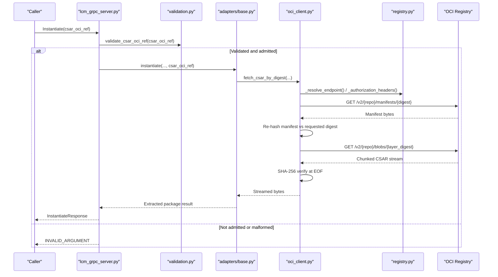
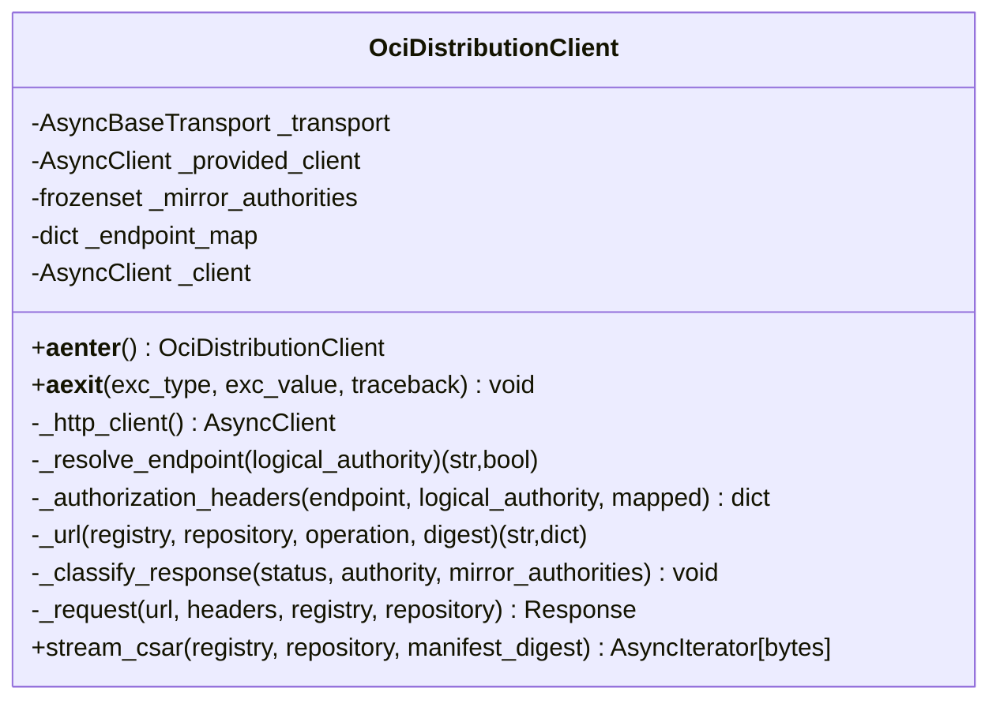
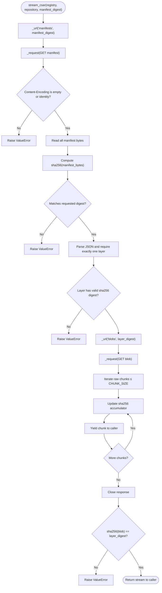
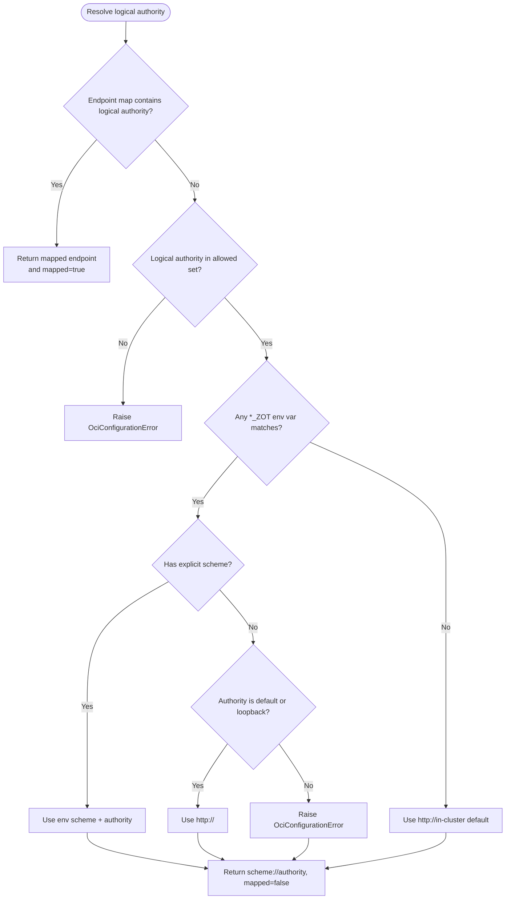
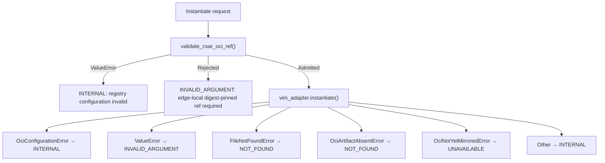
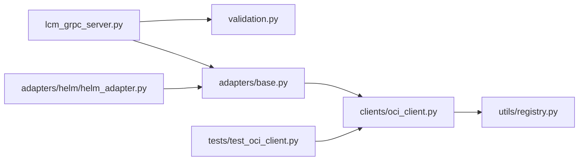

# Native Async OCI Distribution Client

<cite>
**Referenced Files in This Document**   
- `src/VimAdapter/src/clients/oci_client.py`
- `src/VimAdapter/src/utils/registry.py`
- `src/VimAdapter/src/utils/validation.py`
- `src/VimAdapter/src/adapters/base.py`
- `src/VimAdapter/src/adapters/helm/helm_adapter.py`
- `src/VimAdapter/src/server/lcm_grpc_server.py`
- `src/VimAdapter/tests/test_oci_client.py`
- `.planning/phases/50-vimadapter-native-async-oci-distribution-client/50-CONTEXT.md`
- `.planning/phases/50-vimadapter-native-async-oci-distribution-client/50-PLAN-REVIEW.md`
- `.planning/phases/50-vimadapter-native-async-oci-distribution-client/50-SECURITY.md`
- `.planning/phases/50-vimadapter-native-async-oci-distribution-client/50-VERIFICATION.md`
</cite>

## Table of Contents
1. [Introduction](#introduction)
2. [Project Structure](#project-structure)
3. [Core Components](#core-components)
4. [Architecture Overview](#architecture-overview)
5. [Detailed Component Analysis](#detailed-component-analysis)
6. [Dependency Analysis](#dependency-analysis)
7. [Performance Considerations](#performance-considerations)
8. [Troubleshooting Guide](#troubleshooting-guide)
9. [Conclusion](#conclusion)

## Introduction
Phase 50 replaces the external `oras` CLI subprocess path in the Python VimAdapter with a native asynchronous OCI distribution client built on `httpx`. The replacement:

- Pulls an OCI manifest by digest, then streams the single CSAR layer from `/v2/<repository>/blobs/<layer_digest>`.
- Verifies both manifest and blob digests at EOF.
- Enforces a static registry authority allow-list and strict scheme rules for plaintext HTTP.
- Maps OCI-layer failures to gRPC status codes (`INVALID_ARGUMENT`, `NOT_FOUND`, `UNAVAILABLE`, `INTERNAL`).
- Streams blobs in 1 MiB chunks under `Accept-Encoding: identity`, avoiding process spawning and root-level archive leakage.

The phase is scoped to this transport swap plus related validation, extraction safety, chart ephemeral-storage sizing, and verification. It does not add signature provenance checks, application-level retries, or broader pod-resilience controls; those are recorded as accepted risks or deferred work.

**Section sources**
- `.planning/phases/50-vimadapter-native-async-oci-distribution-client/50-CONTEXT.md#L1-L56`
- `.planning/phases/50-vimadapter-native-async-oci-distribution-client/50-VERIFICATION.md#L1-L31`

## Project Structure
Phase 50 touches a small, layered Python surface inside `src/VimAdapter`:

**Diagram sources**
- `src/VimAdapter/src/server/lcm_grpc_server.py#L268-L340`
- `src/VimAdapter/src/adapters/base.py#L63-L83`
- `src/VimAdapter/src/adapters/helm/helm_adapter.py#L1-L40`
- `src/VimAdapter/src/clients/oci_client.py#L1-L30`
- `src/VimAdapter/src/utils/registry.py#L1-L20`
- `src/VimAdapter/src/utils/validation.py#L1-L20`

**Section sources**
- `src/VimAdapter/src/adapters/base.py#L63-L83`
- `src/VimAdapter/src/server/lcm_grpc_server.py#L268-L340`

## Core Components
| Component | Responsibility | Key Implementation Surface |
|---|---|---|
| `OciDistributionClient` | Native async OCI pull using `httpx.AsyncClient`; validates and streams one CSAR layer. | `src/VimAdapter/src/clients/oci_client.py#L33-L227` |
| Authority policy | Static defaults, configured Zot authorities, endpoint mapping, and loopback/plaintext rules. | `src/VimAdapter/src/utils/registry.py#L1-L104` |
| Input validation | Rejects non-digest-pinned refs, whitespace, malformed digests, and credential-bearing authorities. | `src/VimAdapter/src/utils/validation.py#L102-L162` |
| Adapter seam | Exposes `fetch_csar_by_digest` so existing adapters stream without knowing about `httpx`. | `src/VimAdapter/src/adapters/base.py#L63-L83` |
| Cold/warm cache | Streams into a temporary archive, extracts safely, promotes only after `.complete`. | `src/VimAdapter/src/adapters/helm/helm_adapter.py#L240-L300` |
| gRPC error mapping | Converts configuration, validation, absent-artifact, mirror-unavailable, and generic errors to status codes. | `src/VimAdapter/src/server/lcm_grpc_server.py#L268-L340` |

**Section sources**
- `src/VimAdapter/src/clients/oci_client.py#L33-L227`
- `src/VimAdapter/src/utils/registry.py#L1-L104`
- `src/VimAdapter/src/utils/validation.py#L102-L162`
- `src/VimAdapter/src/adapters/base.py#L63-L83`
- `src/VimAdapter/src/adapters/helm/helm_adapter.py#L240-L300`
- `src/VimAdapter/src/server/lcm_grpc_server.py#L268-L340`

## Architecture Overview
The Phase 50 flow starts when a caller supplies a digest-pinned `csar_oci_ref` to the instantiate RPC.

**Diagram sources**
- `src/VimAdapter/src/server/lcm_grpc_server.py#L268-L340`
- `src/VimAdapter/src/utils/validation.py#L102-L162`
- `src/VimAdapter/src/adapters/base.py#L63-L83`
- `src/VimAdapter/src/clients/oci_client.py#L142-L227`
- `src/VimAdapter/src/utils/registry.py#L23-L104`

**Section sources**
- `src/VimAdapter/src/server/lcm_grpc_server.py#L268-L340`
- `src/VimAdapter/src/adapters/base.py#L63-L83`
- `src/VimAdapter/src/clients/oci_client.py#L142-L227`

## Detailed Component Analysis

### `OciDistributionClient`
`OciDistributionClient` is the new transport boundary. It owns:

- An optional `httpx.AsyncClient` created inside an async context manager.
- Redirect disabling, ambient proxy disabling, and a 30-second per-read timeout.
- Endpoint resolution against logical authorities and `ZOT_ENDPOINT_MAP`.
- Basic or Bearer authorization, never forwarded when a mapped endpoint authority differs from the logical authority.
- A two-step OCI pull: manifest first, then exactly one CSAR layer.
- Digest verification for both manifest bytes and streamed blob bytes.
- One-attempt HTTP behavior with no retry loop.

**Diagram sources**
- `src/VimAdapter/src/clients/oci_client.py#L33-L227`

Key behaviors:

| Behavior | Where | Rationale |
|---|---|---|
| No `oras` binary | Client uses `httpx` directly | Eliminates subprocess overhead and stderr parsing |
| Identity encoding | `Accept-Encoding: identity`, explicit rejection of unexpected encodings | Preserves the 1 MiB chunk bound |
| Single layer | Exactly one manifest layer required | Matches CSAR model used by the rest of the platform |
| Manifest digest check | Re-hashes received manifest bytes before JSON parsing | Closes the unverified-manifest threat |
| Blob digest check | Accumulates SHA-256 over streamed chunks | Confirms integrity at EOF |
| Chunk size cap | Each yielded chunk must be ≤ `CHUNK_SIZE` | Detects misbehaving transports |
| No retry loop | `_request` sends once per call | Retry ownership stays with the gRPC channel |
| Mirror transient class | 502/503/504 from mirror authorities maps to `OciNotYetMirroredError` | Only genuinely synchronous upstream sync failures are retryable |
| Terminal 404 | Every 404 raises `OciArtifactAbsentError` | Both Zot hops are `onDemand: true` |

**Section sources**
- `src/VimAdapter/src/clients/oci_client.py#L33-L227`
- `src/VimAdapter/tests/test_oci_client.py#L1-L200`

#### Manifest-and-blob streaming flow

**Diagram sources**
- `src/VimAdapter/src/clients/oci_client.py#L142-L227`

### Registry Authority Allow-listing
The allow-list is intentionally additive:

| Source | Values |
|---|---|
| Static defaults | `mepm-zot:5000`, `mec-host-zot:5000`, `meao-zot:5000`, `localhost:5000`, `127.0.0.1:5000` |
| Environment variables | Exact hosts from `MEAO_ZOT`, `MEPM_ZOT`, `MEC_HOST_ZOT` |
| `ZOT_ENDPOINT_MAP` | Logical-to-transport mappings that must reference an admitted logical authority |

Plaintext HTTP is allowed only when:

- The endpoint carries its own scheme and normalizes to an admitted authority, or
- The logical authority is one of the static defaults, or
- The host resolves to `localhost` or `127.0.0.1`.

A non-loopback, schemeless endpoint raises `OciConfigurationError`. Mapped endpoints cannot be remote plaintext — they must be loopback if using `http://`.

**Diagram sources**
- `src/VimAdapter/src/clients/oci_client.py#L83-L121`
- `src/VimAdapter/src/utils/registry.py#L23-L104`

**Section sources**
- `src/VimAdapter/src/utils/registry.py#L1-L104`
- `src/VimAdapter/src/clients/oci_client.py#L83-L121`
- `src/VimAdapter/src/utils/validation.py#L102-L162`

### Error Mapping to gRPC Status Codes
The gRPC server centralizes exception-to-status mapping for the instantiate flow:

| Exception | gRPC Status | Meaning |
|---|---:|---|
| `ValueError` | `INVALID_ARGUMENT` | Malformed `csar_oci_ref`, invalid registry/repository/digest, malformed manifest or blob, or other input/validation failure. |
| `OciConfigurationError` | `INTERNAL` | Registry configuration fault such as missing scheme, conflicting credentials, or admission failure. |
| `FileNotFoundError` | `NOT_FOUND` | Package directory or extracted content not found after warm/cold processing. |
| `OciArtifactAbsentError` | `NOT_FOUND` | Registry returned 404 for the artifact. |
| `OciNotYetMirroredError` | `UNAVAILABLE` | Mirror upstream returned 502/503/504; retry ownership belongs to the gRPC channel. |
| Other exceptions | `INTERNAL` | Unexpected runtime failure. |

**Diagram sources**
- `src/VimAdapter/src/server/lcm_grpc_server.py#L268-L340`
- `src/VimAdapter/src/clients/oci_client.py#L157-L175`

**Section sources**
- `src/VimAdapter/src/server/lcm_grpc_server.py#L268-L340`
- `src/VimAdapter/src/clients/oci_client.py#L157-L175`

### Cold/Warm Cache and Extraction Safety
The Helm adapter consumes the streaming CSAR through `fetch_csar_by_digest`, which delegates to `OciDistributionClient.stream_csar`. The cold path:

1. Checks for a warm cache entry.
2. Streams the CSAR into a context-managed temporary directory.
3. Extracts the archive into a staging directory.
4. Marks the staging directory `.complete`.
5. Asserts same-filesystem promotion via `os.replace`.
6. Removes incomplete staging directories.
7. Promotes only after successful extraction.

This design eliminates:

- Root-level `.csar` files.
- Partial final directories.
- Unbounded memory accumulation for the downloaded archive.
- Unsafe traversal, symlink, ADS, and Zip-Slip extraction vectors.

**Section sources**
- `src/VimAdapter/src/adapters/base.py#L63-L83`
- `src/VimAdapter/src/adapters/helm/helm_adapter.py#L240-L300`

## Dependency Analysis
Phase 50 dependencies are deliberately narrow and directional:

| Direction | Purpose | Risk |
|---|---|---|
| `lcm_grpc_server.py` → `validation.py` | Pre-forward admission gate | Prevents arbitrary registries and logs safe messages. |
| `lcm_grpc_server.py` → `adapters/base.py` | Delegates lifecycle to adapter implementation. | Adapter may still raise domain errors. |
| `adapters/base.py` → `clients/oci_client.py` | New transport seam. | Lazy import avoids startup coupling. |
| `clients/oci_client.py` → `utils/registry.py` | Shared authority policy. | Centralizes trust boundary. |
| `tests/test_oci_client.py` → `clients/oci_client.py` | Deterministic MockTransport coverage. | Does not prove real network behavior alone. |

**Diagram sources**
- `src/VimAdapter/src/server/lcm_grpc_server.py#L268-L340`
- `src/VimAdapter/src/utils/validation.py#L102-L162`
- `src/VimAdapter/src/adapters/base.py#L63-L83`
- `src/VimAdapter/src/clients/oci_client.py#L1-L30`
- `src/VimAdapter/tests/test_oci_client.py#L1-L60`

**Section sources**
- `src/VimAdapter/src/server/lcm_grpc_server.py#L268-L340`
- `src/VimAdapter/src/adapters/base.py#L63-L83`
- `src/VimAdapter/src/clients/oci_client.py#L1-L30`
- `src/VimAdapter/tests/test_oci_client.py#L1-L60`

## Performance Considerations
| Aspect | Current Behavior | Implication |
|---|---|---|
| Transport | `httpx.AsyncClient` with redirect and ambient-proxy disabled | Reduces surprise routing and dependency on host environment. |
| Timeouts | 30-second read timeout; no global operation deadline in the client itself | Detects stalled reads but relies on cancellation tokens above it for total execution bounds. |
| Streaming | 1 MiB raw chunks under identity encoding | Avoids decoding artifacts and keeps per-chunk memory bounded. |
| Retries | One attempt per manifest and blob request | Avoids stacking with the gRPC channel's `MaxAttempts=5`. |
| Digest cost | SHA-256 over manifest bytes and entire blob stream | CPU cost proportional to payload; acceptable for manifest and integrity verification. |
| Download byte ceiling | Not enforced at the transport level | Phase 50 accepts residual risk via pod-level ephemeral-storage sizing rather than a hard download cap. |
| Warm cache | Bypasses network and extraction entirely | Reduces latency and egress for repeated instantiations. |

The review noted that neither the manifest-declared layer size nor a hard download byte cap is enforced. Phase 50 records this as an accepted risk and adds explicit `requests.ephemeral-storage: 4Gi` / `limits.ephemeral-storage: 8Gi` on `vim-adapter` so a runaway pull evicts its own pod instead of starving the node.

**Section sources**
- `src/VimAdapter/src/clients/oci_client.py#L26-L76`
- `src/VimAdapter/src/clients/oci_client.py#L208-L227`
- `.planning/phases/50-vimadapter-native-async-oci-distribution-client/50-PLAN-REVIEW.md#L104-L120`
- `.planning/phases/50-vimadapter-native-async-oci-distribution-client/50-VERIFICATION.md#L113-L151`

## Troubleshooting Guide

| Symptom | Likely Cause | Diagnostic Action | Expected Resolution |
|---|---|---|---|
| `INVALID_ARGUMENT` on instantiate | `csar_oci_ref` is not an admitted edge-local digest-pinned ref. | Inspect the registry/host/port and digest format. Confirm the registry is in the allow-list. | Use one of the static defaults or configure `MEAO_ZOT`/`MEPM_ZOT`/`MEC_HOST_ZOT`. |
| `INTERNAL` with registry configuration fault | Missing scheme for non-loopback registry, conflicting Basic/Bearer credentials, or malformed `ZOT_ENDPOINT_MAP`. | Check `*_ZOT` environment variables, `OCI_REGISTRY_*` secrets, and `ZOT_ENDPOINT_MAP`. | Provide a scheme, use one credential scheme, or fix the mapping. |
| `NOT_FOUND` during instantiate | Artifact is absent at origin or mirror. | Inspect the Zot logs and the exact manifest digest. | Republish the correct manifest; do not rely on retry unless the error is `UNAVAILABLE`. |
| `UNAVAILABLE` during instantiate | Synchronous mirror upstream returned 502/503/504. | Check mirror connectivity and upstream Zot health. | Let the gRPC channel retry; investigate mirror availability. |
| Manifest digest mismatch | Registry returned different manifest bytes than the pinned digest. | Compare the manifest digest sent by PlatformManager with the manifest bytes received. | Fix the producer or pin the manifest digest actually stored in Zot. |
| Blob digest mismatch | Layer content changed between manifest creation and pull. | Verify the layer digest in the manifest matches the streamed blob. | Republish the artifact consistently. |
| High scratch usage | Large CSAR plus uncompressed extraction exceeds expected limits. | Check container disk pressure and whether the warm cache was reused. | Ensure the `vim-adapter` ephemeral-storage values are applied; avoid oversized archives. |
| Slow pull completes successfully | Per-read timeout is 30 seconds, but slow-but-progressing transfers can exceed it. | Measure elapsed time and transfer rate. | This is expected; the bound detects stalls, not total duration. |

**Section sources**
- `src/VimAdapter/src/server/lcm_grpc_server.py#L268-L340`
- `src/VimAdapter/src/clients/oci_client.py#L142-L227`
- `src/VimAdapter/src/utils/registry.py#L23-L104`
- `src/VimAdapter/src/utils/validation.py#L102-L162`

## Conclusion
Phase 50 replaces the `oras` subprocess path with a focused, test-covered native async OCI client. Its primary security improvements are digest-pinned manifest-and-blob retrieval, strict registry authority allow-listing, plaintext restrictions, and credential-safe header construction. Its primary operational improvements are streaming extraction, no root-level archive leakage, deterministic warm-cache promotion, and clear gRPC status mapping.

Known limitations remain documented rather than silently hidden: there is no download-byte ceiling, no signature provenance check, no SIGTERM drain for in-flight pulls, and no health probe covering wedged downloads. These are either accepted risks within Phase 50 or explicitly deferred to follow-up phases.

**Section sources**
- `.planning/phases/50-vimadapter-native-async-oci-distribution-client/50-CONTEXT.md#L1-L56`
- `.planning/phases/50-vimadapter-native-async-oci-distribution-client/50-SECURITY.md#L1-L93`
- `.planning/phases/50-vimadapter-native-async-oci-distribution-client/50-VERIFICATION.md#L1-L151`