# OpenStack Cloud Adapter Implementation

## Table of Contents
1. [Introduction](#introduction)
2. [Project Structure](#project-structure)
3. [Core Components](#core-components)
4. [Architecture Overview](#architecture-overview)
5. [Detailed Component Analysis](#detailed-component-analysis)
6. [Dependency Analysis](#dependency-analysis)
7. [Performance Considerations](#performance-considerations)
8. [Troubleshooting Guide](#troubleshooting-guide)
9. [Migration Strategies](#migration-strategies)
10. [Conclusion](#conclusion)

## Introduction
This document explains the OpenStack cloud adapter implementation inside the VimAdapter service. The adapter translates MEC application lifecycle operations from PlatformManager into calls against real OpenStack services: Nova (compute), Neutron (networking), Cinder (block storage), Glance (image management), and Keystone (identity). It also supports an opt-in Heat orchestration path that bundles those resources into a single stack.

The adapter is implemented as a Python gRPC server, selected through the VIM adapter factory when `vim_type` equals `openstack`. Configuration credentials are delivered to the adapter via gRPC and persisted as per-host `clouds.yaml` files under `openstack_configs/{host_ip}`. CSAR package metadata drives resource mapping through `InfrastructureLookup`, which extracts and caches information about compute, network, storage, identity, and optional orchestration requirements.

## Project Structure
At a high level, the OpenStack adapter lives under `src/VimAdapter/src/adapters/openstack/openstack_adapter.py`, with dedicated service modules for each OpenStack subsystem and shared utilities for configuration, filesystem safety, CSAR parsing, and metadata resolution.

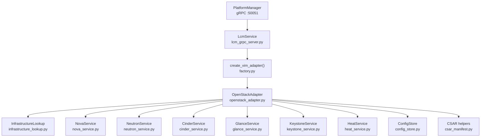

**Diagram sources**
- `src/VimAdapter/src/server/lcm_grpc_server.py#L1-L200`
- `src/VimAdapter/src/adapters/factory.py#L1-L200`
- `src/VimAdapter/src/adapters/openstack/openstack_adapter.py#L1-L200`
- `src/VimAdapter/src/utils/infrastructure_lookup.py#L1-L200`
- `src/VimAdapter/src/utils/config_store.py#L1-L176`
- `src/VimAdapter/src/utils/csar_manifest.py#L1-L144`

**Section sources**
- `src/VimAdapter/README.md#L1-L120`
- `docs/OPENSTACK_VIM_ADAPTER.md#L1-L194`

## Core Components
| Component | Responsibility | Key behavior |
|---|---|---|
| `LcmService` | gRPC entry point for PlatformManager | Validates host IP, package ID, payload size limits, and delegates to the configured VIM adapter. |
| `OpenStackAdapter` | Orchestrates OpenStack provisioning | Loads per-host `clouds.yaml`, resolves CSAR metadata, chooses raw or Heat mode, tracks created resources, maps SDK errors, and performs best-effort teardown. |
| `InfrastructureLookup` | Maps CSAR metadata to OpenStack resource specs | Caches parsed `CsarMetadata`; derives Nova flavors/images/networks, Glance image names, Neutron network/subnet/security-group specs, Cinder volume specs, and Keystone service identifiers. |
| `NovaService` | Compute lifecycle | Creates servers by name using resolved image/flavor/key/network, waits for ACTIVE, finds and deletes servers by app instance ID. |
| `NeutronService` | Networking topology | Finds or creates networks, subnets, and security groups; applies rules; returns created IDs. |
| `CinderService` | Block storage | Creates volumes with minimum size enforcement, waits for available state, attaches/detaches volumes to servers. |
| `GlanceService` | Image management | Finds existing images or streams disk images from the extracted CSAR package; waits for active state. |
| `KeystoneService` | Identity isolation | Creates deterministic project/user/role names based on `app_instance_id`, assigns roles, and supports revocation. |
| `HeatService` | Optional orchestration | Builds a HOT template from CSAR metadata and provisions a single stack containing networks, storage, security groups, and the VM. |
| `ConfigStore` | Secure per-host config persistence | Saves and loads secrets such as `clouds.yaml` under validated paths with restrictive file permissions. |
| `CsarMetadataExtractor` | CSAR archive inspection | Parses AppD and ETSI manifest without extracting the full package to disk. |

**Section sources**
- `src/VimAdapter/src/server/lcm_grpc_server.py#L1-L200`
- `src/VimAdapter/src/adapters/openstack/openstack_adapter.py#L1-L200`
- `src/VimAdapter/src/utils/infrastructure_lookup.py#L1-L200`
- `src/VimAdapter/src/services/nova_service.py#L1-L200`
- `src/VimAdapter/src/services/neutron_service.py#L1-L200`
- `src/VimAdapter/src/services/cinder_service.py#L1-L200`
- `src/VimAdapter/src/services/glance_service.py#L1-L200`
- `src/VimAdapter/src/services/keystone_service.py#L1-L200`
- `src/VimAdapter/src/services/heat_service.py#L1-L200`
- `src/VimAdapter/src/utils/config_store.py#L1-L176`
- `src/VimAdapter/src/utils/csar_manifest.py#L1-L144`

## Architecture Overview
The OpenStack adapter integrates with OpenStack through `openstacksdk`. PlatformManager invokes gRPC methods on VimAdapter, which selects the OpenStack adapter when `vim_type=openstack`. For each operation, the adapter opens an OpenStack connection using the normalized `clouds.yaml` profile keyed by host IP.

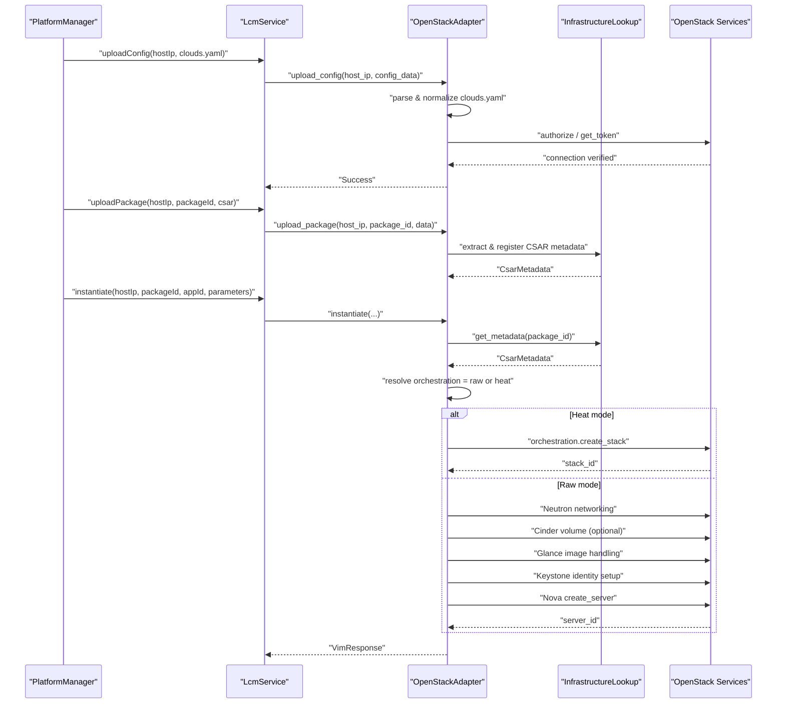

**Diagram sources**
- `src/VimAdapter/src/server/lcm_grpc_server.py#L1-L200`
- `src/VimAdapter/src/adapters/openstack/openstack_adapter.py#L1-L200`
- `src/VimAdapter/src/services/heat_service.py#L1-L200`
- `src/VimAdapter/src/utils/infrastructure_lookup.py#L1-L200`

## Detailed Component Analysis

### OpenStack Authentication and Credential Management
The adapter normalizes operator-provided `clouds.yaml` so that the top-level profile key becomes a stable name derived from the host IP. On validation, it connects directly to OpenStack using `openstack.connect(load_yaml_config=False, load_envvars=False)` and either calls `conn.authorize()` or requests an identity token. Credentials are never logged; error messages are scrubbed before being returned.

Key behaviors:
- Per-host credential file stored at `openstack_configs/{host_ip}`.
- Profile rewriting ensures `openstack.connect(cloud=...)` always matches the uploaded profile.
- Validation probes authentication within a short timeout.
- `validate_config` can be requested via gRPC trailing metadata to include latency.

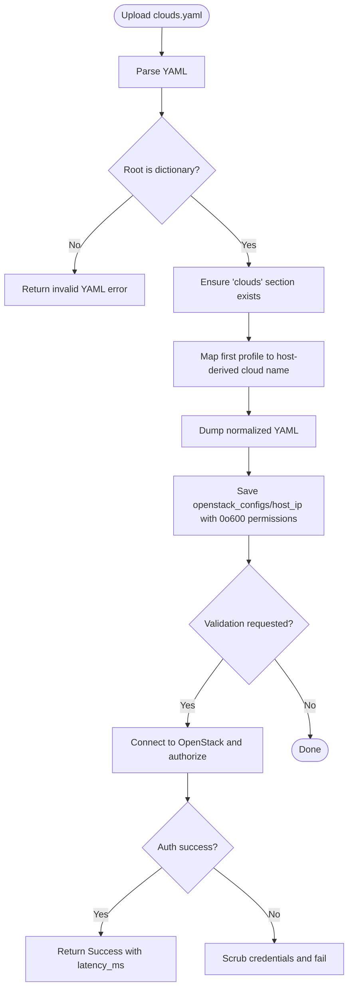

**Diagram sources**
- `src/VimAdapter/src/adapters/openstack/openstack_adapter.py#L1-L200`
- `src/VimAdapter/src/utils/config_store.py#L1-L176`

**Section sources**
- `src/VimAdapter/src/adapters/openstack/openstack_adapter.py#L1-L200`
- `src/VimAdapter/src/utils/config_store.py#L1-L176`

### CSAR Metadata Extraction and Resource Mapping
CSAR packages are inspected in memory. The shared `csar_manifest.py` module locates the TOSCA AppD and parses checksum blocks consistently with the .NET side. `CsarMetadataExtractor` builds a strongly typed `CsarMetadata` object describing virtual compute, networks, storages, scripts, services, traffic rules, DNS rules, and the optional `orchestration` flag.

`InfrastructureLookup` then maps that metadata into per-service specs:
- Nova: flavor naming convention, image name from OS, preferred data network, default key name, user data pass-through.
- Neutron: deterministic CIDR fallback (`10.{index}.0.0/24`), generated security group with broad ingress rule, subnet creation.
- Cinder: first declared block storage mapped to a volume spec.
- Glance: image name derived from OS.
- Keystone: service identifier from declared services or required MEC services.

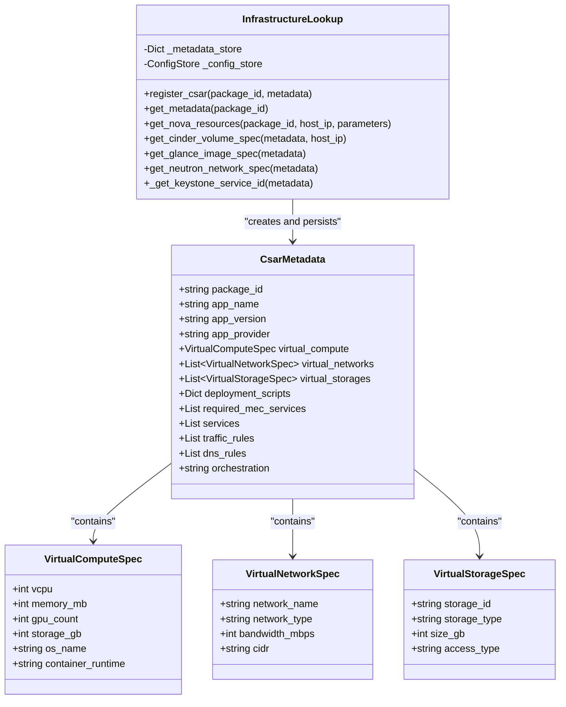

**Diagram sources**
- `src/VimAdapter/src/utils/infrastructure_lookup.py#L1-L200`
- `src/VimAdapter/src/utils/infrastructure_lookup.py#L201-L596`
- `src/VimAdapter/src/utils/csar_manifest.py#L1-L144`

**Section sources**
- `src/VimAdapter/src/utils/csar_manifest.py#L1-L144`
- `src/VimAdapter/src/utils/infrastructure_lookup.py#L1-L200`
- `src/VimAdapter/src/utils/infrastructure_lookup.py#L201-L596`

### VM Lifecycle Operations
#### Raw Mode (Default)
In raw mode, the adapter provisions resources in dependency order:
1. Resolve orchestration flag from parameters or metadata; default is `raw`.
2. Set up Neutron networking if the CSAR declares virtual networks.
3. Create a Cinder volume only when `virtual_storages` declares block storage.
4. Handle Glance image lookup or upload from the CSAR package.
5. Set up per-app Keystone identity (project, user, role).
6. Create the Nova server using resolved image, flavor, key, and network.
7. Wait for the server to reach ACTIVE.
8. Record all created resource IDs under `created_resources[app_instance_id]`.

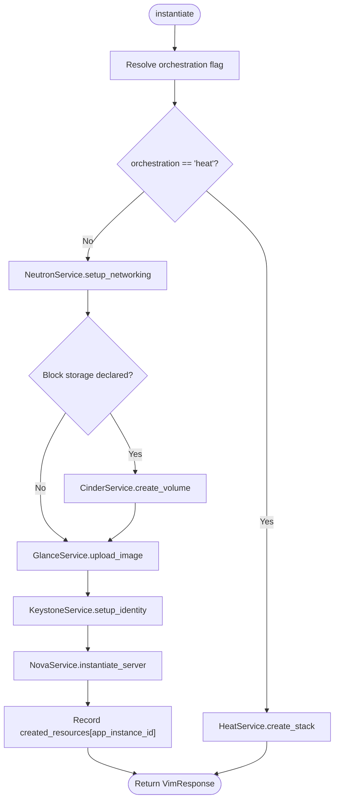

**Diagram sources**
- `src/VimAdapter/src/adapters/openstack/openstack_adapter.py#L1-L200`
- `src/VimAdapter/src/services/nova_service.py#L1-L200`
- `src/VimAdapter/src/services/neutron_service.py#L1-L200`
- `src/VimAdapter/src/services/cinder_service.py#L1-L200`
- `src/VimAdapter/src/services/glance_service.py#L1-L200`
- `src/VimAdapter/src/services/keystone_service.py#L1-L200`

#### Heat Orchestration Mode
When the CSAR metadata or parameters declare `orchestration: heat`, the adapter builds a HOT template and delegates provisioning to `conn.orchestration.create_stack`. The template conditionally includes Neutron networks, subnets, security groups, Cinder volumes, and the Nova server. Failed partial stacks are torn down so retries start clean. Teardown uses `delete_stack` rather than individual resource deletion.

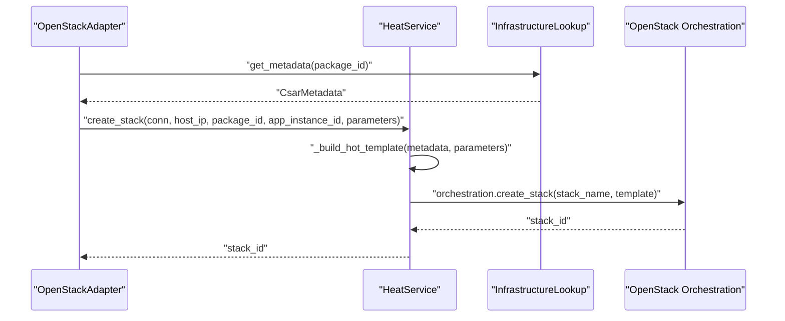

**Diagram sources**
- `src/VimAdapter/src/services/heat_service.py#L1-L200`
- `src/VimAdapter/src/utils/infrastructure_lookup.py#L1-L200`

**Section sources**
- `src/VimAdapter/src/adapters/openstack/openstack_adapter.py#L1-L200`
- `src/VimAdapter/src/services/heat_service.py#L1-L200`

### Termination and Best-Effort Cleanup
Termination clears resources in dependency order using the recorded `created_resources[app_instance_id]`:
- Heat stack (if provisioned).
- Cinder volume.
- Neutron port.
- Neutron network/subnet/security group (only those created by the adapter).
- Keystone identity revocation.
- Nova server.

Missing resources do not abort teardown; failures are logged. Glance image cleanup is explicitly noted as not yet performed on terminate.

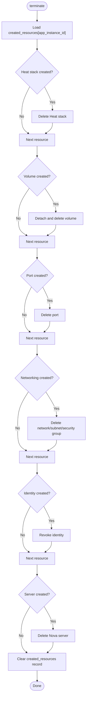

**Diagram sources**
- `src/VimAdapter/src/adapters/openstack/openstack_adapter.py#L1-L200`

**Section sources**
- `src/VimAdapter/src/adapters/openstack/openstack_adapter.py#L1-L200`

### Network Topology Management
`NeutronService.setup_networking` reads Neutron network specifications from `InfrastructureLookup`. For each declared network:
- It finds or creates a Neutron network.
- It finds or creates a subnet with a deterministic CIDR fallback.
- It finds or creates a security group and adds ingress rules.
- It returns collected network IDs, port IDs, and security group IDs.

Security group rules are applied through `create_security_group_rule`, and the service handles `NotFoundException` and `ConflictException` gracefully.

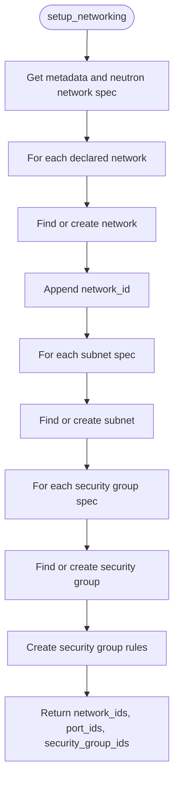

**Diagram sources**
- `src/VimAdapter/src/services/neutron_service.py#L1-L200`
- `src/VimAdapter/src/utils/infrastructure_lookup.py#L201-L551`

**Section sources**
- `src/VimAdapter/src/services/neutron_service.py#L1-L200`
- `src/VimAdapter/src/utils/infrastructure_lookup.py#L201-L551`

### Security Group Configuration
Security groups are generated per CSAR metadata when networks are declared. The default generated rule allows TCP ingress across ports 1–65535 from any source. In production deployments, operators should tighten these rules according to application exposure needs.

Important considerations:
- Generated security group names follow a pattern tied to the package or network.
- Rules are added after the security group is created.
- Existing groups are reused when they already exist.

**Section sources**
- `src/VimAdapter/src/services/neutron_service.py#L1-L200`
- `src/VimAdapter/src/utils/infrastructure_lookup.py#L201-L551`

### Floating IP Assignment
The current OpenStack adapter does not implement explicit floating IP allocation or assignment. Network provisioning focuses on creating networks, subnets, security groups, and attaching ports to servers. If floating IPs are required, this should be added as a separate step after server creation, using the OpenStack Neutron floating IP API.

Recommendation:
- Extend `NeutronService` with a `allocate_and_assign_floating_ip(server_id, network_id)` method.
- Record the floating IP in `created_resources[app_instance_id]`.
- Assign it during instantiate and release it during terminate.

**Section sources**
- `src/VimAdapter/src/services/neutron_service.py#L1-L200`
- `src/VimAdapter/src/adapters/openstack/openstack_adapter.py#L1-L200`

### OpenStack Authentication via Keystone
There are two layers of Keystone integration:
1. **Adapter-to-cloud authentication**: `clouds.yaml` provides `auth_url`, username, password, project name, domain names, region, interface, identity API version, and TLS verification settings. The adapter validates this by connecting to Keystone.
2. **Per-app identity isolation**: `KeystoneService` creates a per-app-instance project, user, and role. Identity keys are derived deterministically from `app_instance_id`, with SHA-256 truncation for unsafe or long identifiers.

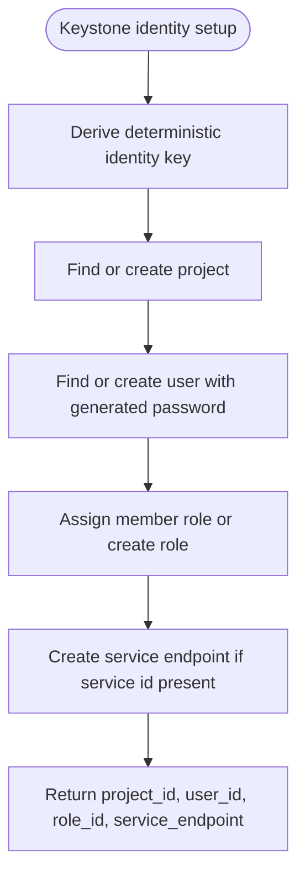

**Diagram sources**
- `src/VimAdapter/src/services/keystone_service.py#L1-L200`
- `src/VimAdapter/src/utils/infrastructure_lookup.py#L201-L551`

**Section sources**
- `src/VimAdapter/src/services/keystone_service.py#L1-L200`
- `src/VimAdapter/src/adapters/openstack/openstack_adapter.py#L1-L200`

### Multi-Tenancy Support
Multi-tenancy is supported through:
- Per-host `clouds.yaml`, allowing different OpenStack tenants per MEC host.
- Per-app Keystone project/user/role isolation keyed by `app_instance_id`.
- CSAR metadata-driven resource scoping.

Limitation noted in documentation:
- Phase 26 proposes stricter per-app project isolation where identity naming would use `app_instance_id` directly and remove plaintext password persistence from `created_resources`.

**Section sources**
- `src/VimAdapter/src/adapters/openstack/openstack_adapter.py#L1-L200`
- `src/VimAdapter/src/services/keystone_service.py#L1-L200`
- `docs/OPENSTACK_VIM_ADAPTER.md#L150-L194`

### gRPC Entry Points and Configuration Upload
`LcmService` exposes:
- `uploadConfig`: Streams `clouds.yaml`, enforces 100 MB limit, validates host IP, optionally probes OpenStack auth, and returns latency metadata.
- `removeConfig`: Removes persisted config for a host.
- `uploadPackage`: Streams CSAR bytes, enforces 500 MB limit, validates UUIDs.
- `deletePackage`, `instantiate`, `terminate`, `health_check`: Delegate to the selected VIM adapter.

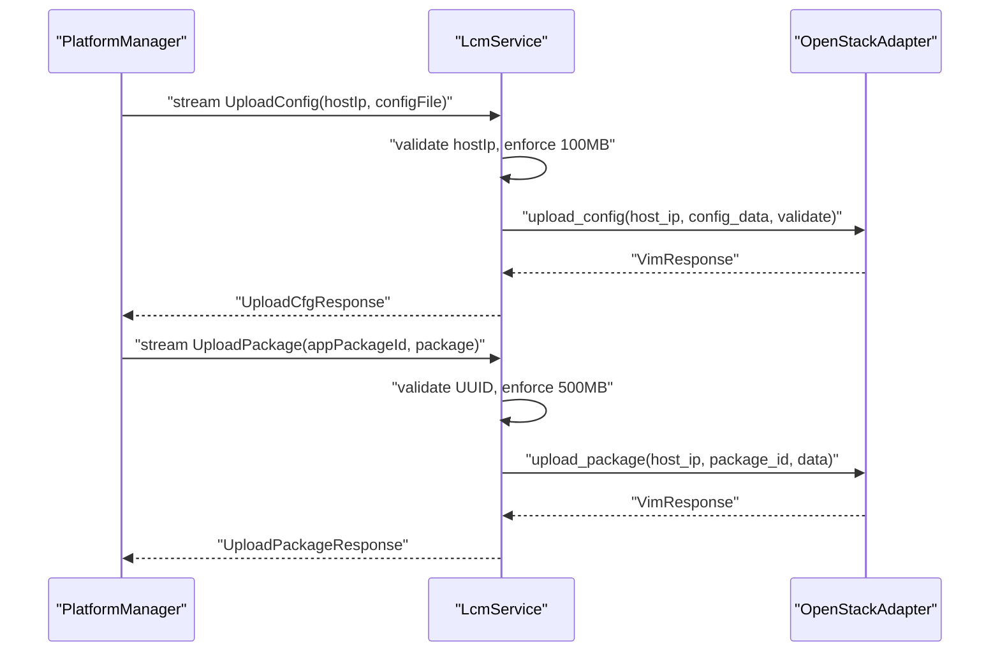

**Diagram sources**
- `src/VimAdapter/src/server/lcm_grpc_server.py#L1-L200`

**Section sources**
- `src/VimAdapter/src/server/lcm_grpc_server.py#L1-L200`

## Dependency Analysis
The OpenStack adapter depends on:
- `openstacksdk` for Nova, Neutron, Cinder, Glance, Keystone, and Heat.
- `opentelemetry` for tracing spans around provisioning steps.
- Shared VimAdapter infrastructure: gRPC servicer, factory, base adapter interface, config store, filesystem helpers, validation, and CSAR manifest helpers.

The import strategy protects the k8s/helm adapter paths when `openstacksdk` is absent: imports are wrapped in try/except blocks, and service modules are imported lazily inside `__init__`.

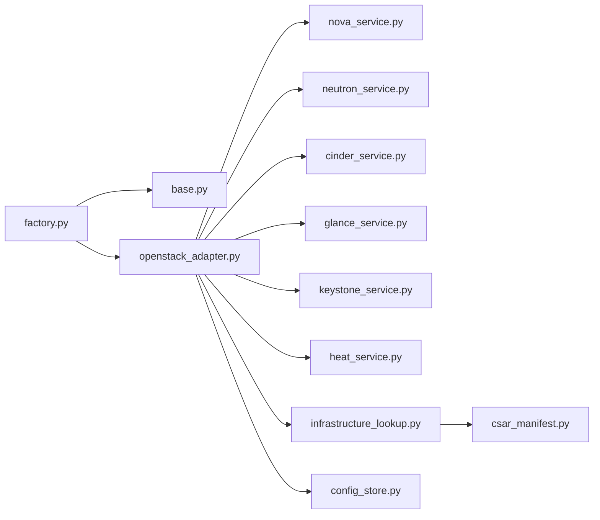

**Diagram sources**
- `src/VimAdapter/src/adapters/factory.py#L1-L200`
- `src/VimAdapter/src/adapters/base.py#L1-L200`
- `src/VimAdapter/src/adapters/openstack/openstack_adapter.py#L1-L200`

**Section sources**
- `src/VimAdapter/README.md#L120-L200`
- `src/VimAdapter/src/adapters/openstack/openstack_adapter.py#L1-L200`

## Performance Considerations
- **Concurrent VM operations:** Each OpenStack SDK call is executed off the asyncio event loop using `asyncio.to_thread`. This avoids blocking the gRPC server while waiting for Nova, Neutron, Cinder, Glance, Keystone, or Heat responses.
- **Polling timeouts:**
  - Nova server wait defaults to 180 seconds with 2-second polling.
  - Cinder volume readiness defaults to 120 seconds.
  - Glance image readiness defaults to 300 seconds.
  - Heat stack operations poll until created or deleted.
- **End-to-end deadline:** PlatformManager applies a gRPC deadline from `LcmWorker:VimOperationTimeout` (default 2 minutes). Adapter-side waits are designed to stay under that deadline, though Nova’s 180-second server wait may approach it. Operators should tune Nova flavor/image availability and network provisioning to avoid long waits.
- **Image streaming:** Glance uploads stream disk images from the extracted CSAR directory rather than loading entire files into memory, reducing peak memory usage for large images.
- **Resource tracking:** Recording `created_resources[app_instance_id]` reduces orphan cleanup cost by limiting teardown to resources known to belong to the adapter.

Recommendations:
- Pre-provision commonly used Nova flavors and Glance images to reduce instantiation time.
- Use Heat mode when you want atomic stack rollback on failure instead of manual best-effort cleanup.
- Monitor OpenStack API latency and adjust `wait_for_*` timeouts accordingly.
- Avoid overly broad security group rules; narrow ingress rules to reduce policy evaluation overhead.

**Section sources**
- `src/VimAdapter/src/services/nova_service.py#L1-L200`
- `src/VimAdapter/src/services/cinder_service.py#L1-L200`
- `src/VimAdapter/src/services/glance_service.py#L1-L200`
- `src/VimAdapter/src/services/heat_service.py#L1-L200`
- `docs/OPENSTACK_VIM_ADAPTER.md#L120-L150`

## Troubleshooting Guide

### Connectivity and Authentication Issues
Symptoms:
- `uploadConfig` fails during validation.
- OpenStack connection probe reports authentication errors.
- Logs mention missing `openstacksdk` or unavailable `openstack.connect`.

Checks:
- Verify `vim_type=openstack`.
- Confirm `clouds.yaml` contains a valid `auth` block and matches the expected OpenStack identity API version.
- Ensure the target OpenStack identity URL, project name, user domain, and project domain are correct.
- Check TLS settings (`verify`) if using self-signed certificates.
- Confirm the adapter process has network access to the OpenStack control plane.

Relevant code paths:
- `src/VimAdapter/src/adapters/openstack/openstack_adapter.py#L1-L200`
- `src/VimAdapter/src/server/lcm_grpc_server.py#L1-L200`

### Missing CSAR Metadata
Symptoms:
- Nova resources fall back to defaults.
- Neutron/Cinder/Glance provisioning skips optional resources.
- Logs show no metadata found for a package.

Checks:
- Ensure the CSAR contains a valid TOSCA AppD or ETSI manifest.
- Verify `InfrastructureLookup.register_csar` is called during `upload_package`.
- Inspect whether `CsarMetadataExtractor.extract_metadata` successfully parsed the archive.

Relevant code paths:
- `src/VimAdapter/src/utils/infrastructure_lookup.py#L1-L200`
- `src/VimAdapter/src/utils/csar_manifest.py#L1-L144`

### Heat Orchestration Failures
Symptoms:
- Instantiate fails when `orchestration: heat` is requested but no orchestration service is available.
- Partial Heat stacks remain after failed provisioning.

Checks:
- Confirm the OpenStack deployment includes Heat.
- Verify the HOT template generation receives valid metadata.
- Review logs for stack creation and cleanup attempts.

Relevant code paths:
- `src/VimAdapter/src/services/heat_service.py#L1-L200`
- `src/VimAdapter/src/adapters/openstack/openstack_adapter.py#L1-L200`

### Neutron Resource Conflicts
Symptoms:
- Network, subnet, or security group creation fails due to conflicts.
- Existing resources are reused but logging shows warnings.

Checks:
- Ensure multiple apps do not declare identical network/subnet/security group names unless intentional.
- Verify CIDR ranges do not collide; the adapter generates deterministic fallback CIDRs when none are provided.

Relevant code paths:
- `src/VimAdapter/src/services/neutron_service.py#L1-L200`
- `src/VimAdapter/src/utils/infrastructure_lookup.py#L201-L551`

### Cinder Attachment Timeouts
Symptoms:
- Volume remains unavailable or attachment times out.
- Logs report timeout waiting for volume ready or attachment completion.

Checks:
- Confirm Cinder backend capacity and availability.
- Verify the volume size meets minimum constraints.
- Check that the Nova server and volume are in compatible availability zones.

Relevant code paths:
- `src/VimAdapter/src/services/cinder_service.py#L1-L200`

### Glance Image Problems
Symptoms:
- Image not found in Glance.
- Streaming upload fails.
- Image remains inactive.

Checks:
- Verify the CSAR contains a `.qcow2`, `.raw`, or `.img` file under the expected package directory.
- Confirm Glance visibility and format compatibility.
- Check adapter logs for upload and active-state polling.

Relevant code paths:
- `src/VimAdapter/src/services/glance_service.py#L1-L200`

### Keystone Identity Errors
Symptoms:
- Per-app project or user creation fails.
- Role assignment fails.
- Revocation does not fully clean up identity resources.

Checks:
- Verify Keystone admin privileges for the adapter’s cloud credentials.
- Confirm identity key derivation does not exceed OpenStack name length limits.
- Review planned hardening for Phase 26 if strict per-instance isolation is required.

Relevant code paths:
- `src/VimAdapter/src/services/keystone_service.py#L1-L200`
- `docs/OPENSTACK_VIM_ADAPTER.md#L150-L194`

**Section sources**
- `src/VimAdapter/src/adapters/openstack/openstack_adapter.py#L1-L200`
- `src/VimAdapter/src/services/nova_service.py#L1-L200`
- `src/VimAdapter/src/services/neutron_service.py#L1-L200`
- `src/VimAdapter/src/services/cinder_service.py#L1-L200`
- `src/VimAdapter/src/services/glance_service.py#L1-L200`
- `src/VimAdapter/src/services/keystone_service.py#L1-L200`
- `src/VimAdapter/src/services/heat_service.py#L1-L200`
- `src/VimAdapter/src/utils/infrastructure_lookup.py#L1-L200`
- `src/VimAdapter/src/utils/csar_manifest.py#L1-L144`

## Migration Strategies

### From Other Cloud Providers
The VimAdapter architecture abstracts VIM implementations behind a common interface defined in `base.py`. This makes migration between providers conceptually straightforward:
- Implement a new adapter class that implements `VimAdapter`.
- Register it in `factory.py` under a chosen `VIM_TYPES` key.
- Provide provider-specific config handling, package handling, and lifecycle translation.

Current adapters:
- Kubernetes/Helm adapter under `adapters/helm/`.
- OpenStack adapter under `adapters/openstack/`.

Migration steps:
1. Identify the source cloud’s equivalent concepts: VMs, networks, volumes, images, identity, and orchestration.
2. Map CSAR metadata to the target cloud’s resource model.
3. Implement secure credential handling similar to `ConfigStore`.
4. Implement lifecycle methods: `upload_config`, `upload_package`, `instantiate`, `terminate`, `health_check`.
5. Add tests mirroring the OpenStack adapter’s coverage areas.

**Section sources**
- `src/VimAdapter/src/adapters/base.py#L1-L200`
- `src/VimAdapter/src/adapters/factory.py#L1-L200`
- `src/VimAdapter/README.md#L1-L120`

### From Heat-Based Deployments to Raw SDK Calls
If an application was deployed through Heat and needs to move to the raw SDK path:
- Remove or change `orchestration: heat` in CSAR metadata or parameters.
- Ensure Neutron, Cinder, Glance, and Keystone resources are provisioned individually.
- Add explicit floating IP and external connectivity logic if required.
- Update termination procedures to delete tracked resources manually.

### From Raw SDK Calls to Heat
If an application was deployed via raw SDK calls and needs atomic orchestration:
- Enable `orchestration: heat`.
- Verify that the OpenStack deployment supports Heat.
- Validate the generated HOT template for required resources.
- Test full stack creation and deletion end-to-end.

**Section sources**
- `src/VimAdapter/src/adapters/openstack/openstack_adapter.py#L1-L200`
- `src/VimAdapter/src/services/heat_service.py#L1-L200`
- `src/VimAdapter/src/utils/infrastructure_lookup.py#L1-L200`

## Conclusion
The OpenStack cloud adapter provides a structured, service-oriented bridge between MEC application lifecycle operations and real OpenStack infrastructure. It separates concerns across Nova, Neutron, Cinder, Glance, Keystone, and optional Heat orchestration, while sharing CSAR metadata extraction, secure configuration storage, and gRPC transport logic.

For production use, operators should:
- Provision pre-approved Nova flavors and Glance images.
- Tighten generated security group rules.
- Decide explicitly between raw SDK and Heat modes.
- Add floating IP handling if external access is required.
- Monitor OpenStack API latency and adjust adapter polling timeouts.
- Plan for Phase 26-style Keystone hardening when strict per-instance identity isolation is mandatory.

> **Referenced Files in This Document**
>
> - `src/VimAdapter/README.md`
> - `docs/OPENSTACK_VIM_ADAPTER.md`
> - `src/VimAdapter/src/server/lcm_grpc_server.py`
> - `src/VimAdapter/src/adapters/openstack/openstack_adapter.py`
> - `src/VimAdapter/src/adapters/factory.py`
> - `src/VimAdapter/src/adapters/base.py`
> - `src/VimAdapter/src/services/nova_service.py`
> - `src/VimAdapter/src/services/neutron_service.py`
> - `src/VimAdapter/src/services/cinder_service.py`
> - `src/VimAdapter/src/services/glance_service.py`
> - `src/VimAdapter/src/services/keystone_service.py`
> - `src/VimAdapter/src/services/heat_service.py`
> - `src/VimAdapter/src/utils/infrastructure_lookup.py`
> - `src/VimAdapter/src/utils/config_store.py`
> - `src/VimAdapter/src/utils/csar_manifest.py`
