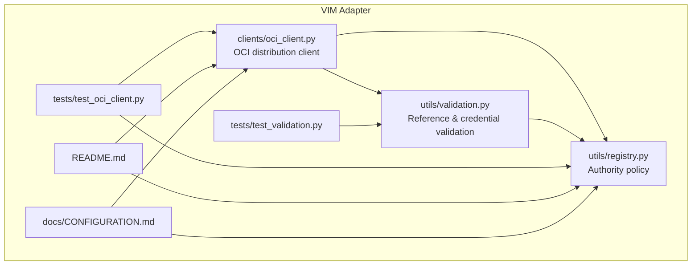
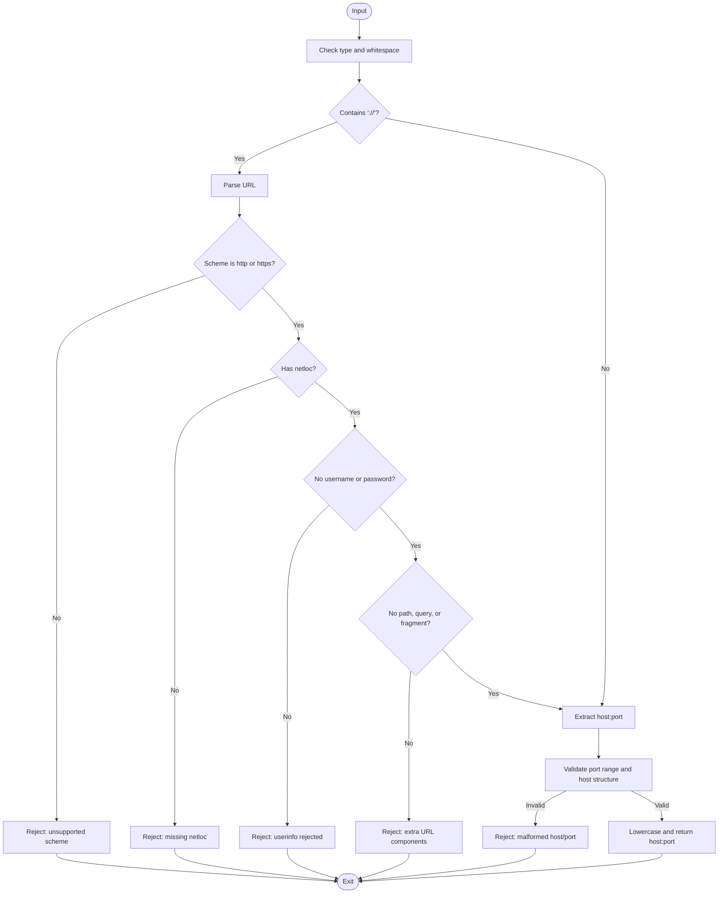
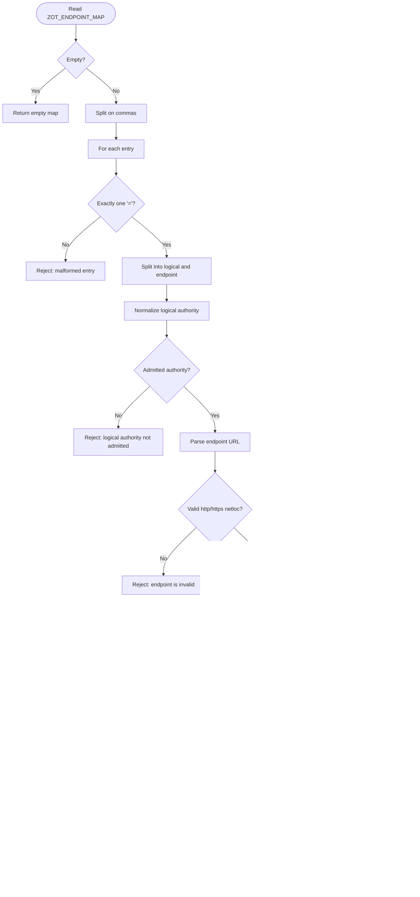
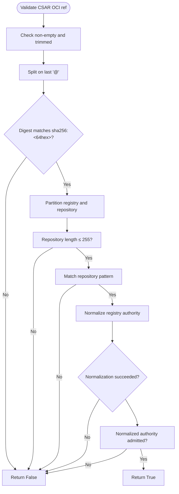
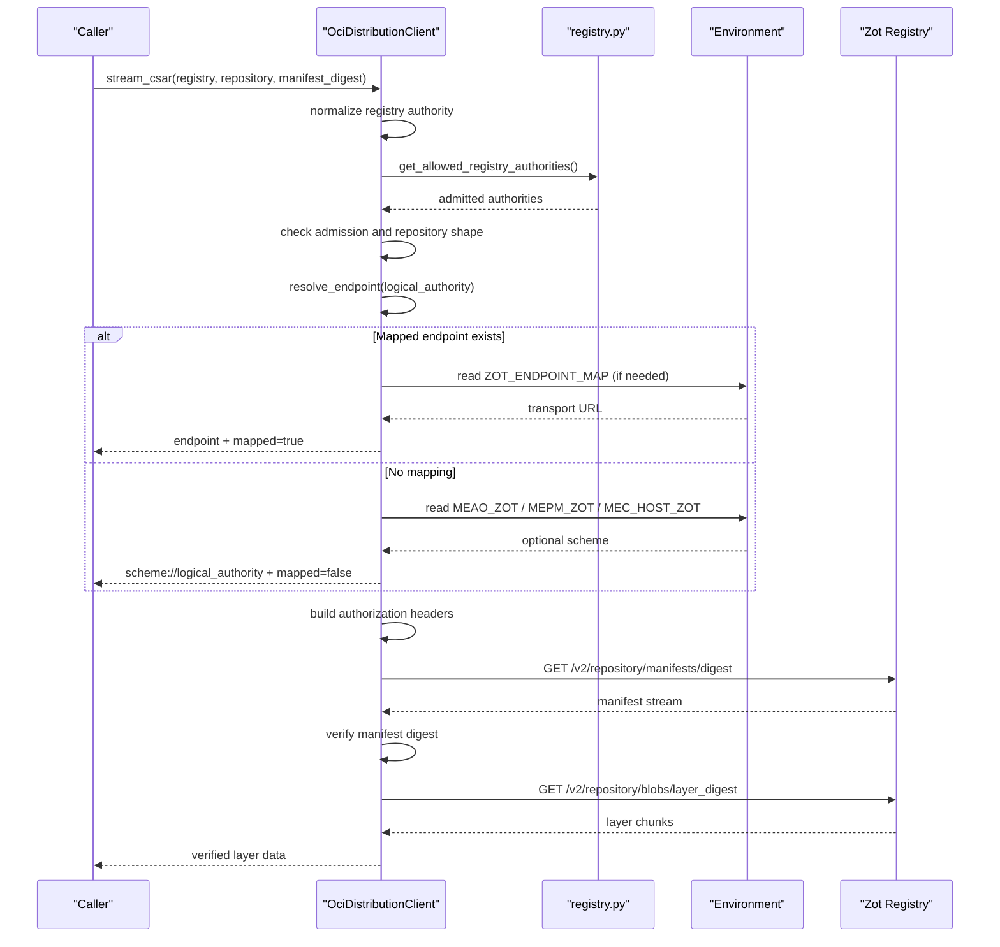
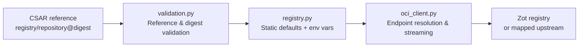
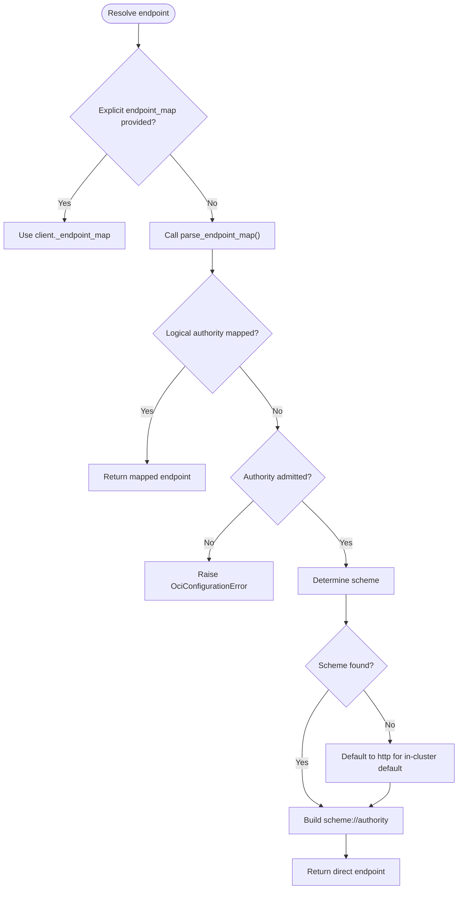
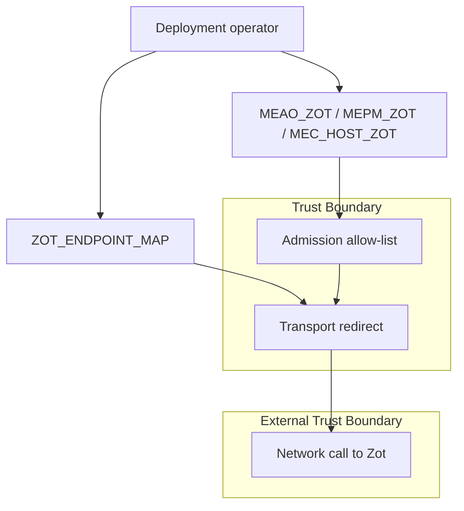
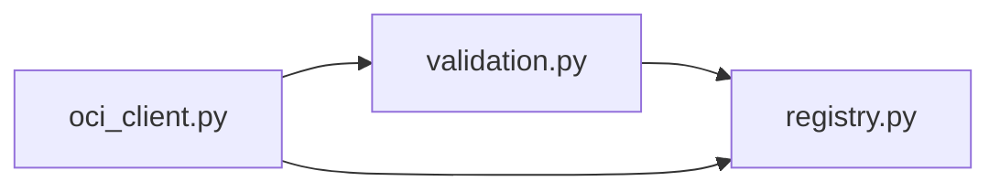

# Registry Authority Validation and Mirror Endpoints

## Table of Contents
1. [Introduction](#introduction)
2. [Project Structure](#project-structure)
3. [Core Components](#core-components)
4. [Architecture Overview](#architecture-overview)
5. [Detailed Component Analysis](#detailed-component-analysis)
6. [Dependency Analysis](#dependency-analysis)
7. [Performance Considerations](#performance-considerations)
8. [Troubleshooting Guide](#troubleshooting-guide)
9. [Conclusion](#conclusion)

## Introduction
This document explains the registry policy layer introduced in Phase 50 for VIM adapter OCI distribution. It covers four tightly coupled security controls:

- **Static default authorities**: a built-in allow-list of in-cluster Zot registries that are trusted by default.
- **`MEAO_ZOT` / `MEPM_ZOT` / `MEC_HOST_ZOT` environment variables**: deployment-time additive overrides that admit additional registry authorities and determine whether plaintext HTTP is permitted.
- **Scheme and userinfo rejection**: normalization rejects unsupported schemes, embedded credentials, paths, query strings, fragments, malformed hosts, and invalid ports.
- **`ZOT_ENDPOINT_MAP` logical-to-transport redirect mechanism**: a strict mapping from an already-admitted logical authority to a transport endpoint, with loopback-only plaintext enforcement and identity preservation requirements.

The design separates three concerns:

| Concern | Responsibility | Primary Location |
|---|---|---|
| Policy admission | Decide which registry authorities are allowed | `src/VimAdapter/src/utils/registry.py` |
| Input validation | Validate CSAR references, digests, repositories, and log scrubbing | `src/VimAdapter/src/utils/validation.py` |
| Transport execution | Resolve endpoints, build URLs, authenticate, stream blobs, and classify errors | `src/VimAdapter/src/clients/oci_client.py` |

## Project Structure
The relevant files form a small Python subsystem under `src/VimAdapter`:

**Diagram sources**
- `src/VimAdapter/src/utils/registry.py#L1-L104`
- `src/VimAdapter/src/utils/validation.py#L1-L162`
- `src/VimAdapter/src/clients/oci_client.py#L1-L227`
- `src/VimAdapter/tests/test_validation.py#L1-L200`
- `src/VimAdapter/tests/test_oci_client.py#L1-L200`
- `src/VimAdapter/README.md#L153-L161`
- `docs/CONFIGURATION.md#L132-L134`

**Section sources**
- `src/VimAdapter/src/utils/registry.py#L1-L104`
- `src/VimAdapter/src/utils/validation.py#L1-L162`
- `src/VimAdapter/src/clients/oci_client.py#L1-L227`

## Core Components

### Static Default Authorities
The registry policy defines a frozen set of in-cluster defaults:

| Default authority | Intended role |
|---|---|
| `mepm-zot:5000` | MEPM pull-through cache |
| `mec-host-zot:5000` | MEC-host edge registry |
| `meao-zot:5000` | MEAO-side Zot registry |
| `localhost:5000` | Local development registry |
| `127.0.0.1:5000` | Local development registry |

These values are admitted without environment configuration. They also imply plaintext HTTP when no explicit scheme is configured, because they are recognized as in-cluster or loopback authorities.

**Section sources**
- `src/VimAdapter/src/utils/registry.py#L10-L17`

### Environment Variables: `MEAO_ZOT`, `MEPM_ZOT`, `MEC_HOST_ZOT`
The three variables are additive: each one contributes one normalized authority to the allowed set. Their primary purpose is not authentication; it is to declare which registries may be contacted over plaintext HTTP.

| Variable | Purpose |
|---|---|
| `MEAO_ZOT` | Admits the MEAO Zot registry and its scheme |
| `MEPM_ZOT` | Admits the MEPM Zot registry and its scheme |
| `MEC_HOST_ZOT` | Admits the MEC-host Zot registry and its scheme |

If any variable contains a value that cannot be normalized, validation raises `ValueError` with the variable name included but never the raw value. This avoids leaking potentially sensitive hostnames or embedded credentials into error output.

**Section sources**
- `src/VimAdapter/src/utils/registry.py#L18-L19`
- `src/VimAdapter/src/utils/registry.py#L40-L57`
- `src/VimAdapter/tests/test_validation.py#L115-L130`
- `docs/CONFIGURATION.md#L132-L134`

### Scheme and Userinfo Rejection
`normalize_registry_authority` is the gatekeeper for every registry identity. It accepts two forms:

1. Exact `host:port`.
2. An `http://host:port` or `https://host:port` URL where only the netloc is used.

It rejects:

| Input characteristic | Result |
|---|---|
| Non-string, empty, or whitespace-padded input | Invalid authority |
| Scheme other than `http` or `https` | Invalid authority |
| Missing netloc | Invalid authority |
| Username present | Invalid authority |
| Password present | Invalid authority |
| Path component | Invalid authority |
| Query string | Invalid authority |
| Fragment | Invalid authority |
| Port outside 1–65535 | Invalid authority |
| Host containing dots at start/end or internal double dots | Invalid authority |

This makes the policy resistant to common trust-expansion mistakes such as embedding credentials, redirecting through arbitrary paths, or treating a full URL as equivalent to an exact authority.

**Diagram sources**
- `src/VimAdapter/src/utils/registry.py#L21-L39`

**Section sources**
- `src/VimAdapter/src/utils/registry.py#L21-L39`

### `ZOT_ENDPOINT_MAP`: Logical-to-Transport Redirects
`ZOT_ENDPOINT_MAP` is not an allow-list. It is a transport-only redirection map keyed by logical authority. Its contract is intentionally narrow:

- The key must be an already-admitted authority.
- The value must be an `http://host:port` or `https://host:port` URL.
- Plaintext HTTP endpoints are allowed only when the target host is `localhost` or `127.0.0.1`.
- Duplicate keys are rejected.
- Malformed entries raise `ValueError` with a descriptive message.

The resulting mapping maps a logical authority to a normalized transport URL. The transport URL retains its scheme and normalized authority, but does not permit arbitrary path expansion beyond what a registry API expects.

**Diagram sources**
- `src/VimAdapter/src/utils/registry.py#L65-L104`
- `src/VimAdapter/tests/test_oci_client.py#L232-L242`

**Section sources**
- `src/VimAdapter/src/utils/registry.py#L65-L104`
- `src/VimAdapter/tests/test_oci_client.py#L232-L242`
- `src/VimAdapter/README.md#L153-L161`

### OCI Reference Validation
`validate_csar_oci_ref` enforces that a CSAR reference is:

- A non-empty, trimmed string.
- Pinned by `@sha256:<64 hex>` digest.
- Formatted as `<registry>/<repository>@digest`.
- Scoped to an admitted registry authority.
- Restricted to a well-formed repository path.

This is the input-validation layer used before a request reaches the transport client. It returns `False` for invalid inputs and raises `ValueError` only when a configured environment variable is malformed.

**Diagram sources**
- `src/VimAdapter/src/utils/validation.py#L80-L123`

**Section sources**
- `src/VimAdapter/src/utils/validation.py#L80-L123`
- `src/VimAdapter/tests/test_validation.py#L132-L200`

### Client Endpoint Resolution and Authorization Headers
`OciDistributionClient._resolve_endpoint` implements the runtime policy:

1. If an `endpoint_map` was passed explicitly, use it directly.
2. Otherwise, lazily parse `ZOT_ENDPOINT_MAP`.
3. If the logical authority has a mapped endpoint, return it and mark the request as mapped.
4. If not mapped, verify the authority is admitted.
5. Determine the scheme:
   - From the configured environment variable if it matches.
   - As `http` for in-cluster defaults or loopback addresses.
   - Otherwise, require the environment variable to declare a scheme.
6. Raise `OciConfigurationError` when the policy cannot produce a valid endpoint.

Authorization headers follow separate rules:

- `OCI_REGISTRY_USERNAME` and `OCI_REGISTRY_PASSWORD` must both be present together.
- `OCI_REGISTRY_BEARER_TOKEN` cannot be combined with Basic credentials.
- When redirected through `ZOT_ENDPOINT_MAP`, `Authorization` headers are removed unless the mapped endpoint authority equals the original logical authority. This prevents accidental credential forwarding to an untrusted upstream.

**Diagram sources**
- `src/VimAdapter/src/clients/oci_client.py#L56-L127`
- `src/VimAdapter/src/clients/oci_client.py#L129-L179`
- `src/VimAdapter/src/utils/registry.py#L40-L104`

**Section sources**
- `src/VimAdapter/src/clients/oci_client.py#L56-L127`
- `src/VimAdapter/src/clients/oci_client.py#L129-L179`
- `src/VimAdapter/tests/test_oci_client.py#L186-L216`

## Architecture Overview
At runtime, a CSAR distribution request flows through three layers:

1. **Input validation** validates the CSAR reference format and digest pinning.
2. **Policy admission** checks the registry authority against static defaults and configured environment variables.
3. **Transport resolution** applies `ZOT_ENDPOINT_MAP` and selects a safe scheme and authentication strategy.

**Diagram sources**
- `src/VimAdapter/src/utils/validation.py#L80-L123`
- `src/VimAdapter/src/utils/registry.py#L10-L57`
- `src/VimAdapter/src/clients/oci_client.py#L56-L179`

## Detailed Component Analysis

### `normalize_registry_authority`
This function is the canonical authority normalizer. It converts acceptable inputs into lowercase `host:port` and rejects unsafe or ambiguous forms.

Key behaviors:

- Rejects non-string and whitespace-sensitive inputs.
- Accepts `http://` and `https://` URLs, then extracts only the netloc.
- Rejects embedded credentials via username/password checks.
- Rejects path, query, and fragment components.
- Validates port numeric range.
- Rejects malformed hostnames using dot rules and double-dot detection.

Complexity:

- Time complexity is linear in the input string length due to parsing and regex matching.
- Space complexity is constant aside from parsed URL components.

**Section sources**
- `src/VimAdapter/src/utils/registry.py#L21-L39`

### `get_allowed_registry_authorities`
This function builds the current admission set:

1. Start from `DEFAULT_REGISTRY_AUTHORITIES`.
2. Read `MEAO_ZOT`, `MEPM_ZOT`, and `MEC_HOST_ZOT`.
3. Normalize each configured value and add it.
4. On normalization failure, wrap the exception so callers see the variable name.

Because the returned set is a `frozenset`, callers should treat it as immutable.

**Section sources**
- `src/VimAdapter/src/utils/registry.py#L40-L57`
- `src/VimAdapter/tests/test_oci_client.py#L186-L195`

### `parse_endpoint_map`
This function parses `ZOT_ENDPOINT_MAP` into a dictionary from logical authority to transport URL.

Validation guarantees:

- Each comma-separated entry has exactly one `=`.
- The left side is an admitted normalized authority.
- The right side is a valid `http` or `https` URL.
- Duplicate logical authorities are rejected.
- Plaintext HTTP endpoints are restricted to loopback hosts.

Failure modes:

| Failure | Error text pattern |
|---|---|
| Malformed entry | `ZOT_ENDPOINT_MAP entry is malformed` |
| Invalid logical authority | `ZOT_ENDPOINT_MAP logical authority is invalid` |
| Unadmitted logical authority | `ZOT_ENDPOINT_MAP logical authority is not admitted` |
| Duplicate logical authority | `ZOT_ENDPOINT_MAP contains a duplicate authority` |
| Invalid endpoint URL | `ZOT_ENDPOINT_MAP endpoint is invalid` |
| Plaintext non-loopback endpoint | `ZOT_ENDPOINT_MAP plaintext endpoint must be loopback` |

**Section sources**
- `src/VimAdapter/src/utils/registry.py#L65-L104`
- `src/VimAdapter/tests/test_oci_client.py#L232-L242`

### `validate_csar_oci_ref`
This validation helper ensures that CSAR references are digest-pinned and scoped to trusted registries.

Behavior summary:

- Returns `False` for malformed references instead of raising exceptions.
- Requires a digest pinned to `sha256:<64 hex>`.
- Restricts repository names to lowercase alphanumeric segments separated by allowed punctuation.
- Rejects overly long repositories.
- Uses `normalize_registry_authority` to reject unsafe registry inputs.
- Uses `get_allowed_registry_authorities` for admission unless an explicit `allowed_registries` parameter is supplied.

This separation between returning `False` and raising `ValueError` is important: caller code can distinguish malformed user input from misconfigured deployment policy.

**Section sources**
- `src/VimAdapter/src/utils/validation.py#L80-L123`
- `src/VimAdapter/tests/test_validation.py#L132-L200`

### `OciDistributionClient`
The client is the operational surface where policy becomes network behavior.

#### Class responsibilities

| Responsibility | Implementation location |
|---|---|
| Async lifecycle management | `__aenter__` / `__aexit__` |
| Endpoint resolution | `_resolve_endpoint` |
| Authorization header construction | `_authorization_headers` |
| URL building | `_url` |
| HTTP request and response classification | `_request`, `_classify_response` |
| Manifest and blob verification | `stream_csar` |

#### Endpoint resolution policy

**Diagram sources**
- `src/VimAdapter/src/clients/oci_client.py#L93-L127`

#### Authorization header policy

| Configuration state | Behavior |
|---|---|
| Only bearer token | Adds `Authorization: Bearer ...` |
| Both username and password | Adds `Authorization: Basic ...` |
| Username without password | Raises `OciConfigurationError` |
| Password without username | Raises `OciConfigurationError` |
| Bearer token plus username or password | Raises `OciConfigurationError` |
| Mapped endpoint with different authority | Removes `Authorization` |
| Direct endpoint or same-authority redirect | Preserves `Authorization` |

**Section sources**
- `src/VimAdapter/src/clients/oci_client.py#L56-L179`
- `src/VimAdapter/tests/test_oci_client.py#L186-L216`

### Conceptual Overview
The overall security model can be summarized as layered trust boundaries:

[No sources needed since this diagram shows conceptual workflow, not actual code structure]

## Dependency Analysis
The dependencies among the core modules are directional and intentional:

- `validation.py` depends on `registry.py` only for shared authority normalization and admission.
- `oci_client.py` depends on both for policy and input validation.
- Tests depend on implementation details to assert behavior, especially around environment variables and endpoint mappings.

Potential coupling risks:

- Any change to `normalize_registry_authority` affects both admission and transport URL construction.
- Changes to `get_allowed_registry_authorities` affect validation, client admission, and scheme selection.
- `ZOT_ENDPOINT_MAP` parsing affects only transport, but its error messages and validation rules influence operational troubleshooting.

**Diagram sources**
- `src/VimAdapter/src/utils/validation.py#L10-L13`
- `src/VimAdapter/src/clients/oci_client.py#L14-L24`

**Section sources**
- `src/VimAdapter/src/utils/validation.py#L10-L13`
- `src/VimAdapter/src/clients/oci_client.py#L14-L24`

## Performance Considerations
- Authority normalization uses regular expressions and standard library URL parsing. These are lightweight operations executed per request, but the result is cached implicitly through process-level environment variables and the small size of the default allow-list.
- `parse_endpoint_map` is called lazily and only when no explicit `endpoint_map` is injected. This avoids parsing `ZOT_ENDPOINT_MAP` during object construction.
- Streaming CSAR layers uses `httpx.AsyncClient` with chunked reading and explicit timeouts, avoiding loading entire artifacts into memory.
- Redirects are disabled globally (`follow_redirects=False`), preventing unintended traversal to arbitrary hosts.
- Ambient proxy and environment trust are disabled (`trust_env=False`), reducing dependency on system-level HTTP settings.

[No sources needed since this section provides general guidance]

## Troubleshooting Guide

### Symptom: Request fails with “registry authority is not admitted”
Likely causes:

- The registry host:port is not one of the static defaults.
- None of `MEAO_ZOT`, `MEPM_ZOT`, or `MEC_HOST_ZOT` admits the requested authority.
- The environment variable value was malformed and raised an earlier validation error.

Resolution steps:

1. Confirm the logical authority matches the expected hostname and port.
2. Set one of the Zot environment variables to the desired host:port or `http(s)://host:port`.
3. Restart the service to reload environment configuration.

**Section sources**
- `src/VimAdapter/src/clients/oci_client.py#L157-L179`
- `src/VimAdapter/src/utils/registry.py#L40-L57`

### Symptom: `ZOT_ENDPOINT_MAP` raises `logical authority is not admitted`
Cause:

- The map key is not in the admitted authority set.
- The corresponding Zot environment variable is missing or malformed.

Resolution steps:

1. Verify the left-hand side of the mapping is an admitted authority.
2. Ensure the matching `MEAO_ZOT`, `MEPM_ZOT`, or `MEC_HOST_ZOT` variable is set correctly.
3. Avoid duplicate keys in `ZOT_ENDPOINT_MAP`.

**Section sources**
- `src/VimAdapter/src/utils/registry.py#L72-L83`

### Symptom: `ZOT_ENDPOINT_MAP` raises `plaintext endpoint must be loopback`
Cause:

- The mapped endpoint uses `http://` and targets a non-loopback host.

Resolution steps:

- Use `https://` for remote endpoints.
- Keep `http://` only for `localhost` or `127.0.0.1` mappings, such as local port forwards.

**Section sources**
- `src/VimAdapter/src/utils/registry.py#L99-L104`
- `src/VimAdapter/tests/test_oci_client.py#L232-L242`

### Symptom: Basic and Bearer credentials conflict
Cause:

- Both `OCI_REGISTRY_USERNAME`/`OCI_REGISTRY_PASSWORD` and `OCI_REGISTRY_BEARER_TOKEN` are set.
- Only one of username or password is set.

Resolution steps:

- Choose either Basic or Bearer authentication.
- Do not combine them.
- Remember that mapped endpoints remove `Authorization` headers unless the endpoint authority equals the logical authority.

**Section sources**
- `src/VimAdapter/src/clients/oci_client.py#L129-L155`
- `src/VimAdapter/tests/test_oci_client.py#L186-L216`

### Symptom: CSAR reference rejected as invalid repository or digest
Cause:

- The reference is not pinned to `sha256:<64 hex>`.
- The repository contains uppercase letters, disallowed characters, trailing slashes, or exceeds the length limit.
- The registry part is not admitted.

Resolution steps:

- Pin images by digest rather than tags.
- Use lowercase repository names with allowed separators.
- Confirm the registry authority is admitted through defaults or environment variables.

**Section sources**
- `src/VimAdapter/src/utils/validation.py#L80-L123`
- `src/VimAdapter/tests/test_validation.py#L132-L200`

## Conclusion
Phase 50’s registry policy layer establishes a clear boundary between logical registry identities and their transport endpoints. Static defaults provide safe in-cluster behavior, while `MEAO_ZOT`, `MEPM_ZOT`, and `MEC_HOST_ZOT` let operators admit additional registries safely. Scheme and userinfo rejection prevent common trust-expansion attacks, and `ZOT_ENDPOINT_MAP` provides controlled redirection for testing and port-forward scenarios without granting broad trust.

Operational best practices are:

- Treat logical authorities as policy identities, not arbitrary URLs.
- Configure Zot environment variables only with trusted registries.
- Use `ZOT_ENDPOINT_MAP` for transport redirects, not for admitting new registries.
- Prefer HTTPS for remote mapped endpoints.
- Pin CSAR artifacts by SHA-256 digest.
- Avoid combining Basic and Bearer credentials.

[No sources needed since this section summarizes without analyzing specific files]

> **Referenced Files in This Document**
>
> - `src/VimAdapter/src/utils/registry.py`
> - `src/VimAdapter/src/utils/validation.py`
> - `src/VimAdapter/src/clients/oci_client.py`
> - `src/VimAdapter/tests/test_validation.py`
> - `src/VimAdapter/tests/test_oci_client.py`
> - `src/VimAdapter/README.md`
> - `docs/CONFIGURATION.md`
