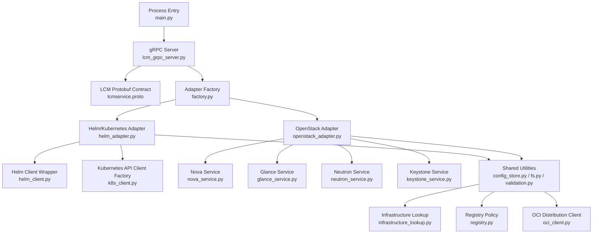
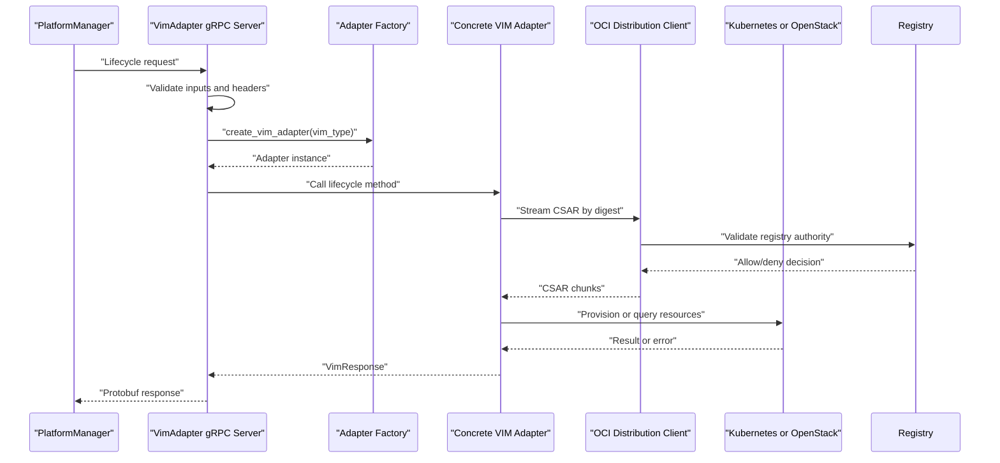
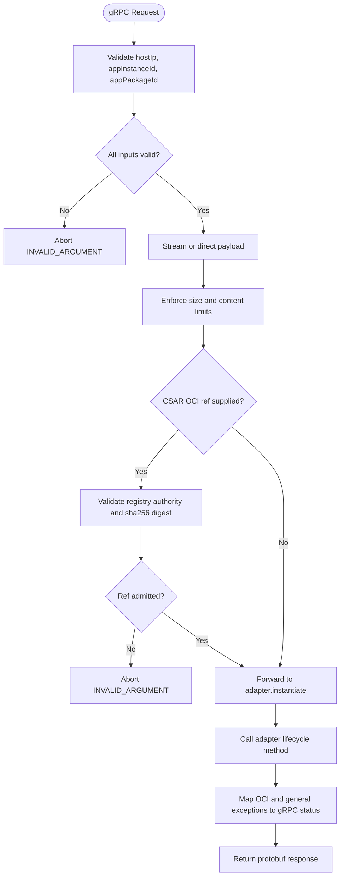
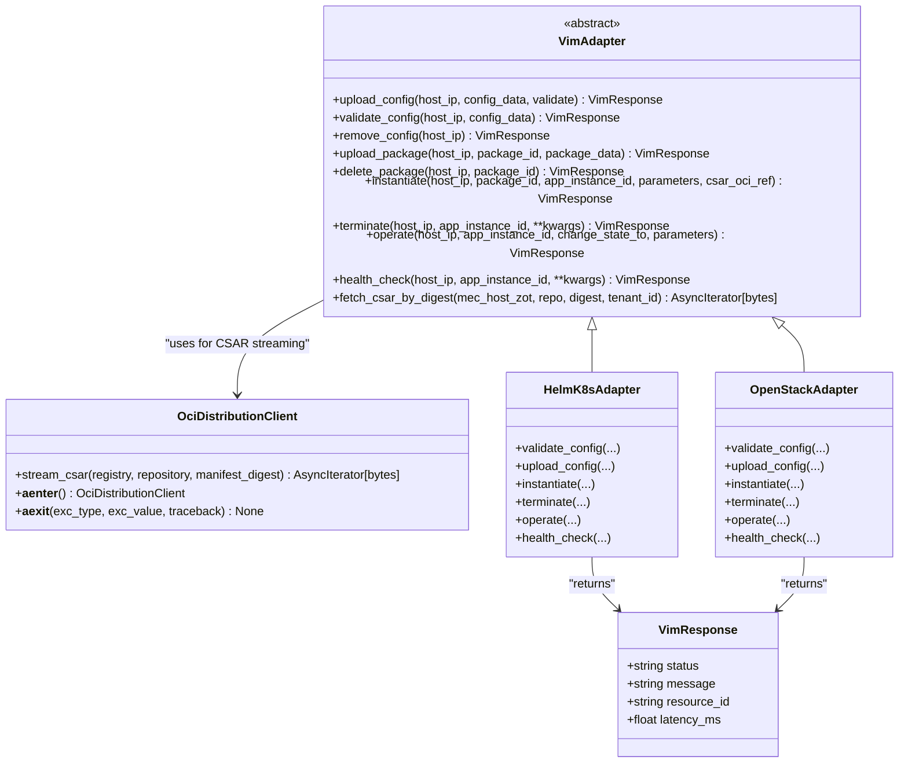
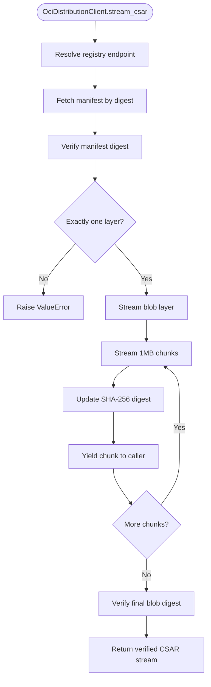
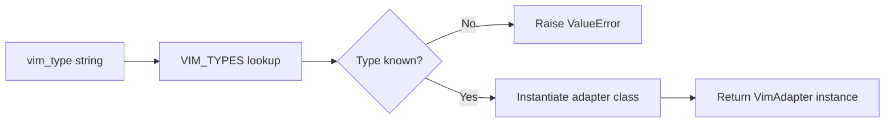
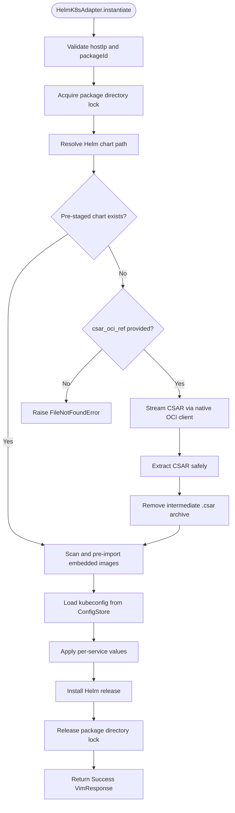
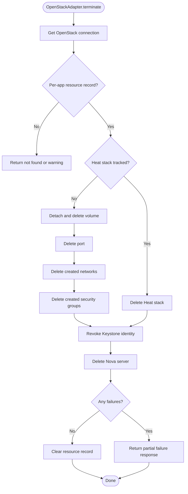
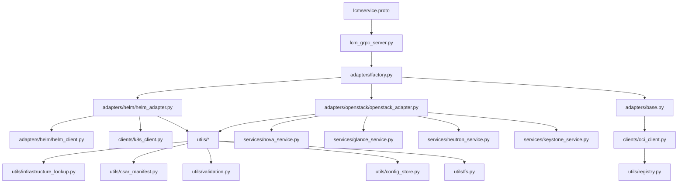

# VimAdapter (VIM Adapter Service)

## Update Summary
**Changes Made**   
- Replaced external `oras` CLI subprocess with native asynchronous OCI distribution client (`OciDistributionClient`)
- Added registry authority validation and static allow-listed registry authorities
- Implemented internal HTTP-based OCI pull path with mirror endpoint mapping
- Updated CSAR fetching to stream digest-verified chunks instead of temporary file extraction
- Enhanced Helm adapter with per-service resource overrides and improved package directory locking
- Updated error handling for OCI-specific exceptions (artifact absent, not yet mirrored, configuration errors)

## Table of Contents
1. [Introduction](#introduction)
2. [Project Structure](#project-structure)
3. [Core Components](#core-components)
4. [Architecture Overview](#architecture-overview)
5. [Detailed Component Analysis](#detailed-component-analysis)
6. [Dependency Analysis](#dependency-analysis)
7. [Performance Considerations](#performance-considerations)
8. [Troubleshooting Guide](#troubleshooting-guide)
9. [Conclusion](#conclusion)
10. [Appendices](#appendices)

## Introduction
VimAdapter is the Python-based Virtualized Infrastructure Manager (VIM) adapter service for the ETSI MEC Platform Manager LCM module. It exposes a gRPC server that receives lifecycle commands from the PlatformManager and translates them into VIM-specific operations. The current implementation supports:

- Kubernetes/Helm as a container orchestration VIM.
- OpenStack as a cloud infrastructure VIM using Nova, Glance, Neutron, Cinder, Heat, and Keystone.

The service is transport-neutral at the adapter layer: the gRPC boundary is defined by protobuf schemas, while adapters implement a common abstract interface. Configuration files such as kubeconfig or OpenStack clouds.yaml are streamed from PlatformManager through gRPC and persisted securely on disk per host IP.

Key design goals visible in the codebase include:
- A pluggable adapter factory keyed by `vim_type`.
- Strong input validation and path safety for host IPs, package IDs, CSAR archives, and OCI references.
- Secure handling of sensitive configuration data with metadata tracking.
- Native asynchronous OCI distribution client for edge-local CSAR pulling via SHA-256-digest-pinned references.
- Static allow-listed registry authorities with optional mirror endpoint mapping.
- Best-effort resource cleanup during termination, especially for OpenStack.

**Section sources**
- `src/VimAdapter/README.md#L1-L50`
- `src/VimAdapter/main.py#L1-L24`

## Project Structure
The VimAdapter project is organized around four main layers:

| Layer | Responsibility | Representative files |
|---|---|---|
| Transport and entry point | Process startup, environment configuration, gRPC server bootstrap | `src/VimAdapter/main.py`, `src/VimAdapter/src/server/lcm_grpc_server.py`, `src/VimAdapter/protos/lcmservice.proto` |
| Adapter contract and factory | Abstract VIM operations and runtime selection | `src/VimAdapter/src/adapters/base.py`, `src/VimAdapter/src/adapters/factory.py` |
| VIM implementations | Kubernetes/Helm and OpenStack provisioning logic | `src/VimAdapter/src/adapters/helm/helm_adapter.py`, `src/VimAdapter/src/adapters/openstack/openstack_adapter.py` |
| Supporting utilities | Config storage, filesystem safety, validation, CSAR inspection, OCI client, OpenStack service modules | `src/VimAdapter/src/utils/config_store.py`, `src/VimAdapter/src/utils/fs.py`, `src/VimAdapter/src/utils/validation.py`, `src/VimAdapter/src/utils/registry.py`, `src/VimAdapter/src/clients/oci_client.py`, `src/VimAdapter/src/utils/csar_manifest.py`, `src/VimAdapter/src/utils/infrastructure_lookup.py`, `src/VimAdapter/src/clients/k8s_client.py`, `src/VimAdapter/src/services/nova_service.py`, `src/VimAdapter/src/services/glance_service.py`, `src/VimAdapter/src/services/neutron_service.py`, `src/VimAdapter/src/services/keystone_service.py` |

**Diagram sources**
- `src/VimAdapter/main.py#L1-L24`
- `src/VimAdapter/src/server/lcm_grpc_server.py#L1-L50`
- `src/VimAdapter/src/adapters/factory.py#L1-L35`
- `src/VimAdapter/src/adapters/helm/helm_adapter.py#L1-L60`
- `src/VimAdapter/src/adapters/openstack/openstack_adapter.py#L1-L80`
- `src/VimAdapter/src/utils/registry.py#L1-L104`
- `src/VimAdapter/src/clients/oci_client.py#L1-L227`

**Section sources**
- `src/VimAdapter/README.md#L1-L50`
- `src/VimAdapter/main.py#L1-L24`
- `src/VimAdapter/src/server/lcm_grpc_server.py#L1-L50`
- `src/VimAdapter/src/adapters/factory.py#L1-L35`

## Core Components
VimAdapter is built around five core component categories:

| Component | Purpose | Key behavior |
|---|---|---|
| gRPC LCM server | Exposes lifecycle RPCs to PlatformManager | Validates requests, maps exceptions to gRPC status codes, forwards calls to the selected adapter |
| Adapter base class | Defines the VIM operation contract | Provides shared response model and async streaming CSAR fetching via OCI client |
| Adapter factory | Selects a concrete adapter | Maps `k8s`, `helm`, and `openstack` types to adapter classes |
| Kubernetes/Helm adapter | Deploys MEC applications as Helm releases | Manages kubeconfig, CSAR extraction, chart resolution, image pre-import, release install/scale/health |
| OpenStack adapter | Deploys MEC applications as VMs or Heat stacks | Manages clouds.yaml, Glance images, Neutron networking, Cinder volumes, Keystone identity, Nova servers |
| OCI Distribution client | Streams digest-verified CSAR artifacts | Native async HTTP client with registry authority validation and mirror support |

The adapter base class defines the canonical operations: upload and remove configuration, upload and delete packages, instantiate, terminate, operate state changes, health checks, and optional CSAR retrieval by immutable digest. All adapters return a structured response carrying status, message, optional resource identifier, and optional latency metric.

**Section sources**
- `src/VimAdapter/src/server/lcm_grpc_server.py#L1-L50`
- `src/VimAdapter/src/adapters/base.py#L1-L107`
- `src/VimAdapter/src/adapters/factory.py#L1-L35`
- `src/VimAdapter/src/adapters/helm/helm_adapter.py#L1-L60`
- `src/VimAdapter/src/adapters/openstack/openstack_adapter.py#L1-L80`

## Architecture Overview
At runtime, PlatformManager acts as the gRPC client over the Mm6 reference point, while VimAdapter implements the Mm7 role between PlatformManager and the underlying VIM. The default process binds to `[::]` and port `50051`, reads `VIM_TYPE` from the environment, and starts the asyncio gRPC server. TLS is supported when certificate and key paths are configured; otherwise insecure mode requires explicit opt-in.

**Diagram sources**
- `src/VimAdapter/main.py#L1-L24`
- `src/VimAdapter/src/server/lcm_grpc_server.py#L1-L50`
- `src/VimAdapter/src/adapters/factory.py#L1-L35`
- `src/VimAdapter/src/clients/oci_client.py#L1-L227`
- `src/VimAdapter/src/utils/registry.py#L1-L104`

### Communication Protocol
The protocol is defined in `lcmservice.proto`. It exposes six RPCs:

| RPC | Request type | Response type | Primary purpose |
|---|---|---|---|
| `uploadConfig` | Streaming `UploadCfgRequest` | `UploadCfgResponse` | Upload kubeconfig or clouds.yaml |
| `removeConfig` | `RemoveCfgRequest` | `RemoveCfgResponse` | Remove stored configuration |
| `uploadPackage` | Streaming `UploadPackageRequest` | `UploadPackageResponse` | Upload and extract CSAR |
| `deletePackage` | `DeletePackageRequest` | `DeletePackageResponse` | Remove staged package |
| `instantiate` | `InstantiateRequest` | `InstantiateResponse` | Deploy application |
| `terminate` | `TerminateRequest` | `TerminateResponse` | Undeploy application |
| `operate` | `OperateRequest` | `OperateResponse` | Change operational state |

The streaming uploads split metadata fields (`hostIp`, `appPackageId`) from payload bytes so large artifacts can be streamed rather than fully buffered in memory beyond the implemented size limits.

**Section sources**
- `src/VimAdapter/protos/lcmservice.proto#L1-L94`
- `src/VimAdapter/src/server/lcm_grpc_server.py#L50-L200`

## Detailed Component Analysis

### gRPC Server and Lifecycle Routing
The `LcmService` servicer constructs the adapter once at initialization based on the configured `vim_type`. Every lifecycle method follows the same pattern:

1. Parse and validate request fields.
2. Reject invalid inputs with `INVALID_ARGUMENT`.
3. Delegate to the adapter.
4. Map `ValueError` to `INVALID_ARGUMENT`, `FileNotFoundError` to `NOT_FOUND`, and unexpected exceptions to `INTERNAL`.
5. Return a protobuf response derived from the adapter's `VimResponse`.

For `uploadConfig`, the server accumulates streamed config bytes up to 100 MB, extracts `hostIp`, optionally enables validation metadata, and returns trailing metadata containing validation results when requested. For `uploadPackage`, it enforces a 500 MB in-memory stream limit and validates both `hostIp` and `appPackageId`.

For `instantiate`, the server additionally accepts a `csar_oci_ref` parameter and validates it against the allowed registry authorities before forwarding to the adapter. Special OCI-specific exceptions are mapped to appropriate gRPC status codes.

**Diagram sources**
- `src/VimAdapter/src/server/lcm_grpc_server.py#L50-L200`
- `src/VimAdapter/src/server/lcm_grpc_server.py#L201-L414`
- `src/VimAdapter/src/utils/validation.py#L1-L145`
- `src/VimAdapter/src/utils/registry.py#L1-L104`

**Section sources**
- `src/VimAdapter/src/server/lcm_grpc_server.py#L1-L200`
- `src/VimAdapter/src/server/lcm_grpc_server.py#L201-L414`

### Adapter Interface and Response Model
The adapter interface is deliberately broad enough to support multiple backends while keeping PlatformManager independent of VIM details.

| Method | Parameters | Return value | Meaning |
|---|---|---|---|
| `upload_config` | `host_ip`, `config_data`, optional `validate` | `VimResponse` | Persist and optionally probe VIM connectivity |
| `validate_config` | `host_ip`, `config_data` | `VimResponse` | Probe authentication and API reachability |
| `remove_config` | `host_ip` | `VimResponse` | Delete stored configuration |
| `upload_package` | `host_ip`, `package_id`, `package_data` | `VimResponse` | Stage and extract CSAR |
| `delete_package` | `host_ip`, `package_id` | `VimResponse` | Remove staged package |
| `instantiate` | `host_ip`, `package_id`, `app_instance_id`, `parameters`, optional `csar_oci_ref` | `VimResponse` | Deploy application |
| `terminate` | `host_ip`, `app_instance_id`, optional kwargs | `VimResponse` | Undeploy and clean up |
| `operate` | `host_ip`, `app_instance_id`, `change_state_to`, `parameters` | `VimResponse` | Scale or change operational state |
| `health_check` | `host_ip`, `app_instance_id`, optional kwargs | `VimResponse` | Query deployment health |
| `fetch_csar_by_digest` | `mec_host_zot`, `repo`, `digest`, optional `tenant_id` | `AsyncIterator[bytes]` | Stream CSAR artifact by digest |

`VimResponse` carries a string status, message, optional resource ID, and optional latency in milliseconds. The base implementation of `fetch_csar_by_digest` now uses the native `OciDistributionClient` to stream CSAR chunks asynchronously, eliminating the need for external CLI dependencies and temporary file extraction.

**Diagram sources**
- `src/VimAdapter/src/adapters/base.py#L1-L107`
- `src/VimAdapter/src/clients/oci_client.py#L1-L227`
- `src/VimAdapter/src/adapters/helm/helm_adapter.py#L1-L60`
- `src/VimAdapter/src/adapters/openstack/openstack_adapter.py#L1-L80`

**Section sources**
- `src/VimAdapter/src/adapters/base.py#L1-L107`

### Native OCI Distribution Client
Phase 50 introduced a native asynchronous OCI distribution client that replaces the previous external `oras` CLI subprocess approach. The `OciDistributionClient` provides secure, digest-verified streaming of CSAR artifacts directly over HTTP.

#### Registry Authority Validation
The client enforces strict registry authority policy through the shared `registry.py` utilities:

- **Static allow-list**: Default authorities include `mepm-zot:5000`, `mec-host-zot:5000`, `meao-zot:5000`, `localhost:5000`, and `127.0.0.1:5000`
- **Dynamic configuration**: Additional authorities can be added via `MEAO_ZOT`, `MEPM_ZOT`, and `MEC_HOST_ZOT` environment variables
- **Endpoint mapping**: Logical-to-physical registry mappings via `ZOT_ENDPOINT_MAP` for mirror support
- **Credential management**: Supports both Basic auth and Bearer tokens through `OCI_REGISTRY_USERNAME`, `OCI_REGISTRY_PASSWORD`, and `OCI_REGISTRY_BEARER_TOKEN`

#### Streaming CSAR Extraction
The client streams CSAR artifacts in 1MB chunks while performing end-to-end SHA-256 verification:

1. Fetches the manifest by digest and verifies its integrity
2. Validates that the manifest contains exactly one layer
3. Streams the blob layer chunk-by-chunk
4. Computes and verifies the final blob digest matches the manifest layer digest

**Diagram sources**
- `src/VimAdapter/src/clients/oci_client.py#L1-L227`
- `src/VimAdapter/src/utils/registry.py#L1-L104`

**Section sources**
- `src/VimAdapter/src/clients/oci_client.py#L1-L227`
- `src/VimAdapter/src/utils/registry.py#L1-L104`

### Adapter Factory Pattern
The factory maps three adapter names to concrete classes:

| `vim_type` | Adapter class | Backend |
|---|---|---|
| `k8s` | `HelmK8sAdapter` | Kubernetes/Helm |
| `helm` | `HelmK8sAdapter` | Kubernetes/Helm |
| `openstack` | `OpenStackAdapter` | OpenStack |

If an unknown type is supplied, `create_vim_adapter` raises `ValueError`, which the gRPC server maps to `INVALID_ARGUMENT`. New adapters are added by registering a new entry in `VIM_TYPES`; they must implement the abstract methods defined in `VimAdapter`.

**Diagram sources**
- `src/VimAdapter/src/adapters/factory.py#L1-L35`

**Section sources**
- `src/VimAdapter/src/adapters/factory.py#L1-L35`

### Kubernetes/Helm Adapter
The Helm adapter manages three primary concerns:

1. **Configuration**: kubeconfig bytes are validated, optionally probed against the Kubernetes API, persisted by `ConfigStore`, and tracked with metadata including upload time, content hash, validation status, and latency.
2. **Packages**: CSAR payloads are written to `packages/{packageId}-{hostIp}/`, extracted safely, and scanned for Helm charts.
3. **Lifecycle**: Deployment uses `HelmClient`, which wraps pyhelm3 and writes kubeconfig to a secure temporary file scoped to the operation.

#### Helm Chart Resolution and CSAR Ingress
The adapter resolves Helm charts through a deterministic precedence:

1. Flat conformant layout: `Artifacts/Deployment/helm-chart.tgz`.
2. Legacy layout: `Artifacts/Deployment/Charts/*.tgz`.
3. Fallback: any `.tgz` under `Artifacts/Deployment`.

If no pre-staged package exists but a digest-pinned `csar_oci_ref` was forwarded, the adapter falls back to streaming the CSAR from an edge-local zot registry using `fetch_csar_by_digest`. The new native OCI client eliminates the dependency on external CLI tools and provides better error handling and security guarantees.

#### Per-Service Resource Overrides
The adapter now supports per-service Helm values through the `parameters.get("values")` field, enabling fine-grained customization of Helm chart deployments without modifying the base chart. This is particularly useful for large CSARs where different services may require different resource allocations, network configurations, or environment variables.

#### Package Directory Locking
Enhanced locking ensures atomic operations across concurrent package downloads, extractions, and deletions. The lock is held from the warm check through the Helm install, preventing race conditions between concurrent operations on the same package directory.

**Diagram sources**
- `src/VimAdapter/src/adapters/helm/helm_adapter.py#L201-L513`
- `src/VimAdapter/src/adapters/base.py#L40-L107`

**Section sources**
- `src/VimAdapter/src/adapters/helm/helm_adapter.py#L1-L607`
- `src/VimAdapter/src/adapters/helm/helm_client.py#L1-L200`
- `src/VimAdapter/src/clients/k8s_client.py#L1-L76`

### OpenStack Adapter
The OpenStack adapter is larger because it coordinates multiple cloud subsystems. Its responsibilities include:

- Normalizing and persisting `clouds.yaml` under a stable profile name derived from the host IP.
- Extracting CSAR metadata through `InfrastructureLookup` and `CsarMetadataExtractor`.
- Provisioning Glance images, Neutron networks, Cinder volumes, Keystone identities, and Nova servers.
- Optionally using Heat stacks when enabled by CSAR metadata.
- Performing best-effort teardown across many resource types during termination.

#### Configuration Validation and Persistence
Validation parses the YAML, ensures a `clouds` section, derives a stable cloud name, and probes authentication using `openstack.connect`. If validation is requested, it records success or failure metadata without overwriting an existing active configuration when validation fails.

#### Package Upload and Metadata Caching
Package upload writes the CSAR, extracts it safely, and registers the parsed metadata with `InfrastructureLookup`. This metadata drives later resource specification decisions such as flavor mapping, image selection, network choice, and volume requirements.

#### Termination Strategy
Termination walks the per-app resource record in dependency order:

1. Heat stack deletion if present.
2. Cinder volume detachment and deletion.
3. Neutron port deletion.
4. Per-created-network deletion.
5. Per-created security group deletion.
6. Keystone identity revocation.
7. Nova server deletion.

Each step is wrapped in its own try block so one failure does not prevent cleanup of other resources. Failures are accumulated and returned in the response; the per-app record is cleared only after full success, enabling retry recovery.

**Diagram sources**
- `src/VimAdapter/src/adapters/openstack/openstack_adapter.py#L201-L528`

**Section sources**
- `src/VimAdapter/src/adapters/openstack/openstack_adapter.py#L1-L528`
- `src/VimAdapter/src/services/nova_service.py#L1-L120`
- `src/VimAdapter/src/services/glance_service.py#L1-L120`
- `src/VimAdapter/src/services/neutron_service.py#L1-L120`
- `src/VimAdapter/src/services/keystone_service.py#L1-L120`

### Common Utilities
Several utility modules are reused across adapters:

| Utility | Role | Important constraints |
|---|---|---|
| `ConfigStore` | Persists per-host configuration and metadata | IPv4 validation, path traversal protection, `O_NOFOLLOW`, owner-only `0o600` permissions |
| `fs.extract_csar` | Extracts CSAR archives | Enforces maximum file count, uncompressed size, compression ratio, symlink rejection, and Zip-Slip prevention |
| `fs.safe_join` | Validates joined paths stay within a base directory | Rejects alternate data streams and relative traversal patterns |
| `validation` | Validates IPs, UUIDs, OCI digests, and CSAR refs | Centralizes allowed registries and credential scrubbing |
| `registry` | Registry authority policy and endpoint mapping | Static allow-list, dynamic configuration, mirror endpoint validation |
| `oci_client` | Native async OCI distribution client | Digest verification, streaming, credential management |
| `csar_manifest` | Reads ETSI CSAR descriptors and manifest checksums | Mirrors .NET parser precedence for AppD discovery and SHA-256 blocks |
| `infrastructure_lookup` | Maps CSAR metadata to OpenStack resource specs | Caches metadata and provides defaults when descriptors are missing |
| `k8s_client` | Creates Kubernetes API clients from in-memory kubeconfig | Accepts dict, bytes, or str without fixed filesystem paths |

Security-sensitive behaviors include:
- Credential scrubbing in logs and error messages.
- Strict path containment checks before every filesystem write or archive member extraction.
- Restrictive CSAR OCI reference validation to edge-local registries.
- Digest-pinned pulls instead of floating tags.
- Registry authority normalization and validation.

**Section sources**
- `src/VimAdapter/src/utils/config_store.py#L1-L176`
- `src/VimAdapter/src/utils/fs.py#L1-L114`
- `src/VimAdapter/src/utils/validation.py#L1-L145`
- `src/VimAdapter/src/utils/registry.py#L1-L104`
- `src/VimAdapter/src/clients/oci_client.py#L1-L227`
- `src/VimAdapter/src/utils/csar_manifest.py#L1-L144`
- `src/VimAdapter/src/utils/infrastructure_lookup.py#L1-L200`
- `src/VimAdapter/src/clients/k8s_client.py#L1-L76`

### Extension Mechanisms for Custom VIM Implementations
To add a new VIM backend:

1. Create a new adapter class implementing `VimAdapter`.
2. Implement all required lifecycle methods.
3. Reuse `ConfigStore`, `fs`, and `validation` for safe configuration and filesystem access.
4. Use `VimResponse` consistently so the gRPC server can map responses uniformly.
5. Register the adapter in `VIM_TYPES` inside `factory.py`.
6. Ensure optional third-party SDK imports are guarded with `try/except ImportError` if the dependency is not required for all deployments.
7. Add tests covering validation errors, resource creation, and cleanup.

The OpenStack adapter demonstrates how to handle optional SDK dependencies without breaking the factory cascade. The Helm adapter demonstrates how to work with external CLIs safely and with timeouts. The base adapter now provides the native OCI client for CSAR streaming, eliminating the need for external CLI dependencies in custom adapters.

**Section sources**
- `src/VimAdapter/src/adapters/base.py#L1-L107`
- `src/VimAdapter/src/adapters/factory.py#L1-L35`
- `src/VimAdapter/src/adapters/openstack/openstack_adapter.py#L1-L80`

## Dependency Analysis
The dependency graph shows clear separation between transport, contract, adapter abstraction, and backend implementations.

**Diagram sources**
- `src/VimAdapter/protos/lcmservice.proto#L1-L94`
- `src/VimAdapter/src/server/lcm_grpc_server.py#L1-L50`
- `src/VimAdapter/src/adapters/factory.py#L1-L35`
- `src/VimAdapter/src/adapters/base.py#L1-L107`
- `src/VimAdapter/src/adapters/helm/helm_adapter.py#L1-L60`
- `src/VimAdapter/src/adapters/openstack/openstack_adapter.py#L1-L80`
- `src/VimAdapter/src/clients/oci_client.py#L1-L227`
- `src/VimAdapter/src/utils/registry.py#L1-L104`

### Coupling and Cohesion
- The gRPC server depends only on the protobuf-generated bindings, the factory, and shared validators.
- Adapters depend on shared utilities but not directly on each other.
- OpenStack services encapsulate individual OpenStack subsystems, improving cohesion compared to a single monolithic cloud client.
- Kubernetes integration is split between the Helm wrapper and the Kubernetes API client factory, separating runtime deployment from API probing.
- The OCI client is decoupled from specific adapters through the base adapter interface, allowing reuse across different VIM backends.

### External Dependencies
| Dependency | Used by | Notes |
|---|---|---|
| `grpc` | Server | Asyncio gRPC server and reflection |
| `pyhelm3` | Helm client | Helm 3 command execution wrapper |
| `kubernetes` | Kubernetes client factory | Discovery and API client construction |
| `openstacksdk` | OpenStack adapter and services | Optional dependency guarded by import checks |
| `httpx` | OCI distribution client | Native async HTTP client for OCI operations |
| `ctr`, `docker` | Helm adapter image pre-import | Local container runtime import fallbacks |

**Section sources**
- `src/VimAdapter/src/adapters/helm/helm_client.py#L1-L200`
- `src/VimAdapter/src/clients/k8s_client.py#L1-L76`
- `src/VimAdapter/src/adapters/openstack/openstack_adapter.py#L1-L80`
- `src/VimAdapter/src/adapters/base.py#L40-L107`
- `src/VimAdapter/src/clients/oci_client.py#L1-L227`

## Performance Considerations
Several parts of VimAdapter are tuned for concurrent provisioning and long-running infrastructure operations:

| Area | Behavior | Implication |
|---|---|---|
| gRPC streaming | `uploadConfig` and `uploadPackage` use async iterators | Avoids loading entire payloads into a single object beyond internal bytearrays |
| Size limits | 100 MB for config, 500 MB for package stream | Protects against memory exhaustion |
| Blocking I/O | External CLI calls run off the event loop via `asyncio.to_thread` | Prevents blocking the asyncio event loop during Kubernetes API probing, OpenStack auth, and Helm operations |
| OCI streaming | Native async HTTP client streams CSAR chunks | Eliminates subprocess overhead and provides better memory efficiency |
| Subprocess timeouts | `ctr` import and `docker load` have 120-second timeouts | Bounds long-running external operations |
| Temporary files | Helm kubeconfig is written to secure temp files and cleaned up | Reduces secret exposure duration |
| Resource tracking | OpenStack adapter tracks created resources per app instance | Enables targeted cleanup and retry recovery |
| Health checks | Kubernetes adapter queries Helm release status; OpenStack adapter queries Nova server status | Gives callers visibility into deployment state |
| Package locking | Per-package async locks serialize concurrent operations | Prevents race conditions in CSAR extraction and Helm operations |

Recommendations for concurrent provisioning:
- Limit concurrent gRPC handlers at the server level if needed.
- Prefer warm-path staging of CSARs to avoid repeated OCI pulls.
- Monitor OCI registry endpoints and mirror availability for slow or failing infrastructure endpoints.
- Tune `LcmWorker:VimOperationTimeout` on the PlatformManager side to match expected VIM provisioning durations.
- Use per-service Helm values to optimize resource allocation for different workload types.

## Troubleshooting Guide

### gRPC-Level Issues
| Symptom | Likely cause | Action |
|---|---|---|
| `INVALID_ARGUMENT` on upload | Missing or malformed `hostIp`, `appPackageId`, or UUID | Validate request fields before sending |
| `RESOURCE_EXHAUSTED` | Config exceeds 100 MB or package exceeds 500 MB | Split or stage artifacts externally |
| TLS bind failure | Missing or unreadable certificates | Set `GRPC_TLS_CERT` and `GRPC_TLS_KEY`, or enable `GRPC_INSECURE=true` |
| Unknown adapter type | Wrong `VIM_TYPE` | Use `k8s`, `helm`, or `openstack` |

### OCI Distribution Issues
| Symptom | Likely cause | Action |
|---|---|---|
| `INTERNAL` with registry configuration fault | Invalid `MEAO_ZOT`, `MEPM_ZOT`, or `MEC_HOST_ZOT` environment variable | Check registry authority format and ensure proper scheme declaration |
| `INVALID_ARGUMENT` for csar_oci_ref | Registry not in allow-list or invalid digest format | Verify registry authority and sha256 digest format |
| `UNAVAILABLE` for mirror operations | Mirror upstream temporarily unavailable | Retry operation or check mirror health |
| `NOT_FOUND` for artifacts | Artifact not present at origin or mirror | Verify artifact existence and registry configuration |
| `INTERNAL` for credential issues | Missing or conflicting OCI credentials | Configure `OCI_REGISTRY_USERNAME/PASSWORD` or `OCI_REGISTRY_BEARER_TOKEN` |

### Kubernetes/Helm Issues
| Symptom | Likely cause | Action |
|---|---|---|
| Config validation fails | Invalid kubeconfig or unreachable cluster | Test `validate_config` first |
| No Helm chart found | Missing or misshapen CSAR layout | Verify `Artifacts/Deployment` structure |
| Cold CSAR pull fails | Native OCI client configuration error | Check registry authority and endpoint mapping |
| Image pre-import fails | Neither `ctr` nor `docker` available | Provide container runtime or pre-stage images |
| Release not found during health check | Instance deployed under different namespace | Check namespace discovery and persisted instance state |
| Per-service values ignored | Incorrect Helm values structure | Validate values against chart schema |

### OpenStack Issues
| Symptom | Likely cause | Action |
|---|---|---|
| Config validation fails | Invalid `clouds.yaml` or failed Keystone auth | Validate YAML structure and credentials |
| SDK import error | `openstacksdk` not installed | Install optional dependency or run in an environment with it |
| Termination partially fails | Some resources already deleted or locked | Inspect recorded failures and retry termination |
| Heat stack delete fails | Orchestration state inconsistent | Check Heat stack status and underlying Nova/Neutron/Cinder resources |
| Image upload fails | Missing image binary or Glance permissions | Verify CSAR contains expected image format and Glance visibility |

### Filesystem and Security Issues
| Symptom | Likely cause | Action |
|---|---|---|
| Path traversal error | Malformed host IP or package ID | Use validated IPv4 and UUID values |
| Symlink rejected | CSAR contains symlinks | Strip or replace symlinks before packaging |
| CSAR too large | Archive exceeds limits | Reduce compressed size or number of files |
| Secret leakage in logs | Credentials included in error strings | Rely on `scrub_credentials`; avoid logging raw configs |
| Package directory lock contention | Concurrent operations on same package | Wait for lock release or use unique package IDs |

**Section sources**
- `src/VimAdapter/src/server/lcm_grpc_server.py#L50-L414`
- `src/VimAdapter/src/adapters/helm/helm_adapter.py#L201-L607`
- `src/VimAdapter/src/adapters/openstack/openstack_adapter.py#L201-L528`
- `src/VimAdapter/src/clients/oci_client.py#L1-L227`
- `src/VimAdapter/src/utils/registry.py#L1-L104`
- `src/VimAdapter/src/utils/fs.py#L1-L114`
- `src/VimAdapter/src/utils/validation.py#L1-L145`

## Conclusion
VimAdapter cleanly separates platform lifecycle semantics from infrastructure specifics. The gRPC server handles transport and validation, the adapter factory selects the backend, and each adapter owns the details of provisioning on Kubernetes/Helm or OpenStack. Shared utilities provide strong guarantees around input validation, path safety, CSAR integrity, and secret handling.

Phase 50 significantly improved the CSAR distribution path by replacing the external `oras` CLI subprocess with a native asynchronous OCI distribution client. This change eliminates external dependencies, provides better error handling, and offers more efficient streaming of digest-verified CSAR artifacts. The addition of registry authority validation and mirror endpoint mapping enhances security and flexibility for edge deployments.

For future extensions, the recommended approach is to implement the `VimAdapter` interface, register the adapter in the factory, and reuse the shared utilities rather than reimplementing configuration persistence, validation, or CSAR extraction. Testing should cover the full lifecycle boundary: configuration upload and validation, package upload and extraction, successful and failed instantiation, state operation, health checking, and comprehensive termination cleanup.

## Appendices

### Development Guidelines for New Adapters
- Implement all abstract lifecycle methods from `VimAdapter`.
- Return `VimResponse` with meaningful status and message values.
- Validate inputs early using `validate_host_ip`, `validate_package_id`, and related helpers.
- Persist secrets through `ConfigStore` with appropriate metadata.
- Guard optional third-party SDK imports with `try/except ImportError`.
- Run blocking external operations off the event loop.
- Add explicit timeouts for subprocesses and long-running API calls.
- Track created resources when possible to support reliable termination.
- Leverage the native OCI client for CSAR streaming instead of external CLI tools.
- Write unit tests for validation, happy paths, and error paths.
- Add integration tests against real or test containers for the target VIM.

### Testing Strategies for VIM Integrations
- **Unit tests**: Validate input parsing, path containment, CSAR extraction limits, and response shape.
- **Adapter tests**: Mock Kubernetes API or OpenStack SDK to exercise lifecycle flows without real infrastructure.
- **Integration tests**: Spin up test clusters using testcontainers or CI fixtures for Kubernetes and OpenStack environments.
- **Boundary tests**: Exercise gRPC streaming uploads, TLS/non-TLS modes, and error mapping.
- **Cleanup tests**: Assert that termination removes tracked resources or leaves deterministic partial-failure state.
- **Regression tests**: Cover documented failure modes such as missing CSAR, invalid OCI ref, and absent SDK dependencies.
- **OCI client tests**: Validate registry authority validation, credential handling, and streaming behavior.

> **Referenced Files in This Document**
>
> - `src/VimAdapter/README.md`
> - `src/VimAdapter/main.py`
> - `src/VimAdapter/src/server/lcm_grpc_server.py`
> - `src/VimAdapter/src/adapters/base.py`
> - `src/VimAdapter/src/adapters/factory.py`
> - `src/VimAdapter/src/adapters/helm/helm_adapter.py`
> - `src/VimAdapter/src/adapters/helm/helm_client.py`
> - `src/VimAdapter/src/adapters/openstack/openstack_adapter.py`
> - `src/VimAdapter/src/clients/k8s_client.py`
> - `src/VimAdapter/src/clients/oci_client.py`
> - `src/VimAdapter/src/utils/registry.py`
> - `src/VimAdapter/src/utils/config_store.py`
> - `src/VimAdapter/src/utils/validation.py`
> - `src/VimAdapter/src/utils/fs.py`
> - `src/VimAdapter/src/utils/infrastructure_lookup.py`
> - `src/VimAdapter/src/utils/csar_manifest.py`
> - `src/VimAdapter/src/services/nova_service.py`
> - `src/VimAdapter/src/services/glance_service.py`
> - `src/VimAdapter/src/services/neutron_service.py`
> - `src/VimAdapter/src/services/keystone_service.py`
> - `src/VimAdapter/protos/lcmservice.proto`
