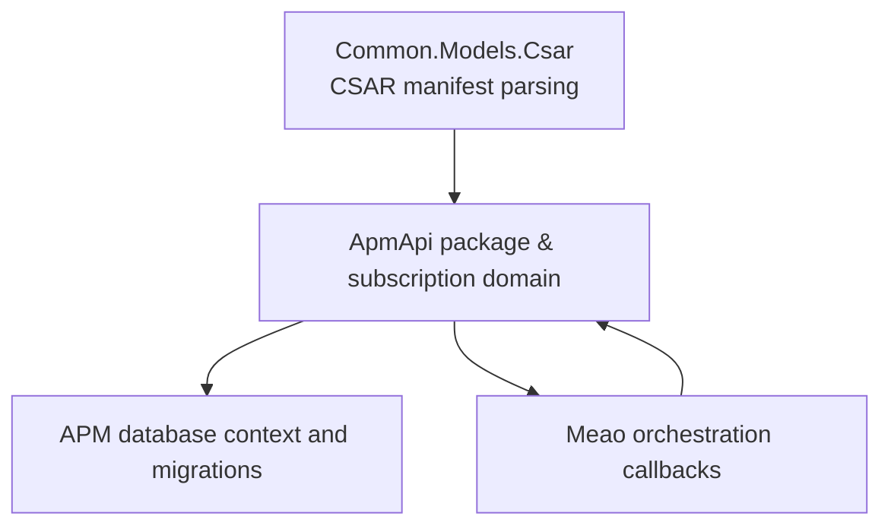
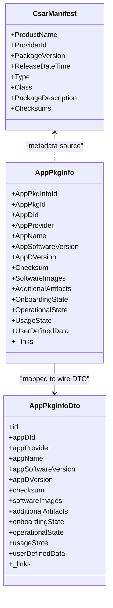
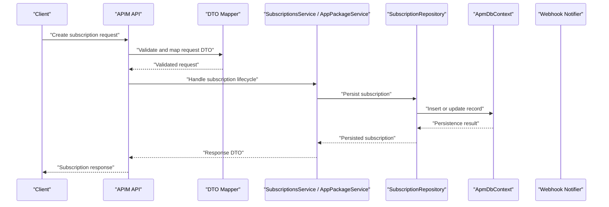
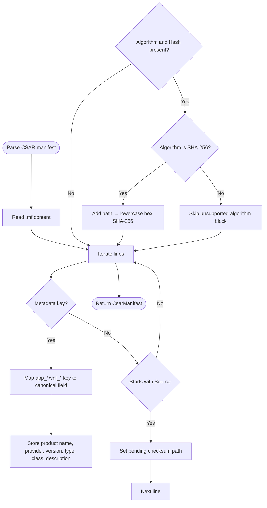
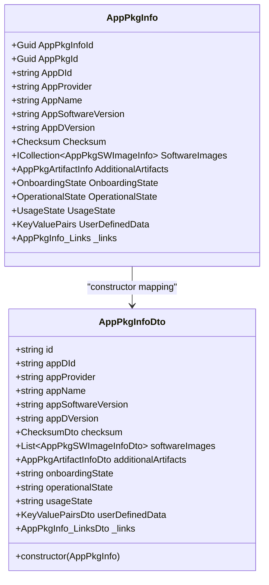
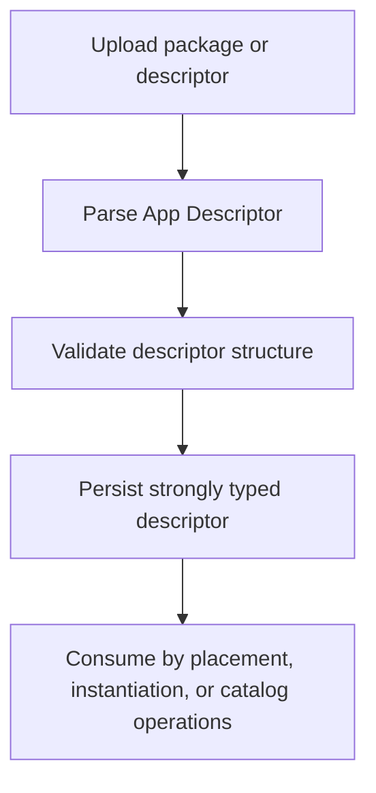
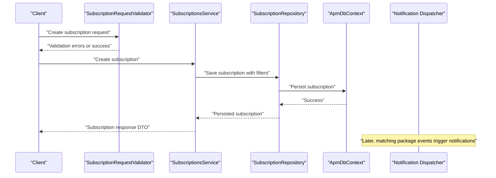
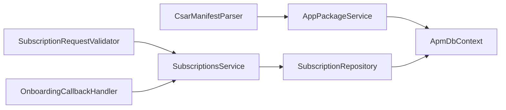

# APM API Domain Models

## Table of Contents
1. [Introduction](#introduction)
2. [Project Structure](#project-structure)
3. [Core Components](#core-components)
4. [Architecture Overview](#architecture-overview)
5. [Detailed Component Analysis](#detailed-component-analysis)
6. [Dependency Analysis](#dependency-analysis)
7. [Performance Considerations](#performance-considerations)
8. [Troubleshooting Guide](#troubleshooting-guide)
9. [Conclusion](#conclusion)

## Introduction
This document explains the APIM API domain models that implement package management and subscription handling. It focuses on:

- The persisted package metadata model represented by `AppPkgInfo` and its related entities.
- CSAR manifest parsing through `CsarManifest` and `CsarManifestParser`.
- App Descriptor (`AppD`) processing via strongly typed descriptors and background deserialization.
- Subscription lifecycle management from request DTOs through persistence, validation, filtering, and notification delivery.
- The mapping between wire contract DTOs and persisted models.
- External registry integration, integrity verification, distribution mechanisms, security considerations, and access control patterns.

The goal is to make these models understandable for both API consumers and maintainers while preserving precise implementation references.

## Project Structure
The relevant code lives primarily in three areas:

| Area | Responsibility | Key files |
|---|---|---|
| Common layer | Shared CSAR parsing logic used by multiple services | `src/Common/Models/CsarManifestParser.cs` |
| APM API service | Package metadata, subscriptions, validators, repositories, migrations, DTOs, and domain models | `src/ApmApi/Models/AppPkgInfo.cs`, `src/ApmApi/Dto/AppPkgInfoDto.cs`, `src/ApmApi/Services/AppDDeserializerService.cs`, `src/ApmApi/Services/PackageValidator.cs`, `src/ApmApi/Services/SubscriptionsService.cs`, `src/ApmApi/Repositories/impl/SubscriptionRepository.cs`, `src/ApmApi/Repositories/ISubscriptionRepository.cs` |
| Orchestration side | Subscription callback handling, validation, and workflow integration | `src/Meao/Validators/SubscriptionRequestValidator.cs`, `src/Meao/Services/OnboardingCallbackHandler.cs` |

**Diagram sources**
- `src/Common/Models/CsarManifestParser.cs#L1-L140`
- `src/ApmApi/Models/AppPkgInfo.cs#L1-L80`
- `src/ApmApi/Services/SubscriptionsService.cs`
- `src/ApmApi/Repositories/impl/SubscriptionRepository.cs`
- `src/Meao/Validators/SubscriptionRequestValidator.cs`
- `src/Meao/Services/OnboardingCallbackHandler.cs`

**Section sources**
- `src/Common/Models/CsarManifestParser.cs#L1-L140`
- `src/ApmApi/Models/AppPkgInfo.cs#L1-L80`

## Core Components
The APIM package and subscription domain has four main pillars:

1. **Persisted package metadata model**: `AppPkgInfo` stores the canonical package identity, descriptor identifiers, checksum, software images, additional artifacts, states, user-defined data, and links.
2. **Wire contract DTOs**: DTOs such as `AppPkgInfoDto`, `AppPkgSubscriptionInfoDto`, `AppPkgSubscriptionDto`, and `AppPkgNotificationDto` represent the external API payloads.
3. **CSAR and AppD processing**: `CsarManifestParser` reads CSAR `.mf` metadata and integrity blocks; `AppDDeserializerService` processes strongly typed App Descriptor structures.
4. **Subscription lifecycle**: Request DTOs are validated, transformed into persisted subscription records, filtered at event time, and delivered through webhook notifications.

**Diagram sources**
- `src/Common/Models/CsarManifestParser.cs#L17-L39`
- `src/ApmApi/Models/AppPkgInfo.cs#L10-L80`
- `src/ApmApi/Dto/AppPkgInfoDto.cs#L1-L46`

**Section sources**
- `src/Common/Models/CsarManifestParser.cs#L1-L140`
- `src/ApmApi/Models/AppPkgInfo.cs#L1-L80`
- `src/ApmApi/Dto/AppPkgInfoDto.cs#L1-L46`

## Architecture Overview
The package and subscription architecture follows a layered pattern:

- **API layer**: Exposes package information, subscription creation, listing, update, and deletion endpoints.
- **DTO layer**: Normalizes incoming requests and outgoing responses to stable wire contracts.
- **Domain model layer**: Persists package metadata and subscriptions with EF Core relationships.
- **Service layer**: Orchestrates validation, transformation, background processing, and notification dispatch.
- **Persistence layer**: Uses `ApmDbContext` and repository abstractions backed by PostgreSQL.
- **Integration layer**: Reads CSAR manifests, validates integrity, integrates with registries, and forwards events to subscribers.

**Diagram sources**
- `src/ApmApi/Services/SubscriptionsService.cs`
- `src/ApmApi/Repositories/impl/SubscriptionRepository.cs`
- `src/ApmApi/Repositories/ISubscriptionRepository.cs`
- `src/ApmApi/Models/ApmDbContext.cs`
- `src/ApmApi/Dto/AppPkgSubscriptionDto.cs`

**Section sources**
- `src/ApmApi/Services/SubscriptionsService.cs`
- `src/ApmApi/Repositories/impl/SubscriptionRepository.cs`
- `src/ApmApi/Models/ApmDbContext.cs`

## Detailed Component Analysis

### CSAR Manifest Parsing and Integrity
`CsarManifest` is the canonical representation of a CSAR top-level manifest. It captures:

- Product name
- Provider identifier
- Package version
- Release date/time
- Type
- Class
- Package description
- File-to-SHA-256 checksum mapping

`CsarManifestParser.ParseFile` throws `FileNotFoundException` when the manifest path does not exist. `Parse` handles:

- Metadata fields under either `app_*` or `vnf_*` key families.
- Indented metadata blocks under a `textmetadata:` header.
- Checksum blocks with `Source`, `Algorithm`, and `Hash` lines.
- Rejection of non-SHA-256 algorithms.
- Case-insensitive matching for keys and values.

**Diagram sources**
- `src/Common/Models/CsarManifestParser.cs#L41-L140`

Security implications:

- Only SHA-256 hashes are accepted during parsing.
- Consumers should compare computed file digests against `CsarManifest.Checksums` before trusting packaged artifacts.
- The parser intentionally ignores unsupported algorithms rather than treating them as valid.

**Section sources**
- `src/Common/Models/CsarManifestParser.cs#L17-L39`
- `src/Common/Models/CsarManifestParser.cs#L41-L140`

### AppPkgInfo Persisted Model
`AppPkgInfo` is the primary persisted entity for package metadata. Its important characteristics are:

| Field | Purpose | Notes |
|---|---|---|
| `AppPkgInfoId` | Primary key | Unique row identifier |
| `AppPkgId` | Package identity | Required |
| `AppDId` | App Descriptor identifier | Required, length-limited |
| `AppProvider` | Provider label | Optional, length-limited |
| `AppName` | Human-readable package name | Required, length-limited |
| `AppSoftwareVersion` | Software version label | Required, length-limited |
| `AppDVersion` | App Descriptor version | Required, length-limited |
| `Checksum` | Integrity reference | One-to-one relationship |
| `SoftwareImages` | Software image list | Collection, marked TODO for one-to-many semantics |
| `AdditionalArtifacts` | Additional artifact metadata | Required one-to-one reference |
| `OnboardingState` | Package onboarding state | Required |
| `OperationalState` | Operational status | Required |
| `UsageState` | Usage status | Optional |
| `UserDefinedData` | Extension data | Required key-value pairs |
| `_links` | HATEOAS-style links | Required link structure |

Validation rules visible in the model include required attributes and string length constraints. The model also documents intended but incomplete relationships, such as changing collections to explicit one-to-many associations.

**Section sources**
- `src/ApmApi/Models/AppPkgInfo.cs#L10-L80`

### Wire Contract DTOs and Transformation Logic
`AppPkgInfoDto` is the wire representation for package information. It maps from `AppPkgInfo` using a constructor that:

- Converts GUIDs to strings.
- Maps descriptor identifiers.
- Wraps `Checksum` into `ChecksumDto`.
- Projects `SoftwareImages` into `AppPkgSWImageInfoDto`.
- Maps `AdditionalArtifacts` into `AppPkgArtifactInfoDto`.
- Converts enum states to strings.
- Maps `UserDefinedData` into `KeyValuePairsDto`.
- Maps `_links` into `AppPkgInfo_LinksDto`.

**Diagram sources**
- `src/ApmApi/Models/AppPkgInfo.cs#L10-L80`
- `src/ApmApi/Dto/AppPkgInfoDto.cs#L1-L46`

**Section sources**
- `src/ApmApi/Dto/AppPkgInfoDto.cs#L1-L46`

### AppD Descriptor Processing
App Descriptor processing is implemented around strongly typed descriptors and background deserialization. Relevant files include:

- `AppDDeserializerService`: Deserializes App Descriptor content into structured objects.
- Migration `20260908112511_StronglyTypedAppDDescriptors`: Adds schema support for strongly typed App Descriptor storage.
- Background workers and queues referenced in the broader APM API background processing area.

The design intent is to separate raw descriptor content from parsed domain structures, allowing validation, transformation, and downstream consumption without exposing internal types directly over the wire.

**Diagram sources**
- `src/ApmApi/Services/AppDDeserializerService.cs`
- `src/ApmApi/Migrations/20260908112511_StronglyTypedAppDDescriptors.cs`

**Section sources**
- `src/ApmApi/Services/AppDDeserializerService.cs`
- `src/ApmApi/Migrations/20260908112511_StronglyTypedAppDDescriptors.cs`

### Subscription Lifecycle Management
Subscription handling spans request DTOs, persisted models, repositories, services, and notifications.

#### Request and Response Contracts
- `AppPkgSubscription`: Represents the subscription request shape.
- `AppPkgSubscriptionInfo`: Represents the persisted subscription entity.
- `AppPkgSubscriptionFilter`: Encodes filter criteria for matching package-related events.
- `AppPkgNotification`: Represents the notification payload sent to subscribers.
- DTOs `AppPkgSubscriptionInfoDto`, `AppPkgSubscriptionDto`, `AppPkgNotificationDto`, and `AppPkgSubscriptionLinkListDto` provide stable wire formats.

#### Persistence Schema
The migration `20260813095316_AddSubscriptionFilters` adds subscription filter columns, indicating that subscriptions can be scoped by filters rather than being global.

#### Processing Flow

**Diagram sources**
- `src/ApmApi/Requests/AppPkgSubscription.cs`
- `src/ApmApi/Models/AppPkgSubscriptionInfo.cs`
- `src/ApmApi/Models/AppPkgSubscriptionFilter.cs`
- `src/ApmApi/Models/AppPkgNotification.cs`
- `src/ApmApi/Dto/AppPkgSubscriptionInfoDto.cs`
- `src/ApmApi/Dto/AppPkgSubscriptionDto.cs`
- `src/ApmApi/Dto/AppPkgNotificationDto.cs`
- `src/ApmApi/Repositories/impl/SubscriptionRepository.cs`
- `src/ApmApi/Services/SubscriptionsService.cs`
- `src/ApmApi/Models/ApmDbContext.cs`

**Section sources**
- `src/ApmApi/Requests/AppPkgSubscription.cs`
- `src/ApmApi/Models/AppPkgSubscriptionInfo.cs`
- `src/ApmApi/Models/AppPkgSubscriptionFilter.cs`
- `src/ApmApi/Models/AppPkgNotification.cs`
- `src/ApmApi/Dto/AppPkgSubscriptionInfoDto.cs`
- `src/ApmApi/Dto/AppPkgSubscriptionDto.cs`
- `src/ApmApi/Dto/AppPkgNotificationDto.cs`
- `src/ApmApi/Migrations/20260813095316_AddSubscriptionFilters.cs`
- `src/ApmApi/Repositories/impl/SubscriptionRepository.cs`
- `src/ApmApi/Services/SubscriptionsService.cs`
- `src/ApmApi/Models/ApmDbContext.cs`

### Relationship Between Wire DTOs and Persisted Models
The mapping strategy is explicit where constructors are defined, for example in `AppPkgInfoDto`. For other models, the general pattern is:

- DTOs use snake_case or kebab-like JSON property names aligned with ETSI-style wire contracts.
- Persisted models use PascalCase properties mapped to database columns.
- Enumerations are serialized as strings in DTOs and stored as typed values in the database.
- Links and metadata are wrapped in dedicated DTO classes.

This separation allows the API surface to evolve independently from internal persistence details.

**Section sources**
- `src/ApmApi/Dto/AppPkgInfoDto.cs#L1-L46`
- `src/ApmApi/Models/AppPkgInfo.cs#L10-L80`

## Dependency Analysis
The following diagram shows how core components depend on each other:

**Diagram sources**
- `src/Common/Models/CsarManifestParser.cs#L1-L140`
- `src/ApmApi/Services/AppPackageService.cs`
- `src/ApmApi/Services/SubscriptionsService.cs`
- `src/ApmApi/Repositories/impl/SubscriptionRepository.cs`
- `src/ApmApi/Models/ApmDbContext.cs`
- `src/Meao/Validators/SubscriptionRequestValidator.cs`
- `src/Meao/Services/OnboardingCallbackHandler.cs`

**Section sources**
- `src/Common/Models/CsarManifestParser.cs#L1-L140`
- `src/ApmApi/Services/AppPackageService.cs`
- `src/ApmApi/Services/SubscriptionsService.cs`
- `src/ApmApi/Repositories/impl/SubscriptionRepository.cs`
- `src/ApmApi/Models/ApmDbContext.cs`
- `src/Meao/Validators/SubscriptionRequestValidator.cs`
- `src/Meao/Services/OnboardingCallbackHandler.cs`

## Performance Considerations
- `CsarManifestParser` uses span-based enumeration to avoid per-line string allocations, which reduces GC pressure when parsing large manifests.
- Checksum lookups use an ordinal case-insensitive dictionary, making file-to-hash resolution efficient.
- Subscription filtering occurs at event time; heavy filtering should be kept narrow using well-chosen filter fields to avoid scanning unrelated packages.
- DTO construction creates intermediate objects; batch operations should minimize repeated mappings.
- Database queries should leverage repository abstractions and avoid loading entire graphs when only lightweight metadata is needed.

[No sources needed since this section provides general guidance]

## Troubleshooting Guide

### CSAR Manifest Issues
Symptoms:
- Missing manifest file error.
- Unexpected empty metadata fields.
- Missing or incorrect checksum entries.

Checks:
- Confirm the `.mf` file exists at the expected path.
- Verify metadata keys use supported `app_*` or `vnf_*` families.
- Ensure checksum blocks specify `SHA-256`.
- Confirm hash values are lowercase hexadecimal.

Relevant behavior:
- `ParseFile` throws `FileNotFoundException` when the path is absent.
- Unsupported algorithms cause the associated checksum block to be skipped.

**Section sources**
- `src/Common/Models/CsarManifestParser.cs#L41-L140`

### Subscription Validation Failures
Symptoms:
- Request rejected before persistence.
- Subscription created but no notifications received.

Checks:
- Validate subscription request payload against `SubscriptionRequestValidator`.
- Confirm callback URL format and prefix hardening rules.
- Review subscription filters to ensure they match expected package events.
- Inspect callback authentication configuration.

**Section sources**
- `src/Meao/Validators/SubscriptionRequestValidator.cs`
- `docs/docs/ADR/0059-etsi-subscription-callback-authentication-and-prefix-hardening.md`

### Package Integrity Verification Failures
Symptoms:
- Package considered untrusted after upload.
- Distribution blocked due to mismatched digests.

Checks:
- Compare downloaded artifact digest against `CsarManifest.Checksums`.
- Ensure only SHA-256 is used.
- Verify that the same CSAR packaging tooling generated both the manifest and artifacts.
- Consult package validation authority and integrity design decisions.

**Section sources**
- `src/Common/Models/CsarManifestParser.cs#L17-L39`
- `src/ApmApi/Services/PackageValidator.cs`
- `docs/docs/ADR/0004-package-validation-authority-and-csar-integrity.md`

## Conclusion
The APIM API domain models for package management and subscription handling are centered on a clear separation between wire contracts, persisted models, and processing services:

- `CsarManifest` and `CsarManifestParser` provide a single authoritative interpretation of CSAR manifests and integrity data.
- `AppPkgInfo` represents the canonical persisted package metadata, with explicit validation and relationships.
- DTOs like `AppPkgInfoDto`, `AppPkgSubscriptionDto`, and `AppPkgNotificationDto` define stable external contracts.
- Subscription lifecycle flows from validated request DTOs through repositories and the database context to webhook notifications.
- Security relies on strict manifest parsing, SHA-256-only integrity checks, callback URL hardening, and controlled access patterns.

For further architectural context, consult the referenced ADRs covering package validation, AppD architecture, registry distribution, and subscription callback authentication.

> **Referenced Files in This Document**
>
> - `src/Common/Models/CsarManifestParser.cs`
> - `src/ApmApi/Models/AppPkgInfo.cs`
> - `src/ApmApi/Dto/AppPkgInfoDto.cs`
> - `src/ApmApi/Models/AppPkgInfoLinks.cs`
> - `src/ApmApi/Requests/AppPkgSubscription.cs`
> - `src/ApmApi/Models/AppPkgSubscriptionInfo.cs`
> - `src/ApmApi/Models/AppPkgSubscriptionFilter.cs`
> - `src/ApmApi/Models/AppPkgNotification.cs`
> - `src/ApmApi/Models/AppPkgSubscriptionLinkList.cs`
> - `src/ApmApi/Dto/AppPkgSubscriptionInfoDto.cs`
> - `src/ApmApi/Dto/AppPkgSubscriptionDto.cs`
> - `src/ApmApi/Dto/AppPkgNotificationDto.cs`
> - `src/ApmApi/Dto/AppPkgSubscriptionLinkListDto.cs`
> - `src/ApmApi/Models/ApmDbContext.cs`
> - `src/ApmApi/Repositories/impl/SubscriptionRepository.cs`
> - `src/ApmApi/Repositories/ISubscriptionRepository.cs`
> - `src/ApmApi/Services/SubscriptionsService.cs`
> - `src/ApmApi/Services/AppPackageService.cs`
> - `src/ApmApi/Services/AppDDeserializerService.cs`
> - `src/ApmApi/Services/PackageValidator.cs`
> - `src/ApmApi/Migrations/20260813095316_AddSubscriptionFilters.cs`
> - `src/ApmApi/Migrations/20260908112511_StronglyTypedAppDDescriptors.cs`
> - `src/Meao/Validators/SubscriptionRequestValidator.cs`
> - `src/Meao/Services/OnboardingCallbackHandler.cs`
> - `docs/docs/ADR/0004-package-validation-authority-and-csar-integrity.md`
> - `docs/docs/ADR/0036-appd-architecture-for-package-onboarding-and-meo-consumption.md`
> - `docs/docs/ADR/0041-oci-zot-oras-csar-distribution.md`
> - `docs/docs/ADR/0059-etsi-subscription-callback-authentication-and-prefix-hardening.md`
