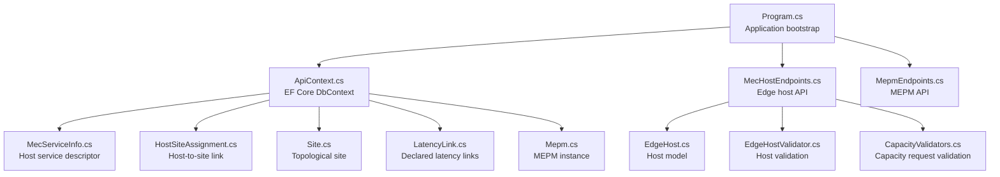
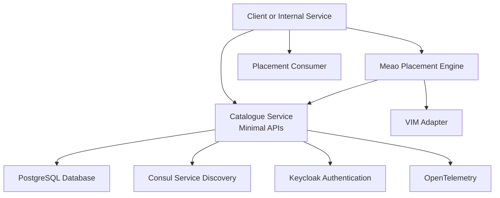
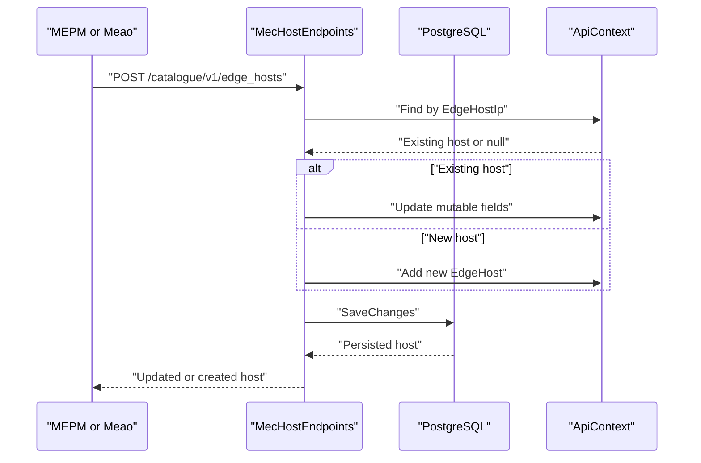
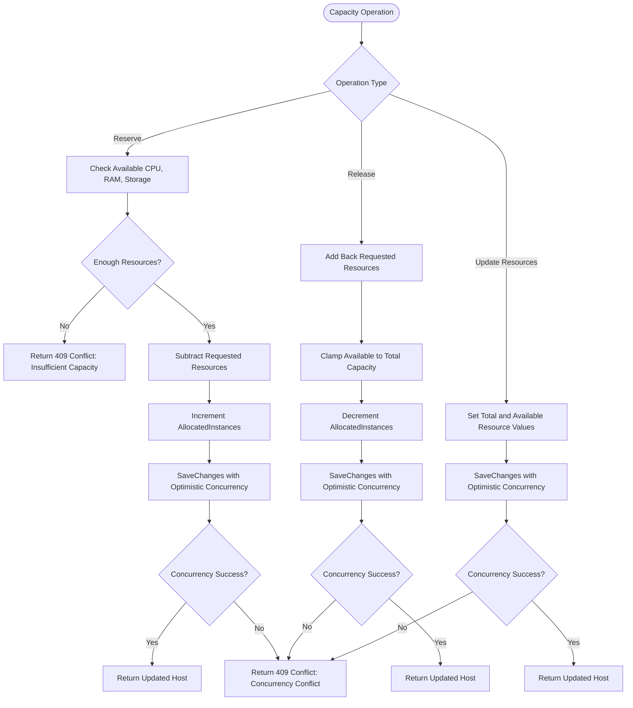
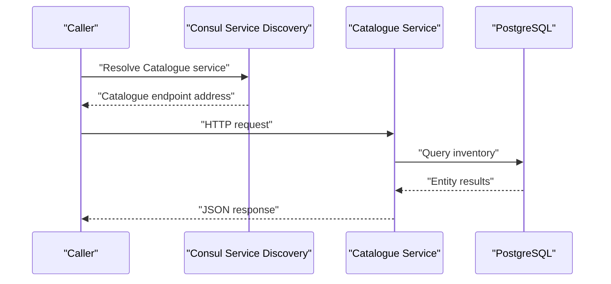
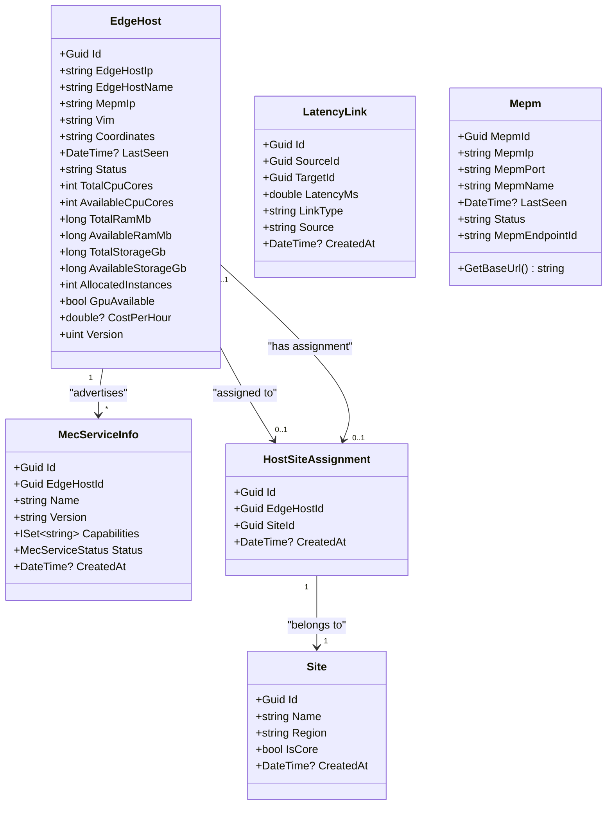

# Catalogue Domain Models

<cite>
**Referenced Files in This Document**
- `src/Catalogue/Program.cs`
- `src/Catalogue/ApiContext.cs`
- `src/Catalogue/Models/EdgeHost.cs`
- `src/Catalogue/Models/MecServiceInfo.cs`
- `src/Catalogue/Models/HostSiteAssignment.cs`
- `src/Catalogue/Models/Site.cs`
- `src/Catalogue/Models/LatencyLink.cs`
- `src/Catalogue/Models/Mepm.cs`
- `src/Catalogue/Endpoints/MecHostEndpoints.cs`
- `src/Catalogue/Endpoints/MepmEndpoints.cs`
- `src/Catalogue/Validators/EdgeHostValidator.cs`
- `src/Catalogue/Validators/CapacityValidators.cs`
</cite>

## Table of Contents
1. [Introduction](#introduction)
2. [Project Structure](#project-structure)
3. [Core Components](#core-components)
4. [Architecture Overview](#architecture-overview)
5. [Detailed Component Analysis](#detailed-component-analysis)
6. [Dependency Analysis](#dependency-analysis)
7. [Performance Considerations](#performance-considerations)
8. [Troubleshooting Guide](#troubleshooting-guide)
9. [Conclusion](#conclusion)

## Introduction
This document explains the Catalogue service domain models that underpin MEC inventory management and capacity tracking. It focuses on:

- **EdgeHost**, the primary host entity representing a MEC edge compute node, including CPU, RAM, storage headroom, operational status, site assignment, services, and latency enrichment.
- **MecServiceInfo**, the per-host service registry record used for placement filtering against application dependencies.
- **Mepm**, the MEPM (MEC Platform Manager) instance model used by MEPM registration and liveness tracking.
- **AppInstance** and **AppPackage**, which together distinguish deployed-instance census from package inventory.
- Capacity calculation and reconciliation patterns exposed through the `/catalogue/v1/edge_hosts` endpoints.
- Service discovery integration with Consul.
- Scalability and consistency considerations for large MEC deployments.

The term “Catalogue” here refers to the internal MEO inventory and census boundary; it is not a generic public catalog but a strongly typed, PostgreSQL-backed inventory service that other components such as Meao query during placement and lifecycle operations.

## Project Structure
The relevant Catalogue code is organized around ASP.NET Core minimal APIs backed by EF Core and PostgreSQL:

| Area | Responsibility |
|---|---|
| `Program.cs` | Application bootstrap, database setup, health checks, authentication, service discovery, endpoint registration |
| `ApiContext.cs` | EF Core DbContext, entity configuration, unique constraints, optimistic concurrency mapping |
| `Models/` | Domain entities: EdgeHost, MecServiceInfo, HostSiteAssignment, Site, LatencyLink, Mepm, plus AppInstance and AppPackage |
| `Endpoints/` | HTTP routes for edge hosts, MEPMs, topology, app instances, and app packages |
| `Validators/` | FluentValidation rules for host, capacity request, and topology payloads |

**Diagram sources**
- `src/Catalogue/Program.cs#L1-L135`
- `src/Catalogue/ApiContext.cs#L1-L109`
- `src/Catalogue/Models/EdgeHost.cs#L1-L57`
- `src/Catalogue/Models/MecServiceInfo.cs#L1-L68`
- `src/Catalogue/Models/HostSiteAssignment.cs#L1-L21`
- `src/Catalogue/Models/Site.cs#L1-L27`
- `src/Catalogue/Models/LatencyLink.cs#L1-L44`
- `src/Catalogue/Models/Mepm.cs#L1-L51`
- `src/Catalogue/Endpoints/MecHostEndpoints.cs#L1-L200`
- `src/Catalogue/Endpoints/MepmEndpoints.cs#L1-L91`
- `src/Catalogue/Validators/EdgeHostValidator.cs#L1-L51`
- `src/Catalogue/Validators/CapacityValidators.cs#L1-L67`

**Section sources**
- `src/Catalogue/Program.cs#L1-L135`
- `src/Catalogue/ApiContext.cs#L1-L109`

## Core Components
This section describes the key domain models and their roles in inventory and capacity tracking.

### EdgeHost: MEC Host Inventory and Capacity Headroom
EdgeHost is the central host entity. It stores:

- Identity and network identity: `Id`, `EdgeHostIp`, `EdgeHostName`.
- MEPM relationship: `MepmIp`.
- VIM context: `Vim`.
- Topology and policy data: `Coordinates`, `GpuAvailable`, `CostPerHour`.
- Liveness and state: `LastSeen`, `Status`.
- Capacity headroom: `TotalCpuCores`, `AvailableCpuCores`, `TotalRamMb`, `AvailableRamMb`, `TotalStorageGb`, `AvailableStorageGb`, `AllocatedInstances`.
- Service census: collection of `MecServiceInfo`.
- Site assignment: optional `HostSiteAssignment`.
- Endpoint-computed projections: `LatencyToCoreMs`, `SiteId`.
- Optimistic concurrency token: `Version`, mapped to PostgreSQL `xmin`.

Complexity characteristics:

- Capacity fields are integers or 64-bit integers, giving O(1) arithmetic updates.
- Service collections grow with registered services per host; queries include them eagerly when needed.
- Site assignment and latency enrichment are performed after fetching hosts.

Implementation notes:

- The POST handler performs an upsert by IP: if a row exists, it updates mutable fields; otherwise it inserts and returns created.
- Validation ensures non-negative totals and that available values do not exceed total values.
- Capacity reservation and release use optimistic concurrency to prevent lost updates.

**Section sources**
- `src/Catalogue/Models/EdgeHost.cs#L1-L57`
- `src/Catalogue/Endpoints/MecHostEndpoints.cs#L1-L200`
- `src/Catalogue/Validators/EdgeHostValidator.cs#L1-L51`

### MecServiceInfo: Per-Host Service Registry Descriptor
MecServiceInfo represents a service advertised by a specific EdgeHost. Its important fields are:

- `Id`: row identifier.
- `EdgeHostId`: foreign key to EdgeHost.
- `Name`: ETSI-style service name, used for hard placement filtering.
- `Version`: informational version tag.
- `Capabilities`: host-side capability tags.
- `Status`: Available, Unavailable, Deprecated.
- `CreatedAt`: creation timestamp.

Relationships:

- One-to-many from EdgeHost: each host can advertise multiple services.
- Unique constraint on `(EdgeHostId, Name)` prevents duplicate service declarations per host.
- Status is serialized as a JSON string enum; Unavailable services are treated as absent during placement hard filtering.

Complexity:

- Lookup by host is O(n) over the host’s service list.
- Placement filtering compares service names and statuses against application dependency requirements.

**Section sources**
- `src/Catalogue/Models/MecServiceInfo.cs#L1-L68`
- `src/Catalogue/ApiContext.cs#L40-L72`

### HostSiteAssignment and Site: Host-to-Site Topology
These two models form the topological grouping layer:

- `Site` identifies a geographical or topological site, optionally marked as core.
- `HostSiteAssignment` associates one EdgeHost with one Site.
- The relationship is one-to-one between EdgeHost and HostSiteAssignment, and many-to-one from assignment to Site.

Design decisions:

- Site assignment is optional because not every host needs a site.
- Deleting a host restricts cascade behavior for assignments, protecting orphaned site records.
- These models support tenant site affinity policies and latency-based routing.

**Section sources**
- `src/Catalogue/Models/Site.cs#L1-L27`
- `src/Catalogue/Models/HostSiteAssignment.cs#L1-L21`
- `src/Catalogue/ApiContext.cs#L74-L92`

### LatencyLink: Declared Latency Graph
LatencyLink stores declared latency relationships between topological entities:

- `SourceId` and `TargetId`: bare GUID references without EF navigation foreign keys.
- `LatencyMs`: one-way latency in milliseconds.
- `LinkType`: either `host-site` or `site-core`.
- `Source`: provenance metadata, currently reserved for declared versus measured values.
- Composite index on `(SourceId, TargetId, LinkType)`.

Purpose:

- Enables endpoint enrichment to compute `LatencyToCoreMs` for hosts whose site has a path to a core site.
- Avoids cyclic cascade paths in PostgreSQL by using bare GUIDs instead of fully navigated foreign keys.

**Section sources**
- `src/Catalogue/Models/LatencyLink.cs#L1-L44`
- `src/Catalogue/ApiContext.cs#L94-L109`
- `src/Catalogue/Endpoints/MecHostEndpoints.cs#L201-L385`

### Mepm: MEPM Instance Model
Mepm represents a MEPM instance and provides:

- Identification: `MepmId`, `MepmIp`, `MepmPort`, `MepmName`.
- Liveness: `LastSeen`, `Status`.
- Routing: `MepmEndpointId`, supporting explicit HTTP(S) base URLs or IP/port combinations.
- Helper method `GetBaseUrl()` for resolving normalized base URLs.

Usage:

- MEPM registers itself via the MEPM endpoints.
- Other services, such as Meao, can resolve the correct MEPM endpoint for a given host.

**Section sources**
- `src/Catalogue/Models/Mepm.cs#L1-L51`
- `src/Catalogue/Endpoints/MepmEndpoints.cs#L1-L91`

### AppInstance and AppPackage: Census vs Package Inventory
Although this document focuses on host inventory, these models clarify the distinction between deployment census and package inventory:

- `AppInstance`: represents a deployed application instance; part of the MEO census read API.
- `AppPackage`: represents the authoritative package inventory, including onboarding and operational states, with optimistic concurrency.

The comment in ApiContext explicitly separates the deployed-instance census from the unified package inventory introduced in Phase 48.

**Section sources**
- `src/Catalogue/ApiContext.cs#L17-L39`

## Architecture Overview
The Catalogue service acts as the MEO internal inventory and census boundary. It uses:

- ASP.NET Core minimal APIs for HTTP endpoints.
- EF Core with Npgsql for PostgreSQL persistence.
- FluentValidation for input validation.
- Steeltoe Consul service discovery.
- Keycloak for authentication and authorization.
- OpenTelemetry telemetry.

**Diagram sources**
- `src/Catalogue/Program.cs#L1-L135`

**Section sources**
- `src/Catalogue/Program.cs#L1-L135`

## Detailed Component Analysis

### Host Registration and Uplink Synchronization
Host registration flows through the EdgeHost endpoints. There are two principal synchronization patterns:

1. **MEPM-driven heartbeat**: MEPM or upstream systems update host metadata, last seen time, status, and resource telemetry through PUT and POST handlers.
2. **Placement-driven capacity changes**: Meao reserves and releases capacity through dedicated reserve/release endpoints.

**Diagram sources**
- `src/Catalogue/Endpoints/MecHostEndpoints.cs#L1-L200`
- `src/Catalogue/ApiContext.cs#L14-L30`

Key behaviors:

- Upsert semantics ensure idempotent host registration by IP.
- Missing fields in updates are preserved rather than cleared.
- `LastSeen` is updated on registration or update.
- Default status is set to ONLINE when creating or updating via registration.

**Section sources**
- `src/Catalogue/Endpoints/MecHostEndpoints.cs#L1-L200`

### Capacity Calculation Algorithm
Capacity calculation is implemented as a headroom model rather than a separate Capacity entity. The algorithm is:

- Total capacity represents physical or provisioned resources.
- Available capacity represents remaining headroom.
- Allocated instances counts how many placement reservations have been made.
- Reservation subtracts requested CPU, RAM, and storage from available capacity and increments allocated instances.
- Release adds resources back, clamping to total capacity and ensuring allocated instances does not go below zero.
- Concurrent writes are protected by optimistic concurrency via the `Version` field.

**Diagram sources**
- `src/Catalogue/Endpoints/MecHostEndpoints.cs#L201-L385`
- `src/Catalogue/Models/EdgeHost.cs#L21-L57`
- `src/Catalogue/ApiContext.cs#L32-L42`

Validation rules ensure:

- Requested resources for reserve/release are positive where required.
- Available resources never exceed total resources.
- All capacity fields are non-negative.

**Section sources**
- `src/Catalogue/Validators/CapacityValidators.cs#L1-L67`
- `src/Catalogue/Validators/EdgeHostValidator.cs#L1-L51`
- `src/Catalogue/Endpoints/MecHostEndpoints.cs#L201-L385`

### Service Discovery Integration Patterns
Catalogue integrates with Consul through Steeltoe:

- Service discovery is configured with `UseConsul()`.
- HTTP client resilience is added via standard resilience handlers.
- Tests disable Consul registration and discovery to isolate integration tests.

Integration points:

- Consul is used for service registration and discovery at the infrastructure level.
- The Catalogue service itself does not expose a separate service mesh adapter; instead, it participates in the existing Consul-based discovery stack.
- Consumers can rely on standard HttpClient resilience while calling Catalogue endpoints.

**Diagram sources**
- `src/Catalogue/Program.cs#L31-L39`

**Section sources**
- `src/Catalogue/Program.cs#L31-L39`

### Relationship with VIM Adapters
The Catalogue domain models store VIM type information on EdgeHost through the `Vim` property. This is a declarative inventory field rather than a live control plane connection to VIM adapters.

Implications:

- Catalogue knows which VIM a host belongs to.
- Placement engines can filter candidates by VIM type.
- Actual VIM provisioning and orchestration are handled by Meao and VIM adapters outside the Catalogue domain.

Real-time aspects:

- VIM telemetry may influence resource updates, but those updates arrive through Catalogue endpoints as resource telemetry rather than direct VIM adapter calls.
- Data freshness is indicated by `LastSeen` and `Status`.

**Section sources**
- `src/Catalogue/Models/EdgeHost.cs#L13-L28`
- `src/Catalogue/Endpoints/MecHostEndpoints.cs#L1-L200`

### Relationship with Service Mesh Integration
The repository shows Consul service discovery integration for the Catalogue service itself. There is no direct service mesh adapter implementation inside the Catalogue models. Service mesh concerns are more likely handled by gateway and routing layers above Catalogue.

Relevant observations:

- Steeltoe Consul discovery is enabled.
- Tests configure Consul discovery flags to disabled during local integration testing.
- No mesh-specific model appears in the Catalogue domain files reviewed.

**Section sources**
- `src/Catalogue/Program.cs#L31-L39`

### Real-Time Updates
Real-time inventory updates flow through three main mechanisms:

1. **Host registration/update**: POST and PUT endpoints update host metadata and resource telemetry.
2. **Capacity reservation/release**: Dedicated endpoints adjust available headroom atomically.
3. **Resource telemetry updates**: PUT `/resources` allows providers or orchestrators to refresh total and available capacities.

Liveness signals:

- `LastSeen` is updated on registration and updates.
- `Status` reflects operational state.
- Health check endpoints expose readiness based on database connectivity.

**Section sources**
- `src/Catalogue/Endpoints/MecHostEndpoints.cs#L1-L385`
- `src/Catalogue/Program.cs#L56-L73`

### Concrete Examples

#### Host Registration Example
A caller registers or updates a host by sending a POST request to `/catalogue/v1/edge_hosts` with an EdgeHost payload containing IP, hostname, MEPM IP, VIM type, coordinates, GPU availability, cost, and capacity fields. If the IP already exists, the handler updates mutable fields and returns the updated host; otherwise it creates the host and returns 201 Created.

Expected response fields include:

- Host identity and network fields.
- Capacity headroom values.
- Services collection.
- Site assignment.
- Computed `LatencyToCoreMs` and `SiteId` after enrichment.

**Section sources**
- `src/Catalogue/Endpoints/MecHostEndpoints.cs#L1-L200`

#### Capacity Reservation Example
A caller reserves resources by sending a POST request to `/catalogue/v1/edge_hosts/{ip}/reserve` with CPU cores, RAM, storage, and application instance ID. The endpoint:

- Finds the host by IP.
- Validates sufficient available headroom.
- Subtracts requested resources.
- Increments allocated instances.
- Persists with optimistic concurrency.
- Returns 409 Conflict if capacity is insufficient or concurrency fails.

**Section sources**
- `src/Catalogue/Endpoints/MecHostEndpoints.cs#L201-L385`
- `src/Catalogue/Validators/CapacityValidators.cs#L1-L67`

#### Capacity Release Example
A caller releases resources by sending a POST request to `/catalogue/v1/edge_hosts/{ip}/release`. The endpoint:

- Adds back requested resources.
- Clamps available values to total values.
- Decrements allocated instances.
- Handles optimistic concurrency conflicts.

**Section sources**
- `src/Catalogue/Endpoints/MecHostEndpoints.cs#L201-L385`

#### Inventory Query Example
A caller lists hosts by GET `/catalogue/v1/edge_hosts`. The endpoint:

- Includes services and site assignment.
- Applies pagination with offset and limit.
- Enriches hosts with latency-to-core values.
- Returns hosts ordered by IP.

**Section sources**
- `src/Catalogue/Endpoints/MecHostEndpoints.cs#L1-L60`
- `src/Catalogue/Endpoints/MecHostEndpoints.cs#L201-L385`

## Dependency Analysis
The following diagram maps the most important domain relationships.

**Diagram sources**
- `src/Catalogue/Models/EdgeHost.cs#L1-L57`
- `src/Catalogue/Models/MecServiceInfo.cs#L1-L68`
- `src/Catalogue/Models/HostSiteAssignment.cs#L1-L21`
- `src/Catalogue/Models/Site.cs#L1-L27`
- `src/Catalogue/Models/LatencyLink.cs#L1-L44`
- `src/Catalogue/Models/Mepm.cs#L1-L51`

Additional persistence relationships:

- Unique index on `EdgeHost.EdgeHostIp`.
- Row-version optimistic concurrency on `EdgeHost.Version`.
- Unique constraint on `(MecServiceInfo.EdgeHostId, MecServiceInfo.Name)`.
- Cascade delete for MecServiceInfo from EdgeHost.
- Restrict cascade for HostSiteAssignment deletion.
- Composite index on LatencyLink `(SourceId, TargetId, LinkType)`.

**Section sources**
- `src/Catalogue/ApiContext.cs#L14-L109`

## Performance Considerations
For large MEC deployments, the current design has several performance-relevant characteristics:

- **Pagination**: Host listing supports offset and limit, with a maximum limit of 1000. This reduces payload size and query scope.
- **Eager loading**: Host queries include services and site assignment to avoid N+1 queries during enrichment.
- **AsNoTracking**: Read endpoints use `AsNoTracking`, improving read performance since entities are not tracked for changes.
- **Optimistic concurrency**: PostgreSQL `xmin` avoids expensive row locks for concurrent capacity updates.
- **Indexing**: Unique indexes and composite indexes reduce lookup cost for host IP, service uniqueness, and latency links.
- **Enrichment batching**: Latency enrichment batches source IDs and queries links once per batch.

Potential bottlenecks:

- Large numbers of hosts with many services per host increase JSON serialization and memory usage.
- Frequent capacity updates may cause optimistic concurrency retries under high contention.
- Latency enrichment requires additional queries proportional to the number of hosts returned.

Recommendations:

- Consider server-side cursors or cursor-based pagination for very large inventories.
- Cache stable topology data such as sites and latency links separately from volatile capacity fields.
- Separate write-heavy capacity updates from read-heavy enumeration endpoints if contention becomes problematic.
- Monitor PostgreSQL `xmin` conflict rates and tune retry strategies for callers.

[No sources needed since this section provides general guidance]

## Troubleshooting Guide

### Host Not Found
**Symptoms**: 404 responses when querying, updating, reserving, releasing, or deleting a host.

**Likely causes**:

- Host was never registered.
- Incorrect IP used in URL.
- Host was deleted.

**Actions**:

- Verify host registration via GET `/catalogue/v1/edge_hosts`.
- Confirm the IP matches `EdgeHostIp`.
- Check deletion history if applicable.

**Section sources**
- `src/Catalogue/Endpoints/MecHostEndpoints.cs#L1-L200`

### Insufficient Capacity
**Symptoms**: 409 Conflict with message indicating insufficient CPU, RAM, or storage.

**Likely causes**:

- Available headroom is less than requested.
- Previous reservations consumed capacity without corresponding releases.
- Telemetry updates did not reflect actual resource state.

**Actions**:

- Review current host capacity via GET.
- Release unused capacity if appropriate.
- Refresh resource telemetry via PUT `/resources`.
- Check for concurrent modification conflicts.

**Section sources**
- `src/Catalogue/Endpoints/MecHostEndpoints.cs#L201-L385`
- `src/Catalogue/Validators/CapacityValidators.cs#L1-L67`

### Concurrency Conflict
**Symptoms**: 409 Conflict with title “Concurrency Conflict”.

**Likely causes**:

- Multiple callers update the same host concurrently.
- Stale retry attempts overwrite newer state.

**Mechanism**:

- `EdgeHost.Version` is mapped to PostgreSQL `xmin`.
- Conflicts are caught as `DbUpdateConcurrencyException`.

**Actions**:

- Implement exponential backoff and retry with fresh host state.
- Avoid long-lived cached host objects across capacity operations.
- Reduce concurrent writers where possible.

**Section sources**
- `src/Catalogue/ApiContext.cs#L32-L42`
- `src/Catalogue/Endpoints/MecHostEndpoints.cs#L201-L385`

### Invalid Host Payload
**Symptoms**: Validation errors for IP, hostname, MEPM IP, VIM, or capacity fields.

**Likely causes**:

- Malformed IP address.
- Empty required fields.
- Available capacity exceeds total capacity.
- Negative resource values.

**Actions**:

- Validate inputs before sending requests.
- Ensure capacity updates maintain valid headroom invariants.

**Section sources**
- `src/Catalogue/Validators/EdgeHostValidator.cs#L1-L51`

### Service Discovery Issues
**Symptoms**: Clients cannot resolve Catalogue through Consul.

**Likely causes**:

- Consul is unavailable or misconfigured.
- Service registration disabled in test environments.

**Actions**:

- Verify Consul configuration and availability.
- Check whether tests intentionally disable discovery.
- Use direct HTTP access for debugging.

**Section sources**
- `src/Catalogue/Program.cs#L31-L39`

## Conclusion
The Catalogue domain models provide a focused inventory boundary for MEC hosts, services, topology, and capacity headroom. EdgeHost is the central entity, enriched by service descriptors, site assignments, and latency links. Capacity tracking uses a headroom model with optimistic concurrency, making it suitable for placement-driven reservation workflows.

Important boundaries to keep in mind:

- Catalogue owns inventory and census state, not VIM orchestration.
- Service discovery is infrastructure-level Consul integration, not a service mesh adapter inside the domain.
- Real-time updates arrive through HTTP endpoints rather than direct streaming from VIM adapters.
- Consistency relies on optimistic concurrency and careful caller retry logic.

For large MEC deployments, scaling should consider pagination, caching of stable topology, separation of volatile capacity updates, and monitoring of optimistic concurrency conflicts. The current design balances simplicity, strong typing, and practical constraints while leaving room for future placement policy and topology extensions.