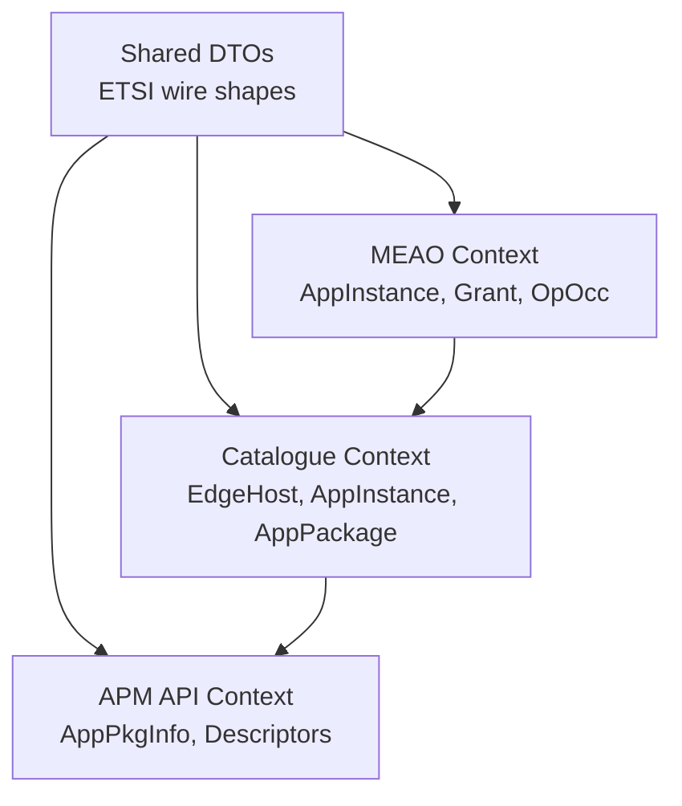
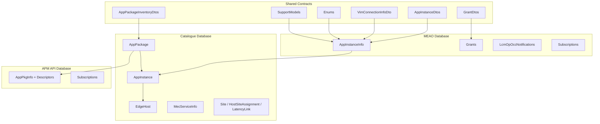
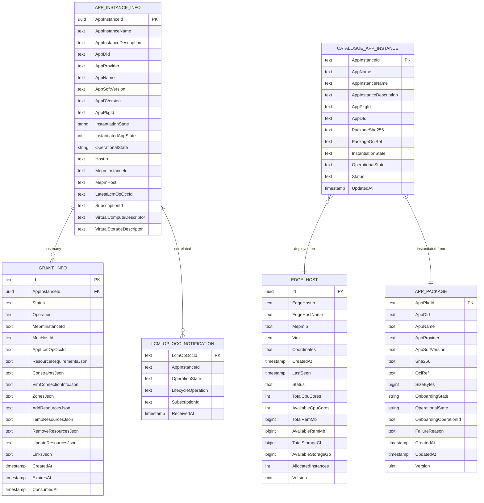
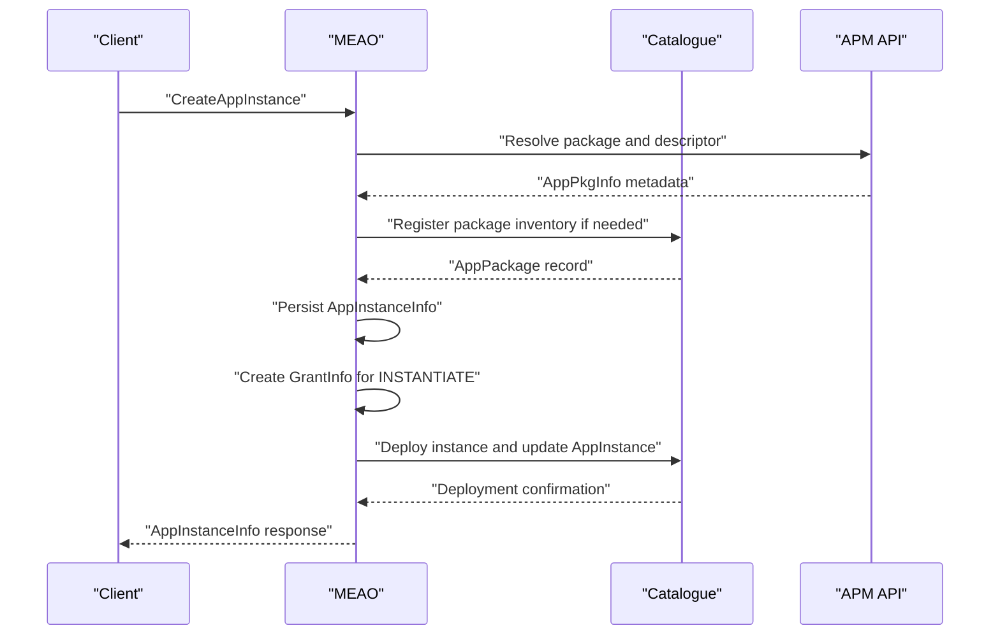
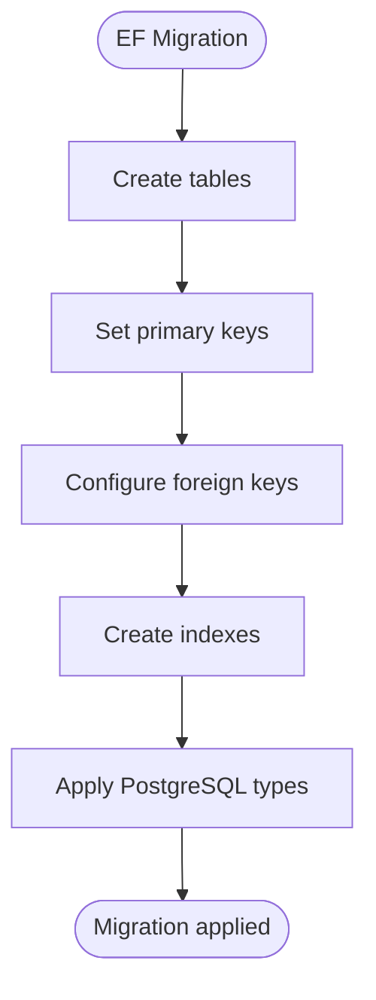
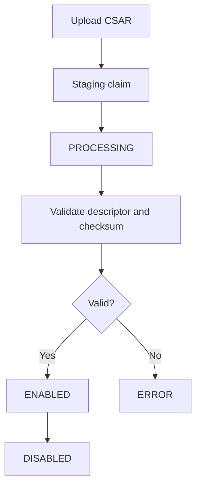
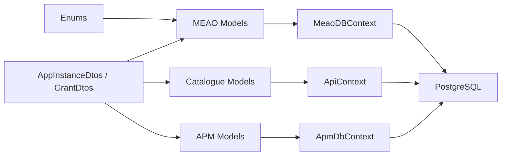

# Data Models

<cite>
**Referenced Files in This Document**
- `src/Meao/Models/AppInstanceInfo.cs`
- `src/Meao/Models/GrantInfo.cs`
- `src/Meao/Models/LcmOpOccNotificationRecord.cs`
- `src/Meao/Data/MeaoDBContext.cs`
- `src/Meao/Migrations/20260819104304_PostgresInitial.cs`
- `src/Common/Models/AppInstanceDtos.cs`
- `src/Common/Models/GrantDtos.cs`
- `src/Common/Models/VimConnectionInfoDto.cs`
- `src/Common/Models/Enums.cs`
- `src/Common/Models/SupportModels.cs`
- `src/Common/Models/AppPackageInventoryDtos.cs`
- `src/Common/Models/OnboardAppPkgRequest.cs`
- `src/Catalogue/Models/AppInstance.cs`
- `src/Catalogue/Models/AppPackage.cs`
- `src/Catalogue/Models/EdgeHost.cs`
- `src/Catalogue/ApiContext.cs`
- `src/Catalogue/Migrations/20260728121602_PostgresInitial.cs`
- `src/ApmApi/Models/ApmDbContext.cs`
</cite>

## Table of Contents
1. [Introduction](#introduction)
2. [Project Structure](#project-structure)
3. [Core Components](#core-components)
4. [Architecture Overview](#architecture-overview)
5. [Detailed Component Analysis](#detailed-component-analysis)
6. [Dependency Analysis](#dependency-analysis)
7. [Performance Considerations](#performance-considerations)
8. [Troubleshooting Guide](#troubleshooting-guide)
9. [Conclusion](#conclusion)

## Introduction
This document describes the shared domain data model for the Optimist orchestrator, focusing on core entities that span multiple bounded contexts: `AppInstance`, `EdgeHost`, `AppPackage`, `Grant`, and lifecycle operation occurrence records (`OpOcc`-related). It explains entity relationships, field definitions, validation rules, database schema design with Entity Framework Core, migration strategy, consistency patterns across services, event sourcing considerations, lifecycle management, security-sensitive fields, audit trails, and retention guidance.

The codebase uses a modular monolith approach where each service owns its own PostgreSQL database and EF Core context. Shared wire contracts live under `Common.Models`, while service-specific persistence models live under `Meao`, `Catalogue`, and `ApmApi`.

## Project Structure
The relevant data-model locations are:

| Layer | Responsibility | Key files |
|---|---|---|
| Shared DTOs | ETSI-aligned wire shapes, enums, HATEOAS links, VIM connection shape | `AppInstanceDtos.cs`, `GrantDtos.cs`, `VimConnectionInfoDto.cs`, `Enums.cs`, `SupportModels.cs`, `AppPackageInventoryDtos.cs`, `OnboardAppPkgRequest.cs` |
| MEAO persistence | Application instance state, grants, LCM operation occurrence notifications, subscriptions | `AppInstanceInfo.cs`, `GrantInfo.cs`, `LcmOpOccNotificationRecord.cs`, `MeaoDBContext.cs`, MeAO migrations |
| Catalogue persistence | Edge hosts, deployed app instances, package inventory, topology | `EdgeHost.cs`, `AppInstance.cs`, `AppPackage.cs`, `ApiContext.cs`, Catalogue migrations |
| APM API persistence | Package registry descriptors, artifacts, subscriptions, and related metadata | `ApmDbContext.cs`, APM migrations |

**Diagram sources**
- `src/Common/Models/AppInstanceDtos.cs#L1-L189`
- `src/Common/Models/GrantDtos.cs#L1-L314`
- `src/Meao/Models/AppInstanceInfo.cs#L1-L48`
- `src/Catalogue/Models/AppInstance.cs#L1-L56`
- `src/Catalogue/Models/AppPackage.cs#L1-L58`
- `src/Catalogue/Models/EdgeHost.cs#L1-L57`
- `src/ApmApi/Models/ApmDbContext.cs#L1-L200`

**Section sources**
- `src/Common/Models/AppInstanceDtos.cs#L1-L189`
- `src/Meao/Models/AppInstanceInfo.cs#L1-L48`
- `src/Catalogue/Models/AppPackage.cs#L1-L58`
- `src/Catalogue/Models/EdgeHost.cs#L1-L57`
- `src/ApmApi/Models/ApmDbContext.cs#L1-L200`

## Core Components
This section documents the primary domain entities referenced by the objective.

### AppInstance
There are two distinct `AppInstance` concepts:

| Context | Entity | Purpose | Primary key | Important fields |
|---|---|---|---|---|
| MEAO | `AppInstanceInfo` | Operational orchestration record for an application instance | `Guid AppInstanceId` | `AppDId`, `AppProvider`, `AppName`, `AppSoftVersion`, `AppDVersion`, `AppPkgId`, `InstantiationState`, `InstantiatedAppState`, `OperationalState`, `HostIp`, `MepmInstanceId`, `LatestLcmOpOccId`, JSON descriptors |
| Catalogue | `AppInstance` | Deployed-instance census record owned by the catalogue | `string AppInstanceId` | `AppName`, `AppInstanceName`, `AppInstanceDescription`, `AppPkgId`, `AppDId`, `PackageSha256`, `PackageOciRef`, host reference, mirrored states, `UpdatedAt` |

Key behaviors:
- MEAO’s `AppInstanceInfo` tracks orchestration state, grants, VIM connections, and JSON resource requirements.
- Catalogue’s `AppInstance` is a read/census model derived from deployment; it captures immutable snapshots of the package digest and OCI reference at instantiation time.

Validation and constraints:
- Wire-level required fields for ETSI `AppInstanceInfo` are documented via JSON property attributes and comments.
- Persistence uses EF Core annotations such as `[Key]`; additional validation is applied through request validators elsewhere.

**Section sources**
- `src/Meao/Models/AppInstanceInfo.cs#L1-L48`
- `src/Catalogue/Models/AppInstance.cs#L1-L56`
- `src/Common/Models/AppInstanceDtos.cs#L1-L189`

### EdgeHost
`EdgeHost` represents a MEC edge compute node and is the Catalogue’s authority on placement targets.

Important fields:
- Identity and network identity: `Id`, `EdgeHostIp`, `EdgeHostName`, `MepmIp`.
- Capability and operational telemetry: `Vim`, `Coordinates`, `CreatedAt`, `LastSeen`, `Status`.
- Capacity headroom: `TotalCpuCores`, `AvailableCpuCores`, `TotalRamMb`, `AvailableRamMb`, `TotalStorageGb`, `AvailableStorageGb`, `AllocatedInstances`.
- Topology and policy tags: `Services`, `SiteAssignment`, `GpuAvailable`, `CostPerHour`.
- Optimistic concurrency: `Version` mapped to PostgreSQL `xmin`.

Constraints:
- Unique index on `EdgeHostIp` prevents duplicate hosts.
- Version column provides row-version semantics for concurrent placement allocation updates.

**Section sources**
- `src/Catalogue/Models/EdgeHost.cs#L1-L57`
- `src/Catalogue/ApiContext.cs#L1-L109`
- `src/Catalogue/Migrations/20260728121602_PostgresInitial.cs#L1-L101`

### AppPackage
`AppPackage` is the Catalogue’s authoritative package-inventory record created by the onboarding saga. It is distinct from `AppInstance`, which is created at runtime when an instance is deployed.

Important fields:
- Identity: `AppPkgId`, `AppDId`.
- Descriptor metadata: `AppName`, `AppProvider`, `AppSoftVersion`.
- Artifact identity: `Sha256`, optional `OciRef`.
- Lifecycle: `OnboardingState`, `OperationalState`, `OnboardingOperationId`, `FailureReason`.
- Audit and concurrency: `CreatedAt`, `UpdatedAt`, `Version` (row version).

Business constraints:
- Ownership is tied to `OnboardingOperationId` so retries and compensation remain safe.
- States mirror APM API vocabulary to avoid parallel dialects.
- Indexes support lookup by `OnboardingOperationId` and `AppDId`.

**Section sources**
- `src/Catalogue/Models/AppPackage.cs#L1-L58`
- `src/Common/Models/AppPackageInventoryDtos.cs#L1-L75`
- `src/Catalogue/ApiContext.cs#L1-L109`

### Grant and GrantInfo
`GrantDto` is the ETSI-aligned wire representation used across services. `GrantInfo` is the MEAO persistence model for granted resources.

Wire contract highlights:
- `GrantRequestDto` validates `operation` as one of `INSTANTIATE`, `OPERATE`, or `TERMINATE`.
- `INSTANTIATE` requires non-empty `AddResources`.
- Grants carry approved resources, zones, VIM connections, virtual links, and timestamps.

Persistence model highlights:
- Owned by an `AppInstanceInfo` through `AppInstanceId`.
- Tracks status, operation type, multi-MEPM correlation, and JSON snapshots of resources and links.
- Includes `CreatedAt`, optional `ExpiresAt`, and optional `ConsumedAt`.

**Section sources**
- `src/Common/Models/GrantDtos.cs#L1-L314`
- `src/Meao/Models/GrantInfo.cs#L1-L49`
- `src/Meao/Data/MeaoDBContext.cs#L1-L78`

### LcmOpOccNotificationRecord
This entity stores MEPM lifecycle operation occurrence notifications received by MEAO. It is idempotently keyed by `LcmOpOccId`.

Fields:
- Correlation: `LcmOpOccId`, `AppInstanceId`, `SubscriptionId`.
- State: `OperationState`, `LifecycleOperation`.
- Audit timestamp: `ReceivedAt`.

It supports replay and idempotent processing of lifecycle callbacks.

**Section sources**
- `src/Meao/Models/LcmOpOccNotificationRecord.cs#L1-L15`
- `src/Meao/Migrations/20260819104304_PostgresInitial.cs#L1-L200`

## Architecture Overview
The data architecture follows bounded contexts with separate databases per service.

**Diagram sources**
- `src/Common/Models/AppInstanceDtos.cs#L1-L189`
- `src/Common/Models/GrantDtos.cs#L1-L314`
- `src/Meao/Models/AppInstanceInfo.cs#L1-L48`
- `src/Meao/Data/MeaoDBContext.cs#L1-L78`
- `src/Catalogue/Models/AppInstance.cs#L1-L56`
- `src/Catalogue/Models/EdgeHost.cs#L1-L57`
- `src/Catalogue/Models/AppPackage.cs#L1-L58`
- `src/Catalogue/ApiContext.cs#L1-L109`
- `src/ApmApi/Models/ApmDbContext.cs#L1-L200`

## Detailed Component Analysis

### Entity Relationship Diagram
The following diagram maps the most important cross-context relationships.

**Diagram sources**
- `src/Meao/Models/AppInstanceInfo.cs#L1-L48`
- `src/Meao/Models/GrantInfo.cs#L1-L49`
- `src/Meao/Models/LcmOpOccNotificationRecord.cs#L1-L15`
- `src/Catalogue/Models/EdgeHost.cs#L1-L57`
- `src/Catalogue/Models/AppInstance.cs#L1-L56`
- `src/Catalogue/Models/AppPackage.cs#L1-L58`

### AppInstance Lifecycle and Relationships

**Diagram sources**
- `src/Common/Models/AppInstanceDtos.cs#L1-L189`
- `src/Meao/Models/AppInstanceInfo.cs#L1-L48`
- `src/Meao/Models/GrantInfo.cs#L1-L49`
- `src/Catalogue/Models/AppInstance.cs#L1-L56`
- `src/Catalogue/Models/AppPackage.cs#L1-L58`

### Validation Rules and Business Constraints

| Model | Rule | Enforcement location |
|---|---|---|
| `GrantRequestDto.Operation` | Must be `INSTANTIATE`, `OPERATE`, or `TERMINATE` | Regular expression attribute |
| `GrantRequestDto.AddResources` | Required and non-empty for `INSTANTIATE` | Custom validator |
| `EdgeHost.EdgeHostIp` | Unique host identity | EF unique index |
| `AppPackage.Version` | Prevents stale workflow retries overwriting newer truth | Row-version mapping to PostgreSQL `xmin` |
| `AppPackage.OnboardingOperationId` | Ownership-scoped transitions | Saga ownership checks enforced by application logic |
| `AppInstanceInfo.InstantiationState` | Serialized as string token | EF value converter |
| `AppInstanceInfo.OperationalState` | Serialized as string token | EF value converter |

**Section sources**
- `src/Common/Models/GrantDtos.cs#L1-L314`
- `src/Catalogue/ApiContext.cs#L1-L109`
- `src/Meao/Data/MeaoDBContext.cs#L1-L78`

### Database Schema Design

#### MEAO Schema Highlights
- `AppInstanceInfo`: primary key `AppInstanceId` (UUID); stores orchestration state, JSON descriptors, and multi-MEPM correlation fields.
- `Grants`: primary key `Id`; foreign key to `AppInstanceInfo` with cascade delete.
- `LcmOpOccNotifications`: primary key `LcmOpOccId`; idempotent callback storage.
- `Subscriptions`: primary key `Id`; subscription delivery metadata.
- Enum columns for `InstantiationState` and `OperationalState` are stored as strings.

**Diagram sources**
- `src/Meao/Migrations/20260819104304_PostgresInitial.cs#L1-L200`
- `src/Meao/Data/MeaoDBContext.cs#L1-L78`

**Section sources**
- `src/Meao/Migrations/20260819104304_PostgresInitial.cs#L1-L200`
- `src/Meao/Data/MeaoDBContext.cs#L1-L78`

#### Catalogue Schema Highlights
- `EdgeHost`: UUID primary key, unique index on `EdgeHostIp`, row-version `Version`.
- `AppInstance`: string primary key, foreign key to `EdgeHost`, mirrors MEPM-reported states.
- `AppPackage`: string primary key, indexes on `OnboardingOperationId` and `AppDId`, row-version `Version`.
- Service and topology entities use explicit relationships and indexes to avoid cyclic cascades.

**Section sources**
- `src/Catalogue/Migrations/20260728121602_PostgresInitial.cs#L1-L101`
- `src/Catalogue/ApiContext.cs#L1-L109`

#### APM API Schema Highlights
- Stores ETSI-aligned package descriptors, artifacts, checksums, transport/service descriptors, and subscriptions.
- The context exposes many related entities but this document focuses on how other services consume package information rather than detailing every descriptor table.

**Section sources**
- `src/ApmApi/Models/ApmDbContext.cs#L1-L200`

### Data Consistency Patterns Across Bounded Contexts
- **Ownership tokens**: `AppPackage.OnboardingOperationId` ties state transitions to a specific onboarding workflow, preventing competing retries from corrupting state.
- **Immutable snapshots**: `AppInstance.PackageSha256` and `AppInstance.PackageOciRef` capture the package identity at instantiation time, decoupling runtime instances from later package changes.
- **Row-version concurrency**: Both `EdgeHost` and `AppPackage` use a `Version` column mapped to PostgreSQL `xmin` to protect concurrent writes.
- **Idempotent callbacks**: `LcmOpOccNotificationRecord` is keyed by `LcmOpOccId`, enabling safe retry and replay of lifecycle events.
- **Shared enum vocabulary**: Enums such as `InstantiationState`, `InstantiatedAppState`, `OperationState`, and `LcmOperationType` are serialized as strings to keep boundaries aligned.

**Section sources**
- `src/Catalogue/Models/AppPackage.cs#L1-L58`
- `src/Catalogue/Models/AppInstance.cs#L1-L56`
- `src/Catalogue/Models/EdgeHost.cs#L1-L57`
- `src/Meao/Models/LcmOpOccNotificationRecord.cs#L1-L15`
- `src/Common/Models/Enums.cs#L1-L38`

### Event Sourcing Considerations
The repository does not implement full event-sourced aggregates. Instead, it uses:
- Persisted event-like records for lifecycle callbacks (`LcmOpOccNotificationRecord`).
- Workflow-driven sagas that mutate state and create audit-trail rows.
- Read/census models such as Catalogue `AppInstance` that reflect current state.

For future event sourcing:
- Treat `LcmOpOccNotificationRecord` as an example of append-only event persistence.
- Introduce explicit event envelopes with correlation IDs, sequence numbers, and event versions.
- Keep command-side writes separate from query-side projections.

[No sources needed since this section proposes conceptual event-sourcing guidance without analyzing specific implementation details]

### Data Lifecycle Management

#### Package Lifecycle

**Diagram sources**
- `src/Common/Models/AppPackageInventoryDtos.cs#L1-L75`
- `src/Catalogue/Models/AppPackage.cs#L1-L58`
- `src/Common/Models/OnboardAppPkgRequest.cs#L1-L10`

#### Instance Lifecycle
- Creation starts with MEAO and results in an `AppInstanceInfo` record plus grant records.
- Deployment updates Catalogue `AppInstance` and binds it to an `EdgeHost`.
- Termination and operate operations produce lifecycle occurrences recorded in `LcmOpOccNotificationRecord`.

**Section sources**
- `src/Meao/Models/AppInstanceInfo.cs#L1-L48`
- `src/Meao/Models/GrantInfo.cs#L1-L49`
- `src/Catalogue/Models/AppInstance.cs#L1-L56`
- `src/Meao/Models/LcmOpOccNotificationRecord.cs#L1-L15`

### Sample Data Structures
The following table summarizes representative structures without exposing source code content.

| Model | Representative structure summary |
|---|---|
| `AppInstanceInfo` | GUID-based instance identifier, ETSI descriptor identifiers, orchestration states, host IP, multi-MEPM identifiers, JSON resource descriptors, grant collection |
| `GrantInfo` | String ID, instance foreign key, status, operation, MEPM/host correlation, JSON resource and link snapshots, timestamps including expiration and consumption |
| `EdgeHost` | UUID host identity, IP/name, MEPM address, VIM discriminator, coordinates, last seen, status, CPU/RAM/storage headroom, GPU availability, cost, row version |
| `AppPackage` | Package ID, descriptor ID, name/provider/version, SHA-256, optional OCI reference, size, onboarding and operational states, owning workflow ID, failure reason, timestamps, row version |
| `AppInstance` (Catalogue) | String instance ID, human-readable names, package pointers, immutable snapshot digests, host reference, mirrored states, update timestamp |
| `LcmOpOccNotificationRecord` | Notification ID, optional instance ID, operation state, lifecycle operation, subscription ID, receipt timestamp |

**Section sources**
- `src/Meao/Models/AppInstanceInfo.cs#L1-L48`
- `src/Meao/Models/GrantInfo.cs#L1-L49`
- `src/Catalogue/Models/EdgeHost.cs#L1-L57`
- `src/Catalogue/Models/AppPackage.cs#L1-L58`
- `src/Catalogue/Models/AppInstance.cs#L1-L56`
- `src/Meao/Models/LcmOpOccNotificationRecord.cs#L1-L15`

### Data Access Patterns
- MEAO uses `MeaoDBContext` with typed `DbSet` collections for `AppInstanceInfo`, `VimConnectionInfo`, `Grants`, `Subscriptions`, and `LcmOpOccNotifications`.
- Catalogue uses `ApiContext` for `EdgeHost`, `AppInstance`, `AppPackage`, services, sites, and topology.
- APM API uses `ApmDbContext` for package descriptors, artifacts, and subscriptions.

Recommended patterns:
- Use repositories or service methods around EF contexts rather than exposing `DbContext` directly.
- Apply unit-of-work semantics within workflows and handlers.
- Separate write models from query projections, especially for census-style reads.

**Section sources**
- `src/Meao/Data/MeaoDBContext.cs#L1-L78`
- `src/Catalogue/ApiContext.cs#L1-L109`
- `src/ApmApi/Models/ApmDbContext.cs#L1-L200`

### Security, Audit Trails, and Retention

#### Security
- `VimConnectionInfoDto` contains credential-bearing fields such as `AccessInfo`. Responses should use the restricted projection `VimConnectionInfoResponseDto`, which omits credentials.
- Sensitive configuration and secrets should not be persisted in plain-text entity fields unless explicitly required and protected by encryption at rest and in transit.
- External endpoints such as callback URIs must be validated and hardened against DNS rebinding, as indicated by architectural decisions elsewhere in the project.

**Section sources**
- `src/Common/Models/VimConnectionInfoDto.cs#L1-L12`
- `src/Common/Models/SupportModels.cs#L1-L125`

#### Audit Trails
- `LcmOpOccNotificationRecord.ReceivedAt` provides an audit timestamp for lifecycle callbacks.
- `AppPackage.CreatedAt` and `AppPackage.UpdatedAt` provide audit timestamps for package inventory changes.
- `AppPackage.FailureReason` stores sanitized failure information for traceability.
- `AppInstance.UpdatedAt` provides update timing for deployed-instance census records.

**Section sources**
- `src/Meao/Models/LcmOpOccNotificationRecord.cs#L1-L15`
- `src/Catalogue/Models/AppPackage.cs#L1-L58`
- `src/Catalogue/Models/AppInstance.cs#L1-L56`

#### Retention Policies
- `LcmOpOccNotificationRecord` can grow over time and may require archival or deletion based on compliance requirements.
- `Grants` include `ExpiresAt` and `ConsumedAt`, which can drive cleanup jobs for expired or consumed grants.
- `AppPackage` and `AppInstance` are longer-lived business records; retention should consider regulatory, tenant, and operational requirements.
- No built-in automatic retention job is defined in the analyzed files; retention should be implemented as a background process using these timestamps.

**Section sources**
- `src/Meao/Models/GrantInfo.cs#L1-L49`
- `src/Meao/Models/LcmOpOccNotificationRecord.cs#L1-L15`
- `src/Catalogue/Models/AppPackage.cs#L1-L58`

## Dependency Analysis

**Diagram sources**
- `src/Common/Models/Enums.cs#L1-L38`
- `src/Common/Models/AppInstanceDtos.cs#L1-L189`
- `src/Common/Models/GrantDtos.cs#L1-L314`
- `src/Meao/Models/AppInstanceInfo.cs#L1-L48`
- `src/Catalogue/Models/AppInstance.cs#L1-L56`
- `src/ApmApi/Models/ApmDbContext.cs#L1-L200`
- `src/Meao/Data/MeaoDBContext.cs#L1-L78`
- `src/Catalogue/ApiContext.cs#L1-L109`

**Section sources**
- `src/Common/Models/Enums.cs#L1-L38`
- `src/Common/Models/AppInstanceDtos.cs#L1-L189`
- `src/Common/Models/GrantDtos.cs#L1-L314`
- `src/Meao/Data/MeaoDBContext.cs#L1-L78`
- `src/Catalogue/ApiContext.cs#L1-L109`
- `src/ApmApi/Models/ApmDbContext.cs#L1-L200`

## Performance Considerations
- Use string-typed enum conversions where readable values aid auditing and debugging; the code already converts several enums to strings.
- Avoid loading large JSON blobs eagerly; deserialize only when necessary.
- Leverage unique indexes such as `EdgeHost.EdgeHostIp` and package inventory indexes to prevent duplicates and improve lookups.
- Prefer row-version concurrency for hot-path updates like capacity headroom and package inventory transitions.
- Partition long-lived audit tables such as lifecycle notifications if they grow significantly.

[No sources needed since this section provides general performance guidance]

## Troubleshooting Guide

### Common Issues
| Symptom | Likely cause | Recommended action |
|---|---|---|
| Duplicate edge host errors | Missing uniqueness enforcement or inconsistent upsert logic | Verify unique index on `EdgeHost.EdgeHostIp` and ensure callers use idempotent upserts |
| Stale overwrite during retries | Missing optimistic concurrency | Confirm `Version` row-version handling for `EdgeHost` and `AppPackage` |
| Grant validation fails for instantiate | Missing `AddResources` | Validate that `INSTANTIATE` requests include non-empty `AddResources` |
| Credential leakage in responses | Returning full `VimConnectionInfoDto` | Use `VimConnectionInfoResponseDto` for external responses |
| Lost lifecycle callbacks | Callback not persisted idempotently | Ensure `LcmOpOccNotificationRecord` is inserted with `LcmOpOccId` as the primary key |

**Section sources**
- `src/Catalogue/ApiContext.cs#L1-L109`
- `src/Catalogue/Models/EdgeHost.cs#L1-L57`
- `src/Catalogue/Models/AppPackage.cs#L1-L58`
- `src/Common/Models/GrantDtos.cs#L1-L314`
- `src/Common/Models/SupportModels.cs#L1-L125`
- `src/Meao/Models/LcmOpOccNotificationRecord.cs#L1-L15`

## Conclusion
The data model centers on five core entities: `AppInstance`, `EdgeHost`, `AppPackage`, `Grant`, and lifecycle operation occurrence records. The system separates shared wire contracts from service-specific persistence models, uses PostgreSQL with EF Core migrations, and applies consistency safeguards through ownership tokens, immutable snapshots, row-version concurrency, and idempotent notification records. Security-sensitive fields such as VIM access credentials require careful projection, and audit timestamps enable traceability. Retention policies should be explicitly implemented for long-lived operational data. Future evolution toward event sourcing should preserve the existing separation between command-side persistence and query-side projections.