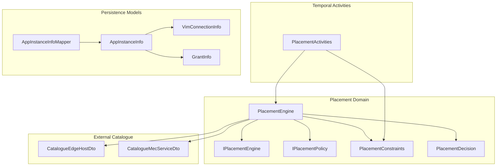
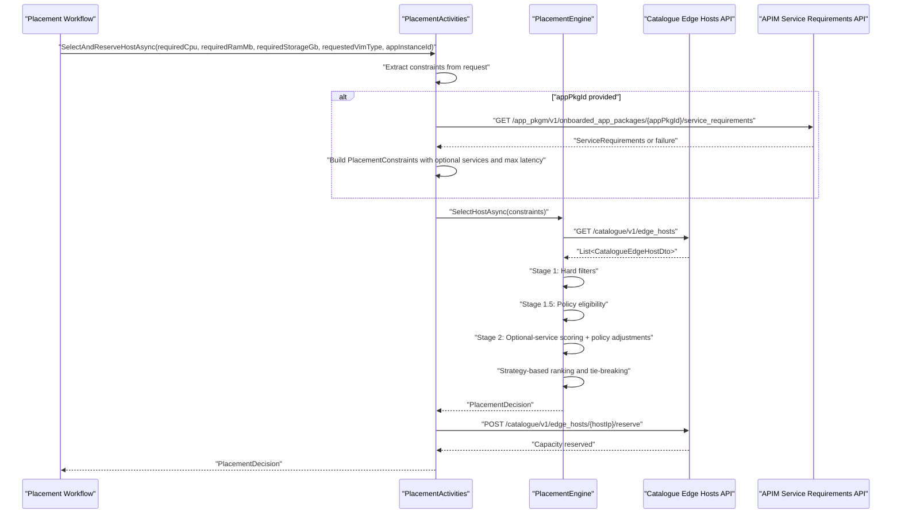
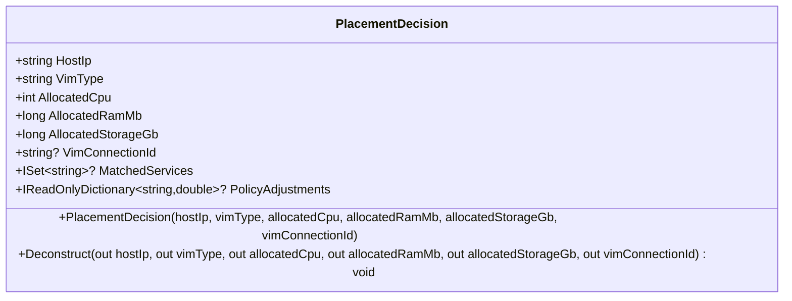
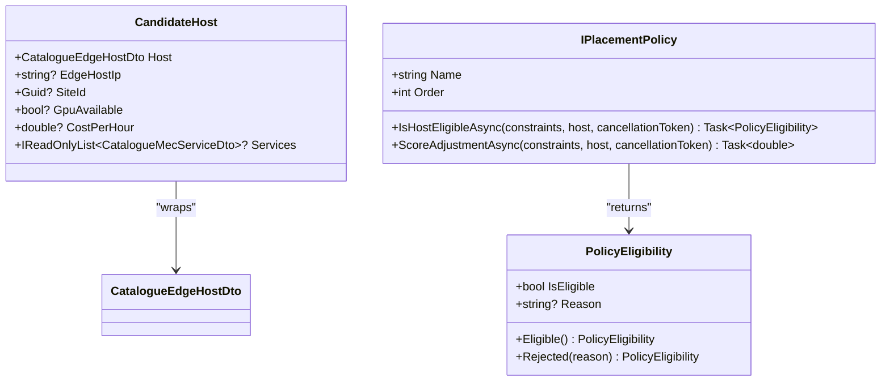
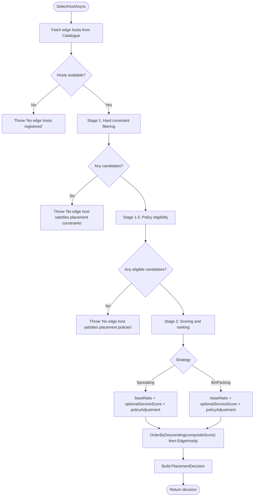
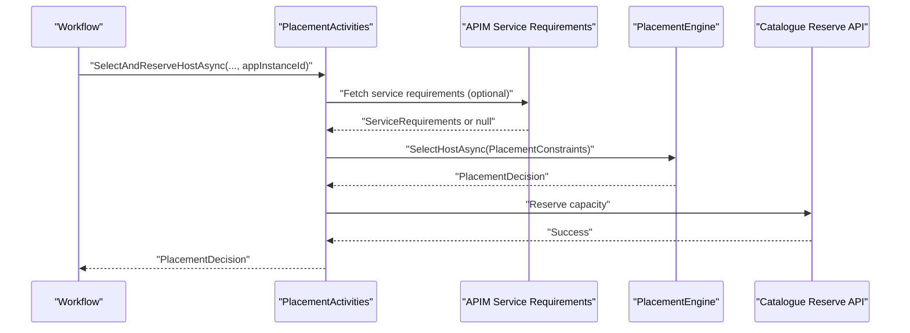
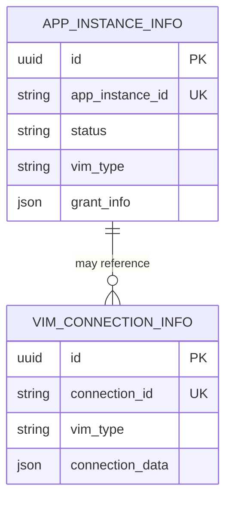
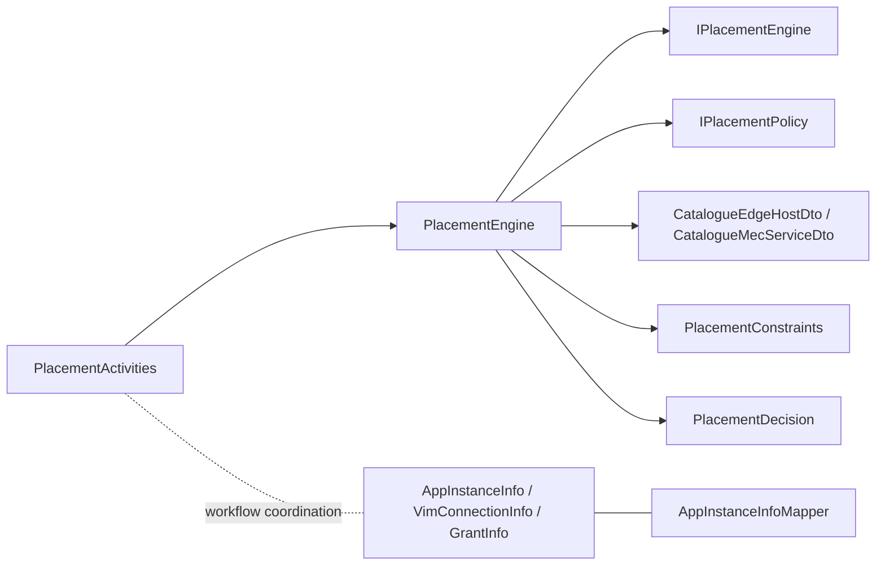

# MEO Domain Models

<cite>
**Referenced Files in This Document**
- `src/Meao/Domain/Placement/IPlacementEngine.cs`
- `src/Meao/Domain/Placement/IPlacementPolicy.cs`
- `src/Meao/Domain/Placement/PlacementConstraints.cs`
- `src/Meao/Domain/Placement/PlacementDecision.cs`
- `src/Meao/Domain/Placement/PlacementEngine.cs`
- `src/Meao/Activities/PlacementActivities.cs`
- `src/Meao/Models/AppInstanceInfo.cs`
- `src/Meao/Models/VimConnectionInfo.cs`
- `src/Meao/Models/GrantInfo.cs`
- `src/Meao/Models/AppInstanceInfoMapper.cs`
- `src/Meao/Migrations/20260819104304_PostgresInitial.cs`
- `src/Meao/Migrations/20260821085847_AddAppInstanceVimConnectionInfoKeyedRelationship.cs`
- `src/Meao/Data/MeaoDBContext.cs`
- `docs/docs/ADR/0027-persist-vimtype-on-appinstance.md`
- `docs/docs/ADR/0030-persist-vim-context-on-appinstance.md`
- `docs/docs/ADR/0045-meo-placement-engine-and-unified-catalogue-inventory-model.md`
</cite>

## Table of Contents
1. [Introduction](#introduction)
2. [Project Structure](#project-structure)
3. [Core Components](#core-components)
4. [Architecture Overview](#architecture-overview)
5. [Detailed Component Analysis](#detailed-component-analysis)
6. [Dependency Analysis](#dependency-analysis)
7. [Performance Considerations](#performance-considerations)
8. [Troubleshooting Guide](#troubleshooting-guide)
9. [Conclusion](#conclusion)

## Introduction
This document explains the MEO placement domain models and engine entities responsible for selecting edge hosts for MEC application instances. It focuses on:

- AppInstance state management as it relates to placement decisions and VIM context persistence.
- PlacementPolicy configuration through extensible policy interfaces.
- PlacementResult calculations via `PlacementDecision`.
- VimContext persistence around `VimConnectionInfo` and its relationship with `AppInstanceInfo`.
- Domain-driven design patterns used by the placement engine, including constraint extraction, hard filtering, policy eligibility, scoring, and host selection.
- Relationships with shared models, Temporal activity data structures, and catalogue inventory DTOs.
- Performance considerations for large-scale placement scenarios and caching strategies.

## Project Structure
The placement domain lives under `src/Meao/Domain/Placement`, while the Temporal orchestration boundary is represented by `src/Meao/Activities/PlacementActivities.cs`. Persistence-related domain models live under `src/Meao/Models`, and migrations are under `src/Meao/Migrations`.



**Diagram sources**
- `src/Meao/Domain/Placement/IPlacementEngine.cs#L1-L12`
- `src/Meao/Domain/Placement/IPlacementPolicy.cs#L1-L49`
- `src/Meao/Domain/Placement/PlacementConstraints.cs#L1-L23`
- `src/Meao/Domain/Placement/PlacementDecision.cs#L1-L60`
- `src/Meao/Domain/Placement/PlacementEngine.cs#L1-L200`
- `src/Meao/Activities/PlacementActivities.cs#L1-L205`
- `src/Meao/Models/AppInstanceInfo.cs`
- `src/Meao/Models/VimConnectionInfo.cs`
- `src/Meao/Models/GrantInfo.cs`
- `src/Meao/Models/AppInstanceInfoMapper.cs`

**Section sources**
- `src/Meao/Domain/Placement/IPlacementEngine.cs#L1-L12`
- `src/Meao/Domain/Placement/IPlacementPolicy.cs#L1-L49`
- `src/Meao/Domain/Placement/PlacementConstraints.cs#L1-L23`
- `src/Meao/Domain/Placement/PlacementDecision.cs#L1-L60`
- `src/Meao/Domain/Placement/PlacementEngine.cs#L1-L200`
- `src/Meao/Activities/PlacementActivities.cs#L1-L205`

## Core Components
The placement domain is composed of five primary types:

| Component | Responsibility | Key Design Notes |
|---|---|---|
| `IPlacementEngine` | Defines the asynchronous host-selection contract. | Single method `SelectHostAsync`; suitable for unit testing and replacement. |
| `PlacementConstraints` | Encapsulates hard and soft placement requirements. | Immutable record; includes CPU, RAM, storage, VIM type, service names, latency, site affinity, and GPU flags. |
| `CandidateHost` | Wraps a catalogue edge host for policy evaluation. | Thin projection over `CatalogueEdgeHostDto`; prevents direct JSON property manipulation from policies. |
| `PolicyEligibility` | Result of policy eligibility checks. | Supports implicit conversion to `bool`, and static helpers `Eligible()` and `Rejected(...)`. |
| `IPlacementPolicy` | Extensible policy hook for eligibility and score adjustment. | Policies run in deterministic ascending `Order`; rejection removes a candidate, adjustments sum into composite score. |
| `PlacementDecision` | Represents the selected host and allocation metadata. | Includes backward-compatibility constructor and deconstructor for legacy callers. |
| `PlacementEngine` | Implements constraint extraction, hard filtering, policy eligibility, scoring, ranking, and decision construction. | Communicates with the catalogue HTTP API and applies strategy-based ranking. |
| `PlacementActivities` | Temporal activity façade over placement and capacity reservation. | Extracts service requirements from the APIM API and maps failures to non-retryable Temporal exceptions. |

**Section sources**
- `src/Meao/Domain/Placement/IPlacementEngine.cs#L1-L12`
- `src/Meao/Domain/Placement/PlacementConstraints.cs#L1-L23`
- `src/Meao/Domain/Placement/IPlacementPolicy.cs#L1-L49`
- `src/Meao/Domain/Placement/PlacementDecision.cs#L1-L60`
- `src/Meao/Domain/Placement/PlacementEngine.cs#L1-L200`
- `src/Meao/Activities/PlacementActivities.cs#L1-L205`

## Architecture Overview
The placement flow is orchestrated by Temporal activities and implemented by the domain engine:



**Diagram sources**
- `src/Meao/Activities/PlacementActivities.cs#L1-L205`
- `src/Meao/Domain/Placement/PlacementEngine.cs#L1-L200`

## Detailed Component Analysis

### Placement Constraints and Strategy
`PlacementConstraints` is an immutable record that captures both hard resource requirements and soft placement preferences:

- **Hard resources:** CPU cores, RAM in MB, storage in GB.
- **VIM preference:** Requested VIM type such as Kubernetes or OpenStack.
- **Service constraints:** Required and optional service names.
- **Latency constraint:** Maximum latency to core.
- **Site affinity:** Tenant site identifier placeholder.
- **GPU requirement:** Optional GPU flag.
- **Strategy:** Spreading or bin packing.

This model centralizes constraint extraction so that domain logic does not directly inspect raw request payloads.

```mermaid
classDiagram
    class PlacementConstraints {
        +int RequiredCpu
        +long RequiredRamMb
        +long RequiredStorageGb
        +string? RequestedVimType
        +PlacementStrategy Strategy
        +IReadOnlyList~string~? RequiredServiceNames
        +IReadOnlyList~string~? OptionalServiceNames
        +uint? MaxLatencyMs
        +Guid? TenantSiteAffinityId
        +bool? RequiresGpu
    }

    enum PlacementStrategy {
        Spreading
        BinPacking
    }

    PlacementConstraints --> PlacementStrategy : "uses"
```

**Diagram sources**
- `src/Meao/Domain/Placement/PlacementConstraints.cs#L1-L23`

**Section sources**
- `src/Meao/Domain/Placement/PlacementConstraints.cs#L1-L23`

### Placement Decision Model
`PlacementDecision` represents the result of intelligent host placement. Its key fields include:

| Field | Meaning |
|---|---|
| `HostIp` | Selected edge host IP address. |
| `VimType` | VIM virtualization type, defaulting to `"k8s"` when not available. |
| `AllocatedCpu` | CPU cores allocated from the request. |
| `AllocatedRamMb` | RAM in MB allocated from the request. |
| `AllocatedStorageGb` | Storage in GB allocated from the request. |
| `VimConnectionId` | Optional future anchor to a VIM connection entity. |
| `MatchedServices` | Available services matched against required or optional service names. |
| `PolicyAdjustments` | Non-zero per-policy score adjustments applied during ranking. |

The model also provides backward-compatible constructors and deconstructors to support older call sites without breaking existing code.



**Diagram sources**
- `src/Meao/Domain/Placement/PlacementDecision.cs#L1-L60`

**Section sources**
- `src/Meao/Domain/Placement/PlacementDecision.cs#L1-L60`

### Candidate Host and Policy Eligibility
`CandidateHost` is a thin wrapper around `CatalogueEdgeHostDto` used by placement policies. It exposes typed properties such as edge host IP, site ID, GPU availability, cost per hour, and service list.

`PolicyEligibility` is the outcome of a policy’s eligibility check. It supports:

- Explicit creation via `Eligible()`.
- Rejection via `Rejected(reason)`.
- Implicit conversion to `bool`, enabling concise policy checks.



**Diagram sources**
- `src/Meao/Domain/Placement/IPlacementPolicy.cs#L1-L49`

**Section sources**
- `src/Meao/Domain/Placement/IPlacementPolicy.cs#L1-L49`

### Placement Engine Implementation
`PlacementEngine` implements `IPlacementEngine` and performs three main stages:

1. **Constraint extraction and hard filtering.**
   - Host status must be online or absent.
   - VIM type must match the requested type when provided.
   - Available CPU, RAM, and storage must meet required values.
   - Required services must be present and marked available.
   - Latency to core must not exceed the maximum if specified.

2. **Policy eligibility evaluation.**
   - Policies execute in ascending `Order`.
   - Any policy can reject a candidate host.
   - Rejections are logged and collected for diagnostic messages.

3. **Scoring and ranking.**
   - Optional service matching adds up to `+1.0` at `+0.25` per matched available service.
   - Policy score adjustments are summed per host.
   - Base ratio uses available RAM divided by total RAM.
   - `Spreading` prefers higher base ratios; `BinPacking` inverts the base ratio.
   - Ties are broken by ascending host IP.
   - Matched services and non-zero policy adjustments are captured in the final decision.



**Diagram sources**
- `src/Meao/Domain/Placement/PlacementEngine.cs#L1-L200`

**Section sources**
- `src/Meao/Domain/Placement/PlacementEngine.cs#L1-L200`

### Temporal Activity Integration
`PlacementActivities` is the Temporal activity layer that converts workflow inputs into domain constraints, invokes the placement engine, and reserves capacity on the selected host.

Key behaviors:

- **Constraint extraction:** Builds `PlacementConstraints` from activity parameters.
- **Service requirements fetch:** Optionally calls the APIM API using the configured `"ApmActivityAPI"` client.
- **Fallback behavior:** If service requirements are unavailable, placement degrades to capacity-only mode.
- **Failure mapping:** Wraps domain `InvalidOperationException` in a non-retryable `ApplicationFailureException` with error type `"PlacementFailed"`.
- **Capacity reservation:** Posts reserve/release requests to the catalogue endpoint using `"CatalogueActivityAPI"`.



**Diagram sources**
- `src/Meao/Activities/PlacementActivities.cs#L1-L205`

**Section sources**
- `src/Meao/Activities/PlacementActivities.cs#L1-L205`

### AppInstance State Management and VimContext Persistence
AppInstance state management intersects with placement through two concerns:

1. **Placement results stored in AppInstanceInfo.**
   - The placement decision supplies host IP, VIM type, and allocated resources.
   - `PlacementDecision` includes an optional `VimConnectionId` field intended for future anchoring to a VIM connection entity.
   - Current engine implementation sets `VimConnectionId` to `null`; this leaves room for later enrichment after actual VIM provisioning.

2. **VimContext persistence through VimConnectionInfo.**
   - `VimConnectionInfo` is a separate persistence model representing VIM connection information.
   - Migrations define relationships between `AppInstanceInfo` and `VimConnectionInfo`, including a keyed relationship migration.
   - Architectural decisions explicitly document persisting VIM type on `AppInstanceInfo` and persisting VIM context on `AppInstanceInfo`.



**Diagram sources**
- `src/Meao/Models/AppInstanceInfo.cs`
- `src/Meao/Models/VimConnectionInfo.cs`
- `src/Meao/Migrations/20260819104304_PostgresInitial.cs`
- `src/Meao/Migrations/20260821085847_AddAppInstanceVimConnectionInfoKeyedRelationship.cs`

**Section sources**
- `src/Meao/Domain/Placement/PlacementDecision.cs#L1-L60`
- `src/Meao/Models/AppInstanceInfo.cs`
- `src/Meao/Models/VimConnectionInfo.cs`
- `src/Meao/Migrations/20260819104304_PostgresInitial.cs`
- `src/Meao/Migrations/20260821085847_AddAppInstanceVimConnectionInfoKeyedRelationship.cs`

### Domain-Driven Design Patterns
The placement engine follows several DDD-inspired patterns:

| Pattern | Implementation |
|---|---|
| **Aggregate-like constraint model** | `PlacementConstraints` groups related placement requirements into one immutable value object. |
| **Domain interface abstraction** | `IPlacementEngine` isolates host selection behind a testable interface. |
| **Extensible policy hooks** | `IPlacementPolicy` allows new business rules without changing engine internals. |
| **Projection objects** | `CandidateHost` projects catalogue DTOs into a safer domain-facing shape. |
| **Value-result objects** | `PolicyEligibility` and `PlacementDecision` encode outcomes rather than relying on exceptions for normal control flow. |
| **Backward compatibility** | Legacy constructors and deconstructors preserve older callers. |

These patterns reduce coupling between orchestration, domain logic, and external catalogue APIs while keeping placement rules explicit and testable.

**Section sources**
- `src/Meao/Domain/Placement/IPlacementEngine.cs#L1-L12`
- `src/Meao/Domain/Placement/IPlacementPolicy.cs#L1-L49`
- `src/Meao/Domain/Placement/PlacementConstraints.cs#L1-L23`
- `src/Meao/Domain/Placement/PlacementDecision.cs#L1-L60`
- `src/Meao/Domain/Placement/PlacementEngine.cs#L1-L200`

## Dependency Analysis
The placement subsystem has clear dependency boundaries:

- `PlacementActivities` depends on `IPlacementEngine`, HTTP clients, and Temporal activity infrastructure.
- `PlacementEngine` depends on HTTP client factory, logging, catalogue DTOs, and optionally injected policies.
- Persistence models (`AppInstanceInfo`, `VimConnectionInfo`, `GrantInfo`) are separate from placement domain models but share lifecycle coordination through workflows and mappers.
- Shared catalogue DTOs (`CatalogueEdgeHostDto`, `CatalogueMecServiceDto`) are consumed only by the engine and its wrapping projection.



**Diagram sources**
- `src/Meao/Activities/PlacementActivities.cs#L1-L205`
- `src/Meao/Domain/Placement/PlacementEngine.cs#L1-L200`
- `src/Meao/Models/AppInstanceInfo.cs`
- `src/Meao/Models/VimConnectionInfo.cs`
- `src/Meao/Models/GrantInfo.cs`
- `src/Meao/Models/AppInstanceInfoMapper.cs`

**Section sources**
- `src/Meao/Activities/PlacementActivities.cs#L1-L205`
- `src/Meao/Domain/Placement/PlacementEngine.cs#L1-L200`

## Performance Considerations
The current placement implementation has several performance characteristics worth noting:

| Area | Current Behavior | Implication |
|---|---|---|
| Catalogue host retrieval | Fetches all edge hosts for every placement request. | O(n) host iteration per placement; no built-in cache. |
| Constraint filtering | LINQ filtering over in-memory host list. | Fast for moderate inventories; may become expensive at scale. |
| Policy evaluation | Sequential async eligibility checks per candidate. | Each policy runs per host; high policy count increases latency. |
| Scoring | Per-host optional-service matching and policy score summation. | Additional O(p × s) work where p is policies and s is services. |
| Ranking | Full sort over eligible candidates. | O(k log k) where k is eligible hosts. |
| Retry semantics | Placement failures map to non-retryable Temporal exceptions. | Prevents repeated failed placements, reducing catalogue pressure. |

Recommended optimizations for large-scale placement:

1. **Cache catalogue host snapshots.** Cache `CatalogueEdgeHostDto` lists with short TTLs to avoid repeated HTTP calls.
2. **Precompute service indexes.** Index services by name to avoid repeated linear scans.
3. **Parallelize independent policy checks.** Run policy eligibility and scoring concurrently per host while preserving deterministic ordering.
4. **Early termination for strict constraints.** Fail fast when hard constraints cannot be satisfied before evaluating policies.
5. **Limit candidate set size.** Cap the number of candidates considered for ranking to prevent pathological sorting costs.
6. **Use streaming or paginated catalogue APIs if available.** Avoid loading entire inventories when only a subset is needed.

[No sources needed since this section provides general guidance]

## Troubleshooting Guide
Common placement issues and their likely causes:

| Symptom | Likely Cause | Resolution Approach |
|---|---|---|
| `No edge hosts registered in Catalogue` | Catalogue returned zero hosts or failed response was converted to success but empty. | Verify catalogue API availability and host registration. |
| `No edge host satisfies placement constraints` | CPU, RAM, storage, VIM type, required services, or latency requirements cannot be met. | Relax constraints, verify catalogue host inventory, or adjust VIM type. |
| `No edge host satisfies placement policies` | One or more policies rejected every candidate. | Inspect policy logs and `PolicyEligibility.Reason` values. |
| Placement fails with non-retryable `PlacementFailed` | Domain `InvalidOperationException` mapped by `PlacementActivities`. | Review underlying constraint satisfaction and policy decisions. |
| Capacity reservation fails after successful placement | Catalogue reserve endpoint returns failure. | Check catalogue availability and host capacity; consider releasing previously reserved capacity. |
| VIM context missing after placement | Engine currently sets `VimConnectionId` to `null`. | Enrich decision after VIM provisioning and update `AppInstanceInfo` or `VimConnectionInfo`. |

Relevant error paths:

- Catalogue host listing and policy rejections are thrown as `InvalidOperationException`.
- Temporal activity wraps domain failures into `ApplicationFailureException` with `nonRetryable: true` and error type `"PlacementFailed"`.
- APIM and catalogue HTTP calls use helper validation to surface non-success responses as activity errors.

**Section sources**
- `src/Meao/Domain/Placement/PlacementEngine.cs#L1-L200`
- `src/Meao/Activities/PlacementActivities.cs#L1-L205`

## Conclusion
The MEO placement domain models provide a clear separation between orchestration, domain constraints, policy evaluation, and decision output. `PlacementConstraints` centralizes placement requirements, `IPlacementPolicy` enables extensible business rules, and `PlacementDecision` captures the result of intelligent host selection. `PlacementEngine` implements deterministic staging: hard filtering, policy eligibility, optional-service scoring, policy adjustments, and strategy-based ranking.

For AppInstance state management, placement decisions supply host and resource allocation data, while `VimConnectionInfo` and related migrations capture VIM context separately. Architectural decisions document the intent to persist VIM type and VIM context on `AppInstanceInfo`, leaving room for future enrichment of `PlacementDecision.VimConnectionId`.

At scale, the most important improvements are catalogue caching, parallel policy execution, service indexing, and candidate-set limits. Until those are added, operators should monitor catalogue health, keep policy counts reasonable, and validate constraints before deployment.

[No sources needed since this section summarizes without analyzing specific files]