# Platform Manager Domain Models

<cite>
**Referenced Files in This Document**
- `src/PlatformManager/PlatformManager/Program.cs`
- `src/PlatformManager/PlatformManager/Endpoints/LcmEndpoint.cs`
- `src/PlatformManager/PlatformManager/Endpoints/AppInstanceEndpoints.cs`
- `src/PlatformManager/PlatformManager/Services/LcmWorkerService.cs`
- `src/PlatformManager/PlatformManager/Services/LcmWorkQueue.cs`
- `src/PlatformManager/PlatformManager/Services/NotificationDispatcherService.cs`
- `src/PlatformManager/PlatformManager/Services/LifecycleStateMachine.cs`
- `src/PlatformManager/PlatformManager/Services/AppInstanceService.cs`
- `src/PlatformManager/PlatformManager/Services/IAppInstanceService.cs`
- `src/PlatformManager/PlatformManager/Services/PluginAdapter/GrpcClient.cs`
- `src/PlatformManager/PlatformManager/Services/PluginAdapter/PluginFactory.cs`
- `src/PlatformManager/PlatformManager/Models/AppInstance.cs`
- `src/PlatformManager/PlatformManager/Models/AppInstanceLcmOpOcc.cs`
- `src/PlatformManager/PlatformManager/Models/AppPkgRecord.cs`
- `src/PlatformManager/PlatformManager/Models/LcmConstants.cs`
- `src/PlatformManager/PlatformManager/Data/LcmDbContext.cs`
</cite>

## Table of Contents
1. [Introduction](#introduction)
2. [Project Structure](#project-structure)
3. [Core Components](#core-components)
4. [Architecture Overview](#architecture-overview)
5. [Detailed Component Analysis](#detailed-component-analysis)
6. [Dependency Analysis](#dependency-analysis)
7. [Performance Considerations](#performance-considerations)
8. [Troubleshooting Guide](#troubleshooting-guide)
9. [Conclusion](#conclusion)

## Introduction
This document explains the Platform Manager domain models and execution paths for lifecycle management operations that coordinate long-running VIM provisioning work. It focuses on:

- The `AppInstance` aggregate, representing a MEC application instance with its instantiation state, platform configuration, and VIM routing context.
- The `AppInstanceLcmOpOcc` model, which tracks asynchronous lifecycle operation occurrences such as instantiate, terminate, operate, and platform configuration updates.
- The background queue architecture that decouples HTTP request handling from VIM adapter calls.
- State transitions enforced by the ETSI-aligned lifecycle state machine.
- Crash recovery through replay of stranded processing operations.
- gRPC communication with the VIM adapter via typed plugin clients.
- Notification dispatch to subscribers when operation states change.
- Monitoring and observability considerations for long-running operations.

The design avoids blocking HTTP endpoints while preserving durable, auditable operation state and supports retry and failure recovery through explicit terminal states and worker resilience.

## Project Structure
The Platform Manager is an ASP.NET Core service exposing the ETSI `/app_lcm/v1` API. Long-running VIM operations are not executed directly inside request handlers; instead, they enqueue work items that a hosted background worker processes. Notifications about operation state changes are published asynchronously to subscribed callback URIs.

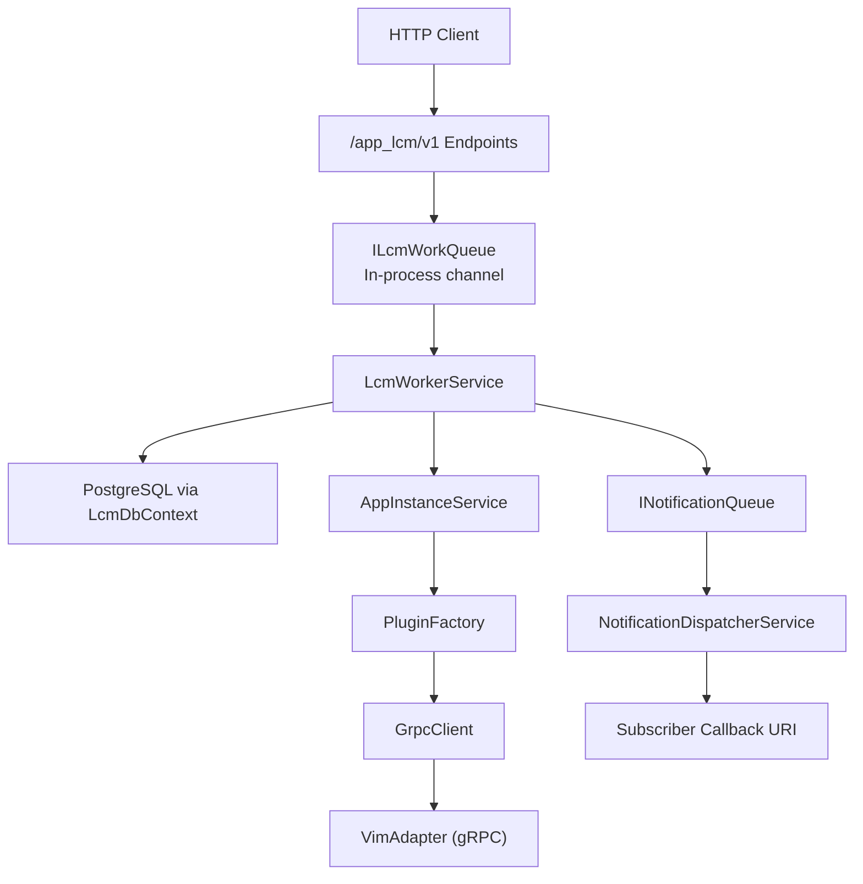

**Diagram sources**
- `src/PlatformManager/PlatformManager/Endpoints/LcmEndpoint.cs#L1-L60`
- `src/PlatformManager/PlatformManager/Endpoints/AppInstanceEndpoints.cs#L1-L200`
- `src/PlatformManager/PlatformManager/Services/LcmWorkerService.cs#L1-L200`
- `src/PlatformManager/PlatformManager/Services/LcmWorkQueue.cs#L1-L37`
- `src/PlatformManager/PlatformManager/Services/NotificationDispatcherService.cs#L1-L120`
- `src/PlatformManager/PlatformManager/Services/AppInstanceService.cs#L1-L160`
- `src/PlatformManager/PlatformManager/Services/PluginAdapter/GrpcClient.cs#L1-L120`

**Section sources**
- `src/PlatformManager/PlatformManager/Program.cs#L1-L120`
- `src/PlatformManager/PlatformManager/Endpoints/LcmEndpoint.cs#L1-L60`

## Core Components
The domain layer centers around two persisted entities and a set of services coordinating their lifecycle:

| Component | Responsibility | Key Fields / Behavior |
|---|---|---|
| `AppInstance` | Represents a MEC application instance and its current instantiation state. | `Id`, `AppDId`, `AppPkgId`, `InstantiationState`, `InstantiatedAppState`, `HostIp`, `VimType`, `PlatformConfigJson`. |
| `AppInstanceLcmOpOcc` | Tracks asynchronous lifecycle operation occurrences. | `Id`, `AppInstanceId`, `LifecycleOperation`, `OperationState`, `StartTime`, `StateEnteredTime`, `EndTime`, `Response`, plus crash-replay fields like `HostIp`, `VimType`, `AppPkgId`, `ChangeStateTo`, `ConfigPayloadJson`. |
| `LifecycleStateMachine` | Enforces legal ETSI-aligned state transitions. | Supports `STARTING → PROCESSING → COMPLETED/FAILED/FAILED_TEMP`, `PROCESSING → FAILED_TEMP`, `FAILED → PROCESSING`, and `FAILED_TEMP → FAILED/PROCESSING`. |
| `LcmWorkItem` | In-memory unit of VIM provisioning work produced by HTTP handlers. | Carries `AppInstanceId`, `OpOccId`, `Operation`, `HostIp`, `AppPkgId`, `VimType`, optional target state, serialized config payload, and immutable CSAR digest. |
| `LcmWorkerService` | Background worker draining the LCM queue and driving op-occ state to terminal outcomes. | Handles replay, per-operation timeout, idempotent consumer guard, transactional state settlement, notification dispatch. |
| `AppInstanceService` | Performs VIM lifecycle RPCs through the selected plugin client. | Instantiate, terminate, operate; forwards digest-pinned OCI reference for instantiate. |
| `GrpcClient` | Typed gRPC client to the VimAdapter with wire deadlines and retries. | Applies configured per-operation timeout as gRPC deadline; retries transient `Unavailable` calls. |
| `NotificationDispatcherService` | Background dispatcher sending ETSI-aligned `AppLcmOpOccStateChangeNotification` messages. | Parses subscription filters, validates callback URIs, records delivery status, and sends notifications over HTTP. |

**Section sources**
- `src/PlatformManager/PlatformManager/Models/AppInstance.cs#L1-L72`
- `src/PlatformManager/PlatformManager/Models/AppInstanceLcmOpOcc.cs#L1-L54`
- `src/PlatformManager/PlatformManager/Services/LifecycleStateMachine.cs#L1-L51`
- `src/PlatformManager/PlatformManager/Services/LcmWorkQueue.cs#L1-L37`
- `src/PlatformManager/PlatformManager/Services/LcmWorkerService.cs#L1-L200`
- `src/PlatformManager/PlatformManager/Services/AppInstanceService.cs#L1-L160`
- `src/PlatformManager/PlatformManager/Services/PluginAdapter/GrpcClient.cs#L1-L120`
- `src/PlatformManager/PlatformManager/Services/NotificationDispatcherService.cs#L1-L120`

## Architecture Overview
The Platform Manager separates HTTP request handling from VIM execution using a single-reader in-process channel. The HTTP handler creates a durable `AppInstanceLcmOpOcc` row, typically setting it to a starting or processing state, and enqueues a work item. `LcmWorkerService` drains the channel, performs VIM calls, settles the operation occurrence, and optionally publishes notifications.

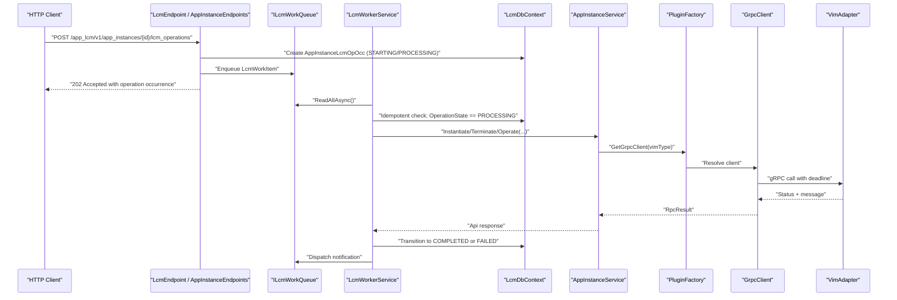

**Diagram sources**
- `src/PlatformManager/PlatformManager/Endpoints/LcmEndpoint.cs#L1-L200`
- `src/PlatformManager/PlatformManager/Services/LcmWorkerService.cs#L201-L501`
- `src/PlatformManager/PlatformManager/Services/AppInstanceService.cs#L1-L160`
- `src/PlatformManager/PlatformManager/Services/PluginAdapter/GrpcClient.cs#L120-L271`

**Section sources**
- `src/PlatformManager/PlatformManager/Program.cs#L100-L200`
- `src/PlatformManager/PlatformManager/Services/LcmWorkQueue.cs#L1-L37`

## Detailed Component Analysis

### Lifecycle Operation Occurrence Model
`AppInstanceLcmOpOcc` is the central persistence object for lifecycle operations. Its fields capture both ETSI-required lifecycle data and internal implementation details required for crash-safe replay:

- `LifecycleOperation`: One of `INSTANTIATE`, `TERMINATE`, `OPERATE`, or `CONFIGURE_PLATFORM_FOR_APP`.
- `OperationState`: One of `STARTING`, `PROCESSING`, `COMPLETED`, `FAILED`, or `FAILED_TEMP`.
- Timestamps: `StartTime`, `StateEnteredTime`, and `EndTime` provide auditability across state transitions.
- Replay payloads: `HostIp`, `VimType`, `AppPkgId`, `ChangeStateTo`, and `ConfigPayloadJson` allow reconstruction of the original work item after process restart.

The model is intentionally nullable for replay fields so legacy rows can still be processed without failing validation.

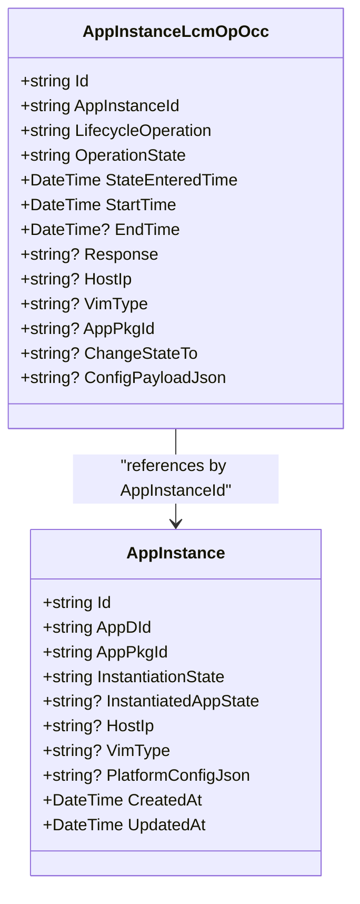

**Diagram sources**
- `src/PlatformManager/PlatformManager/Models/AppInstanceLcmOpOcc.cs#L1-L54`
- `src/PlatformManager/PlatformManager/Models/AppInstance.cs#L1-L72`

**Section sources**
- `src/PlatformManager/PlatformManager/Models/AppInstanceLcmOpOcc.cs#L1-L54`
- `src/PlatformManager/PlatformManager/Data/LcmDbContext.cs#L1-L136`

### Lifecycle State Machine
`LifecycleStateMachine` defines legal transitions for operation occurrences:

| From State | Allowed To States |
|---|---|
| `STARTING` | `PROCESSING`, `FAILED` |
| `PROCESSING` | `COMPLETED`, `FAILED`, `FAILED_TEMP` |
| `FAILED` | `PROCESSING` |
| `FAILED_TEMP` | `PROCESSING`, `FAILED` |
| `COMPLETED` | None |

This prevents illegal state mutations during settlement and makes worker logic defensive against duplicate processing.

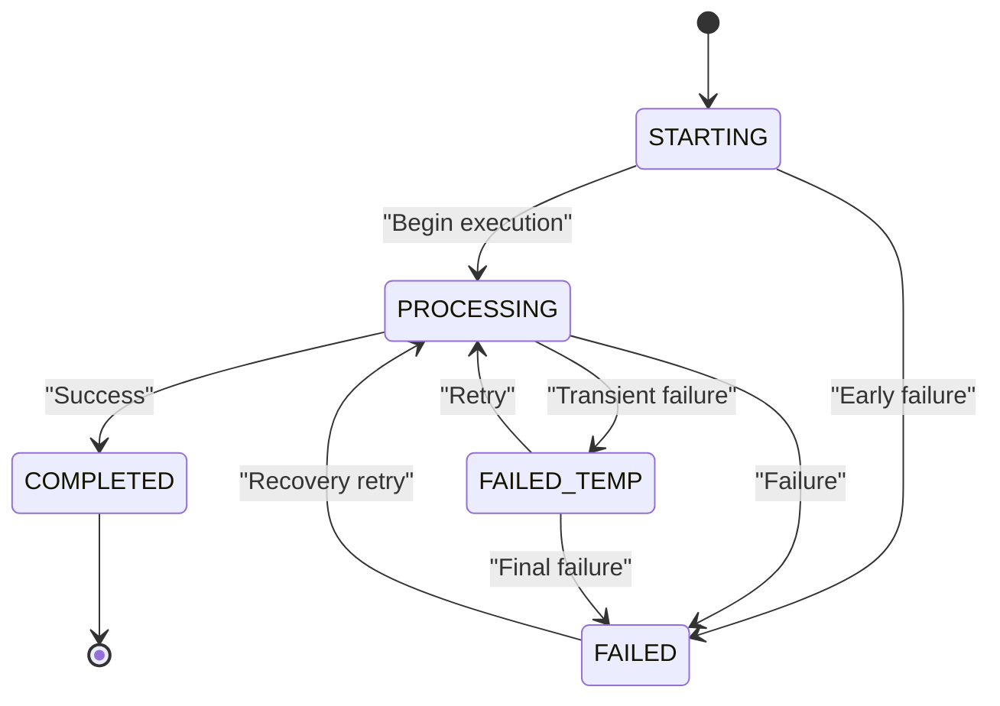

**Diagram sources**
- `src/PlatformManager/PlatformManager/Services/LifecycleStateMachine.cs#L1-L51`
- `src/PlatformManager/PlatformManager/Models/LcmConstants.cs#L1-L31`

**Section sources**
- `src/PlatformManager/PlatformManager/Services/LifecycleStateMachine.cs#L1-L51`
- `src/PlatformManager/PlatformManager/Models/LcmConstants.cs#L1-L31`

### Background Processing Queue and Worker
`LcmWorkQueue` uses an unbounded .NET channel with `SingleReader = true`. This means:

- Each queued work item is delivered at most once within the process.
- The worker loop reads all available items until cancellation.
- Items are lightweight records containing identifiers, routing metadata, and optional payloads.

`LcmWorkerService` is a hosted background service that:

1. Replays `PROCESSING` operations from before startup.
2. Drains the channel one item at a time.
3. Applies an idempotent-consumer guard by rechecking the operation’s current state.
4. Executes VIM calls with a per-operation timeout.
5. Settles the operation occurrence atomically with instance side effects.
6. Dispatches notifications even when settlement succeeds.

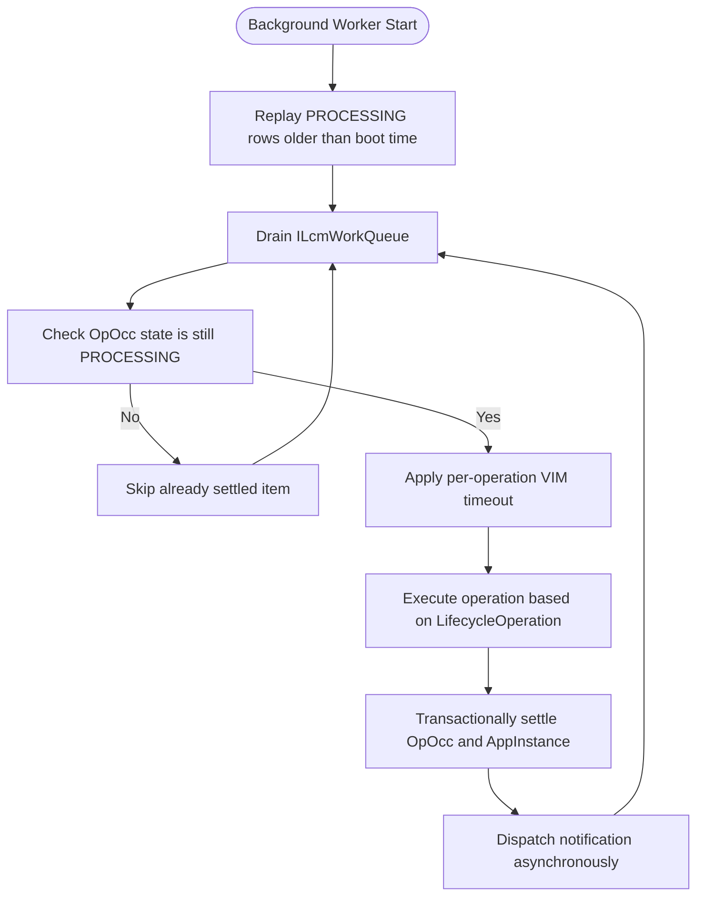

**Diagram sources**
- `src/PlatformManager/PlatformManager/Services/LcmWorkerService.cs#L1-L200`
- `src/PlatformManager/PlatformManager/Services/LcmWorkerService.cs#L201-L501`
- `src/PlatformManager/PlatformManager/Services/LcmWorkQueue.cs#L1-L37`

**Section sources**
- `src/PlatformManager/PlatformManager/Services/LcmWorkerService.cs#L1-L200`
- `src/PlatformManager/PlatformManager/Services/LcmWorkerService.cs#L201-L501`
- `src/PlatformManager/PlatformManager/Services/LcmWorkQueue.cs#L1-L37`

### Crash Recovery and Retry Patterns
Crash recovery is implemented primarily through replay of `AppInstanceLcmOpOcc` rows:

- Only rows with `OperationState == PROCESSING` and `StartTime < bootTime` are considered crash survivors.
- A special case exists for `INSTANTIATE` where the target instance is already `INSTANTIATED`; the worker settles the operation to `COMPLETED` without issuing another VIM call.
- If replay cannot enqueue or process a row, it logs and continues rather than stranding the entire backlog.
- Failed operations use `FAILED` or `FAILED_TEMP`, allowing higher-level orchestration to retry or escalate.

The worker also includes an idempotent-consumer guard: if a work item arrives for an operation no longer in `PROCESSING`, it skips processing instead of asserting an illegal transition.

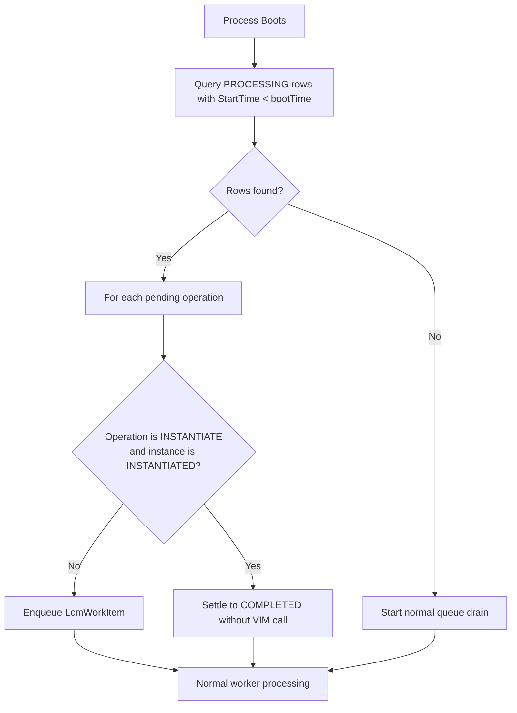

**Diagram sources**
- `src/PlatformManager/PlatformManager/Services/LcmWorkerService.cs#L1-L200`
- `src/PlatformManager/PlatformManager/Services/LcmWorkerService.cs#L201-L501`

**Section sources**
- `src/PlatformManager/PlatformManager/Services/LcmWorkerService.cs#L1-L200`
- `src/PlatformManager/PlatformManager/Services/LcmWorkerService.cs#L201-L501`

### VIM Communication Protocol and Adapter Coordination
VIM communication is abstracted behind `PluginFactory` and `GrpcClient`:

- `PluginFactory.GetGrpcClient(vimType)` returns a typed gRPC client for the resolved VIM adapter.
- `AppInstanceService` delegates instantiate, terminate, and operate calls to the appropriate client.
- `GrpcClient` applies a gRPC wire deadline derived from `LcmWorker:VimOperationTimeout` and configures retry behavior for transient failures.
- The VIM type is resolved upstream and persisted on `AppInstance.VimType`, avoiding repeated grant lookups during downstream operations.

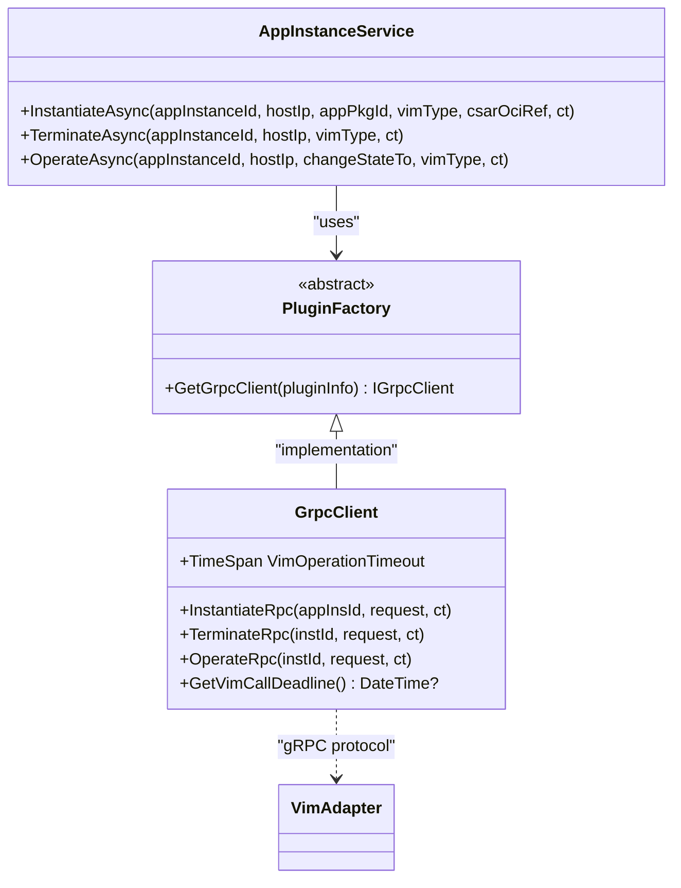

**Diagram sources**
- `src/PlatformManager/PlatformManager/Services/PluginAdapter/PluginFactory.cs#L1-L7`
- `src/PlatformManager/PlatformManager/Services/PluginAdapter/GrpcClient.cs#L1-L271`
- `src/PlatformManager/PlatformManager/Services/AppInstanceService.cs#L1-L160`

**Section sources**
- `src/PlatformManager/PlatformManager/Services/AppInstanceService.cs#L1-L160`
- `src/PlatformManager/PlatformManager/Services/PluginAdapter/GrpcClient.cs#L1-L271`
- `src/PlatformManager/PlatformManager/Services/PluginAdapter/PluginFactory.cs#L1-L7`

### Operation Workflows

#### Instantiate Workflow
The instantiate path is the most complex because it coordinates package distribution, VIM routing, and state settlement:

1. HTTP handler creates or validates the app instance and may auto-provision a CSAR digest.
2. An operation occurrence is created and enqueued.
3. The worker resolves the immutable CSAR manifest digest from `AppPkgRecord`.
4. The worker distributes the package to obtain a digest-pinned OCI reference.
5. The worker calls `AppInstanceService.InstantiateAsync`, forwarding the OCI reference through the existing gRPC parameters map.
6. On success, the worker sets `InstantiationState` to `INSTANTIATED`, persists `VimType` and `HostIp`, and marks the operation completed.

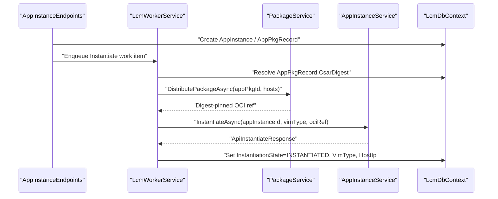

**Diagram sources**
- `src/PlatformManager/PlatformManager/Endpoints/AppInstanceEndpoints.cs#L1-L200`
- `src/PlatformManager/PlatformManager/Services/LcmWorkerService.cs#L201-L501`
- `src/PlatformManager/PlatformManager/Services/AppInstanceService.cs#L1-L160`

**Section sources**
- `src/PlatformManager/PlatformManager/Endpoints/AppInstanceEndpoints.cs#L1-L200`
- `src/PlatformManager/PlatformManager/Services/LcmWorkerService.cs#L201-L501`
- `src/PlatformManager/PlatformManager/Services/AppInstanceService.cs#L1-L160`

#### Terminate Workflow
Terminate clears the instance’s instantiation state and invokes the VIM adapter through the same plugin abstraction.

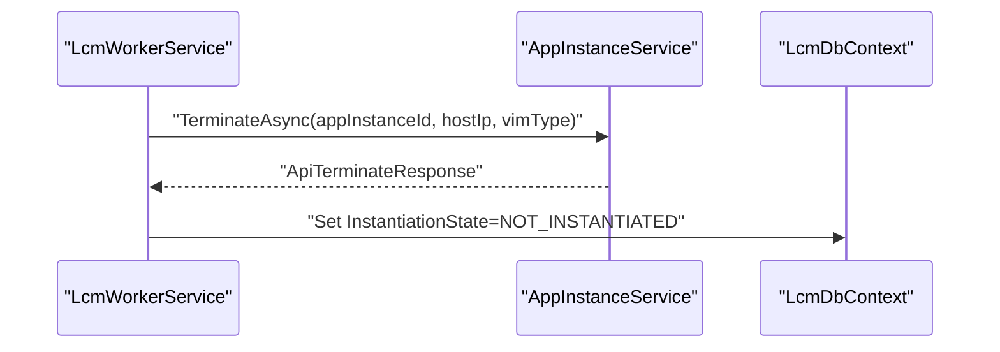

**Diagram sources**
- `src/PlatformManager/PlatformManager/Services/LcmWorkerService.cs#L201-L501`
- `src/PlatformManager/PlatformManager/Services/AppInstanceService.cs#L1-L160`

**Section sources**
- `src/PlatformManager/PlatformManager/Services/LcmWorkerService.cs#L201-L501`
- `src/PlatformManager/PlatformManager/Services/AppInstanceService.cs#L1-L160`

#### Operate Workflow
Operate transitions the running application between `STARTED` and `STOPPED`.

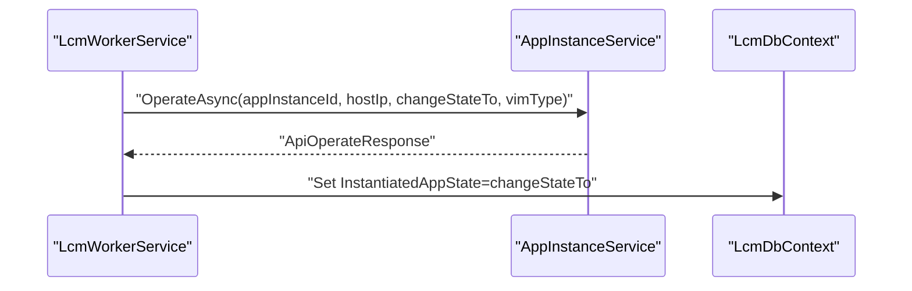

**Diagram sources**
- `src/PlatformManager/PlatformManager/Services/LcmWorkerService.cs#L201-L501`
- `src/PlatformManager/PlatformManager/Services/AppInstanceService.cs#L1-L160`

**Section sources**
- `src/PlatformManager/PlatformManager/Services/LcmWorkerService.cs#L201-L501`
- `src/PlatformManager/PlatformManager/Services/AppInstanceService.cs#L1-L160`

#### Configure Platform for App Workflow
This workflow persists platform configuration into `AppInstance.PlatformConfigJson` without invoking a VIM adapter. It follows the ETSI state machine: `STARTING → PROCESSING → COMPLETED`.

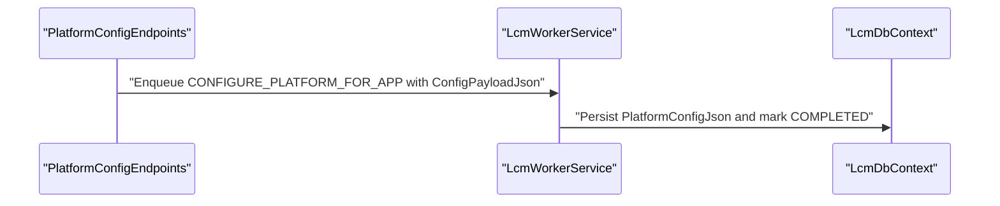

**Diagram sources**
- `src/PlatformManager/PlatformManager/Services/LcmWorkerService.cs#L201-L501`
- `src/PlatformManager/PlatformManager/Models/AppInstance.cs#L1-L72`

**Section sources**
- `src/PlatformManager/PlatformManager/Services/LcmWorkerService.cs#L201-L501`
- `src/PlatformManager/PlatformManager/Models/AppInstance.cs#L1-L72`

### Status Transitions and Error Handling
The worker centralizes successful settlement through `TransitionAsync`, which:

- Loads the operation occurrence and instance.
- Asserts the transition through `LifecycleStateMachine`.
- Updates timestamps.
- Persists instance side effects when present.
- Commits within a bounded transaction token.

Failure paths go through `MarkFailedAsync`, which asserts the transition to `FAILED`, records the error detail, and persists the terminal state. Timeout errors are handled separately: a linked cancellation token fires when the per-operation VIM timeout expires, resulting in a controlled `FAILED` outcome rather than silently marking success.

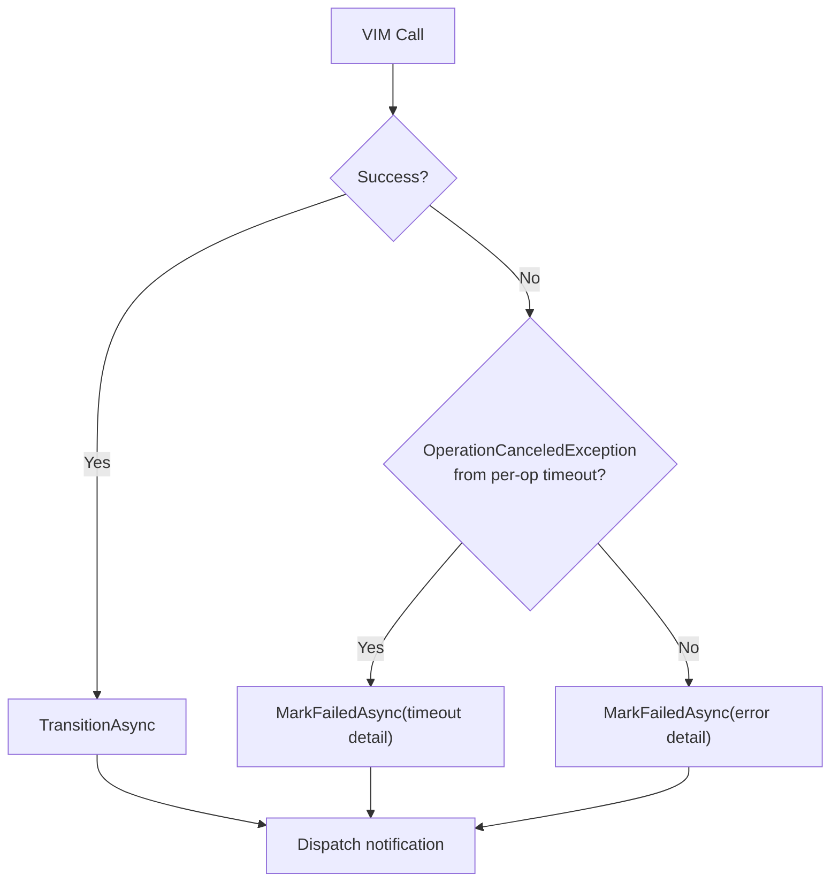

**Diagram sources**
- `src/PlatformManager/PlatformManager/Services/LcmWorkerService.cs#L201-L501`
- `src/PlatformManager/PlatformManager/Services/LifecycleStateMachine.cs#L1-L51`

**Section sources**
- `src/PlatformManager/PlatformManager/Services/LcmWorkerService.cs#L201-L501`
- `src/PlatformManager/PlatformManager/Services/LifecycleStateMachine.cs#L1-L51`

### Integration with Temporal Workflows
The Platform Manager itself does not implement Temporal workflows; it exposes REST endpoints and runs background workers. However, other components in the system integrate with Temporal:

- `Meao` contains Temporal workflow definitions and activities.
- `Meao` starts Platform Manager operations through HTTP calls.
- `Meao` has retry policies, activity policies, and exception handling for long-running orchestration.

This means Platform Manager should be treated as a durable backend service: its own retry and replay mechanisms handle local process failures, while higher-level orchestration can retry failed lifecycle operations.

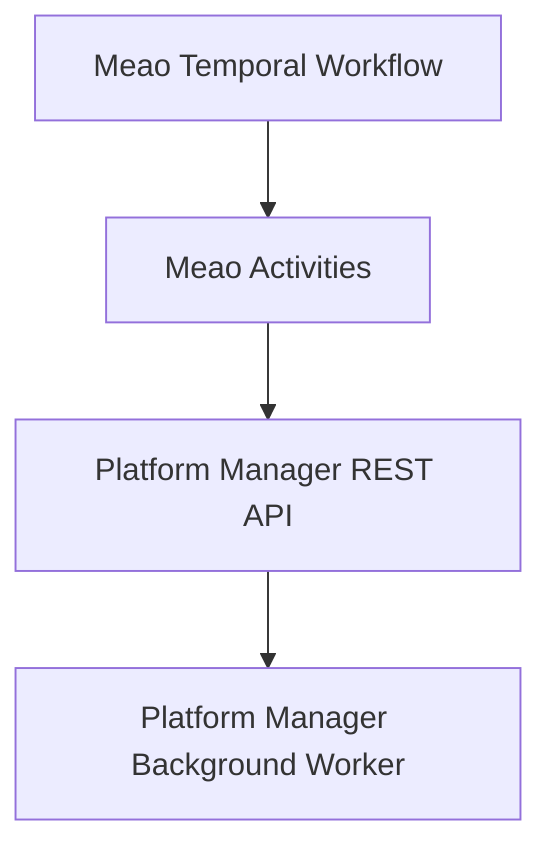

**Diagram sources**
- `src/PlatformManager/PlatformManager/Program.cs#L1-L120`
- `src/PlatformManager/PlatformManager/Endpoints/LcmEndpoint.cs#L1-L60`
- `src/PlatformManager/PlatformManager/Services/LcmWorkerService.cs#L1-L200`

**Section sources**
- `src/PlatformManager/PlatformManager/Program.cs#L1-L120`
- `src/PlatformManager/PlatformManager/Endpoints/LcmEndpoint.cs#L1-L60`

### Distributed Transaction Patterns
Platform Manager does not implement distributed transactions across services. Instead, it uses:

- Local database transactions for atomic state settlement.
- At-least-once processing semantics for background queues.
- Idempotent checks before terminal transitions.
- Explicit terminal states (`COMPLETED`, `FAILED`) to prevent double execution.
- Unique filtered indexes preventing multiple active lifecycle operations per instance.

These patterns favor recoverability and auditability over strict distributed consistency. Higher layers such as `Meao` can coordinate cross-service retries when necessary.

**Section sources**
- `src/PlatformManager/PlatformManager/Data/LcmDbContext.cs#L1-L136`
- `src/PlatformManager/PlatformManager/Services/LcmWorkerService.cs#L201-L501`

## Dependency Analysis
The Platform Manager depends on several infrastructure and domain services:

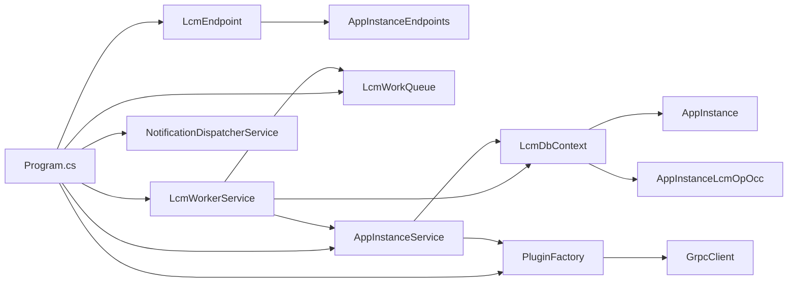

**Diagram sources**
- `src/PlatformManager/PlatformManager/Program.cs#L100-L200`
- `src/PlatformManager/PlatformManager/Endpoints/LcmEndpoint.cs#L1-L60`
- `src/PlatformManager/PlatformManager/Endpoints/AppInstanceEndpoints.cs#L1-L200`
- `src/PlatformManager/PlatformManager/Services/LcmWorkerService.cs#L1-L200`
- `src/PlatformManager/PlatformManager/Services/NotificationDispatcherService.cs#L1-L120`
- `src/PlatformManager/PlatformManager/Services/AppInstanceService.cs#L1-L160`
- `src/PlatformManager/PlatformManager/Data/LcmDbContext.cs#L1-L136`

**Section sources**
- `src/PlatformManager/PlatformManager/Program.cs#L100-L200`
- `src/PlatformManager/PlatformManager/Data/LcmDbContext.cs#L1-L136`

## Performance Considerations
- **Unbounded channel**: `LcmWorkQueue` uses an unbounded channel, so memory pressure can grow under sustained backpressure from slow VIM adapters.
- **Per-operation timeout**: The default 2-minute VIM timeout protects the worker loop but may require tuning for slow VIM provisioning.
- **Database writes**: Terminal transitions use bounded 30-second write tokens to avoid indefinite blocking during shutdown.
- **N+1 query guard**: Replay loads all affected instances in a single batch rather than per-row lookup.
- **gRPC retry policy**: Default retry targets `Unavailable` with exponential backoff capped at 5 attempts.
- **CSAR distribution**: Digest-pinned OCI references avoid ambiguous artifact resolution and support deterministic replay.

[No sources needed since this section provides general guidance]

## Troubleshooting Guide

### Operation Stays in PROCESSING After Restart
- Check whether the operation was a crash survivor older than process boot time.
- Verify the unique filtered index did not block replacement operations.
- Confirm the worker replay path logged re-enqueuing the operation.

**Section sources**
- `src/PlatformManager/PlatformManager/Services/LcmWorkerService.cs#L1-L200`
- `src/PlatformManager/PlatformManager/Data/LcmDbContext.cs#L1-L136`

### Operation Terminates as FAILED
- Inspect `AppInstanceLcmOpOcc.Response` for the recorded error detail.
- Check whether the failure came from a VIM timeout, gRPC error, or state assertion.
- Determine whether the caller should retry `FAILED_TEMP` or escalate `FAILED`.

**Section sources**
- `src/PlatformManager/PlatformManager/Services/LcmWorkerService.cs#L201-L501`
- `src/PlatformManager/PlatformManager/Models/AppInstanceLcmOpOcc.cs#L1-L54`

### VIM Calls Hang or Starve the Worker
- Tune `LcmWorker:VimOperationTimeout`.
- Inspect gRPC retry behavior and underlying VIM adapter health.
- Ensure the worker is not blocked on notification dispatch failures.

**Section sources**
- `src/PlatformManager/PlatformManager/Services/PluginAdapter/GrpcClient.cs#L1-L120`
- `src/PlatformManager/PlatformManager/Services/LcmWorkerService.cs#L1-L200`

### Notifications Are Not Delivered
- Validate the subscription filter matches the operation type and state.
- Check DNS resolution and public IP restrictions for callback URIs.
- Review the notification dispatcher’s logging for invalid URIs or DNS failures.

**Section sources**
- `src/PlatformManager/PlatformManager/Services/NotificationDispatcherService.cs#L1-L200`
- `src/PlatformManager/PlatformManager/Endpoints/LcmEndpoint.cs#L1-L200`

## Conclusion
Platform Manager’s lifecycle operation domain models center on durable operation occurrences and a resilient background worker. The design isolates HTTP requests from long-running VIM calls, enforces ETSI-aligned state transitions, and provides crash-safe replay for stranded processing operations. VIM communication is abstracted through a plugin factory and typed gRPC client with configurable timeouts and retry behavior. Notifications are dispatched asynchronously to subscribers after successful settlement. While distributed transactions are not used, the combination of local transactions, idempotent checks, filtered unique indexes, and explicit terminal states provides robust failure recovery. For production deployments, operators should monitor operation state transitions, VIM timeouts, gRPC retry metrics, and notification delivery outcomes.