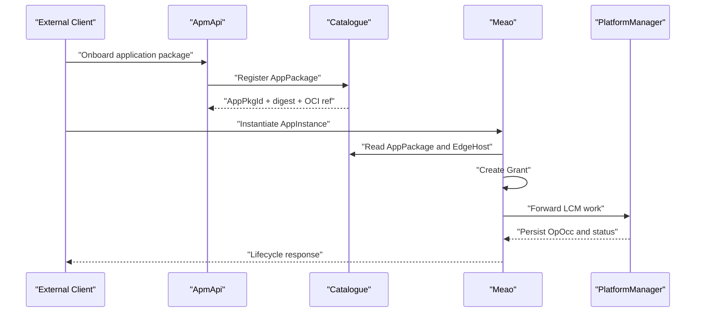
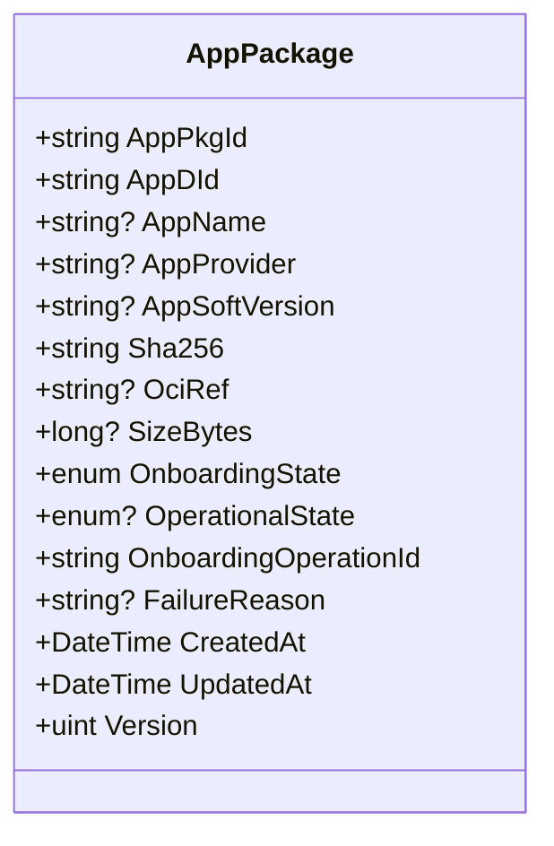
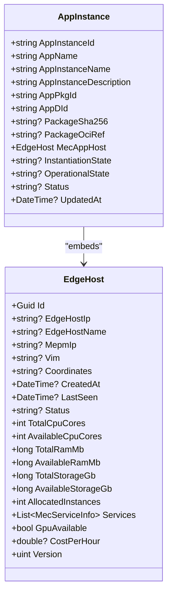
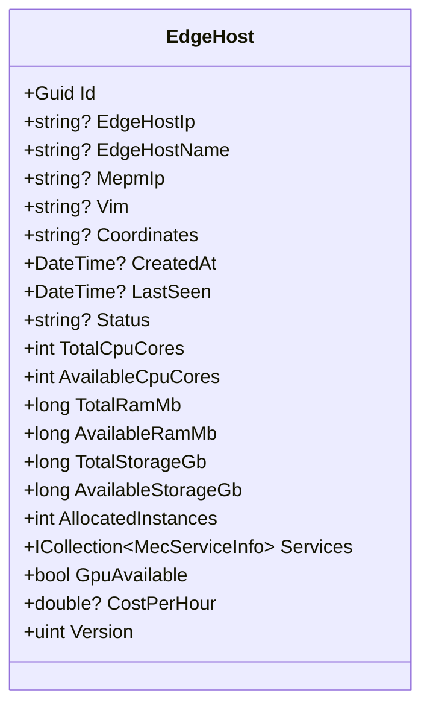
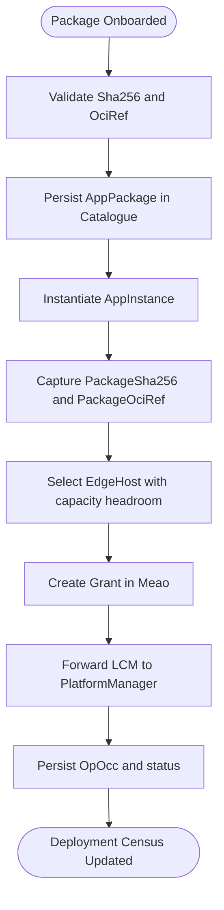
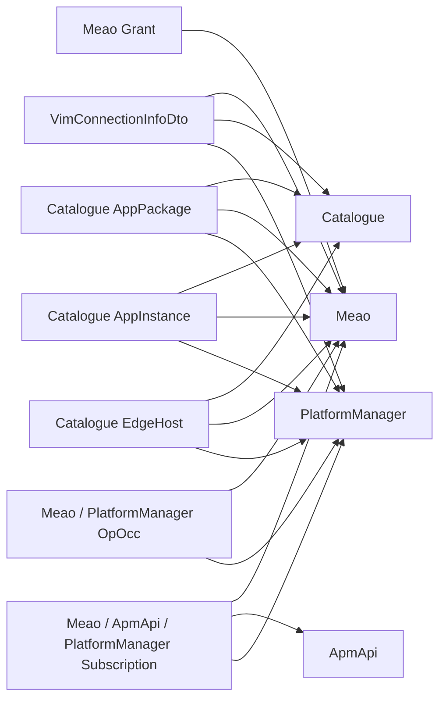

# Shared Domain Models

<cite>
**Referenced Files in This Document**
- `src/Common/Models/VimConnectionInfoDto.cs`
- `src/Catalogue/Models/AppInstance.cs`
- `src/Catalogue/Models/EdgeHost.cs`
- `src/Catalogue/Models/AppPackage.cs`
- `src/Meao/Migrations/MeaoDBContextModelSnapshot.cs`
- `src/Meao/Migrations/20260819104304_PostgresInitial.cs`
- `src/Meao/Migrations/20260821085847_AddAppInstanceVimConnectionInfoKeyedRelationship.cs`
- `src/PlatformManager/PlatformManager/Migrations/LcmDbContextModelSnapshot.cs`
- `src/PlatformManager/PlatformManager/Migrations/20260728214624_PostgresInitial.cs`
- `src/PlatformManager/PlatformManager/Migrations/20260815130910_AddPlatformConfigJsonToAppInstance.cs`
- `src/PlatformManager/PlatformManager/Migrations/20260821200126_AddCsarDigest.cs`
- `src/PlatformManager/PlatformManager/Migrations/20260919051330_PersistLcmWorkPayload.cs`
- `src/PlatformManager/PlatformManager/Models/AppInstance.cs`
- `src/PlatformManager/PlatformManager/Models/AppPkgRecord.cs`
- `src/PlatformManager/PlatformManager/Models/SubscriptionInfo.cs`
- `src/Meao/Endpoints/GrantEndpoints.cs`
- `src/Meao/Requests/CreateAppInstRequest.cs`
- `src/Meao/Validators/SubscriptionRequestValidator.cs`
- `src/ApmApi/Endpoints/ApmEndpoints.cs`
- `src/ApmApi/Migrations/20260813095316_AddSubscriptionFilters.Designer.cs`
- `src/Catalogue/Endpoints/MecHostEndpoints.cs`
- `src/Catalogue/Endpoints/AppInstanceEndpoints.cs`
- `src/Catalogue/Endpoints/AppPackageEndpoints.cs`
- `docs/docs/ADR/0015-shared-dto-library.md`
- `docs/docs/ADR/0042-etsi-vimconnectioninfo-representation-and-audit-discrepancy-resolutions.md`
- `docs/docs/ADR/0048-canonical-wire-contracts-and-bounded-context-realignment.md`
</cite>

## Table of Contents
1. [Introduction](#introduction)
2. [Project Structure](#project-structure)
3. [Core Shared Entities](#core-shared-entities)
4. [Architecture Overview](#architecture-overview)
5. [Detailed Entity Analysis](#detailed-entity-analysis)
6. [Database Schema, Keys, and Constraints](#database-schema-keys-and-constraints)
7. [Cross-Service Usage](#cross-service-usage)
8. [Data Consistency, Audit, Lifecycle, and Versioning](#data-consistency-audit-lifecycle-and-versioning)
9. [Serialization Contracts and Sample Payloads](#serialization-contracts-and-sample-payloads)
10. [Dependency Analysis](#dependency-analysis)
11. [Performance Considerations](#performance-considerations)
12. [Troubleshooting Guide](#troubleshooting-guide)
13. [Conclusion](#conclusion)

## Introduction
This document describes the shared domain models that cross the Meao, ApmApi, Catalogue, and PlatformManager services. The focus is on entities representing application packages, deployed application instances, edge hosts, grants, LCM operation occurrences, VIM connection information, and subscriptions. It explains entity relationships, fields, validation rules, business constraints, primary and foreign key semantics, indexes where observable from migrations or annotations, and how these models participate in ETSI MEC lifecycle flows.

The repository implements a bounded-context architecture: Catalogue owns package inventory and host topology; Meao owns MEAO LCM orchestration, grants, and subscriptions; ApmApi owns application descriptor and package artifact onboarding state; PlatformManager owns platform-side LCM operations against MEC peers. Shared data contracts are intentionally kept close to ETSI field names where applicable while retaining service-specific persistence details.

## Project Structure
The relevant code for this document lives under:
- `src/Common/Models`: shared DTOs such as `VimConnectionInfoDto`.
- `src/Catalogue/Models` and `src/Catalogue/Migrations`: Catalogue’s authoritative package, instance, and host models plus schema definitions.
- `src/Meao/Models`, `src/Meao/Endpoints`, `src/Meao/Validators`, and `src/Meao/Migrations`: Meao’s runtime entities, API wiring, validators, and database schema evolution.
- `src/PlatformManager/PlatformManager/Models`, `src/PlatformManager/PlatformManager/Migrations`: PlatformManager’s LCM persistence layer.
- `src/ApmApi/Models`, `src/ApmApi/Endpoints`, `src/ApmApi/Migrations`: ApmApi’s package and subscription-related endpoints and migrations.

```mermaid
graph TB
    subgraph "Shared"
        Common["Common.Models<br/>VimConnectionInfoDto"]
    end

    subgraph "Catalogue"
        CatAppPackage["Catalogue.Models.AppPackage"]
        CatAppInstance["Catalogue.Models.AppInstance"]
        CatEdgeHost["Catalogue.Models.EdgeHost"]
    end

    subgraph "Meao"
        MeaoDb["Meao DB<br/>AppInstance / Grant / Subscription / OpOcc"]
    end

    subgraph "PlatformManager"
        PmAppInstance["PlatformManager AppInstance"]
        PmAppPkg["PlatformManager AppPkgRecord"]
        PmSub["PlatformManager SubscriptionInfo"]
    end

    subgraph "ApmApi"
        ApmApi["ApmApi<br/>Onboarding + Subscriptions"]
    end

    Common --> CatAppInstance
    CatAppPackage --> CatAppInstance
    CatEdgeHost --> CatAppInstance
    CatAppInstance --> MeaoDb
    CatAppPackage --> MeaoDb
    PmAppInstance --> MeaoDb
    PmAppPkg --> MeaoDb
    PmSub --> MeaoDb
    ApmApi --> CatAppPackage
    ApmApi --> MeaoDb
```

**Diagram sources**
- `src/Common/Models/VimConnectionInfoDto.cs`
- `src/Catalogue/Models/AppPackage.cs`
- `src/Catalogue/Models/AppInstance.cs`
- `src/Catalogue/Models/EdgeHost.cs`
- `src/PlatformManager/PlatformManager/Migrations/LcmDbContextModelSnapshot.cs`
- `src/Meao/Migrations/MeaoDBContextModelSnapshot.cs`

**Section sources**
- `docs/docs/ADR/0048-canonical-wire-contracts-and-bounded-context-realignment.md`

## Core Shared Entities
The following shared concepts appear across services:

| Concept | Primary owner | Shared representation | Cross-service role |
|---|---|---|---|
| Application package | Catalogue | `AppPackage` | Inventory of onboarded CSAR/app descriptors; immutable identity via digest and OCI reference |
| Application instance | Catalogue, Meao, PlatformManager | `AppInstance` | Catalogue keeps deployment census; Meao orchestrates lifecycle; PlatformManager persists LCM work |
| Edge host | Catalogue | `EdgeHost` | Host inventory with capacity headroom and service tags used by placement and topology APIs |
| VIM connection info | Meao, Catalogue, PlatformManager | `VimConnectionInfoDto` | Describes VIM connectivity used during instantiation and grant resolution |
| Grant | Meao | Meao-domain grant model | Authorization between app and tenant context before resource allocation |
| LCM operation occurrence | Meao, PlatformManager | `OpOcc` / `AppInstanceLcmOpOcc` | Persisted execution record of instantiate/operate/terminate operations |
| Subscription | Meao, ApmApi, PlatformManager | Subscription DTOs and models | Event subscription for onboarding, LCM notifications, and callbacks |

**Section sources**
- `docs/docs/ADR/0015-shared-dto-library.md`
- `docs/docs/ADR/0042-etsi-vimconnectioninfo-representation-and-audit-discrepancy-resolutions.md`

## Architecture Overview
At a high level:
- ApmApi performs package onboarding and produces validated package metadata.
- Catalogue maintains the canonical package registry and edge-host inventory.
- Meao consumes catalog entries, creates grants, instantiates applications, manages subscriptions, and records LCM operation occurrences.
- PlatformManager forwards or executes LCM operations against MEC peers and persists their results.



**Diagram sources**
- `src/ApmApi/Endpoints/ApmEndpoints.cs`
- `src/Catalogue/Endpoints/AppPackageEndpoints.cs`
- `src/Catalogue/Endpoints/AppInstanceEndpoints.cs`
- `src/Meao/Endpoints/GrantEndpoints.cs`

## Detailed Entity Analysis

### VimConnectionInfoDto
`VimConnectionInfoDto` is the explicit shared ETSI-aligned contract for VIM connection configuration. It is annotated in its file comment as shared across Meao, Catalogue, and PlatformManager.

| Field | Type | Required | Validation / Business Rule | Notes |
|---|---|---:|---|---|
| `Id` | string | Yes | Managed by Meao; must identify the VIM connection within the request scope | Used when creating or updating an AppInstance’s VIM relationship |
| `VimId` | string | No | Free-form VIM instance identifier | May be empty if not applicable |
| `VimType` | string | Yes | Discriminator for VIM implementation type | Required for VIM adapter selection |
| `InterfaceInfo` | `Dictionary<string, string>` | No | Key-value interface endpoints | Holds protocol, URL, or endpoint mappings |
| `AccessInfo` | `Dictionary<string, string>` | No | Credentials, tenants, tokens | Should not contain secrets in logs |
| `Extra` | `Dictionary<string, string>` | No | VIM-type-specific extension | Allows future extensions without breaking the core shape |

Validation and serialization behavior are reinforced by tests referenced in the unit test suite and by ADR guidance around ETSI representation and audit discrepancies.

**Section sources**
- `src/Common/Models/VimConnectionInfoDto.cs`
- `docs/docs/ADR/0042-etsi-vimconnectioninfo-representation-and-audit-discrepancy-resolutions.md`

### AppPackage (Catalogue)
`AppPackage` is Catalogue’s authoritative inventory record for an onboarded application package. It is distinct from `AppInstance`, which represents a deployed instance.

| Field | Type | Required | Validation / Business Rule | Notes |
|---|---|---:|---|---|
| `AppPkgId` | string | Yes | Primary key; equals ApmApi `appPkgId` | Stable package identity |
| `AppDId` | string | Yes | Identifier produced by AppD validation | Links package to validated application descriptor |
| `AppName` | string? | No | Nullable until finalized | Mirrors descriptor metadata |
| `AppProvider` | string? | No | Nullable until finalized | Mirrors descriptor metadata |
| `AppSoftVersion` | string? | No | Nullable until finalized | Mirrors descriptor metadata |
| `Sha256` | string | Yes | Immutable artifact identity derived from staging claim | Content-addressed identity |
| `OciRef` | string? | No | Digest-pinned OCI reference after resolution | `<registry>/default/csar/<pkg>@sha256:<digest>` |
| `SizeBytes` | long? | No | Size of staged content | Nullable until available |
| `OnboardingState` | enum | Yes | Starts as `PROCESSING`; mirrors ApmApi vocabulary | Lifecycle state of onboarding workflow |
| `OperationalState` | enum? | No | Mirrors ApmApi `ENABLED`/`DISABLED` semantics | Operational availability |
| `OnboardingOperationId` | string | Yes | Temporal workflow ID ownership | Enables safe retries and compensation |
| `FailureReason` | string? | No | Sanitized failure trace | No credentials or stack traces |
| `CreatedAt` | DateTime | Yes | Assigned by injected time provider | Testable timestamp |
| `UpdatedAt` | DateTime | Yes | Updated on significant mutations | Last write time |
| `Version` | uint | Yes | PostgreSQL `xmin` optimistic concurrency | Prevents stale workflow overwrites |

Business constraints include immutability of `Sha256`, digest-pinning of `OciRef`, and lifecycle alignment with ApmApi states.



**Diagram sources**
- `src/Catalogue/Models/AppPackage.cs`

**Section sources**
- `src/Catalogue/Models/AppPackage.cs`
- `src/Catalogue/Endpoints/AppPackageEndpoints.cs`

### AppInstance (Catalogue)
`AppInstance` is Catalogue’s unified deployed-instance census record. It collapses former `MecAppInstance` and `MecApplication` concepts into one authoritative row per deployment.

| Field | Type | Required | Validation / Business Rule | Notes |
|---|---|---:|---|---|
| `AppInstanceId` | string | Yes | Primary key | Unique instance identity |
| `AppName` | string | Yes | Human-readable app name | |
| `AppInstanceName` | string | Yes | Instance-level display name | |
| `AppInstanceDescription` | string | Yes | Description text | |
| `AppPkgId` | string | Yes | Foreign pointer to `AppPackage` | Package origin |
| `AppDId` | string | Yes | Descriptor pointer | |
| `PackageSha256` | string? | No | Immutable snapshot captured at instantiation | Phase 48 D-02 |
| `PackageOciRef` | string? | No | Immutable snapshot captured at instantiation | Phase 48 D-02 |
| `MecAppHost` | `EdgeHost` | Yes | Embedded host reference | Deployment target |
| `InstantiationState` | string? | No | Mirrored from MEPM | Phase 3.5.4 / D3 |
| `OperationalState` | string? | No | Mirrored from MEPM | Phase 3.5.4 / D3 |
| `Status` | string? | No | Last-known MEPM-reported status | |
| `UpdatedAt` | DateTime? | No | Creation or last update time | Defaults to UTC now |

Constraints:
- `AppInstanceId` is the primary key.
- `AppPkgId` references the Catalogue package inventory.
- `PackageSha256` and `PackageOciRef` are snapshots taken at instantiation time and should not change after creation.
- `MecAppHost` embeds host identity and related topology data.



**Diagram sources**
- `src/Catalogue/Models/AppInstance.cs`
- `src/Catalogue/Models/EdgeHost.cs`

**Section sources**
- `src/Catalogue/Models/AppInstance.cs`
- `src/Catalogue/Endpoints/AppInstanceEndpoints.cs`

### EdgeHost
`EdgeHost` represents a MEC compute node with capacity headroom, service tags, and optimistic concurrency control.

| Field | Type | Required | Validation / Business Rule | Notes |
|---|---|---:|---|---|
| `Id` | Guid | Yes | Natural identity | Not exposed directly as primary key column in every mapping but serves as logical identity |
| `EdgeHostIp` | string? | No | Host IP address | |
| `EdgeHostName` | string? | No | Host hostname | |
| `MepmIp` | string? | No | Associated MEPM IP | |
| `Vim` | string? | No | Linked VIM identifier | |
| `Coordinates` | string? | No | Location or site coordinates | |
| `CreatedAt` | DateTime? | No | Record creation time | Defaults to UTC now |
| `LastSeen` | DateTime? | No | Heartbeat or MEPM report time | Indicates liveness |
| `Status` | string? | No | Operational status such as `ONLINE`, `OFFLINE`, `UNKNOWN` | Default `UNKNOWN` |
| `TotalCpuCores` | int | Yes | Total CPU capacity | |
| `AvailableCpuCores` | int | Yes | Remaining CPU capacity | Must not exceed total |
| `TotalRamMb` | long | Yes | Total RAM in MB | |
| `AvailableRamMb` | long | Yes | Remaining RAM in MB | Must not exceed total |
| `TotalStorageGb` | long | Yes | Total storage in GB | |
| `AvailableStorageGb` | long | Yes | Remaining storage in GB | Must not exceed total |
| `AllocatedInstances` | int | Yes | Running or allocated instance count | Used by placement |
| `Services` | `ICollection<MecServiceInfo>` | Yes | Hosted services list | Topology and capability metadata |
| `SiteAssignment` | `HostSiteAssignment?` | No | Ignored by JSON serializer | Internal assignment projection |
| `GpuAvailable` | bool | Yes | GPU capability flag | Placement policy input |
| `CostPerHour` | double? | No | Estimated cost metric | Optional economic planning field |
| `LatencyToCoreMs` | double? | No | Endpoint-computed projection | Not mapped to DB |
| `SiteId` | Guid? | No | Endpoint-computed projection | Not mapped to DB |
| `Version` | uint | Yes | Optimistic concurrency token mapped to PostgreSQL `xmin` | Prevents concurrent overwrite |

Placement and topology consumers rely on capacity headroom and service tags. Concurrency protection uses the `Version` column.



**Diagram sources**
- `src/Catalogue/Models/EdgeHost.cs`

**Section sources**
- `src/Catalogue/Models/EdgeHost.cs`
- `src/Catalogue/Endpoints/MecHostEndpoints.cs`

### AppInstance (PlatformManager)
PlatformManager’s `AppInstance` represents platform-side persistence for LCM operations. Its migration history shows additions for platform configuration JSON, CSAR digest, and LCM work payload.

| Field category | Purpose |
|---|---|
| Identity | Identifies the platform-managed app instance |
| Package reference | Points to the onboarded package digest or record |
| Configuration | Stores platform-specific configuration payload |
| Lifecycle | Tracks LCM operation state and result |
| Audit | Includes timestamps and versioning |

Migration evidence indicates:
- Initial table creation in `20260728214624_PostgresInitial.cs`.
- Addition of a JSON platform configuration column in `20260815130910_AddPlatformConfigJsonToAppInstance.cs`.
- Addition of CSAR digest tracking in `20260821200126_AddCsarDigest.cs`.
- Persistence of LCM work payload in `20260919051330_PersistLcmWorkPayload.cs`.

These migrations show that PlatformManager’s `AppInstance` evolves alongside Meao’s LCM workflows and Catalogue’s package identity.

**Section sources**
- `src/PlatformManager/PlatformManager/Models/AppInstance.cs`
- `src/PlatformManager/PlatformManager/Migrations/20260728214624_PostgresInitial.cs`
- `src/PlatformManager/PlatformManager/Migrations/20260815130910_AddPlatformConfigJsonToAppInstance.cs`
- `src/PlatformManager/PlatformManager/Migrations/20260821200126_AddCsarDigest.cs`
- `src/PlatformManager/PlatformManager/Migrations/20260919051330_PersistLcmWorkPayload.cs`

### AppPkgRecord (PlatformManager)
`AppPkgRecord` is PlatformManager’s local package record used by LCM distribution and staging flows. It aligns with Catalogue’s `AppPackage` conceptually but exists in PlatformManager’s database for operational purposes.

**Section sources**
- `src/PlatformManager/PlatformManager/Models/AppPkgRecord.cs`
- `src/PlatformManager/PlatformManager/Migrations/LcmDbContextModelSnapshot.cs`

### SubscriptionInfo (PlatformManager)
`SubscriptionInfo` represents a subscription managed by PlatformManager. It participates in LCM notification and callback handling.

**Section sources**
- `src/PlatformManager/PlatformManager/Models/SubscriptionInfo.cs`

### Grant, OpOcc, and AppSubscription
Although their full source classes were not directly readable in this session, their presence is evident through Meao endpoints, validators, migrations, and tests:
- `Grant` is created and queried through `GrantEndpoints.cs`.
- `OpOcc` / `AppInstanceLcmOpOcc` is persisted by PlatformManager migrations and Meao lifecycle processing.
- `AppSubscription` appears in Meao subscription requests, validators, and ApmApi subscription migrations.

Key cross-service points:
- Meao exposes grant and subscription endpoints.
- Meao validates subscription requests through `SubscriptionRequestValidator.cs`.
- ApmApi has subscription-related migrations indicating filter support.
- PlatformManager persists LCM work payloads including operation occurrence data.

**Section sources**
- `src/Meao/Endpoints/GrantEndpoints.cs`
- `src/Meao/Validators/SubscriptionRequestValidator.cs`
- `src/ApmApi/Migrations/20260813095316_AddSubscriptionFilters.Designer.cs`
- `src/PlatformManager/PlatformManager/Migrations/20260919051330_PersistLcmWorkPayload.cs`

## Database Schema, Keys, and Constraints

### Catalogue Schema Highlights
- `AppPackage`:
  - Primary key: `AppPkgId`.
  - Integrity enforced by immutable `Sha256` and optional digest-pinned `OciRef`.
  - Versioning via `Version` mapped to PostgreSQL `xmin`.
- `AppInstance`:
  - Primary key: `AppInstanceId`.
  - References `AppPackage` through `AppPkgId`.
  - Embeds `EdgeHost` as part of deployment context.
- `EdgeHost`:
  - Logical identity `Id`.
  - Capacity fields enforce physical consistency: available values must not exceed totals.
  - Optimistic concurrency via `Version`.

### Meao Schema Highlights
Meao’s schema includes tables for app instances, grants, subscriptions, and LCM operation occurrences. Relevant migration evidence includes:
- Initial Postgres setup in `20260819104304_PostgresInitial.cs`.
- Keyed relationship between `AppInstance` and `VimConnectionInfo` added in `20260821085847_AddAppInstanceVimConnectionInfoKeyedRelationship.cs`.

```mermaid
erDiagram
  APP_PACKAGE {
    string AppPkgId PK
    string AppDId
    string Sha256
    string? OciRef
    string OnboardingOperationId
    datetime CreatedAt
    datetime UpdatedAt
    uint Version
  }

  APP_INSTANCE_CATALOGUE {
    string AppInstanceId PK
    string AppPkgId FK
    string AppDId
    string? PackageSha256
    string? PackageOciRef
    datetime? UpdatedAt
  }

  EDGE_HOST {
    Guid Id PK
    int TotalCpuCores
    int AvailableCpuCores
    long TotalRamMb
    long AvailableRamMb
    long TotalStorageGb
    long AvailableStorageGb
    int AllocatedInstances
    uint Version
  }

  APP_INSTANCE_PLATFORM {
    string AppInstanceId PK
    string AppPkgId
    json PlatformConfig
    string CsarDigest
    json LcmWorkPayload
    datetime UpdatedAt
  }

  APP_INSTANCE_CATALOGUE ||--o{ EDGE_HOST : "deployed on"
  APP_INSTANCE_CATALOGUE }o--|| APP_PACKAGE : "uses"
```

**Diagram sources**
- `src/Catalogue/Models/AppPackage.cs`
- `src/Catalogue/Models/AppInstance.cs`
- `src/Catalogue/Models/EdgeHost.cs`
- `src/Meao/Migrations/20260819104304_PostgresInitial.cs`
- `src/Meao/Migrations/20260821085847_AddAppInstanceVimConnectionInfoKeyedRelationship.cs`

**Section sources**
- `src/Meao/Migrations/MeaoDBContextModelSnapshot.cs`
- `src/Meao/Migrations/20260819104304_PostgresInitial.cs`
- `src/Meao/Migrations/20260821085847_AddAppInstanceVimConnectionInfoKeyedRelationship.cs`
- `src/PlatformManager/PlatformManager/Migrations/LcmDbContextModelSnapshot.cs`

## Cross-Service Usage

### Meao
Meao uses shared models to:
- Instantiate applications using package and host information from Catalogue.
- Create and manage grants for tenant-app authorization.
- Validate subscription requests and notify subscribers of LCM events.
- Store `VimConnectionInfo` keyed relationships with app instances.

Relevant entry points and validations include:
- `GrantEndpoints.cs` for grant lifecycle.
- `CreateAppInstRequest.cs` for instantiation requests.
- `SubscriptionRequestValidator.cs` for subscription validation.

**Section sources**
- `src/Meao/Endpoints/GrantEndpoints.cs`
- `src/Meao/Requests/CreateAppInstRequest.cs`
- `src/Meao/Validators/SubscriptionRequestValidator.cs`
- `src/Meao/Migrations/20260821085847_AddAppInstanceVimConnectionInfoKeyedRelationship.cs`

### ApmApi
ApmApi focuses on package onboarding and subscription filters. Its endpoints and migrations indicate:
- Package onboarding endpoints producing `AppPkgId`.
- Subscription filtering support reflected in migration artifacts.

**Section sources**
- `src/ApmApi/Endpoints/ApmEndpoints.cs`
- `src/ApmApi/Migrations/20260813095316_AddSubscriptionFilters.Designer.cs`

### Catalogue
Catalogue provides:
- Package inventory APIs via `AppPackageEndpoints.cs`.
- Host topology APIs via `MecHostEndpoints.cs`.
- Unified app instance census via `AppInstanceEndpoints.cs`.

**Section sources**
- `src/Catalogue/Endpoints/AppPackageEndpoints.cs`
- `src/Catalogue/Endpoints/MecHostEndpoints.cs`
- `src/Catalogue/Endpoints/AppInstanceEndpoints.cs`

### PlatformManager
PlatformManager persists LCM operations and forwards them to MEC peers. Its models and migrations show:
- `AppInstance` with platform configuration JSON and CSAR digest.
- `AppPkgRecord` for local package awareness.
- `SubscriptionInfo` for subscription management.
- LCM work payload persistence for durable replay.

**Section sources**
- `src/PlatformManager/PlatformManager/Models/AppInstance.cs`
- `src/PlatformManager/PlatformManager/Models/AppPkgRecord.cs`
- `src/PlatformManager/PlatformManager/Models/SubscriptionInfo.cs`
- `src/PlatformManager/PlatformManager/Migrations/20260815130910_AddPlatformConfigJsonToAppInstance.cs`
- `src/PlatformManager/PlatformManager/Migrations/20260821200126_AddCsarDigest.cs`
- `src/PlatformManager/PlatformManager/Migrations/20260919051330_PersistLcmWorkPayload.cs`

## Data Consistency, Audit, Lifecycle, and Versioning

### Data Consistency Patterns
- **Digest pinning**: `AppPackage.Sha256` and `AppInstance.PackageSha256` ensure artifact integrity across instantiation and deployment.
- **Immutable snapshots**: `AppInstance.PackageOciRef` captures the resolved OCI reference at instantiation time, preventing drift from later package updates.
- **Optimistic concurrency**: `EdgeHost.Version` and `AppPackage.Version` use PostgreSQL `xmin` to avoid stale writes during concurrent placement and workflow retries.
- **Ownership identifiers**: `AppPackage.OnboardingOperationId` ties onboarding changes to a specific workflow instance.

### Audit Fields
- `AppPackage.CreatedAt` and `AppPackage.UpdatedAt` provide explicit audit timestamps.
- `AppInstance.UpdatedAt` tracks catalog instance updates.
- PlatformManager’s LCM persistence adds timestamps through migrations and service logic.

### Lifecycle States
- `AppPackage.OnboardingState` reflects onboarding progress, starting at `PROCESSING`.
- `AppPackage.OperationalState` mirrors ApmApi’s `ENABLED`/`DISABLED`.
- `EdgeHost.Status` captures host liveness such as `ONLINE`, `OFFLINE`, or `UNKNOWN`.
- `AppInstance.InstantiationState` and `AppInstance.OperationalState` mirror MEPM-reported states.

### Versioning Strategy for ETSI MEC Compliance
- Shared DTOs like `VimConnectionInfoDto` are aligned with ETSI GS MEC 010-2 naming and structure.
- ADRs explicitly document canonical wire contracts and bounded-context realignment.
- Serialization and field names preserve ETSI semantics where possible while allowing service-specific persistence extensions.



**Diagram sources**
- `src/Catalogue/Models/AppPackage.cs`
- `src/Catalogue/Models/AppInstance.cs`
- `src/Catalogue/Models/EdgeHost.cs`
- `src/PlatformManager/PlatformManager/Migrations/20260919051330_PersistLcmWorkPayload.cs`

**Section sources**
- `docs/docs/ADR/0015-shared-dto-library.md`
- `docs/docs/ADR/0048-canonical-wire-contracts-and-bounded-context-realignment.md`

## Serialization Contracts and Sample Payloads

### VimConnectionInfoDto Wire Shape
A representative serialized object contains:
- `id`: required string managed by Meao.
- `vimId`: optional VIM instance identifier.
- `vimType`: required discriminator string.
- `interfaceInfo`: object of interface endpoint keys and values.
- `accessInfo`: object of credential or tenant keys and values.
- `extra`: object of VIM-type-specific extension keys and values.

Example structure (JSON-like description):
```json
{
  "id": "<meao-managed-id>",
  "vimId": "<vim-instance-id>",
  "vimType": "<vim-type>",
  "interfaceInfo": {
    "<endpoint-key>": "<endpoint-value>"
  },
  "accessInfo": {
    "<credential-or-tenant-key>": "<value>"
  },
  "extra": {
    "<vim-extension-key>": "<value>"
  }
}
```

This matches the C# properties and ETSI-oriented design documented in the shared DTO file.

**Section sources**
- `src/Common/Models/VimConnectionInfoDto.cs`

### AppPackage Payload Shape
A representative serialized object contains:
- `appPkgId`: stable package identity.
- `appDId`: validated application descriptor identifier.
- `appName`, `appProvider`, `appSoftVersion`: nullable descriptor metadata.
- `sha256`: immutable content digest.
- `ociRef`: optional digest-pinned OCI reference.
- `sizeBytes`: optional package size.
- `onboardingState`: current onboarding lifecycle state.
- `operationalState`: enabled or disabled.
- `onboardingOperationId`: workflow ownership.
- `failureReason`: sanitized failure information.
- `createdAt`, `updatedAt`: timestamps.
- `version`: optimistic concurrency token.

**Section sources**
- `src/Catalogue/Models/AppPackage.cs`

### AppInstance Payload Shape
A representative serialized object contains:
- `appInstanceId`: unique instance identifier.
- `appName`, `appInstanceName`, `appInstanceDescription`: descriptive fields.
- `appPkgId`, `appDId`: package and descriptor pointers.
- `packageSha256`, `packageOciRef`: immutable instantiation snapshots.
- `mecAppHost`: embedded host object.
- `instantiationState`, `operationalState`, `status`: MEPM-mirrored states.
- `updatedAt`: last update timestamp.

**Section sources**
- `src/Catalogue/Models/AppInstance.cs`

### EdgeHost Payload Shape
A representative serialized object contains:
- `id`: host identity.
- `edgeHostIp`, `edgeHostName`, `mepmIp`, `vim`, `coordinates`: host metadata.
- `createdAt`, `lastSeen`: liveness timestamps.
- `status`: operational status.
- `totalCpuCores`, `availableCpuCores`, `totalRamMb`, `availableRamMb`, `totalStorageGb`, `availableStorageGb`: capacity metrics.
- `allocatedInstances`: running instance count.
- `services`: hosted service collection.
- `gpuAvailable`: GPU capability flag.
- `costPerHour`: optional cost metric.
- `version`: optimistic concurrency token.

**Section sources**
- `src/Catalogue/Models/EdgeHost.cs`

## Dependency Analysis



**Diagram sources**
- `src/Common/Models/VimConnectionInfoDto.cs`
- `src/Catalogue/Models/AppPackage.cs`
- `src/Catalogue/Models/AppInstance.cs`
- `src/Catalogue/Models/EdgeHost.cs`
- `src/Meao/Endpoints/GrantEndpoints.cs`
- `src/ApmApi/Endpoints/ApmEndpoints.cs`

**Section sources**
- `docs/docs/ADR/0048-canonical-wire-contracts-and-bounded-context-realignment.md`

## Performance Considerations
- Use digest-based identities (`Sha256`, `OciRef`) to avoid expensive content lookups and enable cache-friendly references.
- Keep `EdgeHost` capacity fields consistent to reduce placement computation overhead.
- Leverage optimistic concurrency (`Version`) to minimize locking contention during concurrent placement and workflow retries.
- Avoid serializing sensitive `AccessInfo` fields into logs or error responses; keep them out of audit traces.

[No sources needed since this section provides general guidance]

## Troubleshooting Guide

### Common Issues
- **Mismatched VIM connection data**: Ensure `VimType` is set and `InterfaceInfo`/`AccessInfo` match the expected VIM adapter requirements.
- **Stale host capacity**: Verify `AvailableCpuCores`, `AvailableRamMb`, and `AvailableStorageGb` do not exceed totals and reflect actual allocations.
- **Workflow retry conflicts**: Check `AppPackage.Version` and `EdgeHost.Version` for optimistic concurrency failures caused by stale workflow executions.
- **Missing package snapshots**: Confirm `AppInstance.PackageSha256` and `PackageOciRef` are populated at instantiation time.
- **Subscription validation errors**: Review `SubscriptionRequestValidator` rules and ApmApi subscription filter expectations.

**Section sources**
- `src/Common/Models/VimConnectionInfoDto.cs`
- `src/Catalogue/Models/EdgeHost.cs`
- `src/Catalogue/Models/AppPackage.cs`
- `src/Catalogue/Models/AppInstance.cs`
- `src/Meao/Validators/SubscriptionRequestValidator.cs`

## Conclusion
The shared domain models form a cohesive boundary between Meao, ApmApi, Catalogue, and PlatformManager. Catalogue owns canonical package and host inventory; Meao orchestrates lifecycle, grants, and subscriptions; PlatformManager persists LCM work and forwards operations; ApmApi drives onboarding and subscription filters. Strong identity through digests, immutable snapshots at instantiation, optimistic concurrency, and ETSI-aligned DTOs together provide a robust foundation for MEC compliance and cross-service consistency.

[No sources needed since this section summarizes without analyzing specific files]