# Deployment & Operations

<cite>
**Referenced Files in This Document**   
- `README.md`
- `docs/DEPLOYMENT.md`
- `docs/CONFIGURATION.md`
- `scripts/ci_verify.sh`
- `scripts/local_cd.sh`
- `scripts/verify_adr_validations.py`
- `global.json`
- `.github/workflows/ci.yml`
- `.github/workflows/cd.yml`
- `.github/workflows/rollback.yml`
- `gitops/bootstrap/root-app.yaml`
- `scripts/bump_gitops_tags.py`
- `build-images.sh`
- `docker-compose.yml`
- `docker-compose.infra.yml`
- `docker-compose.override.yml`
- `kind.ci.yaml`
- `terraform/README.md`
- `terraform/compute.tf`
- `terraform/network.tf`
- `terraform/variables.tf`
- `ansible/site.yml`
- `ansible/README.md`
</cite>

## Update Summary
**Changes Made**
- Added documentation for `scripts/ci_verify.sh` as the local replica of CI verification gates
- Updated local development workflow to include behavioral correctness gates before image building
- Documented the six CI gate replication: ADR citation validation, Helm lint, Trivy chart config scan, Trivy filesystem/secret scan, VimAdapter pytest, and .NET restore/build/test
- Added documentation for `.NET SDK 8.0.100` pinning with `rollForward=latestFeature` in `global.json`
- Updated local CD workflow section to reflect the mandatory pre-build verification gates
- Enhanced troubleshooting guidance for the new verification gates

## Table of Contents
1. [Introduction](#introduction)
2. [Project Structure](#project-structure)
3. [Core Components](#core-components)
4. [Architecture Overview](#architecture-overview)
5. [Detailed Component Analysis](#detailed-component-analysis)
6. [Dependency Analysis](#dependency-analysis)
7. [Performance Considerations](#performance-considerations)
8. [Troubleshooting Guide](#troubleshooting-guide)
9. [Operational Runbooks](#operational-runbooks)
10. [Conclusion](#conclusion)

## Introduction
This document is the end-to-end deployment and operations guide for Optimist.Orchestrator. It covers local development with Docker Compose, container orchestration on Kubernetes, production deployment through Helm and Argo CD GitOps, infrastructure provisioning with Terraform, node configuration with Ansible, CI/CD configuration, operational procedures for monitoring, scaling, backup/restore, disaster recovery, environment configuration management, secrets handling, and production performance tuning.

The project implements ETSI GS MEC roles:
- **MEO (Multi-access Edge Orchestrator)** via `Meao` plus its internal package-management service `ApmApi`.
- **MEPM (MEC Platform Manager)** via `PlatformManager`.
- **VIM adapter** via the Python gRPC service `VimAdapter`.

It also includes an internal inventory service (`Catalogue`) and relies on APISIX as the API gateway, Consul for service discovery, Keycloak for authentication, Temporal for workflow orchestration, PostgreSQL for persistence, and Prometheus/Grafana/cAdvisor/OTEL Collector for observability.

**Section sources**
- `README.md#L1-L40`
- `docs/DEPLOYMENT.md#L1-L60`

## Project Structure
The repository separates application code, deployment artifacts, infrastructure-as-code, automation, and documentation:

| Area | Responsibility |
|---|---|
| `src/` | Application services: Meao, ApmApi, Catalogue, PlatformManager, VimAdapter, Common libraries, tests |
| `charts/charts/optimist-apps/` | Helm chart for the five application workloads |
| `gitops/` | Argo CD App-of-Apps bootstrap and child Application manifests |
| `docker/` | Local infrastructure configurations: APISIX, Keycloak, Postgres, Prometheus, Grafana, OTEL, ZOT |
| `docker-compose*.yml` | Local development compose stack |
| `.github/workflows/` | CI, CD, rollback, and E2E GitHub Actions workflows |
| `scripts/` | Image build helpers, GitOps tag promotion, local CD emulation, route provisioning, CI gate replication |
| `terraform/` | OCI substrate plan-only IaC (VCN, subnet, instance model) |
| `ansible/` | Node baseline and K3s process installation |
| `docs/` | Architecture, configuration, deployment, and ETSI specification references |

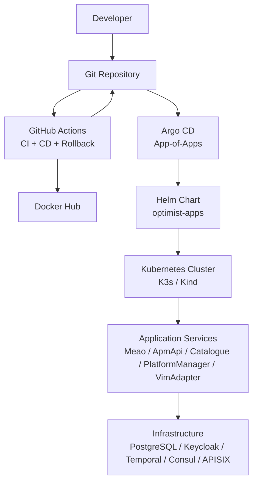

**Diagram sources**
- `.github/workflows/cd.yml#L1-L80`
- `gitops/bootstrap/root-app.yaml#L1-L36`
- `charts/charts/optimist-apps/templates/deployment.yaml#L1-L260`

**Section sources**
- `README.md#L15-L50`
- `docs/DEPLOYMENT.md#L1-L60`

## Core Components
Optimist.Orchestrator ships five runtime services:

| Service | Language | Internal Port | Container Port | Role |
|---|---|---:|---:|---|
| `Meao` | .NET 8 | 5154 | 80 | MEO orchestrator engine; Temporal worker; placement engine |
| `ApmApi` | .NET 8 | 5184 | 80 | Package management inside MEO |
| `Catalogue` | .NET 8 | 5165 | 80 | Internal MEO inventory and census |
| `PlatformManager` | .NET 8 | 5155 | 80 | MEPM lifecycle execution |
| `VimAdapter` | Python 3.11 | — | 50051 | VIM adapter over gRPC (Kubernetes/Helm or OpenStack) |

All four .NET services use multi-stage Dockerfiles based on .NET 8 SDK and ASP.NET runtime images. `VimAdapter` uses a three-stage Python Dockerfile pinned to Python 3.11.16 locally and in the deployed image.

In local development:
- `docker-compose.yml` builds and runs the five application services.
- `docker-compose.infra.yml` runs infrastructure services such as APISIX, Keycloak, Temporal, PostgreSQL, Prometheus, Grafana, OTEL Collector, and cAdvisor.
- `docker-compose.override.yml` maps development ports, mounts source directories, and injects connection strings and Keycloak settings.

**Section sources**
- `docs/DEPLOYMENT.md#L15-L60`
- `docker-compose.yml#L1-L119`
- `docker-compose.override.yml#L1-L85`
- `docs/CONFIGURATION.md#L1-L40`

## Architecture Overview
At a high level, external clients reach the platform through APISIX. Inside the cluster, services communicate via HTTP REST and gRPC, using Consul for service discovery and PostgreSQL for persistent state. Workflows are orchestrated by Temporal. Authentication is provided by Keycloak.

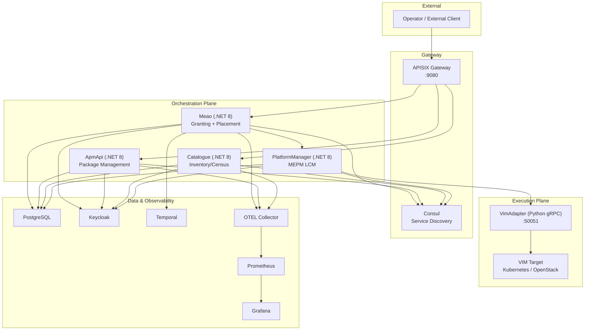

**Diagram sources**
- `README.md#L120-L210`
- `docker-compose.infra.yml#L1-L200`
- `docs/CONFIGURATION.md#L40-L140`

**Section sources**
- `README.md#L120-L210`
- `docs/DEPLOYMENT.md#L15-L120`

## Detailed Component Analysis

### Local Development with Docker Compose
Local development has two layers:
1. Infrastructure services started from `docker-compose.infra.yml`.
2. Application services started from `docker-compose.yml`, with dev overrides from `docker-compose.override.yml`.

The main steps are:
1. Start infrastructure services.
2. Start application services.
3. Verify services with `docker-compose ps`.
4. Optionally run the local E2E smoke test script.

Development port mappings include:
- ApmApi: `5184`
- Meao: `5154`
- Catalogue: `5165`
- PlatformManager: `5155`
- VimAdapter gRPC: `50051`

Infrastructure endpoints include APISIX, Keycloak, Temporal UI, Grafana, Prometheus, and PostgreSQL.

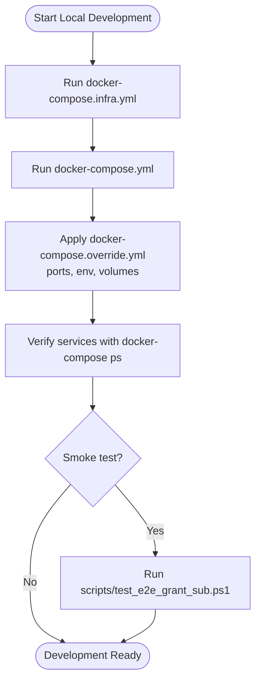

**Diagram sources**
- `docs/DEPLOYMENT.md#L120-L170`
- `docker-compose.yml#L1-L119`
- `docker-compose.infra.yml#L1-L200`
- `docker-compose.override.yml#L1-L85`

**Section sources**
- `docs/DEPLOYMENT.md#L120-L200`
- `docker-compose.yml#L1-L119`
- `docker-compose.override.yml#L1-L85`

### Behavioral Correctness Gates for Local CD
**Updated** The local CD path now includes mandatory behavioral correctness gates that replicate the CI verification pipeline before any image build or registry push.

The `scripts/ci_verify.sh` script serves as a local replica of the CI verification gates, ensuring that local development produces the same quality checks as CI. It is automatically invoked by `scripts/local_cd.sh` before any image building occurs, preventing unverified images from being pushed to registries.

The six verification gates replicated are:

| Gate | Command | Purpose |
|---|---|---|
| 1. ADR Citation Validation | `uv run --python 3.11.16 python scripts/verify_adr_validations.py` | Validates architecture decision record citations and MSBuild glob patterns |
| 2. Helm Chart Linting | `helm lint charts/optimist-apps` | Validates Helm chart syntax and structure |
| 3. Trivy Config Scan | `trivy config --exit-code 1 charts/optimist-apps` | Scans Helm chart for critical/high security misconfigurations |
| 4. Trivy Filesystem/Secret Scan | `trivy fs --exit-code 1` over git archive HEAD | Scans for vulnerabilities and secrets in a clean git snapshot |
| 5. VimAdapter Pytest | `PYTHONPATH= .venv/bin/python -m pytest` | Runs VimAdapter Python test suite |
| 6. .NET Restore/Build/Test | `dotnet restore|build|test -c Release` | Compiles and tests the entire .NET solution |

The script supports `--skip-tests` to run only the cheap structural gates (1-4), skipping the slower behavioral tests (pytest and .NET suites). However, this creates a promotion with no behavioral evidence behind it.

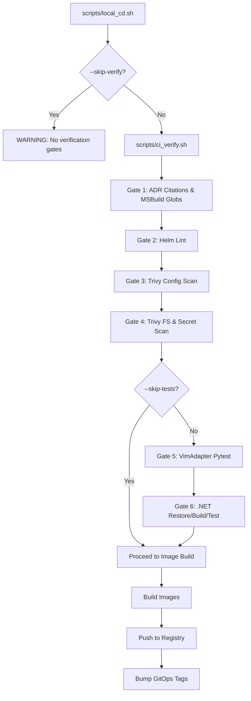

**Diagram sources**
- `scripts/local_cd.sh#L310-L340`
- `scripts/ci_verify.sh#L1-L213`

**Section sources**
- `scripts/ci_verify.sh#L1-L213`
- `scripts/local_cd.sh#L1-L462`

### .NET SDK Pinning for Local Consistency
**New** The repository introduced `global.json` to pin the .NET SDK version and ensure local analyzer/lint output matches CI behavior.

The `global.json` file pins the SDK to version `8.0.100` with `rollForward=latestFeature`, which allows patch updates within the 8.0.x feature band but prevents major version upgrades. This ensures that local development environments produce the same lint warnings, analyzer output, and build behavior as the CI pipeline running on Ubuntu runners with .NET SDK 8.0.x.

Key aspects of the SDK pinning:
- **Version**: `8.0.100` - specific minor version for reproducibility
- **RollForward**: `latestFeature` - allows patch-level rollups but not major versions  
- **AllowPrerelease**: `false` - prevents preview SDK versions from being selected
- **Purpose**: Ensures local analyzer output matches CI runner output even when different SDK versions are installed locally

This pinning addresses the issue where developers might have newer .NET SDK versions installed locally (such as 10.0.101) that would produce different lint warnings or analyzer output than the CI environment.

**Section sources**
- `global.json#L1-L7`

### Kubernetes Deployment with Helm
The production workload is packaged as the `optimist-apps` Helm chart. The chart defines:
- Deployments for each service with resource requests and limits.
- ClusterIP Services for internal communication.
- Health probes for liveness and readiness.
- Migration jobs for database schema updates.
- PVC templates for persistent storage where required.
- Rollout gate integration.

The Helm chart values define image registry, pull secrets, replica count, resources, per-service image names/tags/ports, and probe types.

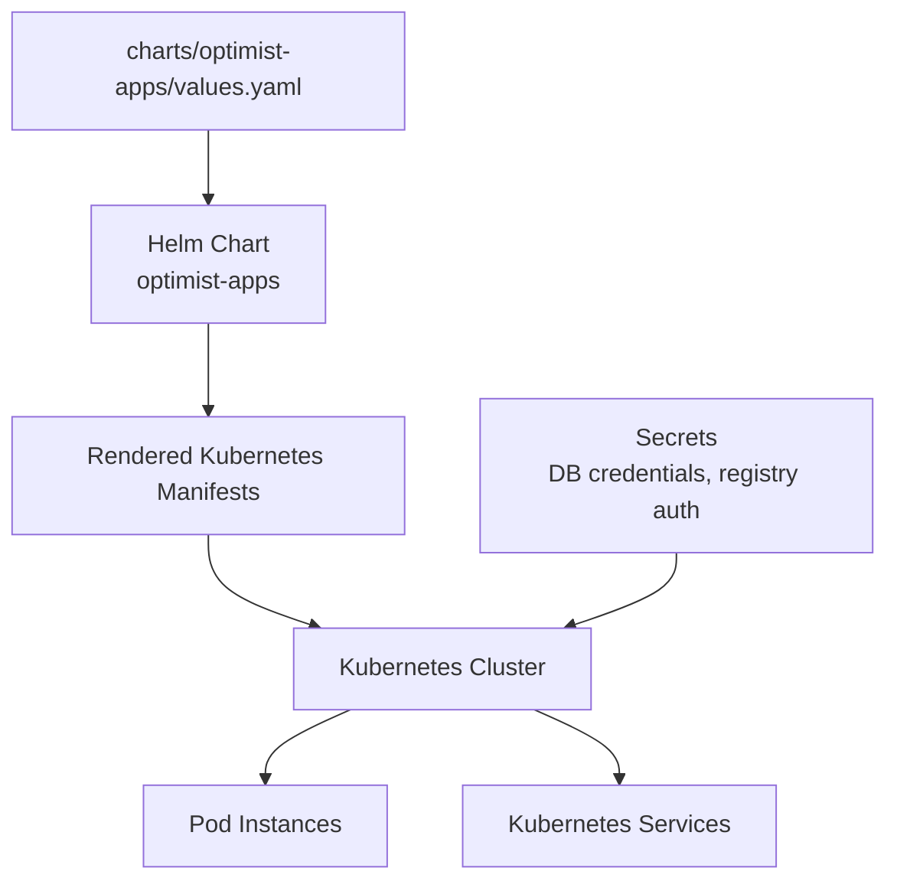

**Diagram sources**
- `docs/DEPLOYMENT.md#L230-L290`
- `charts/charts/optimist-apps/templates/deployment.yaml#L1-L260`
- `charts/charts/optimist-apps/templates/migration-jobs.yaml#L1-L200`

**Section sources**
- `docs/DEPLOYMENT.md#L230-L290`

### GitOps with Argo CD
Production deployment uses a zero-trust GitOps pull model:
- GitHub Actions does not write directly to the cluster.
- GitHub Actions builds and pushes images to Docker Hub.
- GitHub Actions updates image tags in `charts/optimist-apps/values.yaml`.
- Argo CD watches the repository and reconciles the desired state.

The root Argo CD Application at `gitops/bootstrap/root-app.yaml` points to `gitops/bootstrap/apps` and recurses into child Applications. Sync policy enables automated sync, pruning, and self-healing.

Sync waves ensure infrastructure dependencies are ready before application workloads:
1. Admission controllers, CRDs, and External Secrets Operator.
2. Persistent data stores and policies.
3. Temporal.
4. Keycloak.
5. Consul.
6. APISIX.
7. Gateway routes.
8. Application workloads.

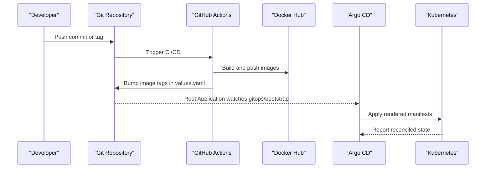

**Diagram sources**
- `gitops/bootstrap/root-app.yaml#L1-L36`
- `.github/workflows/cd.yml#L1-L120`
- `scripts/bump_gitops_tags.py#L1-L60`

**Section sources**
- `docs/DEPLOYMENT.md#L60-L120`
- `gitops/bootstrap/root-app.yaml#L1-L36`

### CI Pipeline
The CI pipeline runs on pull requests and feature branches. Its responsibilities are:
- ADR citation validation.
- Helm linting.
- Trivy scan for Helm chart misconfigurations.
- Trivy filesystem and secret scanning.
- VimAdapter pytest execution.
- .NET restore, build, and test.
- Docker dry-run build for every service image.
- Trivy container vulnerability scan for built images.

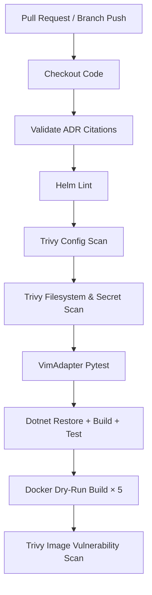

**Diagram sources**
- `.github/workflows/ci.yml#L1-L146`

**Section sources**
- `.github/workflows/ci.yml#L1-L146`

### CD Pipeline
The CD pipeline triggers on pushes to `main` or `develop`, `v*` tags, PRs to `main`/`develop`, and manual dispatch. Path filters ignore changes that only touch planning and documentation.

CD stages:
1. **Docker publish:** Matrix build for all five services with GitHub Actions cache and QEMU multi-platform support.
2. **Vulnerability gating:** Trivy scans are non-blocking on PRs and blocking on main/tag pushes.
3. **Cosign keyless signing and attestation:** Images are signed and vulnerability attestations are attached.
4. **GitOps promotion:** Updates image tags in `charts/optimist-apps/values.yaml` using `scripts/bump_gitops_tags.py`.
5. **GitOps verification:** Lints, renders, and scans rendered manifests.
6. **Cluster reconciliation:** Argo CD pulls the updated values and applies them.

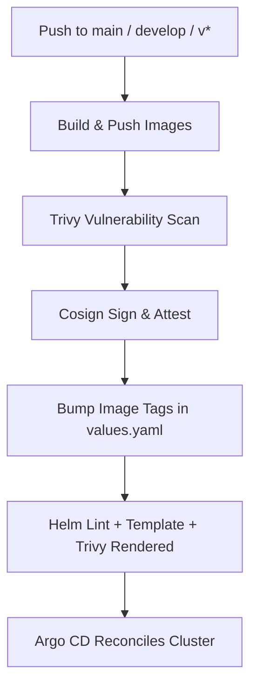

**Diagram sources**
- `.github/workflows/cd.yml#L1-L200`
- `scripts/bump_gitops_tags.py#L1-L200`

**Section sources**
- `.github/workflows/cd.yml#L1-L200`
- `docs/DEPLOYMENT.md#L170-L230`

### Rollback Strategy
Rollbacks are forward Git writes rather than imperative cluster edits. The dedicated rollback workflow:
1. Validates that the target image tag exists for every affected service.
2. Rewrites `charts/optimist-apps/values.yaml` to the target tag.
3. Commits and pushes the change.
4. Lets Argo CD reconcile the previous known-good state.

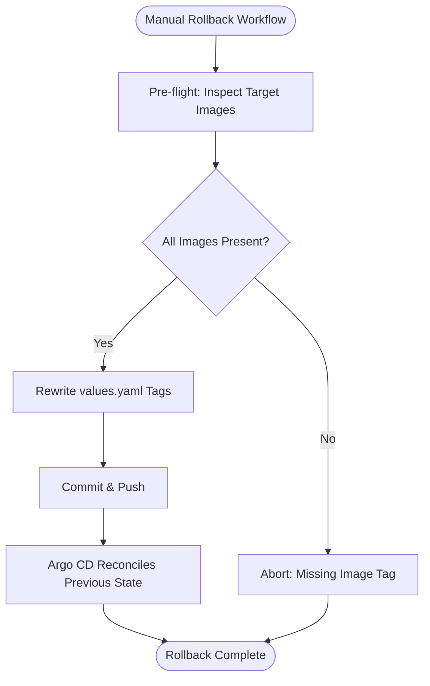

**Diagram sources**
- `.github/workflows/rollback.yml#L1-L160`
- `scripts/bump_gitops_tags.py#L1-L200`

**Section sources**
- `.github/workflows/rollback.yml#L1-L160`
- `docs/DEPLOYMENT.md#L290-L370`

### Infrastructure Provisioning with Terraform
Terraform owns the OCI substrate conceptually but is intentionally plan-only:
- It models the VCN, subnet, internet gateway, route table, security list, and compute instance.
- `enable_network` and `enable_compute` default to `false`, so a default plan proposes no resources.
- `prevent_destroy` protects critical network resources.
- A guard script refuses destructive Terraform verbs.
- Credentials and keys must be supplied externally; nothing sensitive is committed.

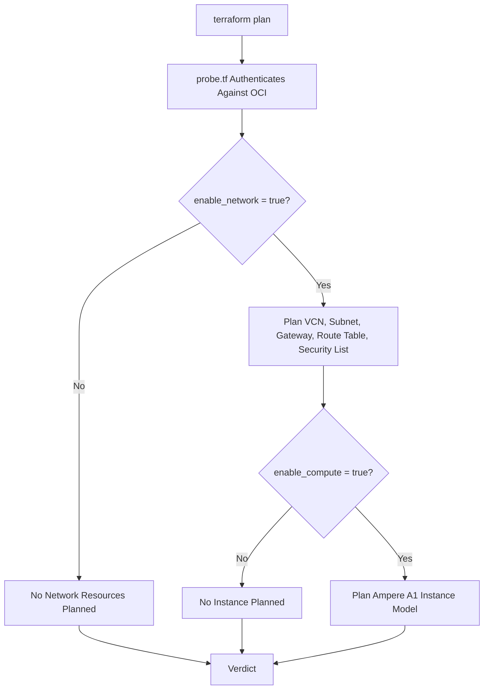

**Diagram sources**
- `terraform/README.md#L1-L120`
- `terraform/variables.tf#L1-L156`
- `terraform/network.tf#L1-L200`
- `terraform/compute.tf#L1-L200`

**Section sources**
- `terraform/README.md#L1-L120`
- `terraform/variables.tf#L1-L156`
- `terraform/network.tf#L1-L200`
- `terraform/compute.tf#L1-L200`

### Server Configuration with Ansible
Ansible manages the host plane up to the boundary where Kubernetes objects begin:
- `preflight`: read-only fact gathering and assertions.
- `node_baseline`: packages, sysctls, SSH hardening, and handoff checks.
- `k3s_server`: installs and supervises the K3s server process, gated off by default.

The playbook explicitly avoids managing namespaces, deployments, services, CRDs, ConfigMaps, or Secrets; those belong to Argo CD.

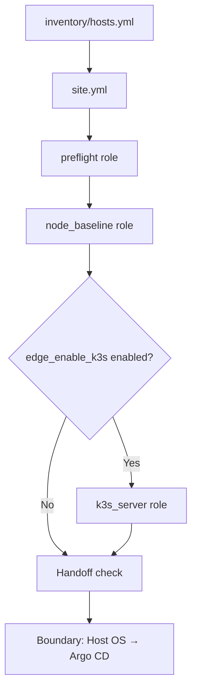

**Diagram sources**
- `ansible/site.yml#L1-L52`
- `ansible/README.md#L1-L120`

**Section sources**
- `ansible/site.yml#L1-L52`
- `ansible/README.md#L1-L120`

### Environment Configuration Management
Configuration follows this priority order:
1. Environment-specific `appsettings.json` files if present.
2. `launchSettings.json` environment variables for local development.
3. Environment variables from Docker, Helm, or shell.
4. Command-line arguments.

Key configuration surfaces include:
- Connection strings for EF Core databases.
- Consul service discovery host and port.
- OTLP exporter endpoint.
- Keycloak client secrets per service.
- VimAdapter plugin address and TLS settings.
- Per-service public URLs and auto-subscription behavior.

For local development, `.env.keycloak` supplies Keycloak client secrets through `env_file`, while `.env` supplies Postgres-related values consumed by the Postgres container.

**Section sources**
- `docs/CONFIGURATION.md#L1-L140`
- `docs/CONFIGURATION.md#L140-L250`
- `docker-compose.override.yml#L1-L85`

### Secrets Handling
Secrets are handled differently depending on environment:

| Context | Mechanism | Notes |
|---|---|---|
| Local Docker Compose | `.env` and `.env.keycloak` loaded via `env_file` | Never committed; `.env.example` is the template |
| Kubernetes | External Secrets Operator and Kubernetes Secrets | DB credentials and registry pull secrets are injected into workloads |
| GitHub Actions | Repository Variables and Secrets | Docker Hub username/token and GITHUB_TOKEN |
| Terraform | Provider configuration and environment variables | Keys and passphrases never committed |
| Ansible | Inventory variables and play-level inputs | No secrets in the repository tree |

Important rules:
- Do not commit `.env`, `.env.keycloak`, private keys, or real database passwords.
- Use External Secrets Operator-backed values in production.
- Keep Keycloak client secrets per service (`KEYCLOAK_CLIENT_SECRET_<SERVICE>`).
- Store image registry credentials as Kubernetes `imagePullSecrets`.

**Section sources**
- `docs/CONFIGURATION.md#L1-L100`
- `docs/DEPLOYMENT.md#L370-L417`
- `.github/workflows/cd.yml#L1-L120`
- `terraform/README.md#L1-L80`

## Dependency Analysis
The system has clear layering:
- External clients depend on APISIX.
- Orchestration services depend on Consul, Keycloak, PostgreSQL, and Temporal.
- MEPM depends on VimAdapter over gRPC.
- VimAdapter depends on the underlying VIM target.
- CI/CD depends on Docker, Helm, Trivy, Cosign, and Git.
- Argo CD depends on Git and Kubernetes.
- Terraform depends on OCI provider credentials.
- Ansible depends on SSH access to the target node.

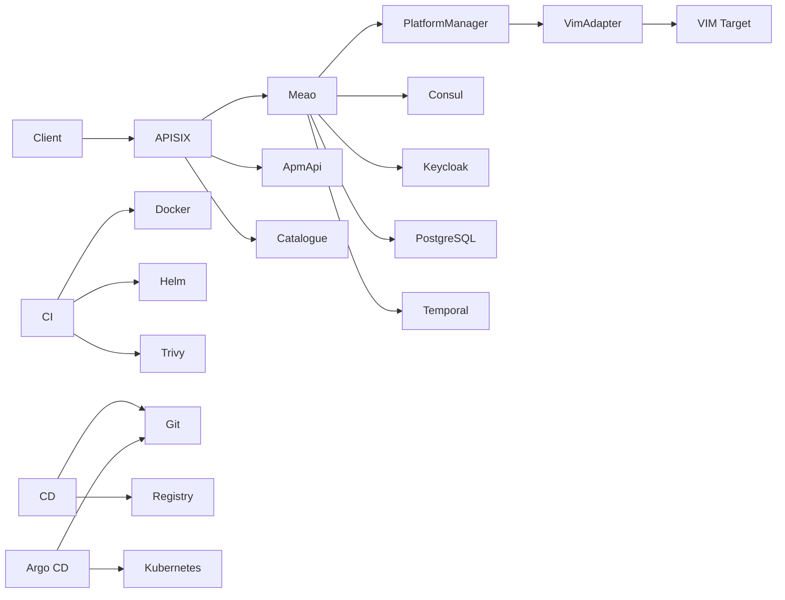

**Diagram sources**
- `README.md#L120-L210`
- `.github/workflows/ci.yml#L1-L146`
- `.github/workflows/cd.yml#L1-L200`
- `gitops/bootstrap/root-app.yaml#L1-L36`

**Section sources**
- `README.md#L120-L210`
- `.github/workflows/ci.yml#L1-L146`
- `.github/workflows/cd.yml#L1-L200`

## Performance Considerations
Performance guidance should be applied with awareness of the current architecture:

| Area | Current Behavior | Recommendation |
|---|---|---|
| Replicas | Helm chart defaults to one replica per service | Scale read-heavy services first; measure before scaling write-heavy services |
| Resource Requests/Limits | Chart exposes CPU/memory requests and memory limits | Tune based on Prometheus metrics and container memory pressure |
| Database Migrations | Three services auto-migrate on startup; Meao does not | Ensure migration compatibility before rolling back application versions |
| gRPC Communication | PlatformManager calls VimAdapter over gRPC | Prefer TCP health probes for VimAdapter and enable TLS in production |
| Service Discovery | Steeltoe/Consul-based discovery | Validate Consul registration and DNS resolution under load |
| Observability | OTLP exporter configured per service | Centralize tracing and metrics; avoid excessive sampling in production |
| Image Caching | GitHub Actions cache scoped per service | Use registry-backed cache for local builds when CI cache is unavailable |
| ARM64 Target | Production target is OCI Ampere A1 ARM64 | Build both arm64 and amd64 images; verify rollout on ARM nodes |
| Local Verification | ci_verify.sh adds ~60-120s overhead | Use `--skip-tests` for quick structural checks during development |

[No sources needed since this section provides general guidance]

## Troubleshooting Guide

### Local Development Issues
- **Services cannot connect to PostgreSQL:** Confirm `.env` and `.env.keycloak` exist and contain expected values. Check `docker-compose.override.yml` connection strings.
- **Keycloak authentication fails:** Ensure `KEYCLOAK_CLIENT_SECRET_<SERVICE>` values are set and match Keycloak realm configuration.
- **VimAdapter gRPC connectivity issues:** Verify `VIM_TYPE=k8s` and `GRPC_INSECURE=true` in development, and that Port `50051` is available.
- **Compose build errors:** Confirm build context paths and Dockerfiles exist under `src/`.

**Section sources**
- `docs/CONFIGURATION.md#L140-L250`
- `docker-compose.override.yml#L1-L85`

### Local CD Verification Gate Failures
**Updated** The new behavioral correctness gates provide comprehensive validation before image building:

- **ADR validation fails:** Add missing ADR citations in changed documents. Use `scripts/verify_adr_validations.py` to identify specific file reference issues.
- **Helm lint fails:** Validate chart syntax and referenced values. Run `helm lint charts/optimist-apps` locally to reproduce the exact error.
- **Trivy config scan fails:** Review `.trivyignore` and fix critical/high findings in the Helm chart configuration.
- **Trivy filesystem/secret scan fails:** The scan runs against a git archive HEAD snapshot, not the working tree. Clean up generated certificates and temporary files that may trigger false positives.
- **VimAdapter pytest fails:** Ensure Python 3.11.16 is used consistently. Check that `.python-version` matches the venv interpreter version.
- **.NET tests fail:** Verify SDK version 8.0.100 is selected via `global.json`. Check test output and dependency resolution.

Common solutions:
- Use `scripts/ci_verify.sh --skip-tests` for fast structural validation without behavioral tests
- Use `scripts/ci_verify.sh --skip-verify` only when you understand the risks (no verification evidence)
- Ensure `.python-version` contains `3.11.16` for consistent Python behavior
- Verify `global.json` pins SDK 8.0.100 for consistent .NET behavior

**Section sources**
- `scripts/ci_verify.sh#L1-L213`
- `scripts/local_cd.sh#L310-L340`

### CI Failures
- **ADR validation fails:** Add missing ADR citations in changed documents.
- **Helm lint fails:** Validate chart syntax and referenced values.
- **Trivy scan fails:** Review `.trivyignore` and fix critical/high findings.
- **VimAdapter pytest fails:** Ensure Python 3.11 and requirements are installed in a virtual environment.
- **.NET tests fail:** Check test output and dependency resolution.

**Section sources**
- `.github/workflows/ci.yml#L1-L146`

### CD Failures
- **Image push fails:** Verify Docker Hub variable and secret configuration.
- **Tag promotion fails:** Check `scripts/bump_gitops_tags.py` arguments and permissions.
- **Manifest rendering fails:** Run `helm template` locally against `charts/optimist-apps/values.yaml`.
- **Rollback pre-flight fails:** Confirm the target tag exists in the registry for every service.

**Section sources**
- `.github/workflows/cd.yml#L1-L200`
- `.github/workflows/rollback.yml#L1-L160`

### Kubernetes Issues
- **Pods crash-looping:** Check liveness/readiness probes, environment variables, and database connectivity.
- **ImagePullBackOff:** Verify image registry, pull secrets, and image tag existence.
- **Migration failures:** Compare application version with database schema; remember migrations are forward-only.
- **Argo CD drift:** Enable self-heal and prune, then reconcile the root Application.

**Section sources**
- `docs/DEPLOYMENT.md#L230-L370`
- `gitops/bootstrap/root-app.yaml#L1-L36`

### Terraform and Ansible Issues
- **Terraform plan fails without credentials:** Export `OCI_PRIVATE_KEY_PATH` and passphrase; confirm the provider can authenticate.
- **Terraform plan proposes unexpected resources:** Verify `enable_network` and `enable_compute` flags.
- **Ansible preflight fails on wrong architecture:** Correct architecture expectations or run against the correct node.
- **Ansible convergence requires privilege:** Use become and provide sudo password when running baseline tasks.

**Section sources**
- `terraform/README.md#L120-L220`
- `terraform/variables.tf#L1-L156`
- `ansible/README.md#L120-L229`

### .NET SDK Version Issues
**New** When encountering inconsistent .NET analyzer output or lint warnings between local and CI environments:

- Verify `global.json` contains SDK version `8.0.100` with `rollForward=latestFeature`
- Ensure your local .NET installation respects the global.json pinning
- Check `dotnet --info` to confirm the correct SDK version is being selected
- If conflicts persist, remove newer SDK versions that might override the pinned version
- The `rollForward=latestFeature` setting allows patch updates but prevents major version upgrades

**Section sources**
- `global.json#L1-L7`

## Operational Runbooks

### Monitoring
- **Grafana:** View dashboards for application and infrastructure metrics.
- **Prometheus:** Query time-series metrics and alert rules.
- **cAdvisor:** Inspect container resource usage.
- **Temporal UI:** Inspect workflow executions and history.
- **APISIX Dashboard:** Inspect gateway configuration and routes.
- **OpenTelemetry:** Trace cross-service requests across Meao, ApmApi, Catalogue, PlatformManager, and VimAdapter.

Local endpoints are exposed through Docker Compose. For in-cluster endpoints, consult the cluster operator or existing ingress/gateway configuration.

**Section sources**
- `docs/DEPLOYMENT.md#L370-L417`
- `docker-compose.infra.yml#L1-L200`

### Scaling
Recommended approach:
1. Identify the bottleneck using Prometheus and Grafana.
2. Increase replicas for read-heavy services first.
3. Tune resource requests and limits in the Helm chart.
4. Validate database connection pooling and migration throughput.
5. Monitor Pod restarts, latency, error rates, and resource saturation.
6. Avoid scaling write-heavy services until database capacity is verified.

Scaling knobs in the Helm chart include replica count and per-service resource requests/limits.

**Section sources**
- `docs/DEPLOYMENT.md#L230-L290`

### Backup and Restore
Operational guidance:
- **PostgreSQL:** Back up each service's database (`meao_db`, `apmdb`, `catalogue_db`, `mepm_db`).
- **Persistent Volumes:** Back up PVCs used by stateful components.
- **Configuration:** Preserve `values.yaml`, Argo CD Application manifests, and External Secrets definitions.
- **Images:** Maintain image digest immutability and retention policy in the registry.
- **Keycloak Realm:** Preserve realm export if managed outside Git.

Restore procedure:
1. Restore PostgreSQL databases in expected order.
2. Apply External Secrets and Kubernetes Secrets.
3. Apply Argo CD root Application.
4. Let Argo CD reconcile workloads.
5. Verify health endpoints and database migrations.

[No sources needed since this section provides general guidance]

### Disaster Recovery
Disaster recovery priorities:
1. Restore data integrity first (PostgreSQL, persistent volumes).
2. Restore identity and secrets (Keycloak, External Secrets Operator).
3. Restore infrastructure networking and gateways (APISIX, Consul).
4. Restore application workloads.
5. Validate end-to-end flows.

Important constraints:
- Database migrations are forward-only; do not assume rolling back application versions restores the database.
- Git history is the source of truth for desired state; prefer restoring from known-good commits.
- Rollback workflow reverts image tags only; it does not revert database schema.

**Section sources**
- `docs/DEPLOYMENT.md#L290-L370`
- `.github/workflows/rollback.yml#L1-L160`

### Environment Promotion
To promote a build to production:
1. Build images through CI or `build-images.sh`.
2. Allow CD to bump image tags automatically on `main` or `v*` tags.
3. Alternatively, manually run `python scripts/bump_gitops_tags.py <tag>`.
4. Commit and push the updated `values.yaml`.
5. Wait for Argo CD to reconcile or trigger a manual sync.

Local CD emulation:
- Use `scripts/local_cd.sh` to reproduce CI/CD behavior without pushing.
- It validates prerequisites, builds images, runs Trivy, and prints the final diff.
- It does not produce a Cosign signature because that requires GitHub OIDC.
- **Critical:** Always review the printed commands and working tree diff before committing changes.

**Section sources**
- `docs/DEPLOYMENT.md#L170-L230`
- `scripts/bump_gitops_tags.py#L1-L200`
- `scripts/local_cd.sh#L1-L462`
- `build-images.sh#L1-L20`

## Conclusion
Optimist.Orchestrator's deployment model separates concerns clearly:
- **Terraform** models cloud substrate as code without owning live state.
- **Ansible** configures the host OS and K3s process without touching cluster objects.
- **GitHub Actions** builds, secures, and promotes container images.
- **Argo CD** owns in-cluster state through GitOps.
- **Helm** packages application workloads and their configuration.
- **Docker Compose** supports local development and evaluation.
- **Behavioral correctness gates** ensure local development quality matches CI standards.

The introduction of mandatory behavioral correctness gates in the local CD path represents a significant improvement in development workflow reliability. By replicating the CI verification pipeline locally, developers now have comprehensive validation coverage before any image is built or pushed, including ADR citation validation, Helm chart linting, security scanning, Python test execution, and .NET solution-wide testing. The .NET SDK pinning further ensures consistent analyzer output across development and CI environments.

For production operations, treat Git as the single source of truth, keep database migrations forward-compatible, centralize observability, manage secrets through External Secrets Operator, and use rollbacks as forward Git changes rather than imperative cluster edits. The enhanced local verification process ensures that the quality bar raised in CI is maintained throughout the entire development workflow.

[No sources needed since this section summarizes without analyzing specific files]