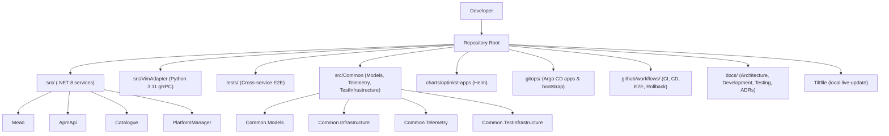
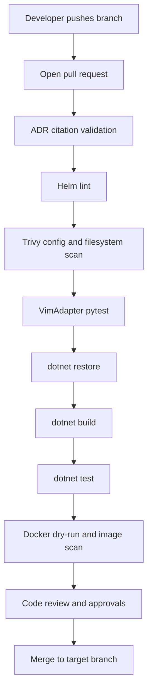
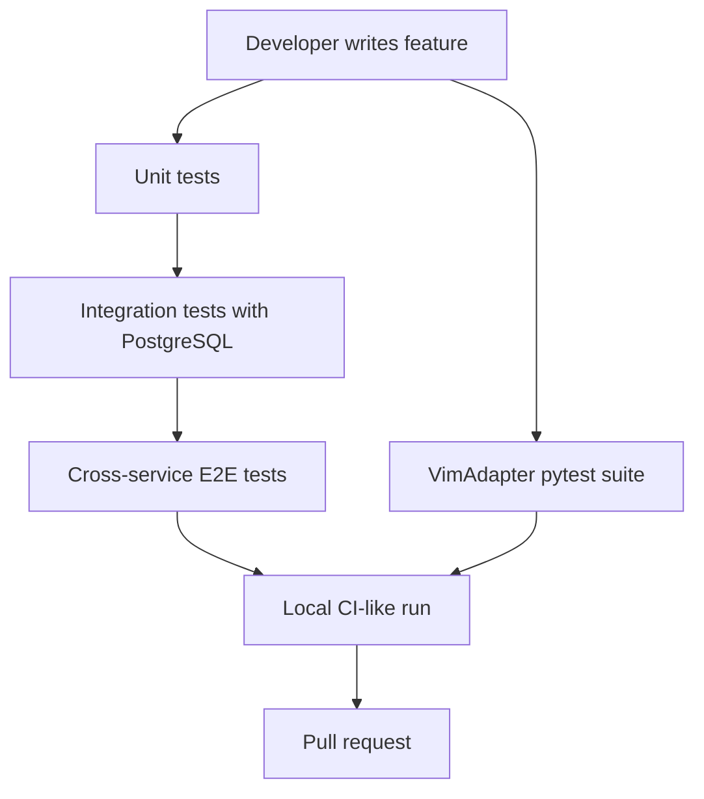
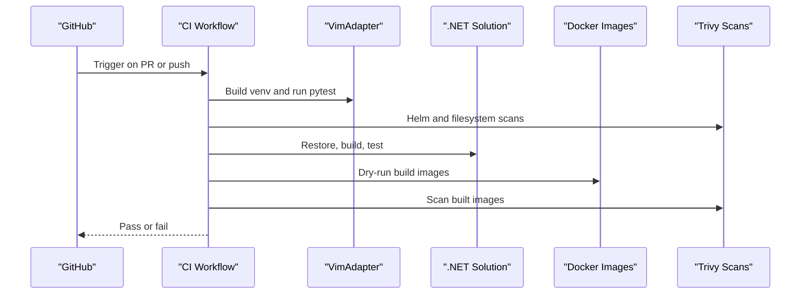
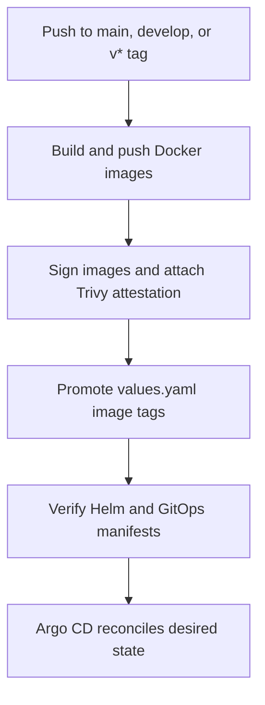
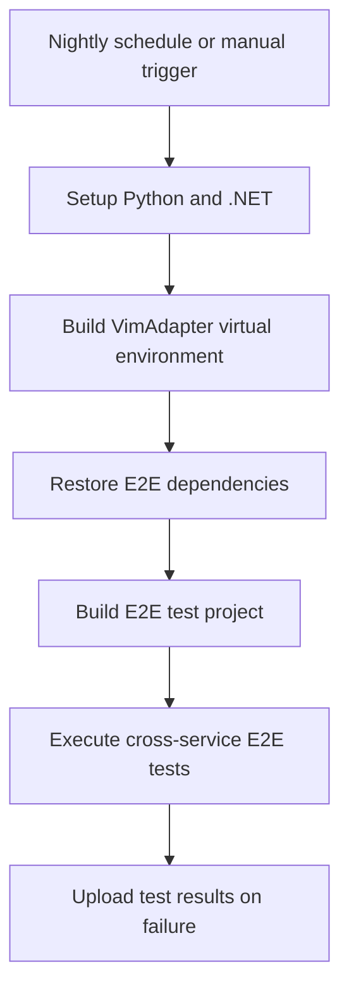
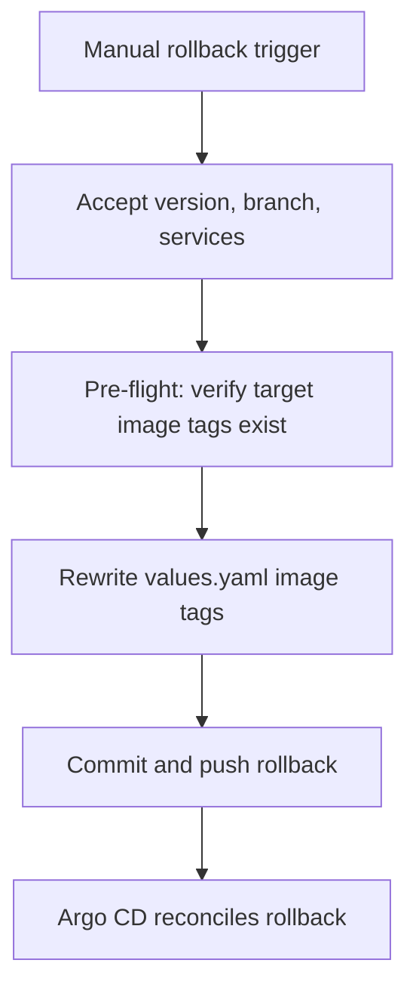
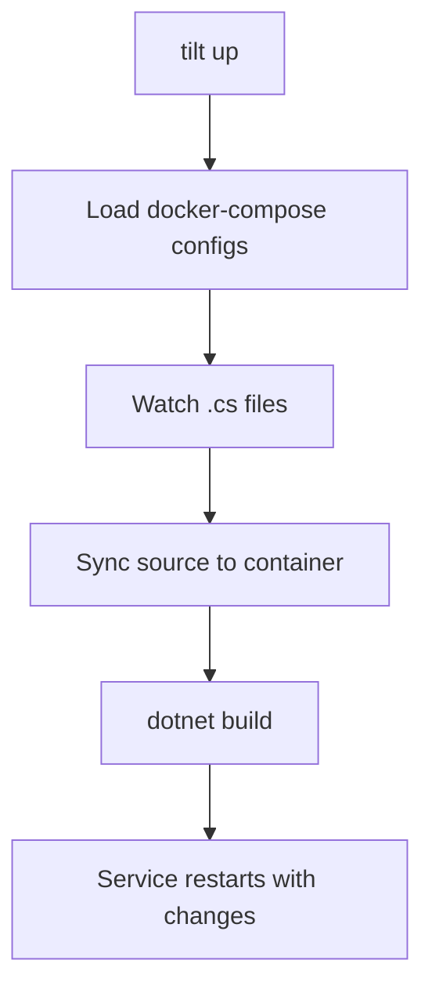

# Development Guide

## Table of Contents
1. [Introduction](#introduction)
2. [Project Structure](#project-structure)
3. [Development Environment Setup](#development-environment-setup)
4. [Coding Standards and .NET 8 Best Practices](#coding-standards-and-net-8-best-practices)
5. [Branch Management Strategy](#branch-management-strategy)
6. [Pull Request Process](#pull-request-process)
7. [Writing New Features](#writing-new-features)
8. [Testing Strategy](#testing-strategy)
9. [Code Review Guidelines](#code-review-guidelines)
10. [CI/CD Pipeline Customization](#cicd-pipeline-customization)
11. [Automated Quality Gates](#automated-quality-gates)
12. [Release and Rollback Management](#release-and-rollback-management)
13. [Troubleshooting Guide](#troubleshooting-guide)
14. [Conclusion](#conclusion)

## Introduction
This Development Guide consolidates the project’s coding standards, development workflow, contribution guidelines, CI/CD behavior, and release process for the Optimist.Orchestrator repository. It is intended for developers working on the .NET 8 services (Meao, ApmApi, Catalogue, PlatformManager), the Python VimAdapter service, and the surrounding GitOps and testing infrastructure.

The guide emphasizes:
- .NET 8 baseline and C# style conventions.
- Local development using Docker Compose and Tilt for live reload.
- Branch naming, commit messages, and pull request gates.
- Test organization across unit, integration, cross-service E2E, and Python pytest suites.
- GitHub Actions CI/CD jobs, Trivy security scans, Helm chart validation, and Argo CD-driven GitOps releases.
- Safe rollback through image tag reversion without rebuilding images.

## Project Structure
The repository is organized around microservices under `src/`, a shared library layer under `src/Common`, end-to-end tests under `tests/`, container and orchestration artifacts under `charts/` and `gitops/`, and automation under `.github/workflows/`.



**Diagram sources**
- `docs/DEVELOPMENT.md#L1-L200`
- `Tiltfile#L1-L41`
- `.github/workflows/ci.yml#L1-L146`

**Section sources**
- `docs/DEVELOPMENT.md#L1-L200`

## Development Environment Setup
### Prerequisites
| Tool | Version | Purpose |
|------|---------|---------|
| .NET SDK | 8.0.x | Build and test all .NET services. |
| Python | 3.11.16 locally; CI uses floating `3.11` | VimAdapter gRPC adapter, HelmK8s + OpenStack support. |
| Docker / Docker Compose | Latest | Infrastructure stack: PostgreSQL 16, Temporal, Consul, APISIX, Keycloak, OTel, Prometheus, Grafana. |
| git | 2.x | Branch and PR workflow. |
| Helm | 3.15+ | Kubernetes application deployment via `charts/optimist-apps/`. |
| Tilt | Installed locally | Live-reload development against Docker Compose or Kubernetes contexts. |

Verify that your local environment matches the CI baselines:
- .NET SDK 8.0.x is required by CI and `.csproj` targets.
- Python 3.11 is used by CI; VimAdapter development pins patch `3.11.16`.
- PostgreSQL 16 runs in the infrastructure compose file for .NET services, Temporal, and Keycloak.

### Initial Repository Setup
1. Clone the repository.
2. Copy the example environment configuration into a local `.env` file.
3. Start the infrastructure stack with Docker Compose.
4. Set up the VimAdapter Python virtual environment using the pinned interpreter.
5. Start application services either directly with `dotnet run` or through Docker Compose/Tilt.

### Local Service Ports
| Service | Kestrel or gRPC Port | Docker Compose Host Port | Base Path |
|---------|---------------------|--------------------------|-----------|
| Meao | 5299 | 5154 | `/granting/v1` |
| ApmApi | 5184 | 5184 | `/app_pkgm/v1` |
| Catalogue | 5183 | 5165 | `/catalogue/v1` |
| PlatformManager | 5029 | 5155 | `/app_lcm/v1` |
| VimAdapter | 50051 (gRPC) | 50051 (gRPC) | LCM gRPC service |

Infrastructure services include APISIX, Temporal, PostgreSQL, Consul, Keycloak, Prometheus, Grafana, and the OpenTelemetry Collector.

### IDE Configuration
- Use an editor that honors `.editorconfig` files. The APM API service ships a comprehensive C# style and formatting configuration.
- Keep line endings and indentation consistent with the per-service `.editorconfig`.
- Enable formatter-on-save if supported by your IDE, but verify changes with `dotnet format` before committing.

**Section sources**
- `docs/DEVELOPMENT.md#L1-L200`
- `docs/DEVELOPMENT.md#L201-L495`

## Coding Standards and .NET 8 Best Practices
### EditorConfig Conventions
The repository does not use a single root `.editorconfig`; instead, each .NET service carries its own configuration. The APM API `.editorconfig` defines the strongest set of rules in the codebase and should be treated as the reference implementation for new services.

Key conventions include:
- UTF-8 encoding.
- Four-space indentation for most files; XML, JSON, YAML, and project files often use two spaces.
- CRLF line endings on Windows where configured by service-level `.editorconfig`.
- Final newline handling varies by service; do not assume every file requires a trailing newline.
- Nullable reference types and implicit usings are enabled at the project level.
- File-scoped namespace declarations are preferred.
- System `using` directives are sorted first and grouped according to the configured rule set.

### C# Style Rules
The active style rules emphasize readability and consistency:
- Prefer built-in type keywords over framework type names.
- Prefer `var` when the type is apparent, including for built-in types.
- Prefer expression-bodied members where appropriate.
- Prefer pattern matching, switch expressions, and null-check patterns.
- Prefer compound assignment operators and simplified interpolation.
- Prefer nullable propagation and null-coalescing where meaningful.
- Prefer object initializers and collection initializers.
- Prefer auto properties, inline variable declarations, index/range operators, and deconstruction where clear.
- Require accessibility modifiers on non-interface members.
- Enforce a stable modifier order.

### Naming Conventions
| Symbol | Convention | Severity |
|--------|------------|----------|
| Namespaces, classes, structs, enums, delegates | PascalCase | Warning |
| Interfaces | PascalCase with `I` prefix | Warning |
| Type parameters | PascalCase with `T` prefix | Warning |
| Methods, properties, events | PascalCase | Warning |
| Parameters, local variables | camelCase | Warning |
| Private instance fields | `_camelCase` | Suggestion |
| Private static readonly fields | `s_camelCase` | Suggestion |
| Public constants and readonly fields | PascalCase | Warning |
| Public/protected instance fields | Disallowed | Error |

### .NET 8 Architectural Best Practices
- Treat ETSI GS MEC contracts as authoritative; do not change DTO shapes or endpoint paths without validating against the specification.
- Use PostgreSQL for persistence across services; avoid assuming SQLite or MySQL unless explicitly scoped to isolated tests.
- Implement background processing with hosted `BackgroundService` workers and channel readers, passing cancellation tokens; avoid fire-and-forget tasks inside HTTP endpoints.
- Use the shared global exception handler to produce RFC 7807 `ProblemDetails`.
- Validate input through FluentValidation and endpoint filters.
- Preserve Temporal determinism inside workflows: generate IDs and timestamps through Temporal APIs rather than direct runtime calls.
- Compose standard resilience handlers after service discovery registration.
- Use forward slashes in `.csproj` glob patterns for cross-platform compatibility.
- Wrap multi-entity EF Core updates in explicit database transactions.

### Formatting Commands
- Format a single service project.
- Format the entire solution.
- Verify formatting without applying changes.

**Section sources**
- `src/ApmApi/.editorconfig#L1-L200`
- `src/ApmApi/.editorconfig#L200-L449`
- `src/Catalogue/.editorconfig#L1-L12`
- `docs/DEVELOPMENT.md#L201-L495`

## Branch Management Strategy
The repository follows conventional branch prefixes and commit messages.

### Branch Prefixes
| Type | Prefix | Example | Usage |
|------|--------|---------|-------|
| Feature | `feature/` | `feature/my-feature` | Non-breaking new functionality. |
| Bug fix | `fix/` | `fix(scope)` | Targeted bug fixes. |
| Phase work | Unprefixed phase branches | `phase-N.M-descriptor` | Long-running phased deliverables. |
| Release | Tagged releases | `v*` | CD pipeline triggers builds and promotions. |

Active branch patterns include `main`, `develop`, `feature/**`, `fix/**`, and phase-specific branches.

### Commit Message Convention
Use Conventional Commits with optional scope:
```
<type>[optional scope]: <description>

[optional body]
[optional footer — closes #issue]
```

Observed commit types include `fix`, `feat`, `docs`, `refactor`, `perf`, `test`, `ci`, `cd`, `build`, `style`, `revert`, and `chore`.

### Branching Rules
1. Use `feature/` for new features and `fix/` for bug fixes.
2. Phase-level work may use unprefixed `phase-N` or `phase-N.M-descriptor` branches.
3. Keep branches focused on a single concern.
4. Use hyphens in branch names and parentheses with hyphens in commit scopes.
5. Avoid pushing directly to `main` without explicit approval.

**Section sources**
- `docs/DEVELOPMENT.md#L201-L495`

## Pull Request Process
A pull request is the boundary between local development and automated quality checks.

### Before Opening a Pull Request
1. Create a feature or fix branch from `main`.
2. Implement changes following the repository’s architectural patterns and code style.
3. Run ADR citation validation.
4. Run relevant .NET tests:
   - Catalogue integration tests.
   - Meao unit tests.
   - ApmApi tests.
   - PlatformManager integration tests.
5. Run VimAdapter Python tests.
6. Verify formatting with `dotnet format --verify-no-changes`.
7. Update affected documentation:
   - Implementation plan.
   - Architecture assessment.
   - ADR index and status headers.
   - Component READMEs.
   - Developer-facing guides when tooling or workflows change.

### Pushing and Review
- Stage and commit changes atomically by concern.
- Push the branch to the remote.
- Do not rely on automatic commits without explicit user confirmation.
- Open a pull request targeting `main`.
- Treat CodeRabbit findings as advisory but review them carefully; resolve valid issues and document reasons for skipping stale or invalid suggestions.

### What CI Runs on Pull Requests
- ADR citation integrity check.
- Helm lint and Trivy configuration scan.
- Filesystem and secret scanning.
- VimAdapter pytest execution.
- .NET restore, build, and test.
- Docker dry-run build and vulnerability scan for applicable images.



**Diagram sources**
- `.github/workflows/ci.yml#L1-L146`
- `docs/DEVELOPMENT.md#L201-L495`

**Section sources**
- `docs/DEVELOPMENT.md#L201-L495`
- `.github/workflows/ci.yml#L1-L146`

## Writing New Features
When adding a new feature:
1. Identify whether the change belongs to Meao, ApmApi, Catalogue, PlatformManager, VimAdapter, shared infrastructure, or GitOps manifests.
2. Follow the service layout:
   - Endpoints under `Endpoints/`.
   - Models under `Models/`.
   - Validators under `Validators/`.
   - Services under `Services/`.
   - Background activities or workers under `Activities/` or `Background/`.
   - Migrations under `Migrations/`.
3. Add corresponding tests:
   - Unit tests for pure logic.
   - Integration tests using `PostgresTestDatabaseFixture` when persistence is involved.
   - Wire contract or snapshot tests where API shape matters.
4. Update documentation tied to the feature, including ADR references when architectural decisions change.
5. Ensure new code respects:
   - ETSI API contracts.
   - PostgreSQL-only persistence strategy.
   - Global exception handling and RFC 7807 responses.
   - Temporal determinism rules for workflows.
   - Resilience handler composition.
   - Forward-slash MSBuild globs.

For VimAdapter features:
- Place Python tests under `src/VimAdapter/tests/`.
- Use `pytest` and `pytest-asyncio`.
- Keep the local virtual environment pinned to Python 3.11.16.
- Avoid leaking credentials through logs or subprocess arguments.

**Section sources**
- `docs/DEVELOPMENT.md#L201-L495`
- `docs/TESTING.md#L1-L200`

## Testing Strategy
The project maintains two independent test ecosystems:

| Ecosystem | Stack | Framework | Scope |
|-----------|-------|-----------|-------|
| .NET | .NET 8 | xUnit + Testcontainers | Unit, integration, workflow replay, and cross-service E2E tests. |
| Python | Python 3.11 | pytest + pytest-asyncio | VimAdapter unit and adapter tests. |

### .NET Test Projects
| Test Project | Kind | Database Strategy |
|--------------|------|-------------------|
| Meao unit tests | Unit and workflow-phase tests | Testcontainers PostgreSQL for selected tests; in-memory EF Core elsewhere; Temporal stubs. |
| ApmApi tests | Unit and integration | Testcontainers PostgreSQL for integration tests. |
| Catalogue integration tests | Integration | Testcontainers PostgreSQL; JWT auth helpers. |
| PlatformManager integration tests | Integration | Mixed SQLite in-memory and PostgreSQL fixtures. |
| Cross-service E2E tests | Cross-service orchestration | In-memory service fabric plus fake or real VimAdapter; optional real Kubernetes gate. |

### Running .NET Tests Locally
- Run individual test projects.
- Run all tests at solution level.
- Filter by fully qualified name or trait.
- Run Temporal workflow replay and activity policy tests separately.

### Running Python Tests Locally
- Activate or invoke the VimAdapter virtual environment.
- Use empty `PYTHONPATH` where required by the fixture convention.
- Filter by module or keyword.

### Test Conventions
- Name test files with a singular `Tests.cs` suffix for C#.
- Use descriptive PascalCase method names.
- Prefer `[Fact]` for single cases and `[Theory]` with data attributes for parameterized tests.
- For HTTP/API tests, use `WebApplicationFactory<TEntryPoint>`.
- For Python tests, use `test_*.py` modules, `Test*` classes, plain assertions, and `@pytest.mark.parametrize`.

### Coverage
- No coverage threshold is enforced in CI.
- Several test projects reference coverlet collector; others do not.
- VimAdapter does not collect pytest coverage by default.



**Diagram sources**
- `docs/TESTING.md#L1-L200`
- `docs/TESTING.md#L201-L303`

**Section sources**
- `docs/TESTING.md#L1-L200`
- `docs/TESTING.md#L201-L303`

## Code Review Guidelines
Code reviews should ensure correctness, safety, spec compliance, and maintainability.

### Review Checklist
- Does the change follow the ETSI MEC contract?
- Does it use PostgreSQL correctly and avoid unsupported persistence assumptions?
- Are background operations cancellable and free of fire-and-forget tasks?
- Are exceptions mapped to RFC 7807 `ProblemDetails`?
- Is Temporal workflow logic deterministic?
- Are HTTP clients composed with resilience handlers after service discovery?
- Are `.csproj` glob paths forward slash compatible?
- Are migrations wrapped in explicit transactions when updating multiple entities?
- Are tests added for new logic, including edge cases?
- Are generated files excluded from manual edits?
- Are documentation and ADR references updated when architecture or behavior changes?

### Handling Advisory Findings
Advisory findings from automated tools should be evaluated rather than blindly accepted or dismissed:
- Fix findings that represent genuine security or correctness risks.
- Skip findings that are stale, misapplied, or conflict with authoritative specs or repository conventions.
- Document the reason for skipping any finding that affects code behavior.

**Section sources**
- `docs/DEVELOPMENT.md#L201-L495`

## CI/CD Pipeline Customization
### Continuous Integration
The CI workflow validates code, runs tests, and performs security scans.

Key stages:
1. Checkout code.
2. Set up Python 3.11 and build the VimAdapter virtual environment.
3. Run ADR citation validation.
4. Install Helm and lint the `charts/optimist-apps` chart.
5. Run Trivy scans on Helm charts and repository filesystem.
6. Execute VimAdapter pytest tests.
7. Set up .NET 8 SDK.
8. Restore, build, and test the solution.
9. Dry-run build Docker images and scan them with Trivy.



**Diagram sources**
- `.github/workflows/ci.yml#L1-L146`

### Continuous Deployment
The CD workflow publishes images, promotes GitOps tags, verifies rendered manifests, and lets Argo CD reconcile.

Key behaviors:
- Builds and pushes five images: APM, MEAO, Catalogue, PlatformManager, and VimAdapter.
- Uses platform matrix builds for `linux/amd64` and `linux/arm64`.
- Tags images with the commit SHA.
- Attaches Trivy vulnerability attestations using keyless signing.
- Promotes image tags in `charts/optimist-apps/values.yaml`.
- Verifies Helm templates and GitOps manifests.
- Skips image promotion for documentation-only changes, except for tagged releases.



**Diagram sources**
- `.github/workflows/cd.yml#L1-L200`
- `.github/workflows/cd.yml#L201-L236`

### Cross-Service E2E Workflow
The E2E workflow runs nightly and can be triggered manually. It boots the four-service stack plus Temporal through Testcontainers and executes cross-service lifecycle scenarios.

Important characteristics:
- Not triggered automatically on every PR or push.
- Uses concurrency queuing to prevent overlapping runs.
- Pins Python 3.11 and sets up VimAdapter dependencies in a local virtual environment.
- Executes E2E tests with an environment flag enabling the in-memory service fabric.
- Uploads TRX results on failure.



**Diagram sources**
- `.github/workflows/e2e.yml#L1-L96`

**Section sources**
- `.github/workflows/ci.yml#L1-L146`
- `.github/workflows/cd.yml#L1-L236`
- `.github/workflows/e2e.yml#L1-L96`

## Automated Quality Gates
Quality gates are enforced both locally and in CI.

### Static and Security Checks
- ADR citation validation ensures referenced files exist.
- Helm lint validates chart structure.
- Trivy scans:
  - Helm chart configurations.
  - Repository filesystem and secrets.
  - Built Docker images.
  - Rendered GitOps manifests during CD verification.

### Test Gates
- All .NET tests must pass.
- VimAdapter pytest suite must pass.
- Cross-service E2E tests run nightly and on demand.

### Formatting Gate
- Developers should run `dotnet format --verify-no-changes` before pushing.
- CI relies on test and build success; explicit formatting verification is part of the pre-push checklist.

### Image Signing and Attestation
- Images are signed using keyless Cosign signing.
- Trivy vulnerability results are attached as attestations.
- On pull requests, image vulnerability scans are non-blocking; on production pushes, they are blocking.

**Section sources**
- `.github/workflows/ci.yml#L1-L146`
- `.github/workflows/cd.yml#L1-L236`
- `.github/workflows/e2e.yml#L1-L96`
- `docs/TESTING.md#L201-L303`

## Release and Rollback Management
### Releases
Releases are identified by `v*` tags. When such tags are pushed:
- CI triggers CD.
- Images are built and pushed.
- Image tags in `charts/optimist-apps/values.yaml` are promoted.
- GitOps manifests are verified.
- Argo CD deploys the promoted version.

Documentation-only changes are intentionally skipped for image promotion to avoid unnecessary work, but tagged releases remain unaffected because path filters do not apply to tag pushes.

### Rollbacks
Rollback is implemented as a forward Git write: the workflow rewrites image tags in `values.yaml` so Argo CD reconciles the previous known-good state. It does not rebuild images because images are tagged with commit SHAs.

Rollback workflow steps:
1. Accept inputs: target commit SHA or image tag, target branch, and optional service filter.
2. Pre-flight: inspect every service image reference to ensure the target tag exists in the registry.
3. Rewrite image tags in `values.yaml`, optionally narrowing to specific services.
4. Commit and push the tag change.
5. Let Argo CD perform the rollout.



**Diagram sources**
- `.github/workflows/rollback.yml#L1-L160`

### Important Rollback Limitations
- Rollbacks revert image tags only; they do not roll back database migrations.
- EF Core migrations are forward-only.
- Chart versions pinned under `gitops/bootstrap/apps/` require a separate Git revert if needed.

**Section sources**
- `.github/workflows/cd.yml#L1-L236`
- `.github/workflows/rollback.yml#L1-L160`

## Troubleshooting Guide
### Tilt Live Reload
Tilt loads Docker Compose configurations and applies live update rules for .NET services. It syncs source directories and rebuilds containers when `.cs` files change.

If live reload does not trigger:
- Confirm Tilt is running.
- Check that the correct Kubernetes context is allowed.
- Verify port forwards for APM, MEAO, and Catalogue.
- Inspect Tilt UI logs for failed `dotnet build` steps.



**Diagram sources**
- `Tiltfile#L1-L41`

**Section sources**
- `Tiltfile#L1-L41`
- `docs/DEVELOPMENT.md#L1-L200`

### Docker Compose Issues
- If services cannot connect to PostgreSQL, confirm the infrastructure compose file is started.
- If ports conflict, check `docker-compose.override.yml` mappings.
- If VimAdapter fails to start, confirm the Python virtual environment is created with the pinned interpreter.

### Test Failures
- .NET integration tests require Docker because they use Testcontainers.
- E2E tests require the in-memory service fabric or a real Kubernetes cluster depending on the environment flag.
- Python tests require the VimAdapter virtual environment and proper `PYTHONPATH` handling.
- ADR validation failures indicate missing or renamed referenced files.

### CI Failures
- ADR validation failure: check referenced files under `docs/ADR/`.
- Helm lint failure: validate chart syntax and values.
- Trivy failure: address critical or high vulnerabilities or update ignore rules deliberately.
- .NET test failure: reproduce locally with the same test command.
- VimAdapter pytest failure: recreate the virtual environment and run tests from `src/VimAdapter`.

**Section sources**
- `Tiltfile#L1-L41`
- `docs/DEVELOPMENT.md#L201-L495`
- `docs/TESTING.md#L201-L303`
- `.github/workflows/ci.yml#L1-L146`

## Conclusion
This Development Guide consolidates the repository’s expectations for local development, code style, branching, pull requests, testing, CI/CD, and release management. Contributors should treat the .NET 8 SDK, PostgreSQL, Python 3.11, Docker Compose, Helm, and GitHub Actions as the baseline environment. Changes should respect ETSI specifications, repository architectural patterns, automated quality gates, and the GitOps-based deployment model. When introducing new features, add tests, update documentation, and follow the pull request process so that CI, security scans, and reviewers can evaluate the change safely.

> **Referenced Files in This Document**
>
> - `docs/DEVELOPMENT.md`
> - `docs/TESTING.md`
> - `Tiltfile`
> - `.github/workflows/ci.yml`
> - `.github/workflows/cd.yml`
> - `.github/workflows/e2e.yml`
> - `.github/workflows/rollback.yml`
> - `src/ApmApi/.editorconfig`
> - `src/Catalogue/.editorconfig`
