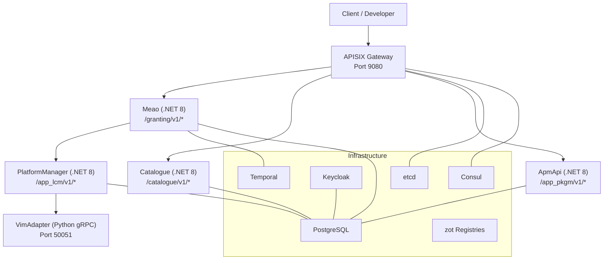
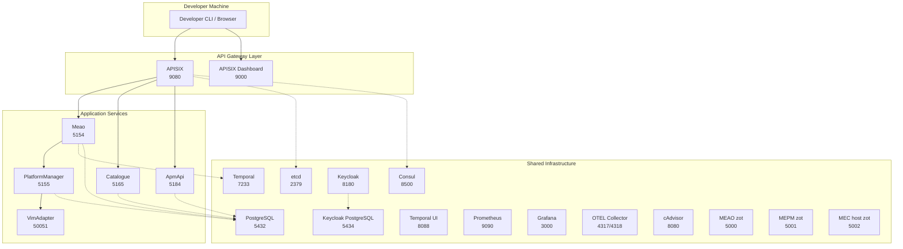
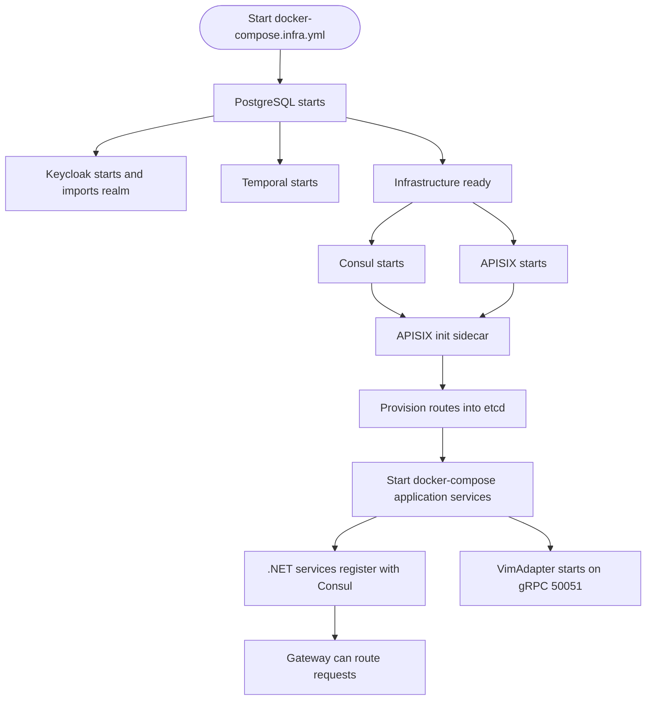

# Getting Started

<cite>
**Referenced Files in This Document**   
- `README.md`
- `docs/GETTING-STARTED.md`
- `docker-compose.yml`
- `docker-compose.infra.yml`
- `docker-compose.override.yml`
- `Tiltfile`
- `build-images.sh`
- `scripts/apisix_provision_routes.py`
- `docker/apisix_conf/config.yaml`
- `docker/apisix_conf/apisix-routes.yaml`
</cite>

## Table of Contents
1. [Introduction](#introduction)
2. [Project Structure](#project-structure)
3. [Core Components](#core-components)
4. [Architecture Overview](#architecture-overview)
5. [Prerequisites](#prerequisites)
6. [Installation](#installation)
7. [Service Startup Sequence](#service-startup-sequence)
8. [Verifying Health and Accessing the Gateway](#verifying-health-and-accessing-the-gateway)
9. [End-to-End Walkthrough](#end-to-end-walkthrough)
10. [Troubleshooting First-Run Issues](#troubleshooting-first-run-issues)
11. [Next Steps](#next-steps)
12. [Conclusion](#conclusion)

## Introduction
Optimist.Orchestrator is an ETSI GS MEC 010-2 v3.1.1 compliant Multi-access Edge Computing orchestrator. It implements the MEO (Multi-access Edge Orchestrator), MEPM (MEC Platform Manager), and VIM adapter roles for lifecycle management of MEC application packages and instances. In practical terms, it lets you onboard edge application packages, grant them access to compute resources, instantiate them on a target platform, operate them, and observe their lifecycle through standardized ETSI APIs.

The project is currently at Working PoC status with core lifecycle workflows fully implemented and ETSI-aligned. It uses APISIX as an API gateway, Consul for service discovery, PostgreSQL for persistence, Temporal for orchestration workflows, Keycloak for authentication, and a Python VimAdapter that bridges to Kubernetes or OpenStack backends.

This getting started guide explains what the system does, how its components fit together, how to install and start it locally with Docker Compose, and how to run a simple end-to-end flow from package upload through instance instantiation.

**Section sources**
- `README.md#L1-L120`
- `docs/GETTING-STARTED.md#L1-L30`

## Project Structure
At a high level, the repository separates infrastructure configuration, application source code, documentation, scripts, and deployment definitions:

| Area | Purpose |
|------|---------|
| `src/` | Application services: Meao (MEO), ApmApi (package management inside MEO), Catalogue (internal inventory/census), PlatformManager (MEPM), VimAdapter (Python gRPC VIM adapter), Common libraries |
| `docker/` | Container configurations for APISIX, etcd, Keycloak, PostgreSQL, Prometheus, Grafana, OTEL, cAdvisor, and zot registries |
| `docker-compose*.yml` | Local development compose stacks for infrastructure and application services |
| `scripts/` | APISIX route provisioning, sample CSAR generation, Keycloak realm generation, CI helpers |
| `docs/` | Architecture, API reference, ETSI spec alignment, configuration, testing, and this getting started guide |
| `charts/`, `gitops/`, `terraform/` | Kubernetes Helm charts, GitOps bootstrap, and cloud infrastructure definitions |
| `tests/` | Cross-service E2E tests, unit tests, integration tests |



**Diagram sources**
- `README.md#L120-L250`
- `docker-compose.yml#L1-L119`
- `docker-compose.infra.yml#L1-L200`

**Section sources**
- `README.md#L1-L120`
- `docker-compose.yml#L1-L119`

## Core Components
The system is organized around ETSI MEC roles rather than a single monolith:

| Component | Role | Primary Responsibility | Typical Port |
|-----------|------|------------------------|--------------|
| **Meao** | MEO orchestrator engine | Granting API, placement engine, Temporal workflow worker | 5154 |
| **ApmApi** | Application Package Management inside MEO | CSAR onboarding, package metadata, validation | 5184 |
| **Catalogue** | Internal MEO inventory and census | Host and app instance registry, capacity reservation | 5165 |
| **PlatformManager** | MEPM LCM execution | App instance lifecycle operations, gRPC bridge to VimAdapter | 5155 |
| **VimAdapter** | VIM adapter | Backend-specific deployment via Kubernetes or OpenStack | 50051 (gRPC) |

The README maps these components to ETSI API base paths and identifies which service produces each API surface. The `.NET` services expose REST endpoints internally; APISIX routes three public-facing paths (`/granting/v1/*`, `/catalogue/v1/*`, `/app_pkgm/v1/*`) to Consul-registered services. PlatformManager is not behind APISIX — Meao calls it directly on the management plane.

**Section sources**
- `README.md#L120-L250`

## Architecture Overview
The local development architecture centers on an API gateway fronting several microservices, backed by shared infrastructure:



**Diagram sources**
- `docker-compose.infra.yml#L1-L514`
- `docker-compose.yml#L1-L119`
- `docker-compose.override.yml#L1-L85`

The diagram shows:
- APISIX exposing the data-plane API surface.
- Three Consul-backed routes for granting, catalogue, and package management.
- Direct Meao → PlatformManager communication for LCM.
- PlatformManager → VimAdapter gRPC communication.
- Shared databases, identity, workflow, and observability services.

**Section sources**
- `docker-compose.infra.yml#L1-L514`
- `docker-compose.yml#L1-L119`

## Prerequisites
Before installing Optimist.Orchestrator locally, ensure your machine has the required tools:

| Tool | Minimum Version | Why You Need It |
|------|-----------------|-----------------|
| Docker | 20.10+ | Runs all infrastructure and application containers |
| Docker Compose | v2.0+ (plugin form) | Starts the multi-container stack |
| .NET 8 SDK | 8.0 | Required if running `.NET` services natively instead of in containers |
| Python | 3.11.16 preferred | Required for VimAdapter local development; `uv` reads the pinned version |
| Helm CLI | 3.15+ | VimAdapter needs Helm for Kubernetes deployments |

Create the environment file used by PostgreSQL and other services:

```bash
cp .env.example .env
```

The `.env` template controls PostgreSQL credentials and port mapping. The default values are suitable for local development.

For local development without containers, you also need Consul running because the four .NET services register themselves with Consul for service discovery. The infrastructure compose file includes Consul, but when running application services natively, you may need to start Consul explicitly.

**Section sources**
- `docs/GETTING-STARTED.md#L30-L120`

## Installation
The recommended path for first-time setup is full Docker Compose mode. This builds the application images once and starts all infrastructure plus services automatically.

### Step 1: Prepare Environment Variables
```bash
cp .env.example .env
```

If you already have something listening on the default PostgreSQL port, edit `.env` and change `POSTGRES_PORT` before starting the stack.

### Step 2: Build Application Images
```bash
./build-images.sh
```

On Windows PowerShell, use:
```powershell
.\build-images.ps1
```

The script publishes and containerizes three services: ApmApi, Meao, and Catalogue. PlatformManager and VimAdapter require separate build steps because their Dockerfiles use different contexts.

### Step 3: Build PlatformManager and VimAdapter
```bash
docker build -t localhost/optimist-platform-manager -f src/PlatformManager/PlatformManager/Dockerfile .
docker build -t localhost/optimist-vim-adapter -f src/VimAdapter/Dockerfile src/VimAdapter
```

PlatformManager’s build context must be the repository root because its Dockerfile copies paths relative to that location. VimAdapter’s build context is its own directory.

### Step 4: Start Infrastructure
```bash
docker-compose -f docker-compose.infra.yml up -d
```

This starts APISIX, etcd, APISIX dashboard, Keycloak, Temporal, PostgreSQL, Prometheus, Grafana, OTEL collector, cAdvisor, Consul, and zot registries.

### Step 5: Start Application Services
```bash
docker-compose up -d
```

The override file automatically applies local development ports, environment variables, and volume mounts.

**Section sources**
- `docs/GETTING-STARTED.md#L120-L200`
- `build-images.sh#L1-L20`
- `docker-compose.infra.yml#L1-L200`
- `docker-compose.yml#L1-L119`
- `docker-compose.override.yml#L1-L85`

## Service Startup Sequence
The startup sequence matters because services depend on infrastructure being ready:

1. **PostgreSQL** starts and initializes databases from the provided SQL file.
2. **Keycloak** starts and imports the `optimist-realm.json` realm.
3. **Temporal** starts and sets up its workflow engine against its dedicated PostgreSQL database.
4. **Consul** starts and exposes the service registry.
5. **APISIX** starts and waits for etcd.
6. **APISIX initialization sidecar** polls the Admin API, then provisions routes from `docker/apisix_conf/apisix-routes.yaml`.
7. **.NET services** start, register with Consul, connect to PostgreSQL, and enable Keycloak authentication.
8. **VimAdapter** starts and listens on gRPC port 50051.



**Diagram sources**
- `docker-compose.infra.yml#L1-L200`
- `scripts/apisix_provision_routes.py#L1-L152`
- `docker-compose.yml#L1-L119`

**Section sources**
- `docker-compose.infra.yml#L1-L200`
- `scripts/apisix_provision_routes.py#L1-L152`

## Verifying Health and Accessing the Gateway
After both compose files have started, verify the key health surfaces:

| Surface | URL | What to Check |
|---------|-----|---------------|
| APISIX client API | http://localhost:9080 | Gateway responds |
| APISIX Admin API | http://localhost:9180 | Admin endpoint reachable |
| APISIX Dashboard | http://localhost:9000 | Gateway management UI loads |
| Consul | http://localhost:8500 | Service registry UI loads |
| Keycloak | http://localhost:8180 | Identity provider loads |
| Temporal UI | http://localhost:8088 | Workflow UI loads |
| PostgreSQL | localhost:5432 | Database is accepting connections |
| Meao | http://localhost:5154 | MEO service responds |
| ApmApi | http://localhost:5184 | Package management responds |
| Catalogue | http://localhost:5165 | Catalogue responds |
| PlatformManager | http://localhost:5155 | MEPM responds |
| VimAdapter | localhost:50051 | gRPC listener responds |

If APISIX returns 404 for routed endpoints, confirm that:
- Consul is running.
- The relevant .NET service is registered under its expected Consul service name.
- Routes were provisioned successfully.

You can inspect registered services at http://localhost:8500 and review the APISIX dashboard at http://localhost:9000.

**Section sources**
- `docs/GETTING-STARTED.md#L200-L320`
- `docker-compose.infra.yml#L1-L200`

## End-to-End Walkthrough
This walkthrough covers a simplified local flow: start infrastructure, upload a sample CSAR package, request an application grant, and check instance status. It assumes Docker Compose mode and that all infrastructure and application services are healthy.

### Step 1: Confirm Infrastructure Is Running
```bash
docker-compose -f docker-compose.infra.yml ps
docker-compose ps
```

All containers should be running. If any are restarting, check logs using `docker logs <container_name>`.

### Step 2: Upload a Sample CSAR Package
Use the ApmApi package management endpoint. For example:

```bash
curl -X POST \
  http://localhost:5184/app_pkgm/v1/onboarded_app_packages \
  -H "Content-Type: multipart/form-data" \
  -F "file=@path/to/sample.csar"
```

This registers an onboarded application package. After upload, you can list packages:

```bash
curl http://localhost:5184/app_pkgm/v1/onboarded_app_packages
```

The exact upload contract depends on the ApmApi implementation and whether the endpoint expects a direct file upload or a staged upload flow.

### Step 3: Request an Application Grant
The ETSI Granting API is exposed by Meao. Create a grant request:

```bash
curl -X POST \
  http://localhost:5154/granting/v1/grants \
  -H "Content-Type: application/json" \
  -d '{
    "applicationPkgInfoId": "<pkg_id>",
    "vnfProfile": {
      "vimAccountId": "<vim_account_or_host_reference>"
    }
  }'
```

Replace `<pkg_id>` with the ID returned from the package upload step. Replace `<vim_account_or_host_reference>` with the value expected by your placement policy and VimAdapter configuration.

Read the grant status:

```bash
curl http://localhost:5154/granting/v1/grants/<grant_id>
```

### Step 4: Create an Application Instance
PlatformManager manages application instances:

```bash
curl -X POST \
  http://localhost:5155/app_lcm/v1/app_instances \
  -H "Content-Type: application/json" \
  -d '{
    "applicationPkgInfoId": "<pkg_id>",
    "grantId": "<grant_id>"
  }'
```

### Step 5: Instantiate the Instance
Instantiate the created instance:

```bash
curl -X POST \
  http://localhost:5155/app_lcm/v1/app_instances/<instance_id>/instantiate \
  -H "Content-Type: application/x-www-form-urlencoded" \
  -d "hostIp=<host_ip>&appPkgId=<pkg_id>&grantId=<grant_id>"
```

### Step 6: Check Lifecycle Operation Status
After instantiation, check lifecycle operation occurrences:

```bash
curl http://localhost:5155/app_lcm/v1/app_lcm_op_occs
```

Look for the operation associated with your instance. Its state indicates whether the workflow succeeded, failed, or is still processing.

### Optional: Run the Repository Smoke Test
The repository includes a PowerShell smoke test that exercises grant creation, subscription registration, app instance creation, and instantiation:

```powershell
.\scripts\test_e2e_grant_sub.ps1
```

This is useful after your first manual walkthrough to validate the full chain automatically.

**Section sources**
- `docs/GETTING-STARTED.md#L200-L525`
- `README.md#L120-L250`

## Troubleshooting First-Run Issues

### Port Conflicts
Many infrastructure services bind to well-known ports. If startup fails, another process may be occupying one of these ports:

| Port | Service |
|------|---------|
| 9080 | APISIX client API |
| 9180 | APISIX Admin API |
| 9443 | APISIX HTTPS |
| 9091 | APISIX metrics |
| 9092 | APISIX control API |
| 9000 | APISIX Dashboard |
| 8180 | Keycloak |
| 5432 | PostgreSQL |
| 5433 | Temporal PostgreSQL |
| 5434 | Keycloak PostgreSQL |
| 2379 | etcd |
| 7233 | Temporal |
| 8088 | Temporal UI |
| 9090 | Prometheus |
| 3000 | Grafana |
| 4317, 4318, 8889 | OTEL Collector |
| 8080 | cAdvisor |
| 8500, 8600 | Consul |

Stop the conflicting process or remap the port in the relevant compose configuration.

**Section sources**
- `docs/GETTING-STARTED.md#L320-L420`

### Consul Not Running or Not Reachable
Symptoms include 502 or 404 responses from APISIX even though the gateway itself is up.

Fixes:
- Ensure Consul is running:
  ```bash
  docker-compose -f docker-compose.infra.yml up -d consul
  ```
- Verify Consul is reachable:
  ```bash
  curl http://localhost:8500
  ```
- If running .NET services natively, start Consul explicitly:
  ```bash
  docker run -d --name consul -p 8500:8500 -p 8600:8600/udp consul:latest
  ```

**Section sources**
- `docs/GETTING-STARTED.md#L320-L380`

### APISIX Routes Return 404
This usually means APISIX cannot resolve the upstream service through Consul.

Checks:
1. Confirm Consul is running.
2. Confirm the target service is registered.
3. Confirm APISIX routes exist.
4. Review the APISIX initialization sidecar logs:
   ```bash
   docker logs optimist-apisix-init
   ```
5. Re-provision routes manually if needed:
   ```bash
   python scripts/apisix_provision_routes.py
   ```

The provisioning script reads `docker/apisix_conf/apisix-routes.yaml` and pushes routes to the APISIX Admin API. It validates the admin API address and pins routable addresses to reduce DNS rebinding risk.

**Section sources**
- `docs/GETTING-STARTED.md#L380-L420`
- `scripts/apisix_provision_routes.py#L1-L152`
- `docker/apisix_conf/apisix-routes.yaml#L1-L32`

### Keycloak Initialization Problems
Keycloak is configured to import the `optimist-realm.json` realm on startup. If authentication fails:

1. Wait for Keycloak to finish initializing.
2. Check Keycloak logs:
   ```bash
   docker logs optimist-keycloak
   ```
3. Confirm Keycloak is available at http://localhost:8180.
4. Confirm the realm exists:
   ```bash
   curl http://localhost:8180/realms
   ```
5. If the realm did not import cleanly, restart Keycloak with a fresh volume so the import runs again.

Keycloak runs with development flags, imports the realm from `docker/keycloak_conf/optimist-realm.json`, and stores its data in a dedicated PostgreSQL container.

**Section sources**
- `docker-compose.infra.yml#L1-L200`
- `docs/GETTING-STARTED.md#L420-L525`

### Temporal Not Ready
Meao uses Temporal as its workflow orchestration engine. If Meao crashes or fails to start:

1. Wait for Temporal to initialize.
2. Check Temporal logs:
   ```bash
   docker logs optimist-temporal
   ```
3. Confirm Temporal UI is reachable:
   ```bash
   curl http://localhost:8088
   ```
4. Restart Meao after Temporal is healthy.

**Section sources**
- `docs/GETTING-STARTED.md#L380-L420`

### EF Core Migration Errors
If database queries fail with missing table errors, migrations may not have applied.

Fixes:
- Ensure PostgreSQL is running.
- Verify connection strings point at the correct database and credentials.
- Restart the affected service so EF Core migration logic runs.

Each service uses its own database:
- Meao: `meao_db`
- ApmApi: `apmdb`
- Catalogue: `catalogue_db`
- PlatformManager: `mepm_db`

**Section sources**
- `docs/GETTING-STARTED.md#L380-L420`

### VimAdapter Python Version or Dependency Issues
VimAdapter is pinned to Python 3.11.16. If pytest or runtime imports fail:

```bash
cd src/VimAdapter
uv venv .venv --python 3.11.16 --clear
uv pip install --python .venv/Scripts/python.exe -r requirements.txt
.venv/Scripts/python.exe --version
```

If `pyhelm3` installation fails, install it explicitly:

```bash
uv pip install --python .venv/Scripts/python.exe git+https://github.com/stackhpc/pyhelm3.git@16691d8c5e7a23da57463b7ec6992b723297c02a
```

For pytest, clear `PYTHONPATH`:

```bash
cd src/VimAdapter && PYTHONPATH= .venv/Scripts/python.exe -m pytest
```

**Section sources**
- `docs/GETTING-STARTED.md#L320-L420`

### Authentication Errors
Most authenticated endpoints require a valid Keycloak JWT bearer token.

To obtain a token for testing:

```bash
TOKEN=$(curl -s -X POST http://localhost:8180/realms/optimist/protocol/openid-connect/token \
  -d "grant_type=client_credentials" \
  -d "client_id=meao" \
  -d "client_secret=$KEYCLOAK_CLIENT_SECRET_MEAO" \
  | jq -r .access_token)

curl -H "Authorization: Bearer $TOKEN" http://localhost:5154/granting/v1/grants
```

Client secrets come from `.env.keycloak`. Some endpoints, such as Keycloak health checks and specific distribution endpoints, are anonymous.

**Section sources**
- `docs/GETTING-STARTED.md#L420-L525`

## Next Steps
After the basic flow works, consider:

- Exploring Swagger UI for each service at its development port.
- Inspecting workflows in the Temporal UI.
- Checking service registration in the Consul UI.
- Viewing metrics in Prometheus and dashboards in Grafana.
- Building and deploying the Helm chart for Kubernetes.
- Running the cross-service E2E tests.
- Reading the architecture and configuration guides for deeper understanding.

**Section sources**
- `docs/GETTING-STARTED.md#L420-L525`

## Conclusion
Optimist.Orchestrator provides a complete ETSI MEC-compliant orchestrator stack for local development and experimentation. The most important concepts are:

- **MEO** owns the granting API and coordinates orchestration.
- **MEPM** executes application lifecycle operations.
- **VimAdapter** translates lifecycle operations into backend actions.
- **APISIX + Consul** provide gateway routing and service discovery.
- **Keycloak, Temporal, PostgreSQL, and observability services** support security, workflows, persistence, and debugging.

With Docker Compose, you can start the entire stack, upload a CSAR package, request a grant, create and instantiate an application instance, and observe the result. When things go wrong, start with ports, Consul, APISIX routes, Keycloak, Temporal, and PostgreSQL — those are the most common first-run failure points.

[No sources needed since this section summarizes without analyzing specific files]