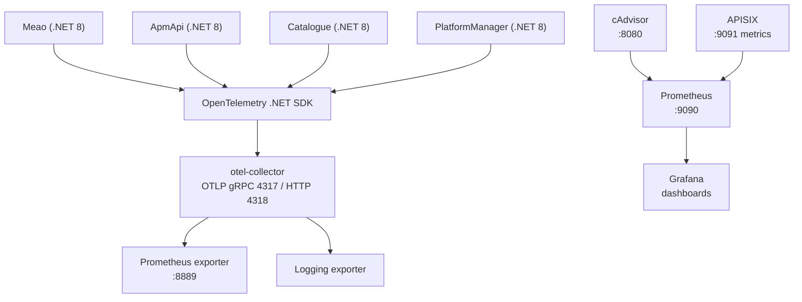
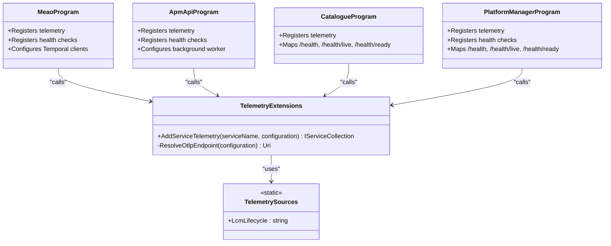
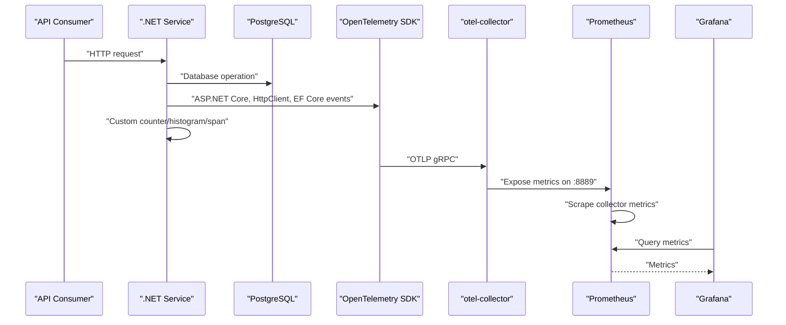
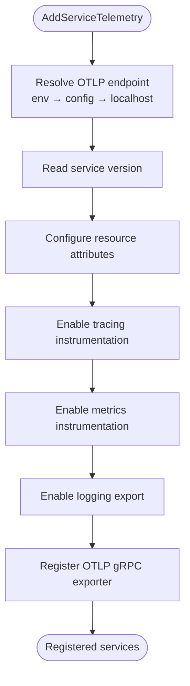
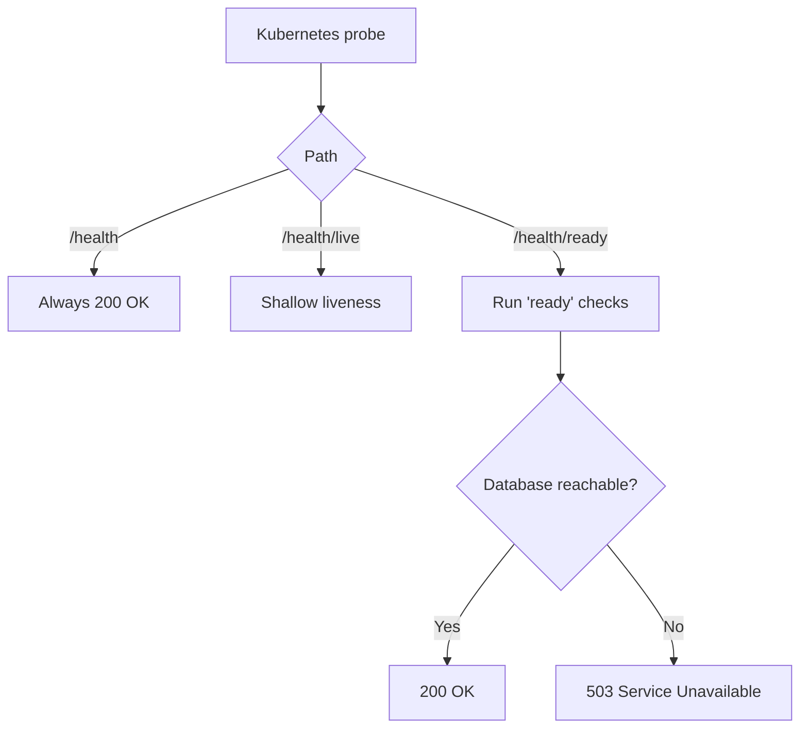
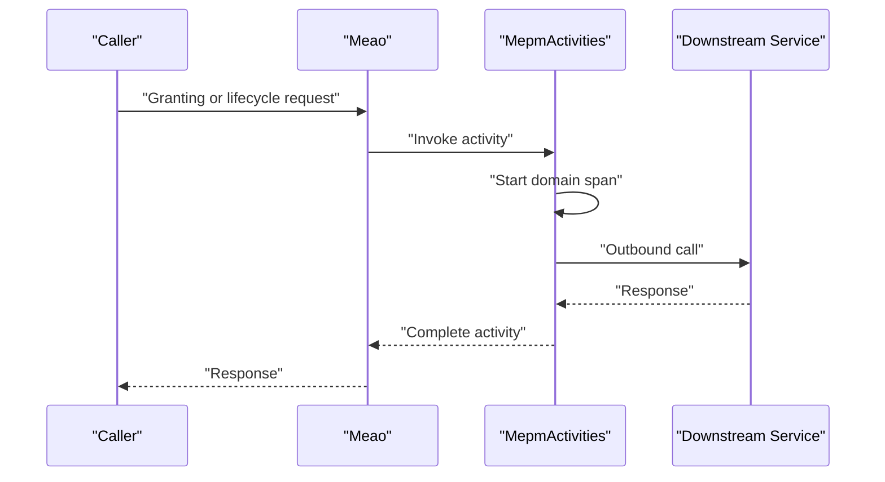
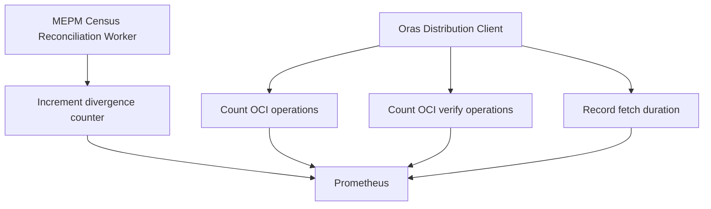
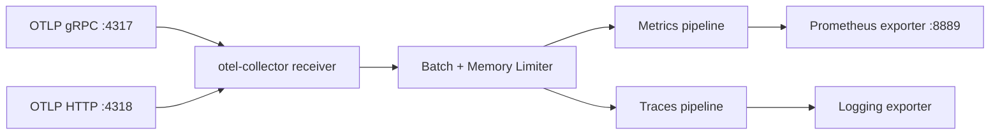
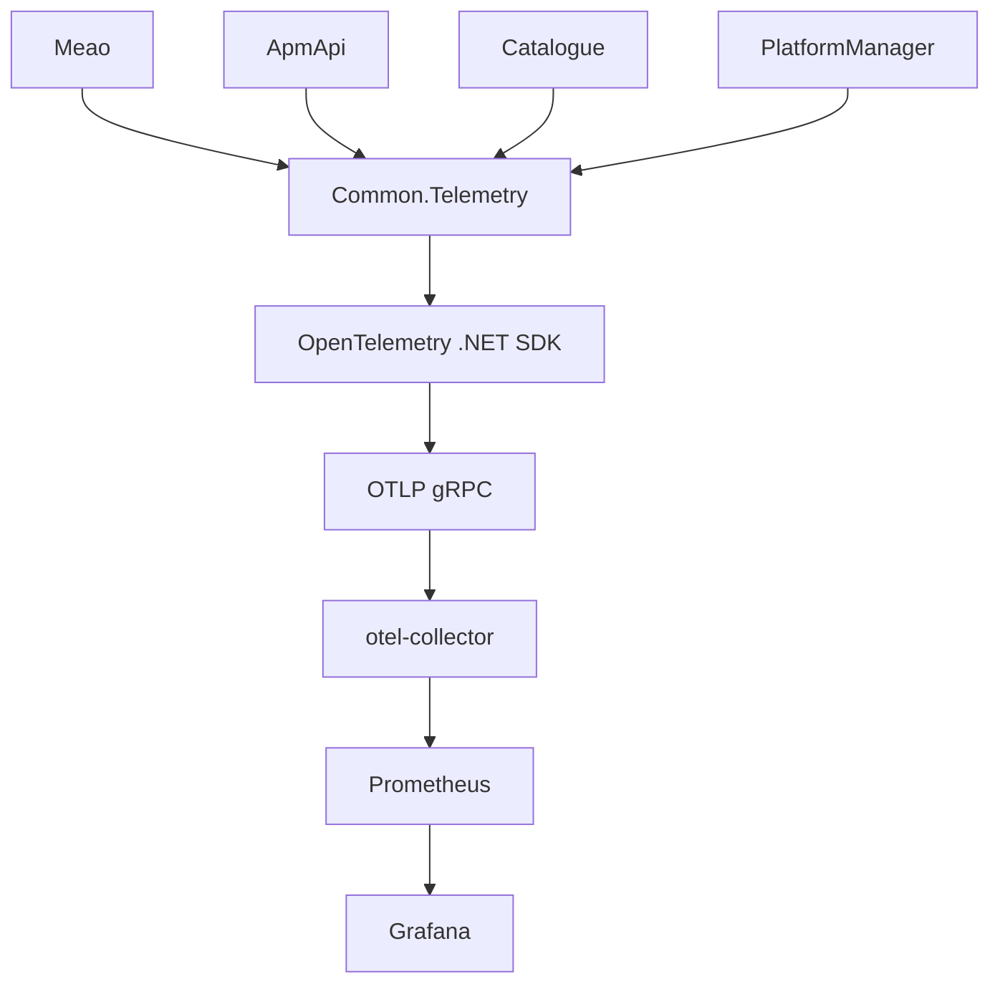

# Monitoring & Observability

<cite>
**Referenced Files in This Document**   
- `README.md`
- `docs/ADR/0016-shared-opentelemetry.md`
- `src/Common/Telemetry/TelemetryExtensions.cs`
- `src/Meao/Program.cs`
- `src/ApmApi/Program.cs`
- `src/Catalogue/Program.cs`
- `src/PlatformManager/PlatformManager/Program.cs`
- `src/Meao/Services/MepmCensusReconciliationWorker.cs`
- `src/Meao/Activities/MepmActivities.cs`
- `src/PlatformManager/PlatformManager\Services/OrasDistributionClient.cs`
- `config/otel-collector-config.yaml`
- `docker-compose.infra.yml`
- `docker/prometheus_conf/prometheus.yml`
- `docker/grafana_conf/provisioning/datasources/prometheus.yaml`
- `docker/grafana_conf/provisioning/dashboards/dashboards.yaml`
- `docker/grafana_conf/dashboards/dotnet-services.json`
- `docker/grafana_conf/dashboards/docker-containers.json`
- `docker/grafana_conf/dashboards/apisix-gateway.json`
</cite>

## Table of Contents
1. [Introduction](#introduction)
2. [Project Structure](#project-structure)
3. [Core Components](#core-components)
4. [Architecture Overview](#architecture-overview)
5. [Detailed Component Analysis](#detailed-component-analysis)
6. [Dependency Analysis](#dependency-analysis)
7. [Performance Considerations](#performance-considerations)
8. [Troubleshooting Guide](#troubleshooting-guide)
9. [Conclusion](#conclusion)

## Introduction
This document describes the monitoring and observability strategy for the Optimist.Orchestrator system. It covers how OpenTelemetry is instrumented across .NET services, how metrics and traces flow through the local infrastructure stack into Prometheus and Grafana, what health checks are exposed, which business and operational signals are collected, and how to extend the setup with custom dashboards and alerts.

The system implements MEC orchestration roles using four .NET services plus a Python VIM adapter. Telemetry instrumentation is centralized in a shared project so that every service emits consistent traces, metrics, and logs over OTLP to an OpenTelemetry Collector, which exports traces to logging and exposes metrics to Prometheus. Grafana is pre-provisioned with Prometheus as a data source and several dashboards covering .NET services, Docker containers, and the APISIX gateway.

## Project Structure
Observability-related assets live in these locations:

| Area | Location | Purpose |
|------|----------|---------|
| Shared telemetry wiring | `src/Common/Telemetry` | Centralized OpenTelemetry configuration used by all .NET services |
| Service entry points | `src/{Meao,ApmApi,Catalogue}/Program.cs`, `src/PlatformManager/.../Program.cs` | Register telemetry, health checks, authentication, routing, and background workers |
| Business telemetry | `src/Meao/Services/MepmCensusReconciliationWorker.cs`, `src/PlatformManager/.../OrasDistributionClient.cs` | Custom counters and histograms for domain operations |
| Trace spans | `src/Meao/Activities/MepmActivities.cs` | Domain-scoped distributed tracing |
| Collector configuration | `config/otel-collector-config.yaml` | OTLP receivers, processors, and exporters |
| Local infrastructure | `docker-compose.infra.yml` | Services such as APISIX, Consul, Keycloak, PostgreSQL, Temporal, and related infrastructure |
| Metrics scraping | `docker/prometheus_conf/prometheus.yml` | Scrapes cAdvisor and the OpenTelemetry Collector’s Prometheus endpoint |
| Grafana provisioning | `docker/grafana_conf/provisioning/*` | Registers Prometheus and the default dashboard folder |
| Grafana dashboards | `docker/grafana_conf/dashboards/*.json` | Predefined dashboards for .NET services, containers, and APISIX |

**Diagram sources**
- `src/Common/Telemetry/TelemetryExtensions.cs#L26-L75`
- `config/otel-collector-config.yaml#L1-L38`
- `docker/prometheus_conf/prometheus.yml#L1-L25`
- `docker/grafana_conf/provisioning/datasources/prometheus.yaml#L1-L12`

**Section sources**
- `README.md#L1-L120`
- `docs/ADR/0016-shared-opentelemetry.md#L1-L39`

## Core Components
The observability system has five core components:

1. **Shared telemetry extension** — `Common.Telemetry.TelemetryExtensions.AddServiceTelemetry` registers ASP.NET Core, HttpClient, runtime, process, and Entity Framework Core instrumentation, configures resource attributes including service name and version, adds a custom ActivitySource for lifecycle spans, and exports everything over OTLP gRPC.
2. **Service instrumentation** — Each service calls `AddServiceTelemetry` once during startup. Health checks are registered and mapped to `/health`, `/health/live`, and `/health/ready`.
3. **OpenTelemetry Collector** — Receives OTLP on gRPC and HTTP, applies batching and memory limiting, exports traces to logging, and exposes metrics via a Prometheus-compatible endpoint.
4. **Prometheus** — Scrapes the collector’s metrics endpoint and APISIX metrics.
5. **Grafana** — Is provisioned with Prometheus and predefined dashboards; dashboard files are mounted from the repository.

**Diagram sources**
- `src/Common/Telemetry/TelemetryExtensions.cs#L1-L75`
- `src/Meao/Program.cs#L22-L40`
- `src/ApmApi/Program.cs#L22-L40`
- `src/Catalogue/Program.cs#L25-L45`
- `src/PlatformManager/PlatformManager/Program.cs#L35-L60`

**Section sources**
- `src/Common/Telemetry/TelemetryExtensions.cs#L1-L75`
- `docs/ADR/0016-shared-opentelemetry.md#L1-L39`

## Architecture Overview
The telemetry pipeline starts at each .NET service and ends in Grafana or Prometheus rules:

1. **Instrumentation layer**: The services use ASP.NET Core instrumentation, HttpClient instrumentation, runtime instrumentation, process instrumentation, and EF Core instrumentation.
2. **Custom telemetry layer**: Lifecycle spans are emitted under the canonical source name `Optimist.Lcm.Lifecycle`. Business counters include MEAO census divergence counts and PlatformManager OCI operation metrics.
3. **Export layer**: All three signals — traces, metrics, and logs — are exported via OTLP gRPC to the collector.
4. **Collector layer**: Traces are logged; metrics are converted and scraped by Prometheus.
5. **Visualization layer**: Grafana reads from Prometheus and renders dashboards for application health, container resources, and API gateway performance.

**Diagram sources**
- `src/Common/Telemetry/TelemetryExtensions.cs#L26-L75`
- `config/otel-collector-config.yaml#L1-L38`
- `docker/prometheus_conf/prometheus.yml#L1-L25`

## Detailed Component Analysis

### Shared OpenTelemetry Configuration
The shared extension centralizes telemetry initialization. It resolves the OTLP endpoint from environment variables, application configuration, or a localhost fallback. It registers:

- Resource attributes including service name and assembly version.
- Tracing instrumentation for ASP.NET Core, HttpClient, and EF Core.
- A custom ActivitySource named `Optimist.Lcm.Lifecycle`.
- Metrics instrumentation for ASP.NET Core, HttpClient, runtime, and process.
- Logging integration.
- An OTLP gRPC exporter.

**Diagram sources**
- `src/Common/Telemetry/TelemetryExtensions.cs#L26-L75`

**Section sources**
- `src/Common/Telemetry/TelemetryExtensions.cs#L1-L75`
- `docs/ADR/0016-shared-opentelemetry.md#L1-L39`

### Health Check Endpoints
All four .NET services register ASP.NET Core health checks and map three paths:

| Path | Behavior | Kubernetes role |
|------|----------|-----------------|
| `/health` | Always returns success because the predicate rejects all registered checks | Legacy ping path |
| `/health/live` | Shallow liveness probe; does not require database connectivity | Liveness probe |
| `/health/ready` | Deep readiness probe; requires the database check tagged `ready` | Readiness probe |

Each service also registers a database health check with a meaningful name and the `ready` tag:

| Service | Database check name |
|---------|---------------------|
| Meao | `meao-db` |
| ApmApi | `apm-db` |
| Catalogue | `catalogue-db` |
| PlatformManager | `pm-db` |

**Diagram sources**
- `src/Meao/Program.cs#L28-L35`
- `src/ApmApi/Program.cs#L30-L37`
- `src/Catalogue/Program.cs#L39-L45`
- `src/PlatformManager/PlatformManager/Program.cs#L53-L60`
- `src/Catalogue/Program.cs#L119-L121`
- `src/ApmApi/Program.cs#L201-L203`
- `src/Meao/Program.cs#L239-L241`
- `src/PlatformManager/PlatformManager/Program.cs#L194-L196`

**Section sources**
- `src/Meao/Program.cs#L28-L35`
- `src/ApmApi/Program.cs#L30-L37`
- `src/Catalogue/Program.cs#L39-L45`
- `src/PlatformManager/PlatformManager/Program.cs#L53-L60`
- `src/Catalogue/Program.cs#L119-L121`
- `src/ApmApi/Program.cs#L201-L203`
- `src/Meao/Program.cs#L239-L241`
- `src/PlatformManager/PlatformManager/Program.cs#L194-L196`

### Distributed Tracing
Tracing is enabled for:

- Incoming HTTP requests.
- Outgoing HttpClient calls.
- EF Core database operations.
- Custom domain spans under `Optimist.Lcm.Lifecycle`.

The MEPM activities define a static `ActivitySource` using the canonical lifecycle source name. This allows end-to-end traces to span Meao’s workflow execution, outbound calls, and downstream services when the full call chain is instrumented.

**Diagram sources**
- `src/Common/Telemetry/TelemetryExtensions.cs#L58-L66`
- `src/Meao/Activities/MepmActivities.cs#L19-L22`

**Section sources**
- `src/Common/Telemetry/TelemetryExtensions.cs#L58-L66`
- `src/Meao/Activities/MepmActivities.cs#L19-L22`

### Metrics Collection

#### Built-in .NET Metrics
The shared telemetry registration enables:

- ASP.NET Core request metrics such as request rate and duration.
- HttpClient request metrics for outgoing calls.
- Runtime metrics such as CLR exceptions.
- Process metrics such as CPU and memory usage.

These metrics are consumed by the dotnet-services Grafana dashboard.

#### Business Metrics

| Metric | Service | Meaning |
|--------|---------|---------|
| `meao_census_divergences_total` | Meao | Number of detected divergences between MEPM and MEAO census state |
| `oci_operations_total` | PlatformManager | Count of OCI distribution operations |
| `oci_verify_total` | PlatformManager | Count of OCI verification operations |
| `oci_fetch_duration_seconds` | PlatformManager | Duration histogram for OCI fetch operations |

**Diagram sources**
- `src/Meao/Services/MepmCensusReconciliationWorker.cs#L35-L40`
- `src/Meao/Services/MepmCensusReconciliationWorker.cs#L283-L286`
- `src/PlatformManager/PlatformManager/Services/OrasDistributionClient.cs#L39-L46`

**Section sources**
- `src/Common/Telemetry/TelemetryExtensions.cs#L58-L75`
- `src/Meao/Services/MepmCensusReconciliationWorker.cs#L35-L40`
- `src/Meao/Services/MepmCensusReconciliationWorker.cs#L283-L286`
- `src/PlatformManager/PlatformManager/Services/OrasDistributionClient.cs#L39-L46`

### OpenTelemetry Collector Pipeline
The collector is configured with:

- OTLP receivers on gRPC port 4317 and HTTP port 4318.
- A health-check extension on port 13133.
- Batch and memory-limiter processors for metrics.
- A Prometheus exporter on port 8889.
- A logging exporter for traces.

**Diagram sources**
- `config/otel-collector-config.yaml#L1-L38`

**Section sources**
- `config/otel-collector-config.yaml#L1-L38`

### Prometheus Scrape Targets
Prometheus scrapes:

| Job | Target | Purpose |
|-----|--------|---------|
| `prometheus` | `localhost:9090` | Self-monitoring |
| `cadvisor` | `cadvisor:8080` | Container metrics |
| `otel-collector` | `otel-collector:8889` | Application metrics exported by the collector |
| `apisix` | `apisix:9091` | API gateway metrics |

**Section sources**
- `docker/prometheus_conf/prometheus.yml#L1-L25`

### Grafana Dashboards and Data Sources
Grafana is provisioned with:

- A Prometheus data source pointing at `http://prometheus:9090`.
- A file-based dashboard provider rooted at `/var/lib/grafana/dashboards`.
- Dashboards mounted from the repository under `docker/grafana_conf/dashboards`.

Predefined dashboards include:

| Dashboard | Focus |
|-----------|-------|
| `dotnet-services.json` | Reporting services count, ASP.NET Core request rate, CLR exceptions, and ASP.NET Core HTTP metrics |
| `docker-containers.json` | Active containers, total CPU usage, total memory working set, and container resource trends |
| `apisix-gateway.json` | Gateway traffic overview, request rate, success rate, client errors, and server errors |

**Section sources**
- `docker/grafana_conf/provisioning/datasources/prometheus.yaml#L1-L12`
- `docker/grafana_conf/provisioning/dashboards/dashboards.yaml#L1-L11`
- `docker/grafana_conf/dashboards/dotnet-services.json#L1-L200`
- `docker/grafana_conf/dashboards/docker-containers.json#L1-L200`
- `docker/grafana_conf/dashboards/apisix-gateway.json#L1-L200`

### Alerting Strategy
The current repository snapshot includes Prometheus scrape configuration and Grafana dashboards, but no explicit alerting rule files or Alertmanager configuration. This means:

- Operational visibility exists through dashboards.
- Automated alerting is not defined in the provided Prometheus configuration.
- Alerting should be added as PrometheusRule objects or rule files depending on deployment model.

Recommended alert categories:

| Category | Example metric signal | Suggested alert condition |
|----------|----------------------|---------------------------|
| Service availability | `/health/ready` readiness failures | Service unavailable for more than one minute |
| Request reliability | ASP.NET Core error rates | Elevated 4xx/5xx rate relative to baseline |
| Performance degradation | ASP.NET Core request duration | P95 latency above target SLI |
| Resource pressure | Process CPU/memory | Pod approaching resource limits |
| Database connectivity | EF Core health check | Database readiness failure |
| Workflow divergence | `meao_census_divergences_total` | Divergence counter increases rapidly |
| OCI distribution failures | `oci_operations_total` with failure tags | High failure ratio or repeated retries |
| Gateway health | APISIX 4xx/5xx rate | Sustained error rate increase |

[No sources needed since this section provides general guidance]

## Dependency Analysis
The telemetry dependency graph shows tight coupling around the shared extension and loose coupling around the collector and storage backends.

**Diagram sources**
- `src/Meao/Program.cs#L22-L35`
- `src/ApmApi/Program.cs#L22-L37`
- `src/Catalogue/Program.cs#L25-L45`
- `src/PlatformManager/PlatformManager/Program.cs#L35-L60`
- `src/Common/Telemetry/TelemetryExtensions.cs#L26-L75`
- `config/otel-collector-config.yaml#L1-L38`
- `docker/prometheus_conf/prometheus.yml#L1-L25`

Key observations:

- Cohesion is high within `Common.Telemetry`; it owns all OpenTelemetry wiring.
- Coupling between services and telemetry is minimal: each service makes exactly one registration call.
- The collector is a single point of failure for telemetry ingestion; production deployments should consider multiple replicas behind a load balancer.
- Prometheus is currently configured only to scrape the collector and APISIX; adding per-service scrape targets would provide richer native metrics if needed.
- No alerting rules are present in the analyzed configuration files.

**Section sources**
- `src/Meao/Program.cs#L22-L35`
- `src/ApmApi/Program.cs#L22-L37`
- `src/Catalogue/Program.cs#L25-L45`
- `src/PlatformManager/PlatformManager/Program.cs#L35-L60`
- `src/Common/Telemetry/TelemetryExtensions.cs#L26-L75`
- `config/otel-collector-config.yaml#L1-L38`
- `docker/prometheus_conf/prometheus.yml#L1-L25`

## Performance Considerations
The current instrumentation uses:

- ASP.NET Core and HttpClient instrumentation for request-level telemetry.
- EF Core instrumentation for database access.
- Runtime and process instrumentation for resource usage.
- Batching and memory limiting in the collector.

Potential performance implications:

- OTLP export adds network overhead. The collector’s batch processor reduces per-signal overhead.
- Runtime and process instrumentation can add small CPU and memory overhead.
- EF Core instrumentation captures query spans and metrics; ensure sensitive SQL payloads are filtered if needed.
- Distributed tracing across many services increases trace volume; sampling may be required in production.
- Grafana dashboards query Prometheus frequently; tune scrape intervals and retention according to cluster size.

Recommendations:

- Enable sampling for traces in non-development environments.
- Separate high-cardinality dimensions such as user IDs or request payloads.
- Use histogram buckets tuned for expected latency ranges.
- Monitor collector memory limiter and batch sizes.
- Review Prometheus retention and recording rules before scaling dashboards.

[No sources needed since this section provides general guidance]

## Troubleshooting Guide

### OpenTelemetry Export Failures
Symptoms:

- No traces in the collector.
- Missing metrics in Prometheus.
- Service starts successfully but dashboards show zero telemetry.

Checks:

1. Confirm the service calls `AddServiceTelemetry`.
2. Verify `OTEL_EXPORTER_OTLP_ENDPOINT` or application configuration points to the collector.
3. Check that the collector is listening on gRPC port 4317.
4. Inspect collector logs for OTLP receive errors.
5. Confirm Prometheus is scraping `otel-collector:8889`.

**Section sources**
- `src/Common/Telemetry/TelemetryExtensions.cs#L32-L45`
- `config/otel-collector-config.yaml#L1-L14`
- `docker/prometheus_conf/prometheus.yml#L11-L17`

### Health Check Confusion
Symptoms:

- Kubernetes restarts a pod unexpectedly.
- Traffic is not routed to a healthy pod.
- `/health` succeeds while `/health/ready` fails.

Explanation:

- `/health` and `/health/live` are shallow probes and always return success.
- `/health/ready` runs database checks tagged `ready`.
- If the database is unreachable, readiness fails while liveness remains healthy.

Remediation:

- Use `/health/live` for liveness probes.
- Use `/health/ready` for readiness probes.
- Investigate database connectivity, migrations, and connection strings when readiness fails.

**Section sources**
- `src/Catalogue/Program.cs#L119-L121`
- `src/ApmApi/Program.cs#L201-L203`
- `src/Meao/Program.cs#L239-L241`
- `src/PlatformManager/PlatformManager/Program.cs#L194-L196`

### Missing Custom Metrics
Symptoms:

- `meao_census_divergences_total` or OCI metrics are absent.
- Dashboards do not reflect business KPIs.

Checks:

1. Confirm the relevant service is running.
2. Verify the worker or client path increments the metric.
3. Query Prometheus directly for the metric name.
4. Check that Prometheus is scraping the collector.
5. Ensure Grafana’s Prometheus data source is connected.

**Section sources**
- `src/Meao/Services/MepmCensusReconciliationWorker.cs#L35-L40`
- `src/PlatformManager/PlatformManager/Services/OrasDistributionClient.cs#L39-L46`
- `docker/prometheus_conf/prometheus.yml#L11-L17`
- `docker/grafana_conf/provisioning/datasources/prometheus.yaml#L1-L12`

### Broken Distributed Traces
Symptoms:

- Spans exist for some services but not others.
- Correlation IDs or lifecycle spans are missing.

Checks:

1. Confirm every service calls `AddServiceTelemetry`.
2. Confirm outbound HttpClient calls are instrumented.
3. Verify the custom ActivitySource name matches `Optimist.Lcm.Lifecycle`.
4. Inspect collector logs for trace output.
5. Add correlation ID propagation where cross-service headers are handled.

**Section sources**
- `src/Common/Telemetry/TelemetryExtensions.cs#L58-L66`
- `src/Meao/Activities/MepmActivities.cs#L19-L22`

### Capacity Planning Based on Observability Data
Use the following signals to plan capacity:

| Signal | Source | Planning use |
|--------|--------|--------------|
| ASP.NET Core request rate | dotnet-services dashboard | Scale web frontends |
| Request duration percentiles | ASP.NET Core metrics | Tune timeouts and SLIs |
| CLR exceptions | Runtime instrumentation | Identify stability issues |
| Process CPU and memory | Process instrumentation | Set resource limits |
| Database readiness | Health checks | Detect backend saturation |
| Census divergence rate | MEAO business metric | Investigate reconciliation backlog |
| OCI fetch duration and failure rate | PlatformManager business metric | Size registry and network bandwidth |
| APISIX error rate | APISIX dashboard | Evaluate gateway capacity |

[No sources needed since this section provides general guidance]

## Conclusion
The Optimist.Orchestrator observability stack is centered on a single shared OpenTelemetry configuration that instruments HTTP, HTTP client, runtime, process, and database activity. Traces and metrics are exported via OTLP to a local collector, which exposes metrics to Prometheus and logs traces. Grafana is preconfigured with Prometheus and dashboards for .NET services, containers, and the API gateway. Health checks follow a shallow liveness and deep readiness pattern suitable for Kubernetes.

To mature the system further, add:

- Explicit Prometheus alerting rules and Alertmanager integration.
- Distributed tracing for all outbound calls.
- Sampling and cardinality controls for production telemetry volume.
- Custom dashboards for MEPM lifecycle operations and VIM adapter status.
- Synthetic probes for external dependencies such as Keycloak, Temporal, and registries.