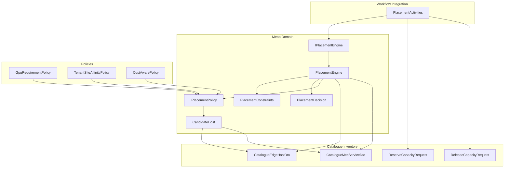
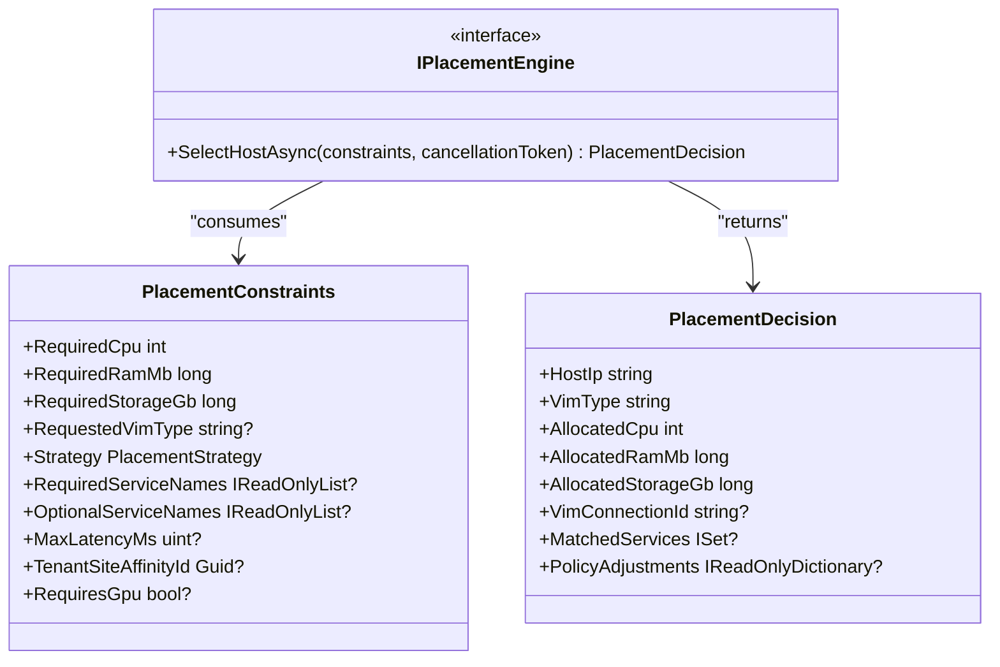
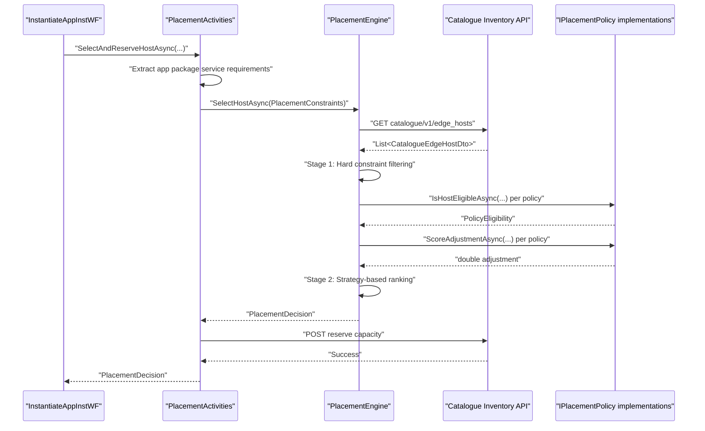
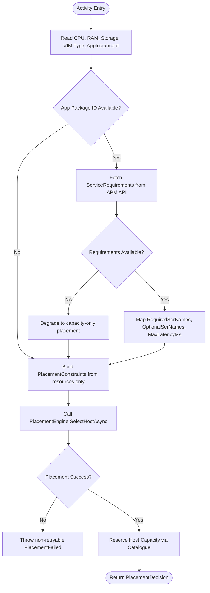
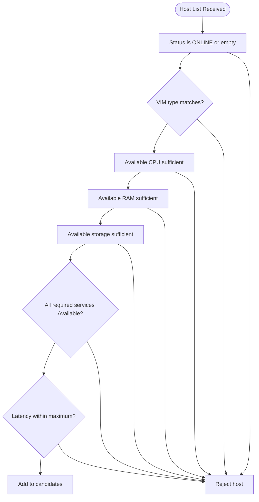
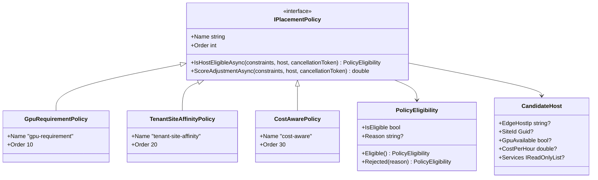
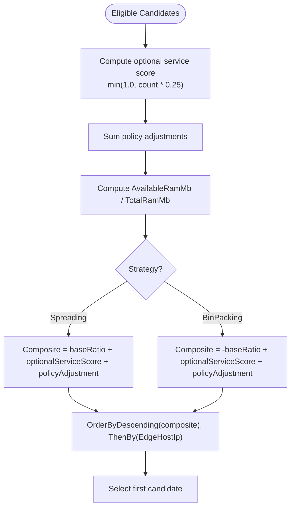
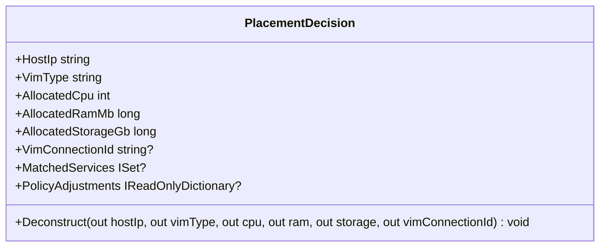
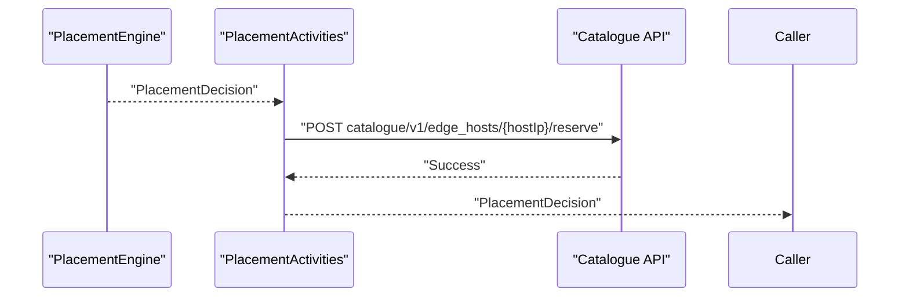
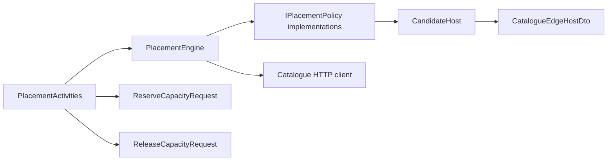

# Placement Engine

## Table of Contents
1. [Introduction](#introduction)
2. [Project Structure](#project-structure)
3. [Core Components](#core-components)
4. [Architecture Overview](#architecture-overview)
5. [Detailed Component Analysis](#detailed-component-analysis)
6. [Dependency Analysis](#dependency-analysis)
7. [Performance Considerations](#performance-considerations)
8. [Troubleshooting Guide](#troubleshooting-guide)
9. [Conclusion](#conclusion)

## Introduction
The dynamic placement engine is the component that selects an appropriate MEC edge host for an application instance by combining hard resource constraints, service and latency requirements, and soft policy scoring. It lives in the Meao service as a domain layer responsible for “where to place”, while the orchestration workflows decide “when” and the Catalogue inventory service supplies “what exists”.

At a high level:
- The engine consumes structured application descriptor information through activity inputs.
- It fetches live edge host capacity from the Catalogue inventory service.
- It filters hosts using hard constraints such as CPU, RAM, storage, VIM type, required services, latency ceiling, and GPU availability.
- It ranks remaining candidates using spreading or bin-packing strategies combined with optional service affinity and custom policies.
- It returns a placement decision describing the selected host, allocated resources, matched services, and policy adjustments.
- An activity then reserves capacity on the chosen host through the Catalogue API.

This design follows ADR 0045, which keeps placement logic inside Meao rather than creating another microservice, and aligns with ETSI GS MEC 003 §5.2.1 by giving the orchestrator visibility over hosts, available resources, MEC services, and topology.

## Project Structure
The placement subsystem is organized around a small set of cohesive domain types and pluggable policies:

**Diagram sources**
- `src/Meao/Domain/Placement/IPlacementEngine.cs#L1-L12`
- `src/Meao/Domain/Placement/PlacementEngine.cs#L1-L275`
- `src/Meao/Domain/Placement/IPlacementPolicy.cs#L1-L49`
- `src/Meao/Domain/Placement/PlacementConstraints.cs#L1-L23`
- `src/Meao/Domain/Placement/PlacementDecision.cs#L1-L60`
- `src/Meao/Activities/PlacementActivities.cs#L1-L205`
- `src/Common/Models/CapacityRequests.cs#L1-L23`

**Section sources**
- `docs/ADR/0045-meo-placement-engine-and-unified-catalogue-inventory-model.md#L1-L67`

## Core Components
The placement engine is built around five core concepts:

| Concept | Purpose | Key Behavior |
|---|---|---|
| `IPlacementEngine` | Public interface for host selection | Exposes one asynchronous selection method taking placement constraints |
| `PlacementEngine` | Concrete algorithm implementation | Fetches hosts, applies hard filters, evaluates policies, computes scores, and returns a decision |
| `PlacementConstraints` | Declarative request model | Encodes CPU, memory, storage, VIM type, strategy, service requirements, latency, site affinity, and GPU needs |
| `PlacementDecision` | Result model | Reports selected host IP, VIM type, allocated resources, matched services, and policy adjustments |
| `IPlacementPolicy` | Extensibility contract | Defines eligibility vetoing and score adjustment hooks |

### Interface Contract
`IPlacementEngine` defines a single entry point:

**Diagram sources**
- `src/Meao/Domain/Placement/IPlacementEngine.cs#L1-L12`
- `src/Meao/Domain/Placement/PlacementConstraints.cs#L1-L23`
- `src/Meao/Domain/Placement/PlacementDecision.cs#L1-L60`

**Section sources**
- `src/Meao/Domain/Placement/IPlacementEngine.cs#L1-L12`
- `src/Meao/Domain/Placement/PlacementConstraints.cs#L1-L23`
- `src/Meao/Domain/Placement/PlacementDecision.cs#L1-L60`

## Architecture Overview
The placement engine participates in the application instantiation lifecycle as an algorithmic domain service between workflow orchestration and catalogue inventory.

**Diagram sources**
- `src/Meao/Activities/PlacementActivities.cs#L1-L205`
- `src/Meao/Domain/Placement/PlacementEngine.cs#L1-L275`
- `src/Common/Models/CapacityRequests.cs#L1-L23`

ADR 0045 clarifies that placement is not a separate physical microservice; it is a logical responsibility inside Meao, backed by Catalogue’s unified inventory model. ADR 0038 further explains how host-level MEP services are synchronized into Catalogue so that the orchestrator has a system-wide census rather than only local discovery.

**Section sources**
- `docs/ADR/0045-meo-placement-engine-and-unified-catalogue-inventory-model.md#L1-L67`
- `docs/ADR/0038-mep-host-service-registry-and-meo-catalogue-sync.md#L1-L33`

## Detailed Component Analysis

### Constraint Extraction from Application Descriptors
Constraint extraction is not performed directly by `PlacementEngine`. Instead, `PlacementActivities` builds `PlacementConstraints` from activity parameters and optionally from application descriptor-derived service requirements.

The flow is:
1. Receive required CPU, RAM, storage, VIM type, and application instance identifier.
2. Optionally call the APM API to retrieve service requirements for an onboarded package.
3. Convert required and optional service names and maximum latency into placement constraints.
4. Call `PlacementEngine.SelectHostAsync`.
5. If placement succeeds, reserve capacity on the selected host.
6. If placement fails with an invalid operation exception, wrap it as a non-retryable Temporal failure.

**Diagram sources**
- `src/Meao/Activities/PlacementActivities.cs#L1-L205`

**Section sources**
- `src/Meao/Activities/PlacementActivities.cs#L1-L205`

### Hard Constraint Filtering
Stage 1 eliminates hosts that cannot satisfy mandatory requirements. The current implementation enforces:

| Constraint | Meaning | Failure Mode |
|---|---|---|
| Host status | Only ONLINE or missing status is accepted | Host excluded |
| VIM type | Optional exact match against the requested VIM | Host excluded if mismatched |
| CPU headroom | `AvailableCpuCores >= RequiredCpu` | Host excluded |
| Memory headroom | `AvailableRamMb >= RequiredRamMb` | Host excluded |
| Storage headroom | `AvailableStorageGb >= RequiredStorageGb` | Host excluded |
| Required services | All required service names must exist with status Available | Host excluded |
| Latency ceiling | Optional maximum latency must be supported by host latency data | Host excluded if latency exceeds limit or is unavailable |

If no candidate survives Stage 1, the engine throws an `InvalidOperationException` with details about the unmet constraints.

**Diagram sources**
- `src/Meao/Domain/Placement/PlacementEngine.cs#L1-L275`

**Section sources**
- `src/Meao/Domain/Placement/PlacementEngine.cs#L1-L275`

### Policy Eligibility Evaluation
After hard filtering, each candidate is evaluated by registered policies in ascending `Order`. A policy can:
- Veto eligibility by returning `PolicyEligibility.Rejected(reason)`.
- Allow the candidate by returning `PolicyEligibility.Eligible()`.

Built-in policies:

| Policy | Order | Role | Veto Behavior | Score Adjustment |
|---|---:|---|---|---|
| `GpuRequirementPolicy` | 10 | Enforce GPU requirement | Vetoes when `RequiresGpu == true` and host does not expose GPU availability | None |
| `TenantSiteAffinityPolicy` | 20 | Prefer tenant site affinity | Never vetoes; tenancy enforcement is deferred | Adds 1.0 when host `SiteId` matches `TenantSiteAffinityId` |
| `CostAwarePolicy` | 30 | Prefer lower cost per hour | Never vetoes | Returns `-costPerHour / 100.0` |

**Diagram sources**
- `src/Meao/Domain/Placement/IPlacementPolicy.cs#L1-L49`
- `src/Meao/Domain/Placement/Policies/GpuRequirementPolicy.cs#L1-L42`
- `src/Meao/Domain/Placement/Policies/TenantSiteAffinityPolicy.cs#L1-L44`
- `src/Meao/Domain/Placement/Policies/CostAwarePolicy.cs#L1-L41`

**Section sources**
- `src/Meao/Domain/Placement/IPlacementPolicy.cs#L1-L49`
- `src/Meao/Domain/Placement/Policies/GpuRequirementPolicy.cs#L1-L42`
- `src/Meao/Domain/Placement/Policies/TenantSiteAffinityPolicy.cs#L1-L44`
- `src/Meao/Domain/Placement/Policies/CostAwarePolicy.cs#L1-L41`

### Capacity Evaluation and Scoring Algorithm
The engine computes a composite score for eligible candidates using three contributions:

1. **Resource headroom base score**: `AvailableRamMb / TotalRamMb`.
2. **Optional service affinity score**: Up to 1.0, calculated as 0.25 per matching available optional service.
3. **Policy adjustments**: Sum of all policy score adjustments.

The final ranking depends on the configured strategy:

| Strategy | Base Score Interpretation | Effect |
|---|---|---|
| `Spreading` | Higher base ratio means more free capacity | Prefers hosts with more remaining headroom |
| `BinPacking` | Inverted base ratio | Prefers hosts closer to saturation, packing workloads together |

**Diagram sources**
- `src/Meao/Domain/Placement/PlacementEngine.cs#L1-L275`

**Section sources**
- `src/Meao/Domain/Placement/PlacementEngine.cs#L1-L275`

### Placement Decision Model
`PlacementDecision` is the stable output of the engine. It includes:

- Selected host IP address.
- VIM type.
- Allocated CPU, RAM, and storage values taken from the original constraints.
- Optional future VIM connection identifier.
- Set of matched required or optional services found on the selected host.
- Non-zero policy adjustments for observability.

It also provides backward-compatible constructors and deconstruction for legacy callers.

**Diagram sources**
- `src/Meao/Domain/Placement/PlacementDecision.cs#L1-L60`

**Section sources**
- `src/Meao/Domain/Placement/PlacementDecision.cs#L1-L60`

### Custom Policy Implementation Patterns
To implement a custom placement policy:

1. Create a class implementing `IPlacementPolicy`.
2. Provide a stable `Name` for logging and diagnostics.
3. Assign an integer `Order` controlling evaluation order after Stage 1 filtering.
4. Implement `IsHostEligibleAsync` to veto unsuitable hosts.
5. Implement `ScoreAdjustmentAsync` to influence ranking without necessarily excluding hosts.
6. Register the policy with the dependency injection container so the engine receives it through `IEnumerable<IPlacementPolicy>`.

Recommended patterns:
- Use eligibility vetoes for hard business rules (for example, GPU or compliance requirements).
- Use score adjustments for soft preferences (for example., cost, locality, affinity).
- Avoid throwing exceptions inside policies; return explicit `PolicyEligibility.Rejected(reason)` instead.
- Keep policies deterministic and idempotent.
- Log rejection reasons and positive matches to support auditability.

**Section sources**
- `src/Meao/Domain/Placement/IPlacementPolicy.cs#L1-L49`

### Capacity Reservation and Catalogue Integration
After selecting a host, `PlacementActivities` calls `ReserveHostCapacityAsync`, which posts a `ReserveCapacityRequest` to the Catalogue API. On successful allocation, the decision is returned to the caller. There is also a corresponding `ReleaseHostCapacityAsync` method that posts a `ReleaseCapacityRequest`.

**Diagram sources**
- `src/Meao/Activities/PlacementActivities.cs#L1-L205`
- `src/Common/Models/CapacityRequests.cs#L1-L23`

**Section sources**
- `src/Meao/Activities/PlacementActivities.cs#L1-L205`
- `src/Common/Models/CapacityRequests.cs#L1-L23`

### Relationship with VIM Adapters
The placement engine itself does not allocate resources on a VIM. Its role ends at producing a placement decision and reserving capacity in Catalogue. Actual resource allocation on the target VIM is handled later in the orchestration pipeline by VIM adapters, which translate platform-specific operations such as Kubernetes deployments or OpenStack instances.

The separation is important:
- Placement decides the best host based on inventory and constraints.
- Catalogue tracks global capacity and prevents double booking.
- VIM adapters perform the concrete allocation on the selected host.
- The workflow coordinates these phases and reports lifecycle state.

ADR 0045 positions Catalogue as the authoritative inventory source, while the placement algorithm remains proprietary and configurable inside Meao.

**Section sources**
- `docs/ADR/0045-meo-placement-engine-and-unified-catalogue-inventory-model.md#L1-L67`

## Dependency Analysis

**Diagram sources**
- `src/Meao/Activities/PlacementActivities.cs#L1-L205`
- `src/Meao/Domain/Placement/PlacementEngine.cs#L1-L275`
- `src/Meao/Domain/Placement/IPlacementPolicy.cs#L1-L49`
- `src/Common/Models/CapacityRequests.cs#L1-L23`

### Coupling and Cohesion
- `PlacementEngine` depends on HTTP transport for Catalogue and on policy abstractions for extensibility.
- Policies depend only on `PlacementConstraints` and `CandidateHost`, keeping them testable and reusable.
- `PlacementActivities` bridges Temporal workflow activities to both the domain engine and Catalogue API.
- DTOs for Catalogue responses are declared locally in the engine file and used through `CandidateHost`, reducing direct JSON property access in policies.

### External Dependencies
- Catalogue inventory API: `/catalogue/v1/edge_hosts` for listing hosts.
- Catalogue reservation endpoints: `/catalogue/v1/edge_hosts/{hostIp}/reserve` and `/release`.
- APM API: `/app_pkgm/v1/onboarded_app_packages/{appPkgId}/service_requirements` for extracting service requirements.

**Section sources**
- `src/Meao/Domain/Placement/PlacementEngine.cs#L1-L275`
- `src/Meao/Activities/PlacementActivities.cs#L1-L205`

## Performance Considerations
The placement algorithm has the following complexity characteristics:

| Operation | Complexity | Notes |
|---|---:|---|
| Hard constraint filtering | O(H × F) | H is number of hosts; F is number of filter conditions |
| Policy eligibility evaluation | O(H × P) | P is number of registered policies |
| Policy scoring | O(H × P) | Each policy contributes one score adjustment |
| Ranking | O(C log C) | C is number of eligible candidates |
| Service matching | O(S) per candidate | S is number of services on a host |

Optimization opportunities include:
- Sorting or indexing host lists when large numbers of hosts are present.
- Short-circuiting expensive policy evaluations after a cheap eligibility check.
- Reusing constructed `CandidateHost` wrappers during scoring.
- Avoiding repeated string comparisons by normalizing names.
- Logging only non-zero policy adjustments to reduce payload size in decisions.
- Using cancellation tokens consistently to avoid hanging HTTP requests under load.

Current implementation already sorts policies once by `Order`, uses cancellation tokens, and limits optional service affinity scoring to a capped value.

**Section sources**
- `src/Meao/Domain/Placement/PlacementEngine.cs#L1-L275`

## Troubleshooting Guide

### No Edge Hosts Registered
**Symptom:** Selection fails immediately after fetching hosts.  
**Cause:** Catalogue returned an empty list.  
**Action:** Verify that edge hosts have been discovered and synchronized into Catalogue.

**Section sources**
- `src/Meao/Domain/Placement/PlacementEngine.cs#L1-L275`

### No Host Satisfies Hard Constraints
**Symptom:** Error mentions CPU, RAM, storage, VIM type, services, or latency.  
**Cause:** One or more mandatory requirements cannot be met by any ONLINE host.  
**Actions:**
- Reduce required CPU, RAM, or storage.
- Relax VIM type requirements if applicable.
- Remove or adjust required service names.
- Increase latency tolerance or ensure latency metadata is populated.

**Section sources**
- `src/Meao/Domain/Placement/PlacementEngine.cs#L1-L275`

### No Host Satisfies Policies
**Symptom:** Error lists policy rejection reasons.  
**Cause:** One or more policies vetoed every candidate.  
**Actions:**
- Check whether GPU is required but unavailable.
- Review tenant site affinity expectations.
- Inspect policy configuration and ordering.
- Add hosts that satisfy policy criteria.

**Section sources**
- `src/Meao/Domain/Placement/Policies/GpuRequirementPolicy.cs#L1-L42`
- `src/Meao/Domain/Placement/Policies/TenantSiteAffinityPolicy.cs#L1-L44`
- `src/Meao/Domain/Placement/Policies/CostAwarePolicy.cs#L1-L41`

### Capacity Reservation Fails After Placement
**Symptom:** Placement succeeds but reservation fails.  
**Cause:** Catalogue rejected the reserve request, possibly due to validation or concurrent allocation changes.  
**Actions:**
- Inspect reserved CPU, RAM, and storage values.
- Confirm the selected host IP is valid.
- Retry only if the failure is transient; otherwise treat as placement failure because the current activity wraps placement errors as non-retryable.

**Section sources**
- `src/Meao/Activities/PlacementActivities.cs#L1-L205`

## Conclusion
The dynamic placement engine provides a constrained, policy-driven host selection mechanism that integrates cleanly with Catalogue inventory and workflow orchestration. It separates hard feasibility checks from soft optimization, allowing operators to configure spreading versus bin-packing behavior, add new policies, and retain observability into why a particular host was selected.

For production use:
- Treat Catalogue inventory as the source of truth for real-time capacity.
- Use hard constraints for non-negotiable requirements.
- Use policies for extendable business and operational rules.
- Choose spreading for workload distribution or bin-packing for resource consolidation.
- Validate that service requirements and latency constraints reflect actual application descriptors.
- Confirm that capacity reservation and release paths remain consistent with the lifecycle managed by the workflow and VIM adapters.

[No sources needed since this section summarizes without analyzing specific files]

> **Referenced Files in This Document**
>
> - `src/Meao/Domain/Placement/IPlacementEngine.cs`
> - `src/Meao/Domain/Placement/PlacementEngine.cs`
> - `src/Meao/Domain/Placement/IPlacementPolicy.cs`
> - `src/Meao/Domain/Placement/PlacementConstraints.cs`
> - `src/Meao/Domain/Placement/PlacementDecision.cs`
> - `src/Meao/Domain/Placement/Policies/CostAwarePolicy.cs`
> - `src/Meao/Domain/Placement/Policies/GpuRequirementPolicy.cs`
> - `src/Meao/Domain/Placement/Policies/TenantSiteAffinityPolicy.cs`
> - `src/Meao/Activities/PlacementActivities.cs`
> - `src/Common/Models/CapacityRequests.cs`
> - `docs/ADR/0045-meo-placement-engine-and-unified-catalogue-inventory-model.md`
> - `docs/ADR/0038-mep-host-service-registry-and-meo-catalogue-sync.md`
