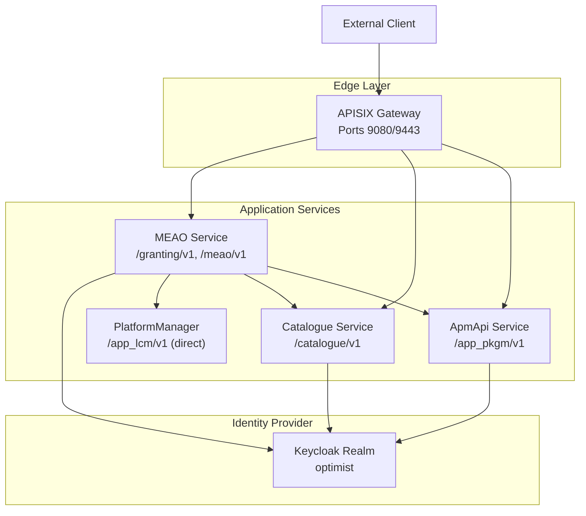
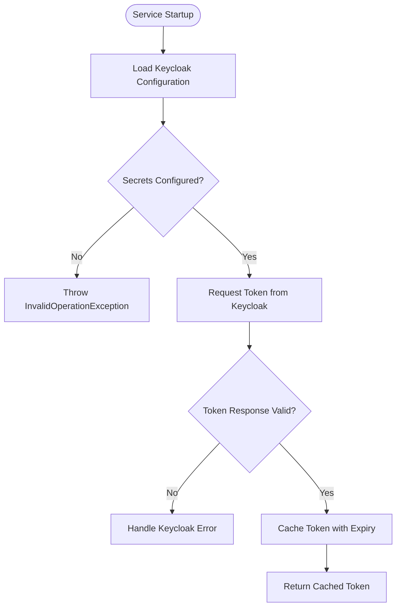
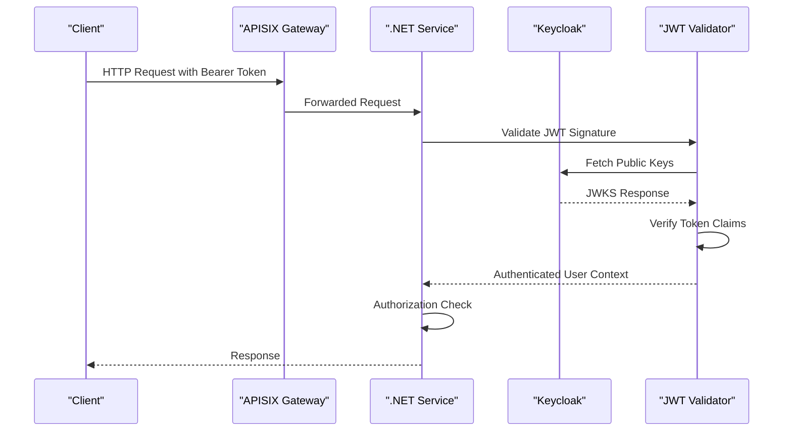
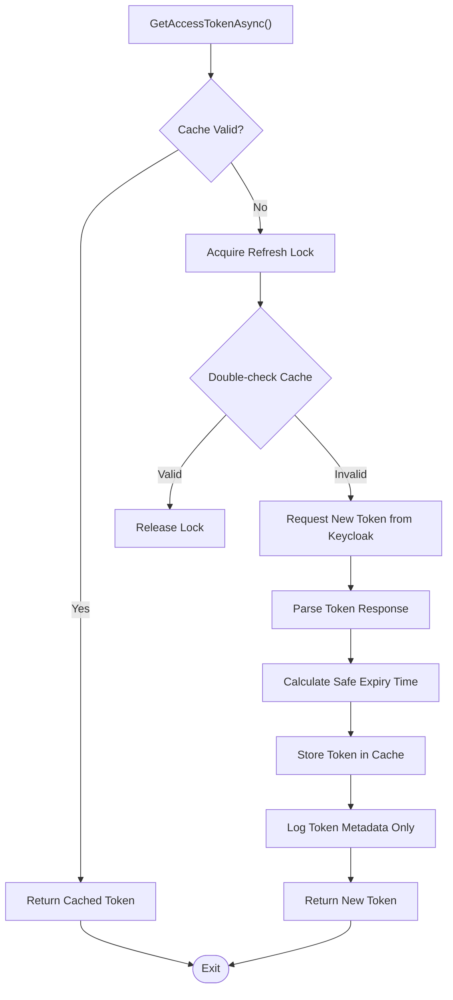
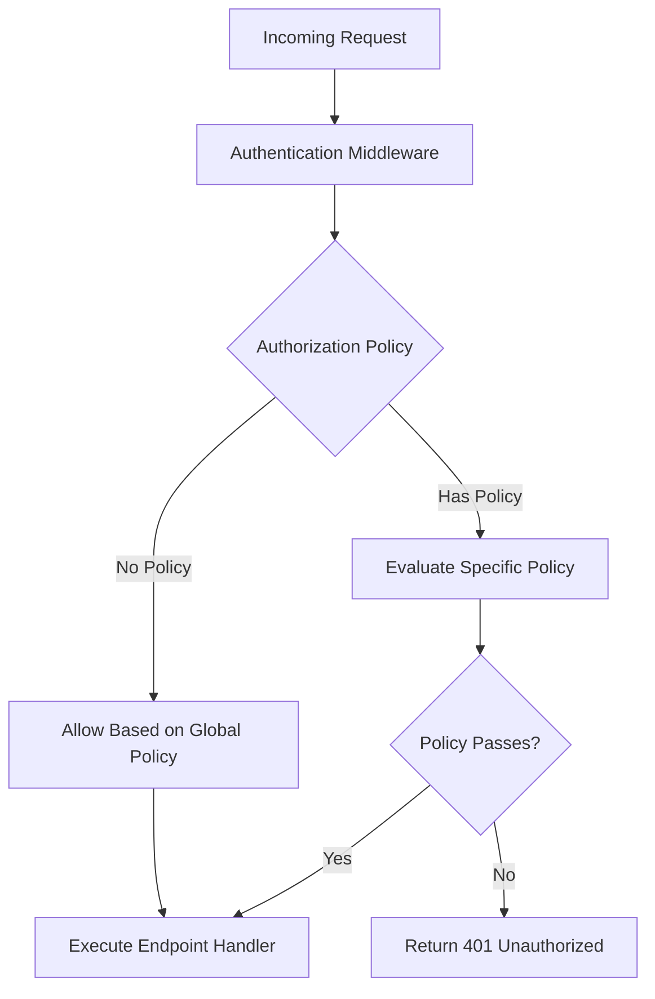
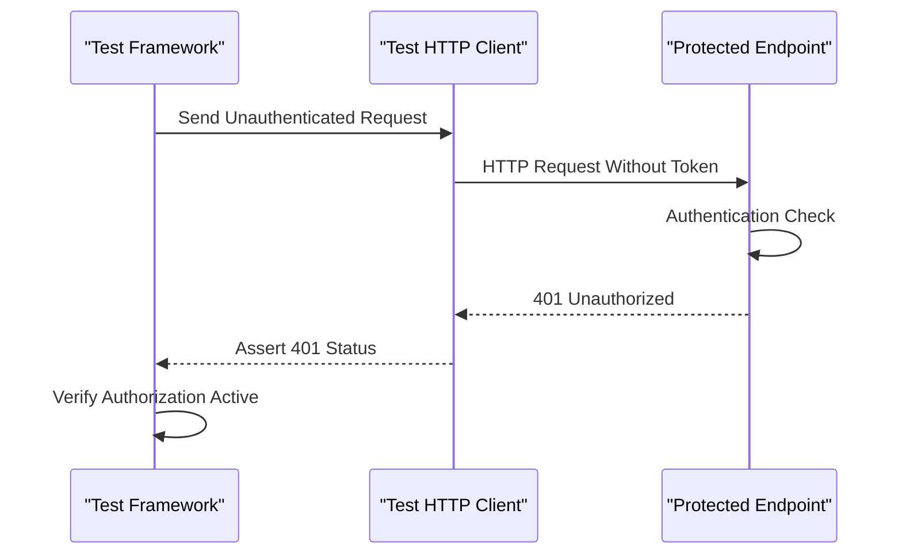
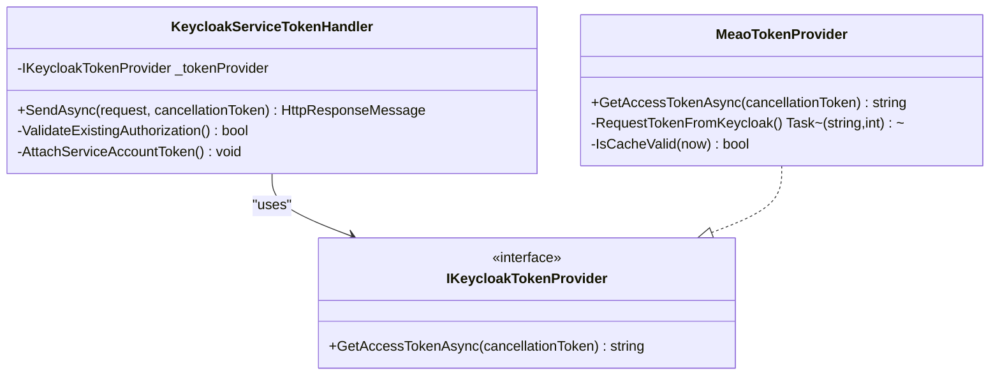
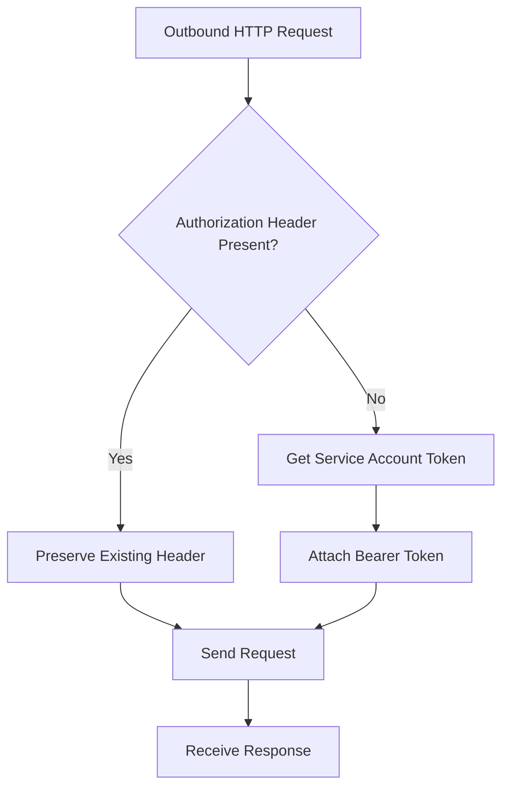
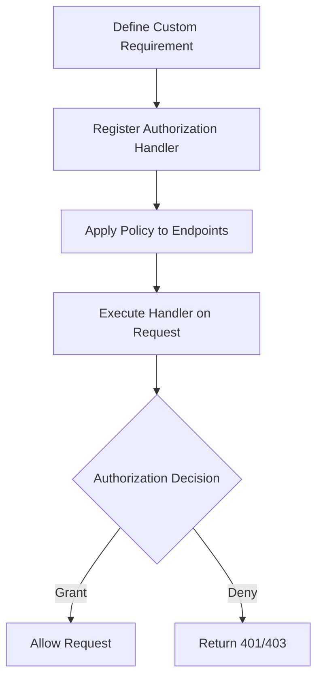

# Security & Authentication

## Table of Contents
1. [Introduction](#introduction)
2. [Security Architecture Overview](#security-architecture-overview)
3. [Keycloak Integration](#keycloak-integration)
4. [Authentication Flows](#authentication-flows)
5. [JWT Token Handling](#jwt-token-handling)
6. [Role-Based Access Control](#role-based-access-control)
7. [Protected Endpoints](#protected-endpoints)
8. [Service-to-Service Authentication](#service-to-service-authentication)
9. [Authorization Policies](#authorization-policies)
10. [Security Configuration](#security-configuration)
11. [Troubleshooting Guide](#troubleshooting-guide)
12. [Security Best Practices](#security-best-practices)
13. [Audit Logging and Monitoring](#audit-logging-and-monitoring)
14. [Conclusion](#conclusion)

## Introduction

This document describes the security model, authentication mechanisms, and authorization policies used throughout the Optimist MEC Orchestration Platform. It covers how external clients authenticate through the APISIX edge gateway, how services validate JWT tokens from Keycloak, and how role-based access control is enforced across the system.

The platform uses Apache APISIX as a single external entry point for ETSI-aligned APIs, Keycloak as the identity provider for OAuth2/OIDC flows, and ASP.NET Core services that validate JWT bearer tokens. Service-to-service communication uses process-local service accounts with client credentials flow tokens attached automatically to outbound HTTP requests.

## Security Architecture Overview

**Diagram sources**
- `docs/ADR/0007-apisix-api-gateway.md#L1-L41`
- `docker/apisix_conf/apisix-routes.yaml#L1-L32`

The architecture follows these principles:

- **Single external boundary**: All external traffic enters through APISIX on port 9080 (HTTP) or 9443 (HTTPS).
- **Per-service authentication**: Each .NET service independently validates JWT tokens using Keycloak's public keys.
- **Service account tokens**: Internal service calls use short-lived client credentials tokens attached via HTTP message handlers.
- **Default deny authorization**: Catalogue and PlatformManager require authentication by default through fallback policies.
- **Gateway policy centering**: Cross-cutting concerns like TLS termination are handled at the gateway layer.

**Section sources**
- `docs/ADR/0007-apisix-api-gateway.md#L1-L41`

## Keycloak Integration

### Realm Configuration

The Keycloak realm `optimist` defines four roles and three service clients:

| Role | Description | Scope |
|------|-------------|-------|
| `admin` | Full access to all Optimist APIs and admin functions | Administrative operations |
| `mec-operator` | Operator role for MEC app and instance management | Operational management |
| `mec-developer` | Developer role for MEC app development and testing | Development and testing |
| `service-account` | Service-to-service internal communication role | Internal service calls |

| Client ID | Service | Purpose | Authentication Type |
|-----------|---------|---------|-------------------|
| `meao` | MEAO Orchestrator | ETSI Granting API producer | Client secret + service accounts |
| `apm-api` | App Package Management | Package management module | Client secret + service accounts |
| `catalogue` | System Registry | Internal MEO backing store | Client secret + service accounts |

Each client maps the `roles` scope to the `client_roles` claim in access tokens, enabling role-based authorization decisions within services.

### Client Configuration Details

All clients are configured as confidential clients with:
- Standard OpenID Connect flow enabled
- Direct access grants enabled
- Service accounts enabled
- Web origins set to allow all origins (`*`)
- Default client scopes including web-origin, roles, profile, and email

**Diagram sources**
- `src/Meao/Services/KeycloakTokenProvider.cs#L1-L169`

**Section sources**
- `gitops/apps/keycloak-realm/optimist-realm.json#L1-L200`

## Authentication Flows

### External Client Authentication via APISIX

External clients authenticate through the APISIX gateway, which routes requests to appropriate backend services based on URI patterns:

| Route Pattern | Backend Service | Port | API Surface |
|---------------|----------------|------|-------------|
| `/granting/v1/*` | MEAO | 5154 | ETSI Granting API |
| `/catalogue/v1/*` | Catalogue | 5165 | Internal MEO backing store |
| `/app_pkgm/v1/*` | ApmApi | 5184 | ETSI App Package Management |
| `/meao/v1/*` | MEAO | 5154 | MEO internal management API |

The MEPM `/app_lcm/v1` API is consumed directly by Meao rather than routed through APISIX, as it belongs to the management plane.

### JWT Validation Pipeline

Each .NET service registers Keycloak authentication middleware during startup:

**Diagram sources**
- `src/Meao/Program.cs#L1-L200`
- `src/ApmApi/Program.cs#L1-L200`
- `src/Catalogue/Program.cs#L1-L135`

**Section sources**
- `docs/ADR/0007-apisix-api-gateway.md#L1-L41`

## JWT Token Handling

### Token Acquisition and Caching

Each service implements a process-local token provider that:
- Uses client credentials flow to obtain access tokens from Keycloak
- Caches tokens with expiry awareness to minimize network calls
- Implements single-flight locking to prevent concurrent refresh storms
- Applies safety margins to refresh tokens before actual expiration

**Diagram sources**
- `src/Meao/Services/KeycloakTokenProvider.cs#L1-L169`

### Token Configuration Sources

Token providers resolve configuration through multiple layers with explicit precedence:

1. Environment variables (`KEYCLOAK_*`)
2. Application configuration section (`Keycloak.*`)
3. Hardcoded defaults

Configuration keys include:
- `KEYCLOAK_URL` - Keycloak server URL
- `KEYCLOAK_REALM` - Realm name (default: `optimist`)
- `KEYCLOAK_CLIENT_ID_*` - Client identifiers per service
- `KEYCLOAK_CLIENT_SECRET_*` - Client secrets per service
- `KEYCLOAK_SCOPES` - OAuth2 scopes (default: `roles`)

### Security Considerations

- Tokens are never logged or persisted outside memory
- Configuration values containing `${}` placeholders indicate secret injection requirements
- Token acquisition errors throw explicit exceptions without exposing sensitive data
- The `verify-token-audience` setting is disabled in current configurations

**Section sources**
- `src/Meao/Services/KeycloakTokenProvider.cs#L1-L169`
- `src/ApmApi/Services/KeycloakTokenProvider.cs#L1-L153`
- `src/PlatformManager/PlatformManager/Services/KeycloakTokenProvider.cs#L1-L153`

## Role-Based Access Control

### Authorization Model

The system uses ASP.NET Core authorization policies with role-based access control. Roles are mapped from Keycloak's `client_roles` claim and can be checked using standard authorization attributes and policies.

### Current Authorization Patterns

Services implement different authorization strategies:

| Service | Authorization Strategy | Implementation |
|---------|----------------------|----------------|
| Catalogue | Default deny with fallback policy | Requires authenticated user on all endpoints |
| PlatformManager | Default deny with fallback policy | Requires authenticated user on all endpoints |
| MEAO | Per-endpoint authorization | Explicit `[Authorize]` attributes where needed |
| ApmApi | Mixed approach | Combination of endpoint-specific and global policies |

### Endpoint-Level Authorization

Protected endpoints explicitly declare authorization requirements:

**Diagram sources**
- `src/Catalogue/Endpoints/TopologyEndpoints.cs#L1-L250`
- `src/Catalogue/Endpoints/AppPackageEndpoints.cs#L1-L50`

**Section sources**
- `src/Catalogue/Endpoints/TopologyEndpoints.cs#L1-L250`
- `src/Catalogue/Endpoints/AppPackageEndpoints.cs#L1-L50`

## Protected Endpoints

### Catalogue Service Endpoints

The Catalogue service requires authentication on all endpoints through its fallback policy:

| Endpoint Category | Methods | Authorization | Description |
|------------------|---------|---------------|-------------|
| Topology endpoints | GET, POST, PUT, DELETE | RequireAuthorization | Host and topology management |
| App package endpoints | GET, POST, DELETE | RequireAuthorization | Package inventory management |
| Health checks | GET | AllowAnonymous | Service health monitoring |

### MEAO Service Endpoints

MEAO endpoints are protected individually:

| Endpoint Category | Methods | Authorization Level | Description |
|------------------|---------|-------------------|-------------|
| Subscription endpoints | Various | RequireAuthorization | Subscription lifecycle management |
| Grant endpoints | Various | RequireAuthorization | ETSI grant operations |
| App instance endpoints | Various | RequireAuthorization | Application instance management |

### Test Coverage

Unit tests verify that protected endpoints return 401 responses when unauthenticated:

**Diagram sources**
- `src/Meao.Tests.Unit/SubscriptionEndpointsRoutingAndAuthTests.cs#L1-L200`

**Section sources**
- `src/Catalogue/Program.cs#L1-L135`
- `src/Meao.Tests.Unit/SubscriptionEndpointsRoutingAndAuthTests.cs#L1-L200`

## Service-to-Service Authentication

### Service Account Pattern

Internal service communication uses dedicated service accounts with client credentials flow. Each service has its own Keycloak client and secret, ensuring isolated authentication boundaries.

### HTTP Message Handlers

Both MEAO and PlatformManager implement custom `DelegatingHandler` classes that automatically attach service account tokens to outbound requests:

**Diagram sources**
- `src/Meao/Infrastructure/KeycloakServiceTokenHandler.cs#L1-L34`
- `src/PlatformManager/PlatformManager/Infrastructure/KeycloakServiceTokenHandler.cs#L1-L39`

### Token Attachment Flow

The token attachment process ensures:
- Existing Authorization headers are preserved (for request forwarding scenarios)
- Tokens are only attached when no Authorization header exists
- Token acquisition happens at HTTP execution time, not during activity construction
- Failed token acquisition results in request failure rather than unauthorized calls

**Diagram sources**
- `src/Meao/Infrastructure/KeycloakServiceTokenHandler.cs#L1-L34`

### Named HttpClient Registration

Services register named HttpClients with specific purposes:

| Client Name | Target | Purpose | Handler Chain |
|-------------|--------|---------|---------------|
| `KeycloakToken` | Keycloak | Token acquisition | Resilience handler only |
| `ApmApiInternal` | ApmApi | Internal MEAO → ApmApi calls | Auth handler + Discovery + Resilience |
| `CatalogueAPI` | Catalogue | MEAO → Catalogue calls | Auth handler + Discovery + Resilience |
| `MepmAPI` | PlatformManager | MEAO → MEPM calls | Auth handler + Resilience |

**Section sources**
- `src/Meao/Infrastructure/KeycloakServiceTokenHandler.cs#L1-L34`
- `src/PlatformManager/PlatformManager/Infrastructure/KeycloakServiceTokenHandler.cs#L1-L39`
- `src/Meao/Program.cs#L1-L200`

## Authorization Policies

### Fallback Policy Configuration

Services configure default authorization behavior through fallback policies:

#### Catalogue Service
- **Strategy**: Default deny all endpoints
- **Implementation**: `RequireAuthenticatedUser()` fallback policy
- **Effect**: All endpoints require authentication unless explicitly marked anonymous

#### PlatformManager Service  
- **Strategy**: Default deny all endpoints
- **Implementation**: `RequireAuthenticatedUser()` fallback policy
- **Exception**: Some distribution endpoints remain open for MEAO orchestration

### Custom Authorization Requirements

While the codebase primarily uses role-based checks through claims, the infrastructure supports custom authorization requirements:

**Diagram sources**
- `src/Catalogue/Program.cs#L1-L135`
- `src/PlatformManager/PlatformManager/Program.cs#L1-L200`

### Role-Based Decisions

Authorization decisions are made based on Keycloak-provided roles in the JWT:

| Role | Typical Permissions | Use Case |
|------|-------------------|----------|
| `admin` | Full system access | System administration |
| `mec-operator` | Operational management | Platform operations |
| `mec-developer` | Development access | Testing and development |
| `service-account` | Internal service calls | Automated processes |

**Section sources**
- `src/Catalogue/Program.cs#L1-L135`
- `src/PlatformManager/PlatformManager/Program.cs#L1-L200`

## Security Configuration

### Application Settings Structure

Each service includes Keycloak configuration in its `appsettings.json`:

| Setting | Description | Example Value |
|---------|-------------|---------------|
| `realm` | Keycloak realm name | `optimist` |
| `auth-server-url` | Keycloak base URL | `http://localhost:8180/` |
| `ssl-required` | SSL requirement flag | `none` |
| `resource` | Client identifier | Service-specific |
| `verify-token-audience` | Audience validation toggle | `false` |
| `credentials.secret` | Client secret (injected) | `${KEYCLOAK_CLIENT_SECRET_*}` |

### Environment-Specific Configuration

Production deployments should override:
- `auth-server-url` with production Keycloak URL
- `ssl-required` to enforce HTTPS connections
- `verify-token-audience` to enable audience validation
- Secrets through environment variables or secret management systems

### APISIX Security Configuration

The APISIX gateway configuration includes:

| Setting | Value | Security Implication |
|---------|-------|---------------------|
| `node_listen` | 9080 | HTTP listener port |
| `enable_control` | true | Admin API enabled |
| `admin.allow_admin` | 0.0.0.0/0 | Admin access from any IP (test mode) |
| `etcd.host` | etcd service | Configuration storage |

**Section sources**
- `src/Meao/appsettings.json#L1-L37`
- `src/ApmApi/appsettings.json#L1-L42`
- `src/Catalogue/appsettings.json#L1-L46`
- `src/PlatformManager/PlatformManager/appsettings.json#L1-L37`
- `docker/apisix_conf/config.yaml#L1-L66`

## Troubleshooting Guide

### Common Authentication Issues

#### 401 Unauthorized Responses

**Symptoms**: Requests receive 401 status codes despite valid credentials.

**Possible Causes**:
- Missing or invalid JWT token in Authorization header
- Expired token not refreshed properly
- Incorrect Keycloak client configuration
- Missing required roles in token claims

**Resolution Steps**:
1. Verify JWT token validity and expiration
2. Check Keycloak client configuration matches service settings
3. Confirm required roles are assigned to the user/service account
4. Validate token signature against Keycloak public keys

#### Service-to-Service Communication Failures

**Symptoms**: Internal service calls fail with authentication errors.

**Possible Causes**:
- Service account secrets not configured
- Keycloak token acquisition failures
- Network connectivity issues between services
- Incorrect service discovery configuration

**Resolution Steps**:
1. Verify service account secrets are properly injected
2. Check Keycloak token provider logs for acquisition errors
3. Validate service discovery and DNS resolution
4. Confirm firewall rules allow inter-service communication

#### Token Expiration Issues

**Symptoms**: Intermittent authentication failures during long-running operations.

**Possible Causes**:
- Token cache expiry timing issues
- Concurrent token refresh conflicts
- Network latency affecting token acquisition

**Resolution Steps**:
1. Monitor token cache hit rates and refresh frequency
2. Check for concurrent refresh storm indicators
3. Validate token lifetime calculations
4. Review network connectivity to Keycloak

### Debugging Tools

#### Log Analysis

Key logging points include:
- Token acquisition attempts and success/failure
- Authorization policy evaluations
- HTTP request/response correlation IDs
- Service discovery resolution events

#### Health Checks

Each service exposes health endpoints:
- `/health` - Basic service health
- `/health/live` - Liveness probe
- `/health/ready` - Readiness probe with dependency checks

**Section sources**
- `src/Meao.Tests.Unit/SubscriptionEndpointsRoutingAndAuthTests.cs#L1-L200`

## Security Best Practices

### Secret Management

**Current State**: Secrets are injected through environment variables and application configuration with placeholder support.

**Recommendations**:
1. Use Kubernetes secrets or Azure Key Vault for secret management
2. Implement automatic secret rotation
3. Avoid storing secrets in source control or configuration files
4. Use separate secrets for development, staging, and production environments

### Token Rotation

**Current Implementation**: Tokens are cached with expiry awareness and refreshed proactively.

**Enhancements**:
1. Implement automatic token rotation policies
2. Add token revocation handling
3. Monitor token usage patterns for anomaly detection
4. Implement token binding to additional context (IP, user agent)

### Audit Logging

**Current State**: Basic logging of authentication events without detailed audit trails.

**Required Enhancements**:
1. Implement structured audit logging for all authentication events
2. Track authorization decision details
3. Log failed authentication attempts with contextual information
4. Export audit logs to centralized logging system

### Network Security

**Current State**: Internal service communication uses plain HTTP within container networks.

**Recommended Improvements**:
1. Enable mutual TLS (mTLS) for service-to-service communication
2. Implement network policies to restrict service access
3. Add rate limiting at the gateway level
4. Configure request size limits and input validation

### Access Control Enhancement

**Current State**: Basic role-based access control with limited granularity.

**Future Enhancements**:
1. Implement attribute-based access control (ABAC)
2. Add fine-grained resource-level permissions
3. Implement dynamic policy evaluation
4. Add authorization caching for performance

## Audit Logging and Monitoring

### Authentication Event Logging

Services log key authentication events:
- Token acquisition attempts and outcomes
- Authorization policy evaluations
- Failed authentication attempts
- Service account token refresh cycles

### Metrics Collection

OpenTelemetry instrumentation provides:
- Request duration metrics
- Authentication success/failure rates
- Service discovery resolution times
- Database query performance

### Security Monitoring Recommendations

1. **Real-time Alerting**: Set up alerts for authentication failures and suspicious patterns
2. **Audit Trail Collection**: Centralize security-related logs for compliance reporting
3. **Performance Monitoring**: Track authentication overhead and token refresh frequency
4. **Compliance Reporting**: Generate reports for security policy adherence

**Section sources**
- `src/Meao/Services/KeycloakTokenProvider.cs#L1-L169`

## Conclusion

The Optimist MEC Orchestration Platform implements a comprehensive security model built around Keycloak integration, JWT token validation, and role-based access control. The architecture provides clear separation between external client authentication through APISIX and internal service-to-service authentication using service accounts.

Key strengths include:
- Centralized identity management through Keycloak
- Process-local token caching with automatic refresh
- Default-deny authorization policies where appropriate
- Clear separation of concerns between authentication and authorization

Areas for improvement include enhanced audit logging, mTLS for service communication, and more granular access control policies. The current implementation provides a solid foundation that can be extended with additional security controls as requirements evolve.

> **Referenced Files in This Document**
>
> - `docs/ADR/0007-apisix-api-gateway.md`
> - `docker/apisix_conf/config.yaml`
> - `docker/apisix_conf/apisix-routes.yaml`
> - `gitops/apps/keycloak-realm/optimist-realm.json`
> - `src/Meao/appsettings.json`
> - `src/ApmApi/appsettings.json`
> - `src/Catalogue/appsettings.json`
> - `src/PlatformManager/PlatformManager/appsettings.json`
> - `src/Meao/Program.cs`
> - `src/ApmApi/Program.cs`
> - `src/Catalogue/Program.cs`
> - `src/PlatformManager/PlatformManager/Program.cs`
> - `src/Meao/Infrastructure/KeycloakServiceTokenHandler.cs`
> - `src/PlatformManager/PlatformManager/Infrastructure/KeycloakServiceTokenHandler.cs`
> - `src/Meao/Services/KeycloakTokenProvider.cs`
> - `src/ApmApi/Services/KeycloakTokenProvider.cs`
> - `src/PlatformManager/PlatformManager/Services/KeycloakTokenProvider.cs`
> - `src/Catalogue/Endpoints/TopologyEndpoints.cs`
> - `src/Catalogue/Endpoints/AppPackageEndpoints.cs`
> - `src/Meao.Tests.Unit/SubscriptionEndpointsRoutingAndAuthTests.cs`
